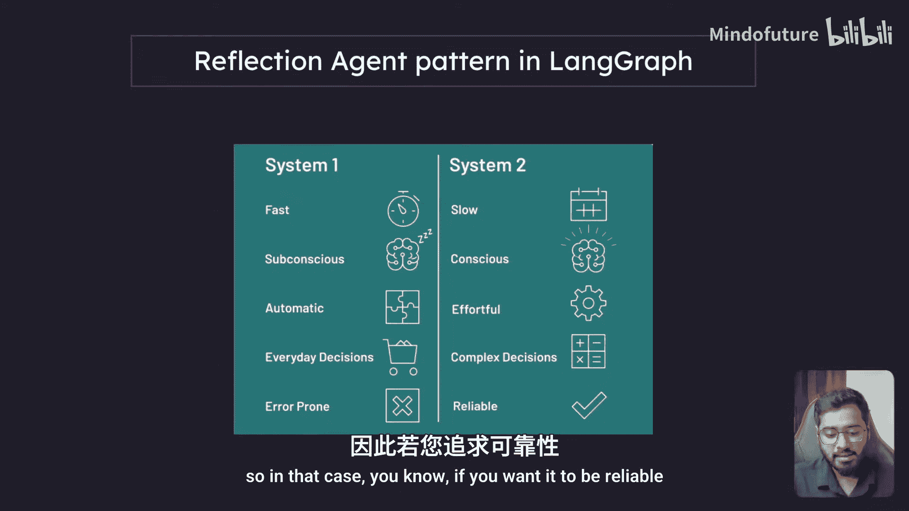
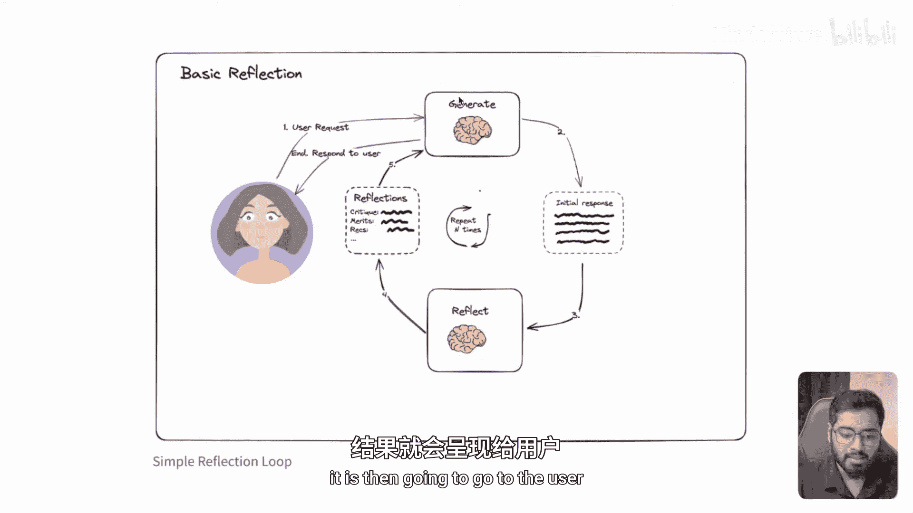
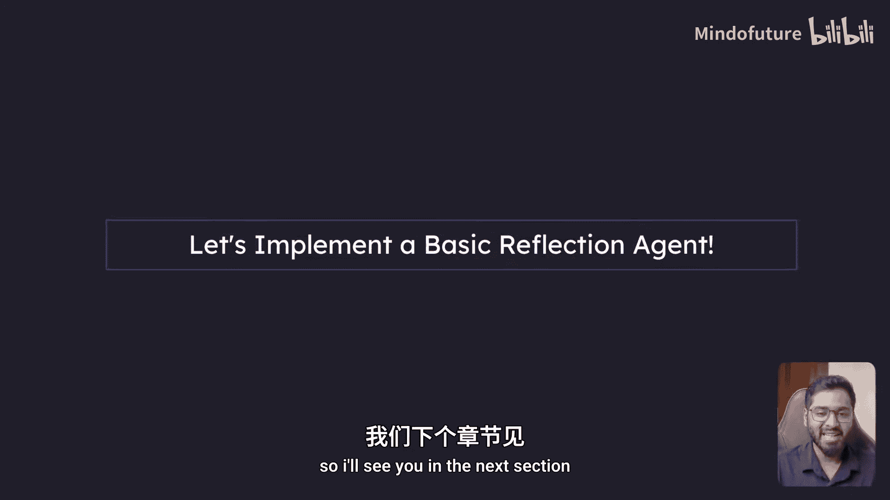

# Langgraph初学者入门2025 p06 P06_#6_反思代理介绍 -BV1mgepzCEjf_p6-

Hello guys welcomee to this section where we are going to be deep diving into reflection agents in Land graph。

 This is particularly important because this is sort of like the entry point for you to start learning land graph and you know how powerful you know certain agents can be okay so in the section we are going to be starting to look at you know what a reflection agent system you know what are the three types of reflection agent systems well do the set an installations and finally we will implement a reflection agent system using our code。

 So by the end of this particular section the reflection agent it could go on for a few more sections as well but by the end of it you should have a pretty good idea。

 you know how powerful this can be and where you can actually sort of。😊，Apply this type of an agent。

 this reflection agent in your you know workflow。So before we jump into you know all the ni of you know implementing it using code etctera。

 etc cea。 Before that， let's actually just understand the very English word called reflection So just like how you' are looking at your reflection in the mirror reflection means looking at yourself or your actions right so that's what self-reflection is right So for example。

 after giving a presentation you are thinking about how it went after writing an email youre reading it again just so it's clear right and also you know after making a decision considering if it was the right choice right So this is what reflection is in a nutshell right so it's basically like having a mirror in front of you and looking at you know basically could have done something better you know thinking to yourself about you know what you've done in the past right So now let us now that we know what reflection is let's dive into what is a reflection agent。

😊，So what is a reflection agent pattern， a reflection agent pattern is an AI system pattern that can look at its own outputs and think about them or make it better。

 just like how we look at ourselves in a mirror and self reflect making ourselves better。😊。

A basic reflection agent system typically consists of a generator agent and a reflector agent。

So here's a diagram that I've prepared about you know this is a very simple application that we are going to be building which is a very good example of a basic reflection agent pattern so in the previous slide we saw that every reflection agent pattern is going to have a generation agent and a reflector agent so we are going to be using that dynamic to help me create the best to possible the best viral tweet possible okay so this is a very simple graph so we have the start node right here and then we have the tweet generation agent okay so this is going to be the first agent which is going to be the generation agent and then as soon as the tweet generation agent is done generating a particular tweet based on my input based on my topic that I'm providing it what ends up happening is that this is a conditional edge right so it is coming to this tweet crtaing agent okay so what this tweet crtaing agent's role or a responsibility is is that it looks at a particular tweet。

😊，Okay basically the prompt of the cring agent is something like this。

 so you are a you know you are a criticer of tweets and you criticique such that the tweet can be made viral。

 something like that。😊，So basically just looks at a tweet。 you know， give suggestions。

 Okay this is too long。 you have to make it shot。 You have to add a CTA。

 you have to add a punchy in a hook right So add these hashtags So this this agent just like critics it critics it critics it So as soon as generation is done it criticiques it and the criticitique of that thing is going to be passed to the generation agent and then the tweet generation agent makes it a little bit better and then sends it to the T agent again and then the loop continues on and on and on for a few times like four or five or six times that we set it but you can imagine that with every single iteration。

 the tweet gets better and better and better and it comes close to a very viral tweet you can actually think of an application or a product where you can actually add this as a feature and your client' your customers would love it right this is another example that La website the documentation provides where you know it sort of explains what a reflection agent partners right So the first system。

😊，That you see right here， this is going this is not the reflection pattern。 Okay。

 so system 2 is the reflection pattern。 So let's look at what are the differences between the two。

 So system one is basically how you would normally use you know chat P or Clade right you just put in a prompt。

 let's say hey agent your your responsibility is to make a viral tweet you know write me a tweet and this is going to the topic。

Right so it's a very simple prompt。 its a a it' is going to do it in one shot right So that' is going to be system one。

 It is going to be very fast。 It is subconscious， meaning it's not really thinking like。

Actively thinking about it。 it is passively with its own reasoning ability。

 It is going to generate something， right， It is also automatic。 It is everyday decisions。

 it's really good for everyday decisions and error prone。 It is a little bit error prone as well。

 because it's not really deeply thinking about something。😊，I hope that makes sense。

 This is what is called system one right， but this is what we are interested in。

 which is the reflection agent pattern where it is going to be a little slow。😊，If you think about it。

 since we have two agents right here， one is generating one is reflecting and then they are sort of like you know working together to make the tweet better like in a loop right so in that case you can imagine that it is going to be a little slow It's not going to be as fast as a one shot prompt and you can also imagine that the system too the system too which has two different agents it's going to be a little bit more conscious as well collectively together right and it is effortful right complex decisions there could be certain situations where the decisions have to be really precise and not just like you know just subconscious。

 but rather it needs to be actively thought out right so in that case you know if you want it to be reliable you can go for this reflection agent pattern right here。

😊。

So this is another simple reflection loop diagram that the documentation provides。

 So first we are whatever it is we are first generating you don't really have to think about to read。

 you can think about pretty much anything out there right So it is generating something this is going to be the initial response and then another brain another LLM or another agent is going to reflect on it know reflecting as like it's going to give some critiques you know merit this is what went right this is what went wrong right So it is going to provide all of that and again it's going to the first brain the generate brain and that is going to incorporate all of these you know critiques and then it's going to you know make the post better it's going to revise the existing post better based on these things and then the slope is going to go you know repeat end times which is put right here and then after a certain iteration loop is reached it is then going to go to the user。

😊。

So we also look at the types of reflection agents in La graph。 So we have three types。

 We have the basic reflection agents which we saw in the previous slides wherein you know there is this reflector chain I mean the reflector agent and the generator agent working together and that is the basic type。

 we also have the refle on agents。 that is something that builds on top of the basic reflection agents we look at that after the section And then we also have the language agent three search or latch So basically I want us to first get really comfortable with this first basic reflection agents so that you know learning the other types is going to be very simple for us。

 So let's actually go ahead and implement a basic reflection agent using land graph。

 So I'll see in the next section。😊。

