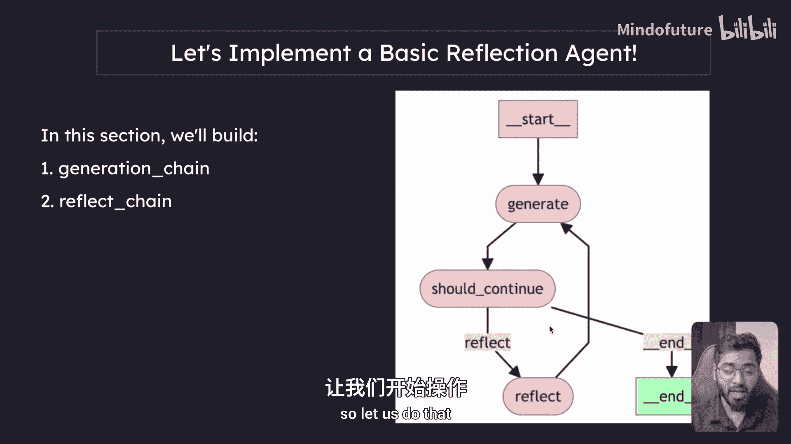
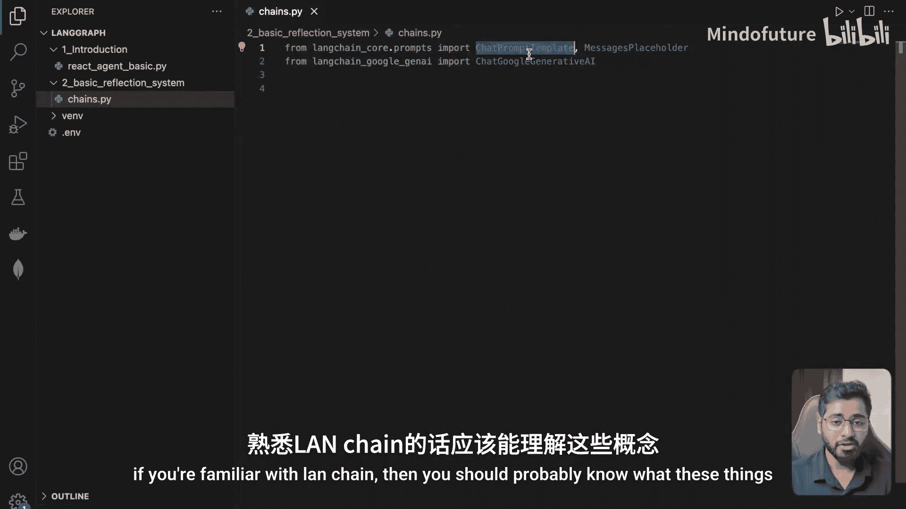
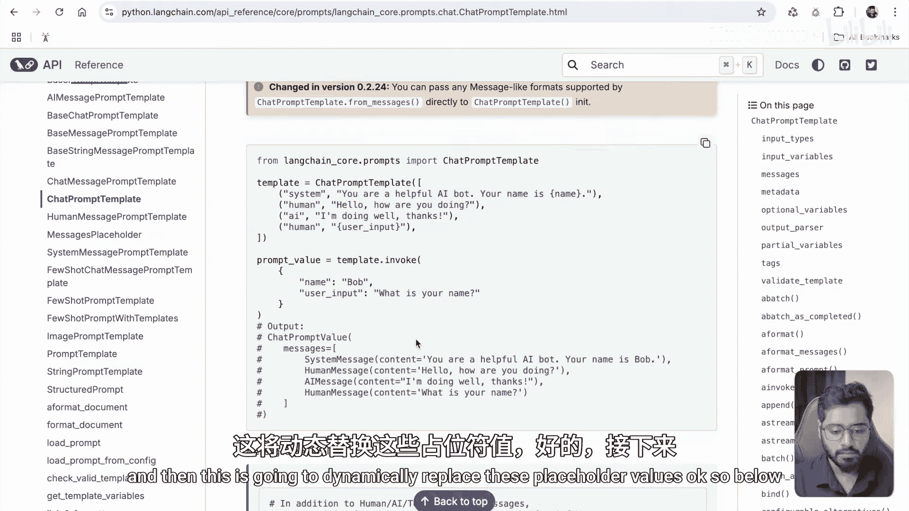
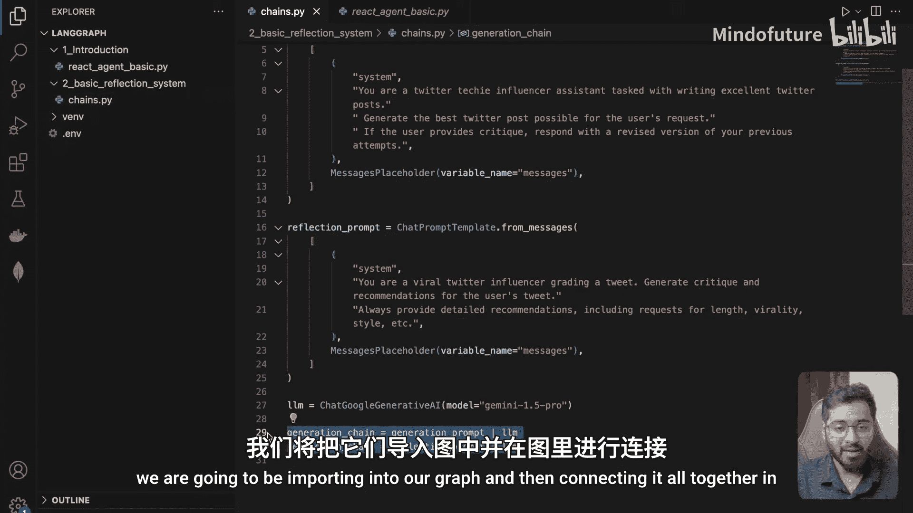

# Langgraph初学者入门2025 p07 P07_#7_反思代理_创建链 -BV1mgepzCEjf_p7-

Hello guys In this section， we will be going ahead and building a very basic reflection agent using La graph。

 and this is going to be the first section where were actually going to be touching on La graph。

 So I'm pretty excited。 we also have a condition rid should continue or not。

 So basically in this should continue node we have like an iteration you know only after four iterations you can go to end。

 So until that four iterations is reached。 always go to the reflect node and then the reflect node is going to give some critique。

 It's going to be passed on to the generate node and then the generate node is going to generate something else and then it's going to come back here now the should count is going to be two。

 So you can imagine that it allows for let's say four different four more iteration cycles。

 So the first thing that I want to do is I want to build out the generation chain and the reflection chain alone and once we built both of those chains then we will in in the next section we will go ahead and create the graph and put it all together。

 So let us do that。😊。

We will go back to our visual studio code。 So I am in my VS code。

 What I've basically done is I've created a folder right here called the basic reflection system。

 and then inside of which I've created a file called chains do p So this is basically the file where I want to sort of put all of my simple I mean the chains alone together this is not the file where I want to create the graph I'll export the chains into the graph and then I'll start using it So right now we just want to create two chains we need one chain for the reflector chain and then another chain for the generator chain right So in this file I've imported two things chat pro template messages placeholder。

 if you are familiar with lacha then you should probably know what these things mean if you do not know basically you chat pro template is like basically like you create a template and then dynamically you sort of input different values So for example。

 you know you are a helpful apod your name is this thing So in the future if。😊。

Want to use this particular prompt you can just pass in the name to be Bob and the user input to be what is your name and then this is going to dynamically replace these placeholder values Okay so below this I'm just going to copy paste the generation prompt so this is going to have a simple system message Okay so basically what it says is that you are a Twitter techie influencer assistant。

Taskked with writing excellent Twitter posts， generate the best Twitter post possible for the user's request if the user provides critique respond with a revised version of your previous attempts。

😊，Okay， so you can imagine that the first system， the generation system's only job is to generate a particular tweet。

 and if at all the other system， the other agent。😊，Provides a critique。

 It needs to respond with a revised version of your previous attempts。

 And that is exactly what we are specifying right here。😊。

And what is this message placeholder Basically in the future， you know， we are not going。

 this is not this alone is not going to be helpful。

 right There needs to be a lot more messages like you know this would generate something。

 and then there would be a reflection。 there would be a generated that be reflection So you can imagine that there is going to be a good amount of you know history getting generated and whatever history is getting generated at that point。

 we will input all of this inside of this particular area。 So that is what this placeholder is for。

 and we have the name for that as well， which is called messages Allright So let's also go ahead and create the reflect prompt。

 So this is going to be reflect a prompt So you can imagine that basically the reflection agent only work is to look at generated tweet and then make it better critique it right So that is exactly the prompt that we provided here。

 So the system message is going to be You are a viral Twitter influencer creating a tweet generate critique and recommendations。

😊，For the user tweet， always provide detailed recommendations， including requests for length。

 virality style， etc。 Okay， so this reflection prompts job is to make the tweet better by criticizing it like really like this is bad。

 Okay do it better Do it better。 you know so now let's go ahead and create chains out of these prompts。

 Okay， we have to create chains out of these prompts so that we can export it and use it inside of our graph later on。

 So to do that I'm just going to use the same chat Google generatorative AI model。

 And then I'm going to use the long expression language to actually go ahead and generate a chain。

 So I'm going to call it generation chain equals。 and let me just put it right here。

 I'm going to pipe it with this LLM that is that is it very simple。

 Okay and then I'm going to do the same thing for the reflection prompt as well。

 So let's make this let's call this chain reflection prompt。😊，And then， L L M。And that is it。 Okay。

 so now we've got two different chains right here and that is what we are going to be importing into our graph and then connecting it all together in the graph。

 So I'll see you in the next section。😊。

