# Langgraph初学者入门2025 p08 P08_#8_反思代理_构建图 -BV1mgepzCEjf_p8-

Hello guys in this section we are going to be building our own very first graph and we are going to be building the reflection agent using some of the chains that we build in the previous section so you can see that I've already gone ahead and created a simple file called basic dot py alongside with the chains do Py that we created in the last section and also you can see that I've imported a few things before you start importing it in your own code just go ahead and make sure that you've installed this particular package La graph okay so this is going to be the command very simple just do that and you know you should be able to import some of these things Alright。

😊，So let me walk you through what are the things that Ive imported So we have the from typing import list sequence this you can think of it like a very simple type checking class like you know very similar to Typescript not really important for the actual execution of the graph but it helps us make sure that there aren't any errors。

😊，And then secondly we have the dot envy which we know you know it basically just like loads up all the environment variables and then we have the messages classes。

 the base message and the human message this I think if youve worked with Laing you should be pretty comfortable with it already and then this is what we are going to be doing a little bit new so we are importing from Land graph dot graph we are importing the end class and the message graph class。

Okay， so this is。Pretty important we will come to this in a minute and then finally we have from chains and we are importing these two chains that we have written in this particular file right here。

😊，Okay very very simple， so let us quickly take a detour and really understand what this message graph is all about so that we can confidently proceed forward with the rest of the code。

😊。

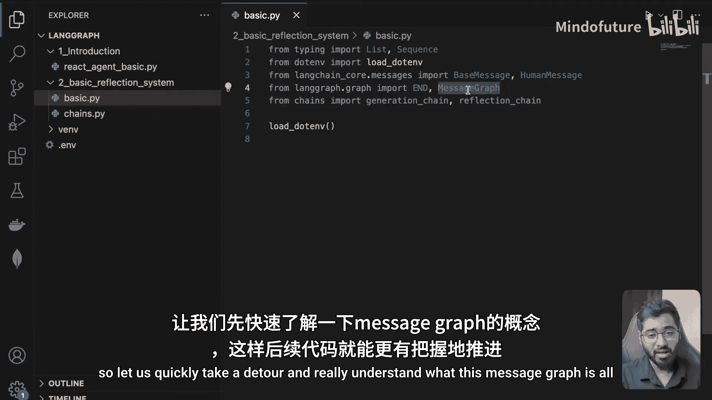

So let us see what is a message graph。So it is a class that Land graph provides that we can use to orchestrate the flow of messages between different nodes。

 so this graph that you see right here this is going to be a message graph that we are going to be using。

So the example use cases are simple routing decisions simple chatbot conversation flow and what we are doing is something that is very basic so we are going to be going with the message graph。

😊，So if you just want to pass messages along between notess。

 then go for message graph Okay so we will look at what this means in a few minutes。

And there is other type of graph which is a state graph and you know if your app requires complex state management。

 then we can go for state graph we will look at more of this in the future， but。😊，For now。

 for this particular use case， we we can actually use the message graph。 Okay。

 so let's actually dive deeper into it。😊，So to put it simply。

 messageage graphra maintains a list of messages and decides the flow of those messages between nodes。

😊，So， every node in message graphra receives the full list of previous messages as input。😊。

Each note can append new messages to the list and return it。

The updated message list is then passed to the next node， so basically each of these nodes。😊。

Receive as the input， all the previous exchanges that happened and then each of these nodes can actually receive the entire list and then append another output a response and then send it to the next node and then the next node can do the same thing it receives the entire input and then it can use that and generate a new response and then append it to the list and then pass it back to generate and then reflect and then generate so that is a very simple workflow and that is exactly why we are going for message graph。

😊，So let us actually now go ahead and start building our own graph。 So to do that。

 I'm just going to come down here and then I'm going to invoke the message graph class。

 So I'm going to call it graph message graph and then I'm going to invoke it perfect。

 So we have the graph ready。 Now there's a couple of things that we have to do。

 So the graph is currently empty right So I'm just going to first go ahead and create the generate node。

 and then I'm going to go ahead and create the reflect node。 So once I have all the nodes ready。

 I'm going to add it to the graph and then I'm going to connect those nodes together。 Okay。

 so it's very much like you know drawing a diagram and then controlling the flow of you know the control flow between nodes。

 So first off， I'm just going to you know name the nodes properly。

 So we have the generate node and reflect node So to make it easy make our lives easier。

 I like to usually go ahead and create a constant like this。 So reflect。😊。

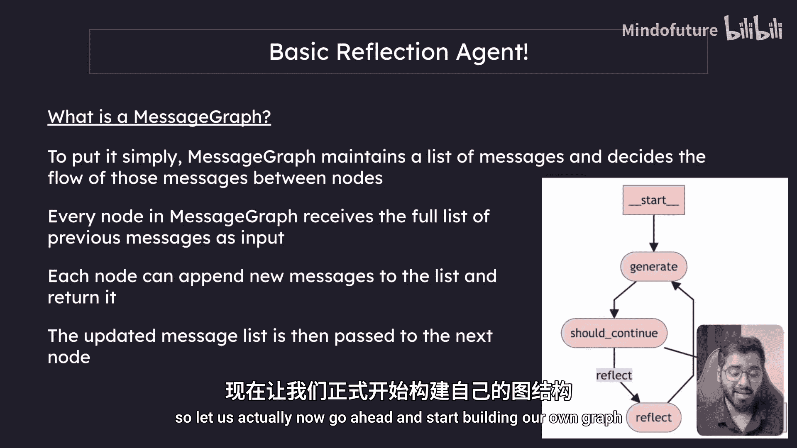

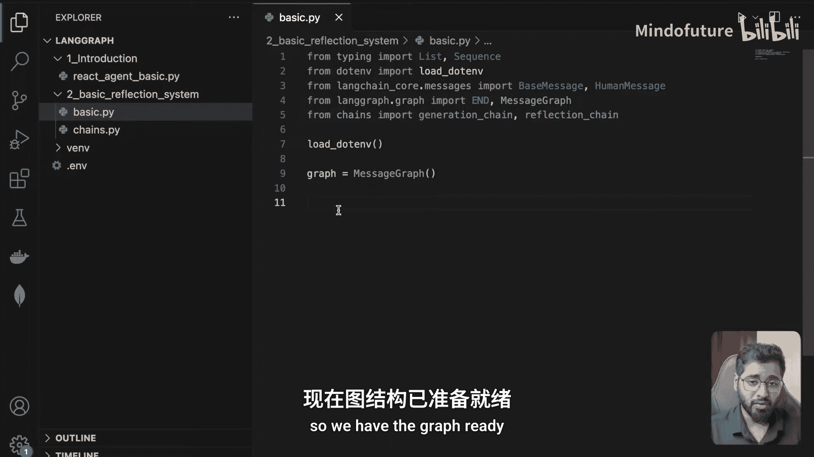

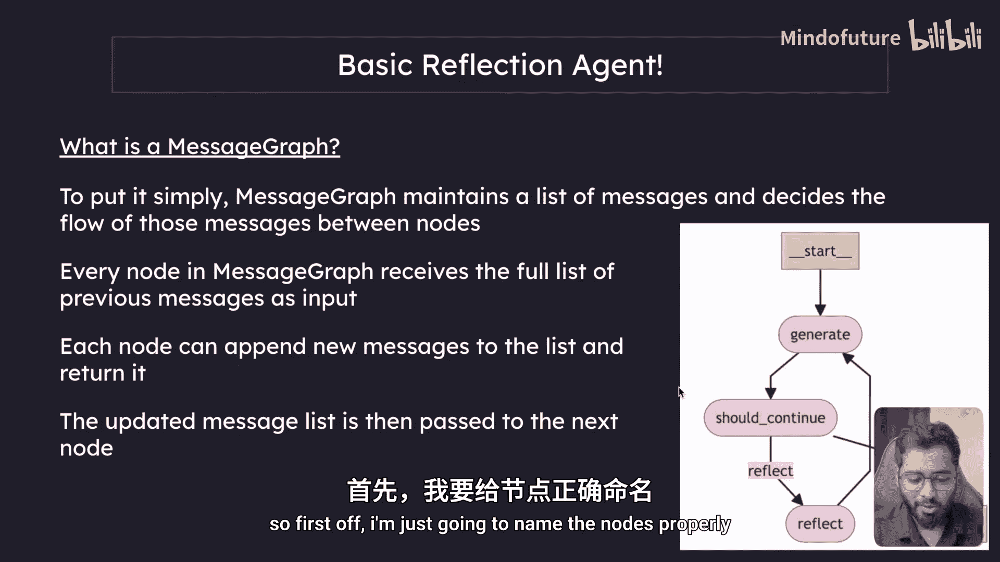

And then， generate。Right， generate。Alright， perfect。

 so now let's go ahead and create the generate node and that is nothing but a simple function Alright so I'm just going to say generate node and depending if you remember from the previous slides we know that every node receives the entire state right and then we are invoking on the state using the chain that we've created in the previous section and then we are appending the response to the history okay so that is what we are going to be doing so this is going to be the state you can basically think of it as a list of messages that happened in the past Okay so this is going to be the list of messages and then this we can actually make use of the generation chain。

😊，And then we can invoke on it so basically whatever state has been generated or accrued all of that we need to sit right here okay so we have the messages placeholder so let's actually go ahead and say messages。

And then we pass in the list of messages and that is it。

 So this what this is going to do is it is going to generate the tweet based on whatever is existing in the past。

 So later on when we actually invoke this graph we will provide the prompt the main user prompt and that is going to be what is appended and it's going to be provided right here and also don't forget to return this particular thing So whatever is going to be the returned object of the LLm It is just going to extract the content property alone and then it is going to append that message to the existing state right here Okay I hope that makes sense let's now go ahead and create our next node in a system which is going to be the reflect node So I'm going to see a reflect node。

😊，State so here we are going to be doing something very similar。

 so here we are going to be using the reflection chain。And then， we are going to invoke。

The message is。And then finally， the same state。Okay케。Perfect， so I hope that makes sense。

 There is also one more thing that I want to do。 So we have a generate node。 Obviously。

 the generation is being taken care of by the AI and whatever is returned is considered to be the AI message So usually in real life the reflection is being done by a human right So we can actually trick the system into thinking that the the the message that is being returned is by a human right So we can also do that。

 So I'll tell you how So we can actually call this to be the response。

 And let me just past something here return。😊，Respon。Okay so we can also do something like this。

 So the previous version that is perfectly fine as well。

 First AI is generating the second AI is critiing the first AI is generating the second AI is critiing that works perfectly fine。

 but for readability for tracing using la width etc， etcter。

 Sometimes it might make sense if the reflection is actually if we are tricking the system into thinking that the reflection is being done by a human So in that case we can actually return a list and we can just pass in the content writer and this content is going to be appended to the existing list of messages Okay so this is also a possibility and just giving it to you but if you don't want to complicate your system too much。

 we can just leave it as it as well Okay all it。 so we've already gone ahead and created both these nodes。

 let's now go ahead and add these nodes to the graph So to do that it's very simple I can just say graph add node。

😊，And in this node， the first one is going to be the name of the。

Notode and then the actual function the generate node。 And then secondly， we also have。

Let's also add the next node。So we can just say reflect。And then， reflect node。Alright perfect。

 And also， we can you know， specify the entry point。 Okay。

 so there is always going to be an entry point。 So in this graph， if you look at the entry point。

 it is going to be this generate。 You might ask， okay， why is it not start， right？

 So the answer to that is start is something that is like， you know。

 inherently sort of assumed to be the entry point。 So it's not really considered explicitly considered。

 It's more like implicitly considered， So let's actually use the generate node。

 which is going to be the first node。😊。

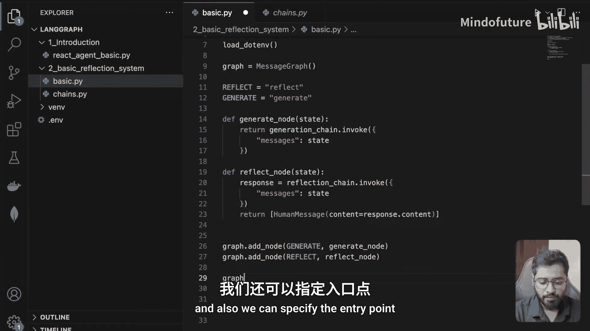

Where the entry is going to happen。 So I'm going to say the entry point is going to be this particular generate。

 Okay， so let's come back to the diagram。 let's see what else is there。

 So we now need to create this particular should continue function Okay so this should continue function is basically keeping track of how many iterations have happened and if you know we can actually said okay after four iterations you stop the cycle go to the end give the user the end output。

 which is the more refined tweet So until then you know just like you know after the generate come here go send it to the reflect insert of the end So it just does this four times and then it is going to go to the end right so let's actually go ahead and write this should continue function So to do that I can just say should continue。

😊。

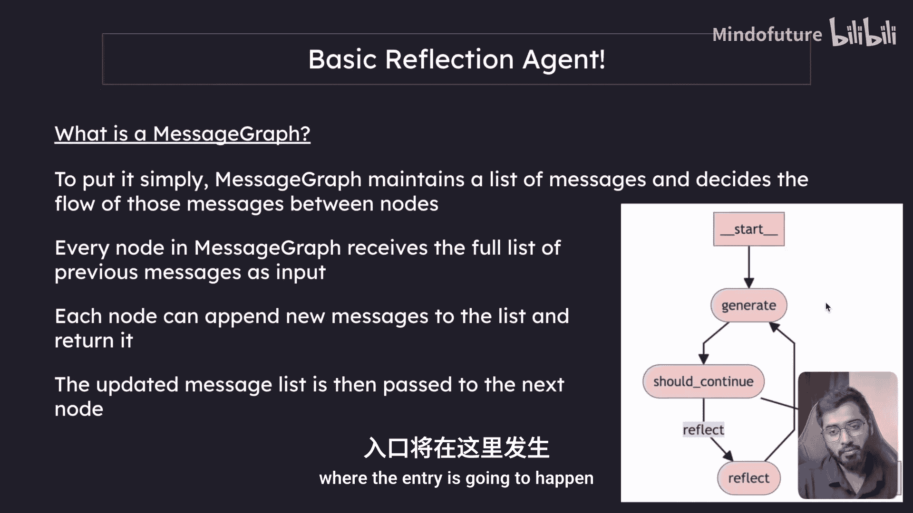

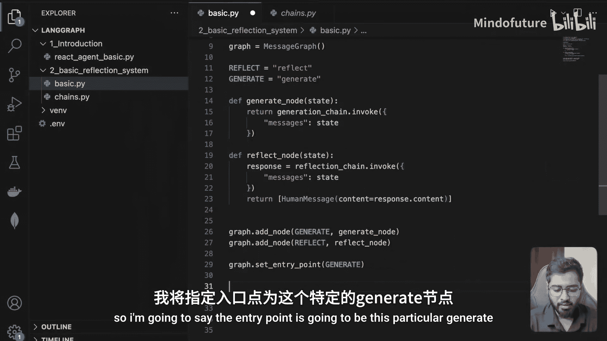

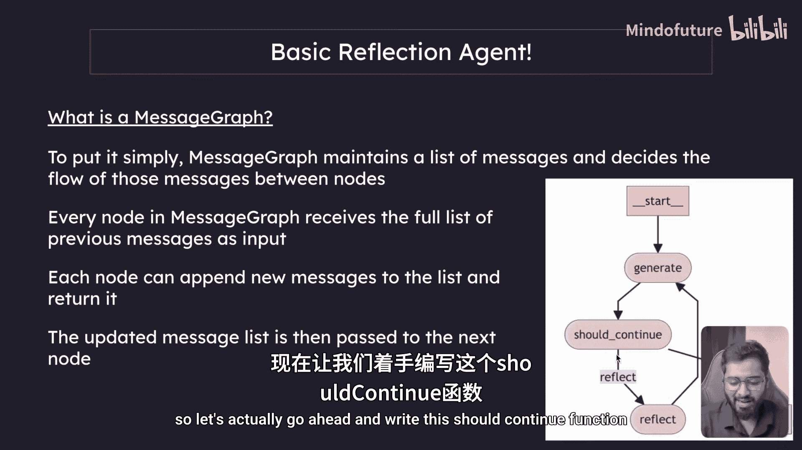

And this， again， is going to get the list of messages。 And here I can say if。The length of the state。

 if that were to exceed for。Okay in that case I want the the the graph to end right so I can just say end right here and you can see that Ive already imported this thing from the graph right it is a prebuilt constant and then we if that is not the case I can just return。

The reflector Okay， I can say go to reflector。 Okay， so so far we've created the generate node。

 the reflect node that should continue node right we've also specified that this generate node is going to be the entry point as well。

 but we haven't really done any sort of connecting yet。

 So the first connection that I this this is going to be the connection right So these edges are going to be the connection。

 So the first thing that I'm going to do is I'm going to say。😊。

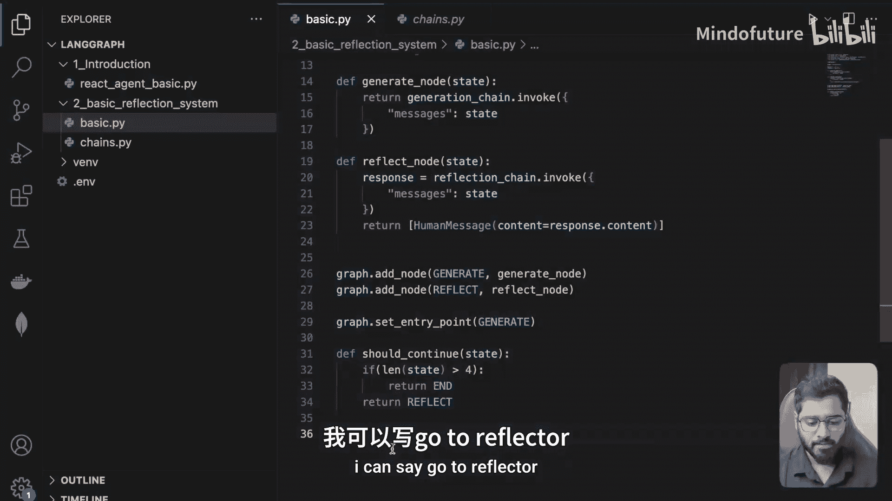

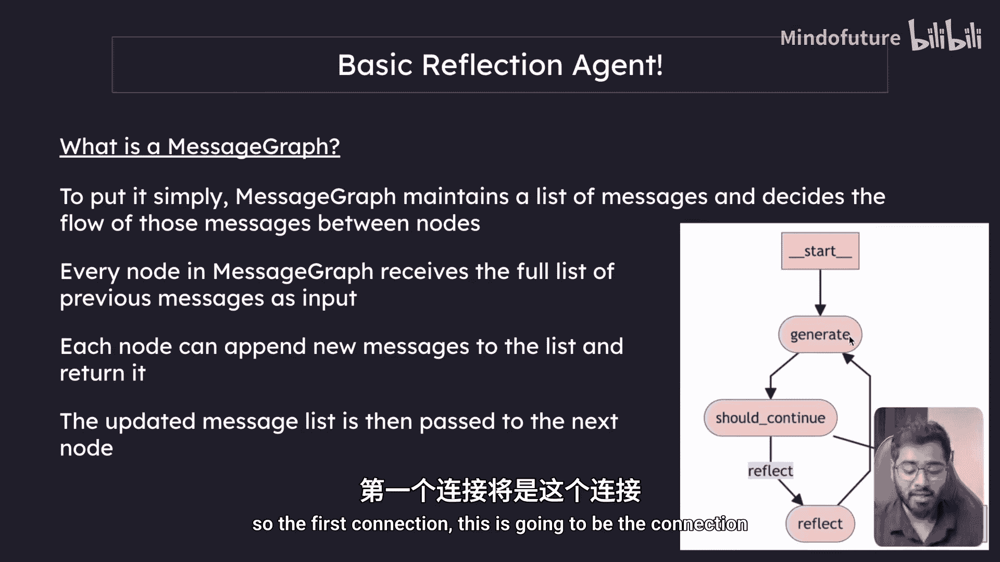

Add conditional edge。 Okay， so the conditional edge is going to be this thing right here。 Okay。

 so right after this should continue， it can either go to the reflect or it can either go to the end。

 right， So this is going to be a conditional edge。 This is not going to be a normal edge。

 So what you see right here is a normal edge。 What you see right here is a normal edge。

 but this is going to be a conditional edge， So what I'm going to do is I'm going to say。

 right after the generation is done right， right after the generation is done。

 this should continue node is going to actually， you know， branch off to two different things。 Okay。

 so that is why we are putting this add conditional edge right here。 Okay， I hope that makes sense。😊。

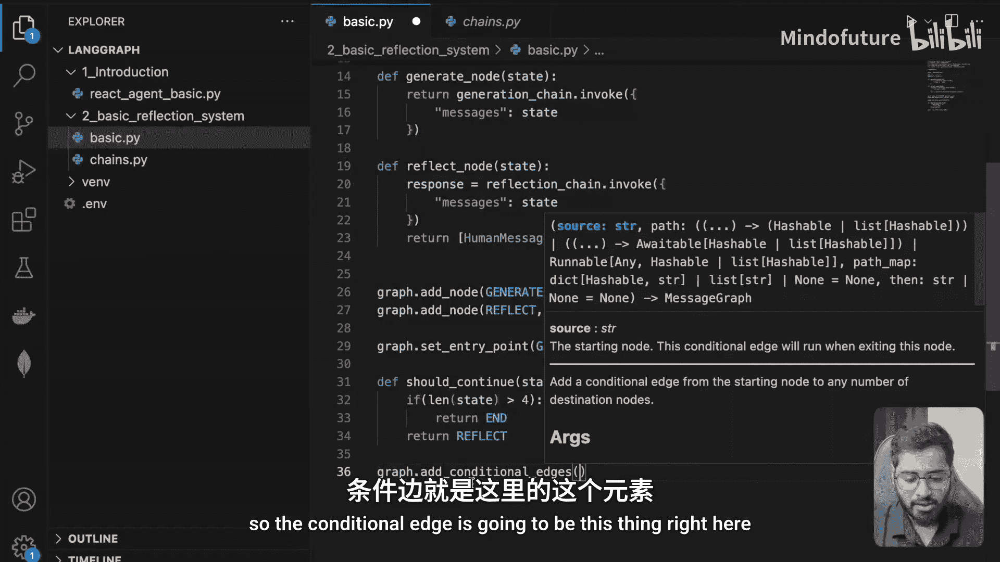

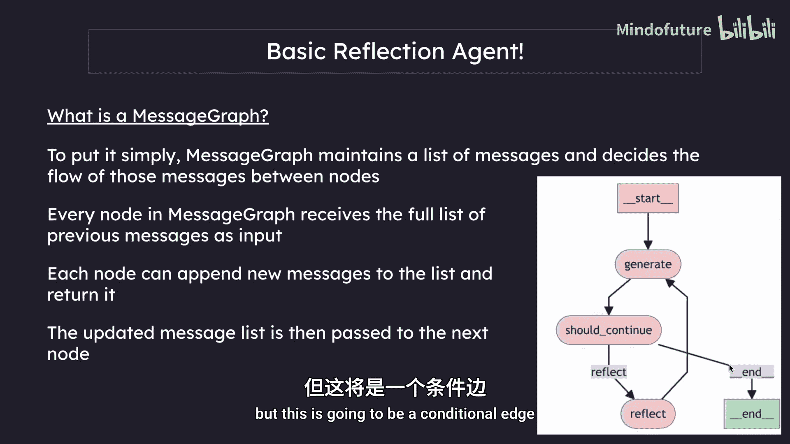

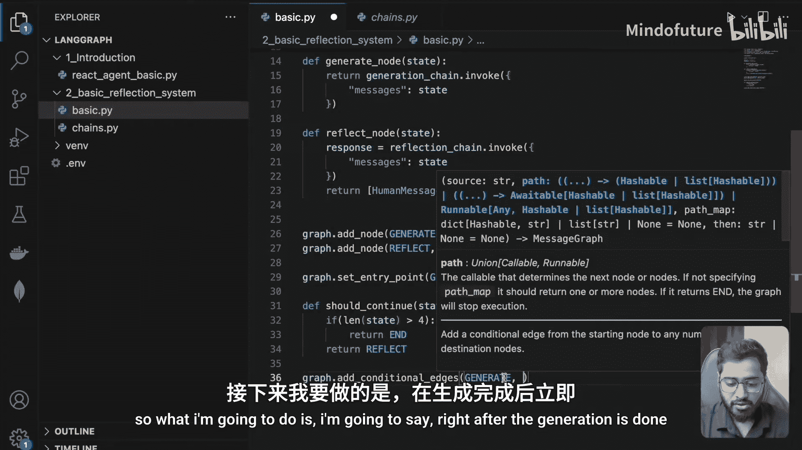

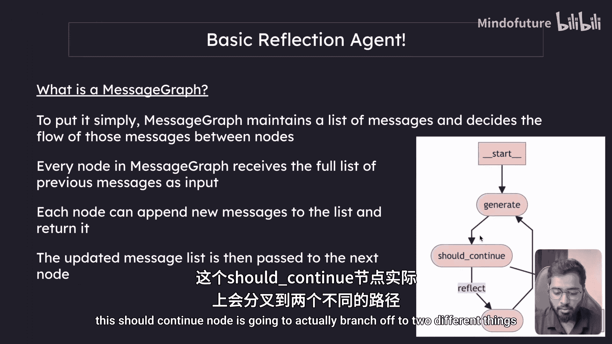

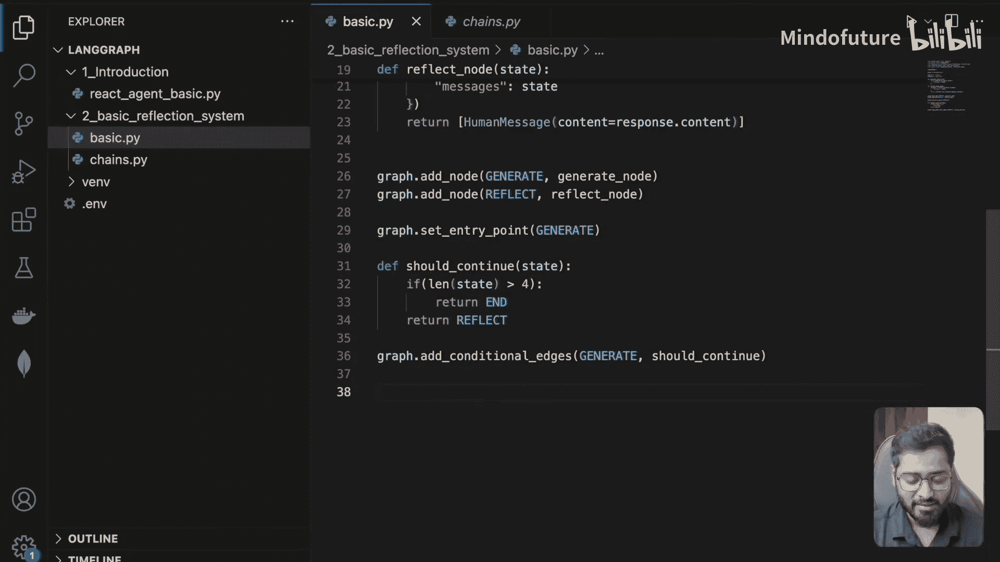

So so far， we've done this particular connection that should continue should go to reflect or should continue to go to end。

 But if it were to go to reflect， then there is only one option which is to go back to the generate。

 right， So let's connect， let's actually connect an edge between the reflect and the generate。

 So to do that， I am just going to add a very simple edge。 So this is called add edge。 Okay。

 this is not going to be the add conditional edge。😊。

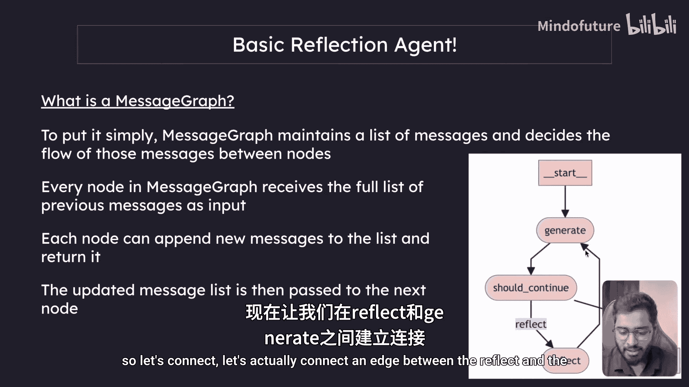

So the first one is going to be reflect。So this is going to be the from node。

 and then we are going to have the two node。So you can imagine that this is very much like just drawing a diagram right So we've done we've connected these two lines。

 Now the reflect is going back to the generate。 So what else is left。 All。

 it looks like everything is done So let's just go ahead and compile the graph。

 So I'm just going to give it a constant named app。

 and then I can just say graph dot compile and they should compile the graph。

 So before I actually you know provide a topic for the tweet or provide an existing tweet and ask it to make it better before I do that。

 I just make sure that you know the graph is looking exactly how I expected to just to get ahead of any problems that may happen right So to do that I'm just going to copy paste a few lines of code。

 So basically what this is doing is that you know this is going to give you a mermaid diagram and an askI diagram basically just it's like a very simple visualization of the graph So right here you know everything is like neat and ti。

 but we just need to make sure that it is the same thing that is being replicated right here as well。

😊。

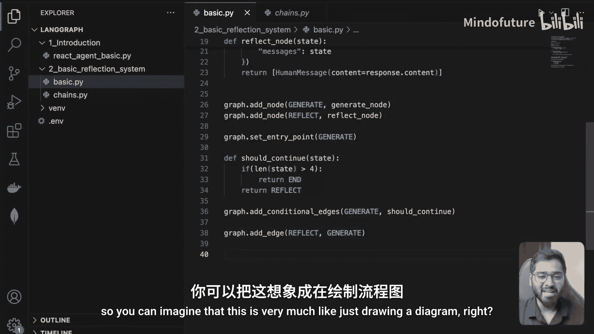

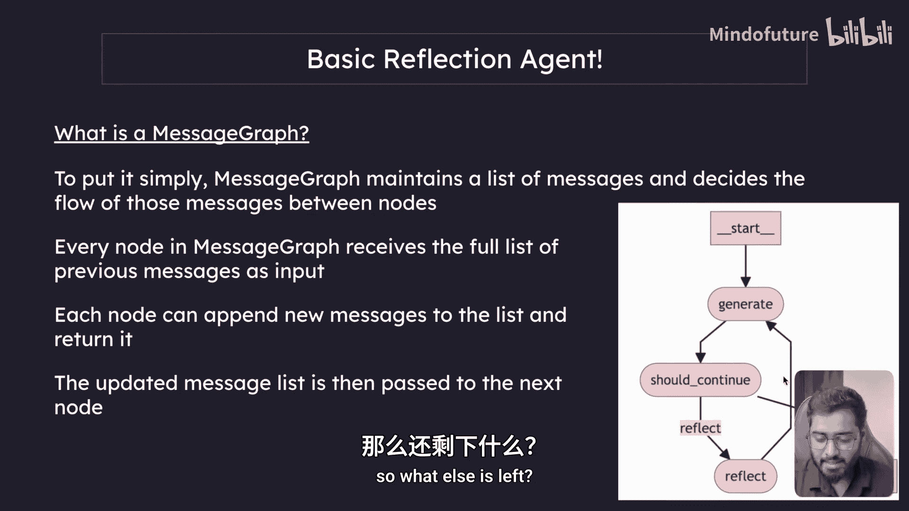

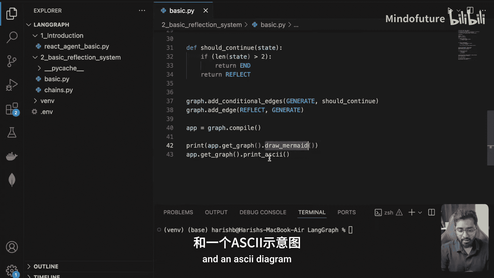

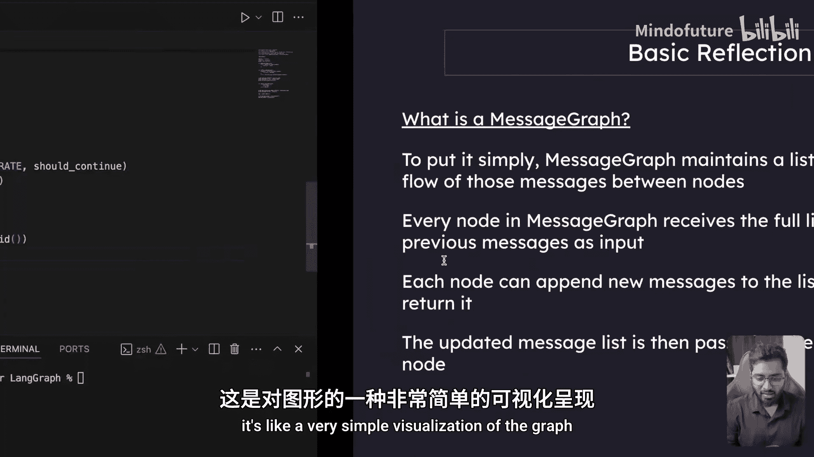

And just one more thing， guys， if at all， you get stuck anywhere。 you've got two options。

 I'm putting this repository in the in the description below so you can always go pull the code and then run it yourself。

 And that is sure to work。 And if at all， despite that you're getting some clarifications。

 I'm more than happy to answer questions in the comment section。

 So this go ahead and shoot your questions。 So yeah， so as I said。

 this is going to give you the mermaid diagram and this is going to give you the ask diagram as well。

 So let's go ahead and run it。 And if you go ahead and run it。

 there is going to be one additional package that it might require you to you know install and that is going to be this。

😊，We install grand dolf， Okay， so just go ahead and install it and you should be able to run it without any problems。

So let's go ahead and run it and let's see what happens。Allright。 So perfect。

 So this is going to be the。This first one is going to be the mermaid diagram。 So as you can see。

 we've got the start start is going to generate right the start is going to generate and here there's going to be a simple edge whereas the reflect going to the generate is also going to be a simple edge right right So these are the two simple edges whereas this generate going to reflect is going to be a conditional edge and that is exactly why we have the dot in the middle of this particular arrow。

 the same thing for the generate going to the end as well。 So it is looking pretty well。

 and also you can see that we've got this other diagram as well where the start is going to generate and the generate is going to reflect and the end。

 So everything is looking fine， So now what I'm going to do is I'm going to provided a towe I'm just going to Im basically this is a system that really helps me churn out really viral ts really quickly。

 and I just need to provide a topic or some context So what I'm going to do is。😊。

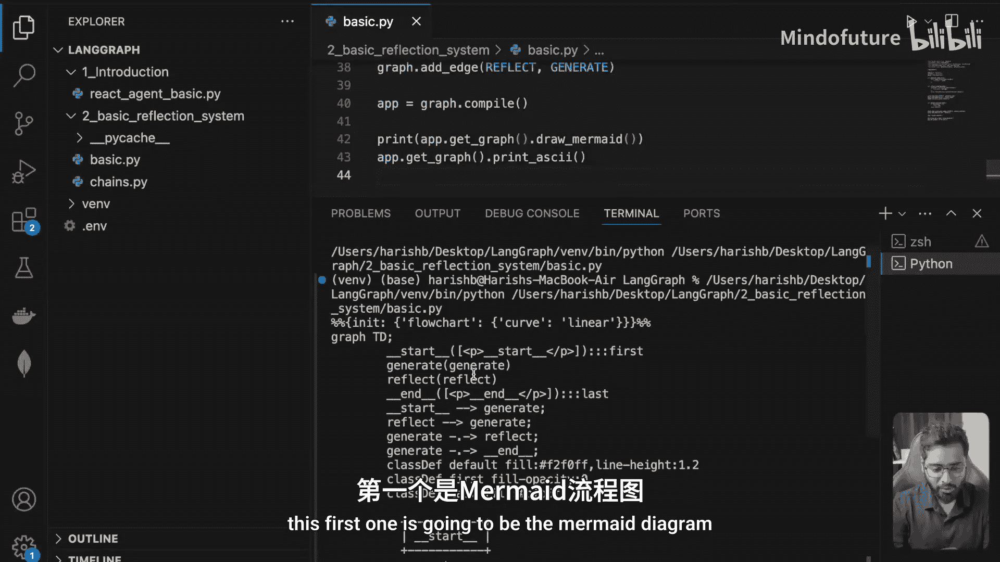

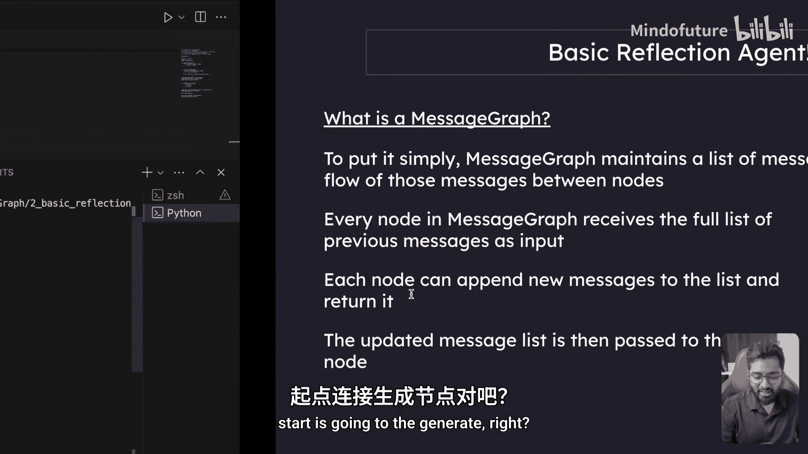

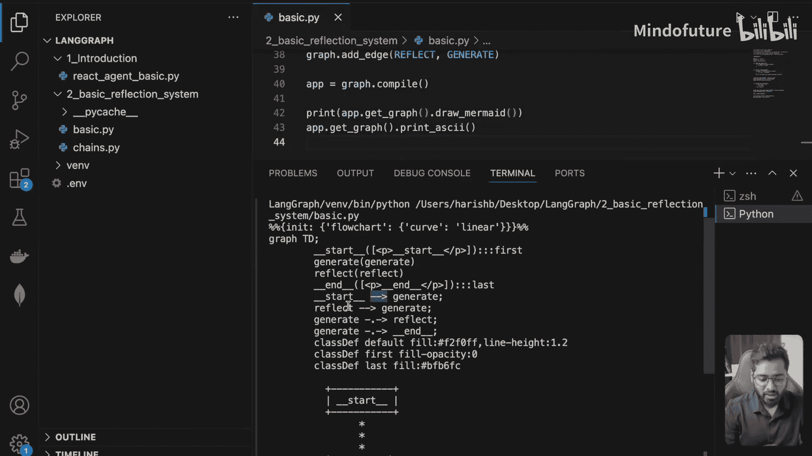

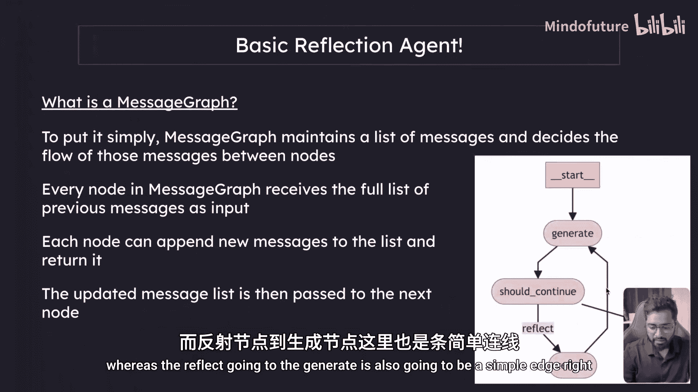

So we have the app right here and what I'm going to do is I'm just going to say app dot invo and inside of this I'm just going to pass in a human message okay so basically whatever we pass in here it is going to be added rather appended to the existing list the message history list that I told you about right so this is going to basically so let me just type it out and let me explain it on the way okay so the content is going to be I want there to be a tweet written on AI agents taking over content creation so I'm just going to say AI agents。

😊，Taking over content creation。And I'm also going to， you know。

 assign it to this response and then print it out as well。

Allright so lets let's hope that everything works fine so essentially if I were to hit play what would happen is that this human message is going to be you know that the entry is going to be the generate node right so this state which is going to be a list of messages right now it is only going to have one message right which is the human message that we are providing and that is going to be put in the place of this variable message in the generation chain so。

😊，Each of those chains would have their own individual system messages。

 but the history is going to be shared， is going to be shared between both of those chains。 Okay。

 so there is this is a confusion that a lot of people get there is only going to be one message history。

 Okay， there's not not going to be two message histories。

 just one message history the system message is going to be separate for each of the chains and both of those chains are going to share the increasingly getting message histories。

 I really hope that I'm not confusing it。 but if it only have any questions ask me or just go ahead and ask cha p。

 So yeah。😊，Let's actually go ahead and run it。 Let's make sure that everything is fine in the chat as I mean。

 the chains as well。 Okay， so let's go ahead and run it。Okay， so the diagrams are getting generated。

Okay， it's taking a while because you， you can imagine that， you know， the， oh， okay。

 so it's actually here， right， So you can see that wait。

 So you can see that the first human message that I've provided is right here。

 And then there's going to be a lot of other information like， you know， oh， okay。

 So the AI message is also here， right？ So， yeah， this is going to be the first。😊。

Creation of the generation chain， right？ So we have the AI agents are revolutionizing content creation from automatic tious tasks to generating creative text formats。

 They are empowering creators to focus on what matters most right And then yeah。😊。

What matters most telling compelling queries I mean stories and we've got several hashtags it has provided。

 So the generation chain has did its work right So I am providing it a title and the generation chain is doing its work properly。

 So now what would happen the reflect chain is going to critique that tweet that degeneration chain has generated。

 So let's see where that is happening。 I know this is a little not really that readable。

 but don't worry we are going to be deep diving into what is exactly exactly happening in the next section where we are going to be praising everything using Langsmith。

 But for now you can see that。😊，Great， so this human message is right here。 So you if you remember。

 we tried to mimic a human message getting basically the critiquing voice is going to be a human message because that's how we are doing it right。

 This makes it very readable for us。 we can put it as a AI message。

 we can just leave it as it is as default。 but when we because we put it as human message。

 This is going to be very readable for us。 So here this is going to be the critique， right。

 So your original tweet was concise， but lack context and excitement。

 It presented a statement without engaging the audience or offering any further information while gravityev is good。

 It needs to be paired with impact。 Okay， and it is also providing recommendations。

 So the length the revised tweet is slightly longer providing more context while remaining。

 you can see that is' providing a lot of different things， right。😊，That's this is amazing。

 So if you if you actually， you know， you can just pause the screen and then give it a read。

 you would be able to see that， you know， human message is criing it。

 And then the AI message is again， like， you know， making it better。

 And the human message is criing it。 And let's see how many iterations would it go for。 Okay。

 so right now we've just set it to two iterations guys。

 So you can actually increase it to let's say four。😊，And let's see what happens。

 I'm just going to increase it to you know what， let's increase it to 6。 I want there to be。

 you know， three different iterations back and forth， back and forth， back and forth。 Okay。

 so if I were to do that， let's see what happens。😊，Usually， it's not going to be enough。

 There needs to be at least like a couple of iterations for the tweet to really， you know。

 get become a viral tweet， right， So let's give it a。😊，So， let's give it a while。Okay。

 so it looks like it given error。 it is saying that you know， the the iterations。

 this thing has been exhausted。And usually， this tends to happen when youre naturally paying for the API。

 So usually since we are not paying for Google Gemini， they basically rate limiters。

 So we can only make these many， you know， subsequent calls at this particular interval。

 like something like that。 So that becomes kind of an issue sometimes。 So what I'm to。

 I'm just going to quickly switch to open AI， because that is what I'm paying。

 So what haveve basically gone ahead and done is that in the。

So basically what I'm going to do is I'm going to go to chains and I'm going to use the La open AI chat model Okay so now I want to communicate with the open AI chat model and lets also go ahead and say chat open AI。

And I'm just going to quickly come down here and then replace the model to G 40， G 40。

Allright and let's save this and I'm also going to provide the environment variable Okay so just go in here and then you can see that this is the environment variable that you need to provide if you do not know how to pay for this thing just go to platform do openaiI dot com I think go to the billing section and then you would be able to pay a minimum of $5 and that is going to give you access you can also pay for Gemini but yeah this is what a already paid it so i'm just going to go go ahead and do it with openaiI。

😊。

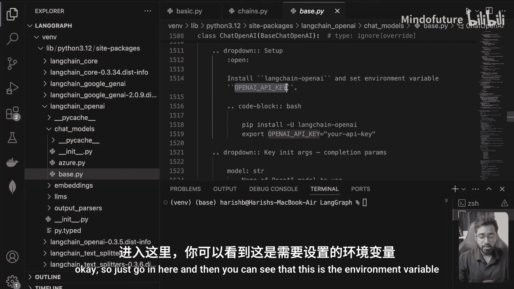

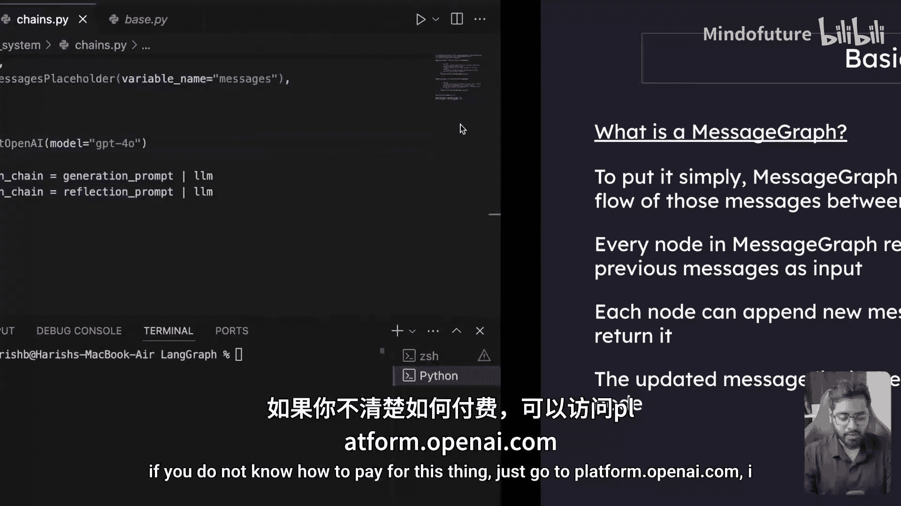

So， alright， So let's now。Ted to run this file again now that I've changed it and it should hopefully work fine。

 So Ive I've said G 40， which is correct。Perfect， All right。 Now， let's try to run this again。

So this time there is going to be you know three different exchanges right so there' is going to be 6 the length of the message list is going to be 6 so there's going to be three different iterations。

😊，So， let's wait and see。Okay， perfect。 So looks like we've received the entire thing。 Okay。

 you can see that this is a pretty long message right because there's quite a lot of data that is packed in here。

 So first off there's a human message。 And then you know this is going to be our initial message and then there's going to be somewhere in in here。

 you know you should be able to find the AI message generated。 So where is it right here。

 Okay we have the AI message generated and there should be another simulation of the human message that is going to critique it。

 So yeah， so we have you can see that there's a human message right here。

 your tweet just an intriguing current topic， but it could benefit from more context and engagement tactics。

 So again， there is going to be another AI message。😊。

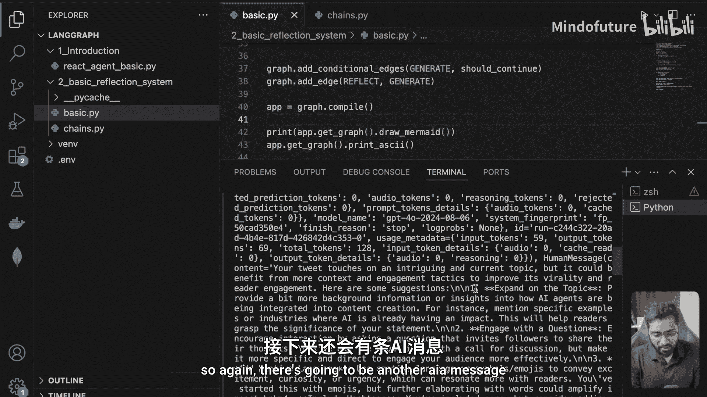

Okay， so I'm not really able to find it here， but it this will all make sense， you know。

 in the next section where we are actually going to be pra the entire thing using Langsmith。😊。

