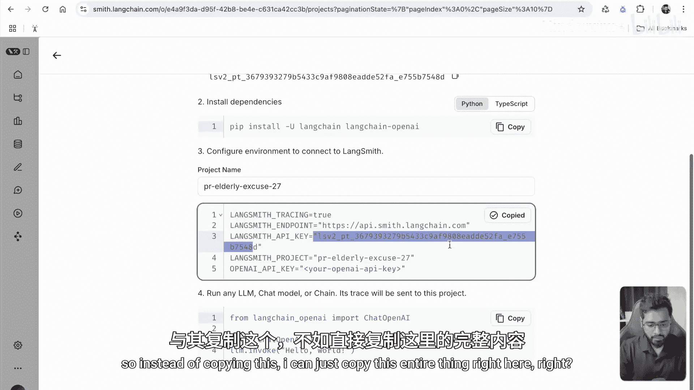
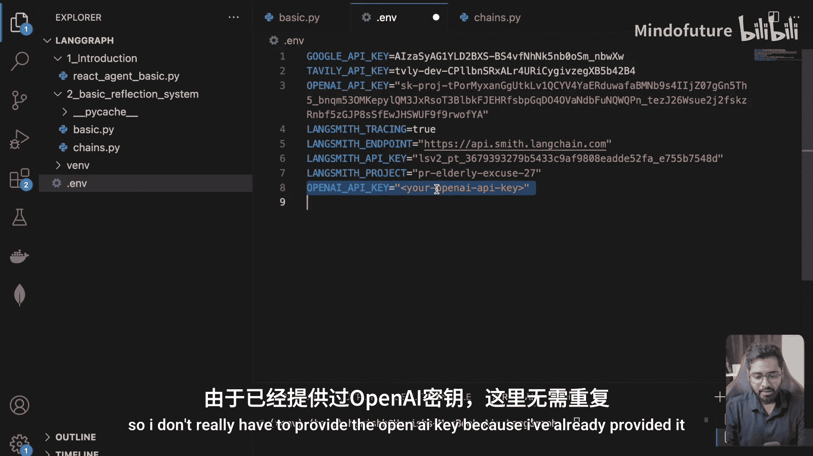
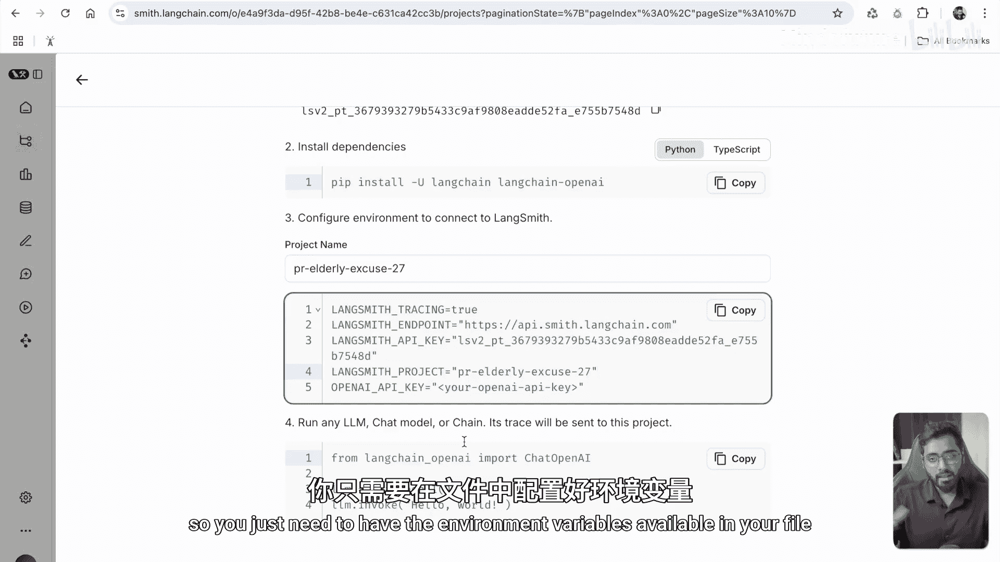
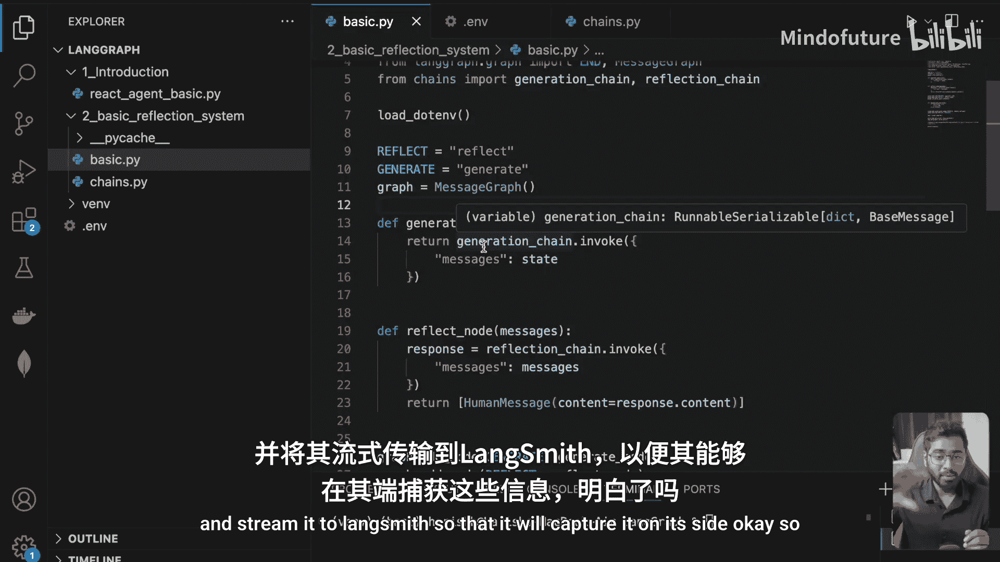
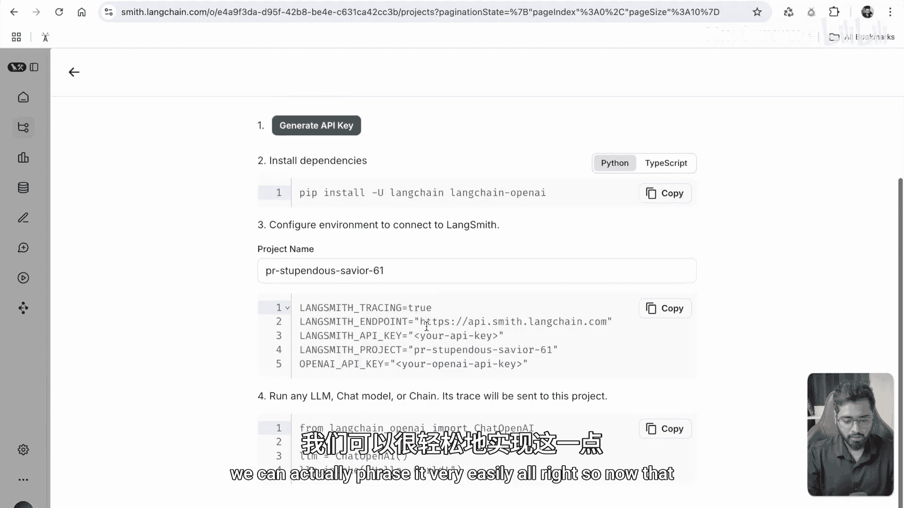
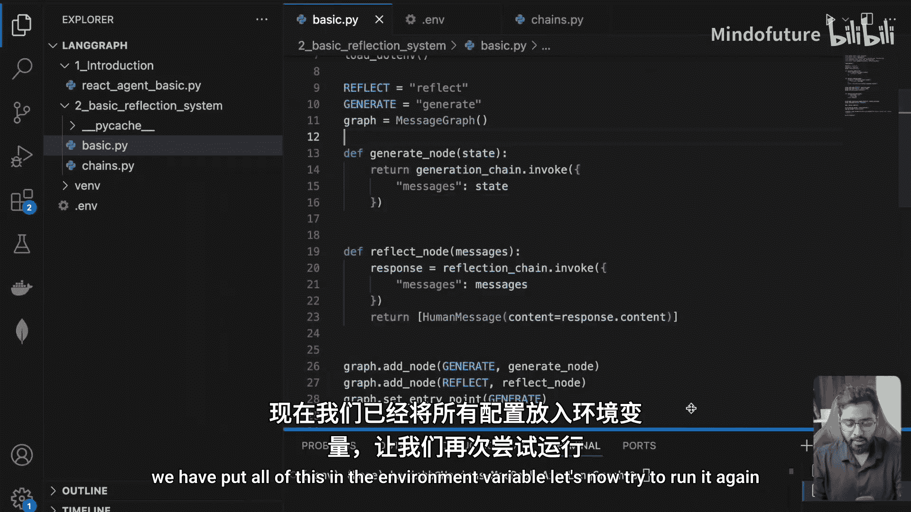
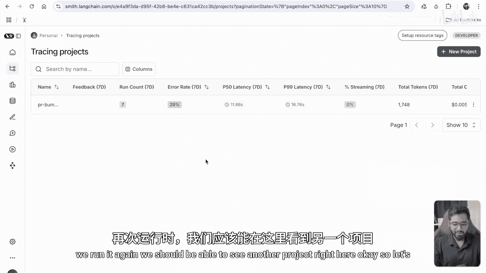
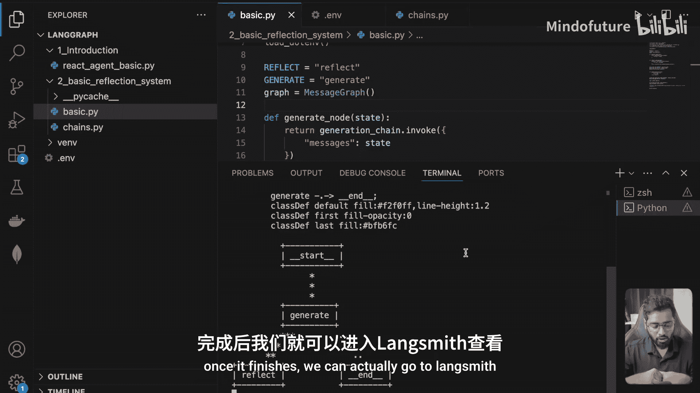
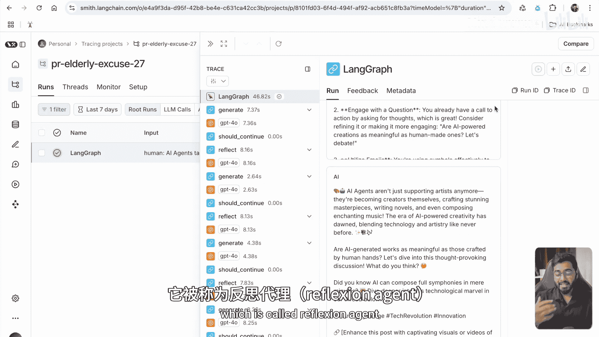

# Langgraph初学者入门2025 p09 P09_#9_反思代理_LangSmith追踪 -BV1mgepzCEjf_p9-

Al right， guys。 So in this section， we will actually trace the reflection agent system that we built just so we can understand exactly what is happening where so that we'll understand how both of these systems are working together to deliver our final refined viral tweet。

 Allright。 So to do that， I'm just going to go ahead to this particular website。

 Smith do Lacha dot com if you don't have an account already just go ahead and create an account。

 And I'm going to come to this tracing projects right here。 I'm going click on this project。

 And yeah， I'm going to choose with La。 And there's a couple of things that we have to do。

 So we have to generate the API key right， So I'm just going to copy this API key。

 and you can see that it's already being reflected right here。 So instead of copying this。

 I can just copy this entire thing right here。😊。

Right I can just copy this entire thing and then come back to my environment file and I can put it down here。

 so I don't really have to provide the the open AI key because Ive already provided it。😊。

But yeah， the rest of it should be there。All right perfect。 So now that is pretty much it guys。

 if you do not know what Langsmith is， you know Landcha has very strong support for Lansmith because they all work under the same umbrella right。

 So you just need to have the environment variables available in your file and that that is it。

 So what I mean to say is that So inside of this。 So we have all the graphs and we have the message graph and we have the different nodes and everything。

 So within all of these classes， it will have support for Landsmith。

 So once a particular operation is done。😊。

If the Lsmith environment variables， everything is like perfect。

 it will make and stream it to Lasmith so that it will capture it on its side。 Okay。

 so we can actually praise it very easily。 All right。

 so now that we have put all of this in the environment variable， let's now try to run it again。

 and once we run it again， we should be able to see another project right here。 Okay， so let's try。😊。

Let's give it a few seconds。So as it is actually going through each and every single step， you know。

 the first iteration， the second iteration， the third iteration after every single operation。

 there is going to be a call that is being made to Langsmith and it is actually recording everything right now。

 So let's us give it a second and。😊，YouOnce once it finishes。

 we can actually go to Langsmith so you can see that everything is available right here。 Now。

 if we come back to Langsmith and refresh this， you should be able to see another project。

 perfect so you can you can see that we have the new one that is generated today right this is 13 which is today let's go in here Allright so here we have runs threads monitor setup we are only interested in runs because a run is basically running an entire application from start to finish So if we were to click on this particular run we'd be able to see traces traces is different from runs traces is like this particular small component in the system know this particular thing right So it gives you a lot more descriptive information about what exactly happened。

 So at the very top， you can see that this entire thing took 46 seconds this is going to be the complete compilation of what happened but if you're interested we can also go through each of these different things just to see what component what at what。

😊。

So right now we have the generation agent and the reflect agent so we can actually see what the generated generate agent or we can call it as an agent but what do they generate workloaded first and then what does the reflect a workloaded second so we can actually see all of that。

😊，So this is going to be， as I said， a highle overview of what happened human me。

 I said this thing first and then the AI， which is the generated agent generated this particular thing and then this is going to be the human message but actually it is not the human message if you remember right So this is going to be another AI generated this thing which is going to critique the first generated tweet it's saying your tweet your tweet touches on an intriguing and highly relevant topic however to maximize its impact and virality consider doing this expand with context engage with a question use emojis right hashtags use better hashtags create a thread add media virality and all of that remember the goal is to be thought provoking and informative So this reflect agent is going to generate this thing and then it is going to now the control is going to go back to the generation chain So the generated chain is going to generate a completely new revised tweet based on all of the feedbacks that its received and then once it is done。

😊，Again， the cring agent is going to look at that tweet and it's going to suggest a lot more you know to how to you know make it better and taking into account all of that again。

 the generation agent is going to make it even more better。

 and then this thing goes on for you know a total of66 different exchanges right so that is what we've done。

 And finally we have finally we have a very viral tweet that is packed with a lot of you know you can see there are emgs and there are hashtags and you know it's really a pretty well thought out tweet right it's not like a one short tweet。

 but rather there's going to be a lot of thinking and lot of refining and then finally you know it gives you this final tweet and that is exactly how in the real world it works as well right is going multiperations So that's what we have right your guys。

 So initially there is going to be the generation node I'm just going to provide this the generation node is going to you know generate the。

😊，First tweet and then what ends up happening is that you know is going to be reflect node and that is going to look at the generated tweet and then it's going to critique it and then finally again the generate node is going to be there and its going to again it has the context about every single thing right it has context about every single thing and then finally it gives you the output of that and the same thing happens again and again and again and finally we have the final tweet right here。

Okay， so I hope that you're starting to understand how reflection agents work and how powerful they are。

 because they can actually think deeply through a particular thing。

 And then they can like reflect and generate and reflect generate。

 And what I've done is basically a very simple example， which is to generate a tweet。

 But you can imagine that we can do it for pretty much anything out there， even for complex tasks。

 And if at all， you have any questions， just go ahead and ask it to me in the comments。

 and I'll be more than happy to help you out。 So in the next section。

 we are going to be looking at the next type of reflection agent， which is called a Reflexon agent。

 And that I believe is going to be even more interesting。 So I'll see in the next section。😊。

