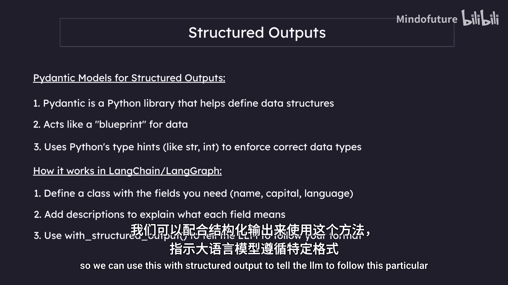
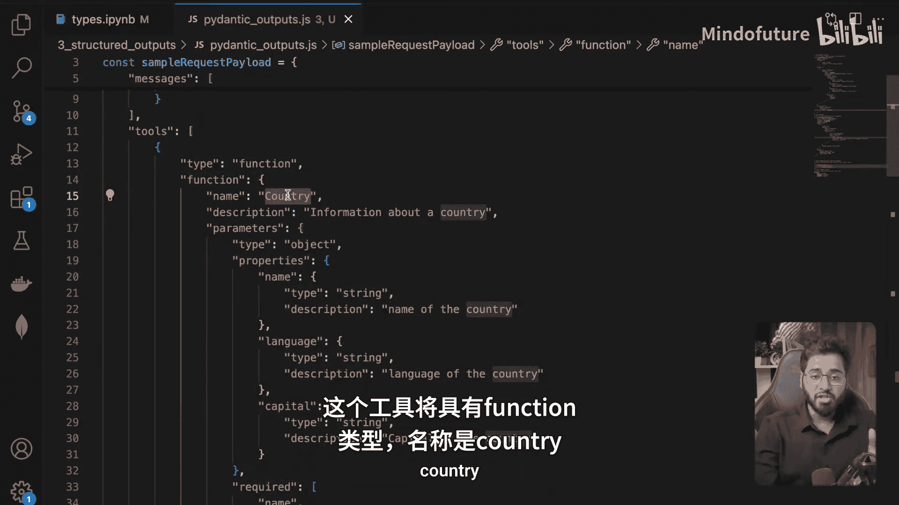
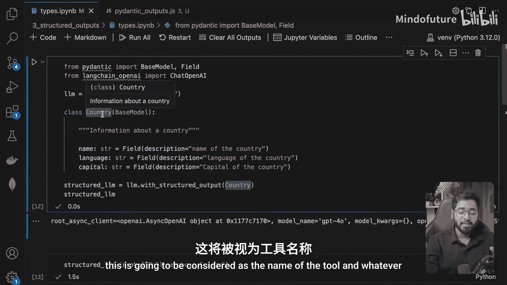
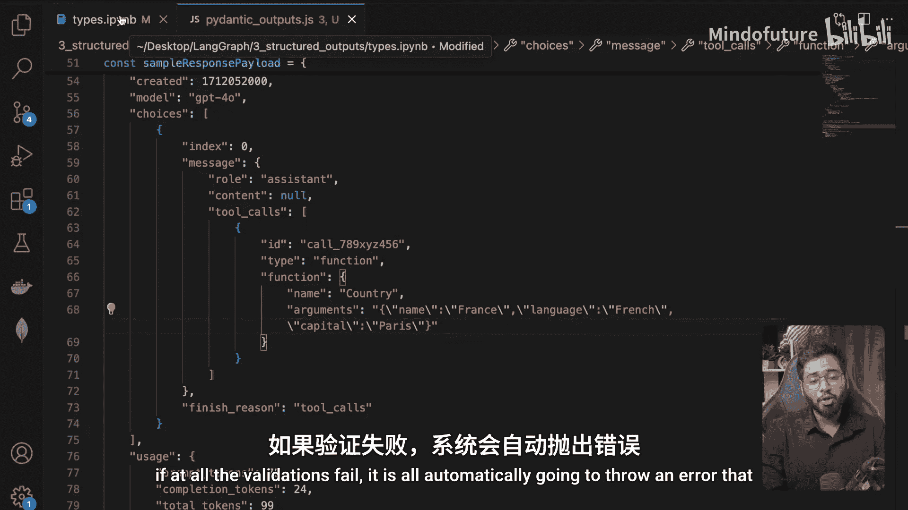
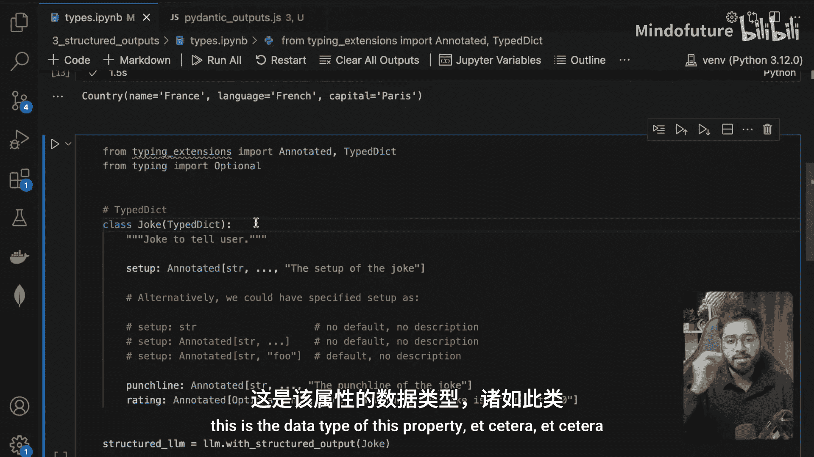
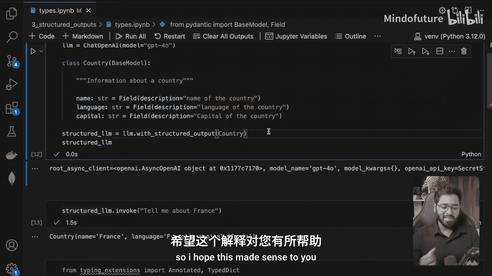

# Langgraph初学者入门2025 p10 P10_#9.5_结构化LLM输出 -BV1mgepzCEjf_p10-

Hello guys。 So before we proceed forward with the reflexon agent system。

 there is one more thing that we have to learn about。

 which is how can we get structured outputs from LLms。

 This is something that I did not get a chance to cover in my long course。

 So let us actually take a look at it and let's look at some slides right now So it is often useful to have a model return output that matches a specific schema that we define So if you can imagine this is what software engineering is all about right So we're always going to be dealing with structured data So there's going to be some object or in an a Json format。

 there are some properties that we extract and we do some manipulation the way we put it in the database is going to be in some structured format。

 So so far we've only been dealing with LLms that just give out some random string that we can't really do anything solid with so that is something that we can change we can actually tell the LLM give it in a structured format give it in a Json with these exact properties so we can actually do that so I'll give you an example So let's say。

😊，You know I am saying okay tell me a joke about cats okay so the LLM normally without any structured outputs what it is going to do it is just going to give you know a string saying that okay the here here is a joke right but what if I tell the LLM also give it to me in this particular output？

😊，Okay， so I want a Json in in that Json I want a setup punchline rating and I want these values。

 not exactly these values， but this is what the output of the LLM is going to be。Okay。

 so why was the cat setting on the computer， This is going to be the setup of the joke。

 The punchline is going to be because it wanted to keep an eye on the mouse right okay。

 this is funny and also I'm also telling it give a rating as well and give it to me in this exact format so that I can take that object that you give the LLM is going to give and let's say put it in the database or you know do something whether Roche over to the user right so we have it's not just this we also have options to get outputs in formats such as Json dictionary string Yaml HTMLtml right so this punch of different formats that we can actually force the LLM to provide value。

 provide the content in so that is what we are going to be learning how to do that in this particular section because this is an important thing that we have to understand so that we can easily learn the reflexon agent architecture pattern。

😊，So there's a couple of types。There is a couple of ways in which we can actually you know force the LLM to give structured outputs and the first one is going to be using pyedantic models Okay so if you are somebody who is new to Python lets quickly I'll give quickly go through you know what pedantic models are and how it can be actually used in the context of la chain and La graph。

So a pyantic is a Python library that helps define data structures。It acts like a blueprint for data。

It uses Python's typehens like string integer to enforce correct data types。So。

 how does it work in blockchain so we basically define a class with the fields we need so lets say we need name property capital and language we also specify you know give some description for each of those properties。

😊，And we can use this particular method。 This is going to be the magic method so we can use this with structured output to tell the LLM to follow this particular format。

 so let me give you a quick example as well so yeah so you can see that initially I have imported the base model and the field from pedantic and we've also initialized model you don't have to use openaiI we can always use other chart models as well and it is going to work perfectly fine later on in the course we are going to be switching between a bunch of different models we are going to be using you know chat G we are going to be using we are going to be using Lama models and a bunch of different things but no difference all that you have to do swap this chat model with another chart model that is it。

😊。

Alright， so now that we have a model initialized， we are going to be defining a pedantic model。 Okay。

 so let us say， you know， the question that I want to ask LLM is tell me about France。 Okay。

 something very dumb。 but the point that I want you to take away from this is let's say this is the question that I want to ask the LLM。

 and I don't want the LLM to just give a string response。

 I want the LLM to give a response in a structured format， So I want the response to have a name。

 a language and a capital。😊，Okay， so in this case， the name is going to be I'm going to give a description as well using this field class。

 so I'm saying name of the country。 I'm giving additional information to the LLM。

 So language is going to be the language of the country capital the capital of the country Okay and also we are going to be giving additional information at the top right here Okay saying information about a country so these are all very important I'll tell you exactly how these actually play out in the API call that we make to the LLM in just a minute but this is how we actually define the pedantic model Okay so we have the name we are importing the base model the description we are also giving descriptions for each of the properties and also the data types for each of those properties All of these are very important。

😊，So now that we have the pic model， we are going to make use of the with structured output method that is going to be available in the LLM and we are passing in this thing and that is it。

 So now we have a slightly supercharged LLM that we can invoke on okay it's not going to be a normal LLM this LLM now has internally what is happening is we are this is going to be considered as a tool Okay so this is going to be considered as a tool for the LLM Now this tool is basically made available to this particular LLM the structured LLM and we are also forcing the LLM to only use this particular tool Okay so if this does not make sense don't worry we are going to be deep diving we are going to be learning all sorts of different things about tools and tool calling and all these different things but for now just know that this is a tool。

😊，That we are providing to the LLM using this particular method。

 and we are also forcing the LLM to only use this particular tool。 Okay。

 so now we have the structured LLM。 And if we now were to invoke and pass in this string。

 we are going to get back in a very structured way。 Okay。

 the response is going to be very structured in this exact thing。😊。

So let me go ahead and run this block so right here you can see that we are getting a runnable binding and in this runnable binding you should be able to see this is not really necessary for you to know right now we don't want to complicate it but we can see that we have this output format we have the schema right so if I were to invoke this run this。

Now this is going to be the response from the LLM。 So now you can see this is going to be a pantic model and inside of which we have the name language and capital。

 Okay， so next step， let me also show you how the request payload looks like when we make the call to the LLM and also the response payload Alright guys so。

😊，So this is going to be a very simple sample request payload okay so this is what Ltrain sends to the open AI API so you can see that we have the messages this is what we provided no difference but in addition to this there are two other things okay that are going to be sent okay so in this tools we are providing okay so you can see that this is a single object。

😊，So if you remember this pantic model that we wrote。

 that is going to be available as a tool to the LLM for the LL M to call。 Okay。

 so this tool is going to have the type function and the name is going to be country。 Okay。

 so it is basically going to take the。😊。

This is going to be considered as the name of the tool and whatever we provided here is going to be considered as the description of the tool that is how the LLM knows we have to use this particular tool Okay and now we have this important property called parameters inside of which we have these properties This is very important okay so it we are basically saying we absolutely need this name Okay so the name is going to be type stringing description is going to be this same thing for language and capital and we are also specifying that these three things are required as well。

😊。

Okay， so this is， this is how。So basically whatever we write here。

 this is how it is going to get converted。😊，Okay。When we actually make the API call to the LLM alright so perfect and we also finally okay so let me close this。

 let me close this so now we saw that we are making this particular pedantic model as a tool and we are making it available to the LLM that is one thing Secondly we are also you know we are also saying the tool choice absolutely have to be So when we say tool choice what it means is you don't have a choice LLM you have to use this particular tool you have to use this particular schema and whatever response you're getting you have to absolutely use it so that is what this means and we are just you know giving the same name so that begin the LM can refer back to it。

😊，That is it。Okay so perfect so now that we know how the sample request pillow looks like this is how the response is going to look like dont don't get confused about all of this but this is how you are going to get the response okay so you can see that the response from the LLM is going to be adjacent JO as well but it is going to have the name language and capital and what ends up happening is after land chain land graph our application right after this you know this information is received by our application it is going to pass it。

😊，Okay， so all of that is going to be taken care of by this particular method Okay so it is going to pass it。

 It's going to convert it into a pedantic model right it's going to validate as well。

 Okay so that is one thing that you have to remember when we are dealing with a pedantic model so you know during the conversion process it is also going to validate if each property is actually present and all the data types are all matching and all of that its just going to make sure that you know name is present language is present capital is present and also you know is this a string is this string is this string as well So it's going to do all of the validations if at all the validations fail it is all automatically going to throw an error that we can easily catch and then do something do a fallback with it。

😊。

Okay， so this is the first way of doing it Okay， so I hope that was clear to you。

 if at all you have any questions let me know in the comments or you can just go to Google type structured outputs La and you can go through the documentation as well and it would make complete sense to you Okay so this is the first way of doing it。

 So what if you know you don't really want the validations part right okay so you just want to tell the LLM give the response to me in this particular schema So in this case if you don't want the additional validations you can always go for coming down you can always go for。

😊，Type di。Okay， so before we use the base model from the pedantic。

 but this time we can always use the type tick。 So basically type tick is you know a Python class you are basically creating a schema for a dictionary and youre saying okay this is the type data type of this property。

 This is the data type of this property etca， etc。 So right here you can see that we are defining the schema。

 this time using the type tick it's going to have okay。

 this is going to be a joke to tell the user we have a setup punchline and rating and this is how we you know keep additional information。

 So we can actually use the annotated class from typing and we can use this to provide additional information about this particular property。

 The first this thing that we are providing is going to be the data type The second argument is going to be the default value that we assign to this particular property in case the LLM does not generate a property Okay so in this case we are not providing。

😊。

A default value。 The third one is going to be the description。

 We are giving more information about this property so that the Llum knows exactly what this property should hold Okay what value it should hold I hope that makes sense so this is one way of doing it okay so we can also you know for the punch line we are doing the same thing for the rating we are basically just saying that you know this is not absolutely important rating can be like omitted So in this case we are making this n optional we are giving a default value of none and we are also saying how fun the joke is from one to 10。

😊，Okay， and finally now that we have the the class ready。

 we are providing the same thing here and the structured LLM is going to invoke it and now when we run it。

😊，Let's give it a few seconds。Okay， great。 So you can see that we are getting the exact same thing。

 Okay， so we are getting set up punchline rating perfect。 Okay。

 so this is the second way of doing it。 Okay great。

 so let us look at the third way of doing it and that is basically just by providing a Json schema so we have to give a title and a description So these are the three properties that we need in the final dit that it provides So here we have the type string description punchline to the joke So this is actually basically the equivalent to what we're doing here but without the class and we're also saying these are the two things that are required the rating is not required So if we pass it the same thing here。

 if I run this。😊，I should get the same thing。 Okay， so why was the cat sitting on the computer。

 punchunline is going to be okay because it wanted to keep an eye on the mouse。 Okay。

 reading perfect。 Okay， great， so now I hope that you understand how we can actually use the pedantic model how we can use the Json schema or how we can use the typetic class to actually tell the LLM to provide its output in a structured way So this is particularly important because in the next you know a section that we are going to be dealing with where we will be building the refle on agent system there we will actually make use of the first type。

 which is going to be the pedantic model。 Okay， so there I might not be using this particular method I might be you know explicitly providing the tool I'm going to consider this as a tool I'm going to be providing it to the LLM you know directly like this。

 But the underlying mechanism is the absolute same thing。

 So if you recall the request sample that we。😊，That it is going to be the same exact thing。

 no different。 Okay， so I hope this made sense to you。 I'll see you in the next section。

