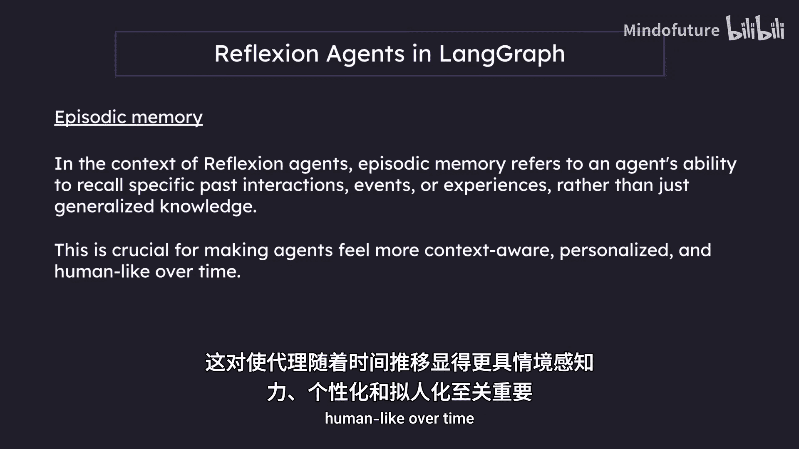
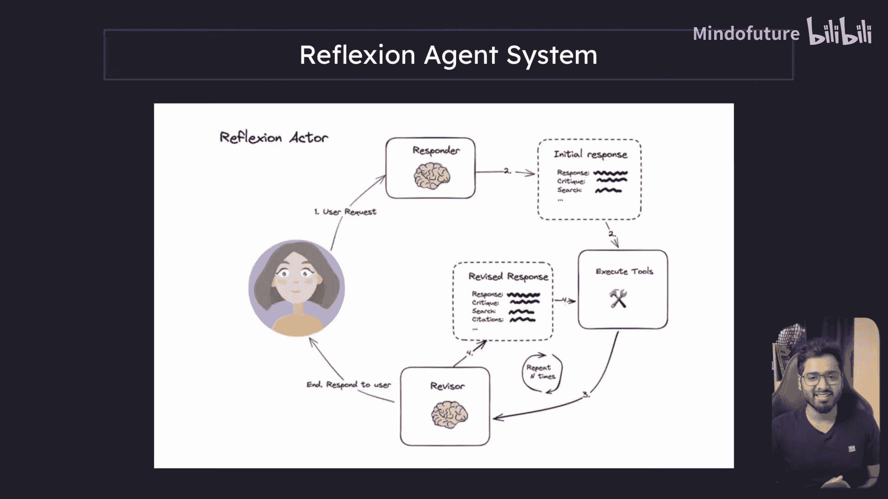

# Langgraph初学者入门2025 p11 P11_#10_Reflexion代理介绍 -BV1mgepzCEjf_p11-

Hello， guys。 welcomecome to the section In the section。

 we are going to be looking at a brand new system called the Refleon agent system。

 I hope that that is how it is pronounced， but this system basically sort of addresses some of the drawbacks that the reflection system that we saw in the previous section tends to have。

 So we'll do a quick recap of what we saw previously So we saw that the reflection agent system right。

 the previous system that we saw consists of the generator and reflector component。

 Although iteratively making a post better is significantly better than just prompting chay Bea。

 the content generated by the reflection system is still not grounded in live data。😊。

It could be hallucination or outdated content， and we have absolutely no way of knowing。

 I'll give you a very simple example。 let's say Im a marketer and I want to write a blog post on you know how is AI helping small businesses grow right so that could be a blog post right if I were to feed it to a reflection basically the the basic reflection system that we saw on the previous section。

😊，What it might do is it might actually write something。

 but it is based on whatever the model has been trained you know last year or something like that it tends to have a cut of data right but if in order to write really enriched blog post it's very important that you know we we need to provide it a lot more recent news that happened or we need to provide the system the ability to make API calls Google search if that is what it's needed right so that is how you know having citations instead of the blog post like you know this is the URL that I referred you know this particular data from So all of that is what makes a blog post really enriched and that is something that this reflection system is not really capable of because we are not really making any tools like w search tool that we saw right we not making it available to the reflection agent system so that is a drawback of reflection agent system So that is exactly why this reflectionlexon agent system it addresses this particular。

😊，Drawback so let us look at what is the reflection agent system。

The reflection on agent similar to reflection agent not only critics its own responses。

 but also fact checks it with external data by making API calls in this case internet search。😊。

In the reflection agent pattern， we had to rely on the training data of LLMs。

 but in this case we are not really limited to that。😊。

So the main component of a reflexon agent system is the actor。😊。

The actor is the main agent that drives everything it reflects on its responses and reexs it。😊。

It can do this with or without tools to improve based on self critique that is grounded in external data。

 So let us look at some of the main subcompence that are involved in this particular system So we've already seen that this actor agent is going to be at the very top right it is what is going to be driving everything underneath it。

 we have all the subcompence So the first one obviously is going to be tools or tool execution right in order to ground a response with live data we need tools like w search tool which is going to make API calls and understand you know what is exactly happening and then the first subagent。

 you can think of it as a subagent and that is going to be the initial responder Okay or the responder agent So basically the responder agent's job is to generate an initial response。

😊，And it is also going to do some self reflection。 Okay， later on。

 we look at the diagram and it would make sense。 So we've got tools。

 we've got the responder agent and we've got the Reor agent。 Finally， okay。

 so the reviseor agent agent's job is to rere and reflect based on the previous reflections and also the reflection agents are thought to have episodic memory in the context of reflection agents episodic memory refers to an agent's ability to recall specific past interactions。

 Even or experiences rather than just generalized knowledge。😊。

This is crucial for making agents feel more context aware， personalized and humanlike over time。😊。

So here is a very simple diagram that the documentation provides about what is a reflection agent system Okay so for now you can actually see that we have the actor right here right so this is going to be the high level this entire thing can be thought of as the actor inside of which we have the responder agent we have the revise agent and we have the execute tools right we have the tools right here so let's actually take things one step at a time let's understand what this responder agent is actually going to do。

😊，Okay so let's say this is the user the user wants a 250 worded blog post on the same prompt right on how can businesses utilize AI or rather small businesses utilize AI to increase growth or something like that right so in that case that user request is going to the responder agent and the responder agent will basically output something like this okay so this is going to be the initial response so this you can think of it as a JSON structure and the JSON structure is going to have three different properties and the first property is going to be the response right so the response is basically just a 250 worded blog post that the LLM thinks that you know this is what is the right thing and along with the response it is also going to attach another property which is going to have critique so essentially it's like writing its own blog post。

😊，And then it is actually looking at the blog post that it has written and then it is actually cring it。

😊，Okay， so the LLM is doing all of that in one shot。

 this responder agent is doing all of that in just one shot。😊，Okay， so it is thinking， okay。

 this could have been better。 this， this could have been shorter。 This could have been， you know， Im。

 you know， this a lot of redundant excessive information that nobody really wants to know。

 So it's actually critiquing itself。 And depending on， you know， whatever it has written。

 it is also going to suggest some search keywords。😊。

Okay so it's also going to suggest some search keywords。

 So basically let's say you the LLM is going to write the blog post and then it once it would it feels like you know it would write it better if it could have latest information about certain things So it is actually suggesting those list of search keywords right here in this third property I really hope that this makes sense。

 So what is next So the next thing you can see that the control flow is coming to this tools component right here So essentially whatever search keywords the list of search keywords that the responder agent generated this tools component is actually going to the W search tool if you remember in the first few sections we looked at what the W search tool does it's basically just a tool that goes into the internet searches for these particular keywords that the LLM suggested and then get the responses and then send it back to the next component that is exactly what the execute tools component。

😊，So what do we have so far。So far， we have the initial response with the response critic and the search terms。

 We also have the results， the Internet search results of the search terms as well ready。

 So we have both the initial response， as well as the new data， the live data ready。 Now。

 all of both of those information is now fed into。😊，This second subcomponent。

 which is going to be the revise agent。Okay， so this revise agent is going to get both those information and then it is going to look at you know these are the existing things。

 these are the new information and now it is going to generate a revised response。😊，Okay。

 so it is going to generate a revised response with a revised response， a revised critique。

 a revised search term list， right， and it is also going to add something else called citations。

 you can see that it is the first three properties are very similar right It's got response property。

 it's got the critique property。 it's got a search property right except since this is the revised response。

 The content is going to be the revised content。 The critique is going to be the revised critique。😊。

And then the search is going to be revised search and additionally there is going to be another property that is going to be added。

 which is called citations。😊，So basically any research paper that you look at you know it the content itself would have like 1。

2，3，4 and then clicking on it it is going to take you to the citations link where that Excel fact has been taken from right so that is what is called citations and we are also instructing the revise agent to add the citations as well so all of this content is going to be revised alright now。

😊，You can imagine that you know after after the revised thing is done the LLM might think you know what okay now I have extra information but I want even more information based on whatever it is that Ive written so in that case this search the search list is going to have new keywords right one or two or three new keywords and again they execute tools is going to go fetch set information and then it's going to come back to the revise and this loop is going to keep it going to go on for a couple of times。

😊，I hope that makes sense。 you can actually imagine how powerful this could be because with every single iteration there is new information getting fetched from the internet and it enriches the content a little bit more every single iteration right it's going to ground all the content with live data right and also don't worry that you know the length of the content is not going to keep on increasing or anything because we will also tell it okay only keep it to 250 words so you can imagine that that content is going to get more and more enriched with live recent information and it would make for a really good blog post right so after it sort of repeats for a couple of times it is then obviously it's going to go back to the user So this is what is called a reflectionion agent system if this is this sounds too much for you don't worry we are going to be taking it one step at a time we are first going to be building out this this first component it and then we are going to be building out the。

😊，PAnd then we are going to be building out the execute tools and then connecting it all together using land graph。

 So by the end of this particular series， the section you should have a pretty good idea。

 So in the next section we are actually going to be implementing this particular system using code so as you there。

😊。

