# Langgraph初学者入门2025 p12 P12_#11_Reflexion代理_构建响应器链 -BV1mgepzCEjf_p12-

Hello guys in the section let's actually go ahead and build out the first component right here。

 the subcompent of the actor agent right here， which is going to be the responder agent okay so the reason why we call both of these agents as subcomp of the actor is because the base chat prompt template the prompt template is going to be of the actors and both of these subcomp are going to use the same basically reuse the same prompt as that of the actor。

😊。

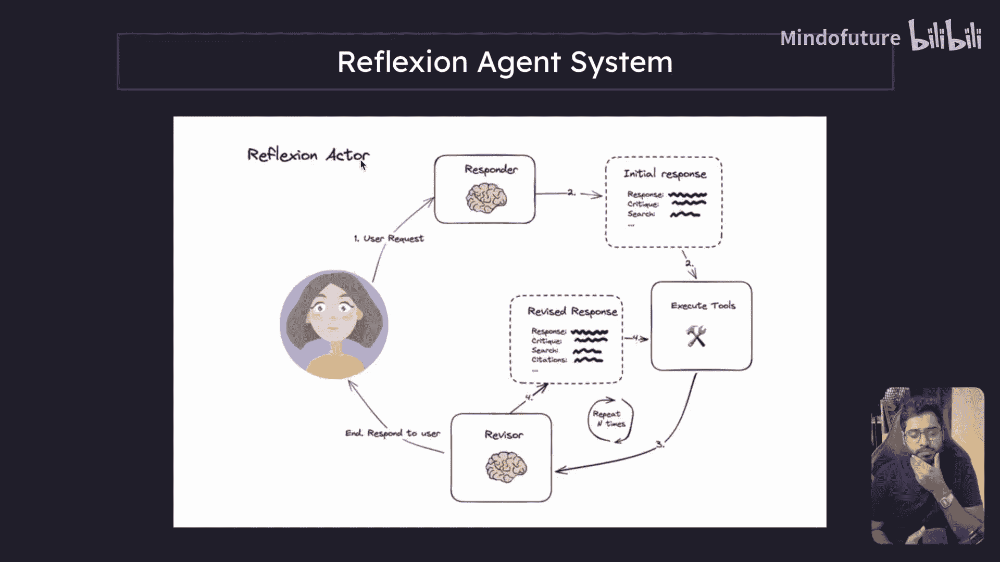

If that does not make sense don't worry let me just quickly copy paste some code writer you can see that I've already created a folder called reflexon agent system Ive created another file called chains so this file is what is going to house all of the different chains that we are going to be building alright so let me copy paste something right here and let me walk you through it。

😊，Alright， so all that I have done here is that I've just called it the actor agent prompt and then I've imported you know chat prompt template and the messages placeholder no different to what we've done in the reflection agent in the previous section。

😊。

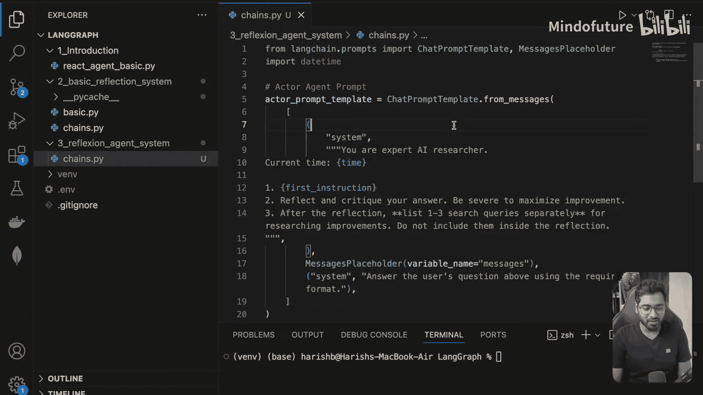

So let me let's actually go back to the diagram。 Let's see what is the you know goal of this responder agent So we know that the goal of the responder agent is to。

😊，Finally， you know， after so many processing finally we need a response like this right lets keep it very simple。

 let's keep it very high level for now the responder needs to output a Json。😊。

And the Json then needs to be converted into a proper Python dictionary that is going to have this particular structure right so the initial response should have the response。

 the content of the blog post the critique of the written blog post the search keyword terms。

 all of that needs to be available right so this is exactly the goal and that is how we are going to be writing the prompt as well So let's actually go look at the prompt of the actor Allright so so you can see that we have the system which is going to be you are an expert AI researcher and then we are also providing the current time right here。

 why do we need the current time it's not really super important to understand this but to give you a very high level let's say you are giving a task to the agent to talk about something that happened recently you know current affairs or something like that。

😊。

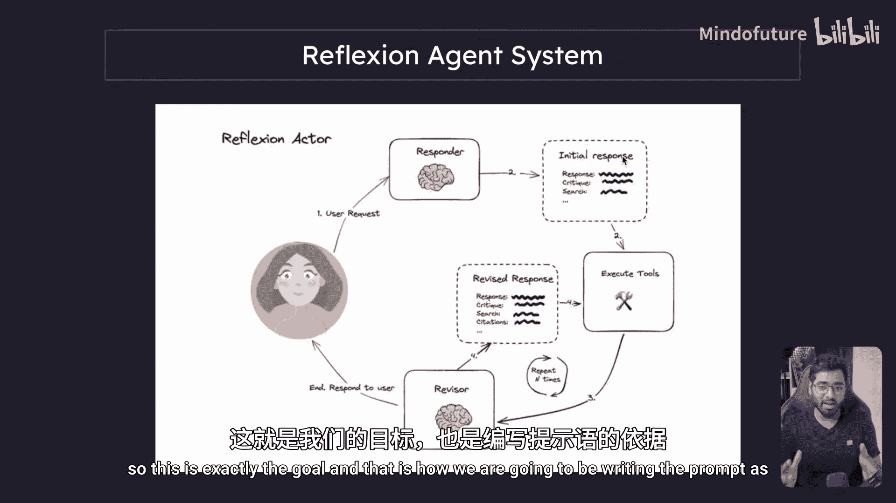

It having access context of what time it is can be important because accordingly it can make Google searches and then figure out if it is actually if it actually needs to do something or not。

 if it actually needs to look look at Google or not， right。😊。

So we have the first instruction right here this first instruction basically weve got one to3 these one23 corresponds to these things right here okay so we've got the response Cri and search this is going to be for response this is going to be for critique this is going to be for searching okay so we will dynamically import this later you know this alone can change depending on whether you are building the responder agent or the revise agent but for now since we are only focused on building the responder agent using the actor。

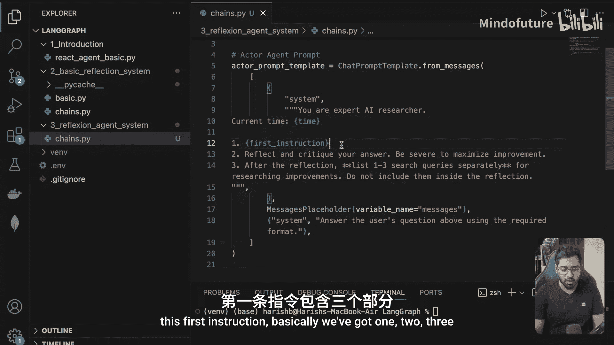

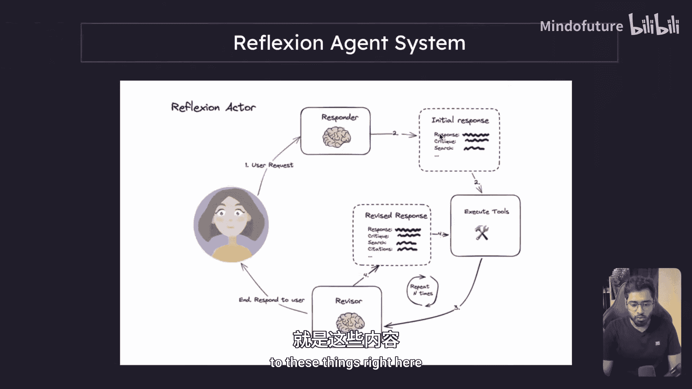

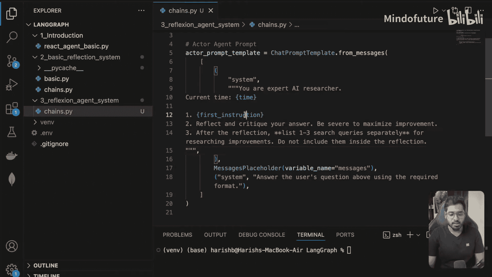

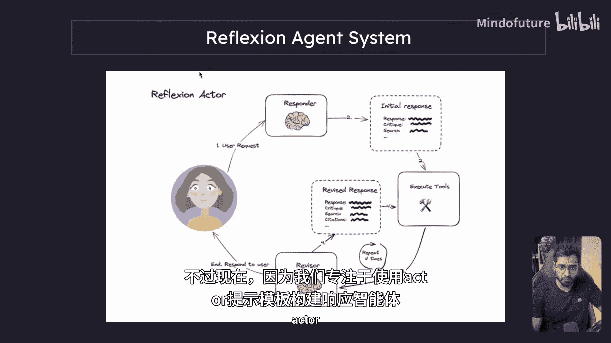

Pro template。 So we are going to have it as a placeholder right here。

 I hope that makes sense This will later on you know tell you know write a 250 word blog post right here。

 Okay， that would be the instruction。 Let's look at the second one reflect and criticitique your answer be severe to maximize improvement right we want it to be really severe about what it has just written。

 It is all going to happen in one single you know to and f right。😊。

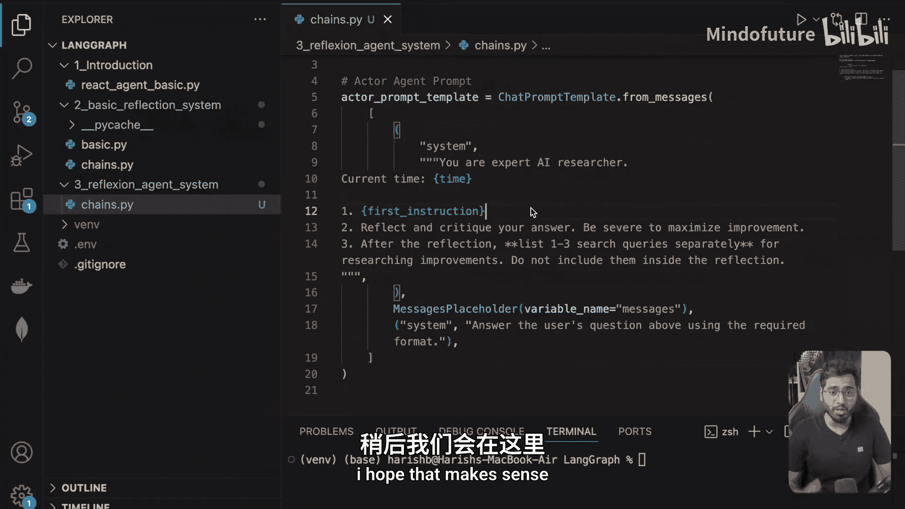

After the reflection list one to three search queries separately for researching improvements。

 do not include them inside the reflection Okay so we're also providing you know instructing it to provide this search list of search queries as well and then finally we also have messages placeholder that could be you know this could be the place where the actual human message would commence it so the human message in the future when we actually run it iss going to be something like I want to blog post on you know this particular topic so that human message is going to come sit inside of here and then finally we have another system message which is just to you know we don't really need it right here but the reason why we provide you know this answer the user's question above using the required format the reason why we provide it at the bottom as well as the top is because LLm tend to you know pay a bit more attention to what happened at the start and what happened at the end so we just like you just to make sure we are providing this。

😊。

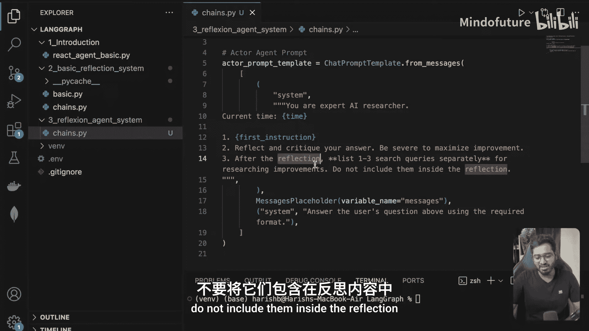

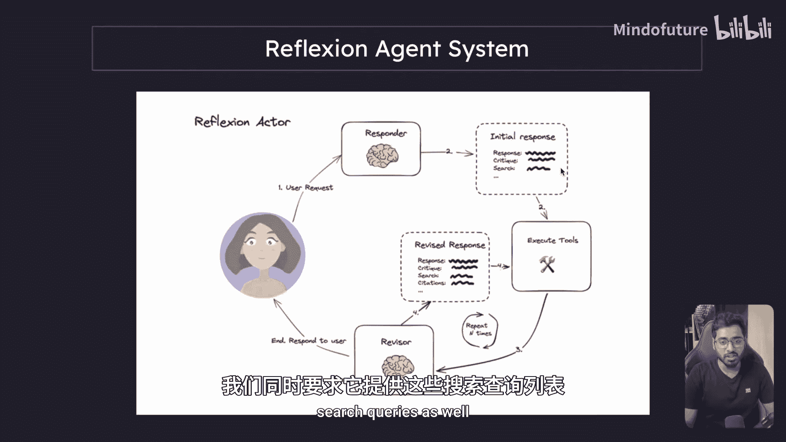

So this is going to be the pro template this is not really something that I wrote this is a pro template that is very standard for the reflexon agent system I pulled it from the internet so yeah that is what I've done here so let's actually go back to the diagram。

😊，So you can imagine that you know if I were to you know use this prompt template and if I were to you know invoke that particular chain。

 you know send it to the LLM and invoke that chain。

 it is going to give you you know a response with this particular response is going to give you a critique is going to search all of it is good。

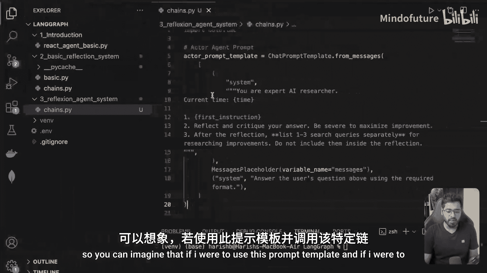

But at the end of the day we want something concrete like this we want a Python dictionary。

 we want a proper dictionary or like a model that we can actually access the values from so that we can extract those things and then send it to the execute tools and do a lot of other things right but you can imagine that LLMs are a little messy they sometimes don't provide the right properties they sometimes you know tend to mess up as well so it's a tricky thing but we actually have a solution to basically force the LLM to ground the LLM to provide a response in a particular schema。

😊，Okay， so that is going to be the main takeaway in this particular section。

 So let's actually look at how the exact processing is done， what are the different lever。

 what are the different steps that we have to take to ground the response of an LLM to provide a Json structure in a very we are forcing the LLM to provide a schema we are forcing the LLM to provide the response in a particular schema。

 Okay， so let's actually look at how that is being done。

 So I am calling it the LLM response pass the system。

 So let's actually understand the theory behind it and then we'll jump into the practical stuff。😊。

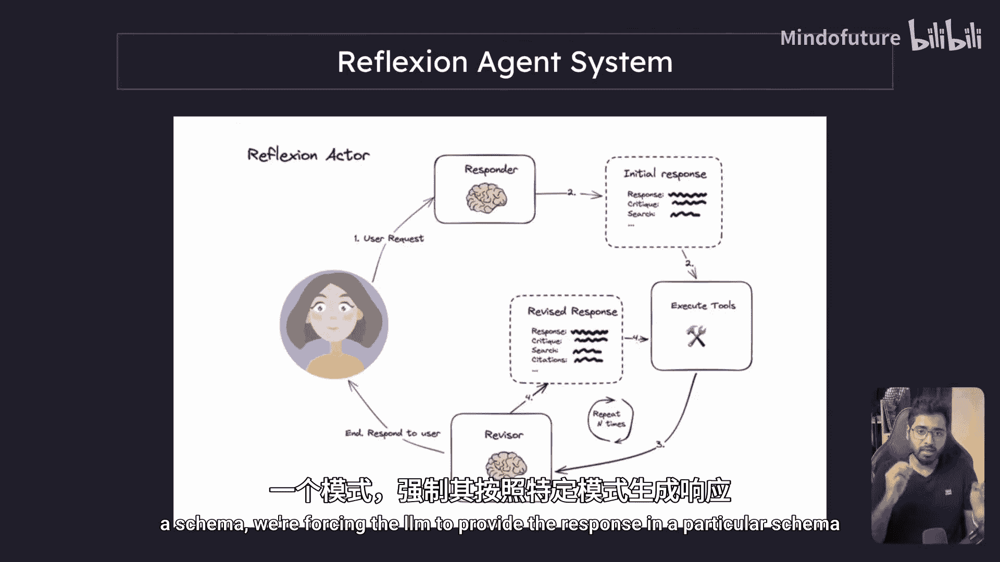

This system converts unstructured LLM outputs into well defined Python objects through a series of structured passings steps。

 ensuring data validation and consistent formatting。

So what are the key components we have already written the actor pro template that part is done。

 Let's look at the next one。😊，Function calling with a pedantic schema。

 and then the third one is going to be something called a pedantic parser。😊。

So since we we already understand chat pro template， let's actually move on to the second one。

whichhich is going to be the function calling with a pedantic schema。

 so we already know what tool calling or function calling is。

 but just to give a refresher similar to how we make tools available to the LLM。

 we can also send a schema to the LLM and force it to structure its Json output according to the schema。

But what is pedantic right here so we we already understand the we already understand the function calling we understand schema。

 but what is the spedantic。A Python library that defines data structures using classes。

 it provides automatic validation of JSO data against these class definitions。😊，So to quickly recap。

 we just define the schema and then we add it as a tool during our function call to the LLM and the LLM is going to call that particular tool you know structure its output accordingly very simple。

 let's look at the last one， the pedantic parser。It takes the JON output from the LLMs function goal。

 it validates it against the defined pedantic schema or the class definition。

It creates instances of pedantic classes with the validated data。

 If the LLm output does not match with a defined schema， it will throw an error。😊。

So it might this pedantic parer you might have some difficulty imagining what it could look like。

 So basically you know the previous pedantic model that we that is a tool that we make it available to the LLM that is basically just going to ground the output of the LLM okay it's just going to force the LM to structure its output in a certain way。

 but we also need another line of defense wherein we also have to validate if the output of the LLM is actually you know adhering to the schema to the model pedantic model okay so that is what this pedantic parer does it takes the Json output it validates it and then it is going to create you know an instance a class or a model。

😊，And you know， it makes it easier for， you know for us to you know use Python and then extract the stuff and then start working with it。

 Okay， so these are the steps。 So so far what we've done is we've written the actor prompt template right here。

 The next step is we need to actually go ahead and before we start invoking it we actually need to go ahead and create a schema file right here。

 So that is exactly what I'm going to do。So to do this I'm just going to copy paste some code right here and let me walk you through it。

 Allright， so this could be a lot。 So let's take it one step at a time。

 So what I've done is I've imported from the pedantic module。

 I've imported the base model as well as the field basically don't let's not overcomplicate the base model is just giving you the tools to you define a schema very simple Alright so let's go back to the diagram So what are the three things that we need we want the main response we want the critique of the generated response and then we want the search and that is exactly what we are providing right here Okay so we defined a class called answer question we are providing in the base model right here and first off we need the answer right so the answer is going to be in a string format and the field is going to have a description right So here we are actually suggesting a 250 word detailed answer to the question so not only are we providing the 250 word prompt in the chat pro template。

😊。

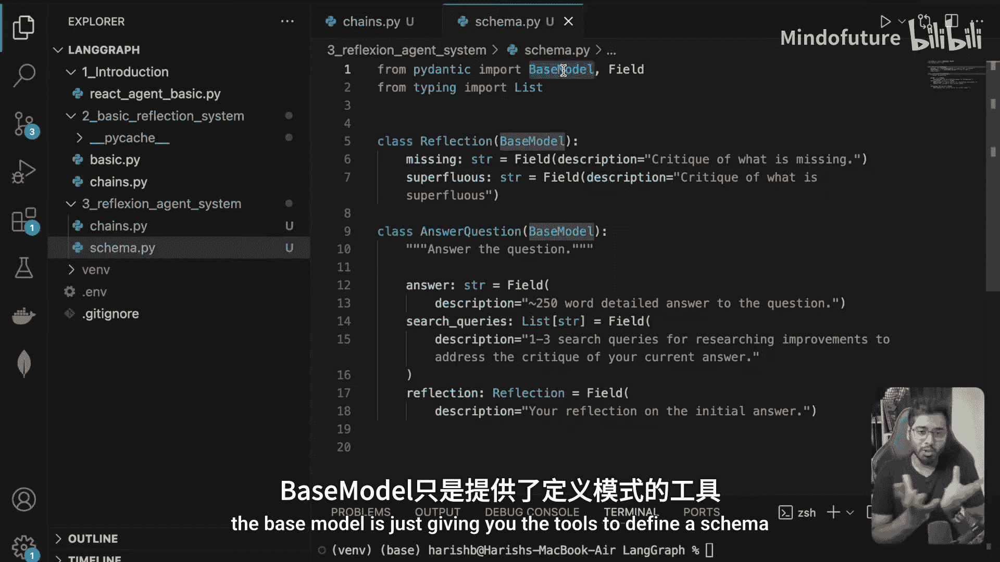

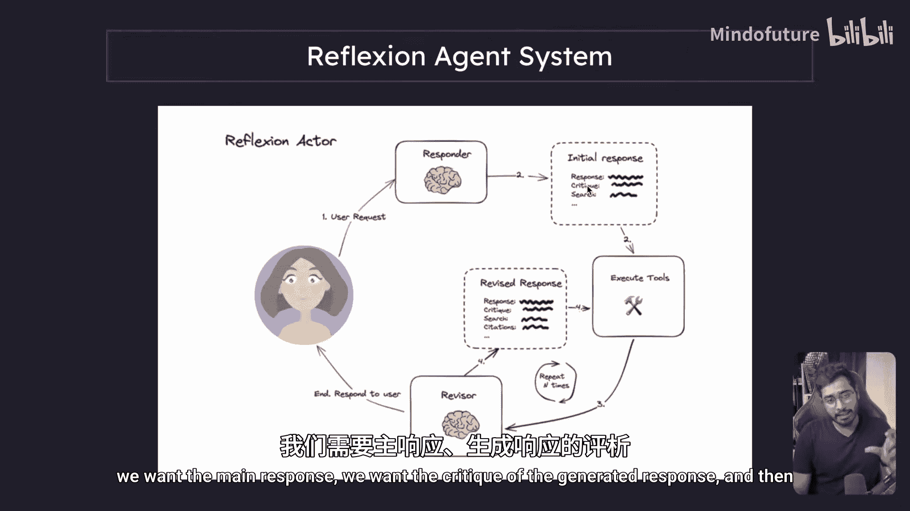

We are also doing it here。 So there is like a double you know defense where we are grounding the response of the LLM properly。

 Okay， so we have the response right here。 Okay， so the first one。

 the response is done the next thing is we can probably provide in the search and the critique right and that is exactly what we've done we want the search queries to be a list of strings and the description is going to be one to three search queries for researching influence to address the critique of your current answer and then finally we have the reflection here as well。

 which is going to be the critique we can name it whatever we want but the reflection is going to be your reflection on the initial answer that is going to be right here right so that is what it is and also note that this reflection is also going to have two different sub propertiesties right so you can see that we have missing as well as something called superfluous okay so we'll get to what that is in a minute but missing is it is a critique of what is missing So whenever we are。

😊。

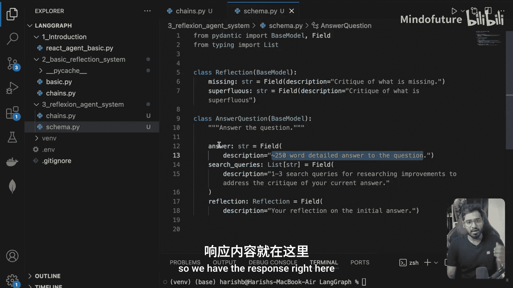

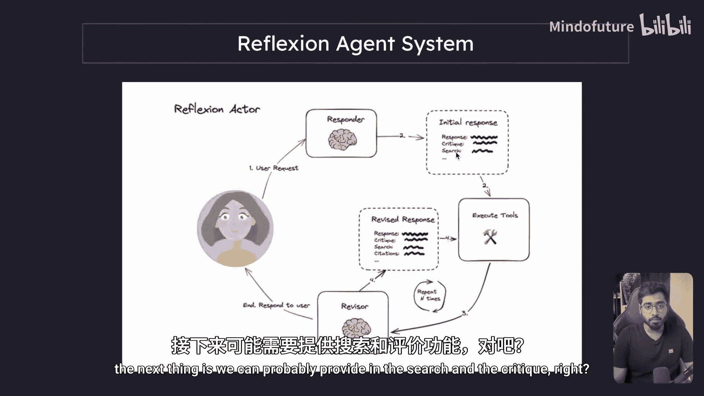

You know， reflecting on or rather critiquing on a particular。

Passage or something like that we either think of it in terms of you know this could be shortened or this could be made better right so that is what we are talking about missing is like you know what is missing what could be made better and then superfluous is what is excessive what is redundant what is not needed right so a criticitique of what is superfluous。

Alright， so this is going to be the base schema that we are now going to use to ground the response of the LLM properly。

 so lets actually go ahead and do that。So let me come back to the chains。

 Let's see if everything is done。 Okay， there's one more thing that I want to do。

 I want to do a partial and I want to prepopulate the time。 Okay。

 I don't really want to do it during invoking so so let me just paste this right here so basically this partial method is something that you can use to prepopulate placeholders you know before even invoking a particular chain right so that is what we've done right here we are making use of the datetime module of pythons All right so now let's go ahead and write the chain for the respondpoer agent so what I can do is I can call this first。

😊。

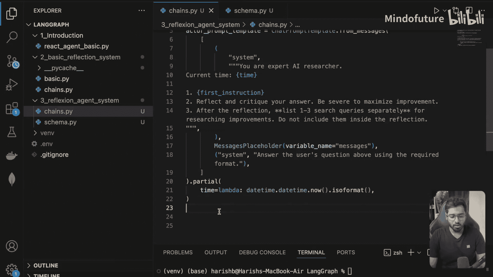

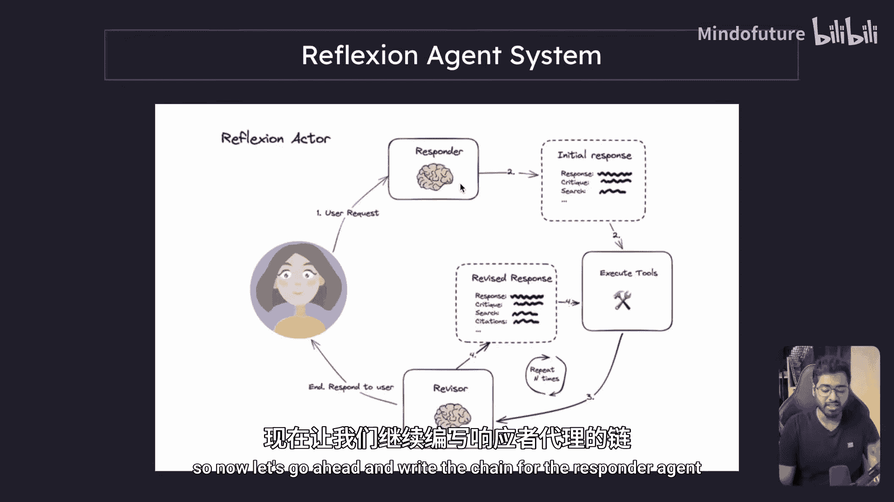

A responder。Prompt。Template。So here I can make use of the actor prompt template right here and I just want to fill up the first instruction okay so you can imagine the first instruction is going to be a very simple you know write me a 250 word blog post right so that is exactly what I'm going to fill it up right here。

😊。

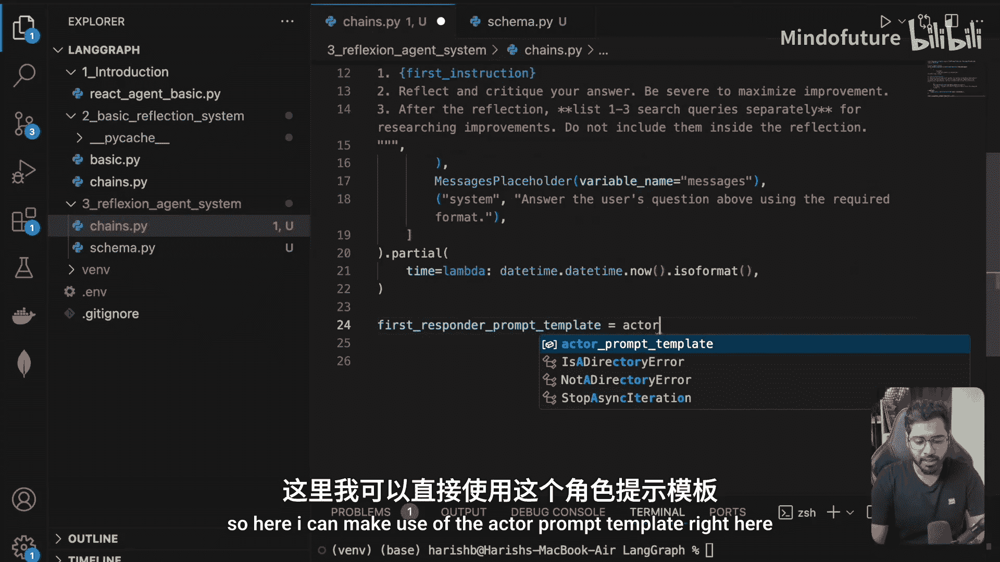

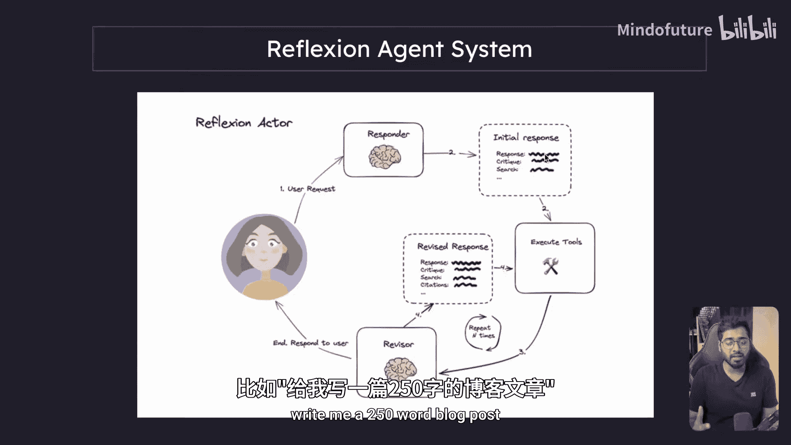

So， so I'm just going to say。First， instruction。Provide me a detailed250 word answer。 Okay。

 so the first responder prompt template is now done。

Now I'm going to create the chain for the first responder。

 So I'm going to call it first responder chain。And I can use this particular pro template。

 and then I can pipe it with the LLM right， So when I pipe it with the LLM， remember。

 we also have to provide in that answer question。😊。

Tool that we have written right here to the LLm so that we can call that tool and then use that tool schema to ground its response。

So I'm just going to say LL M dot buying tool。 Okay， so we haven't actually provided the LLM yet。

 right， So let's actually quickly go ahead and do that。 So to do that， I'm just going to go to。

 you know， from。😊，Langchain， open AI import。Chat open AI， and I can come down here。

 say LLM is going to be equal。Ct open AI， I can send in the model to be G 4。5。Okay， perfect。

 Allright。 So now the bind tools method is going to be available。 So inside of here。

 I can provide an the answer question schema that we've just written in the schema this thing。

 So let's just quickly go ahead and import that as well。 So I'm just going to say a schema import。😊。

The name of this is going to be answer question， so let's import that and let's。

Just go ahead and provide that， and that is it。So we provided this particular tool and since you know we are actually confident that this is the only tool that the LLM has to use right we don't want it to use multiple tools。

 we are sure we we are mandating the LLM to only use this particular tool So there is another property that we can actually provide which is called tool choice and inside of this in a string we can just provide the same thing right here so this is going to force the LLM to call that one particular tool structure its output in that particular schema properly perfect So if you remember we also need to pipe it with something else So not only is it enough that we get the Json response。

 we also have to convertge that Json response into a pyantic class so that we can easily sort of interact with it extract data out of it So to do that I'm going to be using the pyantic parser So that is going to be open eyes pyantic parser So I'm just going to come up here and I'm going to paste this line So here basically from the。

😊，core package output par， open AI tools and I am going to be using the pedantic tools parser right here and I can just come down here and I can instantiate it。

So I can just say pedantic parser。And I can just basically call this and provide in the tools as well。

So it will know exactly how to extract the information and now I can provide it right here Allright。

 so now all that is left is to basically just invoke this chain with a human message basically whatever I as a human I as a marketer want to prompt this particular system Okay so I am just going to say first respond a chain taught invoke and right here。

😊，If I come up here， you can see that in the messages placeholder。

 we have the messages variable right， so I'm just going to say messages and this is again going to be a list right so inside of this list I can just put the human message Okay。

 it looks like we have not imported it up here so I can just say from。😊，Lang chain core。Messages。

 import human message。Let's copy this。Put it here。 and then。So for the content。

 I can just say something like， you know， write to me a blog post。Post on how AI can or rather。

 how small businesses can leverage。AI to grow。 okay， very simple。

Now this is going to give us the response。 let's go ahead and print out the response as well。Perfect。

 so let me make sure that everything is looking fine。Allright。 So let's go ahead and run it。

 Let's hope that everything works fine。Perfect， so you can see that we've we've gotten the response in the exact same structure that we wanted。

 which is in the format of the pedantic class itself。

 So we have the answer question inside of which we have the answer right here and then let's actually go back to the schema let's see you know so yeah so we can see that the answer is right here。

😊。

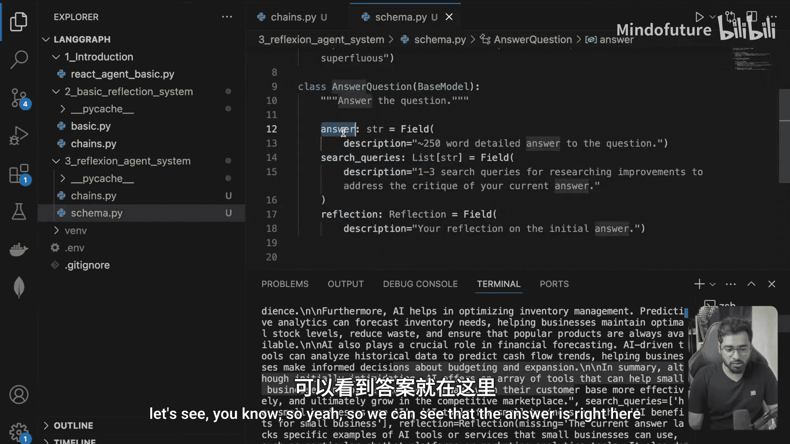

Okay， there's not really enough space for us to look at everything。 Okay。

 so we've got the answer right here。 and then we have the search queries as well。

 So let me actually copy paste the search queries here。

 and you can see that the search queries is also going to be a list of three things。

 So how small businesses use AI AI tools for small business growth AI benefits for small businesses right and finally。

 we have the reflection here as well。 and you can see that inside of the reflection class。

 we have the missing as well as superfluous。 So in the missing。

 it is saying the current answer lacks specific examples of AI tools or services that small businesses can use And then we have the superfluous as well。

 this is basically saying this is overly detailed right make it shorter So you can see that we are getting all the data in the exact format that we needed it。

 I know that this output in the terminal can be a little difficult to read。

 So what I'm going to do is I'm just going to go ahead and create a new project。😊，Let's copy。

 let's actually generate a new API key and then copy this thing and then come back to our environment variable let's let's paste it right here。

 we don't really need the API the open AI API key because we already have this here let's come back。

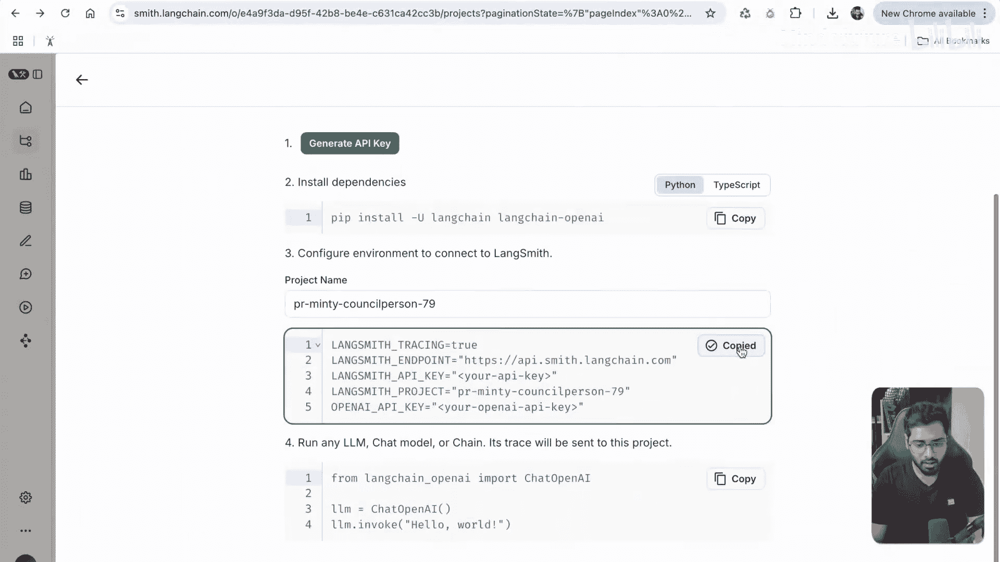

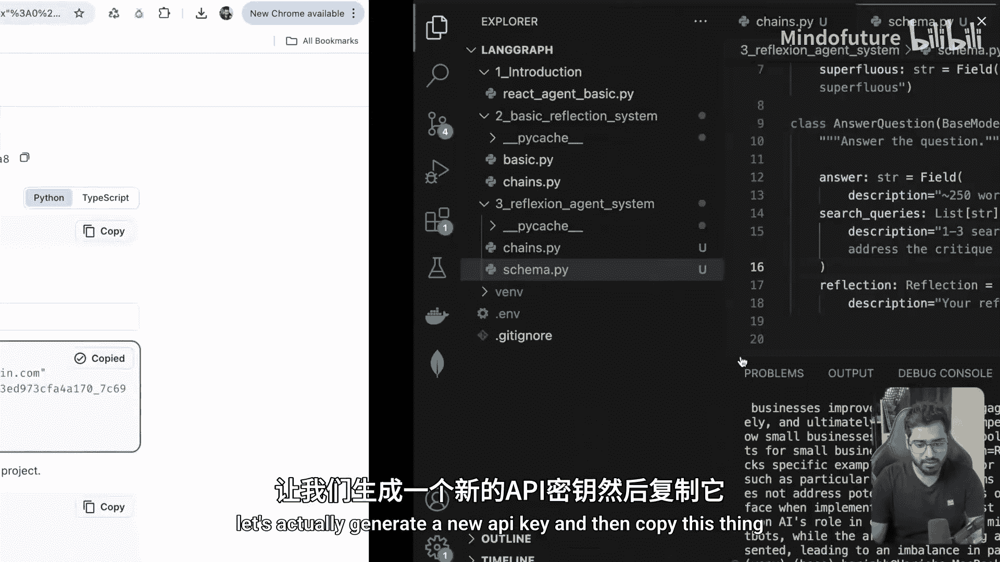

And let's clear this out。 Let's try to run it again。

 So let's actually like delete off all the terminals and then let's run it again。

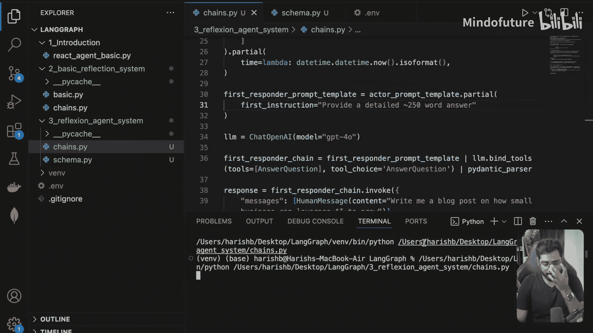

So let's give it a few seconds。Oh it perfect。 So let's actually go back to our lasmith and let's see perfect。

 So we actually have something that is generated right here。 So let's actually go inside。

 look at the traces and right here， you can see that this runnable sequence is going to be the high level know overview of what happened。

 So here we have the human message provided and here we have the output right So you can see that it's a neat list of just one you know object and that is going to have the class the pantic class or the pantic model and you can see that it has the answer right okay it can be a little bit difficult to read in the terminal。

 So I tend to come here So you can see that this is the answer and then finally the reflection is going to be these are the things that are missing we're not talking about costs you talking about the technical expertise So you can see that know it is generating this thing and it is also you know critiquing itself。

 it is saying these are the things that are missing superfluous like these are the things that are redundant or。

😊，Excessive right this you know mention of AI driven customer service its considered generic you know be more specific is what it's saying and then it is also suggesting some search queries for the next component Okay we'll get to that in a minute but these are the search queries AI for small business growth AI tools for small businesses and then finally small businesses AI solutions Alright so this is going to be the high level thing if you further want to look at what were the outputs of each and every single component we have it right here so this was the original pro template。

😊，Right so you can see that this is already populated。

 this was the first instruction that we provided human system and then this was the output。😊，Okay。

 so this you can see that this is a very simple Json output。

 the LLM is actually grounding its response properly based on the parentic schema that we've provided。

 So this is going to be the tool call I if you do not know why this is for well cover that in a few minutes。

 but yeah this is going to be the output of the。😊，The LLM which is which is a proper Json object perfect And if you want to know what this pedantic tools parer did。

 it basically just took this entire JO object and then it just basically formatted it in by pedantic model sort of a way and this can also be helpful in certain situations perfect so in this section we wrote the pro template for the actor agent and then we used the pro template to write the responder prompt template and then we created a chain out of it and then we also learned exactly how to pass and ground the response of the LLM into the structure into the structured format that we wanted and we've learned so so much in the section so that even in your own projects you know exactly how you can actually ground the response of a particular LLM output right Allright so great so we are done with these two sections right now in the next section what we are going to be doing is we are going to be doing。

😊。

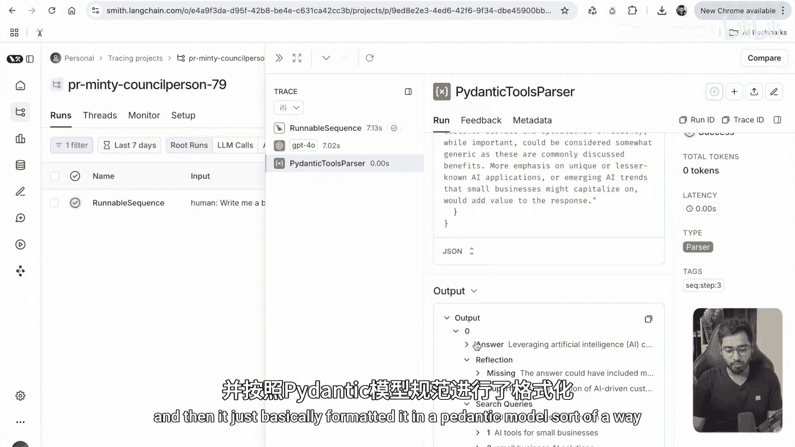

Same thing for the revise agent。 And once we are done with that。

 then we' will come back to building the execute tools。

 So I hope you learned a lot and I'll see you in the next section。😊。

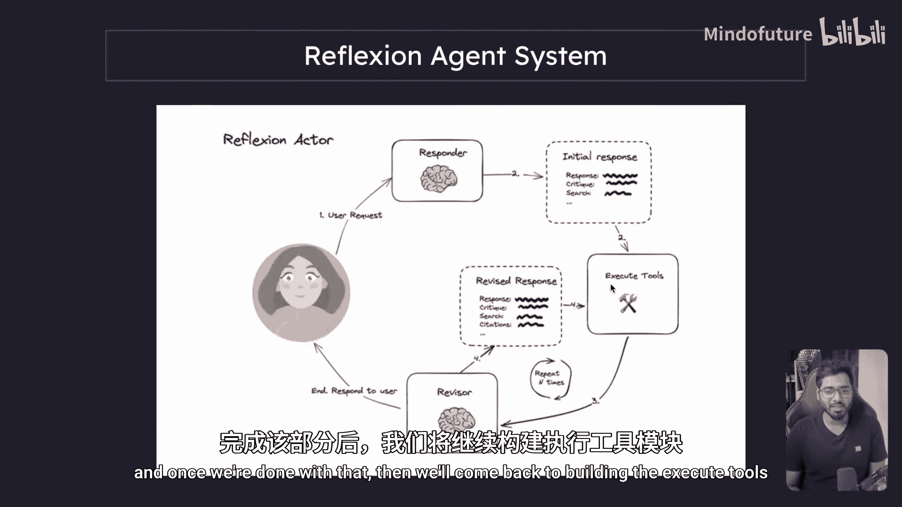