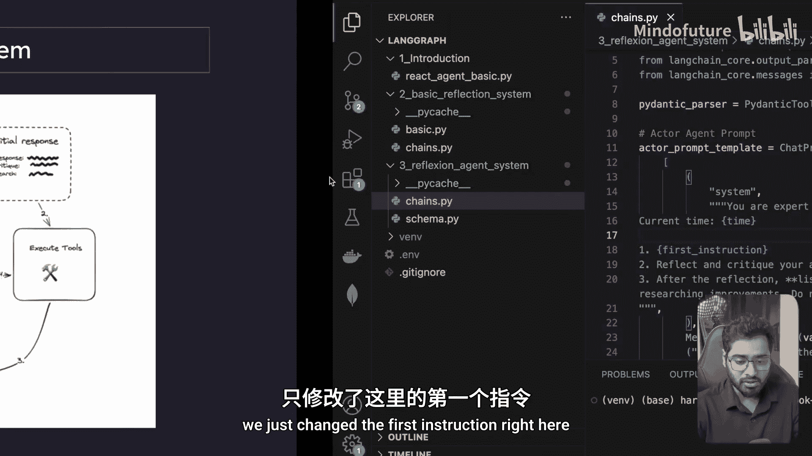
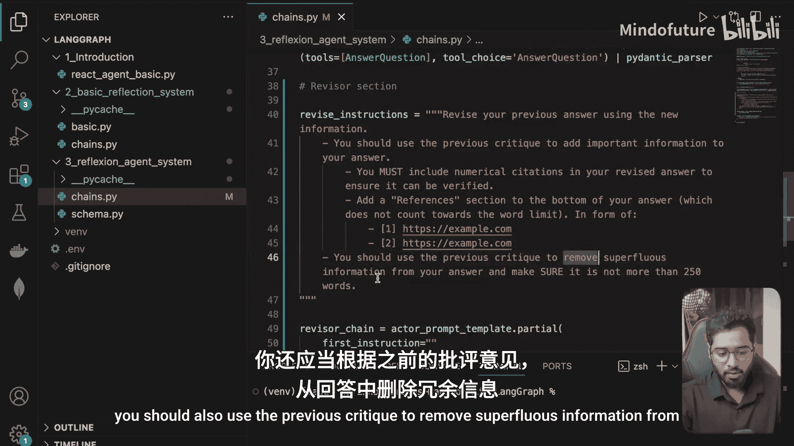
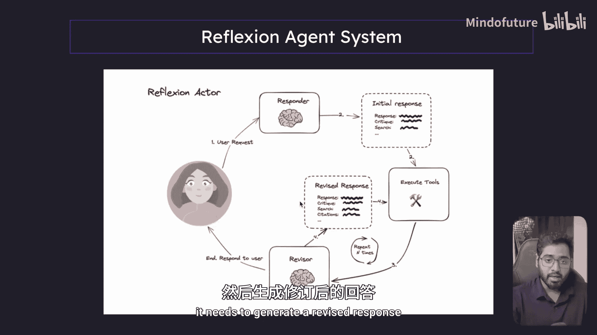
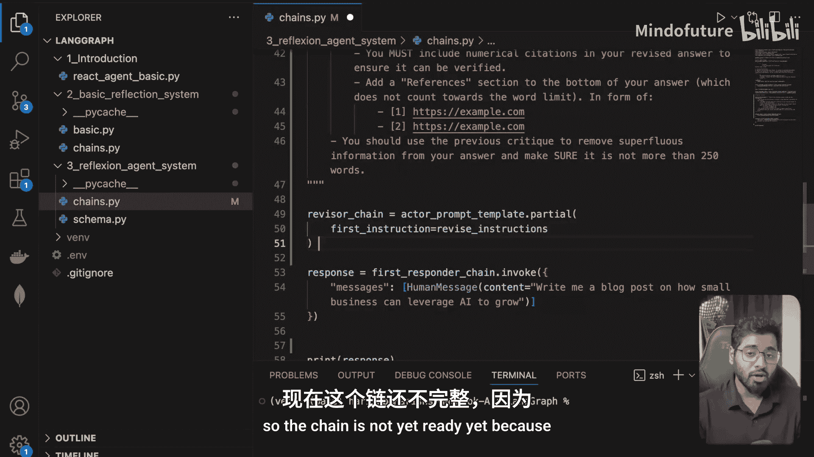
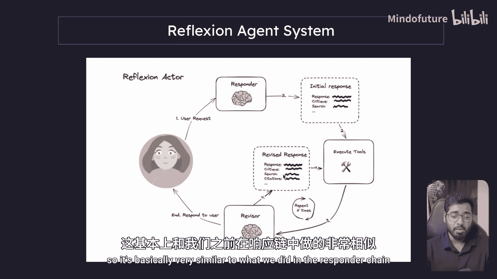
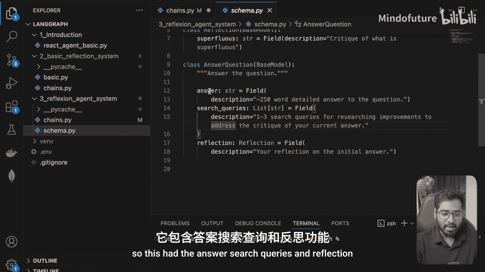
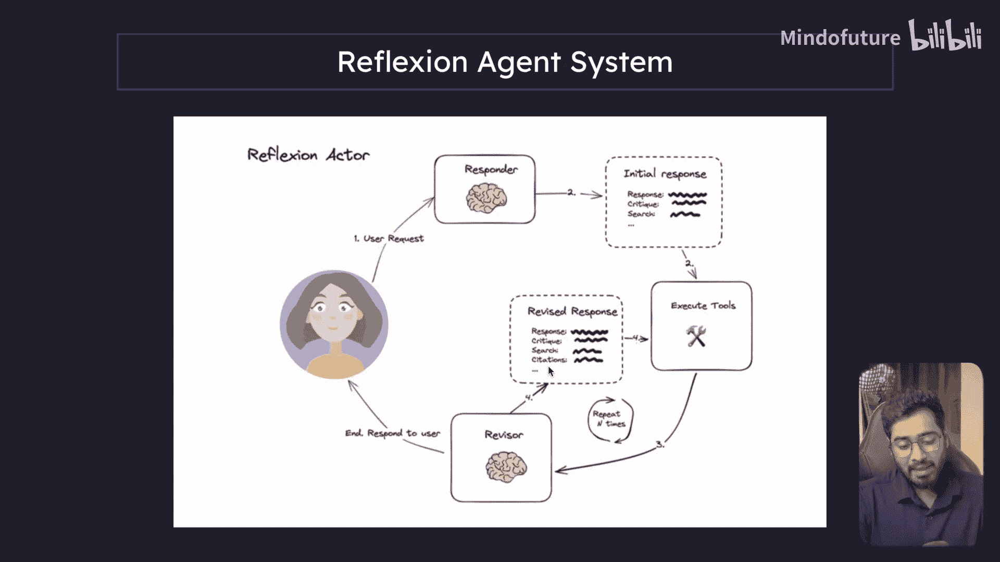
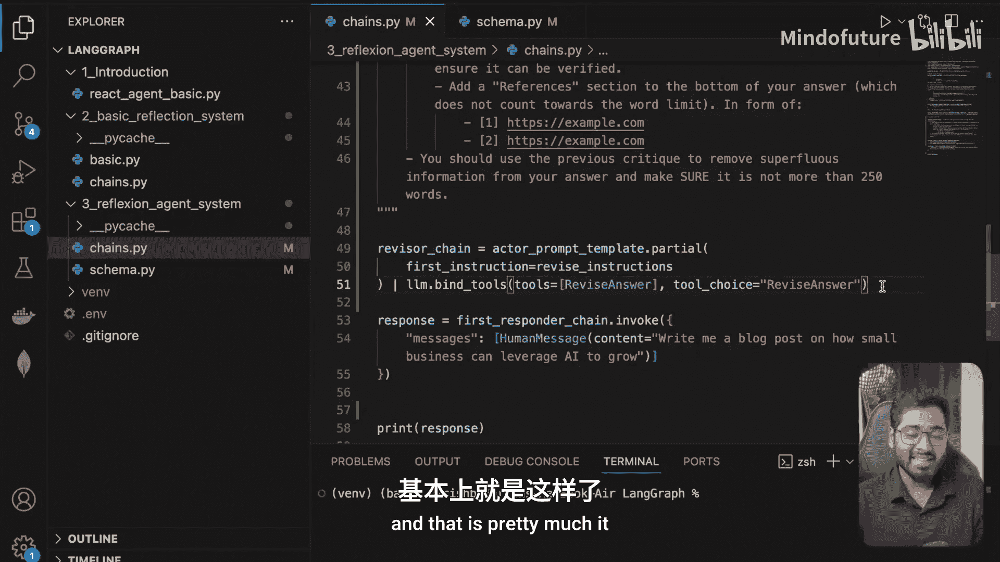
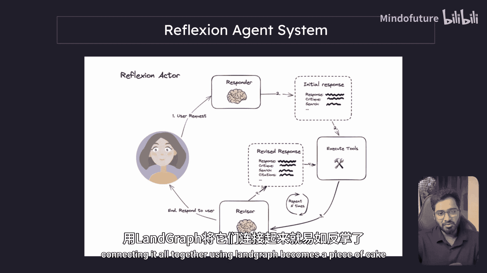

# Langgraph初学者入门2025 p13 P13_#12_Reflexion代理_构建修订器链 -BV1mgepzCEjf_p13-

Hello， guys， welcomee to another section where， you know。

 this section is going to be relatively very simple。 So in the previous section。

 we basically looked at the responder chain right and the actor chat prompt template。

 in this section we are going to be building out the revise chain。 Okay。

 so this is going to be relatively very simple。 We already know how we wrote the responder chain right。

 So we reused some of the reflection I mean， the actor prompt template。

 we just changed the first instruction right here。 right So we have the actor prompt template。

 and to build out the responder chain。 we just changed the first instruction alone。

 and then we created a chain out of it。 we provided a tool as well to ground this response。

 So we are going to be doing the exact same thing for the revise as well。

 So this should be pretty easy for you to understand。

 So what I'm going to do is I'm going to call this the revise。😊。

Jin。And I'm going to use the same actor pro template that we've written right here。So。

 and then Im going to say partial。And I am going to pre populate the first instruction alone。

 So the same thing that we did right here。So I'm just going to， you know。

 pre populate with some data idea， some content。 So let me just copy paste the content right here。

Okay so this is going to be the revised instruction So essentially what we're saying is revise your previous answer using the new information。

 you should use the previous critique to add important information to your answer you must include numerical citations in your revised answer to ensure it can be verified we also ask it to add a references section at the bottom of your answer which does not count towards the word limit so at the bottom we suggested to add these links you should also use the previous critique to remove superfluous information from your answer and make sure it is not more than 250 words right so I hope that makes sense whatever the responder is providing the revise has to look at all of that based on the critique that the responder provided and based on the search results it needs to generate a revised response so that is what we mean right here Alright now let me just copy this and put it over here perfect so the chain is not yet ready yet because we still have to ground the response。

😊。

Of the LLM in this particular revised response structure right so it's basically very similar to what we did in the responder chain。

 we had this you know let's go back to the schema so we had the answer question model right the pedantic model so this had the answer search queries and reflection if we come back to the diagram this also has the same answer I mean the response critique and search no different but in addition to that we just have the citations right here right so i'm just going to go ahead and create a separate class for this thing called revised answer you can name it pretty much anything that you want and this revised answer is going to inherit all of the base properties as the answer question so if you remember there is a lot of overlap right so I'm just going to put it right here。

😊。

And then let me just copy past some code。 Allright。

 So all that this is doing is it's going to inherit all of the answer question。

 you know these fields。 and then we are saying revise your original answer to your question and then in addition to all of that we are just providing the references。

 So this is going to be a list of strings and the description is going to be citations motivating your updated answer。

 Alright， I hope that makes sense。 Now let's come back to the chain and very。

 very similar to what we did in the respondpoer chain So let me scroll up right here so that you can see So this is the responder chain。

 all that we're doing is we are piping the template with the bind tools。

 and then we are forcing it to only use the answer question tool respondpoer right。😊。

So we are going to do the same thing here as well。 So this is going to be the prompt template。

 Let's pipe it。 So let's go ahead and pipe it with the LLM。

 So we are going to say bind tools and then let's provide in the tools which is going to be an array of this particular revise answer schema。

 So let's provide that here。 Okay， so it is not import it。

 Let me go up here and let's quickly import it， okay。Perfect。

 and we're also forcing it to only use this particular revised answer。

 which is now going to be a string as well。 And that is pretty much it。

 So let's come back to the diagram。 So so far， we built out the responder chain。

 we've built out the re chain in the next section， we are also going to be building out the third component。

 which is going to be the execute tools method， right。

 so once we have all of the building blocks done connecting it all together using La graph becomes a piece of cake。

 Okay， so I'll see you in the next section。😊。

