# Langgraph初学者入门2025 p14 P14_#13_Reflexion代理_工具执行组件 -BV1mgepzCEjf_p14-

Hello guys。 So in the section， let us now go ahead and build out this particular component。

 the execute tools component because this is what is next in line right so so far in the state you can imagine that we have the initial human message right if you remember the initial human users message and then the second item in the list is going to be the AI message that has this information right so the AI message is going to have the response cr and search terms the search term is going to have three different search terms right So the next component which is this execute tools so all the execute tools method has to do is take out the last message which is going to be the AI message right it just needs to take that out and then it needs to look at the search terms that are present So we are going to now have three different search queries right So all that it has to do is loop through each of those and then with each iteration call the tabli search get the response compile it all together and formulate a final one tool message So we have different types right we have human。

😊，AI messageSo the initial human message that is the first item the second responder chain is going to give out one AI message。

And then this execute tools is going to give out one tool message Okay and in that tool message in that content。

 we are going to have all the information。 I hope that makes sense。

 let us now see how we can implement it。 So let's jump back to the VS code and you can see that I've gone ahead and I've written out the code。

 I've created a file called execute tools inside of reflexion agent system。

 So this method is what we need right So this is going to be our execute tools node right So this state you can imagine is going to get a list of messages。

 the human message and AI message at the initial point when this is executed right so we have human AI。

 And then when it hits it， we are going to have human and AI message in the state So we are just going to get the last AI message and we are going to do a bunch of different things So before we go through this。

 let me show you you know I've prepared a dummy state that we can actually pass in here just to test out the method to make sure everything is working fine So as I told you we have the first item of the list which is going to be a human。

😊。

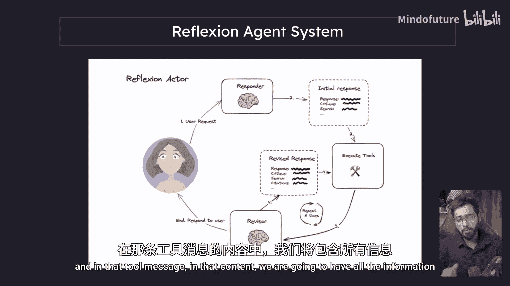

which has some prompt。 and next we have the AI message right so this is going to be the bare bones structure that this particular respondpoer chain is going to output。

 Okay so it's just going to have the content is going to be empty because this time it is actually making a tool call right So in the tool calls the first object it is going to contain which tool it called and you know the tool called ID so the name and I is going to be very important。

 weve just marked it right now and then we also have the as So inside of the as this is the schema that we are defined right So this is exactly how we are going to get So if you're curious you can just like go print out you know the output from the respondpoer chain and this is exactly how we are going to get the AI message maybe this's going to be a lot more information but this is the information that we are interested in to test out this method so the answer we utterly really interested in right now I just left it as empty string What we are interested in is the search。

😊。

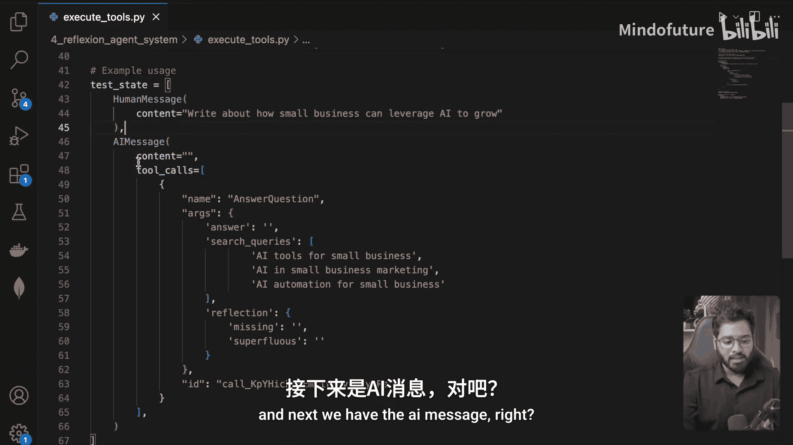

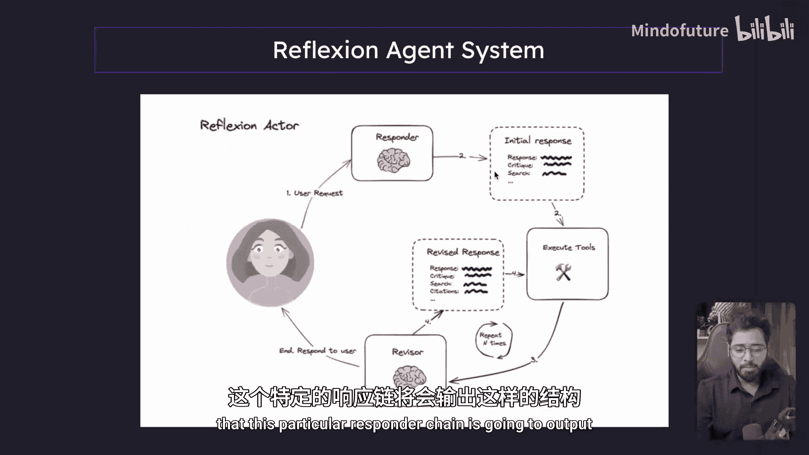

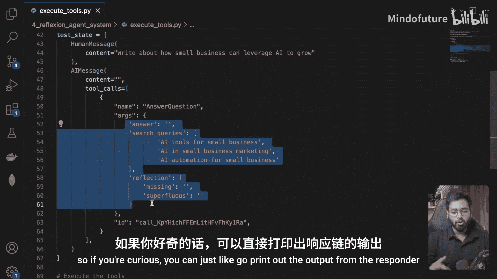

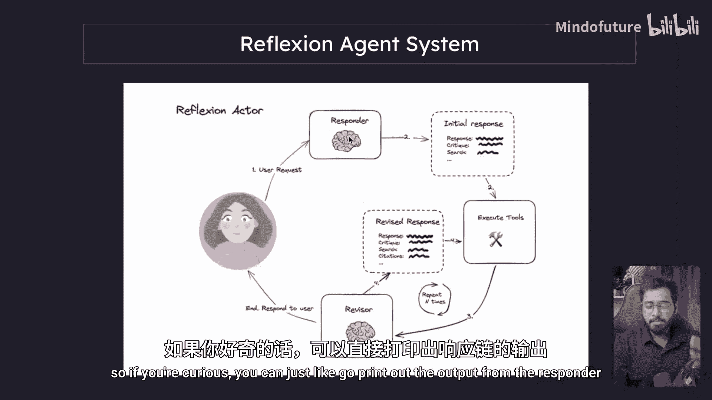

Quries， you know these three things Okay so yeah that is what I've written here the missing and superfls also we are not really interested right now to test out this method so yeah these are the three let's say our imaginary search queries that we need and this method basically just needs to go through each of those things call it and then create a final one tool message okay so in addition to human message and A message we are now going to add another tool message inside of this state okay perfect。

😊，Allright， so let's look at what we are doing right now we are just going to extract the last AI message and all that we are doing is testing checking if the tool calls are present or not okay so if there are no tool call present it does not make sense to execute those tools right because there are no tool calls to begin with so that is why were just checking it if there are no tool calls were just returning an empty array we don't really need to do anything here no tools to execute but in case we do have tool calls we are going to loop through all of the tool calls that are available in this case we only have one right so we only have one object right here which is this one tool call the answer question perfect okay so we are just going to get the tool call ID and the search queries as well so we are going to get the the tool call ID and all of the search queries right here so we have both other information here and now all that we are doing is we are looping through those three different items。

😊。

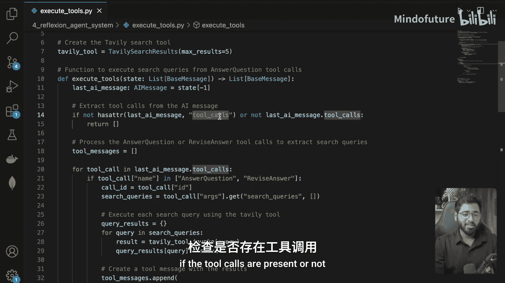

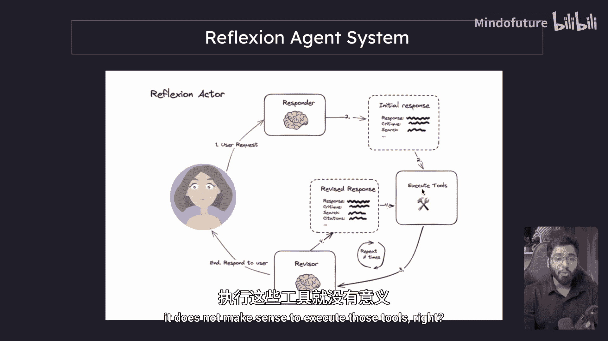

And then we are invoking the Tli search tool that we have right here okay so I hope that makes sense so if we invoke basically okay we are invoking it and sending each and every single query and that is going to give us five different results。

Right， and then the with the results we are getting byre just putting it in a dictionary right with the query。

 So the way that this is going to be is like let me just like you know quick and dirty let me just show you exactly how it's going to look like So we are going to have such term  one right so we are going to have such term2 and three。

😊，Okay， so for each of the search terms we need five different okay so we need five different results right so in the first object we are going to have the URL and the URL is going to have exactly which URL it pull the data from So ABC and then we are going to have content here okay so。

Yeah， this is the content and the same thing is going to continue five different times for each and every single search term Okay so this is going to be five and similarly this is going to have five different objects and this is going to have five different objects So this is the structure that we are going to be creating using these three lines okay very simple So finally once we have the entire query results right here in this dictionary all that we are going to do is we are going to create a tool message and then we are going to dump all of that we are converting all of that into a Json and then we are dumping it along with the tool call I So the tool message is going to be slightly different human message if we are going to create a human message we just pass the content AI message we already know in the tool message。

😊，Along with the content okay， along with the content， we also need to provide the tool call I。 Okay。

 so the tool call I is very important。 So the LLM wants to call a tool。

 you know it is going to generate a tool call I right So the same tool call I we are going to get it from the last AI message all that we' are doing is providing it here。

 Okay， and that is it。 So and then once we have the tool message。

 we are going to append it in the tool messages。 So we don't really need this。 Okay。

 we can just like get rid of this and we can just return。Okay， we can just return it like this also。

 Okay， so we are just going to return one tool message and whatever we return it needs to be in a list format。

Right， whatever we return， it needs to be in a list format， right。

 because only list and list can be merged in the state that we have right in the message graph that we have so we can do it like this。

 This should work perfectly well， but I'm just going to do it a little bit more neatter。😊，Okay。

 so I'm just going to you know do it this way and that is it Alright guys so I hope that makes sense that is it for the execute tools component So we are finally done with you know building out the last component in our application Alright so please if you have any questions at all feel free to ask me in the comments and go ahead pull the code run it try to break it try to understand what we are trying to do here and then I'm sure that you would start making sense。

😊。

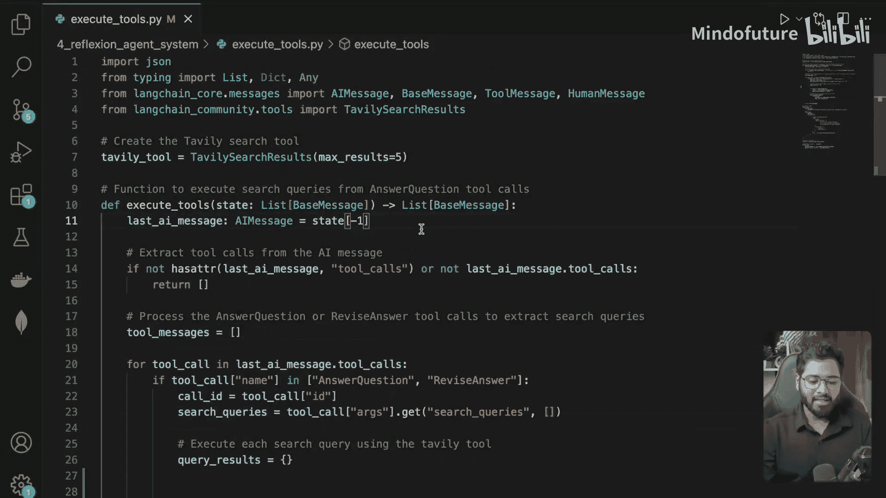

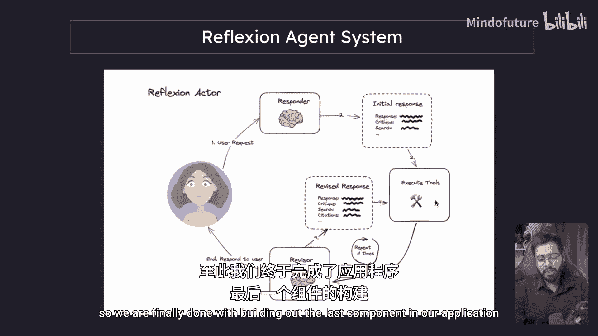

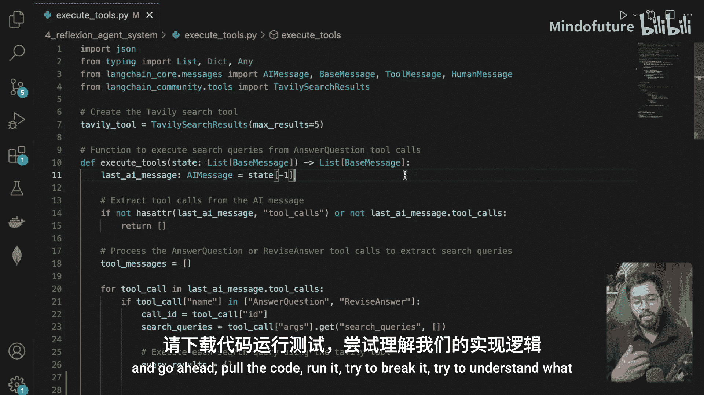

Alright， so now that we have built out all the components that we need for the system。

 all that all that's left is to just put it all together。 build the graph and then run the system。

 So I'll do that in the next section。 So I you there。😊。

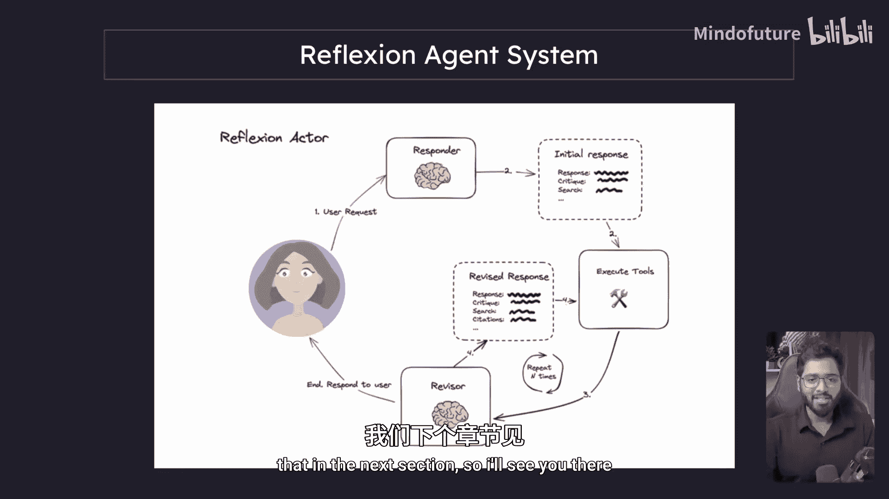