# Langgraph初学者入门2025 p15 P15_#14_Reflexion代理_构建图 -BV1mgepzCEjf_p15-

Hello， guys。 I hope you're excited about this last section in this particular topic。

 The Reflexion agent system， where we are going to be piecing together all these different componentss that we've built into a graph using land graph。

 and then we are going to see it in action。 So to give you a quick recap of what we've done so far。

 we've built out the responder chain。 We've built out the revisedive chain。

 We again built out the execute tools method as well， right， So here's how the message。😊。

Conversation history is going to extend okay I'll give you it is going to be very very similar to what we saw in the reflection system that we saw in the previous this thing right so initially as usual we are going to have the human message as the first item in the conversation history so the chains and the system message they are separate but the conversation history itself that thing is going to have human message at the very top which is going to have my topic you know I can say something like you know write me something like this write me a blog post on this particular topic right so the first human message that human message is going to be sent to the responder that chain is going to be invoked by passing in that particular history and then it is going to spit out you can imagine it is going to spit out and AI message that AI message inside of the as you are going to have all the properties based on the particular schema right so that is going to be the second step。

😊，The control flow is going to go from the human message to the responder。

 So right now we have the human message at the very top and then we have the AI message。

Now that AI message is going to be sent to the method right the execute tools method that we we've written right so you can imagine that we've marked the input and you know the method is like perfect to accept that AI message right so that is going to be you the third step which is to send all of the last AI message to the execute tools right so once that is done the tools is going to output another tool message right so that tool message is going to have the content and that one tool message inside of the content is going to have it's basically going to be an object of three different phrases and each of those properties each of those search terms are going to have you know555 of objects five objects inside of each property and each of those objects is going to have the URL and the content so it is only going to be one tool message so very similar to what we saw in the reflection system。

😊，Every node is going to return an array of just one AI message of one human message of not necessarily human message but sometimes yeah we can do that sometimes but yeah it's going to return an array usually and that array is going to be appended to the existing conversation list I hope that makes sense and right after the tools that is going to return an array of just one tool message that is again going to be this entire thing this entire you know history is again going to be sent to the reviseor chain and the entire thing is going to be inserted in the message placeholder of the Reor chain right and now we have an option right so we can either go back to the execute tools the Reor chain is going to output another AI message with its own search results and with its own critique so we can either go back to the execute tools or we can go you know end the graph cycle as well so we can actually set a limit。

Here as well very similar to what we did before we can set the limit to to this time right because there's a lot of computation happening there is a lot of this quite a lot of you know tokens that are going to be not a lot。

 but a decent amount of tokens are going to be consumed So I'm just going to set the limit to2 alright So I hope that that makes sense。

 So in this section let's go ahead and create our graph file and this is going to be relatively very。

 very simple。 It's going to be fun So let's actually go ahead and get started。

 So I'm just going to go to our you know this particular folder and I'm going to create this file called Let's call it you know a reflectionleion。

😊。

Graph。Allright perfect so up here i'm going to import a few imports so basically what I've done is I've imported the list and i've imported the base message tool message these are some things that you know basically to strongly type our nodes and just going to you know use some of these things we are using the message graph。

And you you I hope you remember what a message graph does right and then we are using the reviseor chain and the first responder chain from the chains module and we are also making use of the execute tools that we've written in the module perfect。

Alright， so the next thing that I'm going to do is I'm going to go ahead and initialize our graph。

 so to do that I can just say graph is equal to message graph and then I can。😊。

Call this right That's pretty much it。 If you remember this is exactly what we did previously。

 Alright， so let's actually go back to the diagram。

 So let's go ahead and first add these three nodes。 So we have the responder node。

 we have the executor node。 we have the revive node。

 If you remember we just need to say graph dot add node。

 and the first argument is going to be the name of the node and then the second is going to be the actual node。

 the function or the chain right So I'm just going to say graph dot add node。😊。

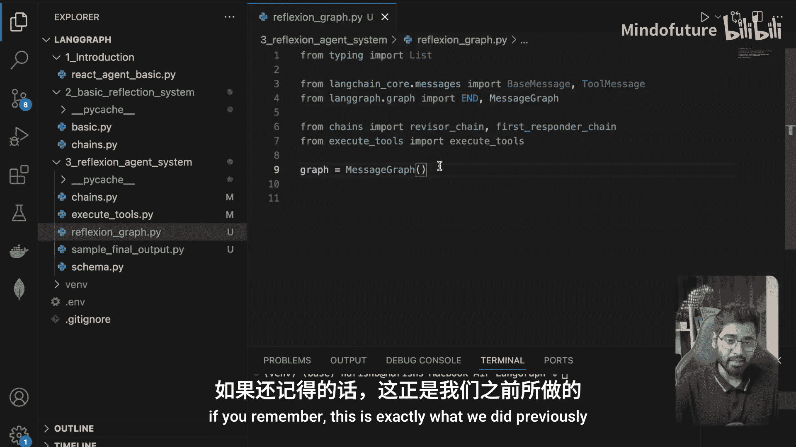

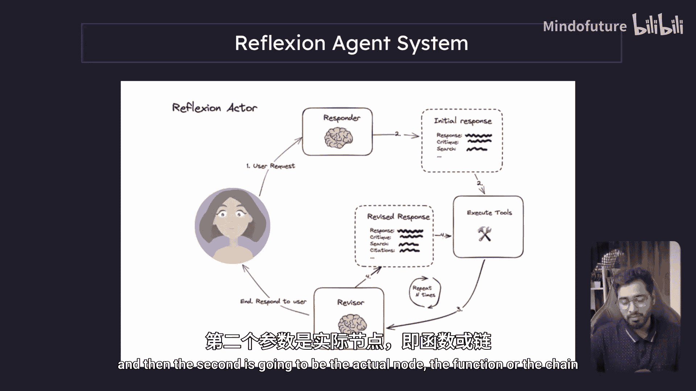

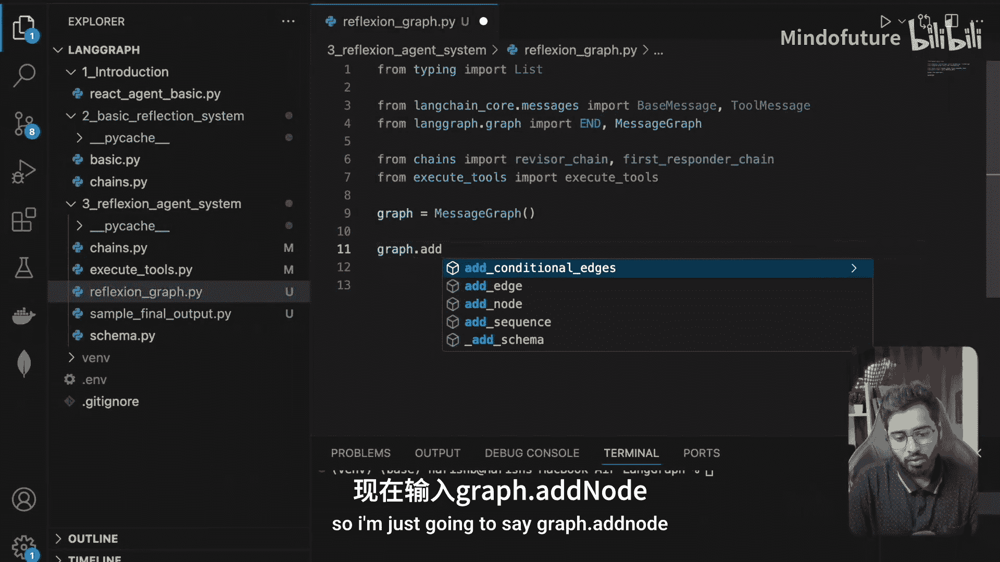

And Im going to call this responder node as the draft。

So you can imagine that it's going to basically this component is just going to generate the first draft and this is what is going to actually like make it better and revise it So I'm going to call it draft but you can call it anything that you want you can call it you know some random name and doesn't matter don't you know just follow what I'm doing but yeah so we have the draft right here and I can just go ahead and put the。

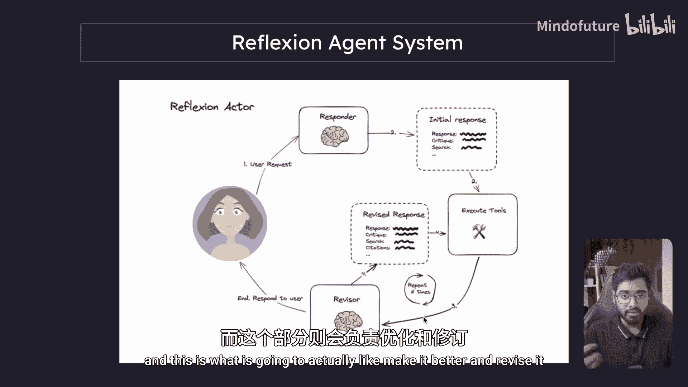

First， responder chain right here。 perfect。 So let's actually do the next one as well。

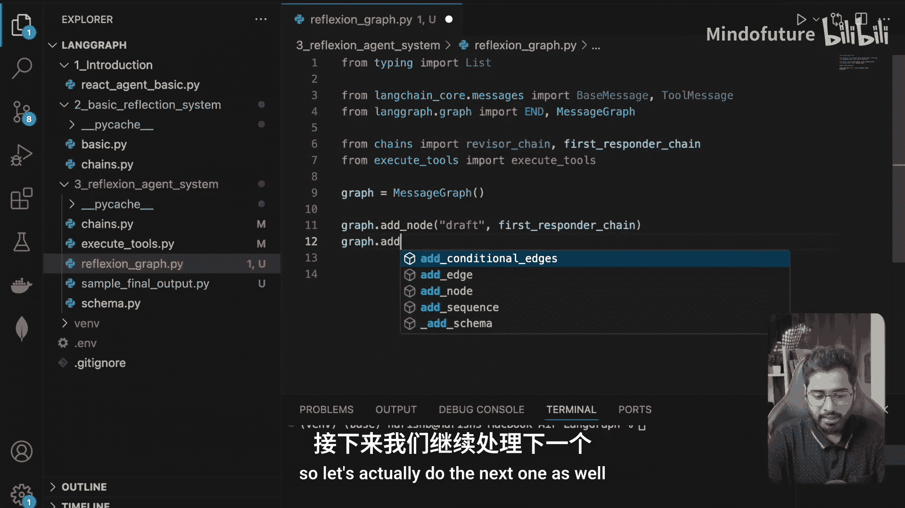

So the next one is going to be the this execute tools right here。

 So for this I can just use the same name right here and I can use this method as well。

 and finally we also need to add。

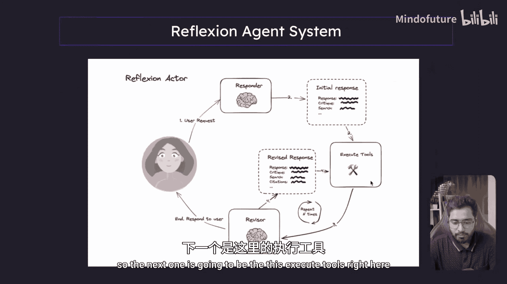

We also need to add the revise right， so this revise chain right here。

 So I'm going to call it the revise and I can put in this thing right here as well。 All perfect。

 So we've added three of these node， let's now go ahead and connect these notes together。

 So obviously the first one is going to be you know there's got to be an edge between the responder node as well as the execute tools node right So to do that。

 this is going to be another simple edge right There is no like you know conditional edge or anything。

 It's going to be a very simple edge。 So let's put this draft right here。

 and then let's put the execute tools right here。 Okay， so what we've done is we just connected。

 we just drew a line between the responder as well as the execute tools。

 So next thing is we need to do the same thing for the execute tools and the revise。

 So this is going to be a very simple edge as well right So I'm again going to say add edge。😊。

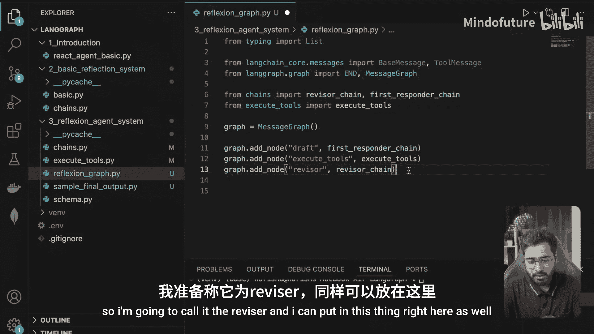

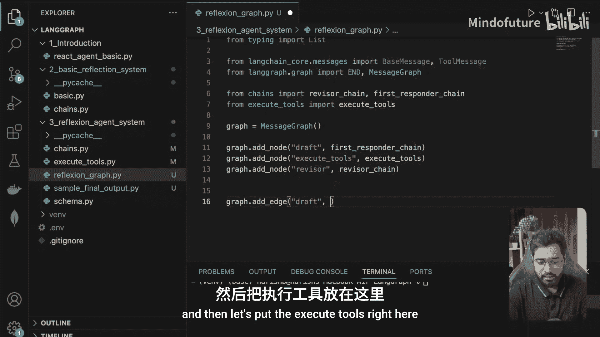

And we need the execute tools name。 And then the。ARevisor， right Okay so we want this perfect。

 So we drew all of the edge edges as well。 now what happens next。 So this line is connected。

 So the next thing is we have to you know right after the revise。

 we have two options right here right we can either go to the human or we can again go back to the execute tools So I'm going to write a function。

 something like an event loop， basically that function sort of decides you know if you know two iterations have been done for iterations have been done you know。

 it's going to check that and depending on that it is going to route whether to go here to the human or it is going to go back to the execute tools right So I'm just going to copy paste some the method right here and let me slowly walk you through it Okay so here basically what we're doing is in the event loop again。

 pretty much every node is going to get the list of all the history messages human AI tool message human AI。

 whatever the entire thing is going to be。😊。

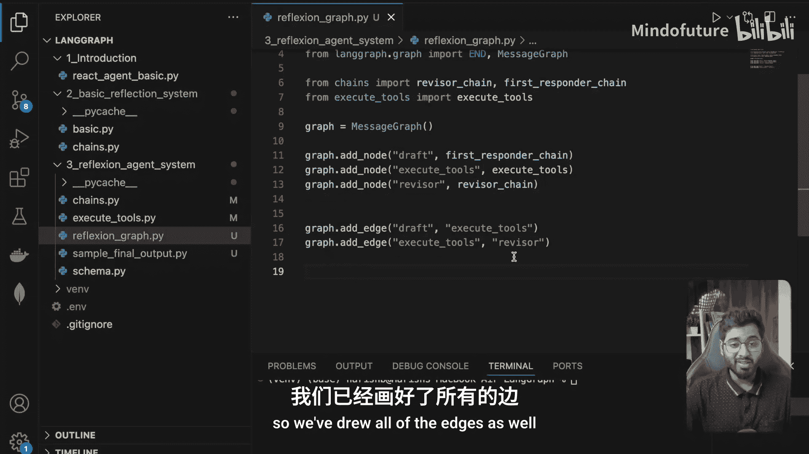

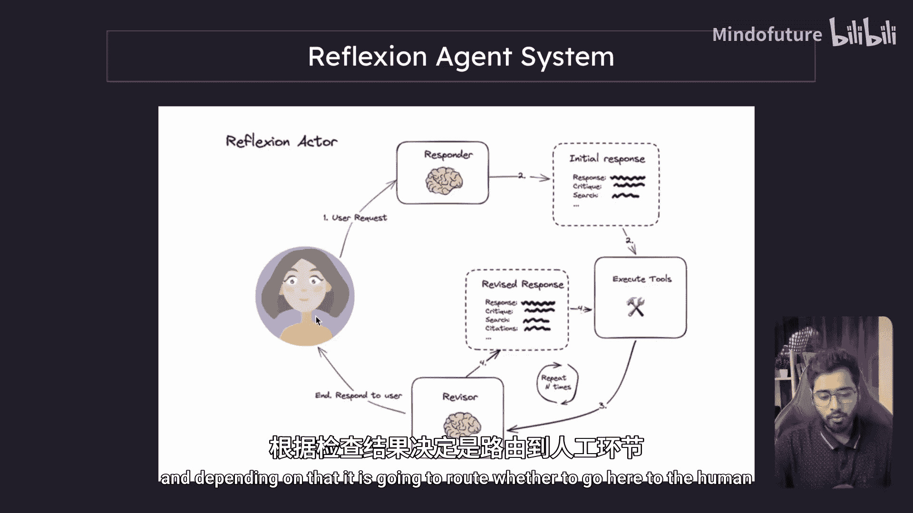

Received right here right so basically here what I am doing is I am looking at all these messages and I am seeing how many tool messages are there。

😊。

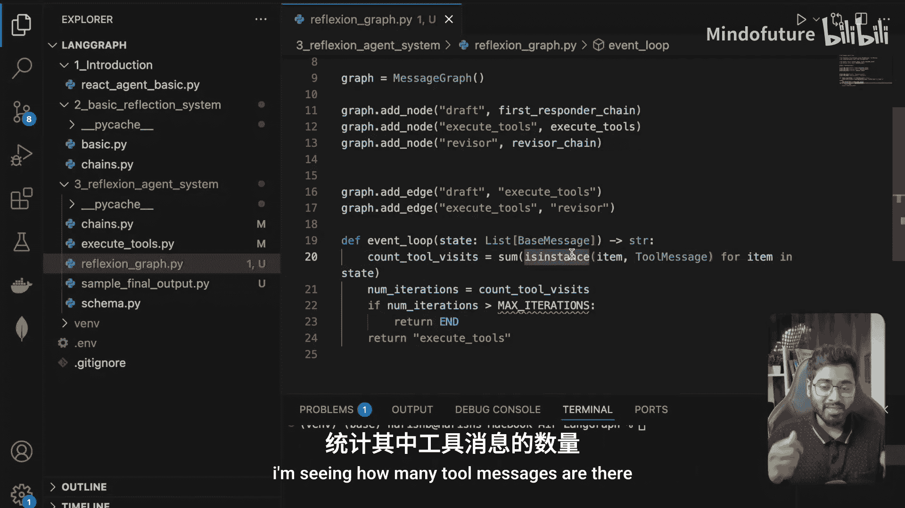

Okay so we know that let's come back to the diagram we know that every time this execute tools component is going to be executed it is going to spit out one tool message with all the data right so if if it were to loop a second time or the third time or something like that the count is going to go up right so I am just going to say count tool visit and Im basically calculating how many tool messages are there in this particular list okay so that is exactly what I'm doing I'm looping through it and Im calculating this sum of it。

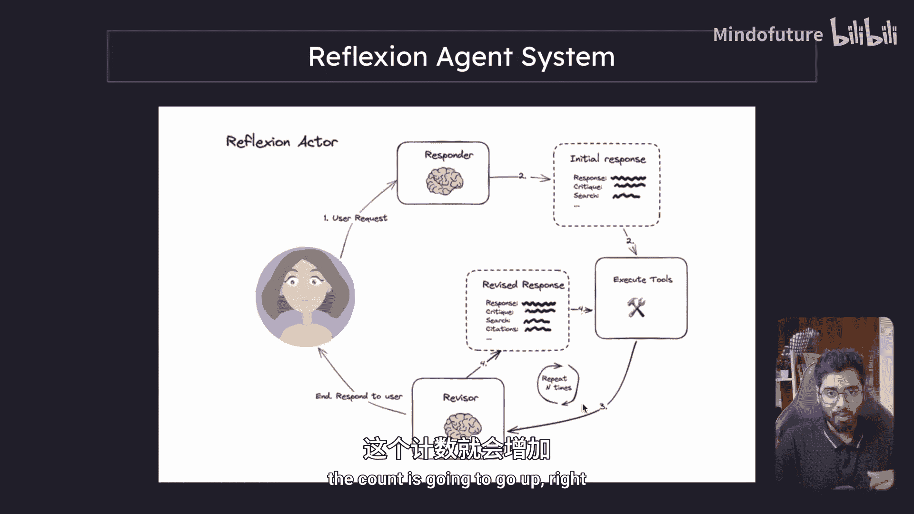

Okay and now I am you know this is the the iterations and I'm checking if it exceeds my maximum iterations constant。

 It's a threshold that I'm setting。 so I can just go up here。

 let's say I can put it over here and I can set it to to because that's what we've decided at the very start you can always increase it as well。

 but its is going to take a little bit more time to you know fully run the process。 Okay。

 so this is a drawback of this particular section。 we look at the advantages disadvantages and all of that you know at the end of the section but。

😊，If your product requires really quick responses for the user then the system might not be the best thing to do it。

 but if your users are comfortable with you know them taking their they prioritize quality over you know the speed in that case in that case we can just go for the reflectionion graph all day if the max if the number of tool messages are more than two it means that we have to end the graph or else we can go for the execute tools again perfect。

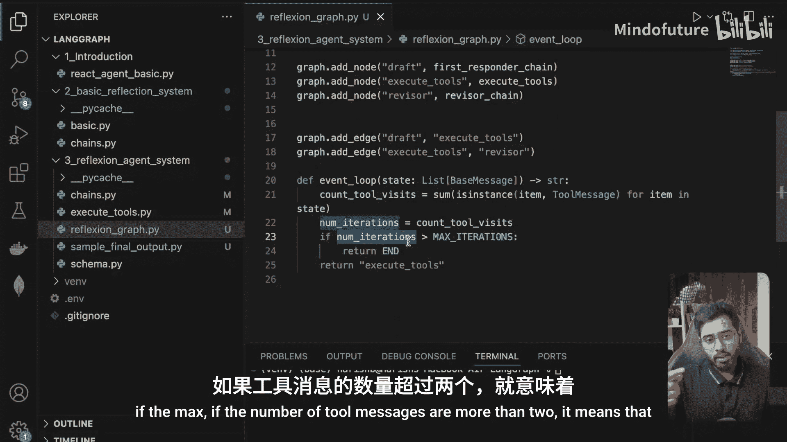

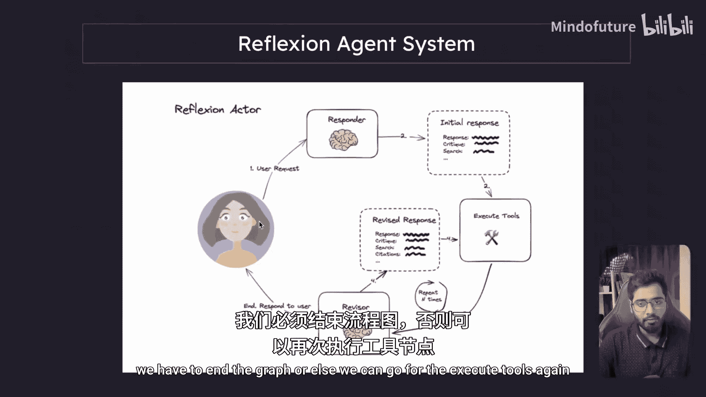

So that is exactly what I've done here so if it is greater than this thing we are going to the end or else we are going back to the execute tools node so I hope that makes sense now let's go ahead and add the conditional graph Okay so how do we add the conditional graph we can just say add conditional graph and then we are basically saying that you know right after the revise go to the event loop right so right after the revise。

😊，Go to the event loop。Okay， and then let it sort of branch out into the end or the execute tools。

 So very similar to what we did in the previous you know topic that piece saw perfect。

 So I think that's it right So we've connected the responder to the execute tools execute tools to the we've connected the with the event loop method that is going to branch off to the end or it's going to branch off to the execute tools And finally。

 if you remember we have to set the entry point as well right so let's quickly do that。

 So we have to go back and then set entry point to draft Okay so because this is going to be the entry point of the graph。

 Allright perfect So I think that should be it， let's go ahead and compile the graph now So I'm just going to say graph or compile and finally I can just you know create the mermaid diagram as well just to make sure everything is looking good Allright so I'm just going to do that and also I'm going to invoke the graph。

😊。

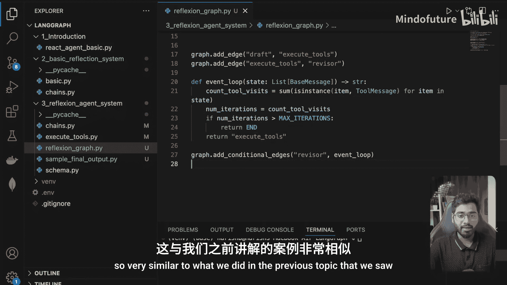

Well so and next step I am also going to invoke the graph with my human message so I can just say app dot invoke and I can provide in my string writer right about how small businesses。

😊，Can leverage。AI to grow， okay。So， this is going to get。The response。

 And now I can go ahead and print the response as well。

So what we have to do is we have to go inside of the response。

 we have to get the last message in the history which is going to be the AI message and then we have to go inside of the tool calls we don't want we are not interested in the content the main content we have to go inside of the tool calls and even that tool calls is going to be an array right so we have to go inside of the first array and then go inside of the as and then we have to go inside of the answer okay I hope that makes sense if this is confusing to you just print it out and see how the structure is going to look like and then it would make sense to you and why not let's also go ahead and print out the response as well so that we'll be able to see the full unabbridged version perfect。

😊，Okay， then let's actually now go ahead and let's make sure that everything is looking good。

All right。 Okay， let's go ahead and let's see what we get。 actually。

 So I'm going to go back to our graph and let's run this graph。😊，If at all。

 there is any bugs well try to debuet right now。So you can see that this is going to be the graph as well。

 You， you can actually pause the video and then look at， you know， if everything is looking good。😊。

All right。 So we are getting some issue right here。 It is saying that， you know。

 the answer question is not really。The output of the answer question tool call is not really correct。

 So let's actually go back to the chains。Okay， okay， okay okay guys。

 So this particular chain is not really returning an AI message right。

 but rather it is like you know going through the parser。

 So it is not really the AI message but I just added this thing here for the validation if everything is working good I just wanted to test it by adding this parser So what I can do is I can just remove that and instead of that I can put it outside of the chain just to make sure that you know the validation is also taken care of So if at all the LLM is not going to return the schema in the right format。

 it would still throw an error， but this parser is not going to be a part of the chain。

 So to do that I'm just going to say。Validator pyantic tools parer and inside of the tools I can just provide in the answer question。

 Okay， perfect。 so this is also going to throw an error。 If at all。

 the output is not really adhering to the schema all it perfect。

 So now the chain is going to be properly ready。 It's going to output the AI message and now it should work。

 So let me clear it out。 let me come back to the reflection graph And then let's run it again。

Okay so we will actually take a look at the Lasmith as well see what is happening there。

 but yeah you can imagine that it might take a little bit of time because you know the firstpoer is generating this entire20 word this thing and then it is going to you know the tool calls are going to happen and theres like three separate search terms that are being called and then that information is being fed into the revise and that revise is going to look twice right？

😊，All data。Let's see what's happening。Perfect， okay， so you can see that。😊，Okay， guys。

 this is a little difficult to read。 Okay， let me actually go ahead and search for。嗯。Okay。

 I don't really put another keyword here for the first print。

 So I'm just going to come up to the very top。 all day。 Okay， so you can see that we have。

 you know the small business can leverage to grow， this is going to be the final revised you know the final AI messages final content so you can see that the numbers are also here so you can imagine that at the end of the blog post we are going to have the URLs as well。

 So let's make sure that okay perfect So we have the references as well right perfect。😊。

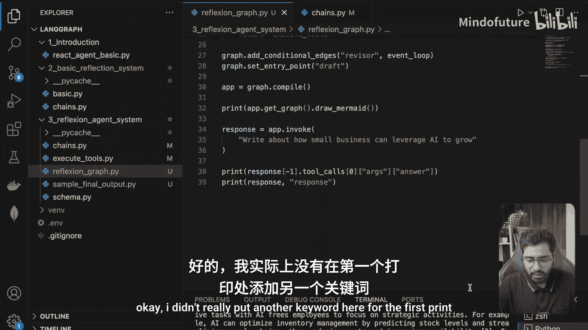

And then also， we have the unabbriridged version right here， right， the entire conversation history。

 You can see that we have the human message。 The AI message should be somewhere here。

 and then another another tool message。 Okay cannot search for tool message。 Okay， so tool。😊，Message。

 okay it's not really searching。 I'm not sure what's happening here。

 So we have the tool message right here with the content of the entire， you know。

 the URL and the contents。 we've got everything。 and and then again， the revise。

 which is going to have an AI message。 So I'm not really I'm not really able to search for it right here。

 So let's actually go back to our lasmith and then look at you know what's happening there。

 All it perfect。 So this is going to be the latest run right here。

 let's click on it and let's look at the trace。😊，So this is going to be the high level。

 totally took us 80 seconds， so you can imagine that it might take a little bit of time。

 So if you don't see anything in the terminal， don't worry。

 it is going to come or you know if you are worried that something might have gone wrong。

 don't worry about it just pull my code and then just copy paste the code and then you can debug it later All right so here we can see that this is going to be my input。

 the original input and it's going to go to the responder chain right So this is going to be the output。

 the first draft So we have the answer we have you know everything except for the you know the references right and you can imagine that that is going to be sent to the tool execution So the next thing you can imagine is going to have the tool message So if I come down here you can see that this is going to have the tool message right So the name。

 the phrase the search term and then we have the URL and the content again the search term URL on the content so we have entire thing right here and then going down you can so what's the next thing right after the tool message。

😊，We have to send that to the revise chain， right， So again， there is going to be the AI message。

 But this time， we will have the references as well along with the。Even on the numbers， okay。

 the numbers in the content as well。 So if I scroll down， you can see that we have the numbers 1。

2 and then at the very end， we have the references as well right along with that we have the search queries and we are looping through it one more time so again it's going to go to the tool so we have the tool right here again it's going to fetch make the internet search。

 it's going to pull it and then again， it is going to feed the entire conversation history back into the revise agent so we have a tool message and then another AI message and then another tool message so totally now we have three different tool messages in our list and right now because it's three it is not going to loop through it again。

 it's going to end So that is why we have the final AI message right here and this is exactly what we need。

 This is such an enriched blog post you can see that small business can leverage AI to grow by enhancing customers。

😊，S optimizing operations， you know we have all the you know references here as well。

 you know where exactly it took the data from so you can actually you know copy one of these things these are like properly legit right it pull these in real time。

So you can actually search for this thing and you can see that it basically pulled everything from this particular blog post and it does the same thing for a lot of other things as well。

😊，And again there is going to be such queries， but since we are stopping the looping right here were stopping the graph it is then going to exit out of the graph so this is going to be the final thing that we want so please do go through each and every single one if you don' if you're not able to understand it and if at all you have any questions at all please feel free to ask me in the comments or know Claude I believe is going to be very helpful to you as well is going to be very helpful to you so that is it for the refleon agent system I hope you learned a lot of things about how to pass how to ground the response of the LLM how to pass it how to put it all together in a graph and I'm hoping that you are able to see how you can actually customize these systems based on your own use case so the goal is not to just copy it but rather to understand the fundamental so that you can actually build out your own systems right。

😊，The refle I just wanted to end this particular section with the disadvantages and you know the advantages of the reflexion system so you can imagine that if your product or if your company you know the customers don't really care about speed as much then please go for the reflexion system because the data is going to be grounded in live data and also the improved quality compared to the reflection system that we saw in the previous section okay so I hope that you learned a lot I'll see you in the next section。

😊。

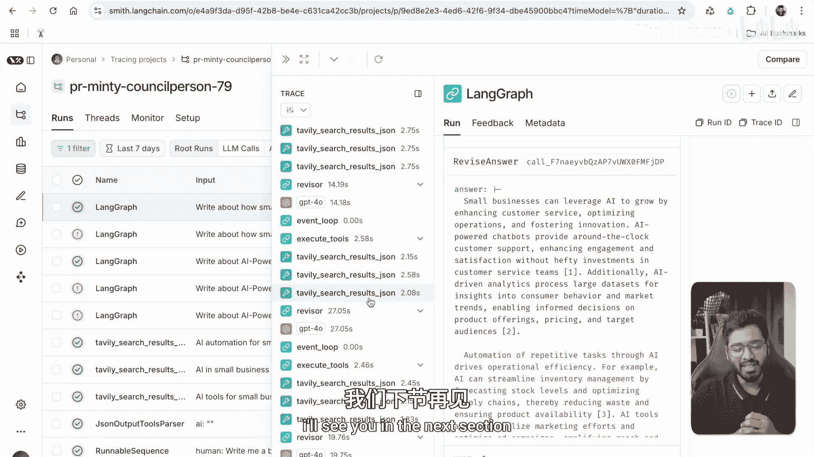