# Langgraph初学者入门2025 p16 P16_#15_什么是StateGraph -BV1mgepzCEjf_p16-

Hello guys， welcome to the section In the section， we are going to deep dive into state in Land graph。

 Okay so why do I want to do that？ So so far in the previous sections that we've seen。

 we have used the message graph right it's basically just a list of messages。 but in the future。

 if you build complex applications， complex graphs。

 complex systems you might want to keep track of multiple other properties。

 you don't really want to restrict yourself to just a list of messages right So in that case you might want to you know you would have to learn about state graph Okay so in that so that is what if planned in the next section。

 we will look at how to build out the react agent system using land graph。

 that is going to be a little bit more challenging because it's going to be a lot more properties that you want to keep track of in the state but before we do all of that I want us to just focus on state in land graph thoroughly familiarize ourselves with state and land graph。

 and then once we are confident。😊，We'll move on to the next section。 So let us look at some slides。

State in Landngra is a way to maintain and track information as an AI system processes data right so think of it as a system's memory。

 allowing it to remember and update information as it moves through different stages of a workflow or graph。

 So here are some concepts that we are going to be covering。

 So we will first look at what is state graph you know what are some basic state structures and then we will progress to a bit more complicated state structures and then we will see what are the different ways to update that state。

 So there is a manual state transformation that we can do and we can also do a declarative annotated state transformation So I'm going to go back to V score and you can see that I've already created a folder right here called state deep dive I'm going to create a new file called let's say you know the first thing I want to start off with something very simple So I am going to call it basic state do Py。

😊。

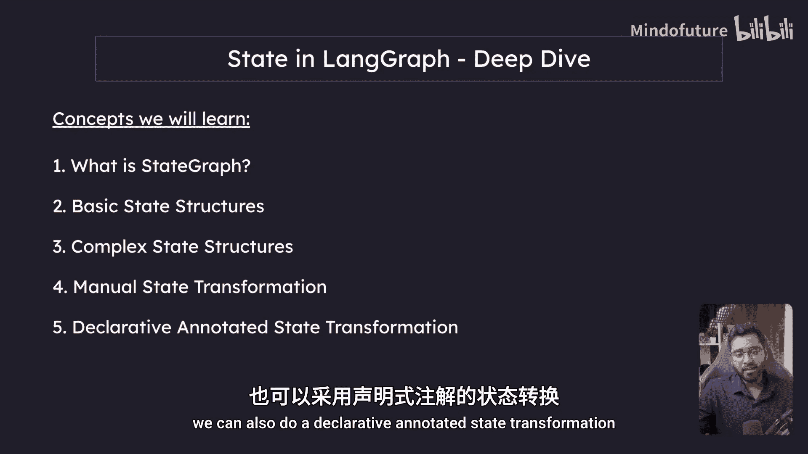

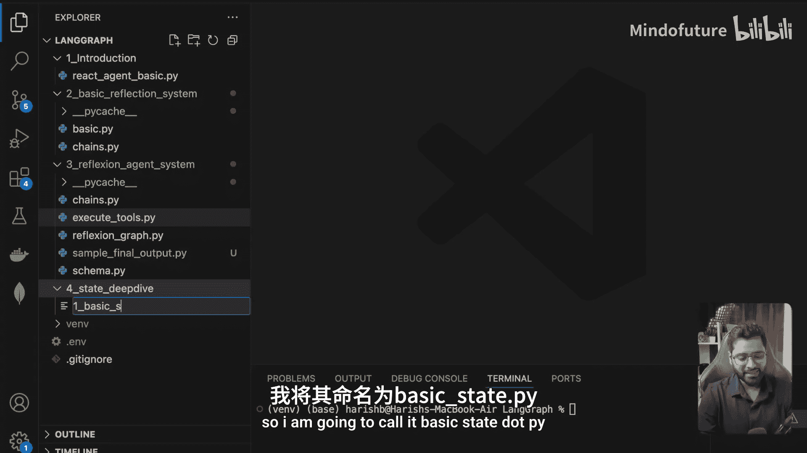

So let me show you a simple graph that we are going to be building。

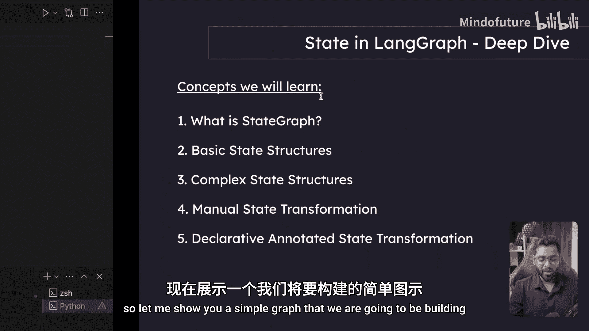

So this is what I planned to explain this。 So all that we are doing here。 this is a simple counter。

 Okay， so this is going to be the state which is just going to have one property called count initial value is going to be0 so we have the start node and as soon as the increment node is hit the count is going to be made to one okay so once it is made to one。

 it is going to go to the should continue method。 So this should continue method is going to have a condition。

 we can set whatever condition that we want。 but I'm going to set the upper limit to 5。

 Okay so basically I'm saying okay increment keep on incrementing it until5 is reached and as soon as5 is reached go to the end。

 Okay so by doing this we are going to be able to see how we can actually maintain a state like this。

 So so far we've only seen message graph which is going to be a list of messages and you we weren't really able to build custom states with that but right now we are going to learn how to do that So let's come back。

😊。

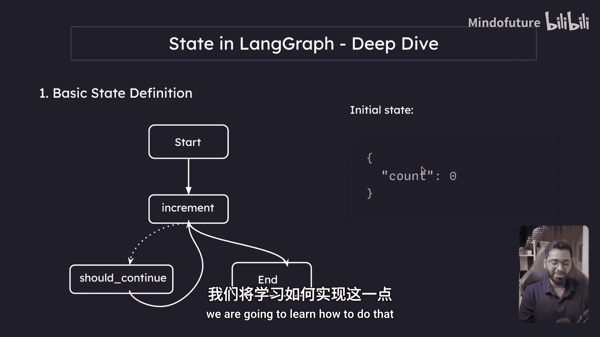

So the first thing that I'm going to do is I'm going to define the blueprint for our。

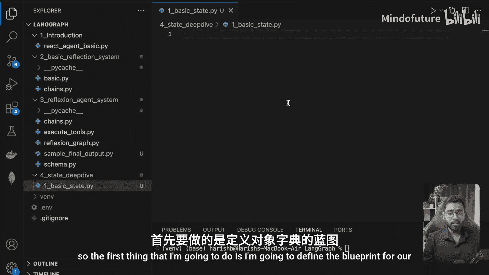

dictiontionary for our object。 Okay， so blueprint as in okay。

 this is this is going to be the name of the property and this is going to be in which is going to be the data type of that particular property。

 So to do that， I can just say class and I can call it whatever I want。

 I can call it simple state or something like that。😊。

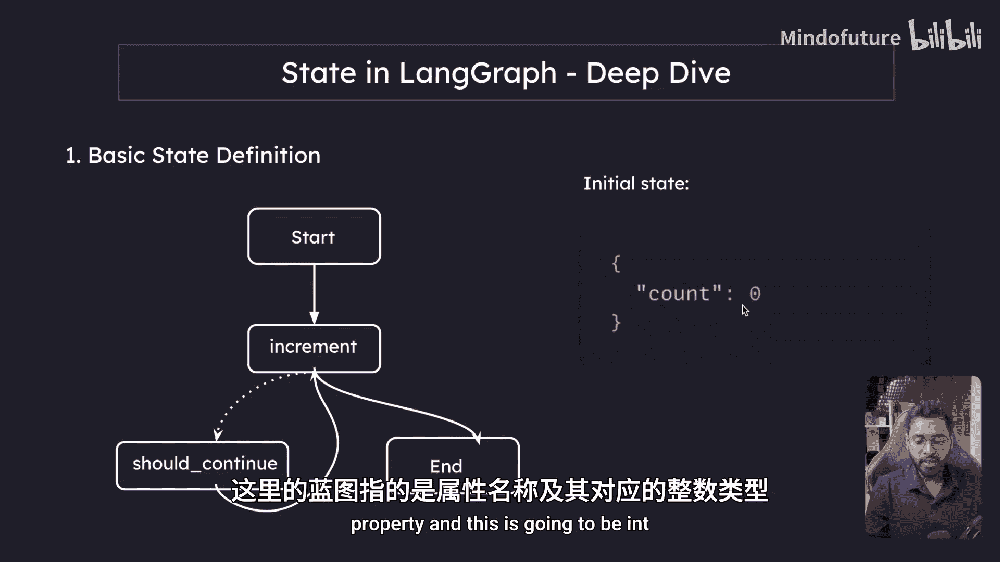

Alright， and now we have to import from type vector。 Okay， so I can just say from Iping。😊，Import。

Tight， di。Okay， so I can actually look at， you know。

 we can see that type tick creates a dictionary type such that a type checker will expect all instances to have a certain set of keys and the consistent typing as well。

 So basically it enforces something like this。 So here we're saying that you know this should be a count and this should be an integer。

😊，Okay， so whatever object or dictionary that we are going to be dealing with in the graph it is going to have this particular structure so that is what it means。

 Now let's come back so let's actually go ahead and build out this particular note right here so we are going to be following the same structure we are going to build out each of these nodes and then we are going to connect it together using state graph this time not message graph alright。

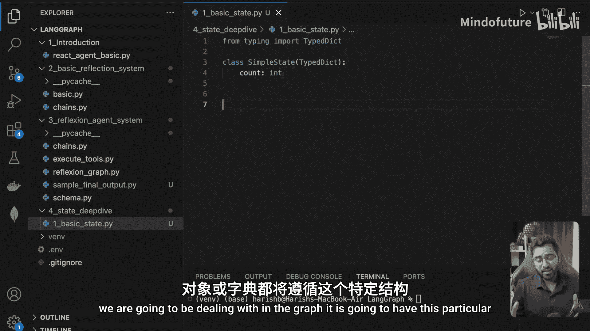

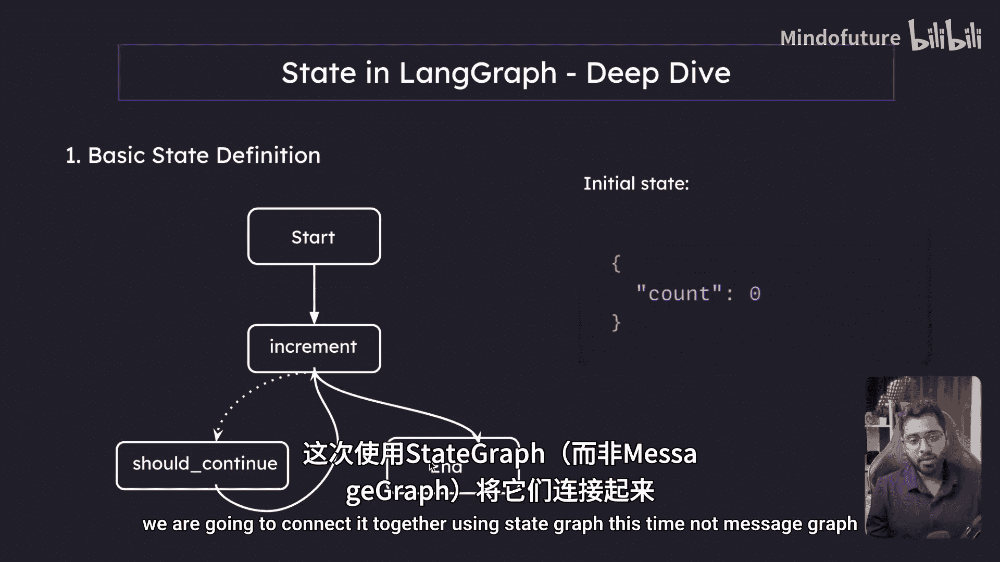

Alright， so I can just， let's just keep it very simple。 Let's call it increment。 Okay。

 this is going to be the node。 And this is， again， going to get the state。😊。

If you remember every stay every node in a graph is going to get that input okay so since we are going to be dealing with a state graph it is going to get the entire dictionary with this particular structure okay so we can just call it a simple state and this node is again going to return the same simple state with modified values that's it。

Allright， so。Basically what this is going to do is this is going to return another object。

 the same object， whatever this is returning is going to replace the existing global state。😊。

So we can say something like count， so this needs to be in strings， so we can say state count。

And then we just need to increment it by one Okay so that is how simple it is so you can see that this is a very important learning Okay so any any node you know every single node is going to get the same state if it is a message graph if we are using a message graph here we will get a list of messages but since we are going to be dealing with state graph I will initialize it later but since we are going to be dealing with state graph we are going to get a dictionary with this particular property call count al right perfect。

😊，So what is the next thing that we have to do。 So let's come back。

 and let's actually go ahead and build out this should continue node。 So I can just say。

 should continue。😊，And this is again going to receive the entire state。

 and let's actually write the condition right here so I can just say if state count。

Is less than 5 okay so if state count is less than 5 we want this control flow to go back to increment right so I am going to say return and I can say continue okay and if this is not the case then we can return the end right here okay so let's actually go ahead and import from land graph or graph。

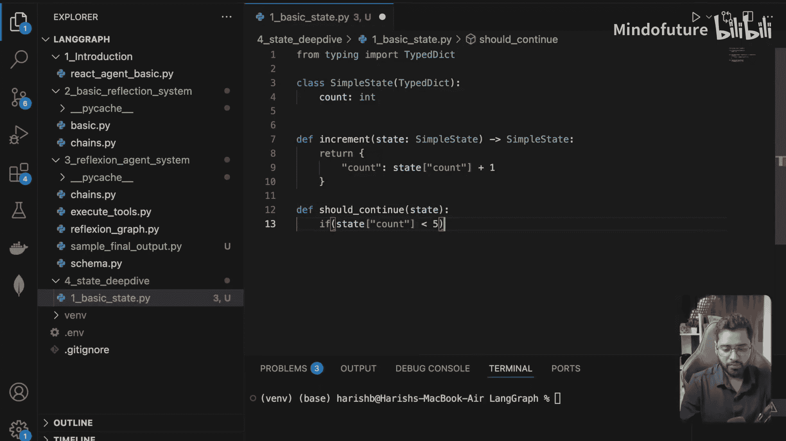

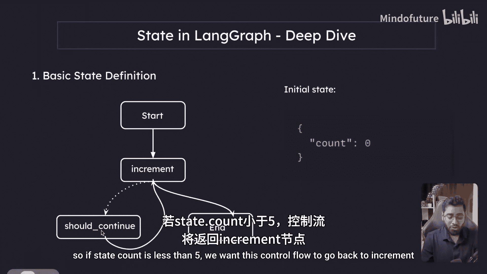

And。Perfect。Actually， you know what I don't really want to use end either。

 I'm just going to say something like stop Okay， so I want to I want us to discuss about something else that is also possible Okay。

 so I'm going to keep it very pure this function I'm going to say continue and stop okay alright now now that we have this node as well as this node done。

 let's actually go ahead and create the graph and let's add these nodes to the graph and then let's you know do the conditional edges as well。

😊。

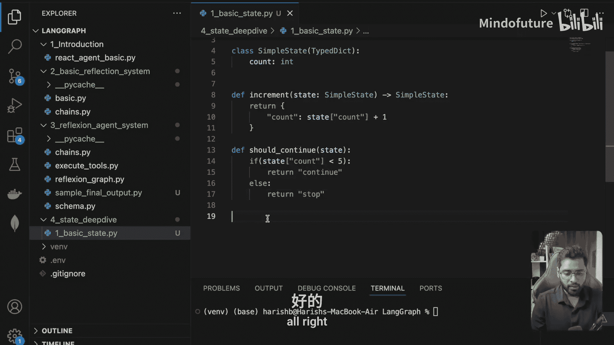

So to do this now I am going to say graph equals state graph okay I am not going to be using the message graph this time。

 so lets actually go ahead and import the state graph right here。And in this state graph。

 we have to provide the blueprint that this state graph needs to create for the object。

 for the dictionary。 so we have the blueprint right here。

 So let's actually go ahead and provide that perfect。😊。

So now let's go ahead and add the nodes right here。 Okay。

 so the first node is going to have increment as the name。 and then let's pass in the。Method as well。

 All it perfect。 So what is next。 So now we need to add a conditional edge， right。

 it can either go here or it can go to the end as well。 So let's say graph dot add conditional edge。

 And we're saying that as soon as the increment is done go to this should continue method。

 So this is going to do this thing。 Alright， So let's actually I'm going to do something here。😊。

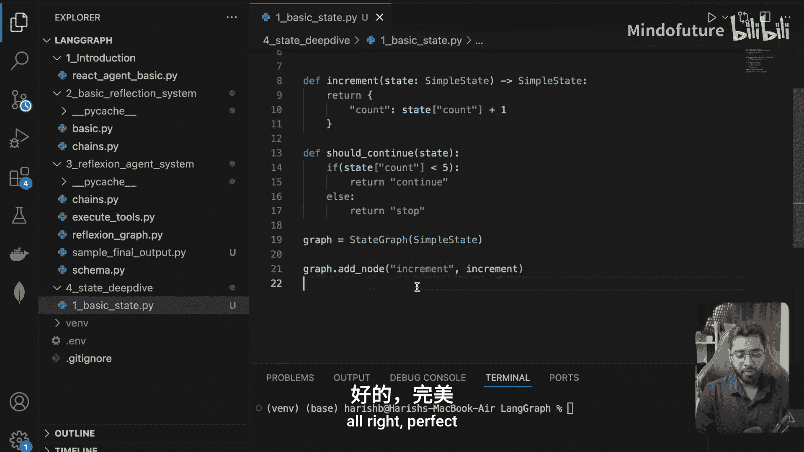

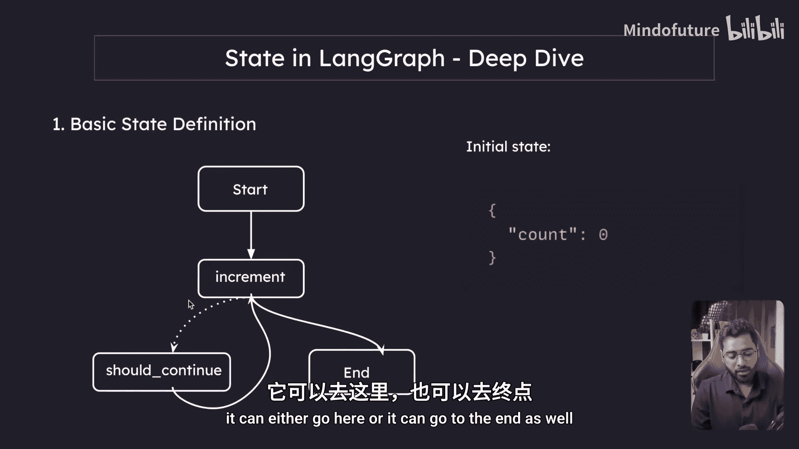

Okay。So it is going to go to the should continue so but here you know we are calling it continue and stop。

 we are not really calling it increment and end right so we can also do something like this。

 So this takes in a third argument So in this argument you know this is a method this is an object and inside of here I can just say if this should continue returns continue then it means that you need to go to increment。

 Okay， so this is what it means if it is continue you need to go to increment。😊，If it is。

 what's the next one， if it is stop， we can go to and。Okay。

 so I just wanted to add it here because I wanted to provide a bit more syntax exposure for you。

 But if you don't want to， you know deal with something like this。

 you can just go for you know saying end right here and saying increment right here and removing this Okay so this also should work。

 So let's actually go back。 This looks perfect So so far we've added the node we've added the conditional edge as well。

 And then finally we just need to add the entry point right So we can just say graph dot set entry point and that is going to be the increment node。

 And now finally let us go ahead and compile this graph as well。 So I can call it app。😊。

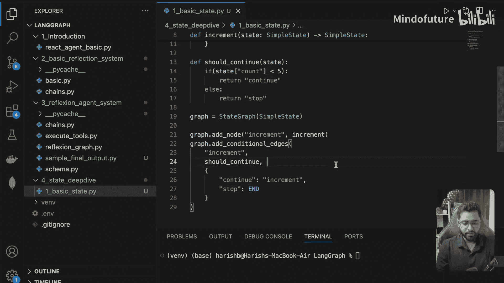

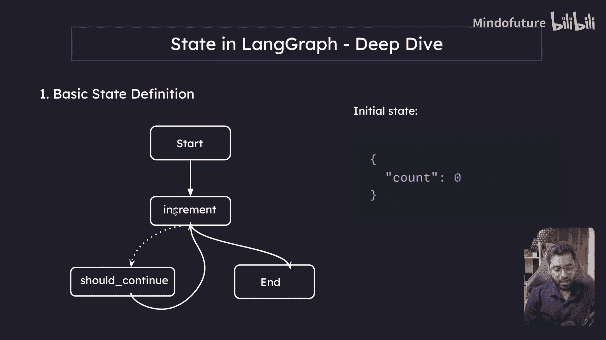

Compile。And then finally， we can invoke it。 and right now we are going to provide a dictionary。 Okay。

 so the initial state is what we need to provide right here。 Okay。

 so we can just put it separately as well。 The initial state is going to have count of0。😊。

Right so that is something that we can provide in this state right。 All it perfect。

 So initially it is going to be0 and this is going to return the result。

 we can go ahead and print the result as well。 So if I run this file。😊，Perfect。

 you can see that we get count is equal to 5。 Okay。

 so all these other additional you know logs that you're seeing warnings and all。

 this has to do with Langsmith。 Let's not worry about it right now。 But right here。

 you can see that the count has been incremented to5。

 So you can imagine that what happened is that it first went to increment and then include five different times and then finally。

 they should continue directed it to the end。 But the main takeaway from this particular section is that instead of having a list of messages。

 we can now define pretty much our own custom state。 anything that we want。 So in this case。

 we went with count。😊。

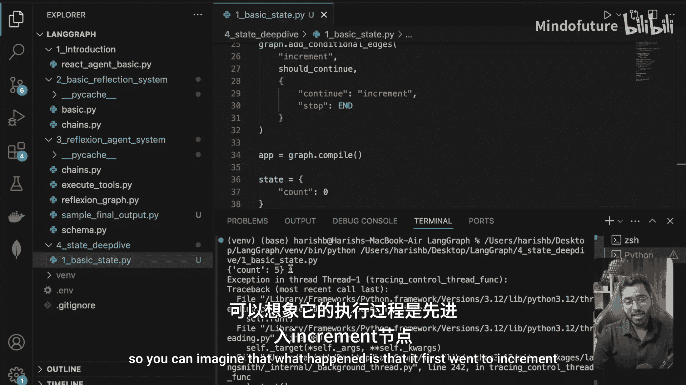

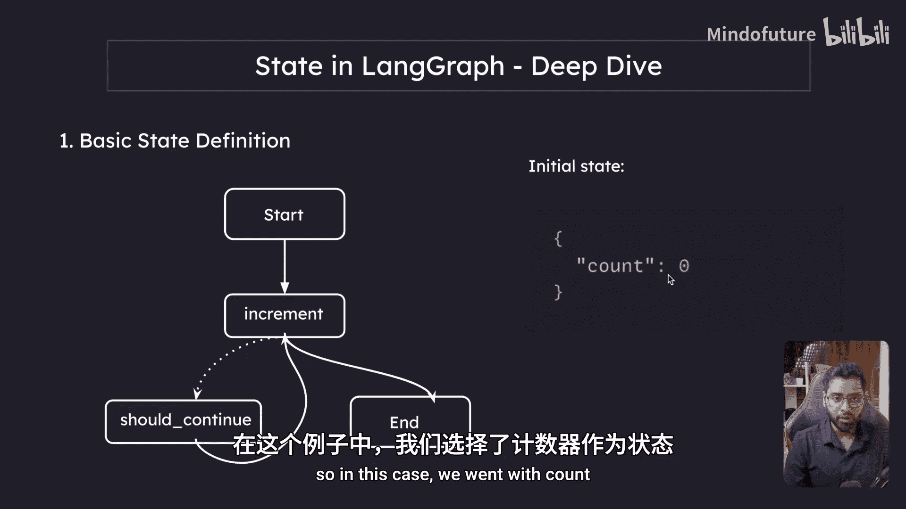

Okay， so all that we did was we defined the blueprint。

 we defined the blueprint right here using the type tick and then all that we are doing is providing it in the state graph。

 Okay， so now every single node right here is going to。😊。

You know is going to have access to the entire object。

 the entire dictionary that the state graph is going to create using the same schema using the same you know blueprint that we specify right here So in conclusion you can actually imagine this state this object to be like a global state that is available for all of these nodes to modify update right so if you're a front end developer if you're a react developer and you've worked with redux。

 let's say you know it is kind of very similar to it right allright so very similar to redux as well there you know we don't mutate any of the values。

 we actually create a new object and then we update right so that is called immutability and that is exactly what we are going to follow in land graph as well so you can see that here we are actually creating a new object and then we are merging it with the existing object okay so perfect so in the next section we are going to increase the complexity just a little bit we are going to be adding。

😊。

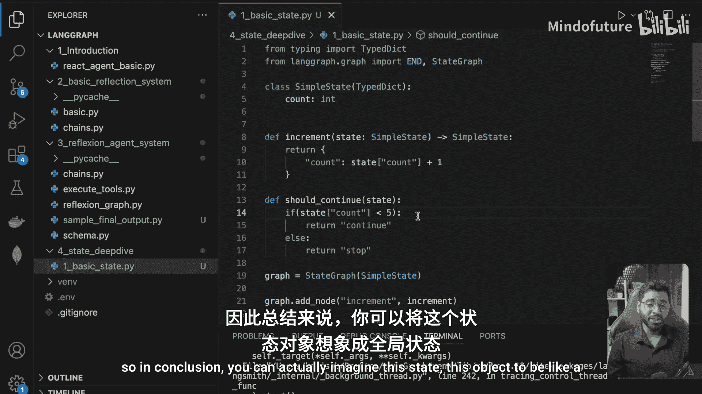

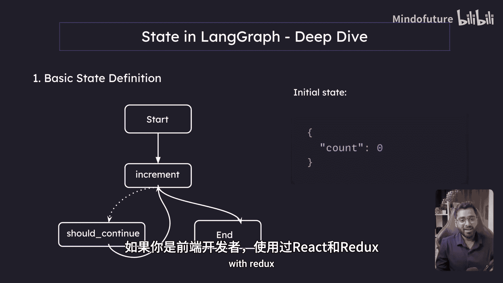

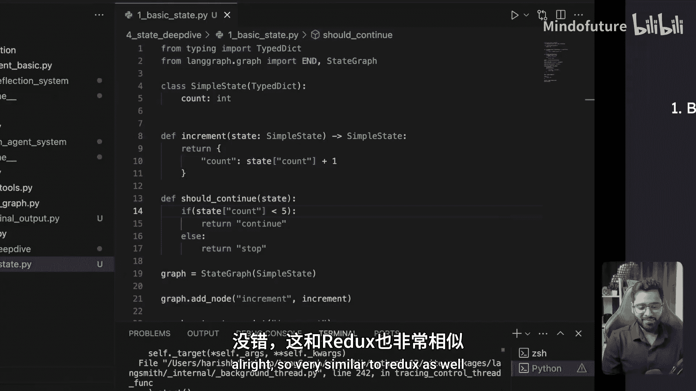

You know， a second property to the global state or maybe even a third property。 Okay。

 I'll see you in the next section。

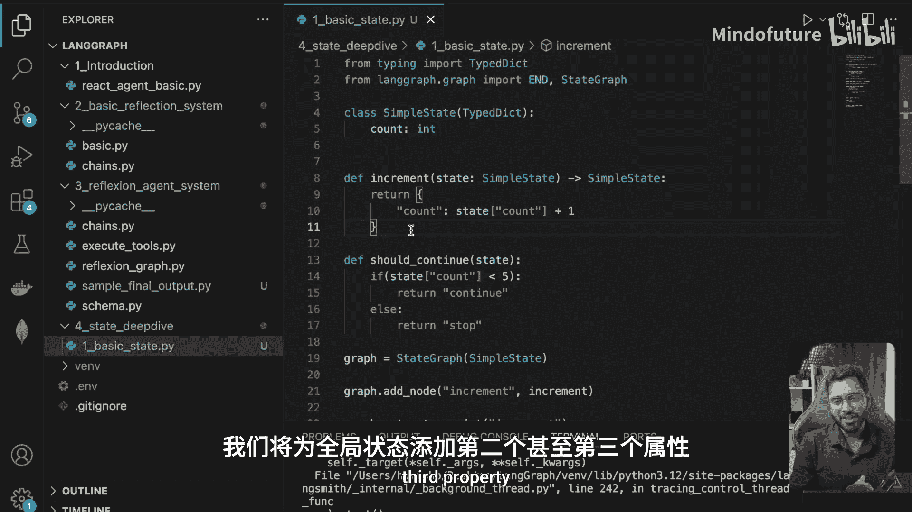