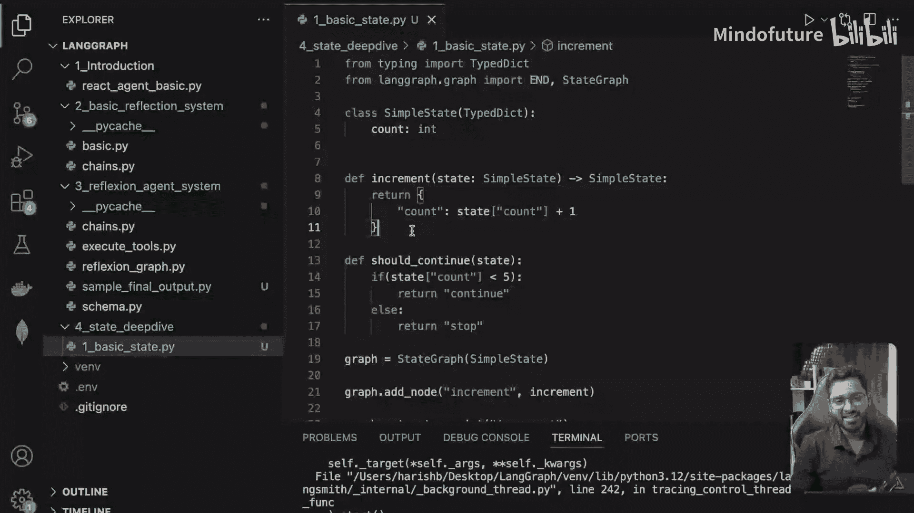
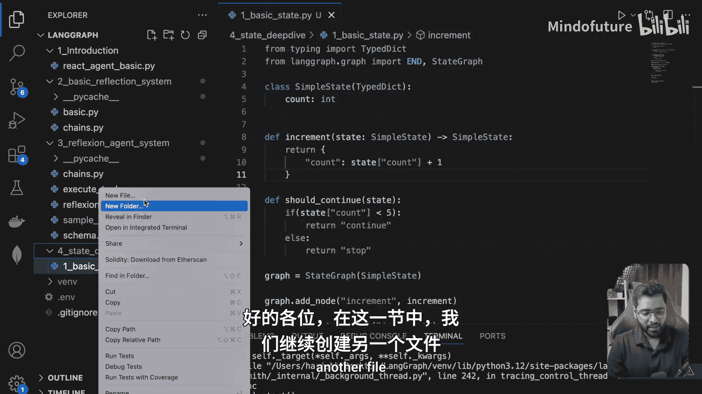
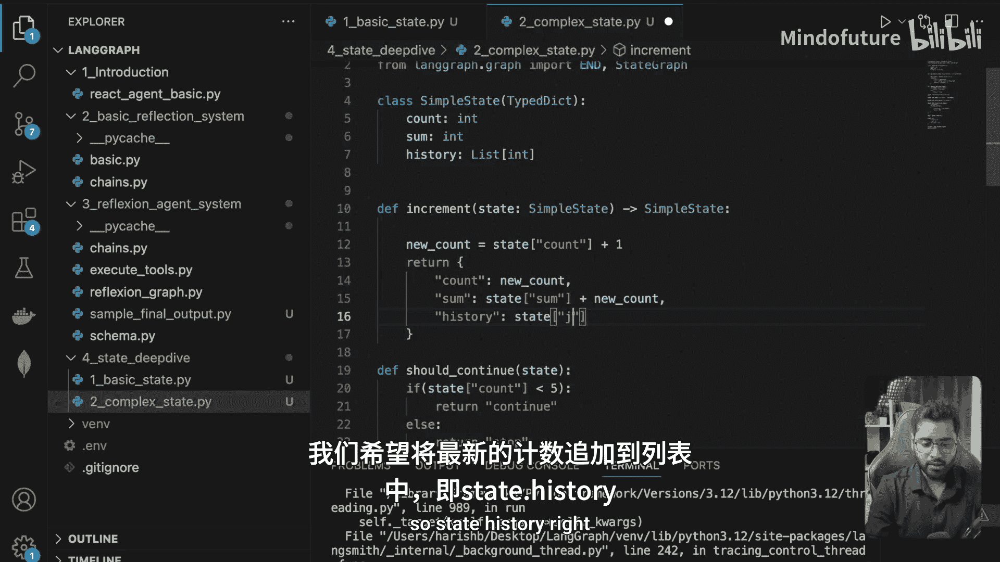
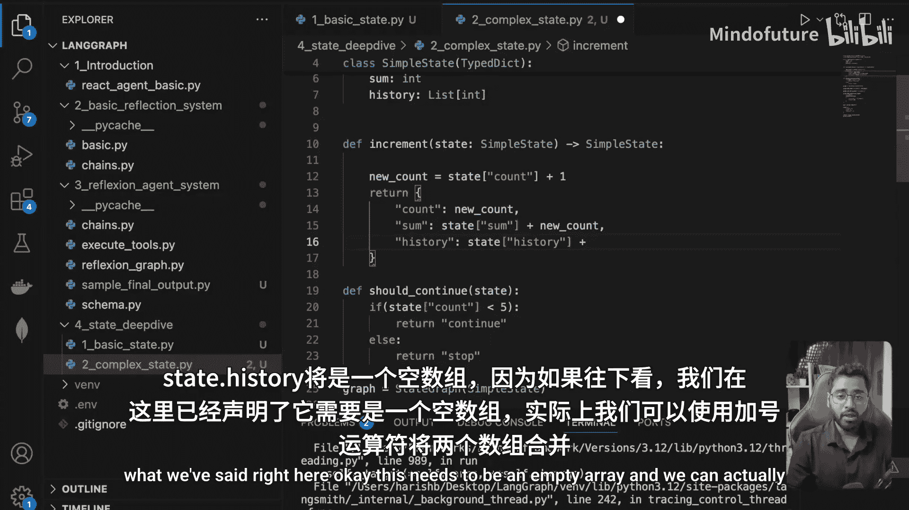
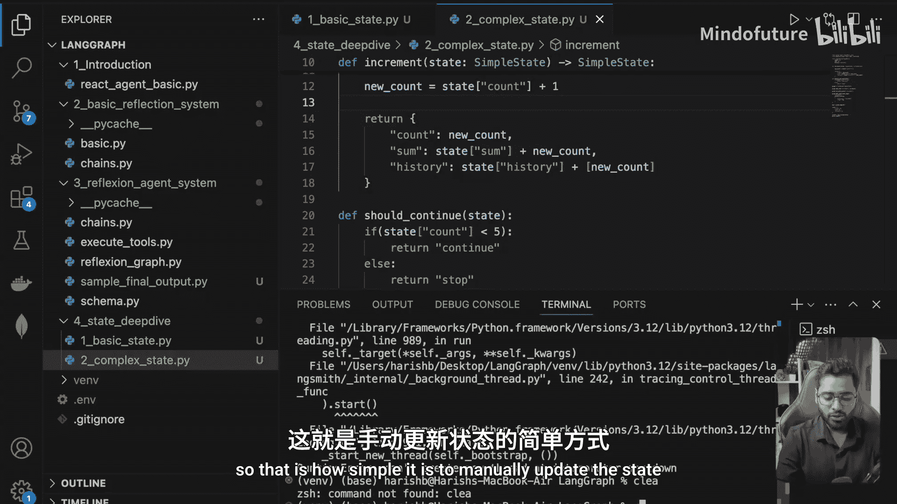
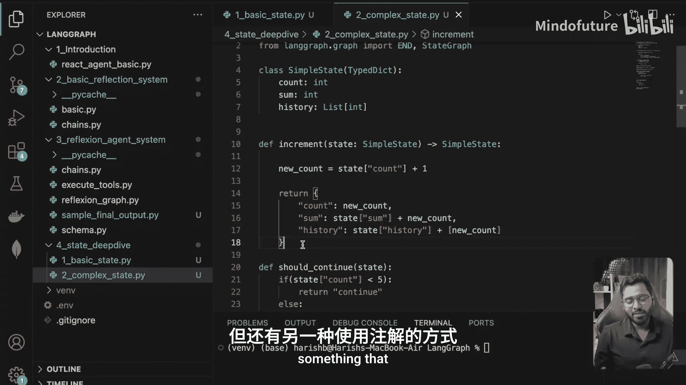

# Langgraph初学者入门2025 p17 P17_#16_手动状态转换 -BV1mgepzCEjf_p17-

All guys。 So in this section， let's actually， you know。

 lets go ahead and create another file and let's call it let's say complex state。😊。

Complex。Stay dot by。Okay I'm just going to copy paste everything right here。

 whatever we did in the previous section， so I want to add another property to this you know blueprint and basically what I want to do is I want to keep track of the sum。

Of whatever count that that this system goes through。 Okay， so initially the sum is going to be0。

 So let's actually go ahead and put that down here as well。 So the initial state。

 the count the I mean， the sum is going to be 0。And。So in this particular node right here。

 in this node right here， so if the sum is going to be 0 and the count increases to1。

 the sum is going to be one。 So right now the sum is going to be one and if the count were to be increased to2 then it it's going to be one plus2 then the sum is going to be3 okay so you can imagine that if there' five more iterations。

 the sum is going to be 15 So let's actually go ahead and implement it So in addition to changing the count property in the state and'm now also going to update the sum property Okay so how can I do it So Im in this object that I'm returning I'm also going to update the state。

 So first off I need to get the current the latest sum value and then I also have to you know get the next count value and then add it to the existing sum okay so since were repeating it I can just go ahead and say new count and then I can just like move this outside。

😊，Okay， so I can also do something like this。And they should work perfectly fine。 Allright。

 so let me go ahead and quickly run this as well。😊，All right。O。So coming up。

 you can see that we have count as 5 and some as 15。

 So you can imagine that we can add as many properties as as we want。

 And this is the whole point of a custom state。 It is completely in our control， right， perfect。

 Let's also do another thing。 Let's also have a history。 Basically， I just want to keep track of。

 you know， what are the different counts that weve encountered。 And I want it to be in a list format。

 right？ So in this case， I can just say it should be a list of hints。😊，So for the list。

 I can just go here to typing and then you know， get the list as well right here。 Okay。

 so I can do the same thing。😊，So initially coming down in the initial state， we want the history。

To be。An empty list right here。 and now I get access to the history everywhere。 So， you know。

 I can easily get it from here and then I can update the history as well。 So the new history value。😊。

We want it to be you know we want the latest count to be appended to the list right so state history right so state art history is going to be an empty array because if we come down here that is what we said right here okay this needs to be an empty array and we can actually you know append two array together by using the plus operator okay so we can actually put whatever thing things that we want here and then two lists are going to get merged together so what do we want right here we wanted the new count again。

All right。Perfect， so let's actually give this a whirl， as well。😊。

And if I run it you can see that don't worry about these things。

 but you can see that we have the count as 5 some as 15 history as 1，2，3。

45 Okay so that is how simple it is to manually update the state okay so in the section basically how we've updated the state is that we have updated it using the manual method okay so we are manually we are doing all of the calculations right here and then we are updating it manually but there is another way of doing it using annotation as well and that is something that we' will be covering in the next section。

😊。

