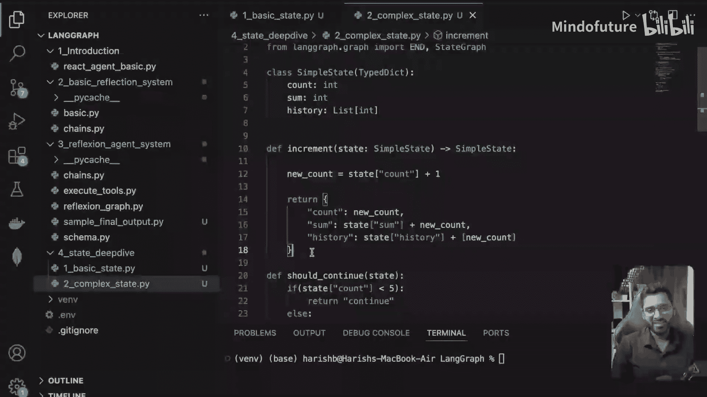
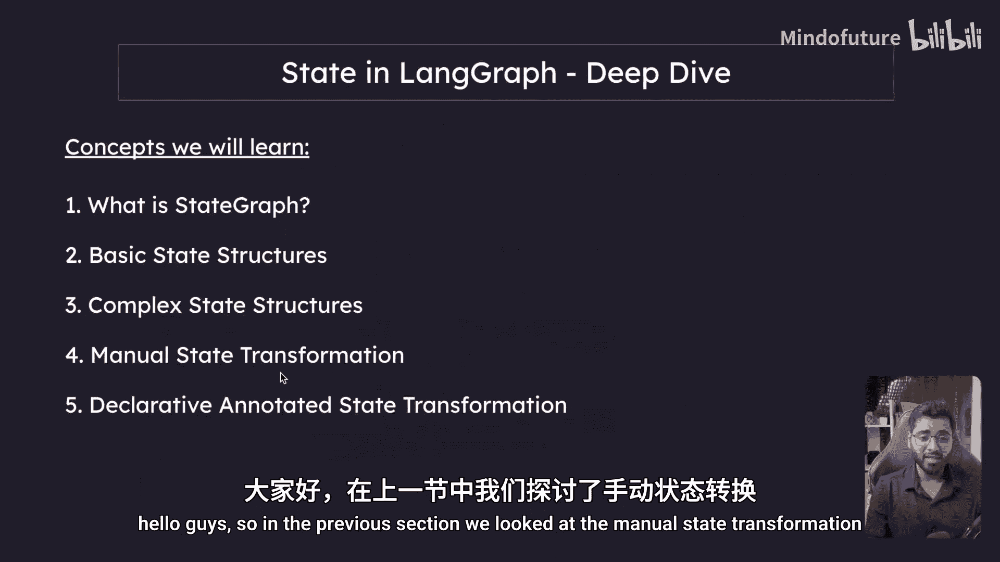
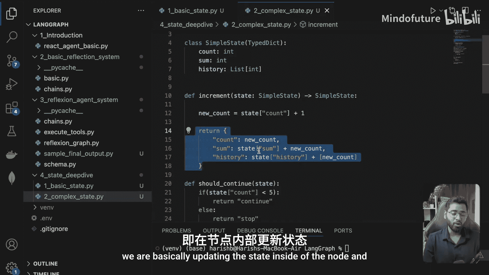
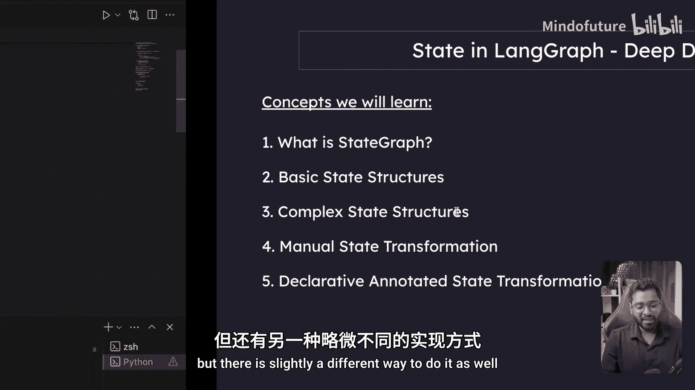
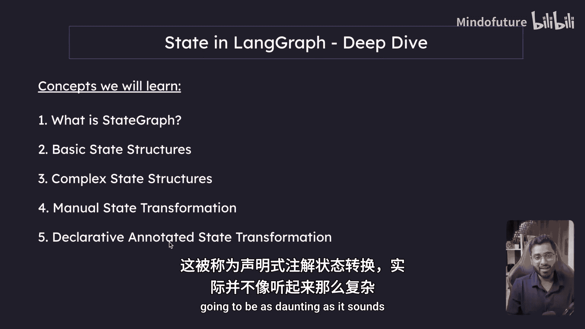
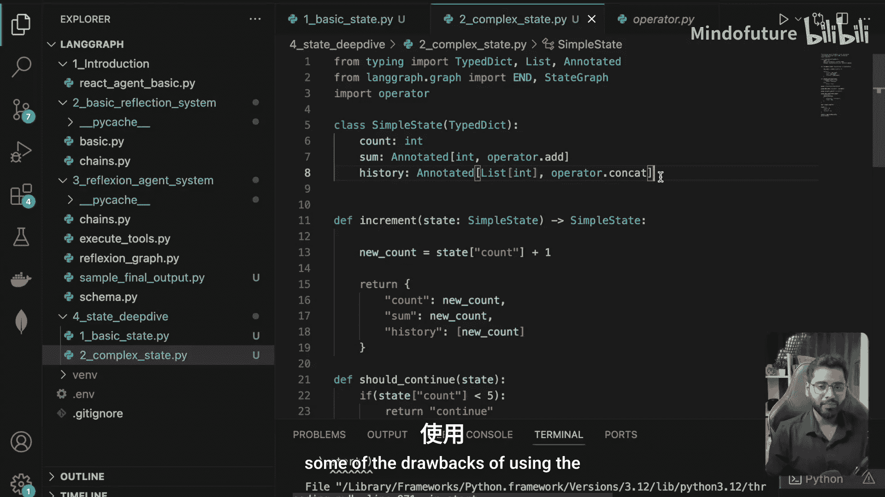

# Langgraph初学者入门2025 p18 P18_#17_声明式注释状态转换 -BV1mgepzCEjf_p18-

Hello guys So in the previous section we looked at the manual state transformation。

 which is where we are basically updating the state inside of the node and we are doing all of the calculations inside of that particular node but that is slightly a different way to do it as well so that is called the declarative annotated state transformation it is not it is not going to be as daunting as it sounds。

 So let's actually look at what what it is used for okay so in the manual way。

 you know we are just dealing with one node right here and let's say you know we are calculating the sum right so this is going to be the operation right so let's say there's like a four or five or 100 different you know nodes that do the same you know summing operation So you can see that this is going to get repeated a lot right So basically just to cut down on that there is a slightly more know better way of doing it and that is through annotation so I'll show you what that means so I can just say。

😊。

Annotated。And right here we can actually you know provide landing graph。

 basically tell it give it a metadata and tell it how to update the state in the future so I can say annotated。

😊，Okay so the first this thing is going to be the type okay and then second in the second option we can actually provide it how to update the state in the future so right now what we are doing is we just summing it right so we are taking the previous value and then we are adding the adding it with this new compute value right so all that we have to do is we can just say operator dot add。

😊，Okay， so we don't really have the operator。 So I'm just going to say operator。

So now that we've added it here we can actually go ahead and remove this part okay so essentially what we are saying is this this annotated this thing is going to keep track of the previous value and any time there is a new value that is going to be returned in the place of this property okay so anytime that is being returned add this to the existing value and that is what this particular method means okay let's try to do the same thing for history as well so we have the previous value right here we don't really want to you know keep on repeating for other nodes as well so in that case we can remove this。

😊，And we can actually， you know， say annotated。Okay， so annotated。 So again。

 this is still going to be a list， but if there is there is an existing list that is being maintained and if there is a new list that is being。

 you know added， how to be updated， we have to concatenate now right we have to merge it so we can just say operator dot concat Okay。

 so you can see that it it provides a bunch of different methods。

 you can see that call we've got a lot of different methods。 So in this case。

 I'm just going to use concat。😊，Allright， and that is it。So if I were to run this。

 you should be able to see the same exact thing no different。

So this would have slightly simplified your code a little bit right so you can see that you know this is a lot more clearer now and then all the you know the actual you know intelligence as to how to update the state is maintained here okay in this particular annotated and we using the operator。

😊，So there might be some you know some operations that might not actually be available in the operator in that case。

 you might have to do it manually right here， but yeah this is always available for you to use and the reason why I wanted to cover cover all of these different patterns is because you know we will be using some of this in the next section where we are going to be building our very own react agent that we saw in the start of the course and we are going to be building it using land graph and that is going to give you a much more deeper insight as to how things work and also that is going to give us a lot more flexibility okay so using lachas classes we don't really have a lot of control infinite loop problems but if we have the control with us if we build it using La graph that is going to give us a lot of control and we eliminate some of the drawbacks of using the the lachas default classes so I'll see you in the next section。

😊。

