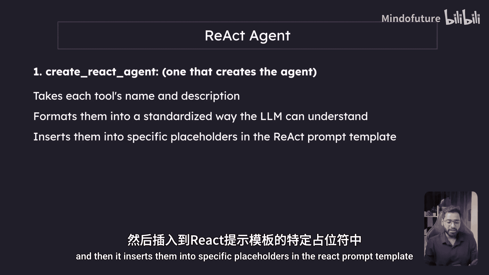
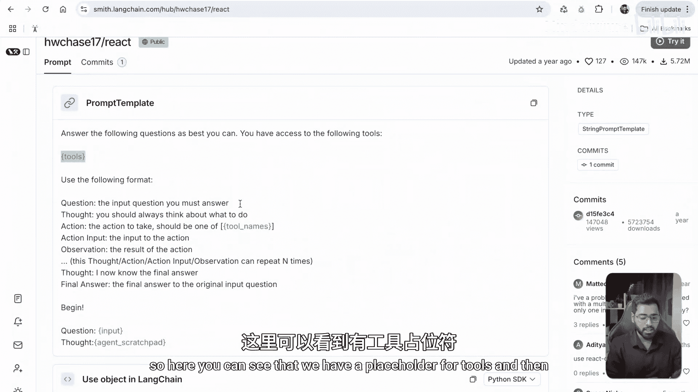
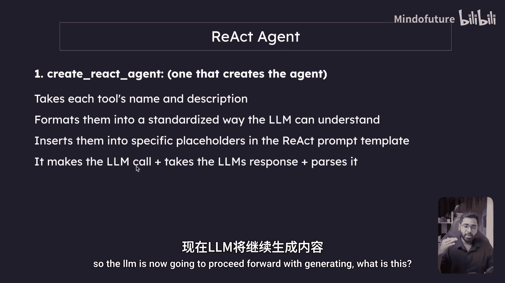
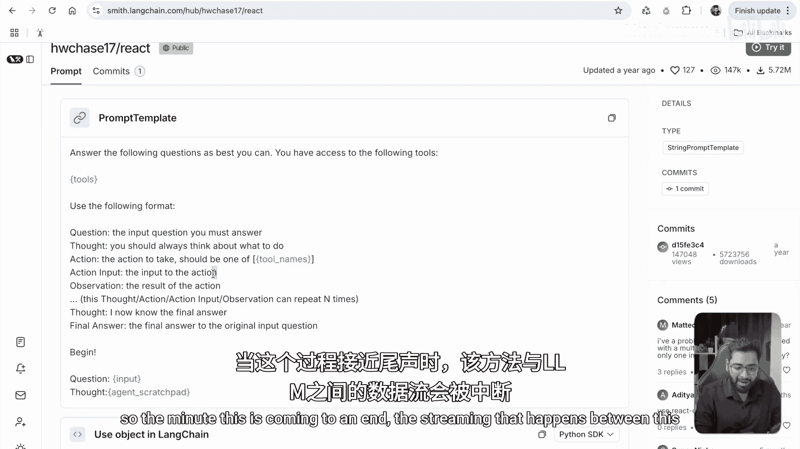
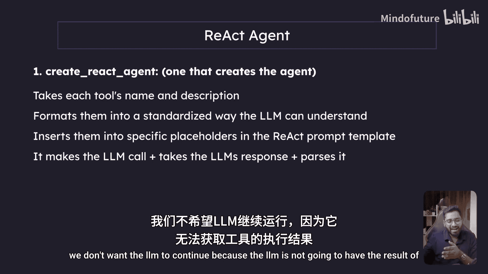
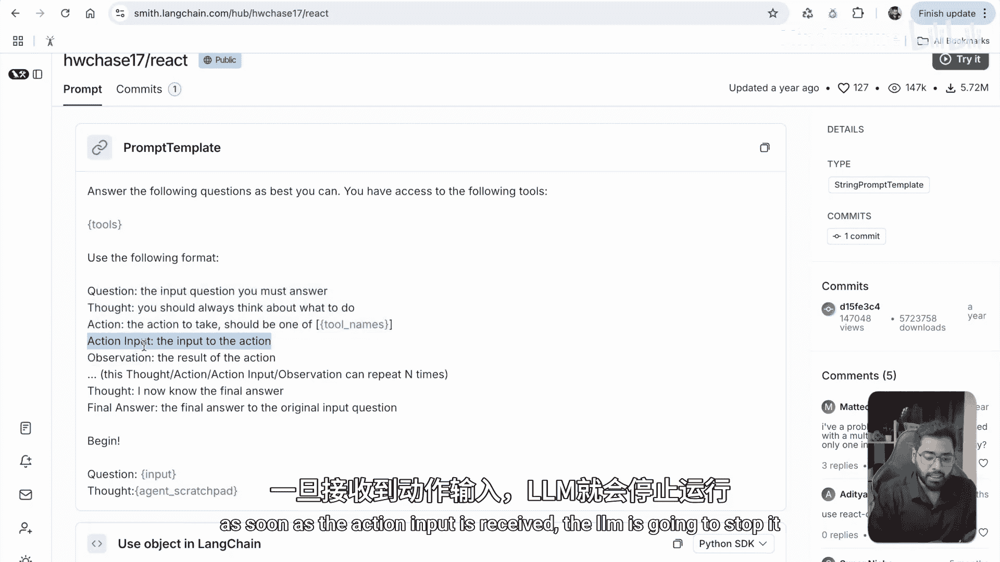
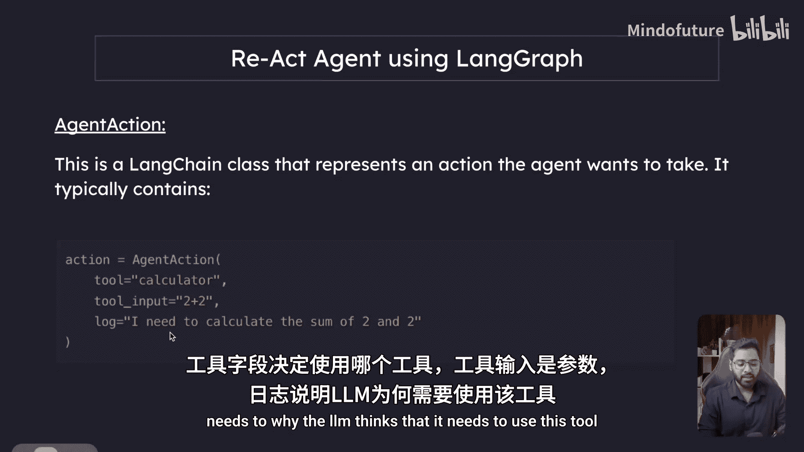
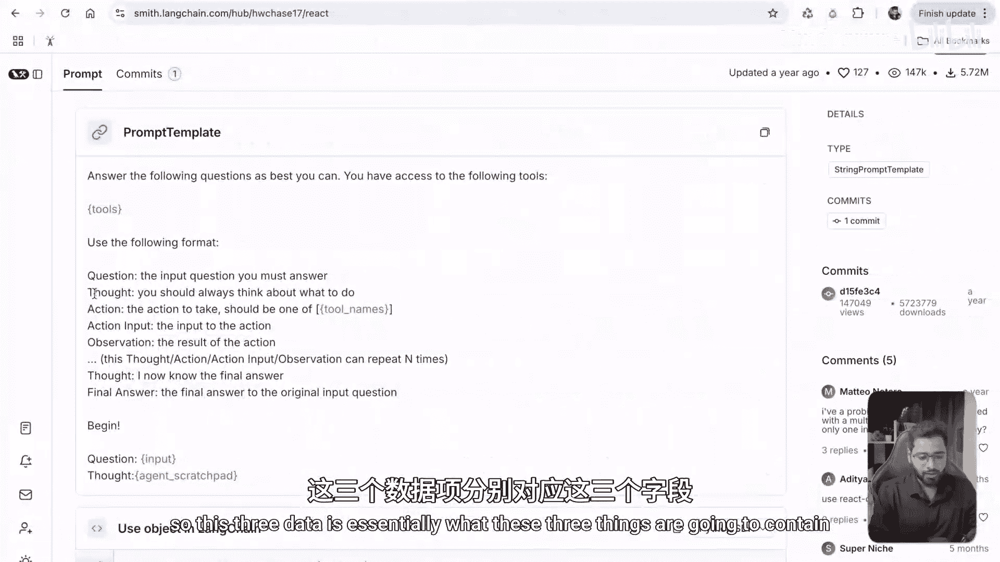
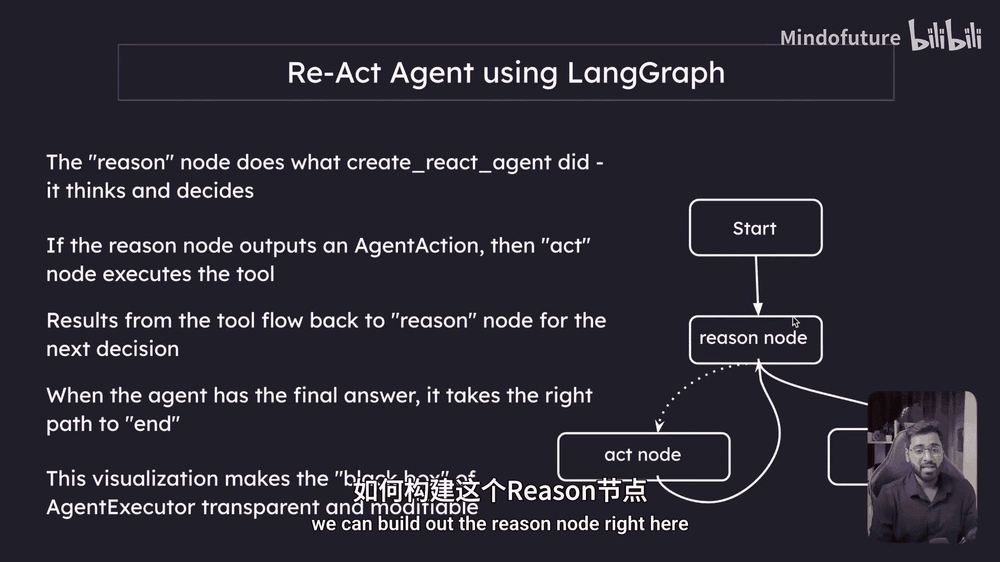

# Langgraph初学者入门2025 p19 P19_#18_使用LangGraph的ReAct_概述 -BV1mgepzCEjf_p19-

Hello guys， welcomee to another brand new section in the section。

 we are going to be building the react agent using Land graph Okay so in the previous section。

 we learned everything there is to know about state in land graph how to use custom state So we are going to be employing all of that to build out our react agent So I know that we did implement the react agent using Lachas you know out of the box classes like initialized agent method and agent executor classes but in this you know section we are going to eliminate you know the agent executor and we are going to have full control over the looping that happens between the LLm and Lacha between LLm and Lacha we are going to have full control because this time we are going to be using our graph data structure we are going to be using land graph So before we proceed forward let's quickly jo your memory about you know what is the react agent what pattern does it follow So if you remember this particular slide So you can see that you the LLM first things。

😊，Let's say you're giving the LLM a problem to solve it first thinks about the user's prompt or the problem and then we have action the LLM decides if it can answer by itself or if it should use a tool so once it decides once it makes a decision it is then you know if it decides that it is going to use a tool the action input is going to be the LLM provides the input arguments for the tool right so once the input argument is provided Las you know out of the box class it just like stops you know the streaming of the LL else the LLM shut up it just basically takes the think action action input it is then you know going to call the tool execute the tool get the response and with all the entire history it is again going to send it back to the LLM and now the LLM is going to observe the result of the tool and if the entire problem is solved at that particular point this is the final answer or else the same loop is going to continue。

So the problem that we faced was that we did not really have control over that you know default class that Lcha provided for you know running the react agent right because sometimes we went into the infinite loop problem we do not have the control to ourselves right so that is exactly what we are going to be solving using land graph okay so before we actually start implementing you know La graph。

 let's actually take a quick peek into this method okay so let me actually come back to the first introduction where we built out the react agent so here you can see that we used the initialized agent method okay so let's actually you know take a quick peek into what is exactly happening what are the components that sort of you know come together to build out the react agent。

Okay， so that is what I've written here。 So in La chain。

 we use the initialized agent as an all in one solution right So that is exactly what weve used right here。

 It basically just sticks in the tool the LLM， you know the prompt as well the react prompt we're telling the method used the react prompt inside of it。

 you know the react prompt would have been written and then we are setting the boster true as well right So this is what we're using as an all in one solution。

 but it combines two key components。 So the first one is going to be the create a react agent method。

 just on a very high level thing that you know this is a method that does one thing。

 and then along with that， we also have the agent executor class。 Okay。

 so this is exactly what we are going to eliminate for La graph Okay so this is what actually controls the looping between La chain and LLM between La chain and LLM this looping is being done by agent executor and that is exactly what we are going to be replacing using La graph。

😊，Alright。 so create react agent。 So what is it So you can basically think of this method to be that method that creates the agent。

Obviously you know， everything is got to come together to create the agent including the looping。

 but for now just think that this is what is going to create the agent。

 So what does it do It just takes each tools name and description。😊，Okay。

 so you can imagine that we would have provided a few tools you know， to solve the problem， right。

 So let's come back to the code。 We see that we have the search tool right here。

 We have the get system tool right here and the center tools is provided to this particular method。

 right？ So let's see what it does。 So it basically takes each tools name and description。 Okay。

 so we have the name right here， and we have the description right here。 Okay。

 all these things are not going to be taken at all。

 These things are not going to be considered at all。 Just these two things are going to be taken。😊。

And then it formats them into a standardized way the LM can understand。 Okay。

 so basically it' is going to convert it into a string and then it inserts them into specific placeholders in the react prompt template。

😊。

Okay， so let's quickly look at the react prompt template。

 So here you can see that we have a placeholder for tools and then we have a placeholder for tool names right So that is exactly what this method is going to do。

 It is basically just going to take the name and description of various tools。

 It's going to structure it。 It's going to pass。 it's going to make it into a proper string。😊。

And then it is going to combine it with the prompt react prompt template so that you know when we send it to the LLM。

 the LLM is going to have full context about what are the tools that it can work with。Alright， so。

Not just that。 okay， it doesn't just do the merging。 It also makes the LLM call and okay。

 it makes the LLM call。 So the LLM is now going to proceed forward with。

 you know generating what is this it is start it is going to start generating the question thought action action input Okay。

 so these four things it is going to start generating and the minute the action input is received And the minute we actually start go going to this observation。

 Okay， so the minute this is coming to an end。 the streaming that happens between this particular method。

 the streaming that happens between this particular method and the LLM know that is interrupted。

 Okay， so we don't really want what happens after that。 Okay。

 we don't want to we don't want the LLM to continue because the LLM is not going to have the result of the tool。

😊。

Right， so what I mean by this is。Up until this point， Okay， up until this point， you know。

 the LL M needs to generate the action input。 As soon as the action input is received。

 the LLM is going to stop it。 Okay， this particular method is going to tell LM to stop streaming。

 Okay， your work is done。 I now have the action input。 It's going to get that action input。 Okay。

 so that is what it does。 It makes the LLM call。 It takes the L response。😊。

And then it pars it。 Okay， so this is an example。 let's say， Okay， so first off， the L M is like。

 you know thought action， action input。 The thought could be。

 I need to find out when Spacex law last launch was and calculate the days since。😊，Okay。

 so if you remember that this was the first， you know prompt the problem that we provided to the LLM right So it is first thinking to itself and then it is the LLM is deciding I want to use the search tool and then it is also providing the input to the Tli search tool。

 Okay， so let's say this is up until this point。😊，This method is going to allow the LLM to generate and as soon as this is done and the observation is started cut and then the data is going to come back to this particular method and finally once it has these three things right here once it has these three things right here。

 it is going to parse the response of the LLM into one of these two classes so the end this method is just going to return two things it is either going to return the agent action class or the agent finish class So let's actually look at what this agent action and agent finish looks like So this is a blockchain class that represents an action the agent wants to take it typically contains something like this So this is how the complete you know past output is going to look like it's going to be an agent action class。

 it is going to have the tool tool input and log So tool is going to be what tool to use the input to the tool and then why it needs to why the LLM things that it needs to use。

😊。

Tool so this three data is essentially what these three things are going to contain The thought is the reasoning and that is exactly what is going to be put in the log and you know the action is going to be which tool to take that is exactly what is going to be converted into this tool input and then finally we have the action input and that is going to be this tool input Okay so it just like passes it and creates this particular。

😊。

Class agent action class。 Okay， I really hope that makes sense。 So in case that， you know。

 the LLM is actually， you know does not need to call another tool。 it thinks that， you know。

 I don't really need to call a tool。 my answer is done my work is done。

 I have all the information that I need。 I have the final answer In that case。

 this particular method。 the create react agent method is going to return the agent finished class。

 So this represents the agent completing its task with a final answer。

 it typically contains you know， this is going to be the output。 and this is the log as well。 Okay。

 so now I really hope that you understand what the first component。

 the first key component of react agent does。 So this is going to be 50% of the work that is done by this initialized agent method。

 Okay， so let's look at the second key component of this initialized agent method and that is going to be the agent executor。

 So let's see what it does。 It takes the agent from create react agent。😊，Okay。

 and then manage the execution loop。 So you can imagine that， you know。

 the create reactation method is going to output past the the agent action and the agent finish。

 but something's got to control the。😊，The looping between between the long chain class as well as the LLM right So after the LLM is done the the the control needs to come back to you know。

 the L chain La is got a par set it's going to call the tool。 And as soon as the tool is called。

 you know again all of the data needs to be sent back to the LLM along with the history。

 So all of that looping is being done by the agent executor。I hope that makes sense。

 so it basically takes the agent that is created from the create react agent method and manages the execution loop it receives the user's question and feeds it to the agent okay and then it identifies which tool to run based on the agents output agent action or if it is no tool required then agent finish so it executes the tool and captures the result。

 feeds the result back to the agent for the next decision it continues this loop until the agent produces an agent finish class。

😊，Returns the final answer then to the user。 Okay so to put it very short Age executor is what is actually going to be controlling the looping between the R system as well as the LLm。

 So this is where we actually lost control a little bit because of the infinite looping problem。

 So if I actually go back and go inside of the initialized agent you can see that it is actually returning the agent executor Okay。

 so this is why you know this is not really in our control at all。

 Okay so if we mess up with the prompt or we mess up， you know。

 if we don't provide a tool or anything， then it's going to malfunction and we don't really want that。

 So this is exactly where there is a drawback and this is what we are going to replace or rather eliminate using La graph。

 So we are going to gain control of the looping。😊，So let's actually look at some of the key advantages of using land graph。

 So Land graph basically turns the hidden black box loop into a visible， editable workflow。😊。

So you can now add custom nodes， modify the flow insert additional logic。

So this is going to be the land graph graph for the react agent and then we have the reason node and the acting node so together is what is react right reasoning plus acting so lets actually look at what this graph means so the reason node does what create react agent did it thinks and decides。

😊，If the reason node outputs an agent action， then Act node executes the tool。

The results from the tool flow back to reason order for the next decision。

When the agent has the final answer， it takess the right path to end。😊。

This visualization makes the black box of agent executor transparent and modifiable。😊。

So I really hope that this introduction makes sense if it does not don't worry we are going to be you know dissecting it and we are going to be looking at it in much more depth。

 but yeah in the next section we are going to be looking at how we can build out the reason node right here so I'll see you in the next section。

😊。

