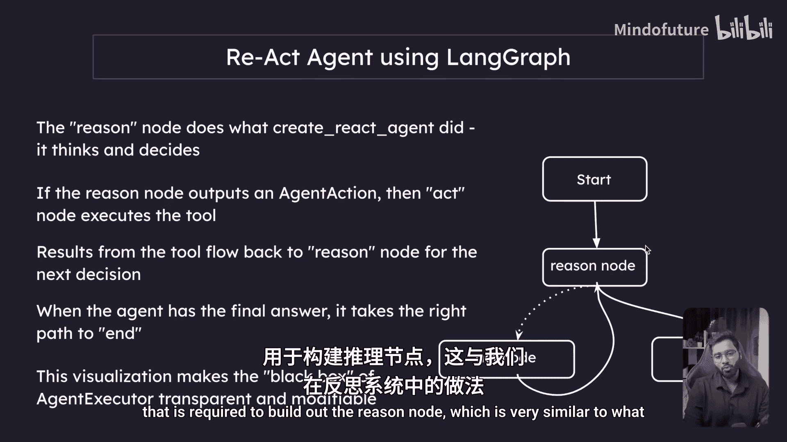
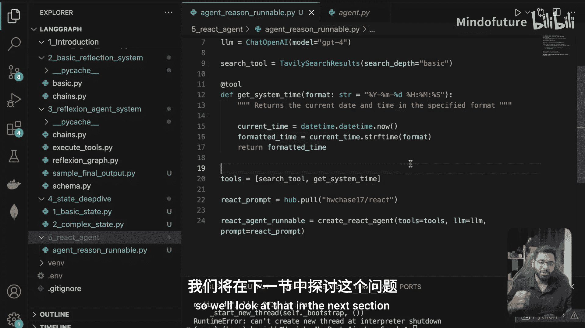

# Langgraph初学者入门2025 p20 P20_#19_使用LangGraph的ReAct_推理Runnable -BV1mgepzCEjf_p20-

Hello， guys。 So in this section， let's go ahead and build out the the chain or the runable that is required to build out the reason node。

 which is very similar to what we did in the reflection reflection systems as well， right？

 So I'm just going to go ahead and first build out。 I mean create a folder。

 Let's call it react agent。

And then I'm going to call this the， let's say， agent。Reason， reason。Runable。 Allright。

 So let's think about what we need right here。 So all that we need is to you know provide all of the properties that the create react agent method is going to need。

 So let me go ahead and paste a few inputs right here。 Pre standard stuff。

 We have the open AI chat model that this is the method that we are going to be using the create react agent the T tool and you know we have the LLm as well。

 So what is the next thing that we need。 So we can just go back to the first section And then let's see what we did right here。

 So we are still going to need the same tools that we have to provide right So we have the get system time tool。

 basically I'm going to replicate the same example that we saw we don't want to reinvent the wheel because were just learning right So I'm just going to copy you know everything right here。

 including the search tool as well as the get system time tool So let me come back put it over here。

 perfect。😊，And finally， we are going to use this particular create react agent method and let's look at what are the things that it needs。

 So first thing is it requires the tools and then it requires the LLM as well。😊。

And then it requires the prompt。 Okay， so the prompt that we need to provide is going to be the react prompt。

 Okay， so for that， I can just。😊，Go to you know， hub。 Okay， so I can just say react prompt。

If this is going to be the react prompt template。 I can just say hub dot。 Okay。

 let me just go ahead and paste it。 Yeah， so this is going to basically pull the react prompt from the H W Chase 17 Lcha。

 you know， the website。 perfect。 So let's actually go ahead and provide this here as well。 Okay。

 great。 So looks like this method has been provided everything that it needs。

 So this method is going to return a runable， which is going to do all of those things that we saw in the the slides before。

 right， So if I go in here， you can see that this is going to return a runable。

 So we can call this the react agent。😊，TheRunable， let's say， Okay， perfect。 Allright guys。

 So we have created the runable， the reasoning runable in the next section， we are going to。

 you know build out the state that we need to build out the system。 So in the previous section。

 we looked at the custom state and we can actually put in pretty much any property that we want to achieve this particular system。

 So for the react， we are going to need a few， you know。

 we are going to think about what are the states that we need。

 So we look at that in the next section。😊。

