# Langgraph初学者入门2025 p21 P21_#20_使用LangGraph的ReAct_状态 -BV1mgepzCEjf_p21-

Alright guys， so in this section， let us look at what are the state properties that we need to achieve this react agent system so you can see that I've already gone ahead and created a file called react state dot py and I've imported a few things like the operator I'm pretty sure that you know what operator is by now we have the annotated class we have the type dic and then we have the union okay we'll talk about what these things mean alright so this is going to be the agent state we can call it anything that we want but I'm just going to call it agent state or react agent state we are importing the type dic and these are the three properties that we need to achieve these are the three state properties that we need to actually you know you know achieve this particular system so the first one is going to be very simple the first one is going to be the human message the initial human problem okay so for example my problem initially was I wanted to you know this was my prompt right so this is going to sit right here and you know initially。

😊，hich is going to put it right here and it is going to stay for the rest of the process。Alright。

 so next thing is going to be the agent outcome。 and then we have the intermediate steps as well。

 So let's look at what this agent outcome is。 So this agent outcome if you remember， is exactly what。

😊，This runable is going to output。 So if you remember this runable。

 so if I go in here you can see that this runable is going to return either an agent action or the agent finish so I can actually search for agent action so you can see that it returns a runable sequence representing an agent it xs as input all the same input variables as the prompt past and thus it returns the output either as agent action or agent finish right so this output is going to be。

Ho hang right here Okay so initially it is going to be none but you know once the LLM wants to use a particular tool after the passing this agent action can sit here or the agent finish can sit here Okay so the union is basically like you know it can either be this or it can either be this or it can either be this that is what this means but yeah initially it is going to be none。

And next we have the intermediate steps and this is basically just to keep track of the entire history of all the existing problems that have been solved。

 We don't want the element to keep on solving the same problems again right so if if there is a small part of the problem that's been solved already we save it and then we keep it right here as a list ofupils okay so anytime there is a new tool call and the output of the tool call is done were just going to add it to the existing list So if this does not make sense to you don't worry I actually have sought the help of clo Ive just like told it exactly you know how basically I told it okay。

 I want you to give me the exact sequence of how the state changes as the looping happens in the right sequence So this is exactly how it's going to go guys okay so initially when the application starts with a or invo okay so let's say this is going to be the initial human prompt right so initially the agent outcome is going to be none and then the intermediate。

😊。

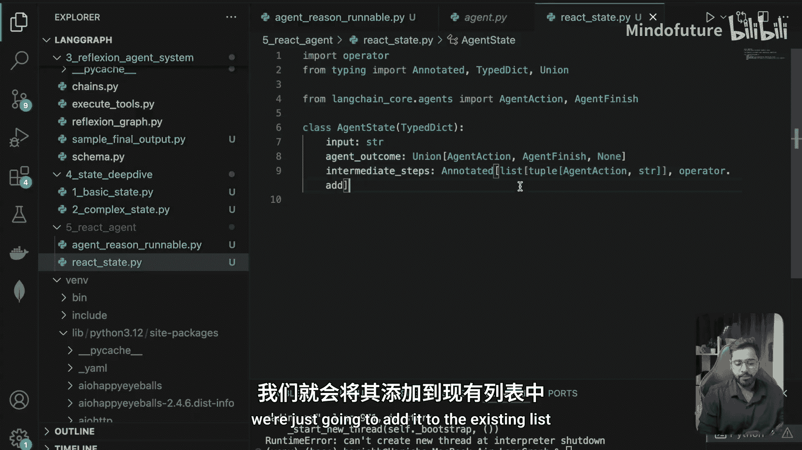

Initially is not is going to be an empty array as well。

 okay so in the first iteration the flow starts at the entry point right So if you come back to the graph。

 So this is going to be the reason node the entry point So what this is going to do this is going to know it's going to call the method this is going to sit inside of the create react agent don't worry about it So yeah this is going to process the input and it is going to parse and generate the agent action for the search tool right So this is going to be the updated state。

 So as soon as the react node is done executing it is going to return the agent action So that agent action is going to sit inside we are going to update the state and put it in the agent action the agent outcome property So this agent action is going to have the tool this tool to use tool input this is going to be the search term and then the log so right here this is going to return it and now we are going to put the data and the agent outcome so what。

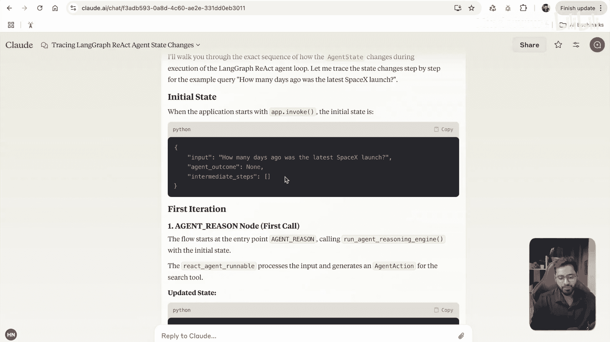

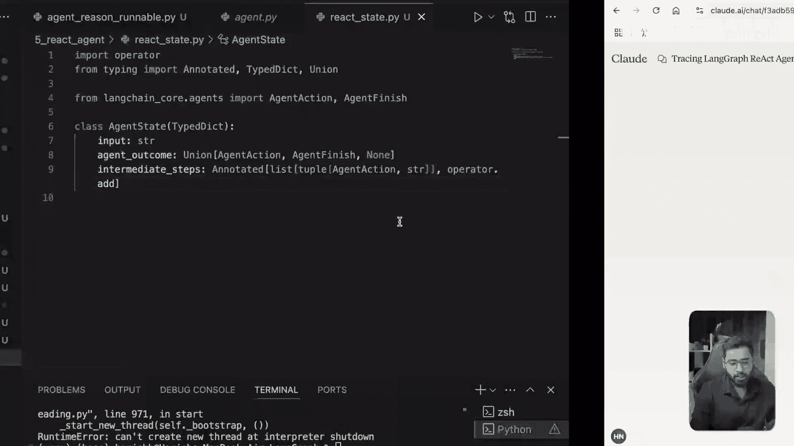

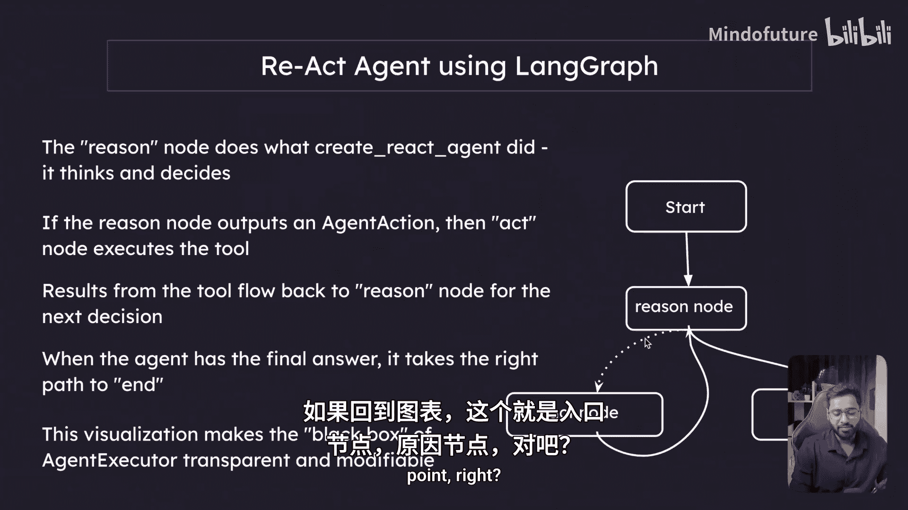

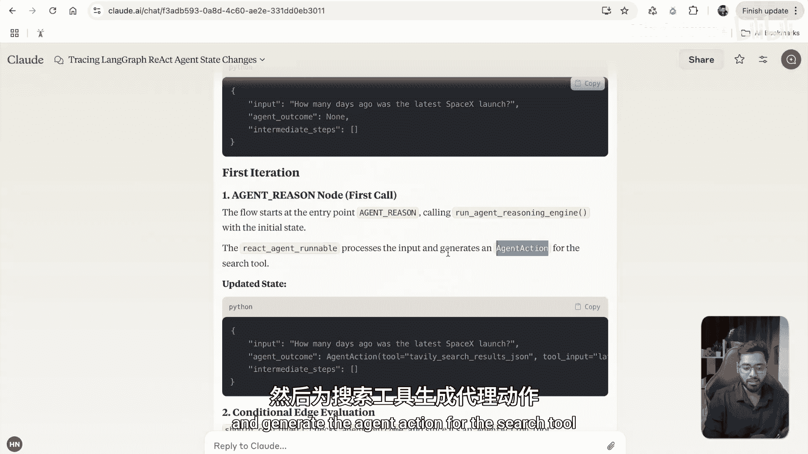

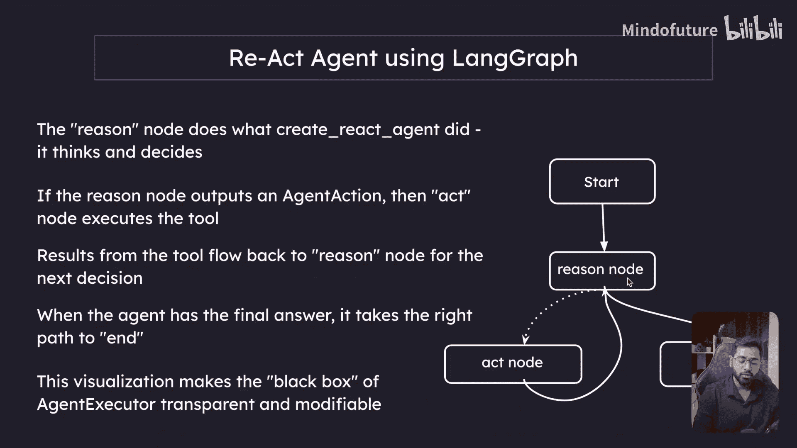

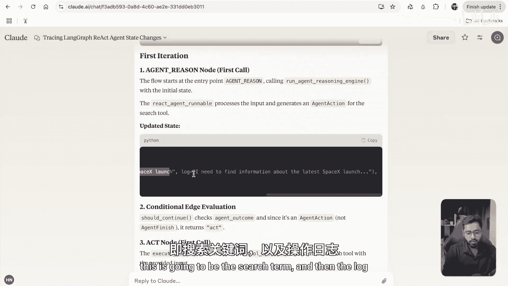

Next step， we need to send it to the act node the act node is what is going to actually execute the tool so now it has all the data it needs it knows okay it knows exactly you know what tool to use what should be the input to the particular tool right it has all the information So what's going to happen next the conditional that is going to happen it's either going to go to you know the act node or the end node so it sees the agent action it is not agent finish it sees the agent action so it is sending it to the act node well actually build all of this later in the graph but it is going to send it to the act node and then the execute tools the tools are going to be executed and then as soon as the tools are executed。

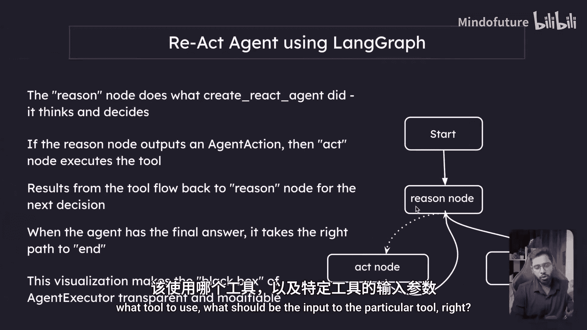

The intermediate steps is going to get populated Okay so we have in the tuil so this is going to be the first tuil in the list in the tuil the first part we are going to have the agent action that was generated before and also we have the output okay so we have the output of the tool execution Okay here it is going to you know all the output of the you know the search results is going to set right here。

 So this is going to be the intermediate steps perfect So as soon as this is done the tool execution is done what happens So as soon as the tool execution is done we are going to send all of the informationation back I mean。

 the control flow is going to go back to the reason node and then。😊。

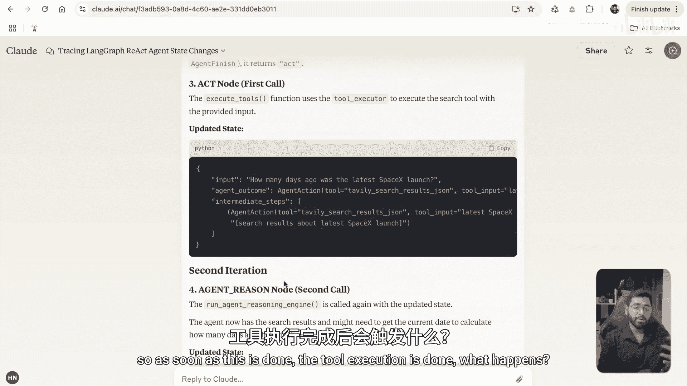

All that history is going to be again sent back to the LLM in that agent scratch pad。

 so now it has solved a particular problem， one problem it has solved now it needs to solve the next problem and for that it might use a different tool right so we have the second iteration and then we have the agent reason node again okay it's going to get updated now gett system tile gett system time needs to be called not the other T search So this time okay the same thing happens the act node is going to execute the gett system time tool and then it is going to append it and then the final LLM call is going to happen in the agent reason node。

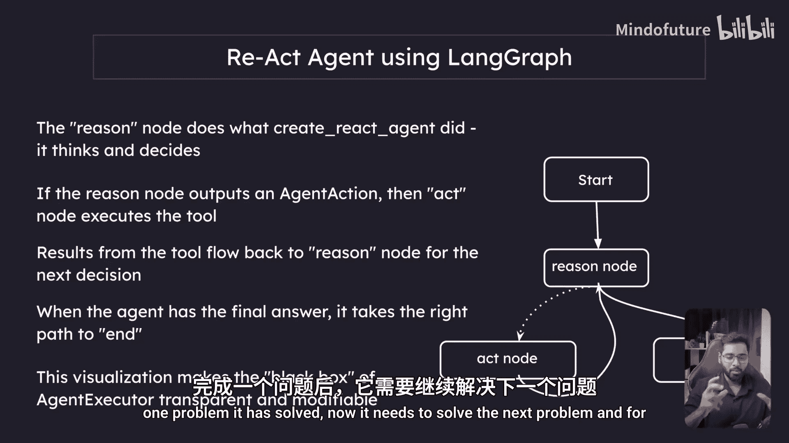

Right so this is going to be the upgraded state and then finally what happens the agent finish is going to be you know outputted by the reason node and that so what happens the agent finish is going to come right here and it's not going to go to the act node but instead it is going to the end node okay so that is exactly this is exactly why we need these three different properties so don't worry about how this is all coming together right now but for now just know that these are the three properties and why we actually need those three properties okay so that is what I want you to take away from this。

😊。

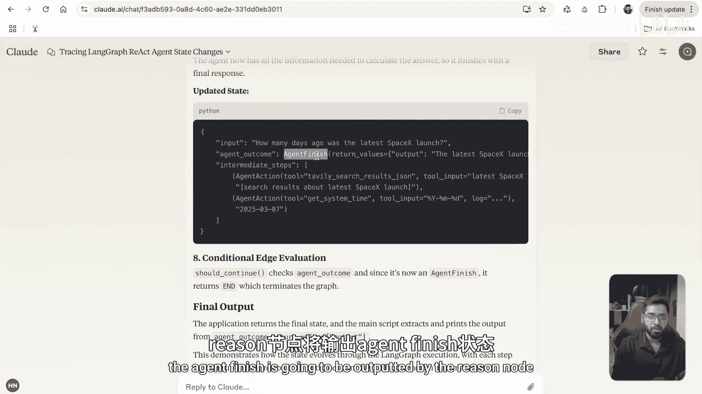

Okay， so in the next section we are going to be building out the nodes okay so this node and this node we are going to be building it out so Ill see you in the next section。

😊。

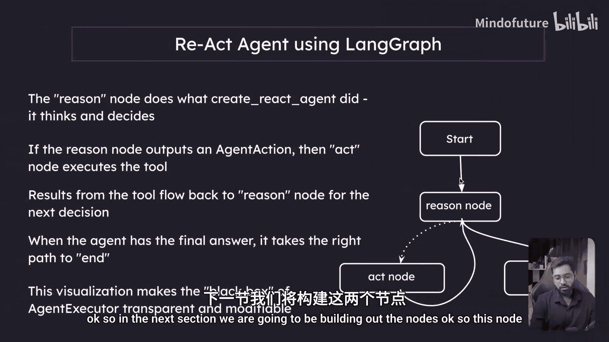