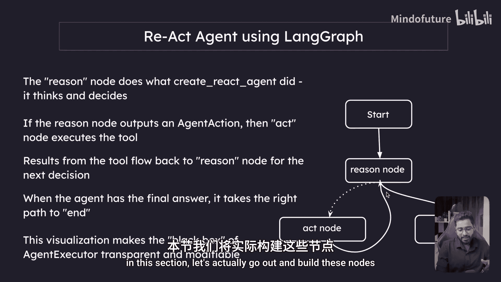
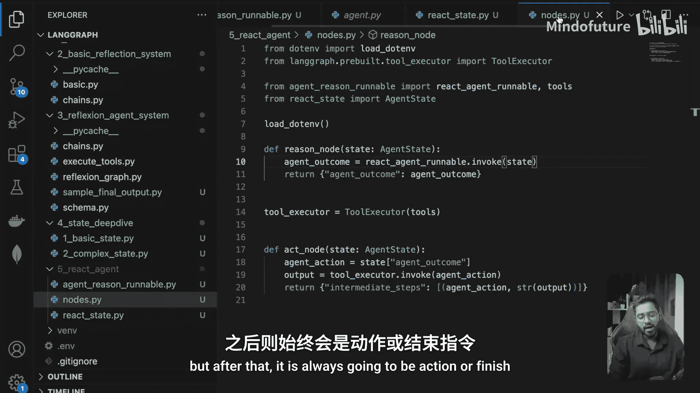
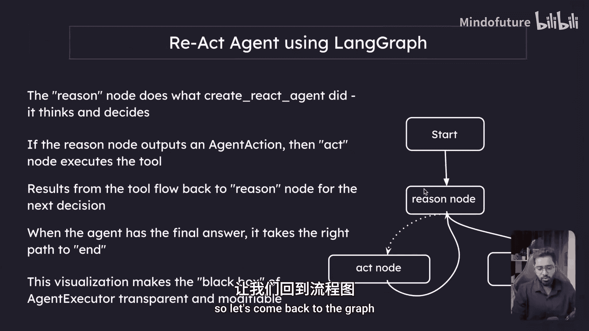
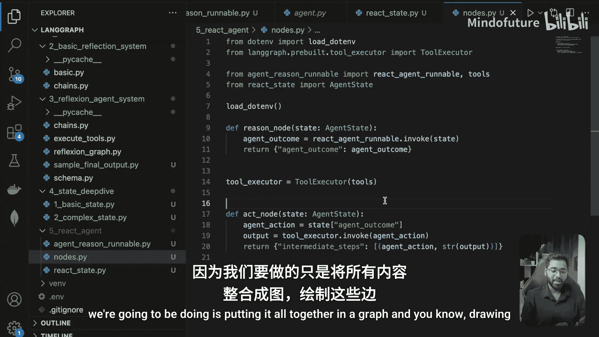
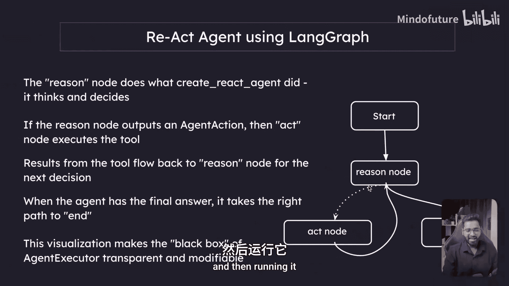

# Langgraph初学者入门2025 p22 P22_#21_使用LangGraph的ReAct_构建节点 -BV1mgepzCEjf_p22-

Hello guys so in the previous section we built out the runable that this reason node is going to depend on in this section let's actually go out and build these nodes okay so you can see that I've already gone ahead and you know I've created this file called nodes do Py and we have the reason node as well as the act node right here so let's actually let me take you through it step by step。

😊。

So right here you can see that we are going to use the react agent runable that we wrote in the previous section and all that we are going to do is we are going to invoke on it using the agent state okay so all the values。

 all these things that we see right here these are reserved keywords and this you know runable is going to know exactly what to do with those particular names so don't change anything so you will have to follow the exact input agent underscore outcome intermediate steps everything' is got to be perfect and now this runable is going to look at the state is' going to take all of the properties merge it with the react prompt and then it's going to do all of that magic including calling the LLM and then passing the output of the LLM and then having that particular agent outcome if you remember what is going to be the agent outcome this thing is going to return the agent action class or the agent finish class so here we are going to update the agent outcome right So right here we have the agent outcome that。

😊，Is going to be an high agent action or the finish。

 So as soon as this node is executed it is either going to have agent action or agent finish only during the first initial you know instance it is going to be it is going to be none but after that is always going to be action or finish Allright allright so let's come back to the graph so now lets let's assume that it is going to be agent action now it is going to come to the act node right so act node we are going to again basically extract what is that agent action that needs to be done and now we written the tool executor here as well right so here we are providing the tools and we have the tool executedecutor all that we are doing is we are invoking that you know we are providing that agent action and then whatever output that we are getting we are again we are going to be appending it to the in steps。

😊。

Okay， so if you remember， the intermediate steps is going to be a list of tus。

 Each tuil in the first part， it is going to have that agent action or the agent finish。 and again。

 it is going to have the output of that particular tool execution right So in this case。

 the output is going to be here。 we are stringifying it and then we are putting it here。

 And whatever we return here in this array in this list。

 it is going to be merged with the existing intermediate steps list。

 Why is that that is because if you come back to the state， we are using the operator dot ad。 Okay。

 so now I hope that if you you see that everything is coming together， right？ perfect。

 So now we have the reason node as well as the act node。

 So the next step is going to be very simple and fun to be honest because all that we are going to be doing is putting it all together in a graph And you know。

 drawing these edges and then running it。 So we will build out the graph in the next。

 So I see you there。😊。

