# Langgraph初学者入门2025 p23 P23_#21.5_ToolExecutor_(已弃用) -BV1mgepzCEjf_p23-

Hello guys。 I'm from the future。 I had to rewrite the act node alone because in the latest version La graph version 3。

 the tool executor class that we had used inside of the act node that has been deprecated it does not exist anymore so we are going to do it without using any of these methods okay without using the tool executor class Okay so it's going to be very simple So this line we've already written the only change that we are going to do is without using that tool executor we have to invoke the right tool okay so if I come back here。

 okay so we already have the list of tools that we have available。

 Im just going to take it right here Okay so we have this available So from the agent action I am all that I'm doing is Im I'm going to take the tool name and then I'm going to take the input okay so we can easily extract the information from the agent action。

😊。

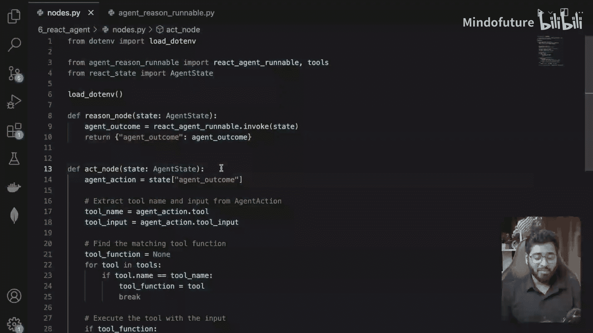

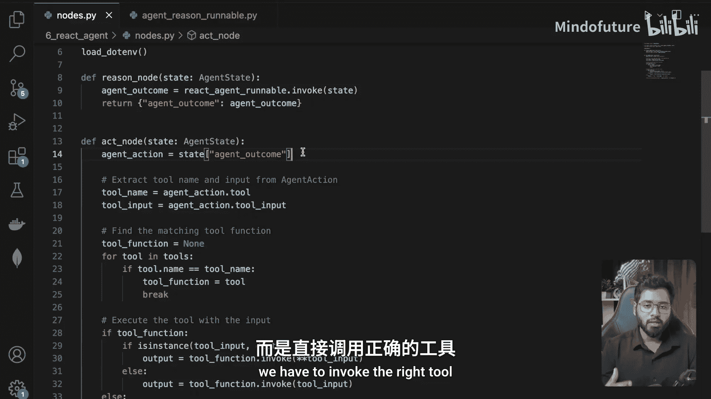

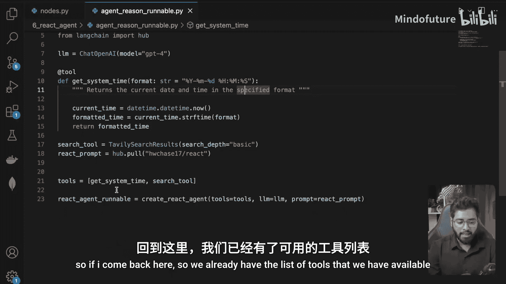

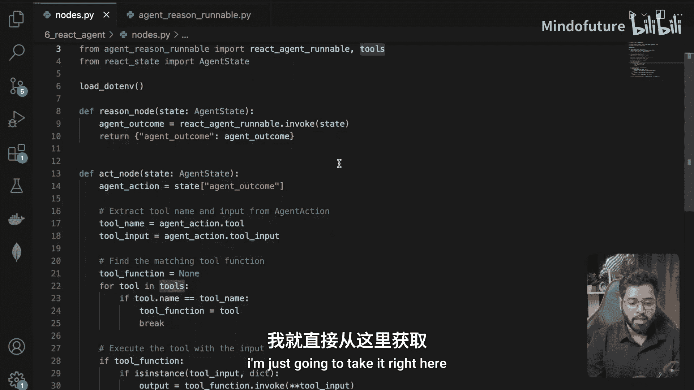

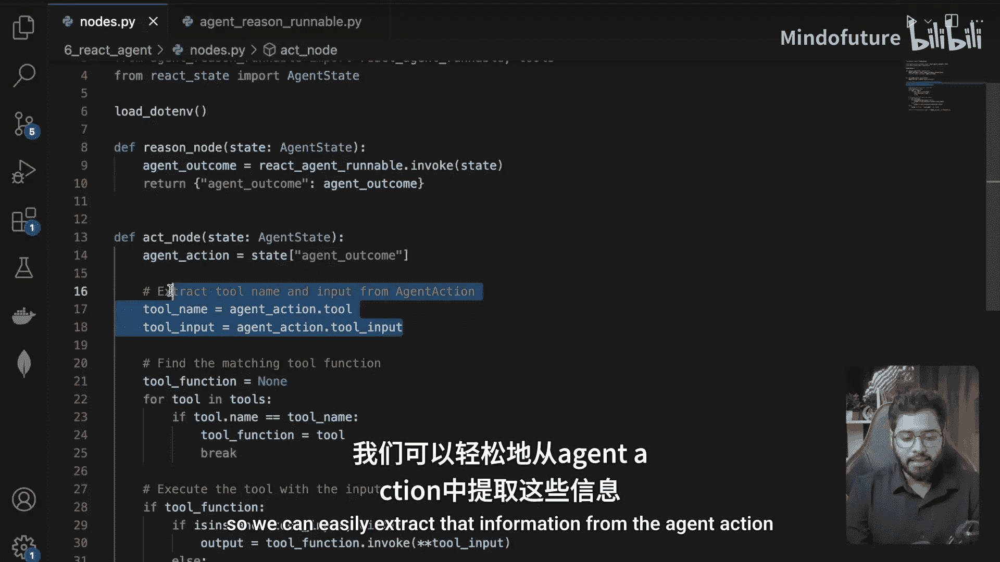

So this is going to be step 1 okay so from step1， we are getting information about which exact tool the LM wants to call okay。

 so the LM might want to call get time or it might want to call this search tool Okay so we have both the information right now the next step here is to basically get access to whichever tool that we need at that particular moment So I'm saying I'm basically just looping through the tools and I'm checking okay which tool name matches with the tool name that the Lm wants to call and I'm finally getting the tool function getting access to the tool function Okay so I'm basically getting a reference to this or this okay。

 so that is it。 So once I get a reference to either this or this that I want in the act note I can then invoke it that is it very simple。

 we don't need tool executor in this case at all。 so once we have that particular tool I'm just going to invoke on it right here so why do we have very simple if we are dealing with get the stem time and we。

😊。

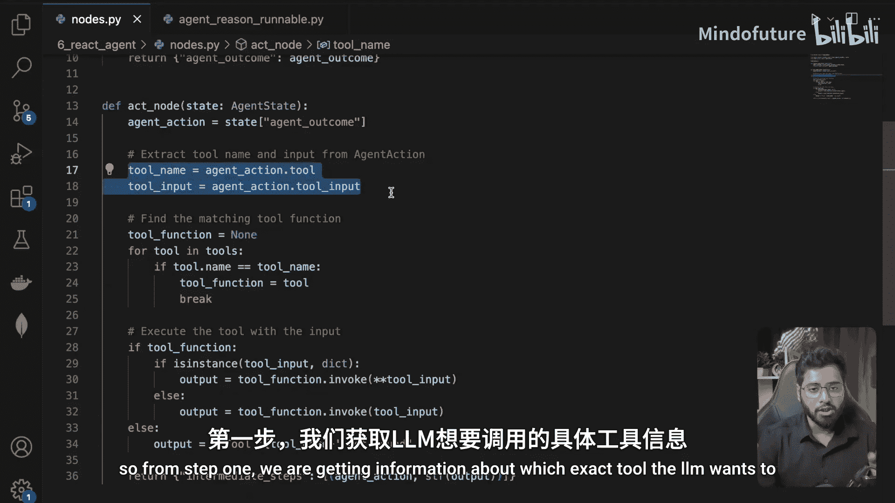

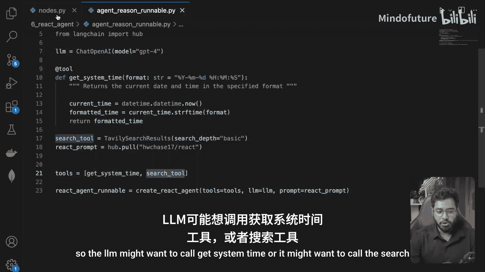

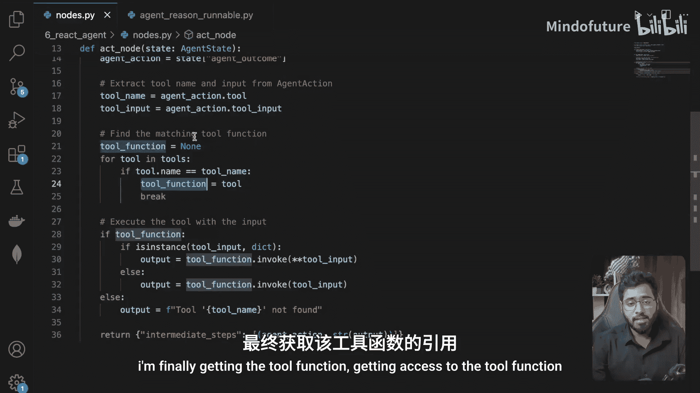

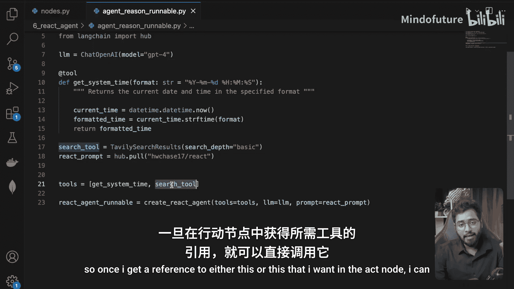

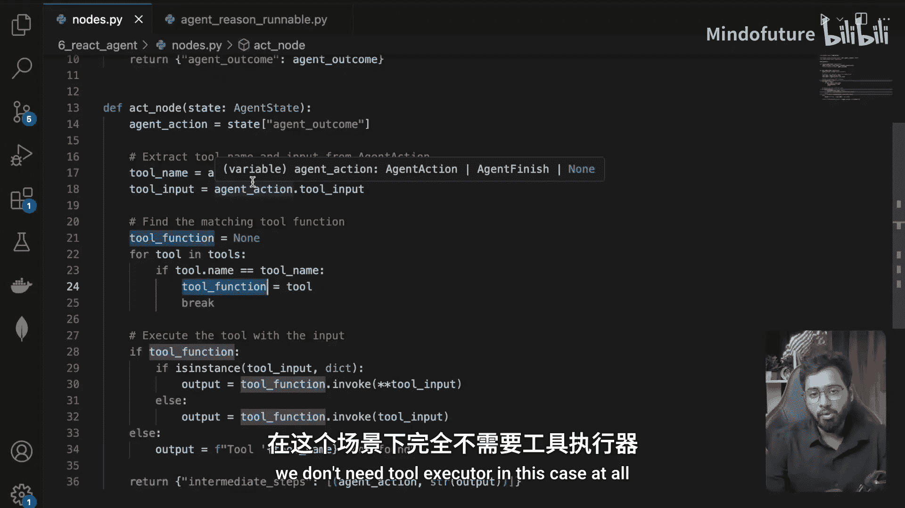

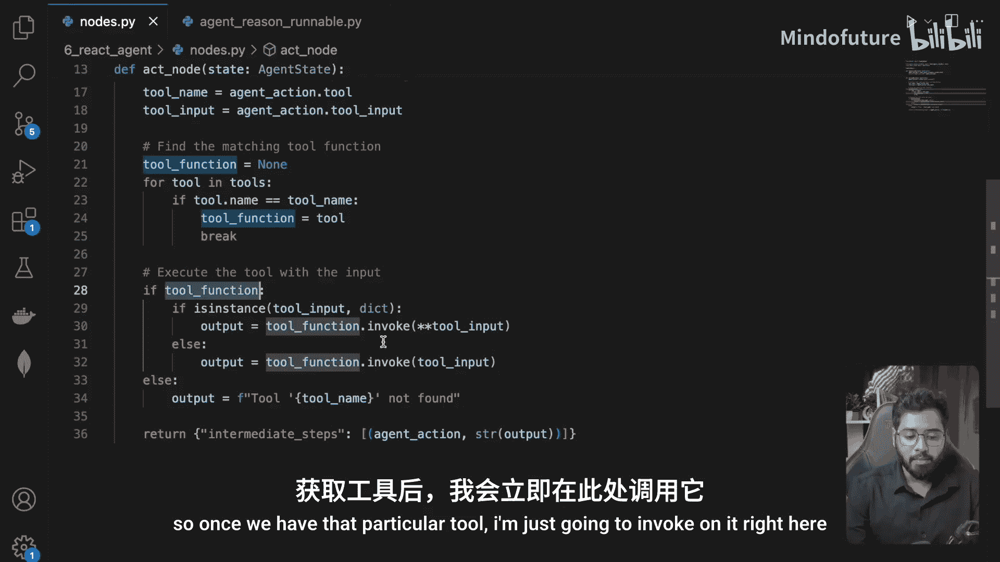

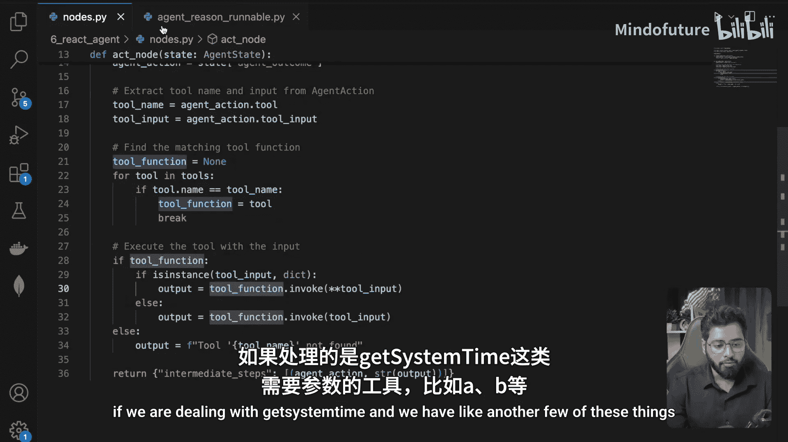

Have like another few of these things， A B， whatever。 in that case， we will have to spread it out。

 If not， we don't have to spread it out。 Okay， so that is what I have done here。 Okay。

 and then finally， we are going to get the output， and then we are going to add here。 Okay。

 so it's a very simple alternative。 Also， I don't really want to rely keep on relying on these La classes that they are providing for two reasons。

 One thing is we are not learning， you know， exactly how to do it without these classes because they introduce breaking changes。

 especially in production， you know， we keep on having to change code， which I don't really like。

 So yeah， this is this is a much more simpler way of doing it。

 And that is exactly why I wanted to introduce， I just wanted to make this particular section。

 So thank you， I you in the next section。😊。

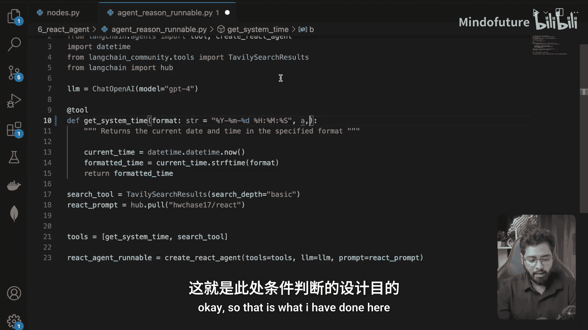

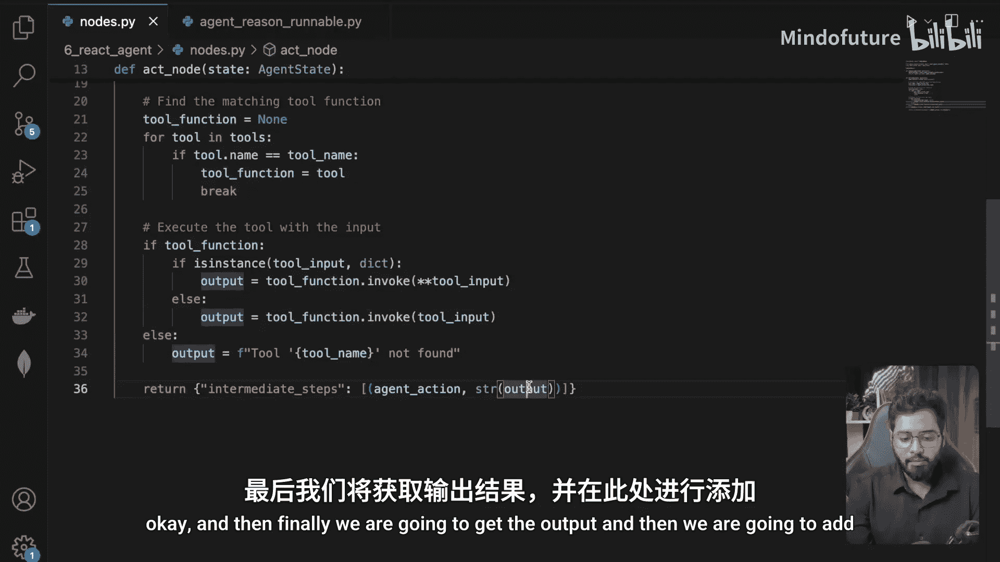

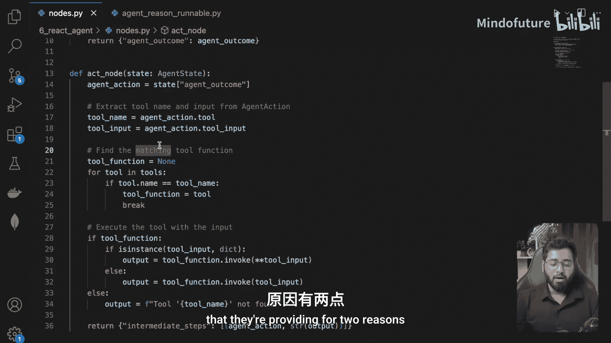

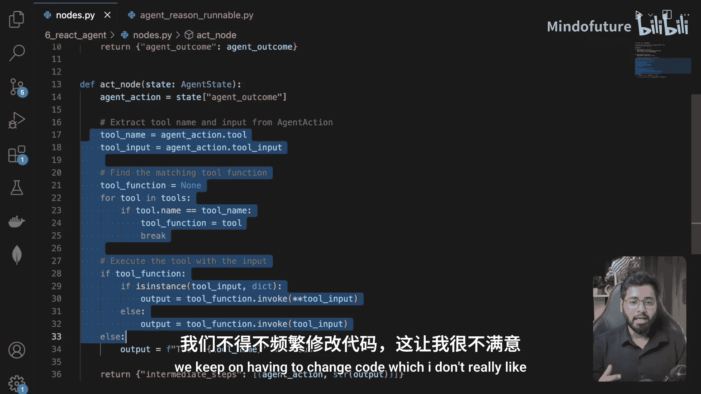

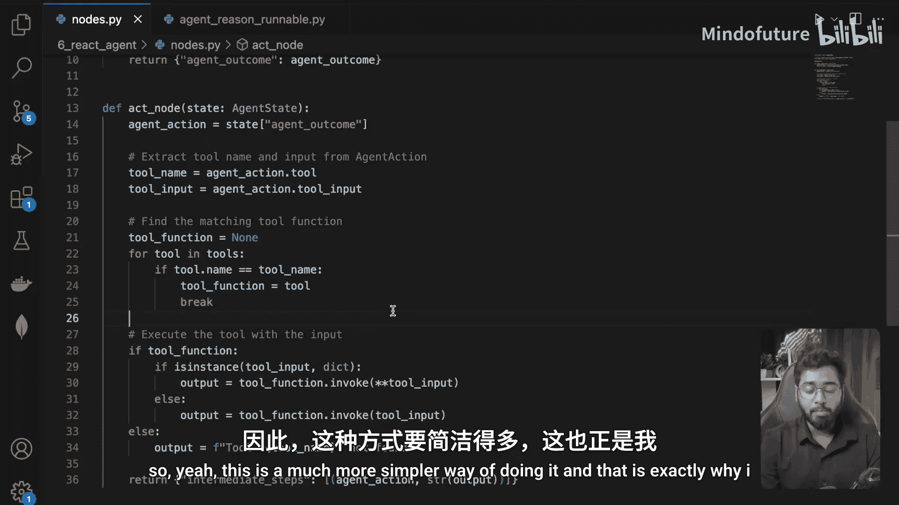

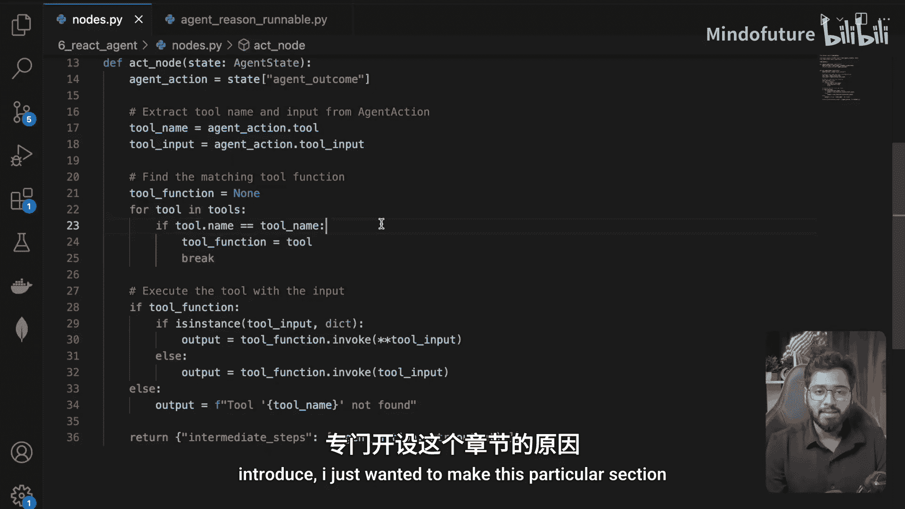