# Langgraph初学者入门2025 p24 P24_#22_使用LangGraph的ReAct_最终图 -BV1mgepzCEjf_p24-

Hello guys。 welcomelcome to the final section in this topic where we are going to be putting together all these different nodes together to form the final react graph。

 Allright， so you can see that I've already gone ahead and created a file called react graph。

 and I've already populated the code as well。 So let me walk you through it step by step what I've done。

 So I'm just doing a very standard import of all the nodes that weve written we have imported the agent state as well the global state that we have written right and then we've also imported the state graph so that we can create the graph and then just some classes like agent finish and agent action just type it basically force type it basically right Allright So let's actually go back to our graph。

 So the first thing that I'm doing is I'm basically just giving it a constant name for these nodes So that is exactly what I've done here。

 So we have the reason node and the act node。 Okay So so if I scroll down here。

 all that I'm doing is I'm creating a graph using state graph。😊。

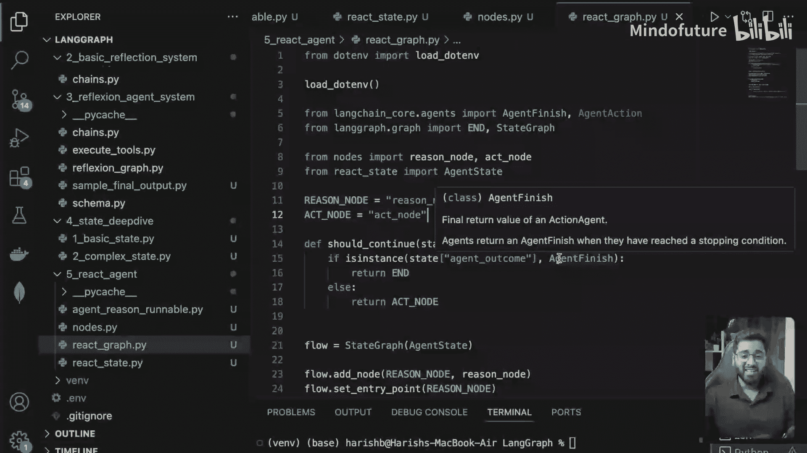

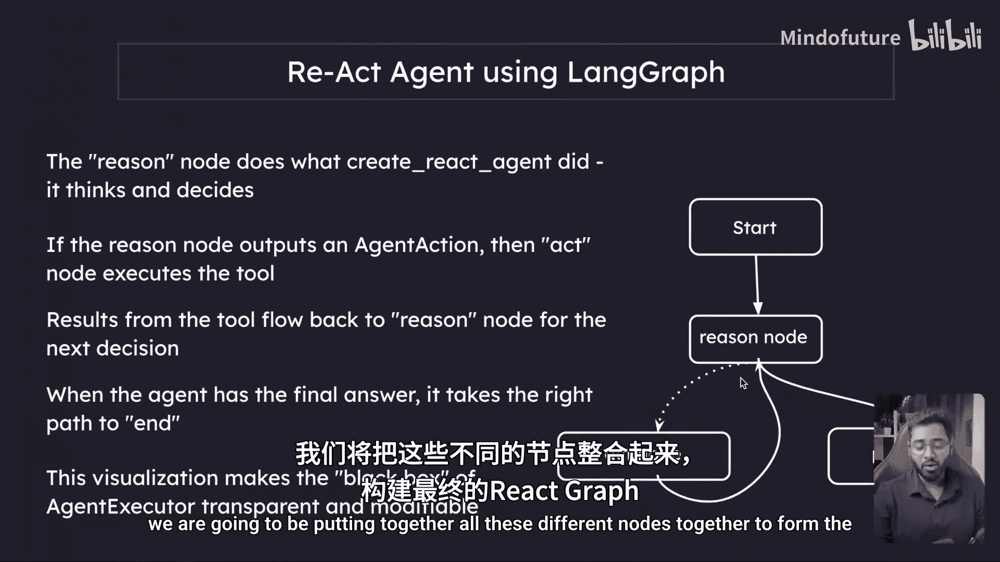

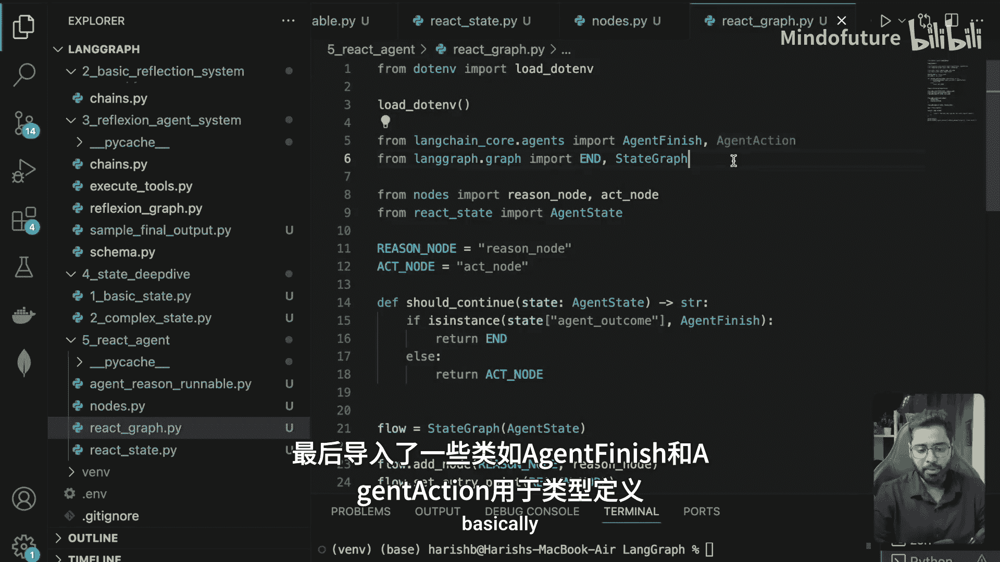

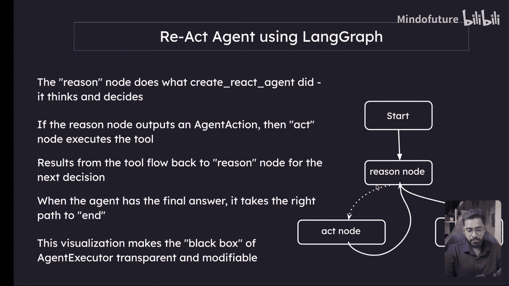

And I'm providing the blueprint that we've created as well right if you remember the blueprint is going to be you know the input is going to be a string agent outcome is going to be one of these three things immediate steps is going to be a list of tuups with each tuupil having the agent action as the first part and the string as the output of the agent the output of the tool execution as the second part right so coming back and that is exactly what we' are passing in here and I'm creating a simple graph al right so first thing is I'm adding the react node I mean the reason node and the act node so you can see that I'm adding the reason node I'm adding the act node and I'm also setting the entry point to be the reason node okay so I'm saying that right after the reason node is done executing we want to basically check if this particular outcome let's go back to the state if this output has the agent action or the agent finish so if agent action is present then it means that we have to go to the act node。

😊。

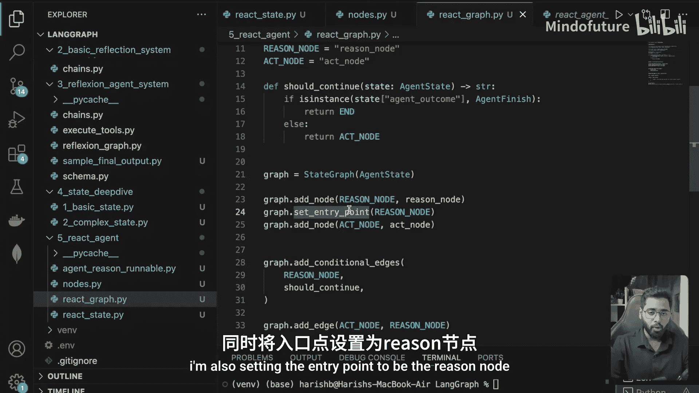

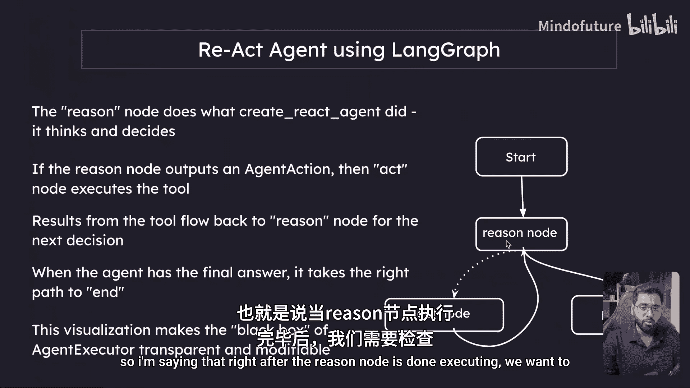

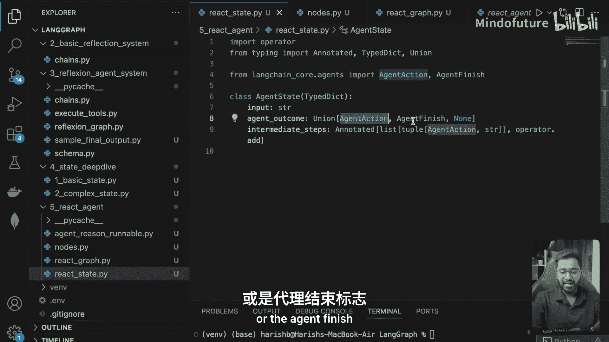

If you know agent finish is present we just have to end it。

 So for that we need a should continue method and that is exactly what written here so you can see that so I'm saying that right after the agent node is done executing I'm adding a conditional edgege and it is the control flow is going to the should continue method so the should continue method again like every node in the graph it is going to get the entire state as the input right here okay so for now I'm just going to look at the agent outcome because that is what is going to contain the agent action or the agent finish so I am checking in the state is it an agent action or the agent finish so I'm checking if the agent outcome it an instance of the agent finish so if it is an agent finish then the control flow needs to go to the end okay but if it is not if it is not then we have to go to the act node which is down here okay so for our prompt it is going to go to the act node right so that is exactly what's happening。

😊。

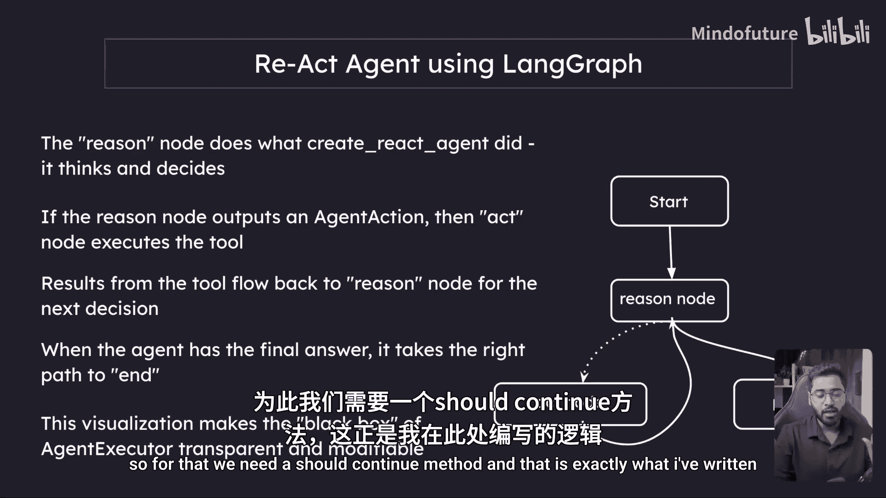

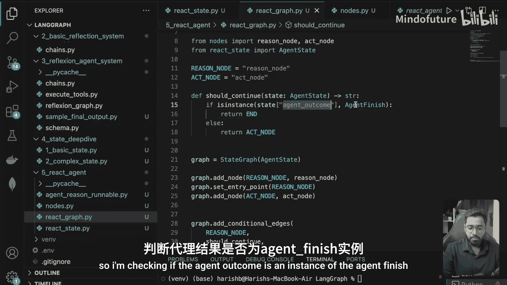

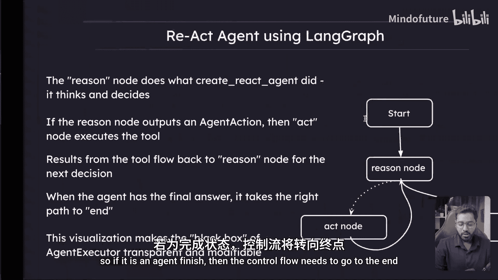

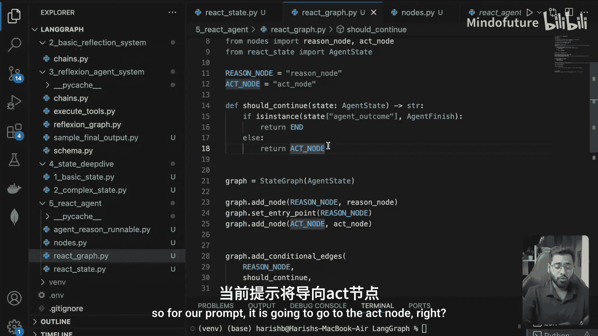

Here and I am also adding a edgedge between the act node and the reason the reason node right so right after the act node it should always come back to the reason node right and that is exactly what Ive added here that is it okay so nothing out of the ordinary all of this is something that we are already familiar with。

😊。

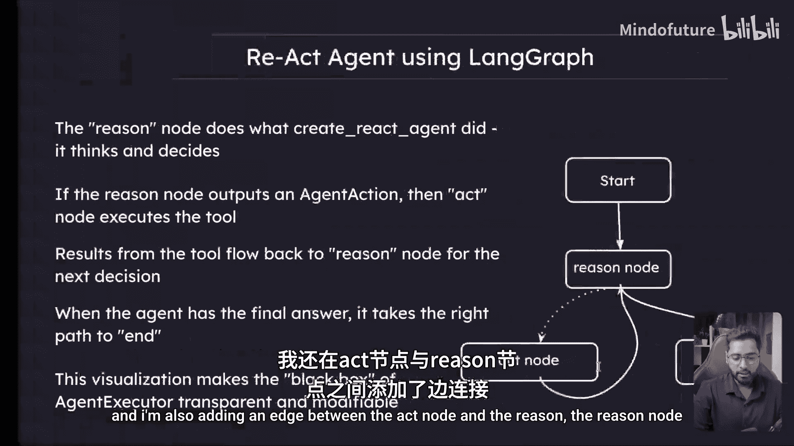

Okay， and finally， we are going to compile the app。

 and then we are going to invoke the app using the initial state。 Okay。

 so right now going back to the state， we are just providing the input right。

 How many days ago was the latest Spacex launch So weve provided the input。

 It is always very good practice to provide the initial state for everything else。

 So I'm just going to， you know， put the。😊，呃。Okay， what's happening Okay。

 so I'm just going to put the agent outcome to none， which is going to be the initial state。

 initially the LLM hasn't suggested anything。 and then we have the intermediate steps and that is going to be an empty list Allright。

 and finally I'm just going to print out the final state right after the end node is reached Allright。

 and then I'm also going to print out something inside of the agent outcome we'll be able to see why we are doing that。

 you know， once we look at this particular result。 So let me actually go ahead and run this while。😊。

Let's give it a few seconds。Okay， so perfect， you can actually see that we are getting the entire state right here。

 so we have the input and this input is what I provided right here right So this is going to be the input and then we have the agent outcome which is going to have the agent finish。

😊，So if you remember only because we have the agent finish did the control flow even come to the end node right so that is why it is ending the cycle and then we are getting the result So in the agent finish in the return values you can see that the latest SpaceX launch was two days ago so this is going to be the final answer okay so how we actually got to this point we will actually look at the Langsmith logs right but for now you can see that this is going to be you know this is going to be the final answer so you can see that this is how it actually arrived at this answer So today is March 72025 which is true it is March 7。

2025 it was able to call my you know get system time tool that I provided so the latest Spacex launch was two days ago right and then we also have all of the intermediate steps that it went through as well so we don't really even have to go to laangsmith so you can see that in the intermediate steps first thing is there was an agent action the LLm suggested that。

😊，We use the T search results tool and then this was the input and then you know this was the reasoning behind using that tool by the LLM。

Okay， and then we have， you know， basically the same thing happened a couple of different times。

 And then finally， I'm just going inside of the agent outcome andm going inside of the return values。

 and I'm printing the final result。 So this is going to be the final output。

 The latest Spaces launch was two days ago。😊，Okay， so if you have any problems understanding this code。

 simply just go ahead。 I've， I'm pushing all of this code to my Gi repo。 So just go there， you know。

 pull it。 And then， you know， you can test it out right away。 So in the next section， let us look at。

 you know， the laangsmith tracing so that we can better understand it。😊。

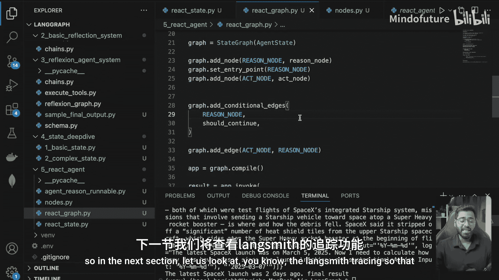