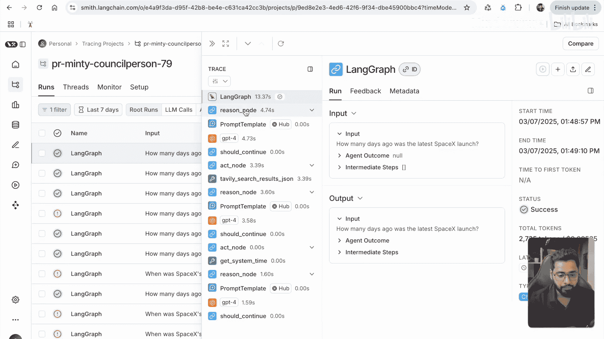
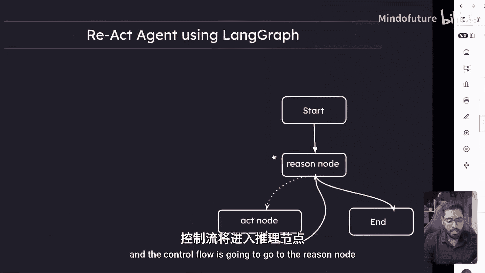
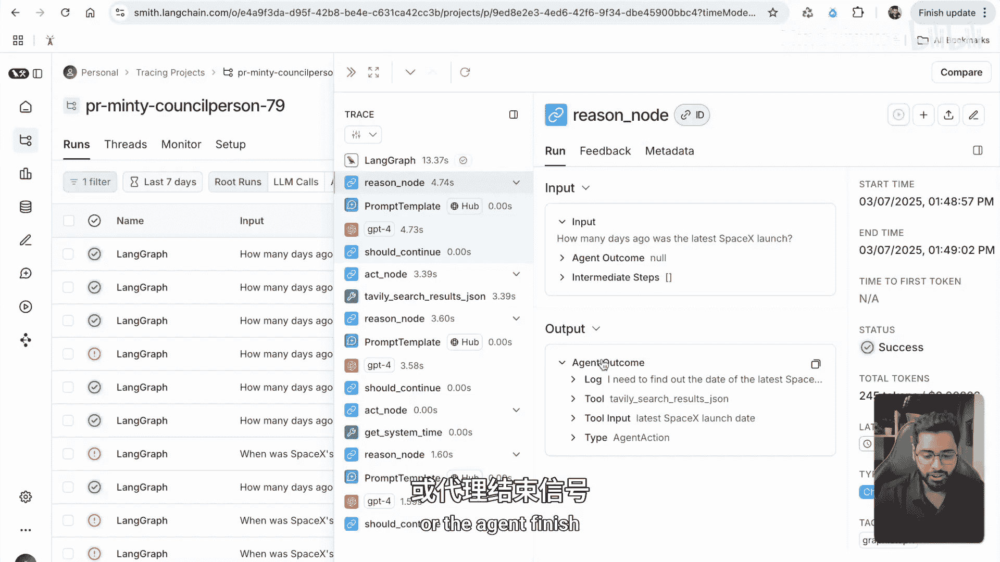
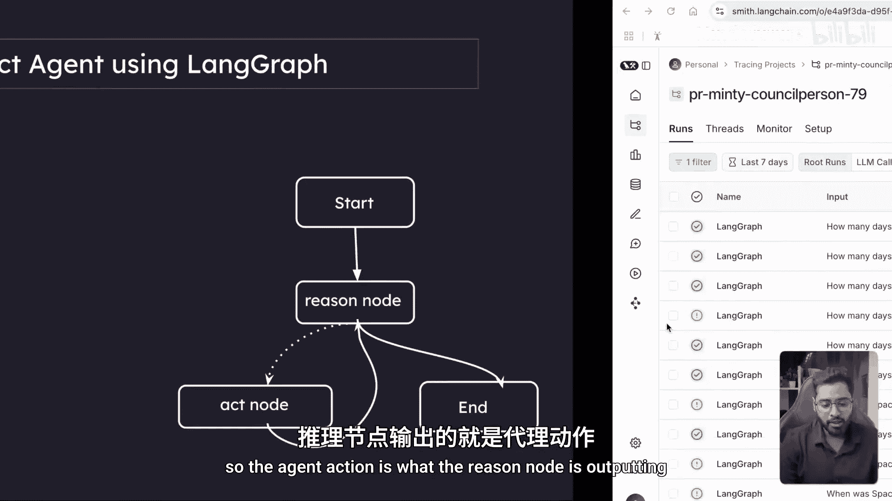
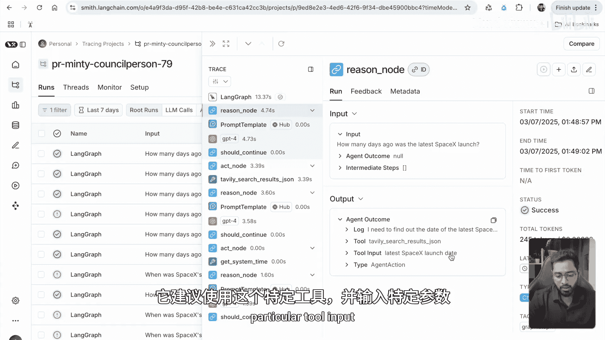
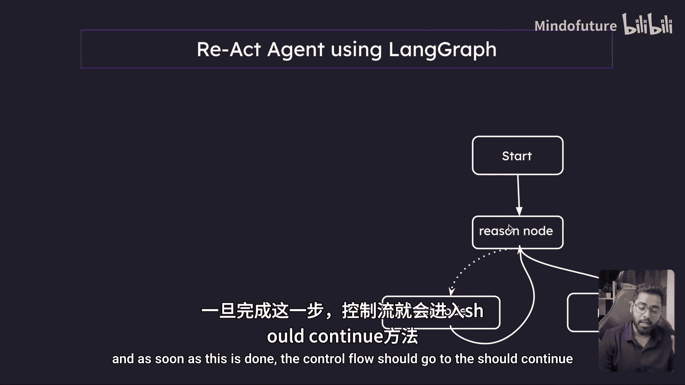
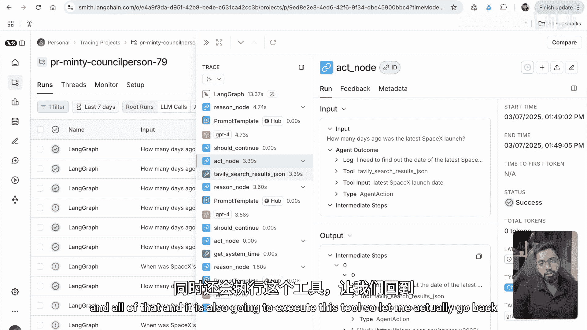
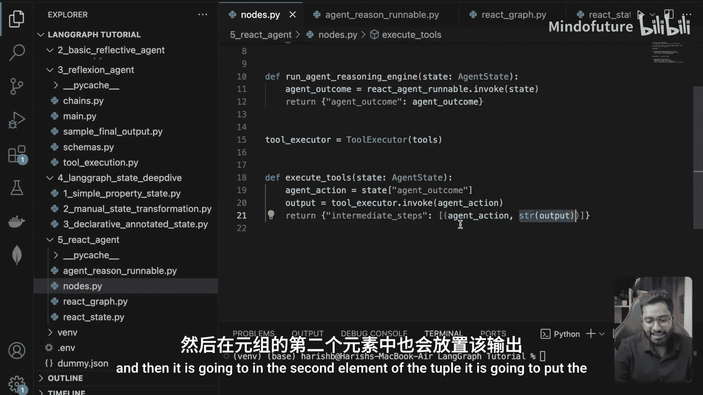
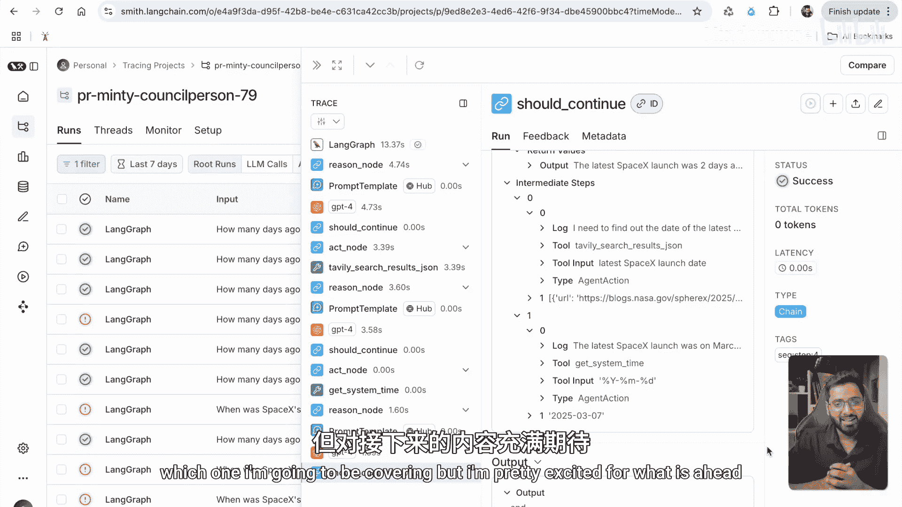

# Langgraph初学者入门2025 p25 P25_#23_使用LangGraph的ReAct_LangSmith追踪 -BV1mgepzCEjf_p25-

All right guys， So in the section let us look at the laangsmith tracing so that we better understand what are the different steps that our system went through。

 So I ran it a couple of times， but lets let's just go to the latest one right here。😊。

So let's actually look at you know you can see that this took a total of 13 seconds right So this is going to be the initial state and this is going to be the final state that we already looked at in the terminal So let's actually go through you know what the steps that happened now to arrive at this final output okay so initially you can imagine that this is going to be the initial state that we provide and the control flow is going to go to the reason node So let's click on this and you can see that this took a total of four seconds right So this gets the entire state and then this you can imagine is going to output the agent action or the agent finish So the agent action is what。

😊。

The reason node is outputting so it is suggesting you know use this particular tool you know put this particular tool input and as soon as this is done the control flow should go to the should continue method and that should direct it to the act node so let's actually look at if the should continue is coming yeah so we have the should continue right here and that is directing it again to the act node right so it is going to the act node and yeah so you can imagine that the act node is only going to take the outcome the agent outcome right so it is only going to take the agent outcome and then it is going to actually call the tool。

😊。

Right and then it's going to take that output and then it's going to append a tuil to the in steps and that is exactly what it is doing right here。

 So you can see that the first element of the first tuil is going to have the agent action and the tool input and all of that and it is also going to execute this tool so let me actually go back to our。

😊。

Graph right here or rather let's go to the nodes so you can see that it is going to invoke that particular tool it's going to take that output and then it is going to in the second element of the tuil it is going to put the output as well so that is exactly what is happening right here so the first one is going to be the agent action and then the second one is going to be the output of the agent action tool execution so we have that entire you know tabli search call that is being made So what is the next step again so right after this is done the control flow goes back to the reason node so you can see that we have the reason node again right here and then the same step sort of like continuous the same step continuous the act node comes and then finally the should continue is going to get the agent finish you can see that agent finish and finally the output the control flow is going to the end and that is it for building react agent using G graph I hope that youre able to see what is possible。

😊。

Lang graph and these patterns you can sort of extend it to a lot of different use cases as well。

 So if at all you you know face any struggles at all。

 go ahead pull my code if you have any problems even despite that please to go ahead and ask me in the comments I'll be more than happy to help you out。

 I'd be more than happy to connect with you on let's say LinkedIn even so yeah that's pretty much it guys in the next section we are going to be you know looking at you know another aspect of la graph and we are going to be looking at persistence we are going to be looking at rags not really sure which one I'm going to be covering but I'm pretty excited for what is ahead and I' ask you in the next section。

😊。

