# Langgraph初学者入门2025 p26 P26_#24_聊天机器人介绍 -BV1mgepzCEjf_p26-

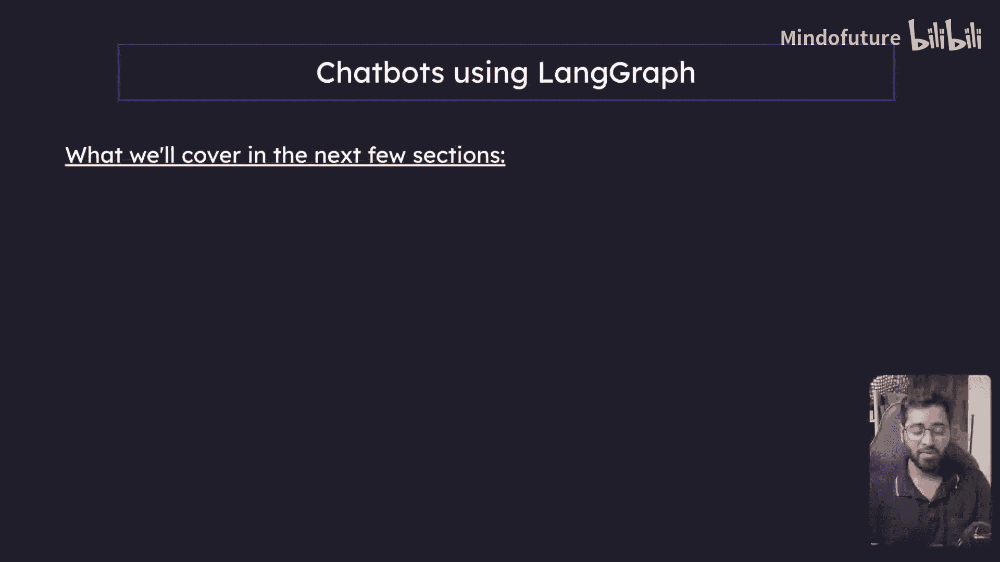

Hello guys so I'm excited about this section in this section we will you know take on chatbots we will look at incrementally we'll sort of increase the difficulty and we'll introduce more concepts Okay so these are what we will be covering in the next few sections so the first thing we are going to be you know building a very basic chatbot a basic chatbot meaning it does not have any memories it does not you know it cannot make any internet searches or anything of the chart you give it something it bits out response right we also have chatbot with tools we are adding tools like you know various tools in order to get accurate data。

😊。

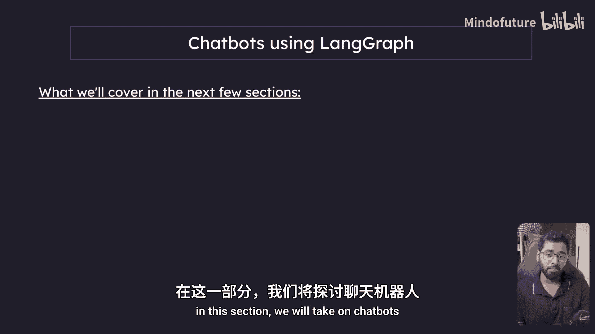

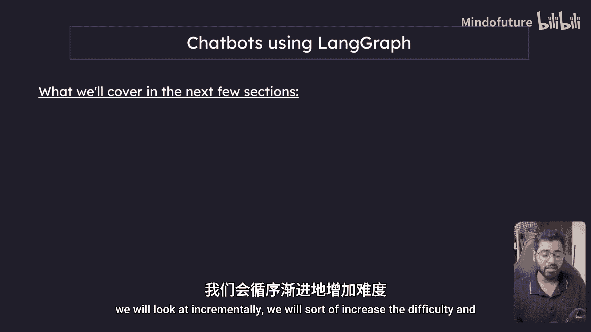

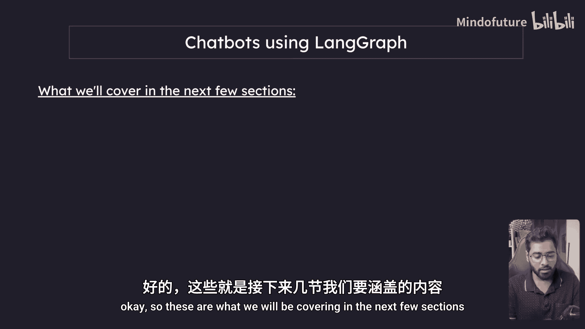

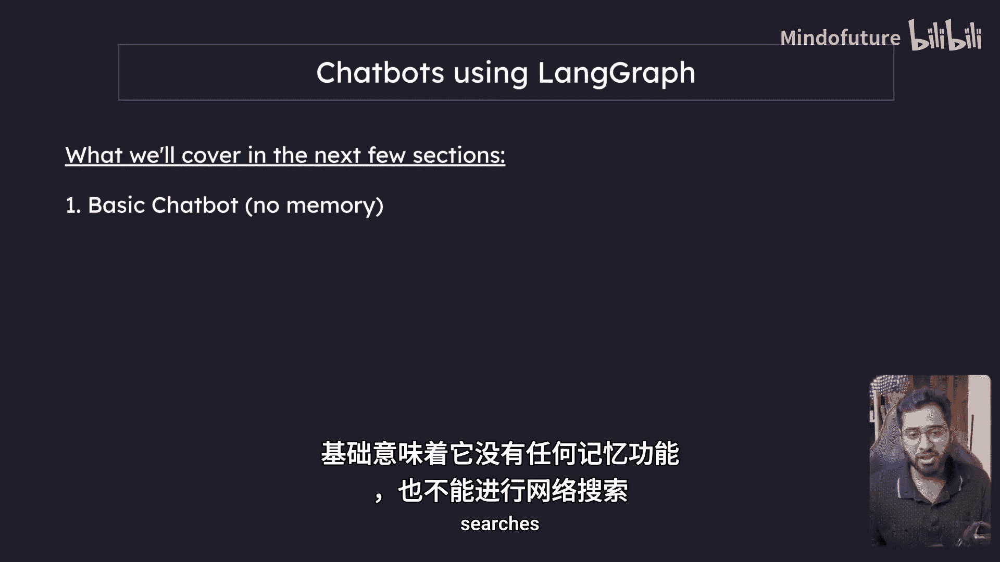

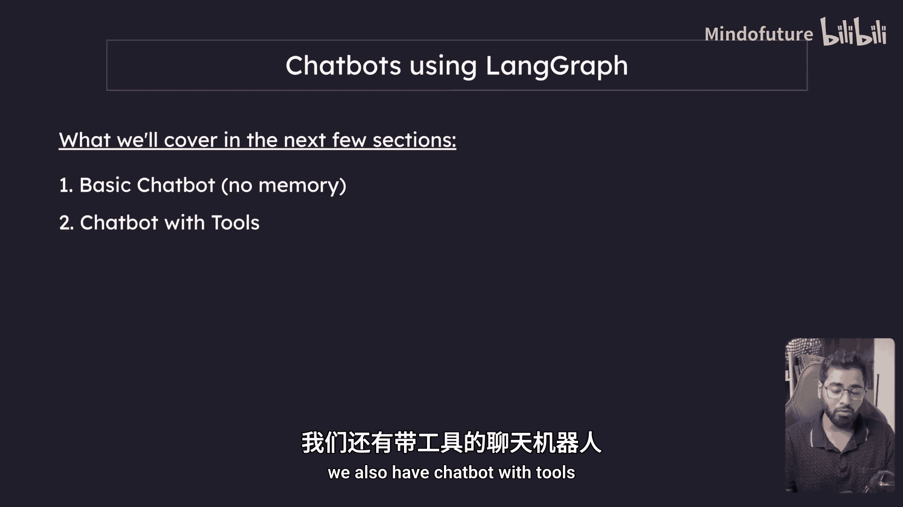

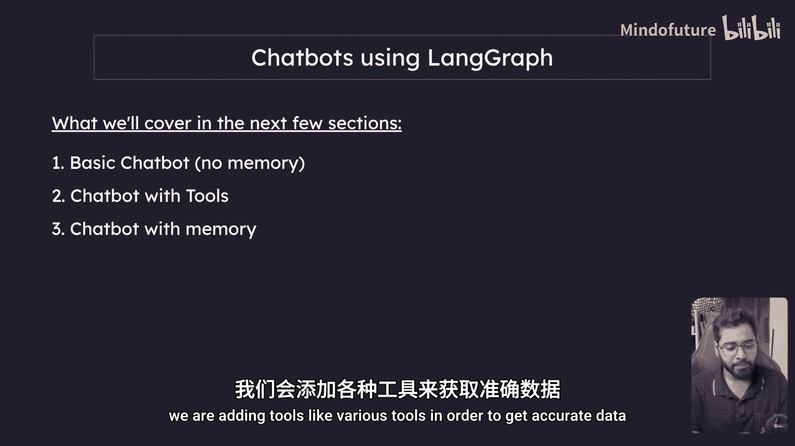

And then we will introduce memory。 Okay， so persistence and memory。 we will cover those concepts。

 And then we have the human in the loop concepts。 We will cover that that will build on top of whatever we learn in the memory。

 And then we have， you know， chatbos with more complex state。

 will will explore a little bit more use cases so that you understand， you know。

 all the edge cases that are possible。 And finally， we have time travel。

 So without wasting any more time。 Let's go ahead and build out a very basic chatbo。😊。

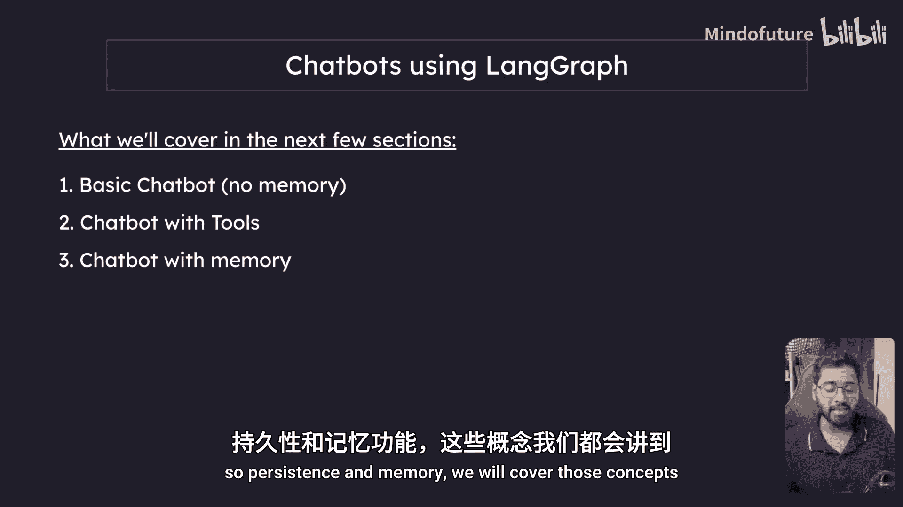

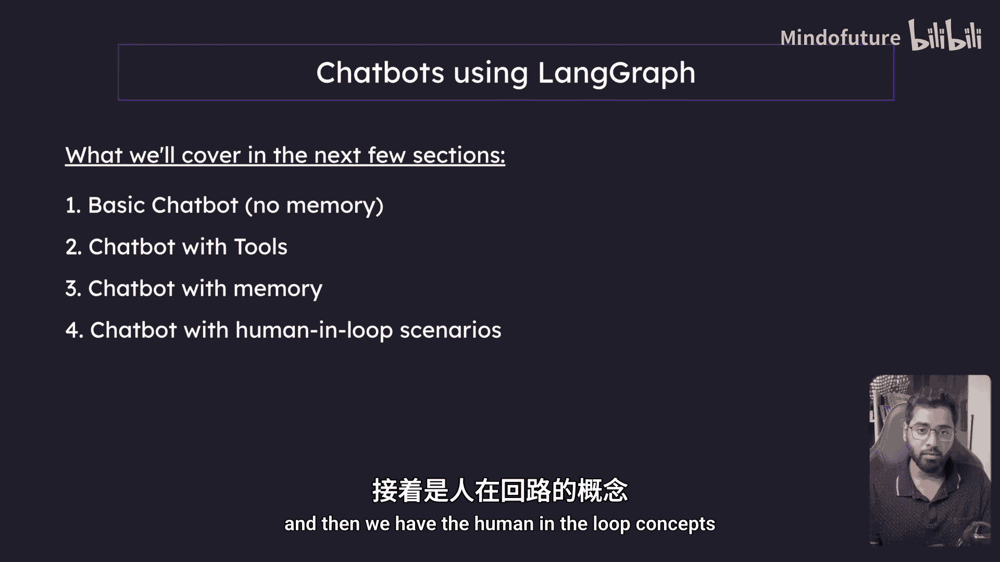

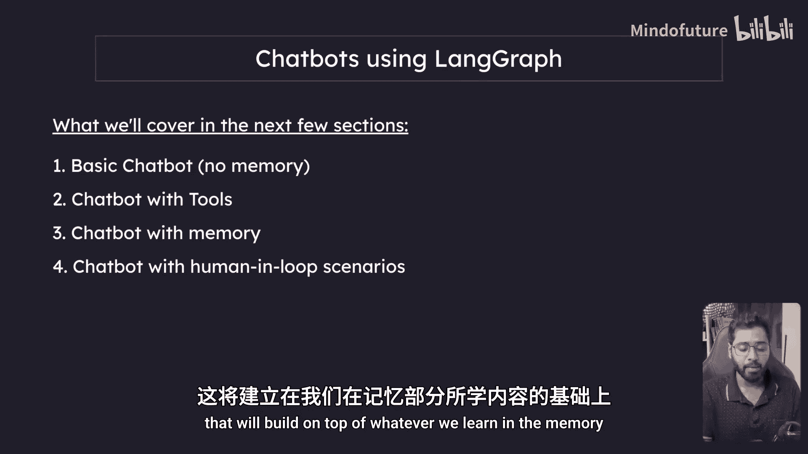

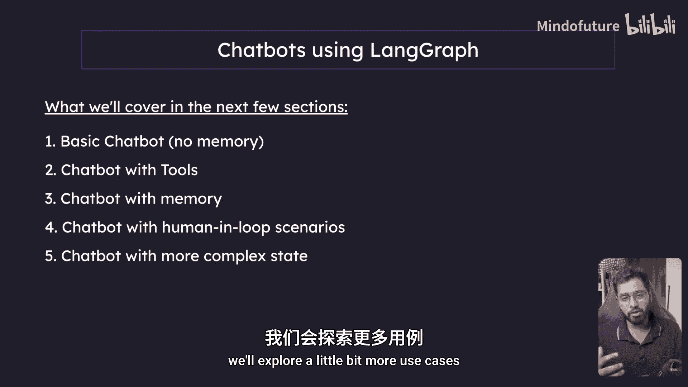

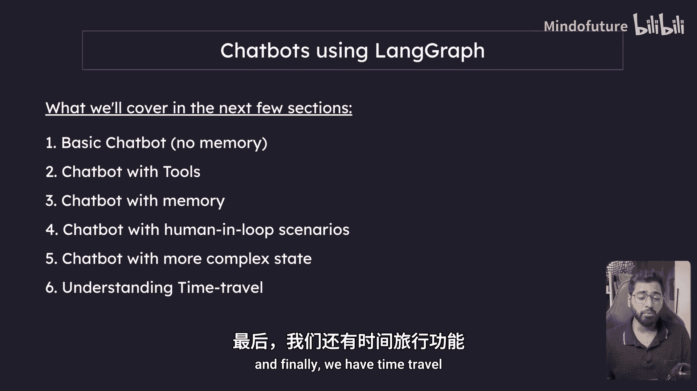

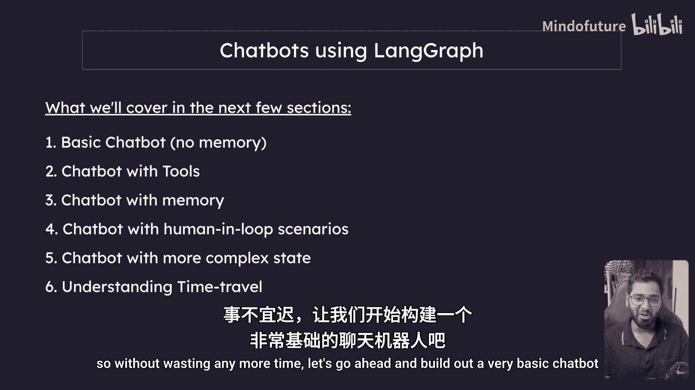