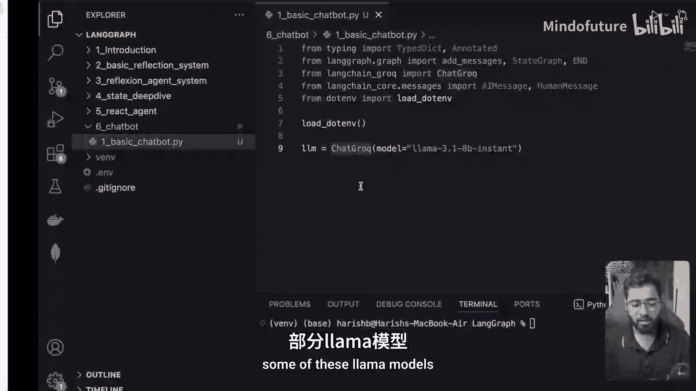
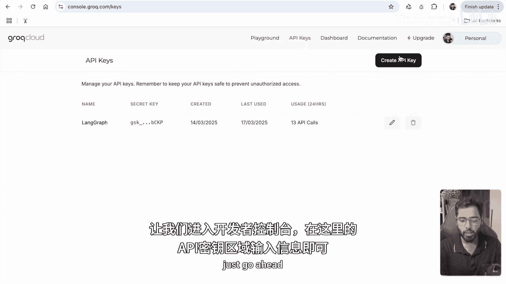
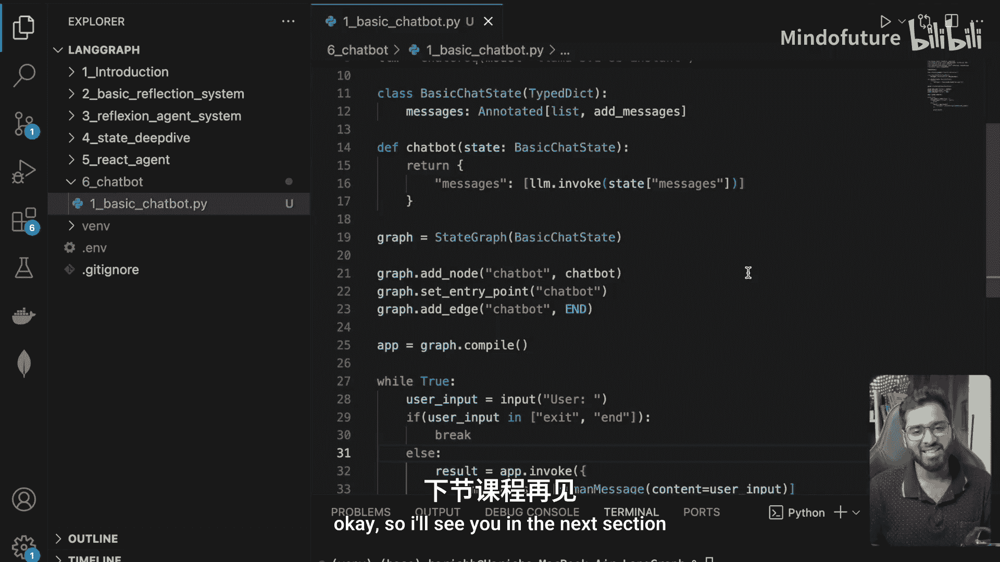

# Langgraph初学者入门2025 p27 P27_#25_聊天机器人_基础 -BV1mgepzCEjf_p27-

Hello guys。 So this is what we are going to be building。

 So you can see that this node just has a start and then we have this node called chatbot and then we have an end Okay。

 so basically you can think of this chatbot node as just a model just an LLM that sort of like you know takes in a human message from the start。

 I mean， when we invoke it， we pass the initial state right So yeah it just takes in the initial state and then it passes it to the chatbot node。

😊，Processes it and then sends it and then ends the graph。 That's it very simple。

 So this basic chatbot does not have any memory。 It does not have any tools either right So these are some of the new things that we'll be learning well learn about another method so far we've been using the app do invoke method right we'll also learn about know there's another method called stream we learn about that we learn about know looping in the chat and finally we can also use a free Lama model using the G interface。

 Okay so if you do not know Lama is an LLm that is created by Facebook。

 and it is hosted in a service called G。 Okay so basically from my experience I've seen that the response much more faster compared to openaiis and also it is free。

 So we'll definitely explore that as well。 So without wasting any more time。

 let's jump back to our vs code So right here you can see that I've created a folder called chatbot and I've just named it as basic chatbot。

😊，So these are some very standard imports that I' have done the only thing that I've done differently is I've used the G chat model which lets us access some of these Lama models so if you want to know where you know where I pull this from I can just go to chat G okay that is going to be a chat model inside of Lcha。

So I can just click on this thing I think let me go to this particular class and you can see that this is what we have to install Okay。

 so just say pip install L chain dash cr and then we just need to set the API key right so this is going to be the name of the API key you can you can set it by going to crc dot com。

😊，Let's go to dev console And then I think yeah right here in the API keys。

 you can just go ahead and create an API Okay， so that should be it。

 And I'm just going to load all of the environment variables Okay so we have all of this ready。

 let us now go ahead and build out this very simple graph。

 So so let's go ahead and build out let's think about what we need in order to run this right So whenever we talking about a chat bot I mean it needs some memory and that memory is going to be a list of messages right so it needs to you know it needs to be a list of you know AI message human message system message or whatever right we are not going to be doing anything different it's all something that we've already done before。

 So I'm just going to go ahead and say something like you know basic let's say basic chat state。😊。

Okay so I can use the type d again and here it's going to be messages okay so this object is going to have one property messages and I can use the same annotated and I can see this is going to be a list of messages and then how are how are we going to know append a new message to the existing list we can use you the concat operator that we've seen before but land graph also provides this method called add messages Okay so if I hover over it。

 you can see that it merges two lists of messages updating the existing messages by ID so you can see that this is also something that we can use perfect Alright this is all that we need for the state now let's go ahead and what's an next thing let's go ahead and build out this particular node right here Okay so I can call a chatbot doesn't matter I can use this basic chart state this is what we I mean we this is going to be the state and this is going to be the。

😊，perfectfi。Right。So what do we need to do here So all that we have to do is you know we are going to get a list of messages from the start in this case it's going to be very simple。

 The list is just going to have one human message。 It just needs to take that list and then invoke it in the LLM right So all that we have to do is let's return the。

😊，This is going to be the the the structure of the state right so here all that we have to do is lets go into the state okay this is going to have the messages inside of it。

Okay， so how do we do it So LLM dot invo。And then， we can。Pass the state right here。 Okay。

 so I hope that makes sense。 And whatever is the response is going to be an AI message right。

 So we are passing， we are passing the entire list of whatever conversation， you know。

 history that it could have。 were passing it all inside of this and this is going to return an AI message and that also needs to be an array。

 Okay， so this entire thing is going to return the AI message and that needs to be an array so that two arrays can merge together。

 So we have to。😊，To something like this。 Okay， so I really hope that makes sense。

 So the chatbot node is done right， So now let's go ahead and create our sta graph。 Okay。

 so that we can actually add all of these nodes So we've already created the chatbot node。

 We just need to add this thing and then connect it and set this as the entry point。😊，All right。

 so what we can do is we can say graph equals。State graph。Let's pass in this particular schema。

Alright， and let's go ahead and add all the node。 So in this case it's going just going to be the chat port node。

Alright， and then we can also set the entry point。2， this chat board。And then finally。

 we can also add an edge right， we can add the edge from chatbot to end。Okay。

 as simple as that so we've added this as the chatbot node。

 we've connected this in this together and weve set the chatbot node as the entry point。😊，Okay。

 so now all that is left is to compile the graph。 So let's go ahead and compile。

And next up we want to write a for loop right so this is something that constantly requires the users you know we need to be able to basically have a conversation in the terminal like a very similar like a chatbot right like how we would talk to you know cloud interface web interface or Gp interface that's how we want to talk to it right so in that case we can just go for the while loop right so inside of this while loop we want to first add an end condition let's say if the user were to say exc or you know something like that we need to come out of the loop or we just need it to continue looping right so in this case I can just say user input I'm first going to collect whatever the user is typing in there I can use the inputbuilt method input method and the message I want to basically show in the terminal let's just user something like this right alright。

😊，And now I can check if the user input， okay， so is one of you know， it could be many things。

 it could be， you know， either exit or end or buy or something like that， Okay， and okay。

 something like this。So if it is any of these things Im just going to break Okay。

 that is it if it is not the case then we just need to invoke the graph right so I can just say app dot invoke and we have to pass in the initial state right here and the initial state is going to be the messages。

And right here you know initially we need to pass in the human message right so we need to pass in the human message and that is going to have the content。

 but we are going to get that content from the user message。Okay， I hope this makes sense。

 now Im just going to， you know I'm just going to say result of the entire， you know this thing。

 And finally we are just going to print the result Okay。

 so it's very simple on every single iteration were we are going to restart the entire graph。

 It is very similar to just stopping the program and starting it again right。

 so it's just going to start chatbot end Okay， another by loop start chatbot end Okay。

 so let's come back and let's run it and let's see if everything is working fine。😊，So， you know。

 I can say something like hi， I am Haish。And great。

 you can see that the graph has completely executed once。 So it started from here。

 I passed in the human message。 I am Haish。 and then coming down here， you can see that in this list。

 we have the AI message right the AI message saying hellello Harish， Nice to meet you。

 Is there anything I can help you with right？ So it only has one human message one AI message So we start off with one human message。

 it comes here， it adds the AI message to the list and then it ends it and then it shows the result very simple right。

 But if I were to， you know， do something like， you know， if I were to， let's say ask， okay。

 what's my name。😊，Okay， what do you think would be the answer， right？

Because we are restarting the graph， okay， this is going to be the initial state that we are providing。

😊，RightThis is going to be the initial state that we are providing。

 The AI does not have context about what my name is right now。 Okay， so if I were to press enter。

 Okay， this is where I put it。 And here you can see that I don't have any information about your name。

 I'm a large language model。 Okay， so there is no actual memory maintained guys。

 I really hope that you understand what's going on here。

 every single time the iteration of the while loop is running where starting the graph afresh。

 There is no memory at all。 There is no persistence at all。 Okay， and also， if I were to， you know。

 say something like， you know， what's the weather。😊，In Bangalore， let's say。I mean。

 it's not going it's not going to be able to understand。 It's not going to be able to give an answer。

 I'm not able to access real time information about the weather in Bangalore right there is no tools available for the LLM to use either right so in the next I hope you understood what are the limitations of this particular you know basic chatbo in the next section we will introduce the ability for the system to access the Internet。

 Okay， so that is one thing that well do It's very simple。 It's very basic。

But once we have both of that， then we'll have， then we'll introduce persistence。

 Well introduce memory， and we'll see how to do that。 Okay， so I'll see you in the next section。😊。

