# Langgraph初学者入门2025 p28 P28_#26_聊天机器人_带工具 -BV1mgepzCEjf_p28-

Hello guys welcome to this next section in this section well just equip our chatbot with the ability to call tools alright so you can see that I've already gone ahead and created a file and then I've done some imports right here its it's not really very different from what we did in the previous section I've just had I mean I just basically copy pasted everything。

😊，But in addition to that， Im just going to use the Tli search this thing again。

 and I'm going to create a list of this thing。 Okay。

 so I can just say a search tool and then I can put this in here。 Okay。

 just to be a little bit more descriptive and as usual we are going with this particular model again Alright。

 perfect。 So the next thing that I'm going to do is I'm going to you know。

 initialize a variable called LLM。😊，With tools， let's say。 And then I'm going to use the。

Bind tools method that this provides。 and here I can actually go ahead and pass in all these different tools。

 Okay so if you do not， if you are not familiar with bind tools basically。

When we make the API call to the LLM okay so normally we can just say something like you know whats hi how are you or something like that。

 but if we are to you know ask a problem that you know the LLM would not be able to solve it by itself okay so we can actually make some tools available to the LLM okay so in that case what the LLM is going to do is it's going to look at all of the tools that are available it's going to see okay can I answer it by myself or do I need to suggest to use a particular tool So let me give you a very simple example how it works Okay so it's going to be very similar to doing just LLM dot invoke it's going to be very similar。

😊，In addition to that we are just making some tools available to the LLM to decide if it wants to use a tool or if it can respond by itself so I can just say you know I can just say LLM with tools invogue so I can say something like hi my name is Harsh and let me go ahead and print this out。

😊，So let me run this you are going to see some errors in all because that is from Langsmith don't worry about it but if you come up here this part you can see that you know it says okay nice to meet you hurrysh is there anything I can help you with right so this is a perfectly valid response no different from you know using just LLM dottingvo but because weve bind we've binded some of these tools okay so what this is going to do is let me clear this out and lets tweak the prompt a little bit。

😊，Okay， so I can say something like what's the weather in Bangalore？So in this case。

 if I wait to run this， let's see what happens now。

Okay so in this case you can see that the content is empty right the content is an empty string and if you come this entire thing is a dictionary right so if I come down here in the tool calls you can see that there is one object which is suggesting to call a particular tool that we have provided in the Tli I mean that we have provided right here okay so I know this is a little complicated to look at let me just actually you know put it in a neat format。

Okay guys， so basically what I've done is Ive just copied this thing and Ive put it in a Json file so that we can actually look at it you know in a proper way so you can see that we have the content which is going to be empty Okay。

 let me just you can see that total of you know six properties are there。😊。

The content is going to be empty。 We don't really have to consider these things。

 these are metadata and some additional information。 But here inside of the tool calls。

 you can see that there is one object inside of which the LLM is suggesting to use this particular tool and is also providing the query right it is also providing the query So that is something that we are getting from this bind tools。

 were just making some tools that are available and the LLm can decide perfect。

 Al right guys so now that we've understood this bind tools method now let us go ahead and build out our graph Okay so let me show you you know what we are going to be building So it's going to be very similar but right after the chatbo okay so right here this is where the LLM do bind tools lives right so what's going to happen is let's say if I were to ask something like you know what's the weather in Balore So this is going to output response which we just looked at right so if the content is going to be empty but the tool calls property is。

😊。

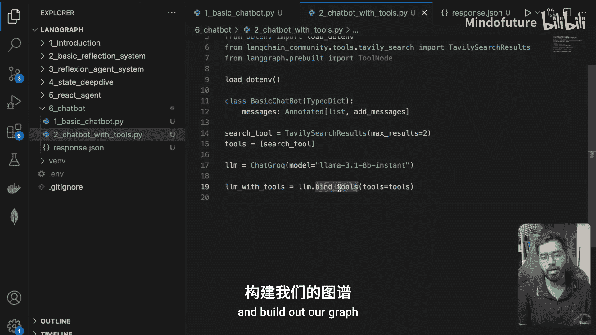

WeTo be having exactly what told to call。So basically， we are making a decision right there。

 So we're checking if there is a tool call available or not if there is no tool call available。

 it means that we can just， you know， end the。Graph， okay， so the LLM。

 it means that the LLM has all of the information。 it needs to answer the question。 So in that case。

 we can just end it right there。But in case there is no content there is only tool calls available in that case that method。

 that condition method that we are going to write is going to make a decision okay it decides whether to go to the end or if it is going to go to the tools if the tool calls are available it is going to go here and this tools method is going to execute the tool。

Okay， so it's going to execute the tool。 It's going to get the response from let's say Ta search。

 Okay so it's going to create a tool message with all the content and it's going to append it to the list and it's all going to be provided to this particular LLM okay I really hope that makes sense。

 And then once the LLM has all of the full information including you know information about the weather in Bangalore or something like that。

 it is then going to you know output the content it's not going to make another tool call because it now has all of the information So in that case it's just going to give the content。

 you know current weather is this is this and then the flow is going to go to the end。

 So now that I've given you a birdise view of what we are going to be building let's go ahead and code this out。

😊。

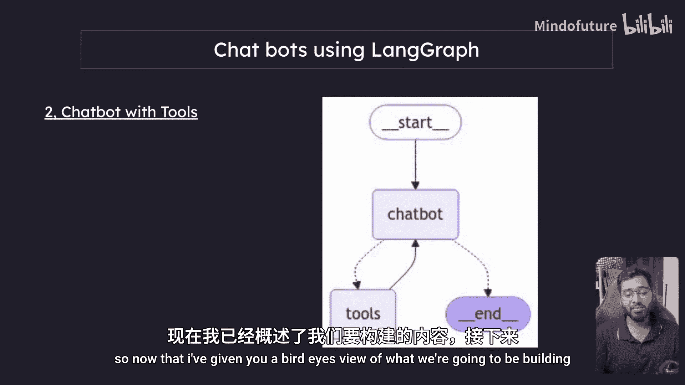

Alright， so as for the actual node it is not going to be very different from what we did previously。

 so I am just going to copy this particular chatbot。😊，Put it over here。

And okay we can change this and then instead of using this LLM we have to use this LLM with tools that is the only difference alright perfect so what is the next thing so we've written this now you know there is going to be a conditional this is going to be a message that decides if the control flow should go to the tools node or the end node right so let's actually call this something like tools router okay let's call it tools router Okay this is going to be a function。

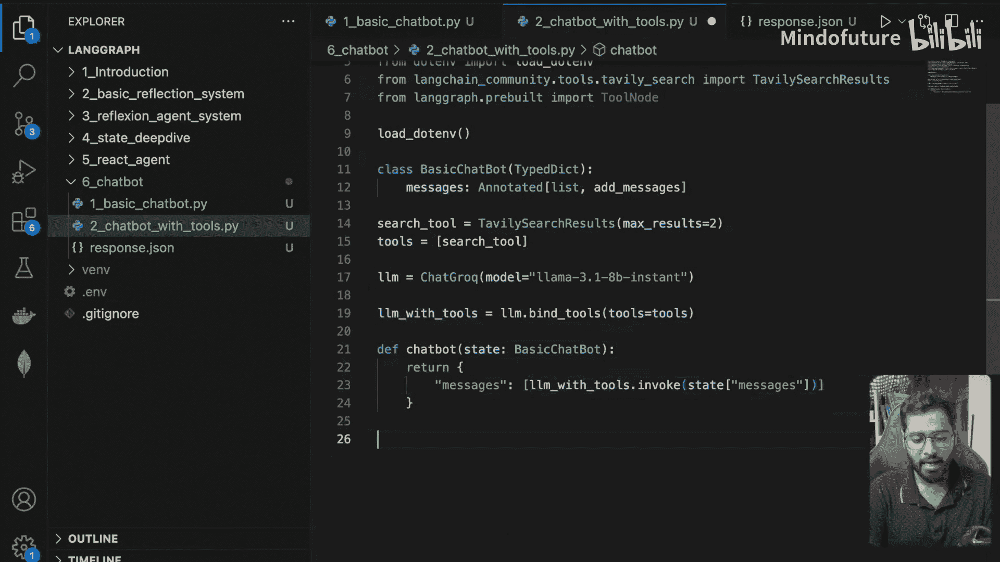

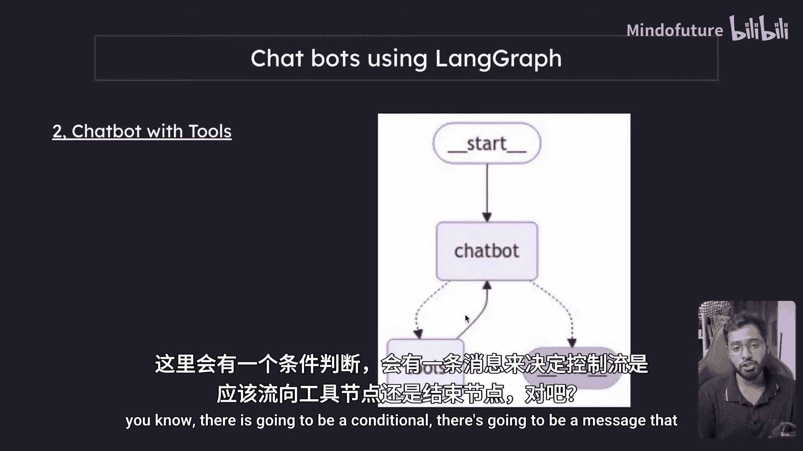

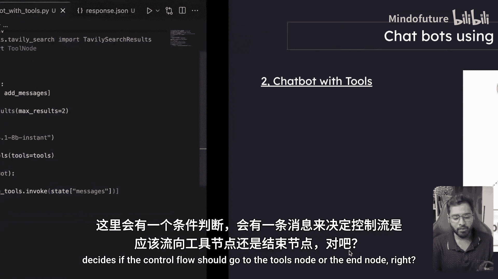

This is again， going to get the list of everything。Right， and。Okay。

 so what this tool router is going to do is， you know。

 let me just copy paste some code and let me walk you through it。 All right。

 so let me walk you through it。 So first off， we're just getting the last message from the list of messages。

 Okay， so why am I getting the last message because if the control flow is coming here it means that the last message is going to be because of this chatbot that is always going to be an AI message So I am just getting the last AI message and then I'm just checking does the last AI message have a property called tool calls and I'm checking if the tool calls property also has a list greater than0 So if I come back to the response you can see that this is present and this list the items the length of it is greater than zero right so I'm just checking that So if it is true then it means that we have to go to the tool node。

😊。

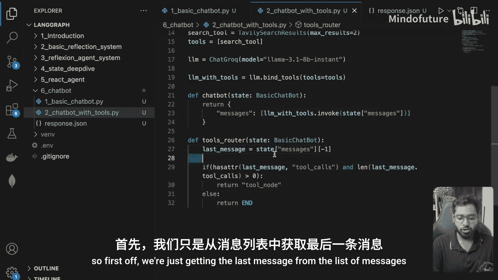

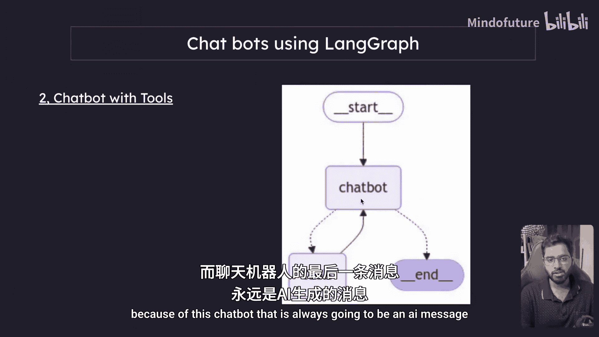

Right， we have to go to the tool node。 Okay， so that is what this method I hope that makes sense Now let us actually go ahead and build out this particular tool node。

 This is actually much more simple。 La graph provides a very。

 very easy to use method that we can use that takes care of like 9095% of the work。😊。

So so we have tools。 Okay， so let's call it tool node itself。

 and then we are going to use this class called tool node that just takes in the tools that are available Okay。

 so this tool node comes from landgra dot pre built。😊。

So let me actually hover over it and let me show you what it says It is a node that runs the tools called in the last AI message Okay so if this is going to be the last AI message。

 this entire thing it is going to run all of the tools that are available in the last AI message so it can be used either in statecraft with messages state key okay or a custom key as well so we always have to use this particular keyword messages okay so this tool node actively looks for messages and looks at the last AI message and it goes in executes all of the tools that the LLM has specified。

😊，If you want this tool node to look at something else okay。

 let's say you know I don't want this particular messages key instead I want messages you know let's say okay it's a different name right so if that is the case then we have to provide we have to tell the tool node to look at a different list and not the default messages list Okay。

 so how can we specify that we can actually specify it by saying messages key。

Message is key here we can actually specify this thing。 That's it。 that's as simple as that。

 Okay it' is going to look at this particular tuil it' is going to look at this particular sorry list and then it is going to look at the last AI message that is present。

😊，But yeah in this case we can just remove it and let's actually okay so yeah the tool node is also done So what have we done so far So we've built out the chat bot node we've built out the tools node we've also built out the tools router method that is going to decide if it needs to go to the tool node or the end okay so now all that is left is to just like create the graph and add all the nodes and connect it all together right so here's what I'm going to do I am going to you know go ahead and create the graph so I'm going to say state graph let us pass in the basic chat bot。

😊。

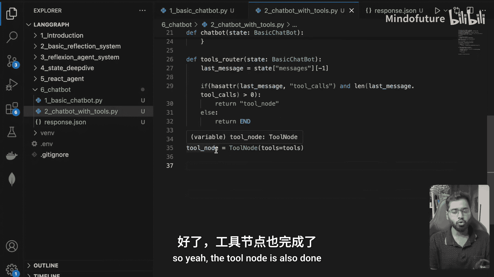

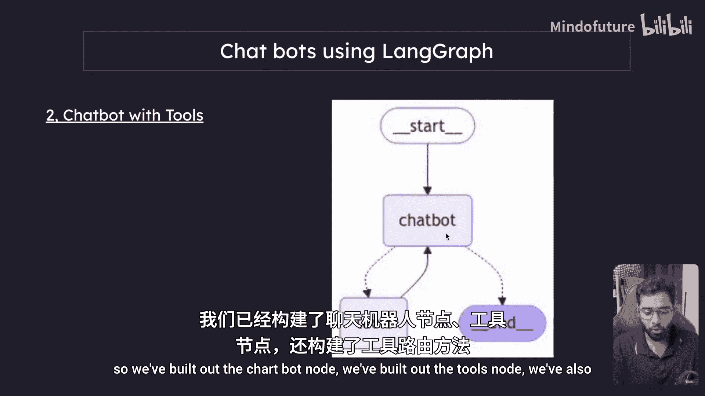

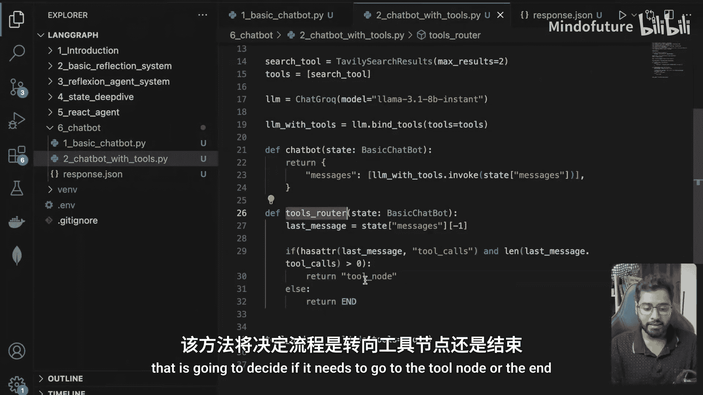

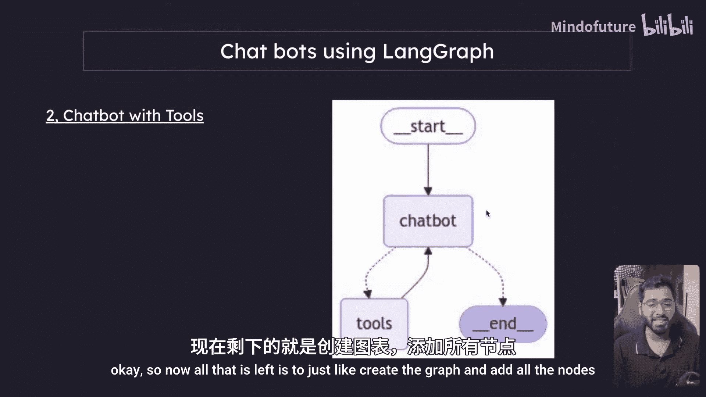

And no。Add node， let's go ahead and add the chat bot first。Chahart part。

The second node that I want to add is going to be this particular。

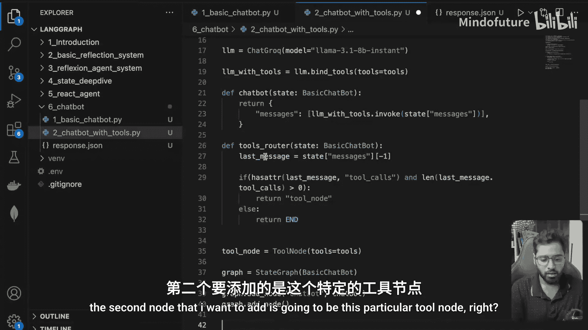

Tool node right so I can just say tools because in the diagram that's what I specified right tools and I can just go ahead and put this right here。

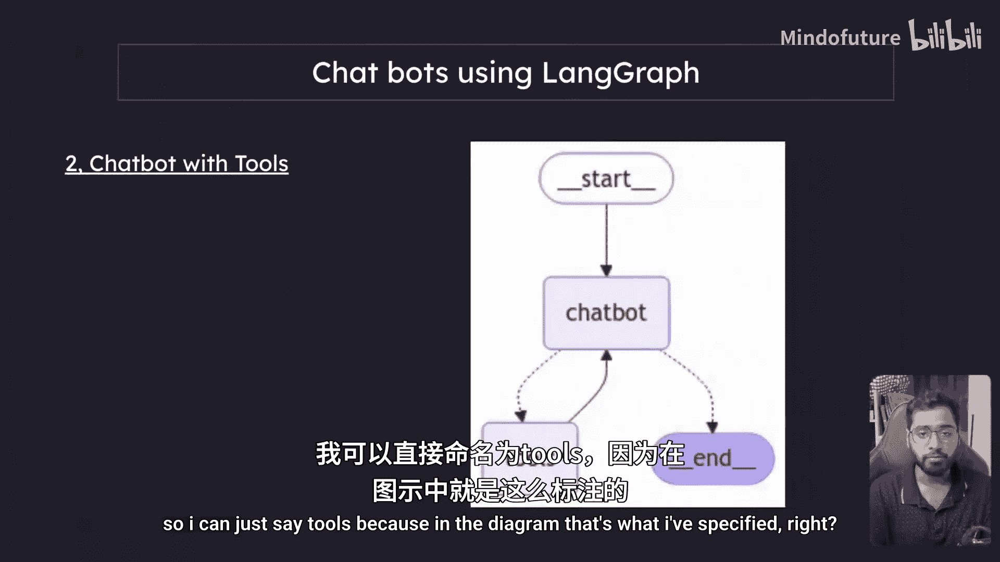

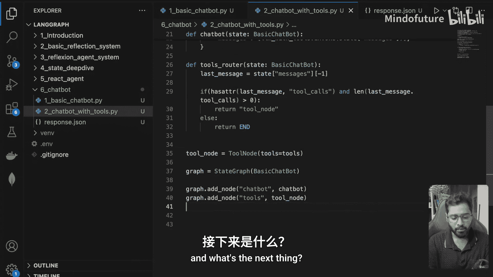

And what's the next thing， So we've added this in this now we have to you know connect it So we know the entry point is going to be set entry point is going to be the chat bot。

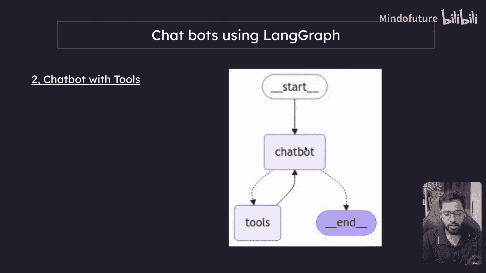

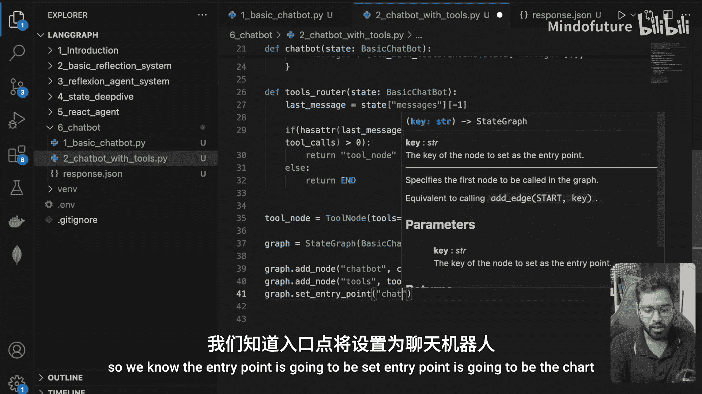

And as soon as the entry point， you know as soon as this chat node is executed。

 we have to make a decision whether to go to tools or end so in this case we have to set conditional edges。

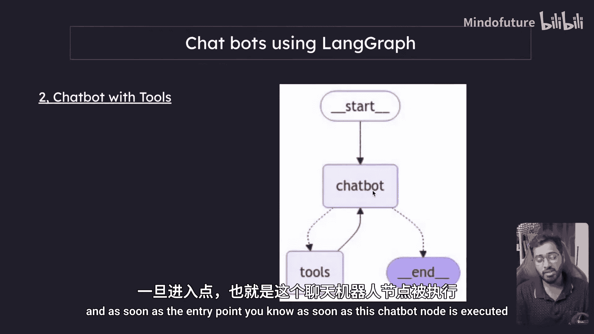

So we have to put the chat po。And then we have to put this tools router here。Okay。

 I hope that makes sense。And once the tools router okay that I think that should be it right so the tools router is going to decide okay so if weve named it tool node right here lets just go ahead and name the same thing here as well。

Okay perfect Okay so I right after the tools router is executed it is going to go to the tool node or the end Okay。

 so let me check if weve written all of the edges so right after the chat board you know it comes to the tools so weve not really added this particular edge yet so let's go ahead and add a normal edge。

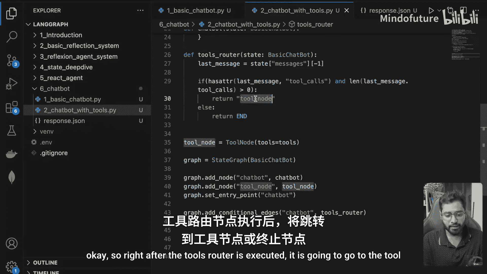

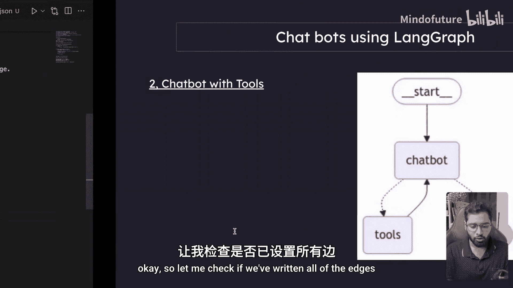

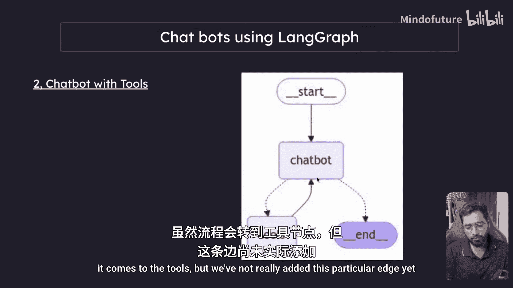

So this is going to go from tool node。Do。Chatbot。Okay， okay。

 so now let's go ahead and compile this graph。 So I'm just going to go ahead and just copy this。

Bit of code。 It's not going to be any different。 So we are compiling it。

 and then we are running the same thing again。 But the only difference is that this time we have。

Tools available。 Alright， so let's go ahead and run it。

 So here I'm just going to say something very simple first just to test it out。 Hi， I'm Hash。😊。

It's going to be like hi Harish， how are you or something like that。 Okay。

 so you can see that the AI message says that hello Harish is nice to meet you great。😊，Still。

 the memory is not really added yet。😊，But now lets actually go ahead and force it to use our Tli search tool so。

I can say what is the current weather。In Bangalore。Okay， guys。

 even though it looks like you know it is continuing the graph is actually getting executed from the start with a different initial state。

 Okay， so it is not going to remember anything even though it looks like you know it is continuing perfect。

 So what is the current weather in Bangalore。😊。

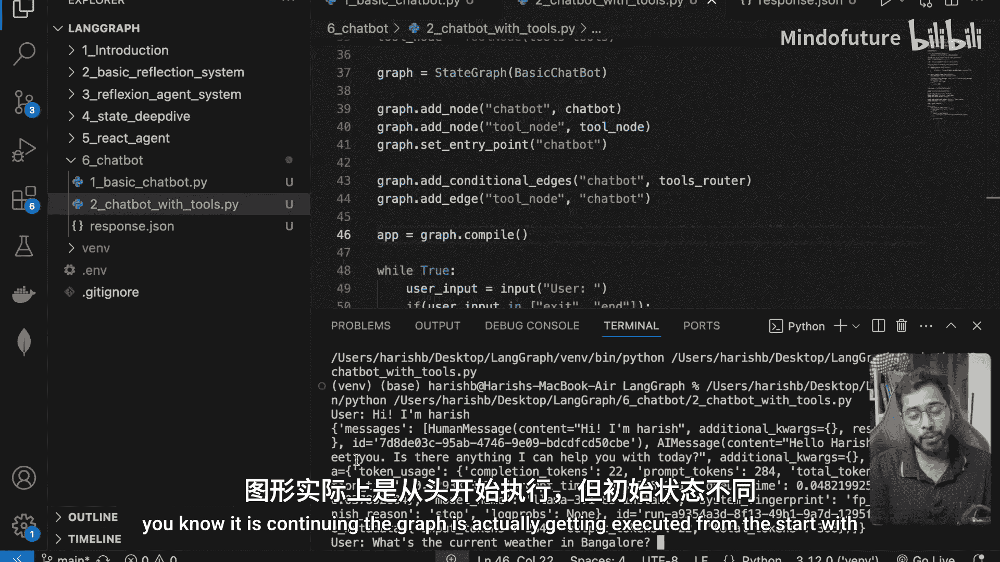

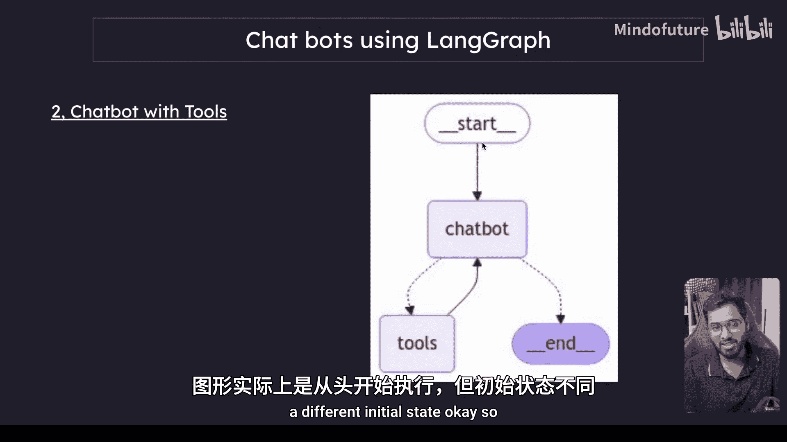

So， in this case。

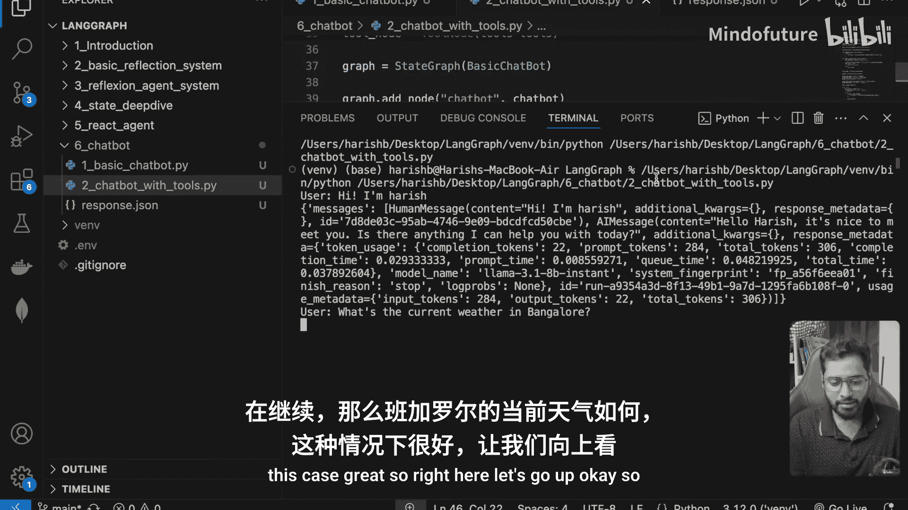

Great， so right here， let's go up。 Okay， so we have the user message right here。Okay， so what。

 what should happen First is the human message。 Okay， let's come back to the state。 Okay， I mean。

 let's come back to the graph。 So we have the initial human message。And then the chat bot。

 which is going to be the LLM call， it is looking at the what is the current weather in Bangalore and then instead of actually providing the content itself it is suggesting to use a tool right So we've got a human message we've got an AI message with just the tool call。

😊，Property filled up。So right after that the control flow is going to come back to the tools this node。

 this tool this node is going to execute based on the query right based on the query the search query that the LLM provided so this is going to output what this is going to output the tool message so weve got a human message AI message tool message。

And then the tool message this entire list is going to be sent to the LLM again。

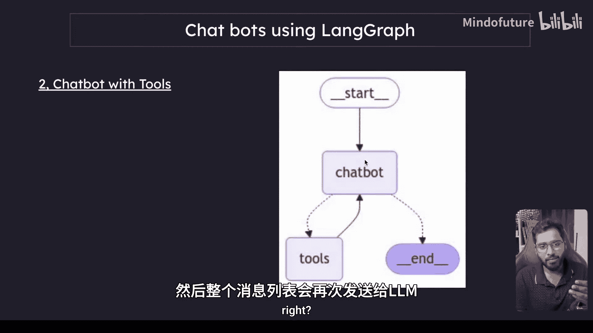

Right and now it is going to give the final answer so we should see all of these things so what do we have right here。

😊，So， we have the human message what is the current weather in Balore and coming down we we should find the AI message right here you can see that the content is empty instead of the content we can actually find the。

😊，Tool calls and inside of the tool calls the LLM is suggesting to use this tab search。

 So right after this， you should see what a tool message。 So if I search right here， okay。

 so we have the tool message right here and right here you can see that this is this entire thing is going to be the。

😊，A responsespon of the Tvi search tool， so we have the URL and the content URL content a lot of these different things right and finally the control flow is going to go back to the chat bot to the LLM right so if I。

Okay so we should be able to find another AI message somewhere here Okay great so the AI message so it is saying the current weather in Bangalore is part cloudy with a temperature of 32。

3 degrees okay so now the LLM has full context about the the weather so it is giving a final answer okay so this is in a nutshell you know basically adding tool calls to a chatbot okay but still you can imagine that if I if I were to say something like whats my name。

😊，Right， it's not going to， you know， if I come down here， you can see that。

 I don't have information about a name， right， So it doesn't actually maintain， you know。

 the context about what happened previously。 So that is something that we will tackle in the next section。

 So I'll see you there。😊。