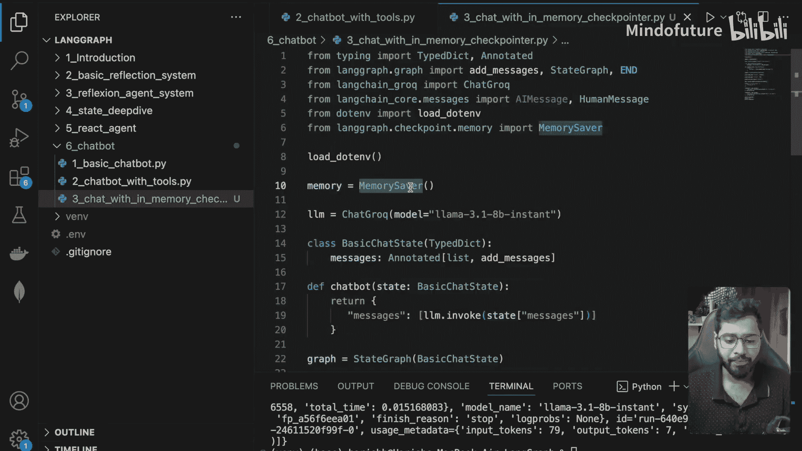
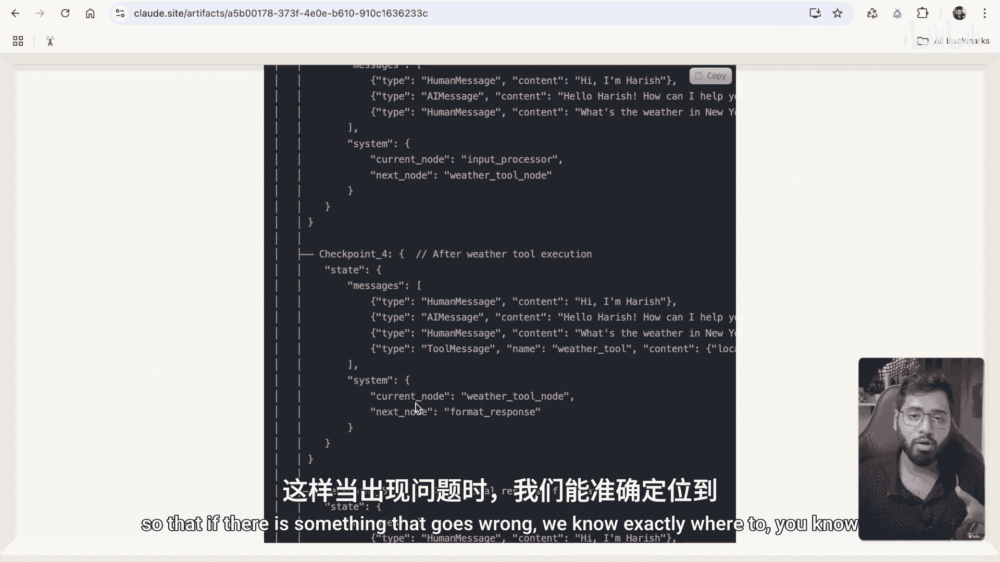
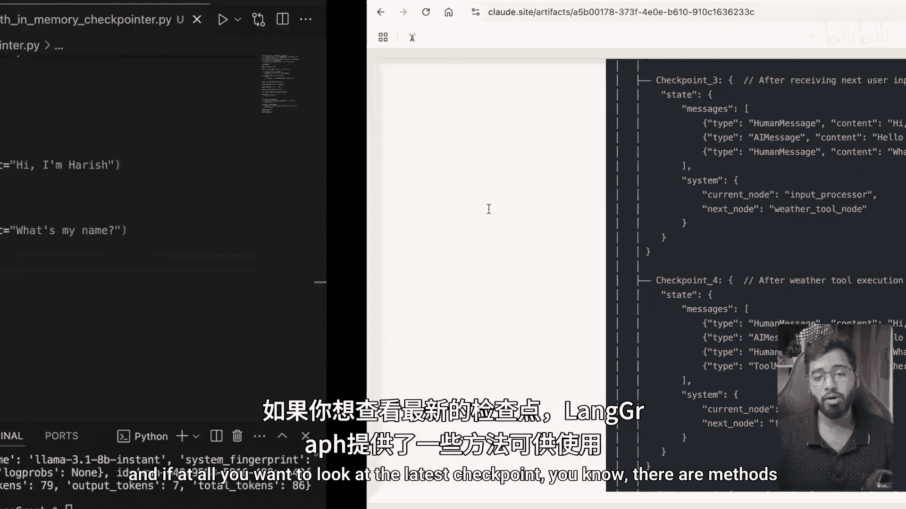
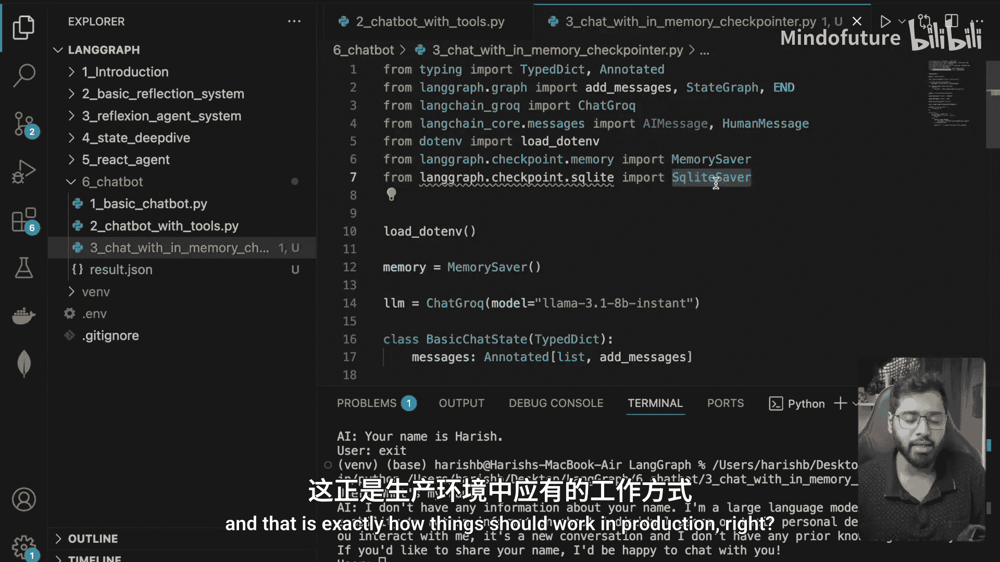

# Langgraph初学者入门2025 p29 P29_#27_聊天机器人_带记忆（什么是Checkpointer） -BV1mgepzCEjf_p29-

Hello guys So in the previous section we spun up a very basic chatbot and we also built chatbot with tools。

 but we also noticed that you know the previous conversations that we have the chatbot does not remember because persistence have not been introduced yet memory has not been introduced yet so that is exactly what we are going to solve using something called checkpointers in Lagra so when you build a basic chatbot using Lagra you run into an immediate limitation by default your chatbot has amnesia this weve already seen。

😊。

Every time a user starts a conversation， the bot has no recollection of previous interactions。😊。

This happens because without memory management， each invocation of a graph is completely independent。

😊，This is where the concept of checkpointers in Lagra come into the picture。

 so let us look at what exactly are checkpointers。😊。

A checkpointer in Langra is essentially a way to save the state of your agent or workflow at specific points during execution。

😊，Think of it like saving your progress in a video game When you reach a checkpoint。

 the current state of everything is saved。😊，If something goes wrong later。

 you can always return to this same point。You don't have to start over from the beginning， as well。

Right。😊，So in the context of La graph nodes and workflows。

 nodes are the individual steps or components in your workflow this we already know。

Checkpoints basically save the complete state after a node finishes its work。😊。

If an error occurs in a later node， you can resume from the last checkpoint rather than starting the entire workflow again。

This is particularly useful for complex workflows where processing takes significant time or resources。

😊，You want to implement retry mechanisms and in this case。

 all that we are going to do is introduce persistence across sessions or server restart。

 So to introduce persistence and memory into our graph understanding checkpointers is only half of the puzzle you also need to understand。

 you know what is a thread I Okay so together both of it together。

 we can actually introduce persistence into our graph。 So we will implement it later on in our code。

 But for now let's understand why what is a thread I Y is it even necessary。😊。

So a thread I is simply a unique identifier for each specific conversation or workflow execution。

 You can think of it like a unique session I for a user。

 a conversation I that groups related messages together。

 So if you've ever used the web version of chat C or cloud every single chat that you create or every single conversation this thing that you create has its own thread I right So that is how we can actually separate out these conversations。

 So that is what a thread I is So if if at all you know it's a group chat or something like that。

 that group chat is going to have it is its own thread I。😊。

So I hope that makes sense let's move on a thread ID is necessary because you might have multiple conversations or workflows running simultaneously。

😊，Each needs its own separate save state the threat ID helps the system know which saved state belongs to which conversation。

😊，Without threat IDs， all your conversation would share the same state which would cause confusion and errors。

So so far we know that to introduce memory and persistence into our La graph application we need two things we need to provide a checkpointer and we also need to provide it a thread ID so that it can link both of this together right so lets actually go ahead jump back to our Vi Studio code here I've basically just created a file called chat with inmemory checkpointer。

So all that I have done here is basically just implement the basic chatbo that we already saw right here。

 Okay， so we just have a state。 we have the chatbo node and then end node。

 So we have start chatbo and that is it right So that that is all that I've done here。

 I've added the chatbo node Ive added the link between the chatbo and the end I've set this entry point of chatbo compiled it and we have the final application right here and all that I'm doing Im invoking this application using this initial state Okay I'm just providing him Harish and then I'm trying to use the same application again and I'm passing in something else。

 Okay， what's my name。😊，Okay it is very simple， but usually what happens without memory this graph gets invoked from the start to an end and you know it doesnt really remember what happened previously so that is the issue that happened。

😊，So let me quickly run this for you and show you that memory is indeed not working。 So yeah。

 you can see that this is going to be the first invocation using I mean。

 I've provided this thing right here Hi amsh I'm providing this thing So you can see that hi Im Haish and in this AI message nice to meet yoush create but if I were to use the same app and invoke again and you know use a different you know what is my name if I were to ask that it should ideally remember it right and it is saying that I don't have an information about your name right so the persistence is not really happening so let's actually go ahead and introduce that so we know that we just need to provide a checkpointer and a thread ID so to introduce the checkpointer all that I'm going to do is I'm going to import the memory saver checkpointer okay so I'm just taking it from Land graph checkpoint memory memory saver So this is an inmemory checkpointer this is not really put in an external file or an external database or anything it's an in memorymory check。

😊，Okay， we will see further you know what are the differences。

 but okay all that I'm doing here is I can just say memory。

And then invoke this okay so if I hover over this， you can see that it says it is an in memory checkpoint saver。

 This checkpoint saver stores checkpoints in memory using a default di Okay so this is really this we can use this for you know debugging and testing quickly But then in production applications you would have to use you know ssQ light or Postgres checkpointer So we will look at more about that later。

 but for now all that I'm going to do first is I'm going to come down here and when we compile the graph you can see that it actually asks for the checkpointer and we can actually provide this。

😊，Memory in memory checkpointer right here。 Okay， so if you remember this is the first thing that we have to do。

 and the second thing is we also have to tie it with a particular thread right a thread I D So what I'm going to do is just going to come down here and I'm going to say config okay。

 and this is going to be an object。😊，And inside of this object。Okay。

 so this is the exact structure we this is the exact structure that we have to follow。

 so we have configuration。😊，Okay and this configuration property inside of this dictionary is going to have another object inside of which we have the thread ID right here and we can actually you know put one or two or whatever we want Ily we want it to be something that you know is very unique you can use the Uu ID package or something like that。

 but for now I'm just going to save it as one。And what I can do is I can come down here and wherever the graph is being invoked。

 I can just say config equals config。 That is it。 Okay。

 so this is going to be the first place where we are invoking the same graph and we are also invoking it here。

 So if you want to tie this and this together the first and the second one together。

 if you want the conversation to continue all that we have to do is provide the same config here as well。

😊，Okay， great。 So that is it， guys， Let me go ahead and run this file so that I can show you。

 you know， the persistence。 Okay， so， okay， I messed up one word right here。 Okay。

 this is not supposed to be configuration。 It's supposed to be configurable。😊，Configurable， okay。

Sorry about that。 Let's run this again。All it great。

So we have the first time we are invoking the graph right here and then we have the second time we are invoking the graph right here right so the first time you know we are passing in the human message and the AI message is getting generated right so if I come down here you know the first time we are invoking this human message we are passing in and then an AI message so we already have two messages right so since we are passing the same config here as well so when I invoke when I pass in this initial state this initial state。

😊，It actually needs to be the third message and not the first message right so that is exactly what we will be able to see in the final states of you know both of these graph invocations。

😊，So right here you can see that first is the human message Hi Haish AI message is saying that you know nice to meet you。

 Haish great。 So the next time I invoke the same graph right here。

 you can see that we see the first message right， the first message even though we are passing in this what's my name as the initial state we still see the previous message that is linked with this particular config okay。

 with this particular thread I So we have the Haish。

 nice to meet you this is retained and then what happens then I am again providing my human message Okay。

 where is it human message What is my name and the AI is able to say your name is Haish so I really hope that you are able to see you know how persistence works but you still might have some questions about how exactly is the storage being saved in this memory saver in this checkpointer right So Ive actually prepared that as well So you can see that this is how basically roughly。

😊。

How the structure looks like。So you can basically think of it as a dictionary with you know different thread I。

 Okay in our case， it's going to be the thread I of one right so you can equate that with this particular thread 1 to3。

 And inside of which we have multiple checkpoints Okay， checkpoint1， checkpoint2， checkpoint3。

 checkpoint4。 So inside of which we have the messages here right So initially I'm just providing higher meish So right after the first nodes execution Okay。

 whatever is the output of that particular node， it is going to append to this particular messages list。

 And then after the AI response AI response with something we are going to add that AI message to this thing and that is going to be checkpoint2。

😊，And then， you know there could be you know another human message saying that okay what's weather in New York or something like that that is going to be added。

 And that is going to be checkpoint3。 So checkpoint4 checkpoint5。

 So every single time a node is done executing whatever is the response of it。

 It could be a tool message。 It could be a human message。 It could be an AI message。

 it just gets appended with new checkpoints。 Okay so I hope that that makes sense。

 you can see that we also have the tool message And in addition to it。

 we are also you know maintaining basically that checkpointer is also going to maintain what was the current node。

 what was the next node so that if there is something that goes wrong。

 we know exactly where to know resume the execution。😊。

And if at all you want to look at the latest checkpoint you know this there are methods that land graph makes it available for us to use let me just you know comment this out。

 So this is the graph that youre working with right this this app is what we are working with we can just say get state and we can pass in the config that we are interested in Okay so basically the thread I that we are interested in Let's go ahead and print this。

😊。

Okay， so。Now， you should be able to see the latest。This thing， Okay。

 so this is going to give you a snapshot， the snapshot of the latest checkpoint。 Okay。

 so here you can see that， you know， there is a human message and there is an AI message and there is another human message。

 and then there is an other AI message。 Okay， so that's it。 And then a bunch of other things。

 actually， let me just put it in a neat format。 okay。So yeah， so this result， is what it looks like。

 Okay， so basically it's going to， you know， let me just okay， so this is how it looks like。 Okay。

 so you can see that we have you know， a bunch of different messages right here。 Okay。

 so the first message is going to be a user message I'm seeing this thing that's got an I as well。

 and then the AI is saying this thing you know， basically behind the scenes。 you know。

 human message and AI message gets converted to these roles in content Okay。

 so we have the role content。 Okay， we've got some other metadata as well。

 And then this is the third message。 What's my name and this is going to be the fourth message。

 Okay your name is Har right， So and then in addition to that。

 we also maintain some other things like the config。

 you know the thread I we also have the metadata right。

 we've got some additional things that we don't really have to confuse ourselves with right now。

 But yeah， so we have all this data。😊，Being printed from this particular latest checkpoint state Okay and I also want to do another thing right now。

 this is a little artificial rate。 Ive basically just。

 you know invoked the same graph two different times so that I can sort of demonstrate this you know persistence in action。

 So let me actually put it in a while loop so that it's much more natural and we can actually have a conversation in the terminal。

😊，Allright guys。 So all that I've done is I've just converted you know。

 those two different invocations into a while loop so that we we can actually extend it and basically have a conversation。

 basically have a long conversation。 And finally， I'm just going to。

 you know to show the AI message and'm just going to take the last message。

 which is going to be an AI message and I'm printing out the content。 And that is it。

 So let me run this。😊，So you can see that， you know， hey there。 my name is Haish。

 I know I'm using the same example again and again， but yeah， my name is Haish。

 I just wanted to remember my name right？ So my name is Hash。 And so nice to meet you， Hash create。

 I there something I can help you with And now I can say what's my name。😊，Right。

 so it should be able to say your name is Arish because the entire history is now maintained perfect。

 so you can actually test it out yourself。 So what I want you to do is you know basically try to invoke this app。

 this land graph application using different thread Is and you would be able to see that you know if if it is a different thread I the conversation history would not be available and it put start from scratch and also case there is one big disadvantage when it comes to using and in memory checkpointer。

 So what this is is it's an inmeory checkpointer。 Okay so basically if we were to stop this program right here so if I were to say exitright and if I were to run it again and if I ask the same question again。

 what's my name it is not going to have the information because the memory gets wiped out So this is exactly why Landgra provides you know this S lights saveer this is something that we can use to sort of see。

😊，Gave all of that memory externally， you know， and not in memory。 And you know。

 it also provides a postg saver as well。 Okay， so that， you know， even after we end the program。

 we can， we can always like continue it。 And that is exactly how things should work in production right。

 So that is what we are going to be looking at in the next section。 So as you there。😊。

