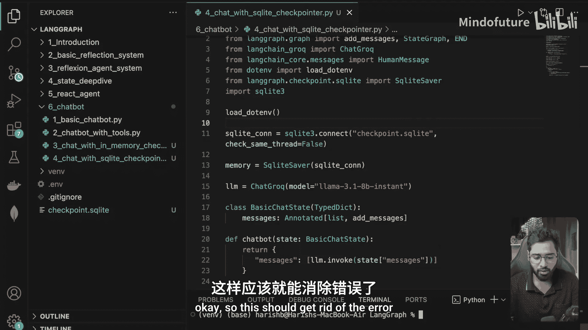
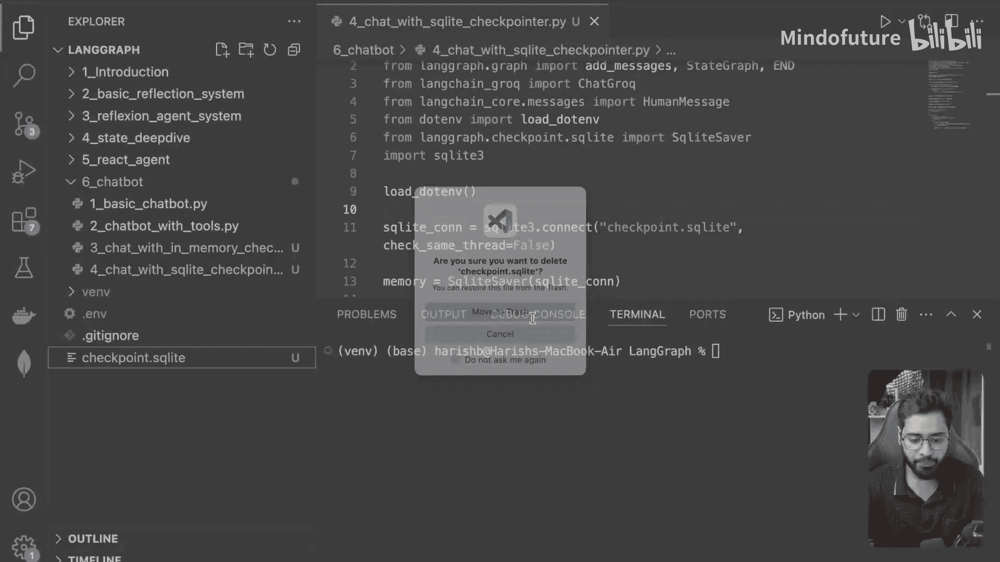
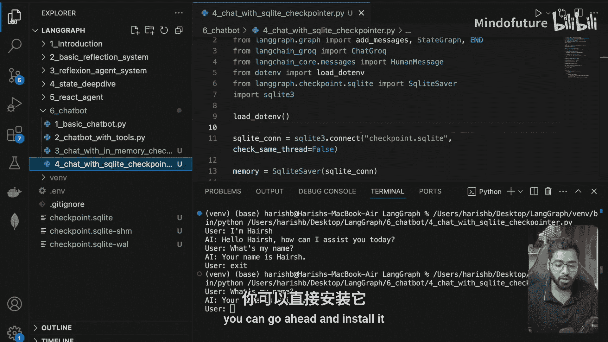
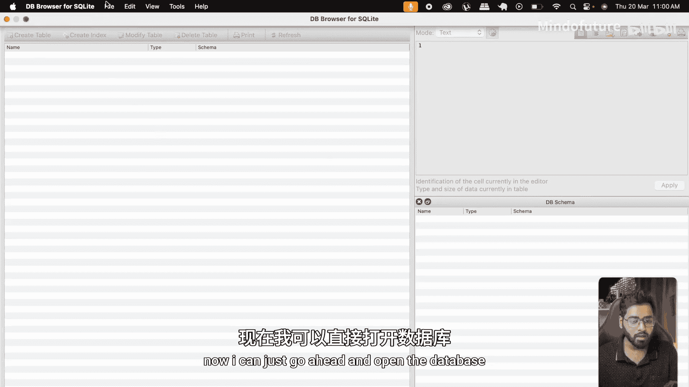
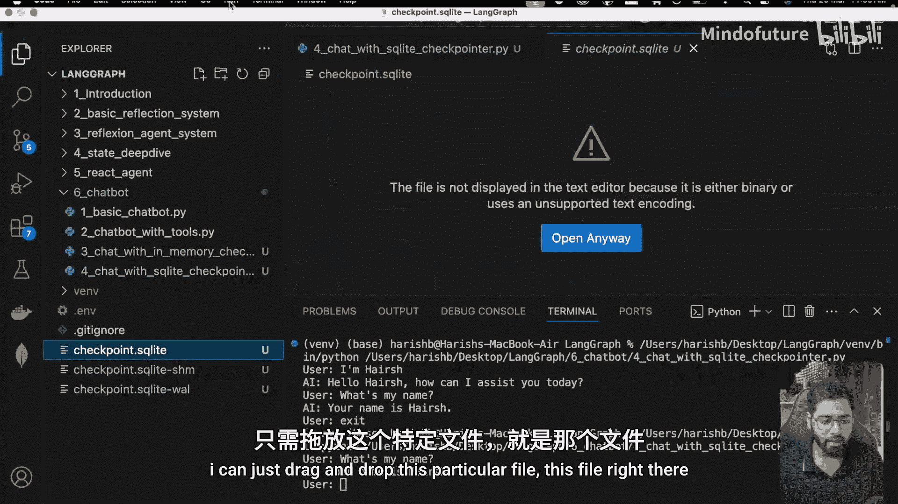
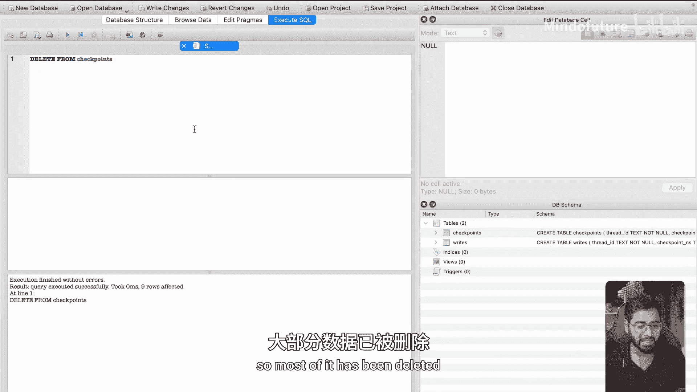
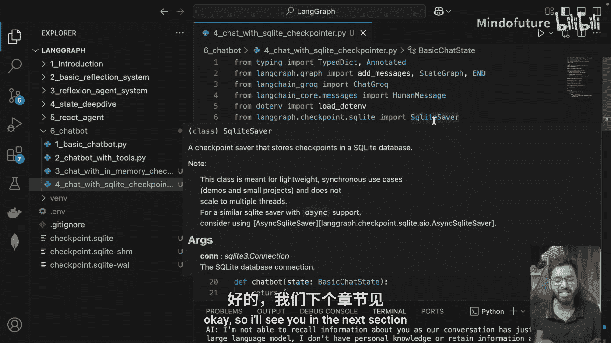

# Langgraph初学者入门2025 p30 P30_#28_聊天机器人_带SqliteSaver_Checkpointer -BV1mgepzCEjf_p30-

Hello guys so in this section let us now go ahead and replace our inmemory checkpointer with the SQite checkpointer so that we can you know introduce true persistence meaning we can you know shut down the server or know we can close the application and still we can resume the conversation right so I have gone ahead and created this new file right here called chat with SQite checkpointer Ive basically just copy pastted everything that I had in my previous file but right now instead of this memory saver we are going to use the SQ light。

😊。

So I'm going to go ahead and you know， in import another， okay， we don't need this anymore。

 you can go ahead and import the SQ light so I want you to go ahead and install this package so that we can actually go ahead and import it。

 So let's do install this particular package。Let's give it a few seconds。All right， great。

 So now you can see that the the warning has gone。 Now let's go ahead and import the SQ light saver All right。

 Great。 So what's the first thing that we have to do So we have to first import the SQ light3 library that is that is basically a part of Python itself。

 So whenever you want to work with basically SQ light you first create a connection string right So that is exactly what we are going to do。

 Let's say SQ light connection。😊，And we can say SQ light dot。跟那。

And then here we can basically okay provide the name of the database file that we want to create。

 Okay， so Im going to call it something very simple。 So I guess we can call it checkpoint。😊。

Dot S Q light。Okay， so this is a pretty standard thing that we do in pretty much any Python application if we want to work with SQ light。

 Okay， so now we have to introduce the checkpointer。

 So to do that basically all that I'm going to do is I'm going to replace the memory saver with the SQ light saver。

 And then I'm just going to provide this connection string inside of this。 And that is it。 Okay。

 everything else should work perfectly fine。😊，So， lets go ahead and run the file so the minute it hits this particular line it is going to create a database file and then it is going to after every single node execution this checkpointer is going to take control it is going to append new checkpoints。

😊，And it's going to save the state right， So lets go ahead and run this file。😊，Okay， and great。

 you can now see that there is a file that is being generated right here。

 There is a database file right so lets actually go ahead and you know right now the checkpointer is not really taking effect right it hasn't really work yet。

😊，It just created the database file so let's go ahead and say something like you know hi amm Harish so this way it is going to actually save the checkpoint so lets see what happens。

😊，Alright， so it looks like we are getting this error the SQite objects created in a thread can only be used in the same thread。

 alright。So guys this issue is a pretty common issue so basically how Land graph works is that it's going to use multiple threads。

 you know different different threads， whatever thread is available in order to you know work with the SQite database but SQI database only prefers to work with one thread whichever thread that created the SQI database that is a thread that it allows to make modifications as well So what we can do is we can actually explicitly tell SQ light to not freak out if some other thread where to go and make modifications so to do that I can say I can say the check same thread and set it to false。

😊，Okay， so this should get rid of the error。 So let's actually go ahead and run this again。

 Let's delete this off。

Okay， so now it should hopefully work fine。Okay， so I'm Hash。Okay， I messed up my name。 But yeah。

 how can I assist you today， What's my name。Okay you can also see that there multiple different files that are generated they are all part of the same this thing so what's my name and you can see that you know the persistence has been truly you know introduced so I can easily just exit out of it Okay so right now the application is closed but still the database is persisting right so now I can again ask you know I can basically you can run this file again。

😊，And I can tell what's my name。And it should be able to pull it from this particular D file。 Okay。

 so we can also go ahead and take it up notch。 We can actually go ahead and explore this。

 So I'll also show you how we can actually take a look at。 So right now。

 you can see that it is not really accessible。 So one way to do that is to go go ahead and install。😊。

The SQ light there is an extension here。 you can go ahead and install it。

 but I had some issues with that extension。 So what I prefer working with is this Db browser for SQite you can go ahead and downloaded this is what I click on to download it and if I open it this is how it looks like Now I can just go ahead and you know open the database I can just drag and drop this particular file this file right there let me show you how it looks like Okay great so Ive actually open that particular Db file in my you know Db browser for SQite and right now you can see that there are two tables that are La graph application our SQI checkpointer has created so inside of this checkpoint you can actually click on this and go to browse data and you can see that we can also see all of the different you know messages that have been added so you can see that this is the the checkpoint I checkpoint I2 whatever And then if I click on this thing Okay so this is going to be the metadata right so if I。

😊。

Scrolled down， scroll to the very right。 You can see that the content is going to be。

 I'm Harish I says I'm saying I'mish And right here there is a loop happening。

 we don't have to worry about that。 And then the AI is saying helloish how can I assist you today and then the same input happens and then know another loop happens we don't have to worry about that and finally okay I ask okay what's my name and then it's saying so basically you can see that all the messages are being stored in this table call the checkpoint table right so I can also do something where I can just go to the。

😊，You know， I can basically execute an SQl command and then sort of remove delete all of the rows from the table。

 So the way that I can do that is I can just say delete from I think checkpoints right checkpoints and if I run this file okay so you can see that nine rows have been affected So most of it has been deleted and if I come back to my VS code So if I now ask the same question again Okay what's my name it is not going to be able to answer it because we have removed all of the rows So let's check it great you can see that you know I'm not able to recall information Great guys so I hope that you now understand how you know the SQ like works how in memory checkpointer works So now that we understand how checkpointers in memory works let us now use all of these concepts and introduce a human in the loop scenario okay so I'll see you in the next section。

😊。

