# Langgraph初学者入门2025 p31 P31_#29_人工在环_介绍 -BV1mgepzCEjf_p31-

Hello guys， so so far we've learned a lot about checkpointers and memory。

 let us now use some of those concepts and let's start exploring human in the loop。

 so let's look at some slides。😊，So， a human in the loop workflow integrates human input into automated processes。

 allowing for decisions， violation or corrections at key stages。😊。

This can be especially useful in LLM based applications where the underlying model may generate occasional inaccuracies。

😊，So some of the use cases include reviewing tool calls so humans can review。

 edit or approve tool calls requested by the LLM before tool execution。😊。

We can also use it for validating the LLM outputs so humans can review。

 edit or approve content generated by the LLM。😊，Or you know。

 we can use it to provide additional context as well， like for example。

 enable the LLM to explicitly require human input for clarification or additional details or to support multit conversations。

😊，So next let us look at some of the design patterns that usually are used with human envelope the loop So there are three different actions that you can do with the human envelope the loop workflow so the first one is approve or reject。

So we can pause the graph before a critical step such as an API call to review and approve the action。

If the action is rejected we can prevent the graph from executing that step and potentially take an alternative action This pattern often involves routing the graph based on the humans input so here is a very simple diagram so here we have you know a node here another node here and then some other node here so right here we can actually decide the human can decide if you know it if the flow needs to go to this particular node or this node so depending on the human's approval or rejection the graph can proceed with the action or take an alternative path。

😊。

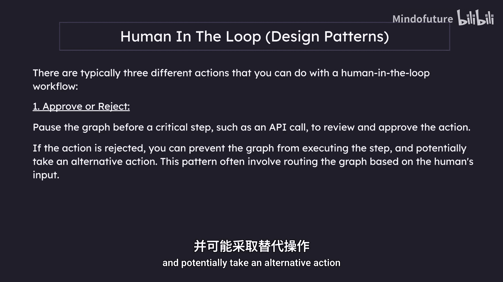

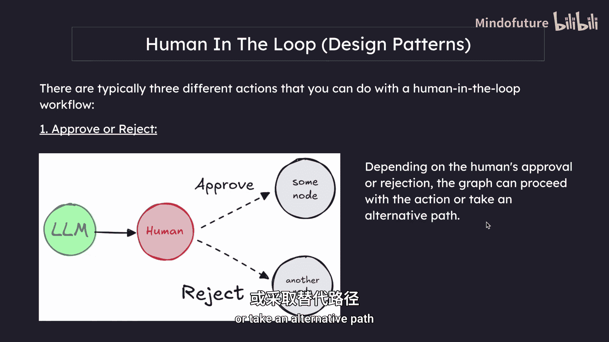

Let's look at another one， so review and edit state。Okay， so in this case。

 a human can review and edit the state of the graph。

 This can be useful for correcting mistakes or updatinging the state with additional information。😊。

And you know， another use case could be reviewing tool calls which weve already seen a human can review and edit the output of the LLM before processing。

😊，This is particularly critical in applications where the tool calls requested by the LLM may be sensitive or require human oversight so you can actually imagine that there could be some tools that could be expensive and in that case we can have the graph ask the permission from the human and if the human is okay with it then we can go ahead with going to the particular tool node or else we can go to another node in the graph So if you remember the first design pattern that we saw was approved or reject okay so that would probably be the easiest for us to as a beginner for us to learn so basically you know the graph flow execution just comes in a certain direction and depending on whether the human is okay depending on whether the humans as yes or no。

 we either direct the flow in the left side or we direct the flow in the right side So I've just prepared a very simple intuitive example so we can see that we have basically the graph that we are looking at right now is like a very simple agent that you creates LinkedIn。

😊。

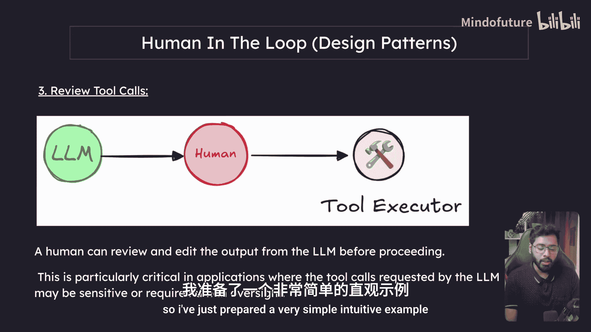

Conent。And if the human is like happy with it， it goes off and you know。

 talks to the LinkedIn API and then just like you know， creates a draft。

Or if the human is not happy with the draft that is generated。

The human can provide feedback on it and then the agent is going to you know you know take that feedback and then iterate on it and make it better and the loop is going to continue。

😊，So you can see that we have the start node and here is where we are actually going to provide the。

 you know this is the topic that I want you to create a LinkedIn post on right So this node when it hits this node。

 the LLM call is being made post is generated and as soon as this post is generated we are then going to interrupt this the flow of the graph it's going to stop the flow of the graph right here and then we are going to you know basically provide。

😊，Show the user the post the draft that is created and ask the user is it good or not okay so if the user says yes in that case we are just going to go ahead and post you know post it to LinkIn or rather you know create a draft and communicate with the LinkedIn API。

😊，Right but if the user were to say no， then this node comes and then we are going to collect feedback from the user Okay so we can we can have the user say okay make this shorter。

 make this long or make it more funny or something like that and then we are going to feed it back to the generate post and it is going to iterate on it right so initially were just going to it very quick and dirty we are not going to dive deep into land graphs methods or anything of the sort just so we can actually understand how simple it actually is right so you can see that I've actually gone ahead and created a folder and a file and I'm calling it using input because in this particular example we are going to be using the input the Python input method and that is going to be you know something that all of us would have already been used to working with right so the first thing is obviously just a state with a very simple messages property we provided the add messages reduce function here as well and then we are first defining the generate post node。

😊。

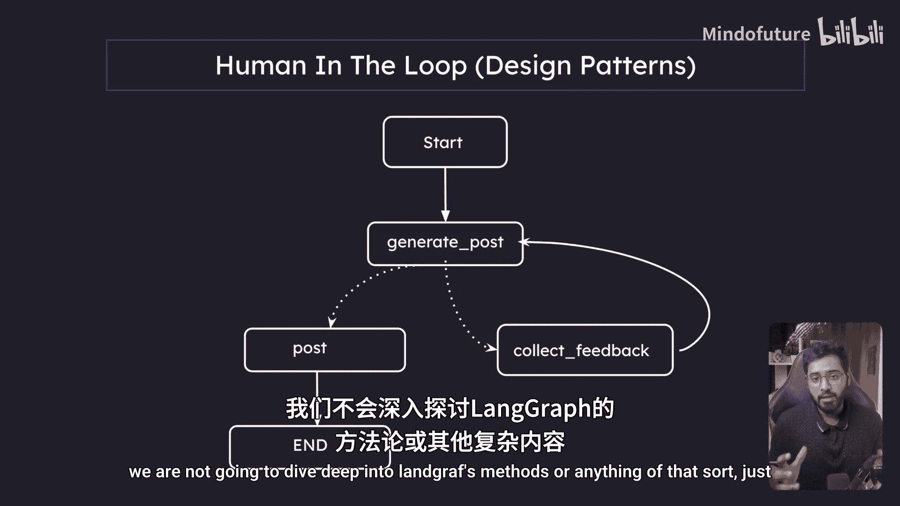

So this is something that we would have already seen before it just takes in the list of messages and invokes on it right right so let's come back So the generate post is done So as soon as the generate post is done what we want to do we want to actually you know get the feedback from the user so you can if I were to come down here you can see that。

😊。

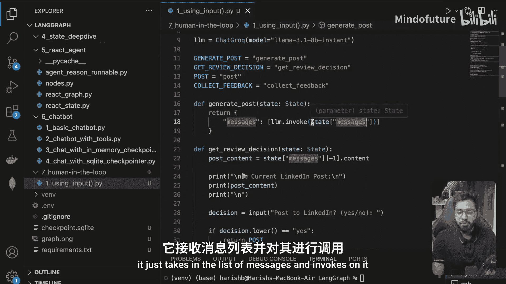

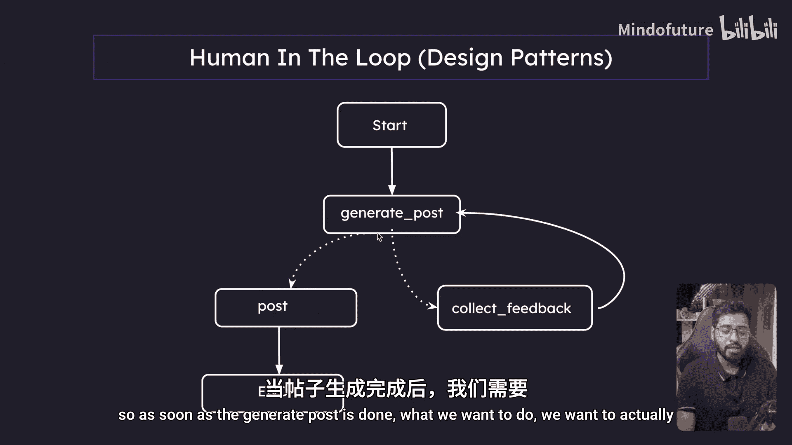

So right after the generate post is done， I am going to go to this particular node called get review decision。

 Okay， let's go back to the get review decision。😊，So all that Im doing here is that I'm going to take the last message which is going to be the AI message which is going to contain the LinkedIn post right and then what I' am basically going to do is I'm going to print it in the terminal right okay this is going to be the current LinkedIn post and then I'm showing the post content as well and then I' am basically asking the user do you want me to post to LinkedIn yes or no。

😊，Very simple right So depending on whatever the answer is。

 we are then directing the flow of the graph to either the post method the post node or the collect feedback node。

 So if you remember right here， we are either going to the post node or the collect feedback node right So if I were to go to the post node I'm just basically saying that you know I'm just showing that this is going to be the final LinkedIn post and then I'm just going to print it。

 Okay， we are not actually going to make an API call or anything of the chart。

 So were just saying the post has been approved and it now live on LinkedIn Okay。

 so we're just keeping it very simple because we're just learning the concept of human in the loop right So if this yes is not going if the user were to say no。

😊。

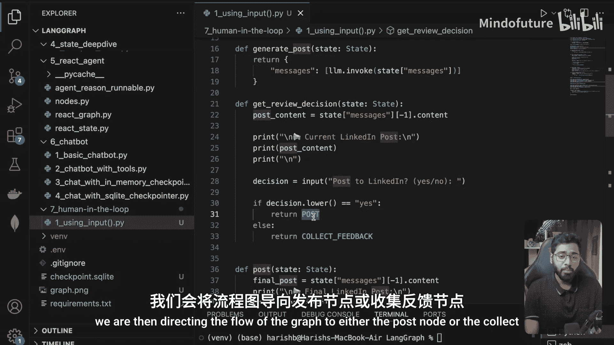

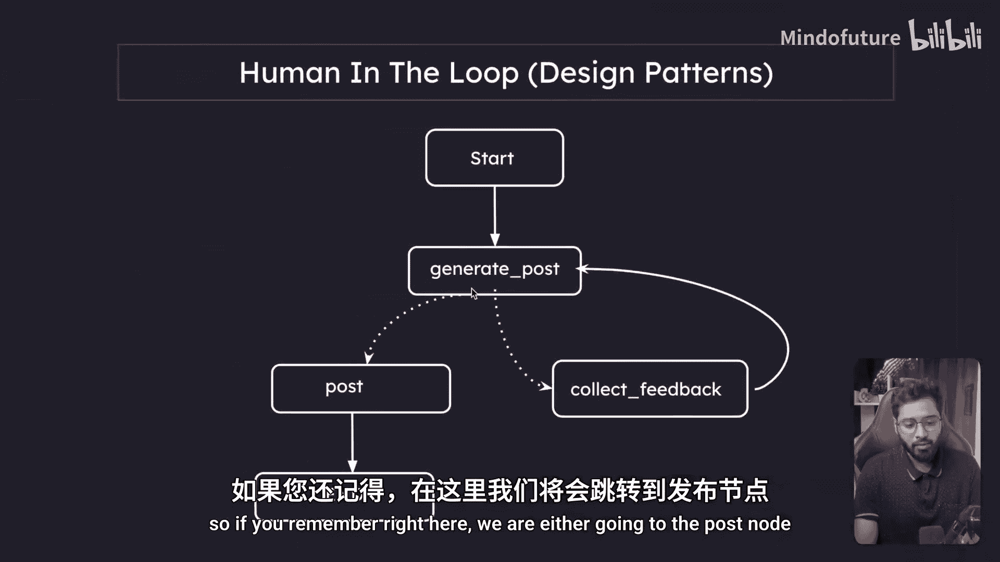

In that case we are going to come to this collect feedback and right here you can see that we have another input right here which is going to ask the user how can I improve this post right so the human could say something like you know make this shorter or make this more funnier or something like that and then we are going to append this to the existing list and as soon as this is done we are going to loop it back to the generate post again so if you see that I would have added an edge from collect feedback to the generate post right so that is going to run the same loop again and then eventually if you know the user is finally happy with it they can just go ahead and post it to LinkedIn right and finally you can see that we are providing the initial state which is going to have one human message which just says write me a LinkedIn post on AI agents taking over content creation so if I run this。

😊。

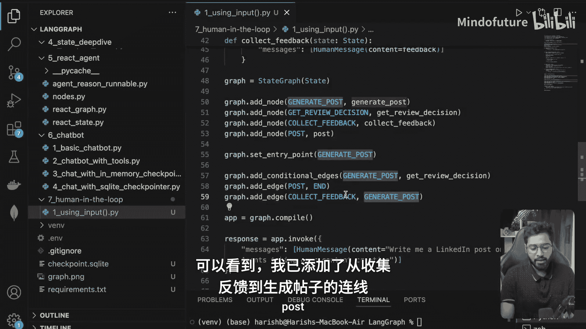

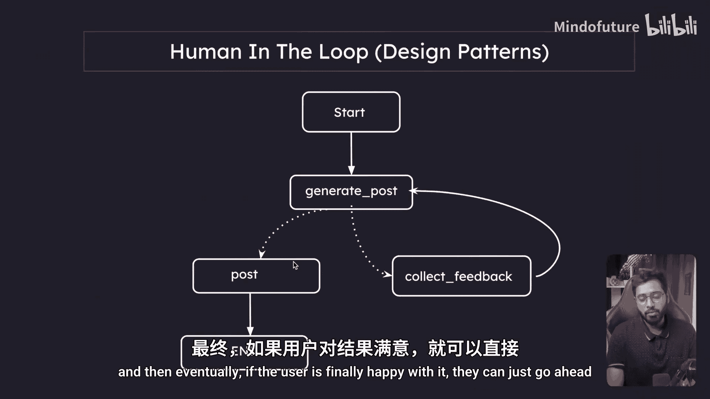

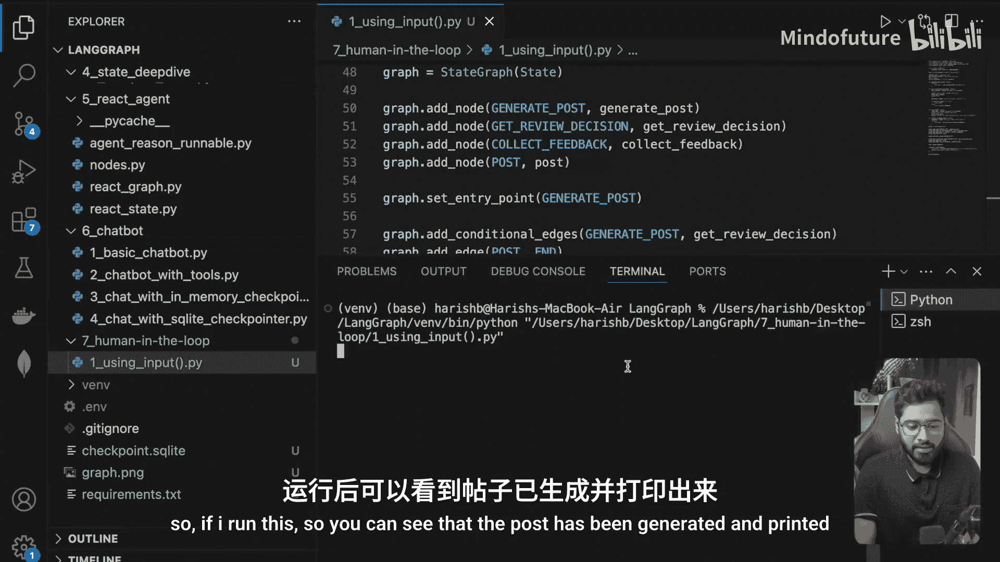

Okay， so you can see that the post has been generated and printed。 so you can see that okay this。😊。

Particular you know node， it comes inside of this particular node and it prints the current LinkedIn post and then we see the the complete post right it hits this particular line and it is going to ask post to LinkedIn yes or no right So if I were to say no。

 it's going to ask okay， how can I improve this post and I can say something like you know make it。

You know， four lines maxs。 Okay， so you can see that now it's like， you know，4 or five lines， right。

 So now if I wait。 okay， let's say I'm happy with this particular post。

 I do now want the agent to go ahead and post it as well。 So now I can say yes。

 and that is going to post the the final thing right？

 So final LinkedIn post this has been approved and is now live on LinkedIn。😊，Okay。

 and finally we are also you know logging the printing the the the final state after the end of the graph right so we have a human message an AI message and then I would have provided the feedback somewhere so I would have provided make it to full lines ss and then we have the final AI message somewhere here right so we have a AI message。

So in this example you can see that we are using this input Python method。

 but that is not the right way of doing things Okay so I've included this particular example because you know the way that we are going to be doing it with land graphs interrupt method we are going to be looking at it later but it's going to be very similar to what we are doing here so I just wanted to give you sort of like a bridge between you know what were used to and what we are going to learn okay so let's look at some of the drawbacks of using input because this is not how we are supposed to do it and then we'll sort of segue into learning about another method a class that La graph provides called interrupt okay so let's come back to the slides。

😊。

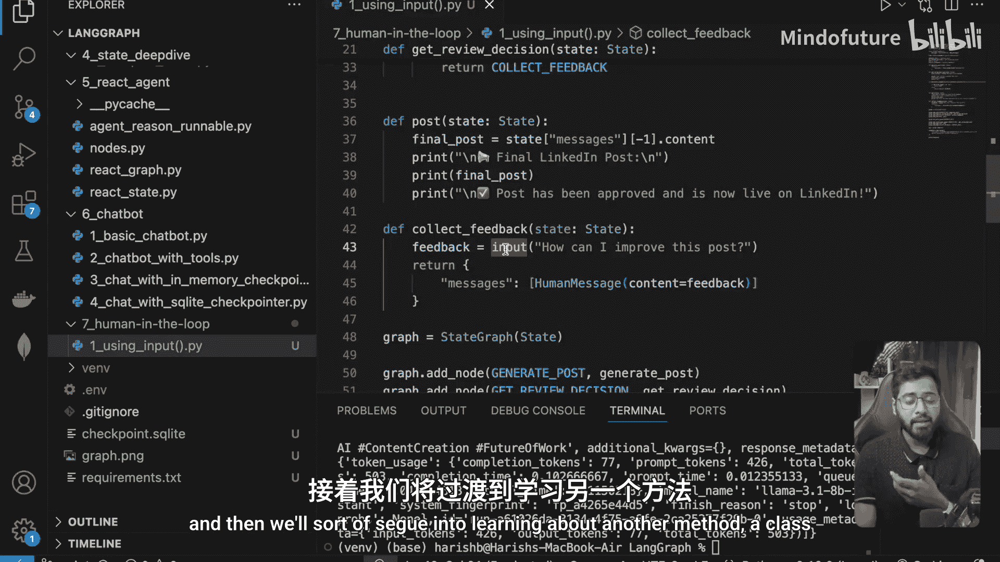

So the drawbacks of input involve， you know， it freezes your program completely until someone types something in。

You know， it only works in the terminals， right， It is useless for web applications。😊。

If your program crashes， all progress is lost。It can only handle one user at a time。

It only lives in your terminal session。So this is why we use a special method that Landgra provides called interrupt。

So what is interrupt and why do we use it？It is a special La graph function that passes your workflow nicely。

😊，Saavs your program state so it can continue later。 It works in web apps， APIs and other interfaces。

 It handles multiple users and sessions at once。😊，It survives programme crashes and restarts。

 lets humans take their time to respond。It is required for any serious human in the loop system。

So here are two ways wherein you can use interrupts so in the first case you can see that during the compile step we can provide the interrupt before and we can actually specify before which node do we want to interrupt this application So here we are seeing that if there is going to be a tools node in our graph it means that right before the tools node is going to be executed we can actually interrupt the graph so that is what it means and La graph also provides this interrupt function with the command class that we can use together So we can see that this sort of using it is going to be very similar to what we did with the Python input method So instead of the input method we can just replace that with this interrupt method and that is it So whenever the execution hits this particular line the program is going to get interrupted or basically just past or exit it from the graph and now you know after we get the response from the human we can just resume it using this command class。

😊，So how can we resume it， Where is the memory stored， It is the memory stored with the checkpointer。

 Okay， so the checkpointer is going to have information about exactly where the interrupt happened and depending on what we pass in here。

 it is going to resume it， it is going to continue from it Okay so well look at a lot more examples about you know how we can actually use this interrupt method。

 So in the next section， let us use this interrupt method and then build out some human in the loop workflow So as you there。

😊。

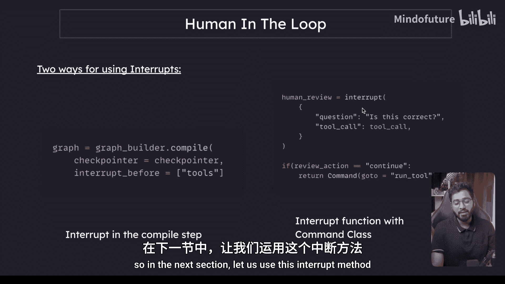