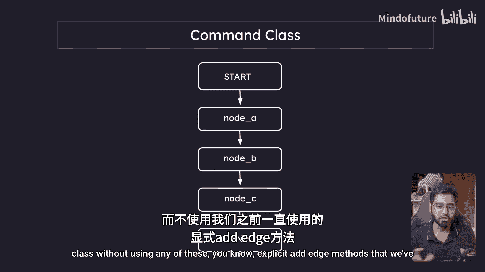
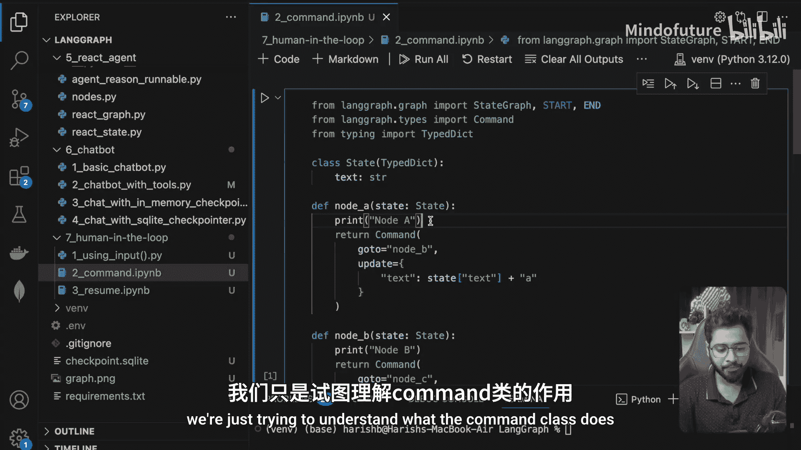
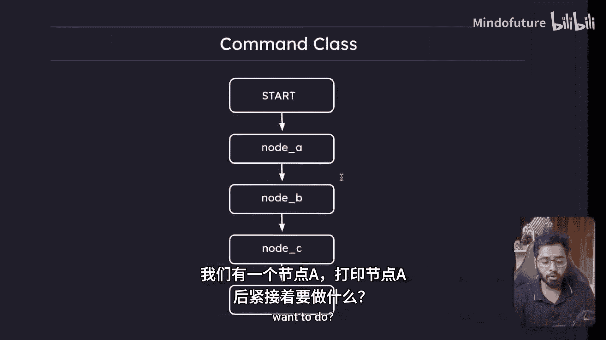
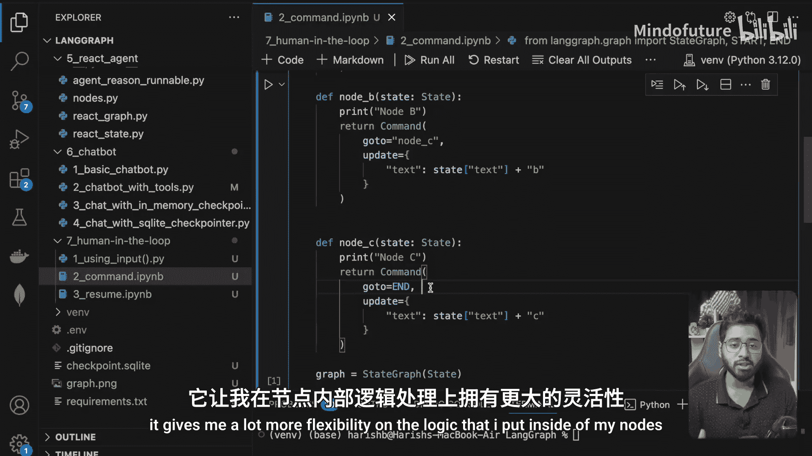
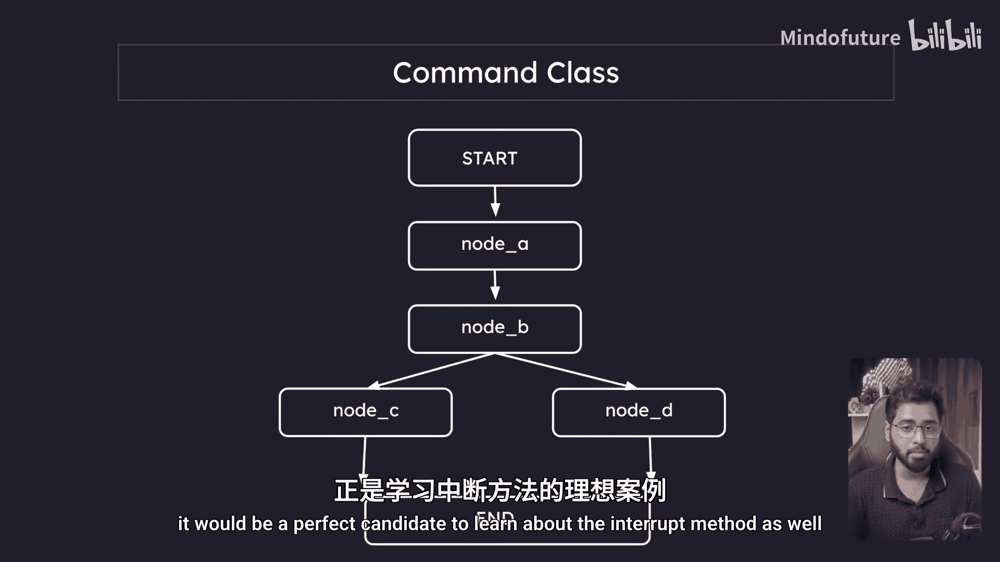

# Langgraph初学者入门2025 p32 P32_#30_人工在环_命令类 -BV1mgepzCEjf_p32-

Hello guys。 So in the section， let us understand what the command class is。

 What is the interrupt method using very simple examples。 And once we familiarize ourselves with it。

 let us then go ahead and convert the LinkedIn agent that we built using the right methods using the interrupt method and the command class。

 Alright， so first in this section， let us look at what is the command class。

 what is the utility of it。 So what this command class allows us to do is to create edgeless workflows。

 And this is how it works。 Okay， so let's say this is a node， this is very simple node。

 So instead of you know just updating the state as we've been doing so far。

 What we can do is we can return this command class and this takes two keyword parameters。

 So in this go to keyword parameter， we can just specify go to this particular node right after this node is executed。

 so we can see that the next node to transition to that is as simple as that。😊。

But what if you know a node needs to update the state as well。

 So so far every node that we've been writing， it also updates a state right so we can also specify the same thing here as well So right here we have the update keyword parameter inside of this we passing the same object this is very very this is no different to what we've been doing so far which is just returning these state object so if we return a response right here it gets appended to the messages list very simple so I hope that makes sense so to better understand this prepared an example so right here you can see that this is this is a very simple node graph I mean so what we normally do is we just create these nodes know and then we add these nodes to the graph and then explicitly we will mention add edge add edge add edge but this time we are going to do the same thing using the command class without using any of these explicit add edge methods that we've been using so far。

 So let me go to vs code So here you can see that I've already gone。😊。

head and created a file so all the time doing here is that you know we have a node which is just going to print node a okay so we are not going to be you know making any complicated LLM cause we are just trying to understand what the command class does right so we have a node a we are printing node a and then right after node a what do we want to do we want to go to node B right so that is exactly what we are doing we are returning the command class we are saying go to node B next。

😊。

At the same time I'm also you know just to better drive the point home I'm also going to update the state as well just to show you that that is also possible。

 So right here in the state schema you can see that we have something called X right here right so I'm just basically just going to take the text and then I'm appending this letter A to it Allright so right after the node a is going to be executed we are going to go to node B node B does the same thing it's printing it and then it is saying go to node C next and this time before we go to node C we are also going to append this letter to the state。

😊，Okay， so if the initial value were to be an empty string。

 so right after this it's going to be a and when it comes to B。

 the state is going to have just a letter alone。 and by the time this is done executing we we will have appended the B letter as well and the same thing for C as well。

 and then we're just going to add the node and the set entry point also needs to be done。

 and that is simply it。 Okay， so I'm just going to leave it as an empty string right now Alright。😊。

Great， so you can see that node A is done executing。 node B is done executing。

 node C is done executing as well。 And then the final response has A， B C。😊，I hope that makes sense。

 So I hope you understand you know the utility of the command class and the goto keyword parameter that it takes in it's personally。

 it's a lot more readable for me it gives me a lot more flexibility on you know the logic that I put inside of my nodes。

 So given that this is a very simple graph， this would be a very nice way to learn the interrupt method as well。

 In the next section， we are going to be adding the interrupt method。

 we are going to interrupt the graph at a certain point。 And then using the human review。

 we are going to direct the graph towards node C or node D。 given that this is a very simple graph。

 it would be a perfect candidate to learn about the interrupt method as well。

 So I'll see you in the next section。😊。

