# Langgraph初学者入门2025 p33 P33_#31_人工在环_恢复图 -BV1mgepzCEjf_p33-

Hello， guys。 So in this section， we are going to learn about the interrupt method。

 So this is the graph that I'm going to be building。

 So here we have start node A and node B inside of node B。😊。

You can imagine that we are going to have a command class that can either go here or here。 Okay。

 so we have two different options right here。 So in order to make the decision。

 whether to go to node C or node D， I'm going to seek the help of a human。 Okay。

 so I'm going to add a break point in the node B。 I'm going to pass the execution of the graph。

 and then I'm going to make， I'm going to ask the question to the human。

 Do you want to go to node C or node D， depending on the humans， you know， whether they say C or D。

 it's going to then go to C or D and then end it。 Okay， so I hope you're excited。

 let's go to the BS code。😊。

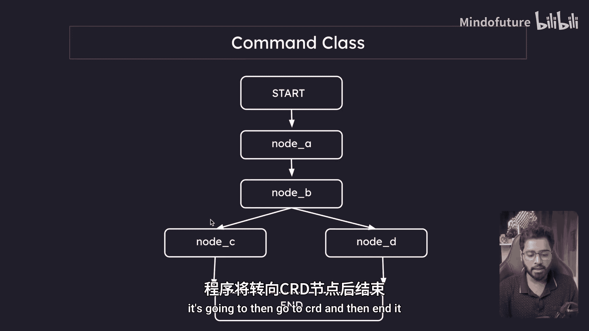

So Ive created another file as well for resume。 So the reason why I have named it resume is because we are just going to put a break point were just going to pass a graph execution and then we are going to resume from it。

 We are not going to do anything else complicated。 We are not going to you know update the state or we are not going to branch off or anything like that。

 So before we jump into the code， let's look at some of the operations that are possible with interrupts。

😊。

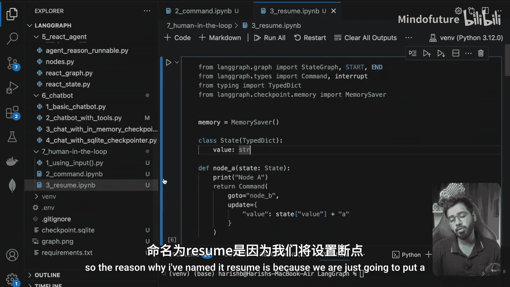

So the first one is obviously resume right so we can continue the execution with input from the user without modifying the state。

 Okay， so that is exactly what we are doing here， right， So we are going to。

 you know pause the execution right here and we are going to get an input from the user。

 And then depending on that we are resuming the execution。 That is the first one。😊。

We can also do update and resume as well so we can also do update the state and continue the execution。

 no different。 So you can imagine that the command class that we have。

 it can also you know go to the next node， we can also you know direct the flow of the graph to a certain node but at the same time we can also update the state as well so that is also something that we can do and the third thing is rewind or time travel basically so go back to a previous checkpoint in the execution So what I mean by that is so in this graph。

 let's take a very simple example So let's say you know there is a node a node the user decides they want to go to node C and then end right so the graph is actually ending completely but we can also do time travel So after the graph is done executing if we want to actually go back and then choose a different option for whatever reason maybe we might have made a mistake right it could be anything so we can actually go back to node B and then you know。

😊，ulate the same interrupt again。 and then this time， you， go to node C。 I mean。

 note D and then end So how can we do that， we can do that because of checkpointers right So after every single node execution。

 there is a checkpoint getting created right so we can actually just take the checkpoint and then continue from that。

 So that is also another possibility along with it we can also have branch we can create a new branch from the current execution state to explore alternative parts it's kind of very similar to what we just saw and then we can also abo we can cancel the current execution entirely as well。

 So each of these operations we you different ways to control the flow of your graph when it is interrupted Okay。

 so I hope that makes sense。 now let's actually go ahead and see interruption action using this very simple example that I just showed you Okay so this we are going to be using this particular example。

 and let's actually go through it。 So it's no different So the previous code that we saw I just basically copy pasted everything as is。

😊。

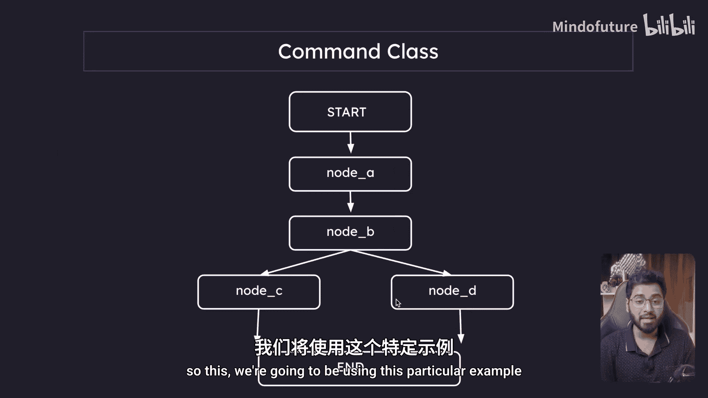

All that I have done is added this memory。Okay so why do we need memory right here So if we are going to you know interrupt a particular point in the graph basically what is what is actually happening is it' is going to exit out of the graph okay but we need some sort of information about where it got exited right where the break point happened so the memory is going to keep track of where the interrupt happened so that the next time we can resume from that particular interrupted point Okay so that is why we want this memory saver right here。

😊。

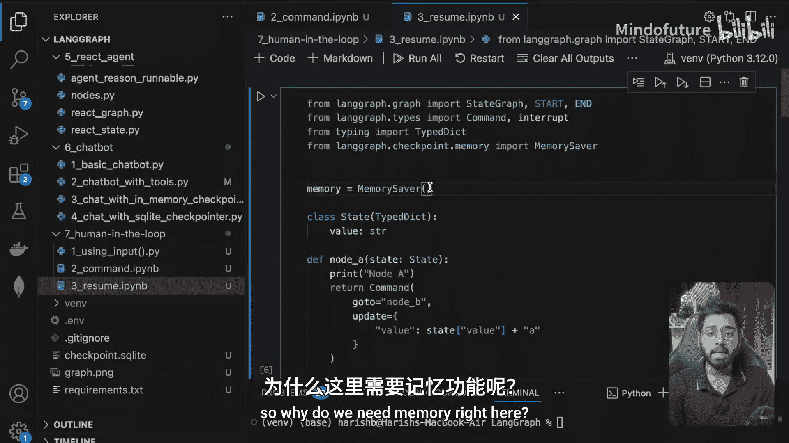

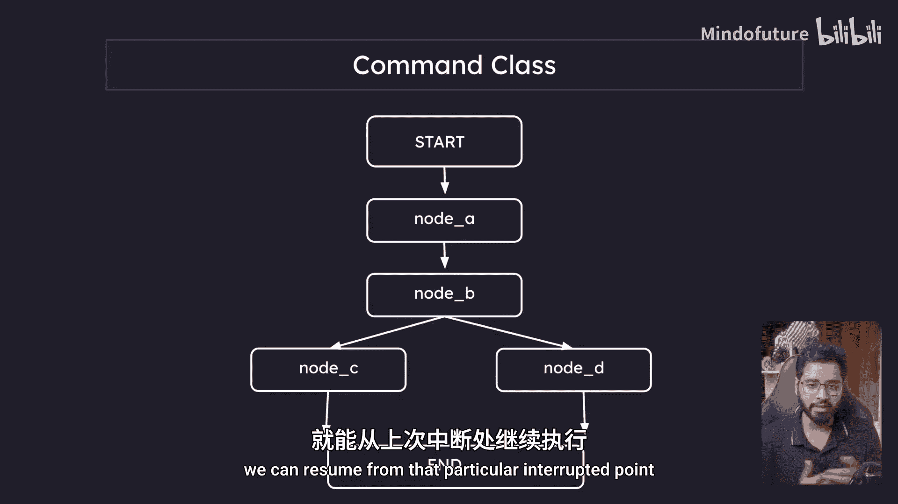

Alright， so the rest of it is pretty very very much the same。

 We have node A and then you can see that inside of node B。

 I have this interrupt method so you can see that I've imported it from La graph types So all that I'm doing here is I'm just asking do you want to go to C or D type C or D right so we have the human response and then depending on whether the user says C or D we are going to go to node C or we are going to go to node D okay at the same time I'm also going to update the state just so you know it is we are learning and we are seeing possibilities so we can also do it if we wanted to so because we are in node B we are upending B in each of these places and the initial value is going to be just an empty string。

😊，Alright， Okay， great。 So the same thing continues。 We've got node C。 we've got node D。

 and then we are adding all of these nodes together。

 and then we are providing the memory as well a config object。😊，Okay， and then finally， okay。

 we are also providing the initial state。 Okay， so the initial state is going to be the value with an empty string。

 Okay， that is it。 So if I were to invoke， okay， so I am not running this just yet。

 So if I were to invoke this graph what what do you think is going to happen So it's going to you know print out node a。

😊。

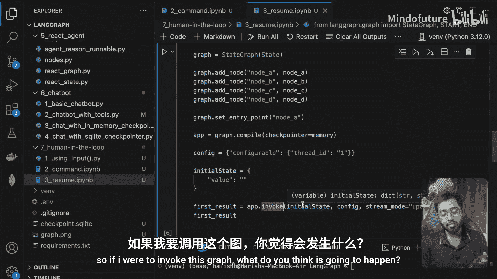

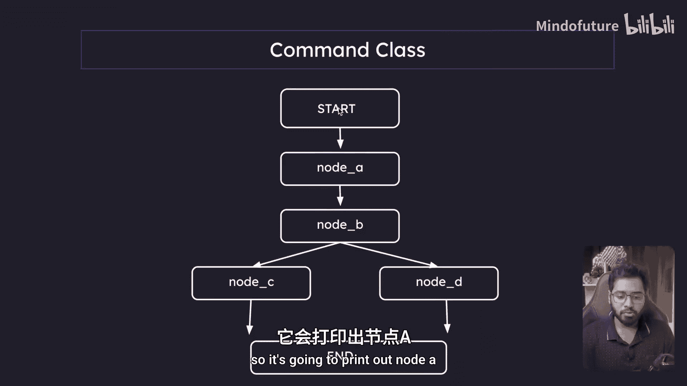

And then it's going to print out okay， so the execution is going to come from come to here it's going to print out node a。

 and then it's going to go to node B。 It's going to print out node B。Okay， so this much we know。

 So after this node be printedprint out， it is going to encounter this input interrupt method right right here。

 it's going to look at this particular line and it's going to exit the state。 Okay。

 so this interrupt。 Okay， this is the area where the interrupt happened。

 That information is put in the checkpointer。 right that is in that information is going to be added and it's going to exit from the graph。

 Okay， that is it。😊，So if I go ahead and execute this file so you can see that we have node A and node B printed coming from here。

 Okay so as the graph went through these two different nodes。

 we are printing both of this and we also see this information right here so since we set these stream mode updates we are going to see the output of every single node the state return so node a successfully return the value of a this is correct and then the node B did not get a chance to completely execute because the interrupt happened right so that is exactly why we see this interrupt right here So in here you can see that the value is do you want to go to C or D type C or D so in ideally in production applications。

 we would surface this information to the user in the Ui in the front end so that you can get the response then resume the graph from there but right now we just going to do it very quick and dirty but in the next section in the next few sections we are going to be building we are going to。

😊，How to build production grade graph applications， but this is grateful learning or it grade。

 So right here we are getting the the the latest checkpoint you can imagine that the checkpoint is going to have information about you know what is the exact state at that particular point but in addition to that it is also going to have information about you know which node the next node it should go to right all those flow related things as well it is going to contain right so so I'm going to use this next property and that is going to give you information about the next node it needs to go to So if I come back to the diagram。

😊。

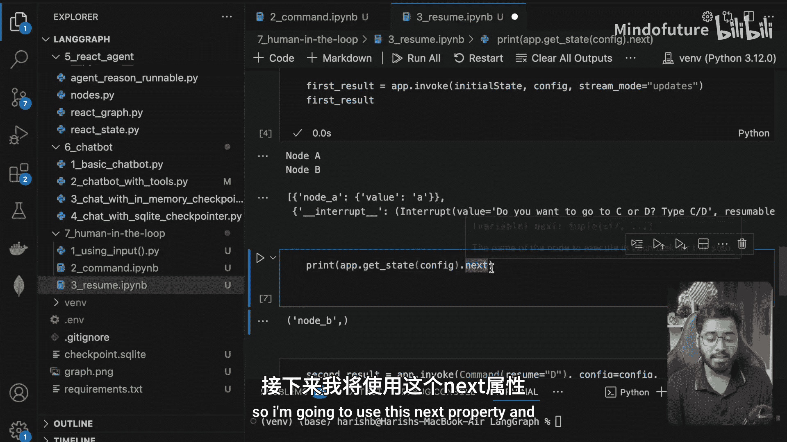

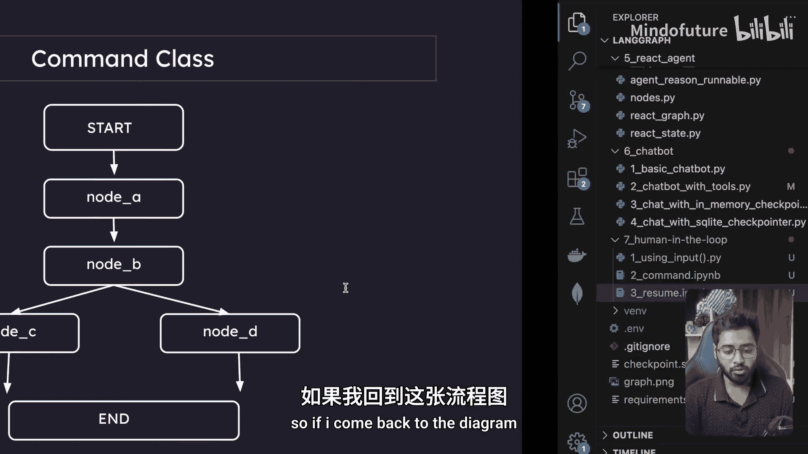

So the interrupt method， we put it right here right So because we put it right here。

 it's going to stop the execution right here。 So the next time we assume it it's going to start off from node B。

 So that is exactly why we see the node B right here。 Alright。

 So whatever are we going to do right now we now need to you know give get the user to give a particular value。

 it could be C or D right So depending on that it's going to go here or here。

 So how can we do that we can now use the command class。 Okay， so we can say app invo command。

 and we have to use this exact keyword parameter。 Okay。

 so this here we can pass in pretty much any information that we want。

 we can pass in an object We can pass in a lot of different properties But right now I'm just going to keep it very simple。

 I'm just going to pass in a single letter alone Okay so whatever I pass inside of here。😊。

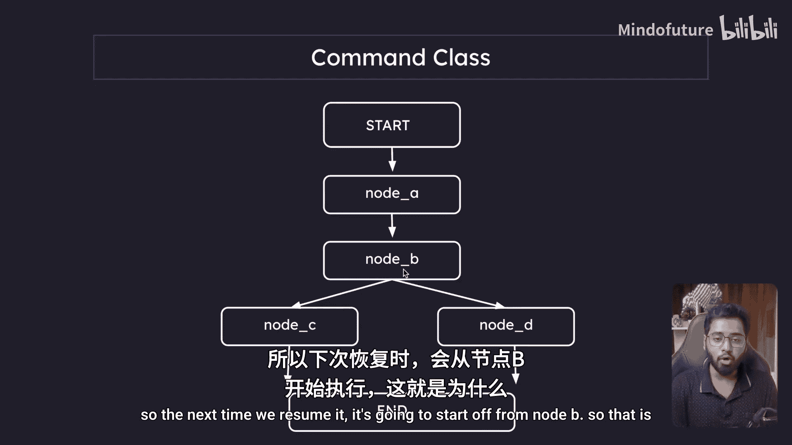

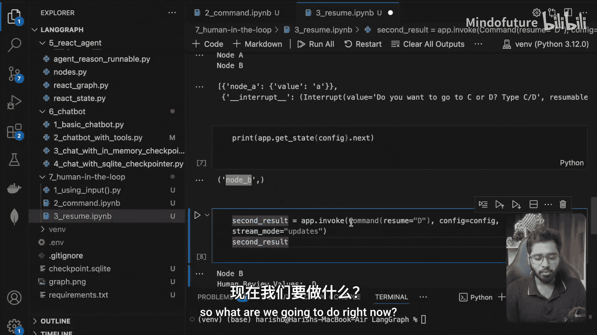

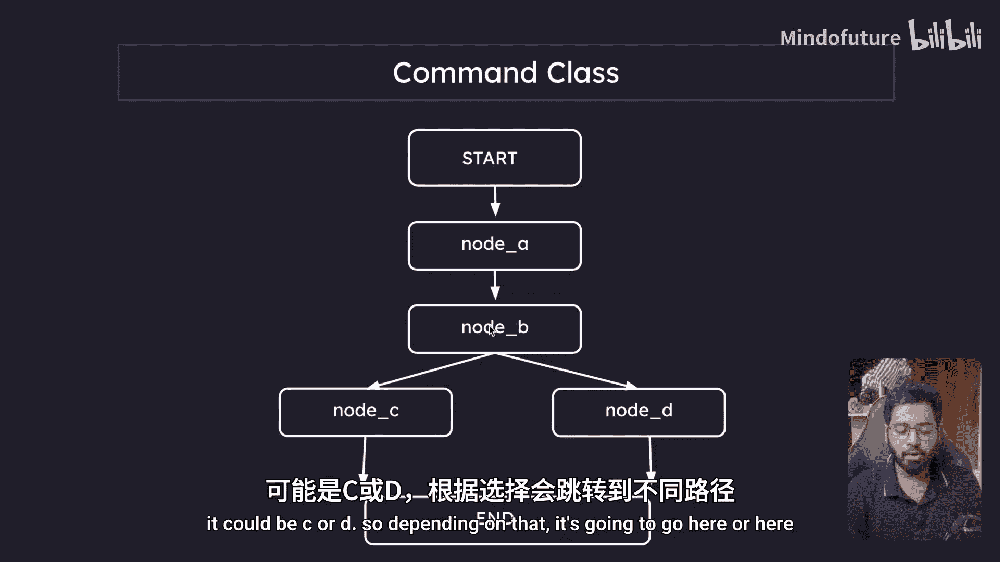

The graph is going to resume wherever it left off， wherever it you know it enter got interrupted and this value is going to go and sit inside。

Of here。 Okay， so whatever is going to be the response of this， we are sending。

In this command resume so if I come down here and if I run this file what do you think should happen so we are getting D right here right so it should come print D and then go to end right so if I run this you should now be able to see that we are printing node D and we also see the node B and node D got executed right here node B and node D and as you know B would append a B letter and D would append D right here so that's why we have B right here and then we have D and now I want to explore one more use case。

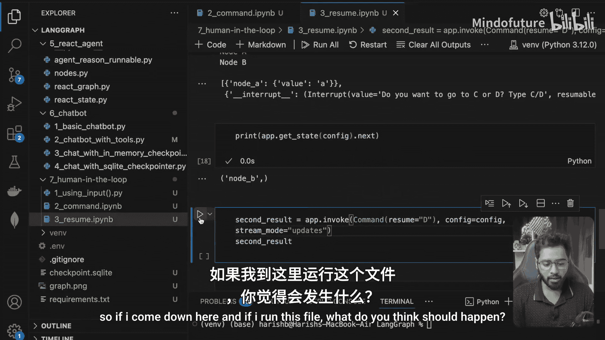

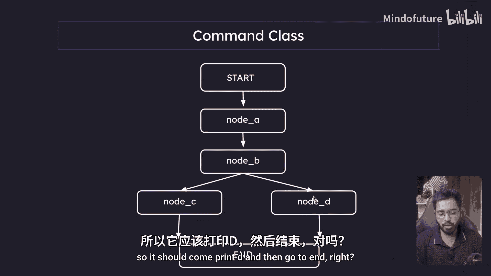

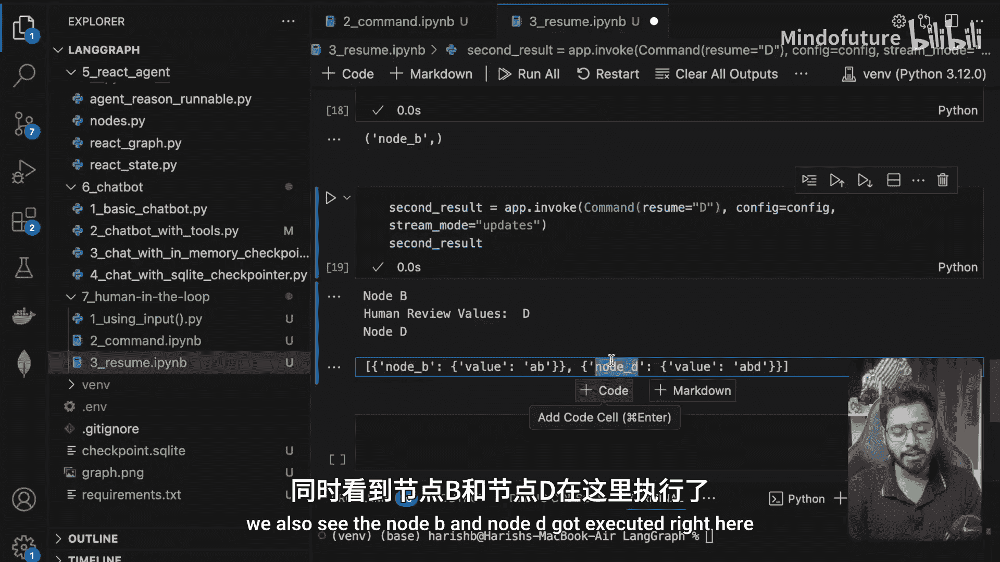

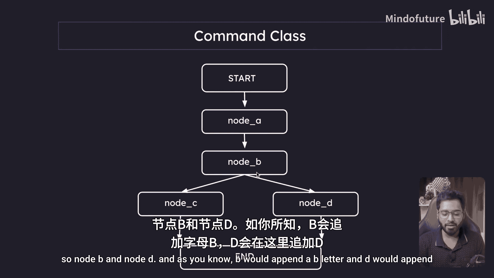

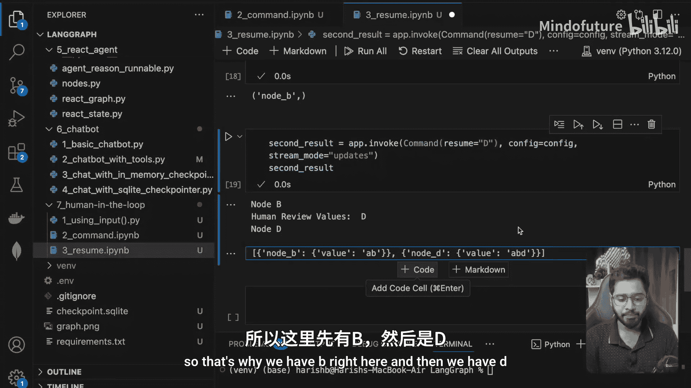

What if。We made a mistake coming to the ren。 So right now。

 because I passed in the resume value to be D。It came to D and then it ended， right。

 The graph ended completely。 It ran its entire execution， right， It went through the entire thing。

So what if I wanted to sort of come back to this node be and then if I wanted to。Provide signal。

In this case， it' is not going to be possible right because the graph has already ended we are using the same thread I as well。

 So there is nothing to actually resume。 There are no interrupts right there is nothing to resume actually So if I just go here and if I change it to C and if I try to run it you we are not going to get anything Okay why are we not going to get anything because。

😊。

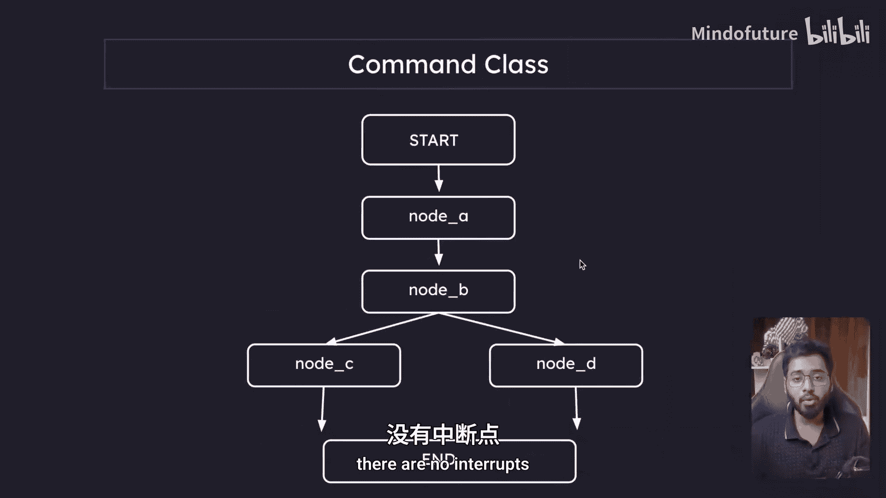

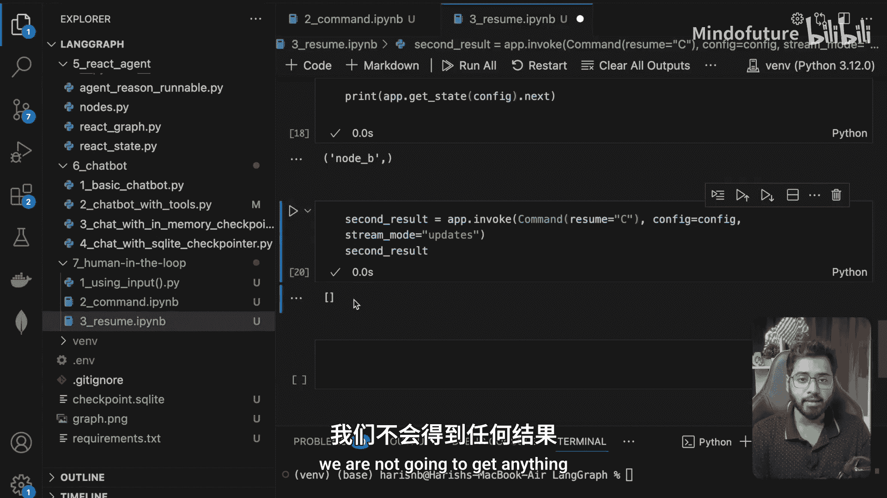

We don't have anything to execute anymore。 Graph has already ended。

So one way to get around this is to change the con thread I so that in that case you know you can start over from from the start。

 but in case you want to use the same thread I what you might have to do is we might have to do something called time travel。

 It's very simple It's a pretty straightforward concept so I'll explain that in the next section so I'll you there。

😊。

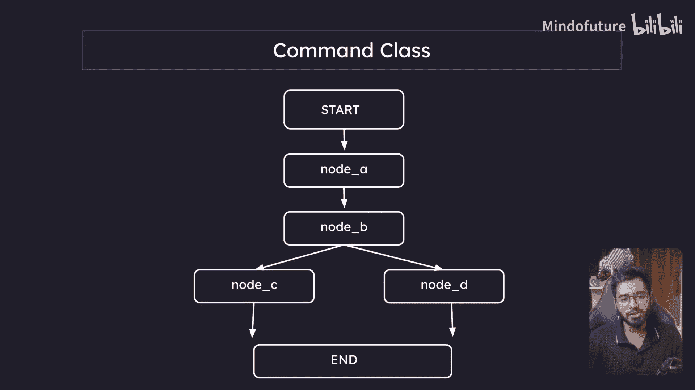