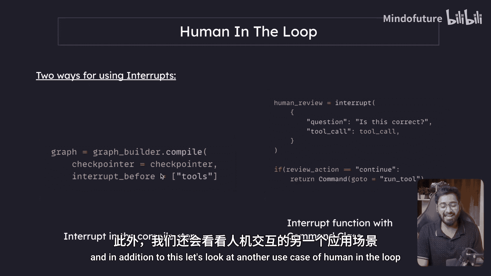
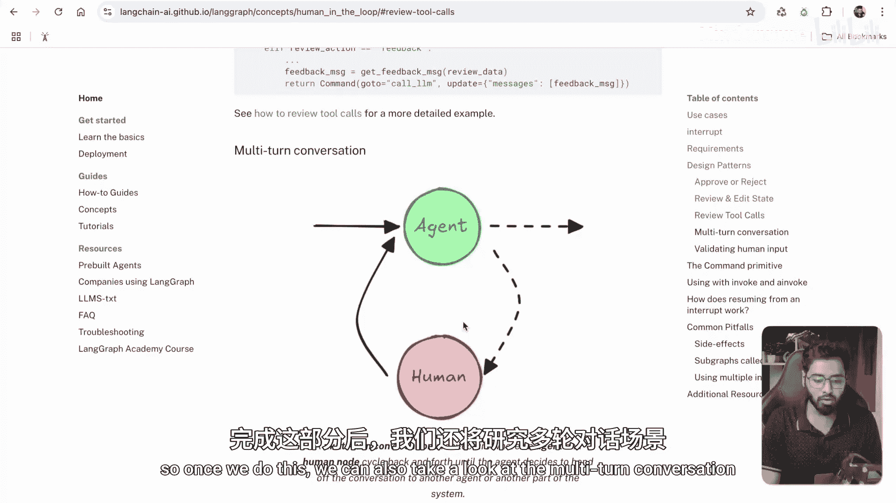
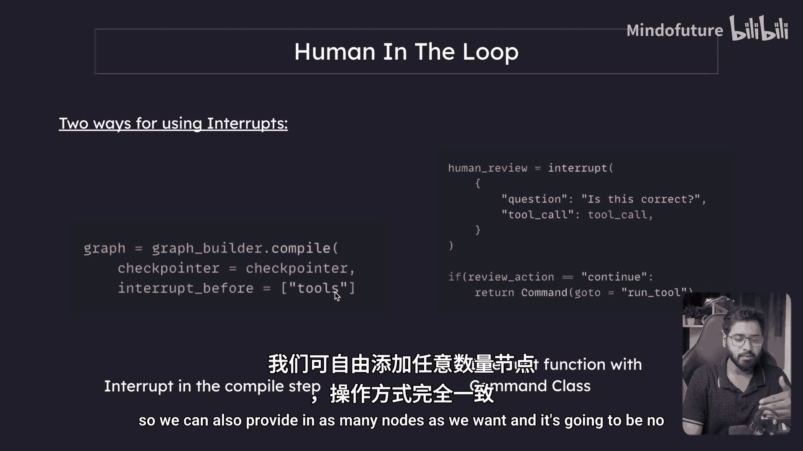
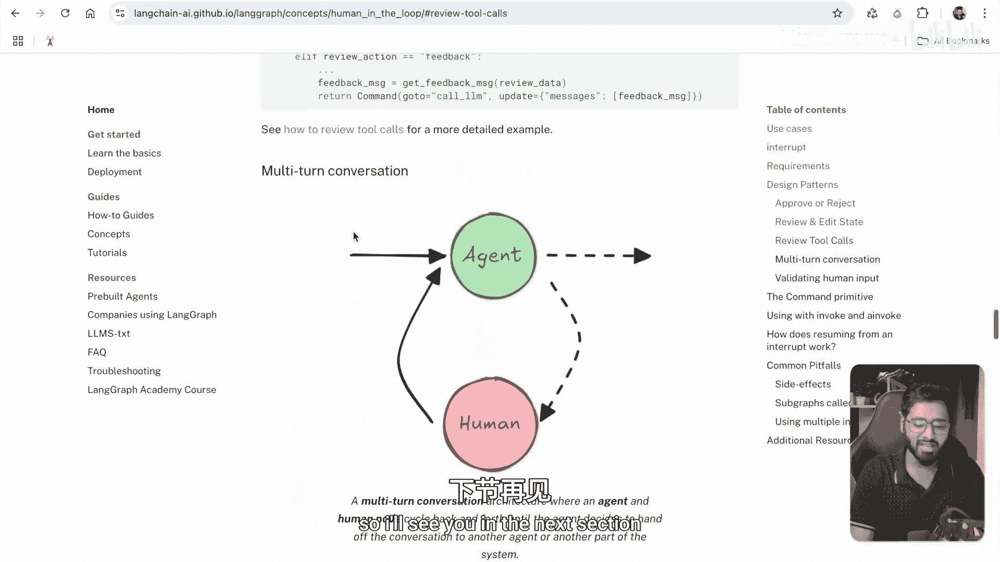

# Langgraph初学者入门2025 p34 P34_#32_人工在环_审查工具调用 -BV1mgepzCEjf_p34-

Hello guys So in the section let us look at the other way of using interrupts。

 So if you remember we've already done this way of doing things right so where we use the interrupt method and then we get a response and then we based on it we make a decision inside of the node right There is also another way of using interrupts which you can still see in a lot of code basis we just to use it this way in the compile step using the interrupt before you know key parameter So we are also going to explore this and in addition to this let's look at another use case of human in the loop okay so if I were to go to the human in the loop documentation land graph。

😊。

So you can see that weve got a couple of different design patterns right so we've already seen the approve or reject right depending on what the human is saying we can either go to this node or this node which weve already seen。

😊，Let's also you know explore another use case which is to review tool calls okay so where could this be useful so you can imagine that there could be a scenario where this particular tool execution could be expensive or it could be something that is sensitive it could be an API or it could be like a T search tool or it could be some expensive tool something like that。

That could potentially require a human approval。RightThat that could be a valid use case right and this is something where we can use human in the loop as well so we have an LLM and the LLM is suggesting that we use a tool and based on that the human can actually approve before it goes to the tool executor step Okay so that is exactly what we are going to be looking at in this section so once we do this we can also take a look at the multi turn conversation so let us now explore the review tool calls use case。

😊。

So you can see that I've already gone ahead and created a file called approval。

 So what I have right here is going to be absolutely no different to what we saw in the chatbo with tools section。

 but if you don't remember it don't worry this is what we did in that section So we have the start model tools and end So if the human were to say something like you know what is the capital of India or something like the LLM is already going to know it it's already going to know the answer So in that case you know there is not the tool condition is not going to go to the tools。

 it's just going to go to the end but in case you know it requires some realtime information like what is the current weather in Cheennai or something like that。

 in that case this LLM LLM that is bound with the tools So this LLM is going to not give the answer but instead it is going to give information about which tool to call if you remember right So it's going to go to tools the T search tool or some other tool is going to execute it's going to send the response the tool message。

😊，Back to the LLM and the LLM can make an informed decision right so and then finally it is going to come to the end that is exactly what we are going to be building here The only difference is that we are going to interrupt it before this tools node ever the the execution before it ever hits the tools node we are going to interrupt it we are going to get a human approval before making that Tli search call alright。

😊，So， let me walk through the code step by step so we have the Tvalli we are putting it inside the tools list and we finally have the LLM with tools and as usual we just need one messages you know property in the schema we have the model which is just going to invoke on all the list of messages very simple。

Right， so what should happen right after the model executes okay so right after the model is done executing right we have it right here right So right after the model is done executing。

 we need to go to a router a tools router the tools router is just going to take the latest AI message it's going to look at the tool calls and it's going to see if there is any tool calls the LLM wants to wants us to do right so if there is some tool call like you know Tval search tool call if the LLM wants us to call the T search we are then going to direct the flow to the tools node and the tools node we can use this prebuilt you know tool node you know class and we just need to provide an all these tools right there Alright so that is going to execute that particular tool and it's going to create automatically create a tool message append it to the message list alright so after that is done we are again going back to the model the model now has information that。

😊，You know it would not have had otherwise Tli is returning that new information and based on that it is going to make an informed decision and then come to an end So this so so far this is something that we are already super familiar with nothing new here the only new thing that we are going to learn here is look at this compile step okay so as you should we are going to provide the memory because if you remember anytime we use an interrupt we need to provide a memory right checkpointer basically not a memory checkpointer。

😊，And next this is new。 This is where we are providing this interrupt before keyword parameter and we are providing which node before which we need to exit out of the graph right So before we even get a chance to come here we are going to exit out of it Okay so that we can actually review the tool called that the LLM is suggesting okay based on that we can approve it。

😊，In addition to this， we also have an interrupt after。

 so you can see that we also have an interrupt after right here。😊，Right。

 so this interrupt after also is going to be very similar to interrupt before。

 but interrupt after is something that exits the graph after this tool node is executed so that could be another use case wherein we can actually。

😊，Make it mandatory that the user should be able to review the output of a tool call right just to make sure that everything is looking good right but in this case we are just going to do the interrupt before and if I scroll down here we have the config object right we are specifying the thread I and then all that we are going to do is invoke the graph okay so in this time we are not going to use the invoke method we can use the stream method this time the only difference between app dot invoke and app dot stream is that app dot invoke returns a value after you know the graph has exited it could be because of an interrupt or it could be because the end node has reached but stream is something that it basically just returns it's a generator function that emits events after every single node right so that is exactly what I'm doing here this events is something that we can actually iterate through loop over and then every single time a node is done execution we are going to get an event right here and that event is going to contain。

😊，All the different messages at that particular point。

 we are just going to take the latest one and pretty printed。 Okay， it's very simple。 Okay。

 we can also set these stream motor values because we are only interested in the values and not the entire object。

 Alright， great So if I bear to now let's run this okay。

 let me just clear all of the outputs because I ran it before but let's go ahead and run this file this code block。

😊，Run this。Okay， so everything is looking perfect。 Let's run this， as well。😊。

Allright great So this as you know that this is the question I am asking。 So as expected。

 the LLM is saying that okay， you have to go ahead and use this tab search results right that is what we've provided So it's also providing the query here as well which andnai current weather is what it wants to search for Allright great now coming down let's actually go back to the diagram So the model has successfully you know provided the AI message and now we are interrupting out of it。

 we are coming out of we are exiting the graph right So if I were to now you know look at the next node that this latest snapshot is going to go to what should we see we are supposed to see the tools right So if I run this you can see that we have the tools which is next in line So how can we assume it is going to be very simple all that we are going to do is you know we can see Ab invoke none Ab stream none no difference and then we can actually go ahead and run this again So this time it。

😊，I going to you know go ahead and execute the Try search tool right so you can see that this is going to be the result of the this is going to the tool message the result of the actual tool execution and once that is done we are going to feed it back to the LLM。

😊，Right， so we have the AI message and it's doing an informed answer。

 So right here we we successfully have interrupted the tool call right okay。

 we can apply it to a lot of different use cases where you it could be something sensitive that we have to sort of you know make sure that a human is approving or you it could be the result of a tool call that the user has to the human has to confirm they have to quality check or something like that using the interrupt after。

 So I hope you now understood how simple it is to basically use the interrupt in the compile step as well。

 so we can also provide in as many nodes as we want and it's going to be no different。 Okay。

 perfect So in the next section we are going to you know let's scroll down we are going to look at this multi turn conversation as well。

 So I'll you in the next section。😊。

