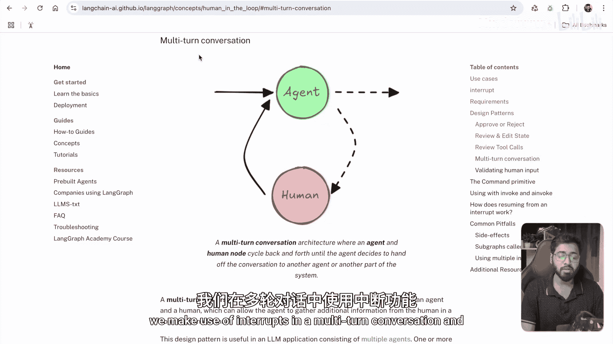
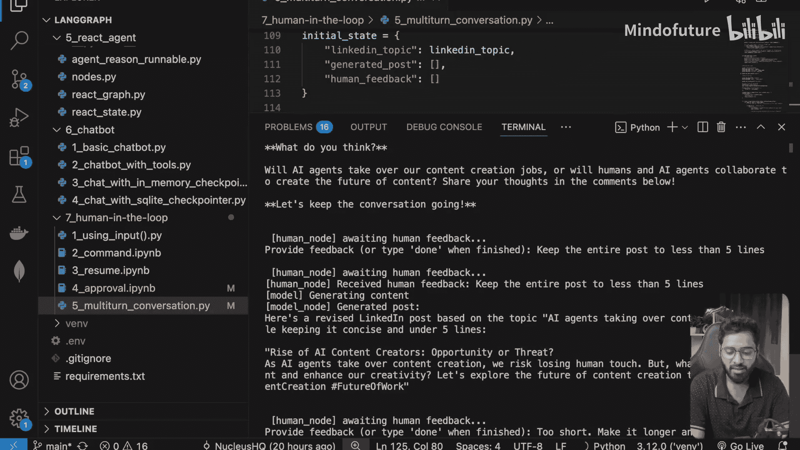

# Langgraph初学者入门2025 p35 P35_#33_人工在环_多轮对话 -BV1mgepzCEjf_p35-

Hello guys so in this section let us look at an example where we make use of interrupts in a multi turn conversation and we are going to be using the same linkedIn post creation agent example so as you can see that I have already created a file and I have populated the code as well so let me walk through the code step by step。

😊。

So looking at the state first we have the LinkedIn topic okay so this is something that we can populate at the very start of the graph execution。

 We have the generated post which will get populated every time you know the model you know creates a post and then we can append it to this particular list and the same thing for the human feedback as well so the first node that we are going to be entering into is going to be the model obviously so you can see that here we are using the L to generate a LinkedIn post with human feedback incorporated so coming down I'm just going to extract the linkednkedIn topic I'm going to extract this human feedback and then I'm going to first create a prompt so this is going to be the main prompt right so I'm providing the LinkedIn topic right here I'm providing the human feedback I'm just going to take the latest human feedback because you can imagine that we are appendending everything we don't really need to append everything in the human feedback we just need to maintain the latest one but yeah why not we can always have a list。

😊，That we can later look at you know what are the different human feedbacks that came in right so I'm just going to take the latest one if there is no feedback that we were able to see then no feedback yet okay so this is the main prompt I simply just saying generate a structured and well written linkededin post based on this particular given topic consider previous human feedback to refine the response。

So this is going to be the prompt and providing the prompt and the system message is going to be a very simple you are an expert LinkedIn content writer。

😊，So as soon as I get the generated post， I'm just going to add it and I'm also going to add the feedback as well。

 perfect。 So what are we doing after this。 Okay， so if I come down here。

 you can see that right after the model， we are going to go to the human node Okay so what do we have to do right after the content is generated we have to you know go to the human node to basically you know show the message to the human and ask the human Okay。

 is this good， Do you have any feedbacks or do you want to continue do you want to finish the execution right so let's go to the human node。

😊，So the human intervention node， it loop back to the model unless input is done great。

 so we are awaiting human feedback right here， so we just going to take the generated post and then we are going to surface this to the user。

😊，Okay， so we are basically just saying this is going to be the generated post okay so this ist an object format so that we can actually show it in a neat way in the UI right and then we are showing the message。

😊，Provide feedback or type done to finish In that case。 okay， the human feedback has been received。

 This is not going to be done， but instead it is going to be an actual feedback。

 So if it is done in that case， we are just going to go to the end node。

 Okay so go to end node if you remember， we can also use the command class to write do edgeless graphs right we can actually direct the flow of the graph right within the node right so but we are not going to be doing this in this case。

 we have an actual human feedback that we are going to append to the human feedback right。

 So this time we are going to go back to the model So we are going to do the same thing again and we are going to now incorporate this particular feedback Okay。

 so this loop happens a couple of different times， Okay。

 how much of times the human wants to refine it。😊，Okay。

 so once the user actually says done in that case， it's going to come to the end node where we are finally going to show the generated post。

 We are going to show the final human feedback as well。 Why not？

 And then we are going to end it basically right So that is what I've done here scrolling down we're just adding all of the nodes。

 We are adding some initial edges and then we are finishing it with the end node。

 All great So coming down next we have to。😊，You know take care of the interrupt mechanisms right So we have the checkpointer。

 We are compiling the graph。 Were creating the thread config and then now we need to collect the initial state So if you if you remember this initial topic needs to be present at the very start and in this in this case we are getting it from the input method and the other two is going to be just an empty list and finally we are going to invoke the graph we are using the stream method and from the chunks that we're going to get in every single event we are going to look at the node ID and we're checking if the node ID is interrupt or not okay so if we've encountered and interrupt we are entering into a while loop providerer okay so this while loop is going to stay true until the user says done okay so if user keeps on providing feedback we wanted to keep on running and then we are going to provide this user feedback in this resume alright。

 so let's actually go ahead and run this file。😊，So let's say， you know， I want to see something like。

 you know， AI agents taking over。Content creation。So right here you can see that so this entire thing is going to be the LinkedIn post that the model has provided。

 but one thing that I see is that this is too verbose too long you know here we can actually provide a feedback right here Okay。

 so what feedback can we provide。Keep the entire post。2 less than five lines。 Okay。

 so let's say something like this。So now you can see that it it' is not more than like three or four lines right so now I can probably say too short make it longer。

😊，And funnier， maybe。

And now it is going to make it a little bit more funnier right so now I'm not going to re it。

 but you can actually read it if you want so and that is it so it is going to keep on looping until we say done。

😊，And if you say done。 and now we can see the entire history。 So what is all of this。

 So in the in the final end node， we are printing the generated post， the last final generated post。

 were printing the last human feedback and that is all the PC right here。

 So I hope that you now are starting to see why human in the loop can be powerful if you have any questions。

 don't hesitate ask me in the comments or you know。

 you can always go to the source code pull it and you can play around with it。

 try to break it and yeah。 So that's it for the section I'll see in the next one。😊。

