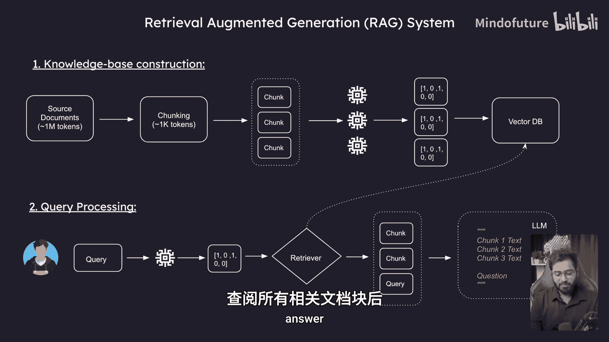
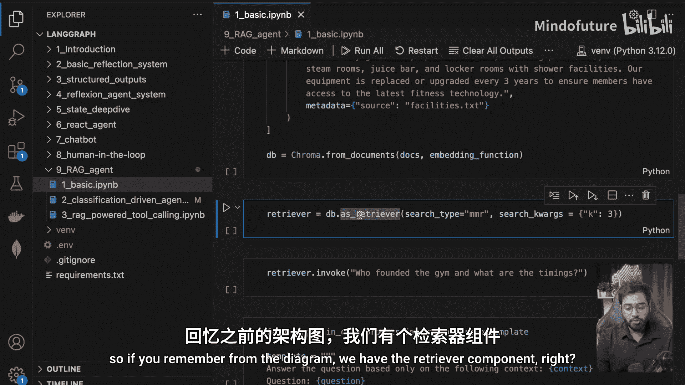
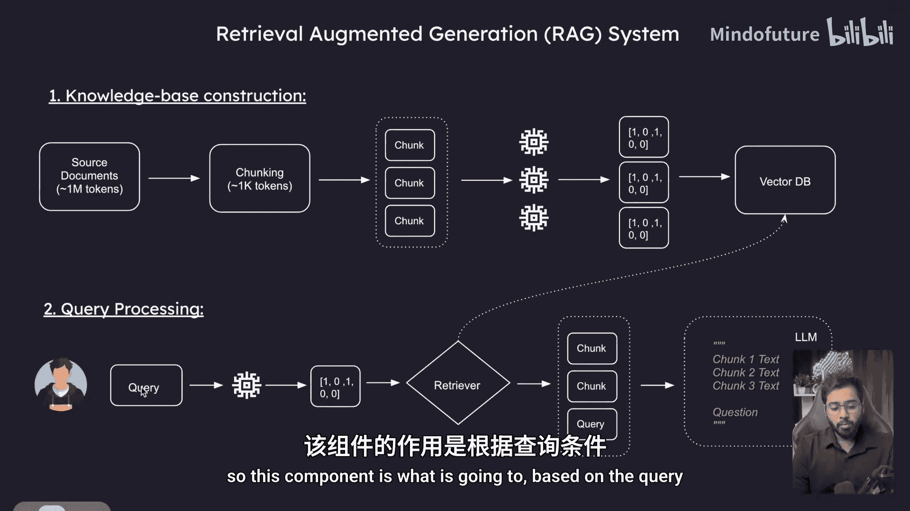
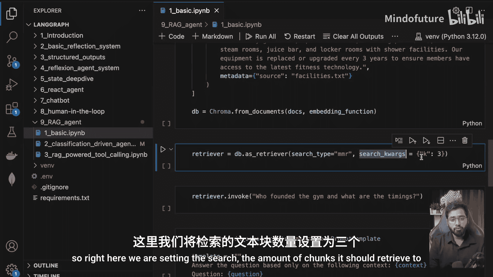
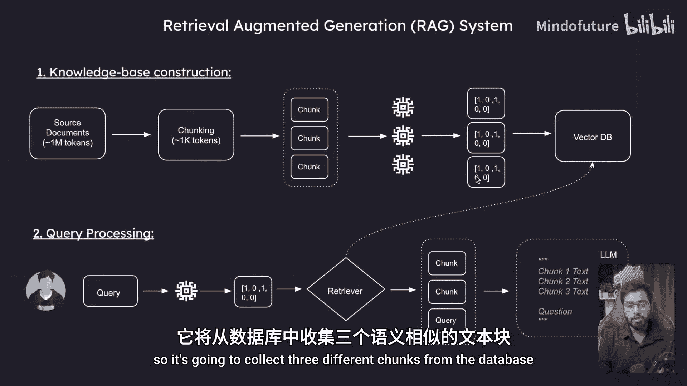
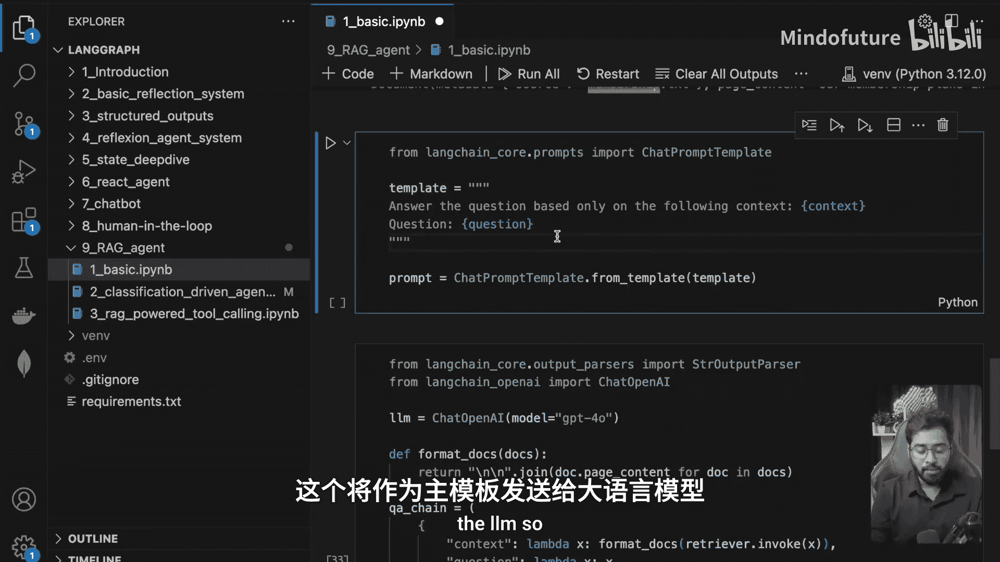
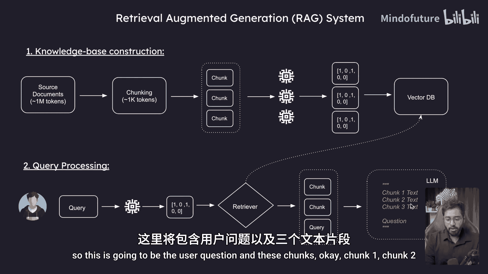
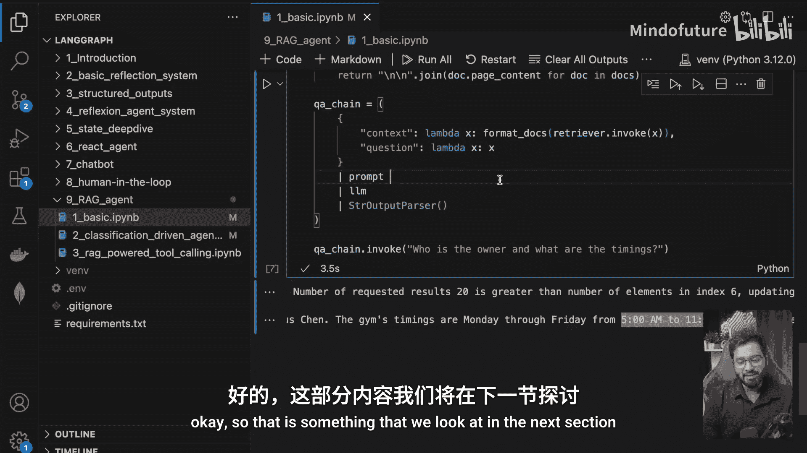

# Langgraph初学者入门2025 p36 P36_#34_RAGs_介绍 -BV1mgepzCEjf_p36-

Hello guys welcomecom to this brand new section where we are going to be you know combining retrieval augmented generation or rags with landgra so we are going to be building rag enhanced AI agents so this is not going to be an introductory video to rags because I expect you to know it already because I've already covered rags extensively in my land chain graph course so if you have not watched it please go ahead and watch it。

 So let's anyway get a quick refresher about what rags is basically rag system is going to compris of two different parts right so the first part is going to be the knowledge based construction and the second one is the query processing So let's quickly talk about why we even need rags So we use rags because we want to give additional information to the LLM So let's say we have a lot of different documents I run my own private company and this let's say there's a lot of documents in that case the LLM is not going to be aware of the contents of my。

😊，Documents so in that case， I can actually make these documents available to the LM to query。 Okay。

 so that is the whole point of rags。 So let's go through the knowledgebased construction quickly So let's say these are my private documents and you can see that 1 million tokens is a lot of information right so the first thing that we have to do is we are chunking it up。

 Okay so were taking a huge document and then we are chunking it small into smaller。

 smaller documents。 So we can see that I'm chunking it and each chunk is going to have 1000 tokens。

 So it's much manageable。 It's much more smaller right So this is what I'm representing right here we have multiple different chunks So now that we have chunked up all of our text。

 The next thing that we have to do is we have to put them through an embedding model Okay so an embedding model is going to take normal text like normal English iss going to take that and it is going to embed it and it's going to convert it into a vector。

😊，Representation or to put it very simply， it's going to convert it into a mathematical representation。

 Okay so this chunk is going to convert is going to be converted into a mathematical representation。

 This is going to be the the corresponding version and this chunk is going to be converted into its own mathematical representation the same thing for every single different chunk。

 So now we have the English version of the chunk and we have its corresponding mathematical representation as well right so now that we have both of this information。

 we are going to put it all okay we are going to put all of this information both the original version as well as the mathematical representation we are going to put everything in a database called the vector database So now that we have all of the chunks and its corresponding vector embedding versions in the vector Db Now we can actually go on to doing the second part。

 Okay so how does the second part work， let's say there's a bunch of different documents we already put it in the vector database and as a user I want to query something。

 So I'm asking like some question about。😊，My own company and even that is going to be converted into a mathematical representation so and now that we have both this information。

 the query as well as the data in the vector embedding format。

 this retriever component is going to based on this particular question it is going to fetch all of the relevant chunks which could potentially have the answer to this particular query okay so it's going to fetch all of this it's going to fetch the corresponding chunks as well and then finally this retriever is going to you know have the chunk1 chunk2 and as well as the query。

 Okay so this is going to be in English。 Okay this is not going to be in the vector embedding format and then finally we are going to send it to the LLM So this is chunk1 chunk to chunk3 and question okay so this is how we are going to send the LLM So the Lm is going to look at the question it's going to look at all the relevant pieces relevant document chunks and then based on this is going to give an informed answer。

 So this is a very quick intro to rags so let's quickly see it in action as well。😊。

Okay so I've gone ahead and created a file called basic okay so right here。

 you can see that I've imported document I've imported the open AI embedding model。

 I've also imported chromroma which is the vector database that we are going to be using right now so later on when we are building production applications I'll be making a lot more videos courses on that where we are going to be using superbase and doing a lot of cool stuff but since we are just learning right now Chroma works perfectly fine。

 Okay so now we are going to be using the open AI embedding model and so right now I have a array of documents Okay so we have like six different documents and all these documents talk about this particular gym okay so you can consider you know we had huge amounts of text and then we just junk it up into six different smaller documents So that is what I'm sort of simulating that we have so in this document we have the page content and metadata So this is going to be the about section。

😊，Of the gym。 So peak performance gym was founded in 2015 by this particular person Marcus Chen with over 15 years of experience and professional Okay so there's a bunch of different information and we also have you know the timings of the gym so we have a bunch of different information about a gym so we are our do Txt we have membership different information about the different tires of membership。

 we have classes these are the different classes Zooumba spin cycling， yoga crossbed etc etc ce。

 we have the trainers so these guys have five years of minimum years of experience so all of these are chunked up neatly facilities right So all of these are chunked up neatly right now and now we are going to create are going to create you know the vector database and we are going to embed everything and put it in the D and that is exactly what this line does so we are providing all of the documents so we are providing all of the documents here。

 and then we are also providing the embedding model that we are going to use as well。😊。

Okay so finally we have the database created as well as this D now has information about all the different you know embedded versions of all these different documents as well。

 Alright great coming down So in this particular instance of the database we actually get access to the retriever method So if you remember from the diagram we have the retriever component right So this component is what is going to you know based on the query it is going to go fetch the relevant chunks from the Db right So that is what this method does So right here we are just giving a few configurations about how this retriever should behave。

 So right here we are setting the the search the amount of chunks it should retrieve to three okay so it's going to collect three different chunks from the database that it thinks is similar in meaning semantically。

😊。

And then we are also setting the search type to MMr。 So this means maximum marginal relevance。

 It basically just make sure that the chunks that are retrieved are different from each other。

 so we don't want similar chunks to be retrieved。 Okay， so great， so we have the retriever。

 we configure it now we can actually use this and invoke something Okay。

 so I can say who founded the gym and what are the timings。 Okay， so if I run this。😊，Okay。

 retriever is not defined。 Okay， let me just go ahead and run these code blocks again。Okay。

 so now it's going to take some time because it is taking all of these documents。

 it is then embedding it right and then putting it in the Db Alright okay great and then now if I run this it should work okay perfect so we can see that based on our query we wanted to know about okay who founded the gym so basically we wanted the about section okay so basically the retriever is going to look through this particular text and it's going to see that Marcusers Cheen is the founder of this gym so that is why it's semanticallyqueried this particular chunk and then regarding the timings as well So ours dot txt right so5 to 11 okay it queried that as well and then there is another thing that it queried as well which we do not want at the moment great so the retriever works fine coming down。

😊，So right now we are creating a template。 okay so this is going to be the main template that we are going to be sending to the LLM。

 So if I come back to the diagram。 So right here you can see that we are you know we are structuring this in a certain format and we are sending it to the LLM right So when this what do we want we want the context So this is going to be user question and these chunks chunk1 chunk to chunk3 these are going to be the context Okay so that is what we are going to put right here So answer the question based on the following context and then we have the final users question as well。

 Alright， so we are preparing the prompt here perfect。

 So what is the next thing So we have another u method that weve written right here。

 So the retrieve is going to is going to fetch some chunks right So it's going to fetch some chunks and each of the chunk is going to have the regular English text as well right So all that we are doing is we are getting all of we are getting access to let's say you know we have three different documents So we are sending all of this here we are just taking the page content。

😊。

We don't want the metada。 We just want the page content。

 and then we're basically just joining and we're just like giving a couple of lines in between Okay。

 so that is it all right so this is a helper method that we're using okay。

 so this is going to be the last chain so this is going to be the Q chain so the first thing that we have to do we have to populate the prompt template So as we know the prompt template has context as well as question so that is the first thing that I'm doing I am populating it right here so we have the prompt and then right here before the prompt we have to provide this particular object Okay so in the object in the dictionary we have the context and I am able to get the context because I am doing retriever invogue and I'm sending this x okay so whatever we send right here is going to be available as X that I'm providing right here so this particular method is going to okay so this thing is going to just get the relevant chunks and this is going to format it in a certain way and we have the context ready and the same thing for the question as。

😊，So this thing is going to be the question Okay so this is a lambda function。

 It just gives you access to you know it basically allows you to write a function in a single in a single line all it。

 so now that the dictionary is ready we are now you know sending it to the prompt and now the prompt is also going to be ready so right after the prompt is ready so right after all these values are populated we' are sending everything to the LLM okay so we're using the La expression language right here okay so if we use this we don't have to say invoke invoke every single time Okay so and then finally we are just extracting the content out of the AI message that we get back。

😊，Okay， great。 so let me actually go ahead and run this particular code block as well okay。

So it looks like we're getting some problem。 Okay， let me actually go ahead and run this as well。

 Okay， so we missed out on running this。All right。So right now you should be able to see the owner's name。

 okay， so the owner of peak performance Jim is this person。And then these are the timings as well。

 Okay， perfect。 So this section was a very quick， you know， we are， we are not using land graph。

 Youre not， you know， building agents here。 This is just a quick refresher for rags just to jog your memory in the next section。

 we are going to be， you know， building an agent。 and we are going to， you know。

 allow the agent to make use of rags。 Okay， so that is something that we look at in the next section。

 So as you there。😊。

