# Langgraph初学者入门2025 p37 P37_#35_RAGs_分类驱动检索 -BV1mgepzCEjf_p37-

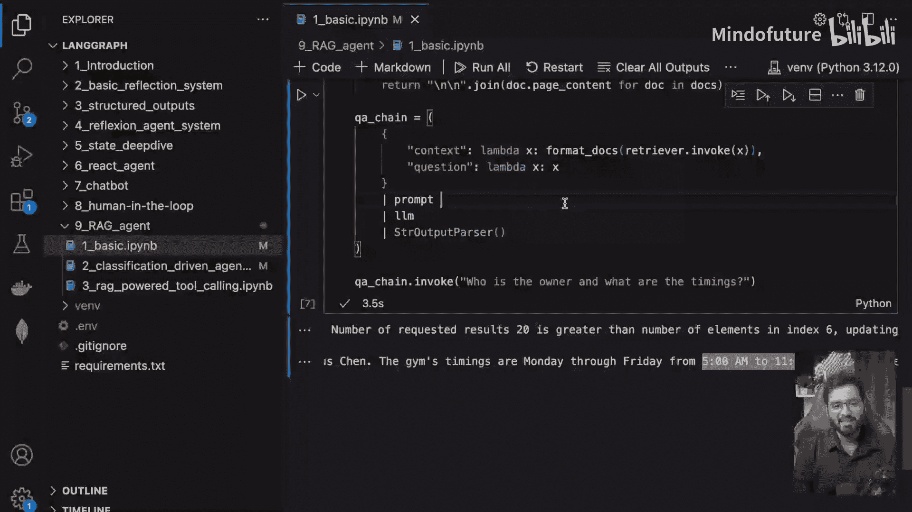

All right guys， So welcome to the second section in rags in the section we are going to be building out this particular graph。

 so we are going to be building the classification driven retrieval system。

 So basically what this is going to do is only if the question is on topic we are going to make use of rags if the question is something unrelated we are not going to the LLM is just going to say okay I don't know I can't answer this question So where could this be used So let's say you know I have a chatbot on my company's website and I want the users to only be able to ask questions about my company Okay so if the user were to ask something about some other company the LLM should not respond so that is what this workflow is going to do So first off。

 we are going to have this topic decision node this node is just going to look at the user question and then it's going to figure out is this on topic or off topic is the human asking。

😊，Questions about something that is relevant about my company。 And if it is on topic。

 it is then going to go look through the documents that I've provided。

 and then it is going to generate an answer based on that。 Okay， if it is off topic。

 then it's going to give a boilerlate response saying something like， you know。

 I can't answer the question。 Okay， so this is what we are going to be building。😊。

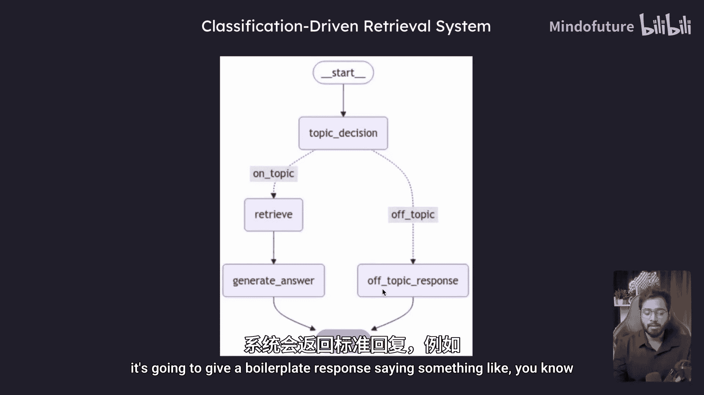

So coming back to the code， so what we have here is Ive just basically copy pasted you know the documents we are going to be you know working with the same example already coming down so we have the embedding function。

 the docs。😊，And then we have the same database that I initialized。

 I've initialized the retriever I provided the same configuration here as well。

 So if I were to ask something like who is the owner what is the timing it is going to okay。

 so let me quickly run this again， right。😊，It is going to take some time already done。

 So now we should give some information about who is the owner and what are the timings。 Okay， great。

 so coming down。 So this is also something that we have seen right so we are preparing the template right here we are providing the context and the question this is also no different and then we have the drag chain so we just have the prompt and once we have the prompt and that is completely ready and then we are going to send it to the Lm okay so we have the chain ready as well okay so let us scroll down So this is where we are going to start know building the graph So in this graph we are going to have three different properties that we are going to maintain in the state。

 So initially it is the list of messages and then the list of documents right So this retriever is going to retrievetrie a list of documents right and then we are going to use that particular property in order to send it to the LM later So we are storing that as well and then we also have another property for you know on topic or not okay so right here we can see that this。

😊。

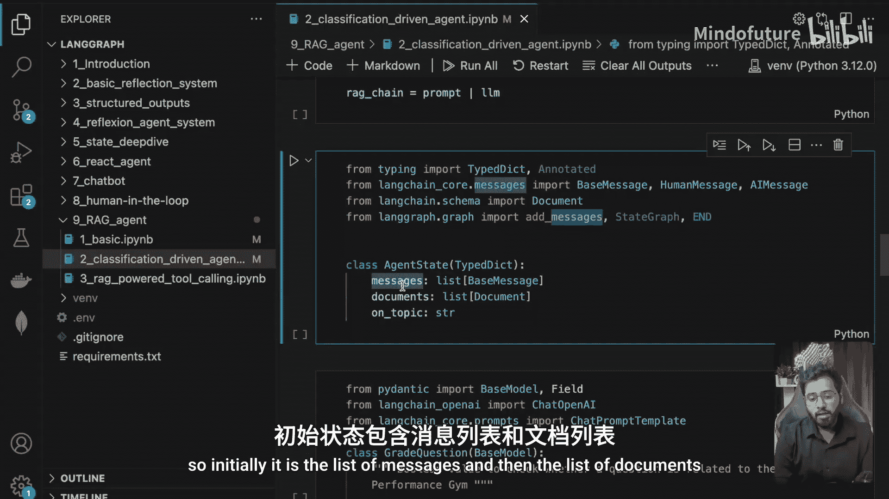

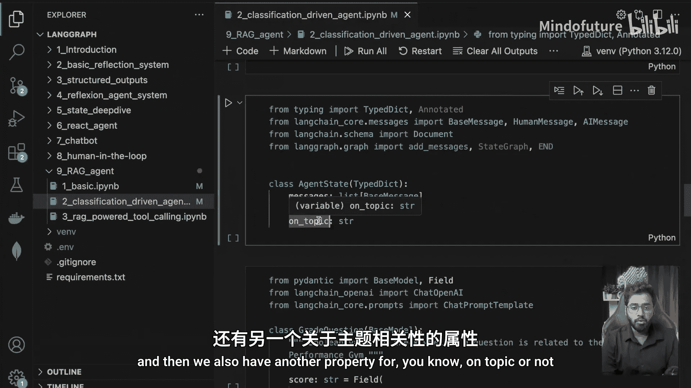

is either going to be true or false all coming now we now are going to define a pedantic model if you've forgotten you know what structured outputs are how to get structured outputs from the LLm water pedantic models simply scroll up in the course you would be able to find that one video that I would have made right before the reflection on agent system watch it to better understand this but yeah we are defining this pedantic model right here so we are giving a description Boolean value to check whether a question is related to the peak performance gym right so this is going to give either true or false okay so we are providing a description as well okay so basically we are saying okay give a boolean value okay true or false to check whether the human question is related to the peak performance gym and this is the property that I want the LLM to return in a structured format so it's going to be score and we are further giving a description is the question about the gym if yes give yes。

😊。

turn yes or else no Alright， so it's going to be yes or no。

 Okay perfect So it's not going to be true or false。 it's going to be yes or no perfect。

 And then coming down， we have the questions classifier。

 which is going to be this first node right here right so we are going to get the human message and then I'm saying you are a classifier that determines whether a user's question is one of the following topics okay so is it something regarding you know the gem okay it's not something else outside of it So if it is coming under any of these different things then if the answer is about any of these topics respond with yes otherwise respond with no okay so this is going to be the prompt and then we are also using the structured output right here and we are providing the model as well。

😊。

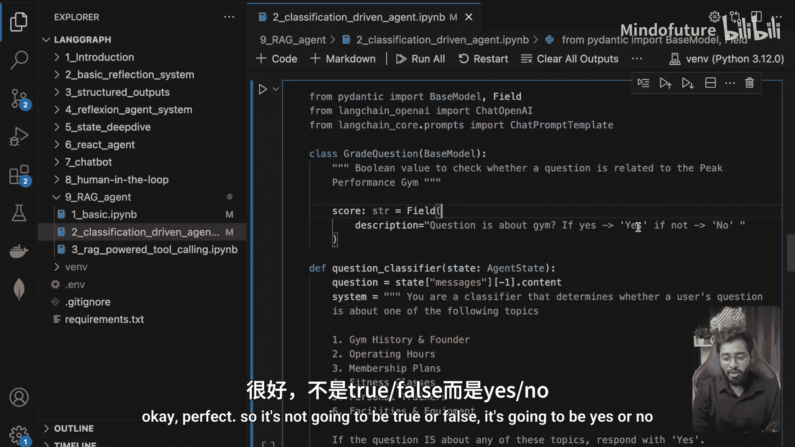

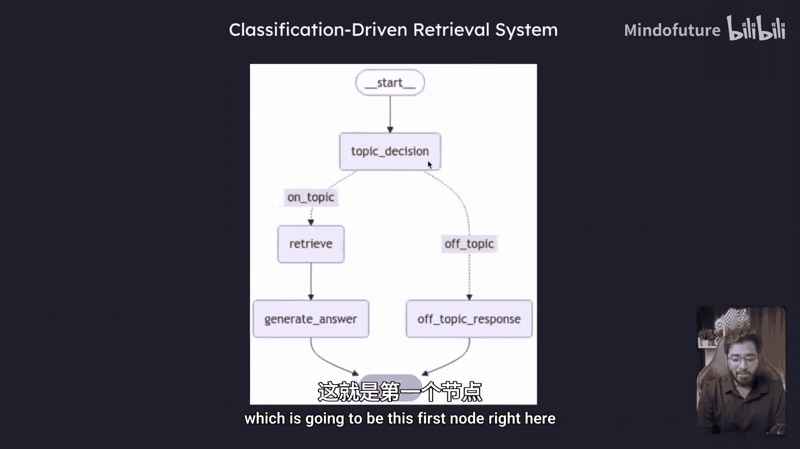

Okay， so we are providing this particular pedantic model as a tool to the LLM and we are forcing the LLM to always give this output Okay。

 so always give this output in this particular structure Okay。

 so it should have a score of yes or no。😊，Alright， so then we are invoking。

 we are passing in the question right here and whatever result we are going to get。

 we are setting it to the state on topic。 Okay， so we are finally done with this particular thing。

 Alright， so now we have to decide if we have to go to this side or this side based on the result of the on topic right so right here we have the router for that Okay。

 so on topic router so were taking this particular we are getting a reference to this thing and then we're checking is it yes or no。

 if it is yes， then we are going to the on topic chain Okay。

 so we are going the on topic router Okay， but if it is not we are going to the off topic route Alright。

 so let's look at you know the on topic route Okay so in on topic we have the retrieve and the generate answer Alright。

 so coming down we have the retrieve we are getting the the human message we are using the retriever we're getting all of the documents and then we're setting it in the state。

😊。

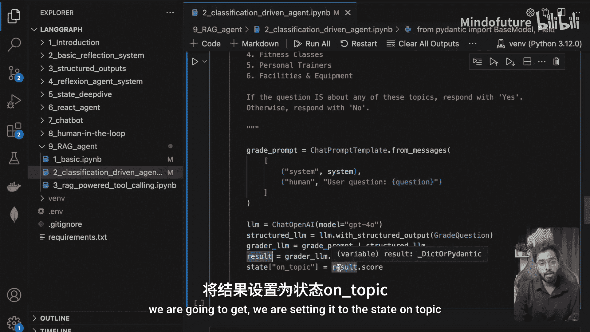

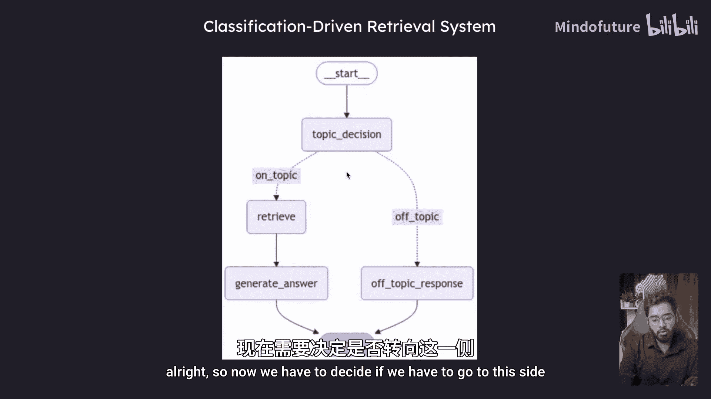

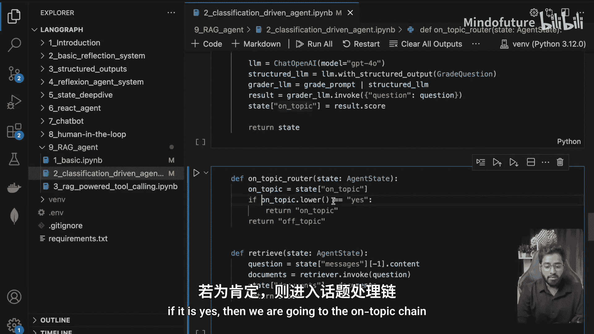

Okay， perfect。 And what's the next thing。 So once we said it in the state。

 we now have to send that information to the LLM along with the users' question。 So coming down。

 we are getting reference to both the users question as well as all of these documents that have been queried by the retriever。

 So once we have both the information， we are then providing both of that and then we are invoking the chain。

 Okay， so whatever response that we get from the LLM。

 we are then going to append it to the list of messages。 Okay。

 so here we are not using the reducer function that we use in the state。

 we are doing it the very simple way。 we are just app it right here。 Alright， perfect。😊。

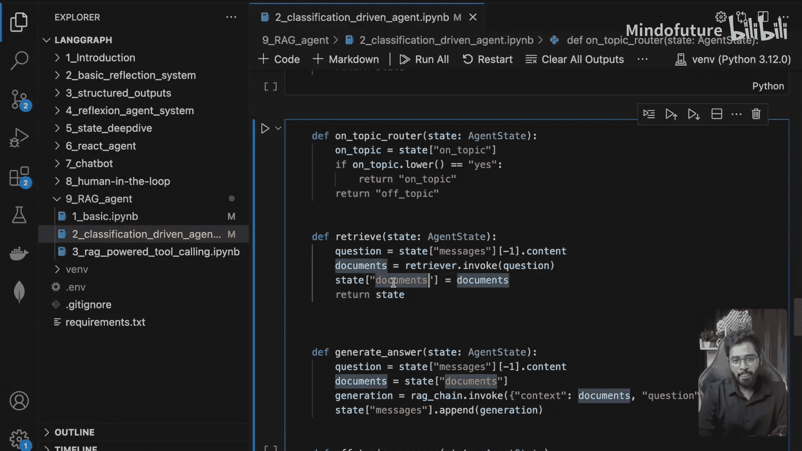

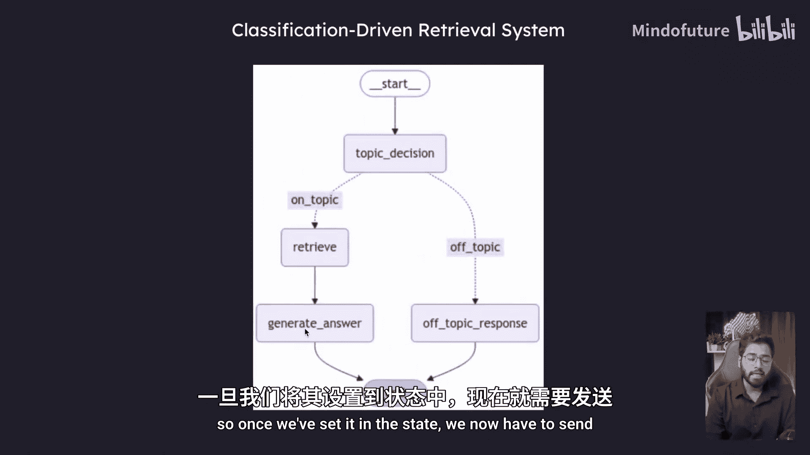

Alright， so finally， once we get this answer， we are going to come to an end right So generate answer and then we are coming coming to an end。

 But what if the question that the human ask was off topic。 Okay。

 so in that case we have to go to the off topic response right So this is going to be the off topic response here I'm just know hard coding an AI message saying that I'm sorry I cannot answer this question。

 Okay， so we don't really even need an AI to do it。 that's an extra API called it with saving there。

 So I'm just going to return this particular AI message and right after this we are going to end it。

 Okay， so this particular graph I built it right here。 and then you can post the screen。

 all of these are some things that you should be already familiar with。

 So right after the topic decision， we are going to the router。

 which is going to decide if it's going to go to the on topic crowd or the off topic route coming down So finally right after the generate answer we are going to the end So if it went to the off topic then we are going to the end as well。

😊。

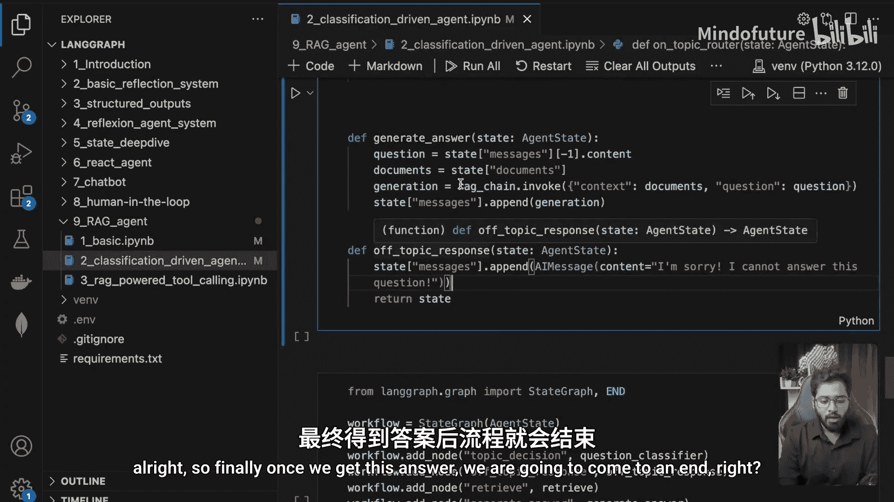

Okay， perfect。 So let me actually quickly go ahead and run all of these blocks right here。

 So let me run this。😊。

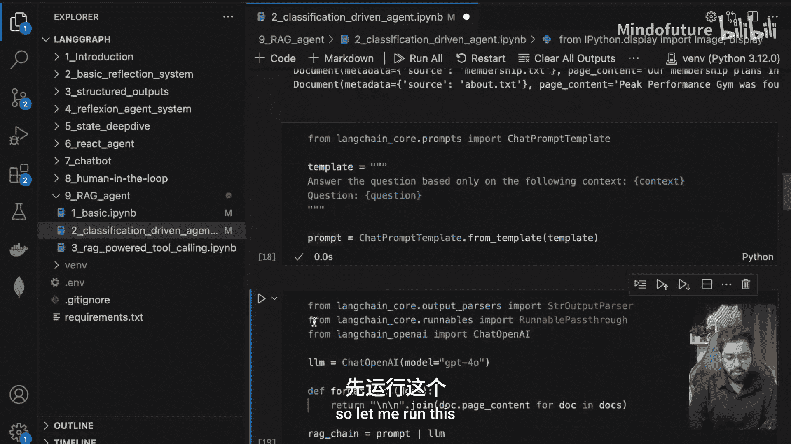

This as well， okay。Alright， so now I think， okay， so we get the exact same structure that we see right here。

 Okay， so everything is looking perfect。 let's scroll down and let's finally go ahead and invoke the graph。

 So right here I'm saying who is the owner and what are the timings。 Okay。

 so I'm just making the prompt a little bit complicated。

 So let's see if the right chunks would be retrieved and the L M would be able to answer it。😊。

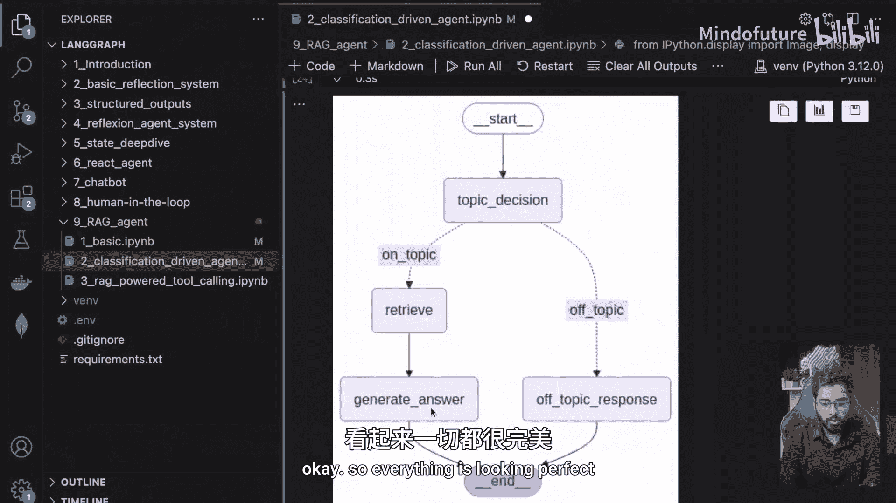

Okay， so let's give it a few seconds， perfectect。 So in the final state object。

 you can see that we have the messages。 we have the documents and we have the on topic。

 So in the messages as usual the initial human message and then the final a message is also present。

 Okay so this is what we want。 the owner of peak performance Jim is Marcuscus Che， which is correct。

 Okay， this is going to be the timings as well。 Okay。

 so the LM was able to properly you know answer the questions based on the context we provided。

 So what were the context day documents So you can see that the retriever you know collected the membership text hours and the about as well。

 So the about is where you know the information about the owner is present and regarding the timings。

 we have the hours。 Okay， so properly query the relevant chunks and provided it to the LLM and you can also see that this final on topic is also set to true Okay because this question is related。

😊，Okay， so this question is related to these things。 Okay， so that is why we have gotten this。😊。

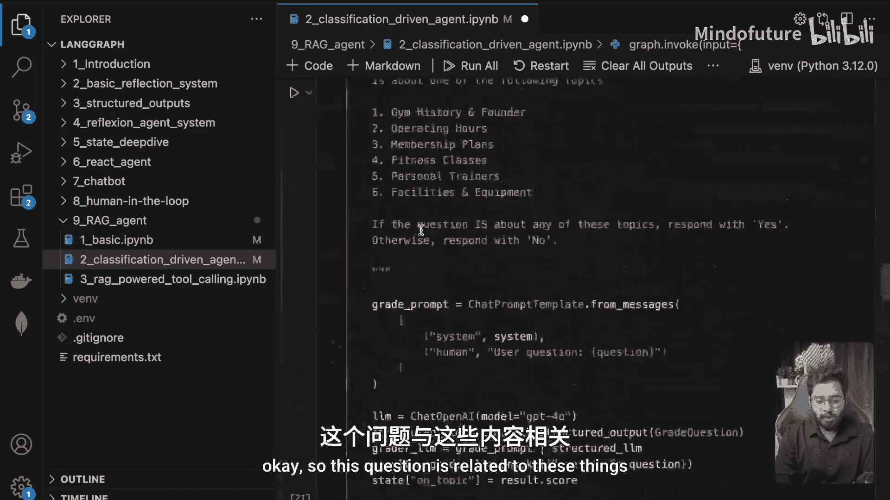

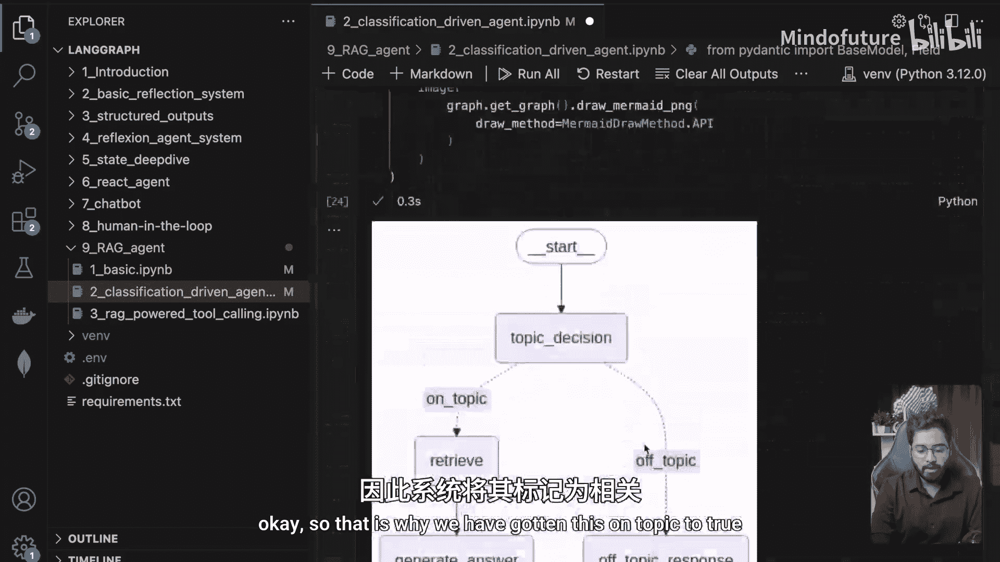

On topic to true。 So let's actually test the system on something that is off topic as well。

 So you know， I am going to， you know say what does the company Apple do。

 Okay so that is going to be completely different from what my Z is all about right So in this case if I run it it should ideally say I am sorry I cannot answer this question and that is because on topic is no So that is it for the classification driven retrieval system in the next section we are going to take a look at you know how we can actually provide a rag node as a tool to the agent so that the agent can you know invoke the tool anytime it wants to Okay so that is another way of doing the same thing and we'll explore that as well。

 So's even the next section。😊。

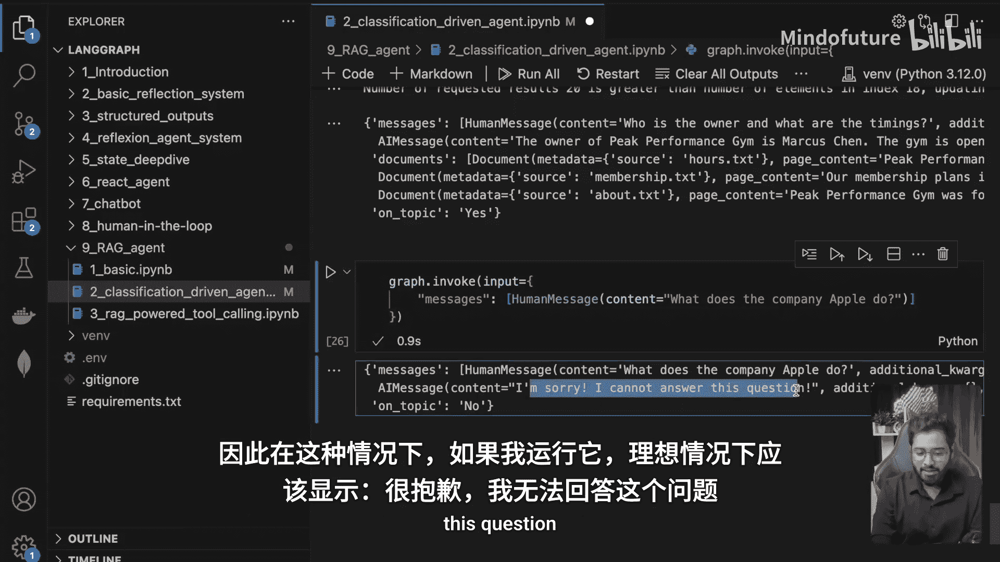

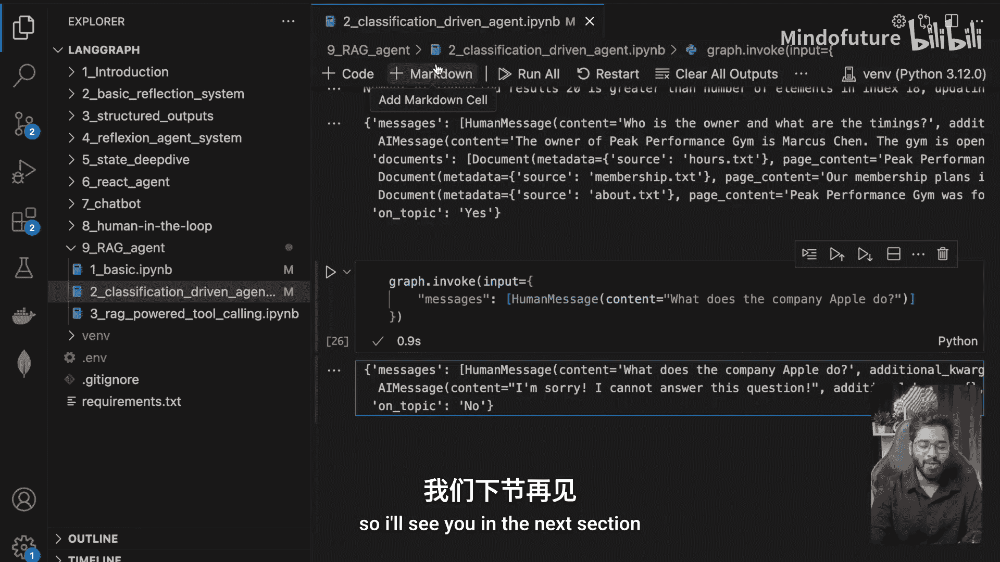