# Langgraph初学者入门2025 p38 P38_#36_RAGs_RAG驱动的工具调用 -BV1mgepzCEjf_p38-

Hello guys。 So in this section let us look at how we can provide a rag tool。😊。

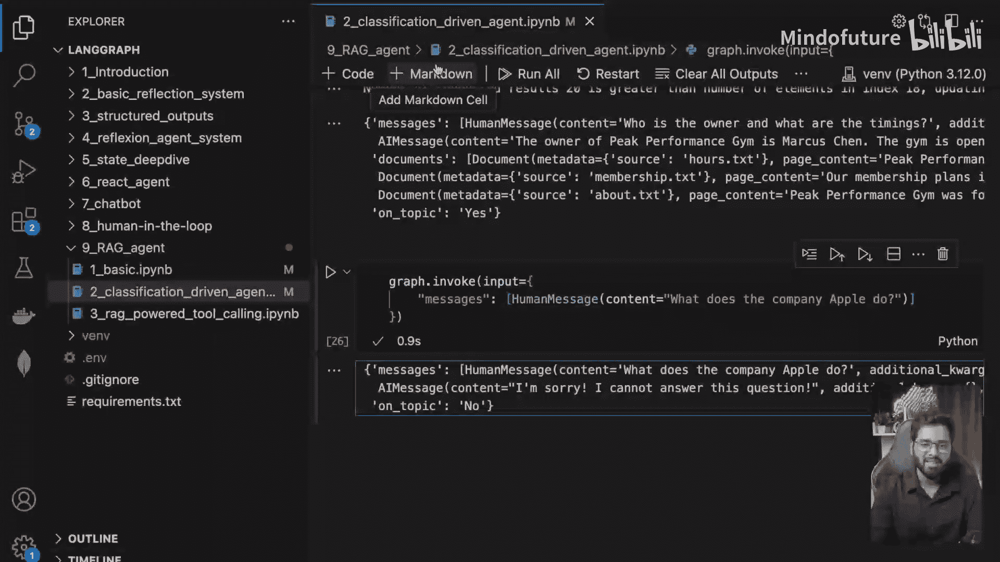

To the agent so that it can actually call that tool whenever it needs to okay so you can see that I've created I've populated all of the code here。

 let me walk you through it step by step。 So this particular section。

 it is the same thing that we've been using for the past few videos Alright so we are creating the database as well were setting the retr absolutely no different so let's come down so this is where we are going to learn about something new okay。

 so you can see that I am now creating two different tools right here。

 Okay so we are creating a retrieval tool and and off topic tool okay so if at all the agent wants to make use of you know rags and it wants some private information in that case it can use this particular retrier tool okay so let's look at what is what it's all about So this create retrieval tool let me hover over it and you can see that it creates a tool to do retrieval of documents and this takes in a couple of arguments。

😊，So you can see that it takes in the retriever itself。 which we've already written。

 we can give the name of the tool here。 that is going to be passed to the LLM。

 Okay the LM can decide， okay， it wants to use this particular tool and we are providing some description as well。

 so that is exactly what we have done here。 This is a pre tool that long chain provides so we can go ahead and use it I'm going to hope that they are not going to change the name and deprecated but yeah。

 so we have this create retrieval tool so here we are providing this particular retriever that we have initialized。

 and I want this to be the tool name as well。 Okay， and then this is the description。

 So this is very important。 So this is information related to gym history and founder operating hours membership plans fitness and all of these different things so basically what's going to happen is if we ask if the user asks the agent a question like who is the owner of this particular gym in that case this tool is going to be available to the LLM it can。

😊，Actually say， okay， I want to use this tool to fetch this information and then it can call this particular tool Okay so this is going to be the first tool and the second tool is the off topic tool Okay so what is this going to do this is going to catch all questions not related to the peak performance Jim's history okay so all of this okay so if at all the user asks some other question like you know what we saw earlier if it asks questions about some competitors Jim or something like that in that case forbidden do not respond to the user。

😊，Okay perfect。 So we are having both of these tools right here。 So coming down。

 you can see that this is going to be the state right So in this case you can see that the state is much more simpler。

 we just need to maintain the list of messages this time we don't really need to worry about this on topic or not because the LLM decides to call the tool we don't have to keep track of it okay so coming down so this is going to be first node so don't this is not a complicated structure。

 this is something that we've already seen So if I scroll down here this is the structure that we are working with okay so if the human you know ask the question that requires a tool call then this particular model is going to this control is going to go here if not then it's going to go directly to the end okay so that is what we are doing here that is the agent or model right so we are providing all of the tools right here to the model and then were invoking that particular human message okay so then we are appending this thing great now coming down we have the should continue。

😊。

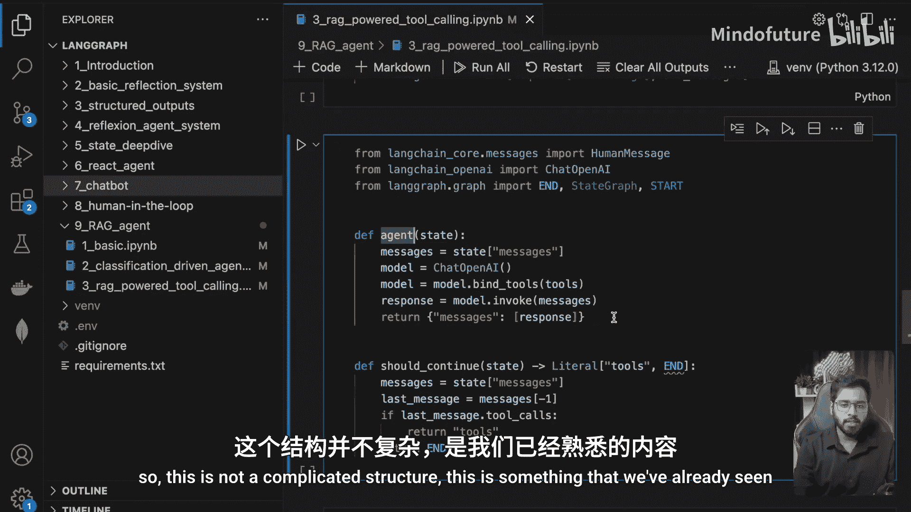

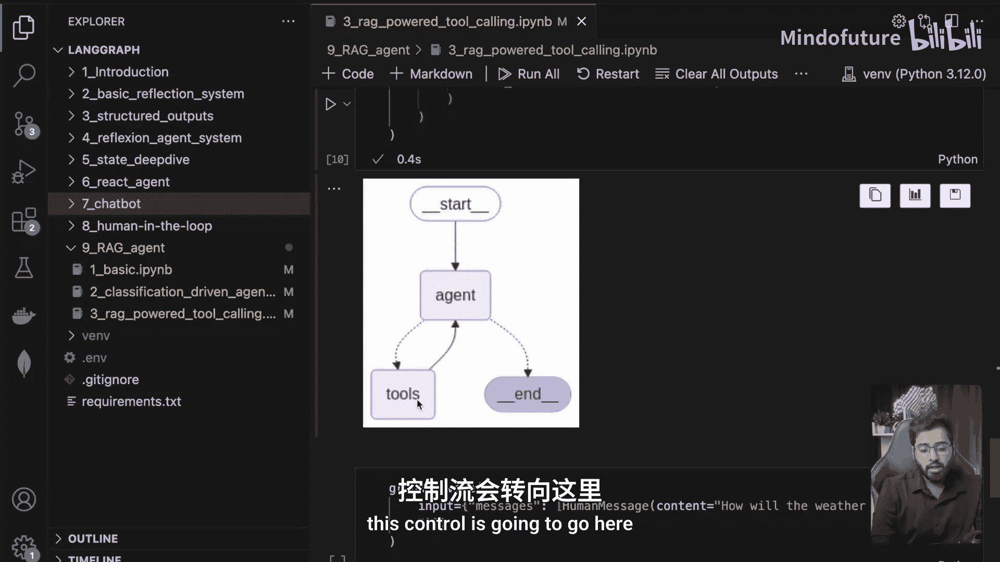

So that should continue is what is going to decide if the control flow should go to the tools node or it should go to the end okay so here we are just checking if the tools tool calls property if it is present in that case we are going to tools or we are going to go to end already coming down we are adding all of these nodes and then we are using this tool node as the tools node and then we are adding the conditional edge right here so right after the model go to this particular should continue okay and then we are adding the final edge from tools to agent as well and we are compiling it and this we have already seen and scrolling down so right here I am going to provide a question like this okay what is Apple's latest products。

😊。

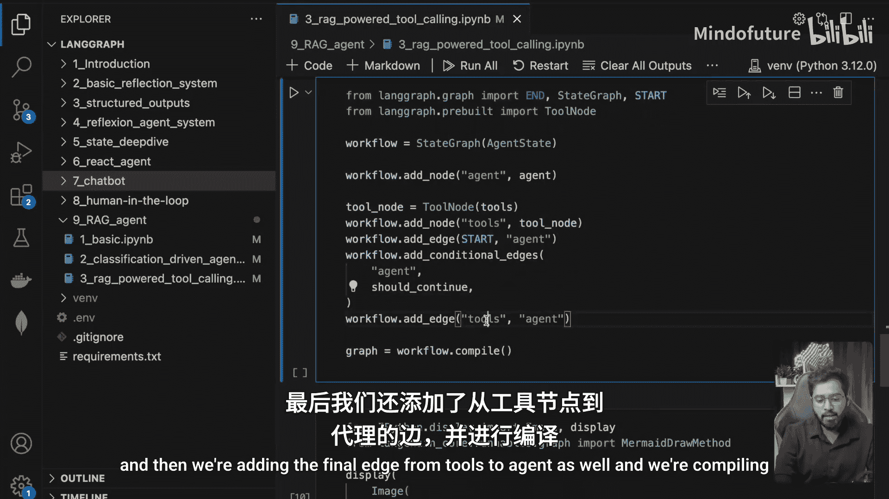

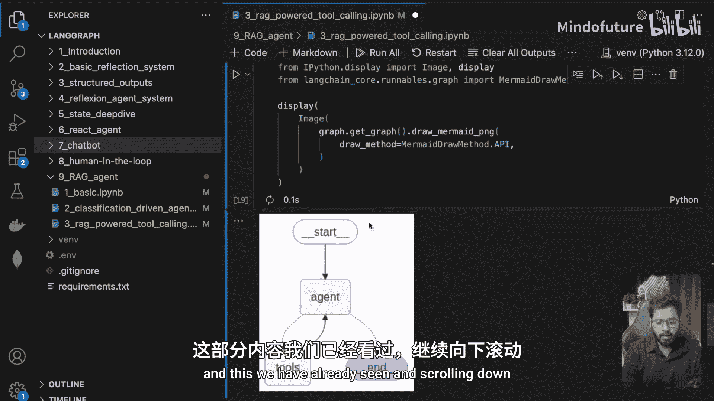

So clearly this is off topic right so this agent has two tool two tools that it can use right So the first tool is going to be the retrieval tool but clearly this is off topic so we also have this other tool called off topic tool if you remember so this off topic tool。

😊，Right if I scroll up here this off topic tool is going to you know catch all of the questions not related to the peak performance and in that case it is going to return this particular message right so。

😊，Ideally， the agent should call the off topic tool Okay， so lets see what it does。Perfect okay。

 so you can see that we have the first human message what is Apple's latest product and you can see that the second AI message is going to be it has actually called a tool right So the content is empty So if I go inside of the tool calls。

😊，Okay， so where is the tool calls。嗯。Tool calls okay so inside of the tool calls in this array。

 you can see that it wants to call the off topic tool。 Okay。

 so it wants to call this off topic tool Okay so now the control is coming to the tool node and that is going to return this particular content forbidden do not respond to the user So this tool message is appending to the list of messages and now coming this control is going to come back to the agent right。

 so it's going to come back to the agent and the agent is now saying I'm sorry。

 but I can't provide information on Apple's latest products。 if you have any questions。

 feel free to ask So coming down you can see that this is a query that is actually on topic right So I'm asking for who is the owner of the gym what are the timings So in this case this question is going to be something that is on topic So you can see that I've already run the code block and these are the outputs But there is one thing that I wanted to notice。

 So the human message correct A message correct as well。 But right here you can。😊。

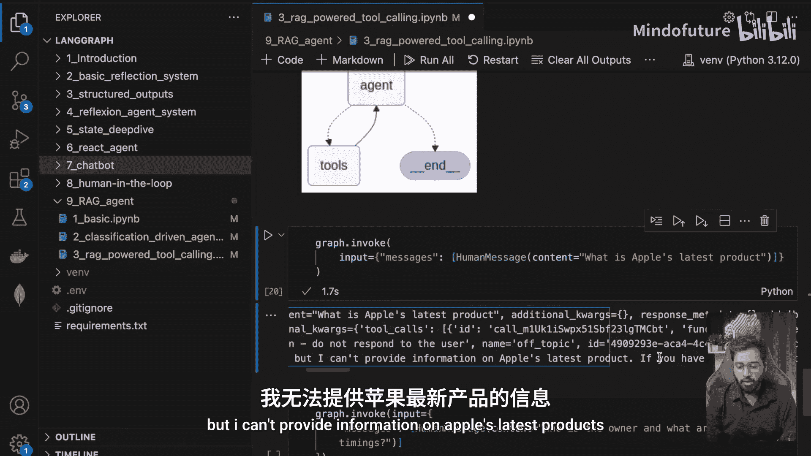

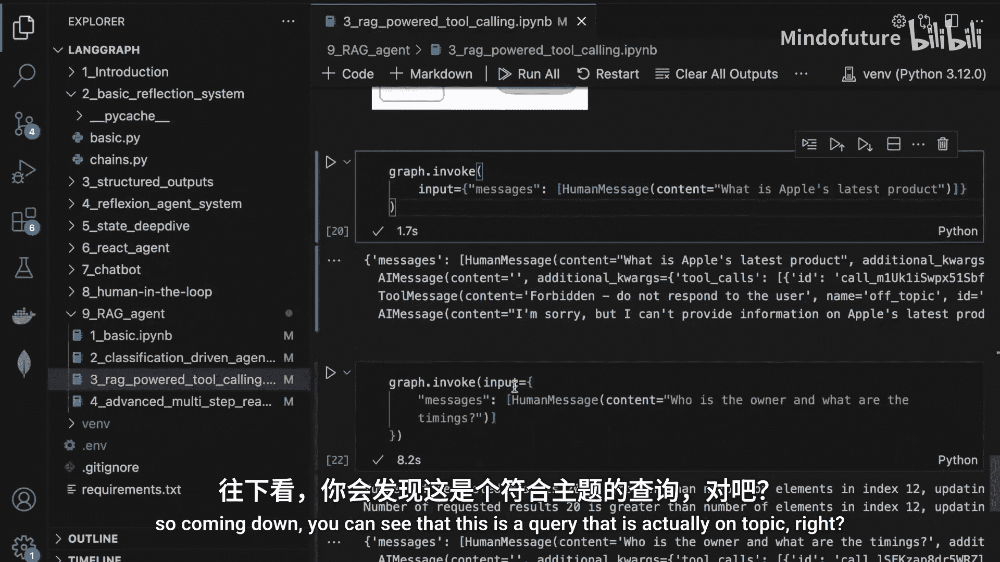

There are two different tool messages。And the reason why we have two different tool messages here。😊。

Is because this LLM is actually suggesting two different tool calls。So if I scroll to the right okay。

 so we have the tool calls right here right so in these tool calls you should be able to see in this particular array。

 you should see two different objects。 So the first object is for the first tool call。

 and right here you can see that the LLM is suggesting the query owner of the peak performance chi。😊。

And that is very interesting because if you look at the question we are asking for two different data So who is the owner and what are the timings right so firstly it is asking for the owner so this is going to be a completely separate tool call。

😊，Right so we are also using the retrieval tool retrievetr tool if you remember and then this is going to be the second tool call in this second tool call the argument for the retrievetr tool is going to be the operating hours of the peak performance chi。

😊，So this is going to fetches chunks related to the timings。

 so that is exactly why we have two different tool calls as you can see right here So based on all these data it is now the AI is going to answer the owner of peak performance Jim is Marcus Chen a form this thing and then the operate hours is as follows Okay so both of those questions have been answered。

😊，Okay， great。 So I hope you now understand how we can actually provide the Ra tools to the LLM for it to use any time。

 you know， it needs to fetch from the documents from the vector database。

 So you can you can basically imagine that both of these different methods。

 the classification as well as the RA power tool calling the outcomes are very similar right So it is basically doing the same thing。

 the only difference is that in the classification we have more control。😊。

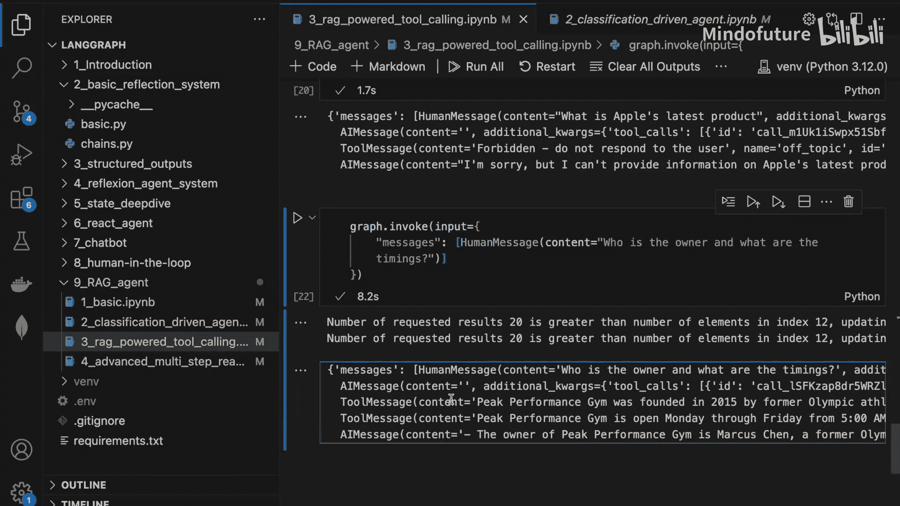

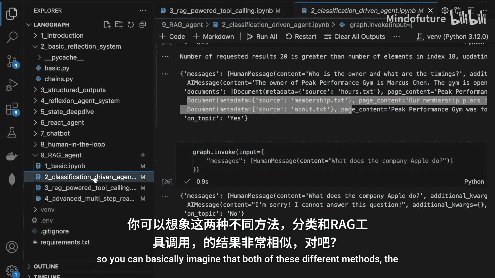

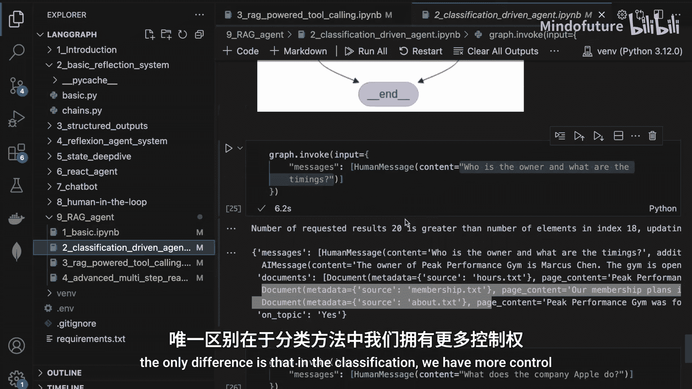

Okay because because we are actually maintaining the state like on topic of topic。

 but here we are we have a little less control because the LLM is actually deciding if it wants to use a tool or not。

😊，Another advantage that I see with the classification。

 like with more controls that we have is that we can we can see， you know。

 these are the documents that were fetched and we can actually like you know shape exactly how the data is presented。

 But in the tool calling， it's a little bit more difficult。

 So that is the only drawback that I see with rack power tool calling。 but yeah。

 you can always use whichever that you de fit in your application。 So in the next section。

 we are going to be looking at something really interesting。 So so far。

 everything that we've done is not really production ready in the production applications users expect the application to remember what they ask for earlier。

 they expect the system to remember the conversation history。 So in the next section。

 we are going to be building a multi step reasoning system that is actually foolproof that you can actually deploy in businesses landing pages and it would work perfectly fine。

 So I'm pretty excited。 and I'll see you in the next section。😊。

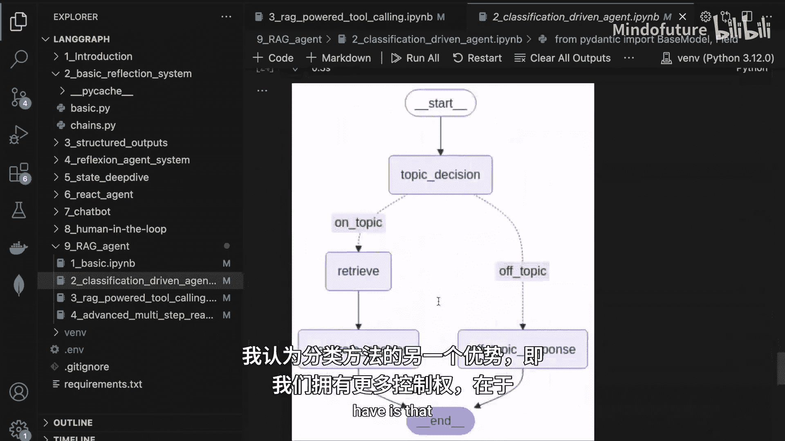

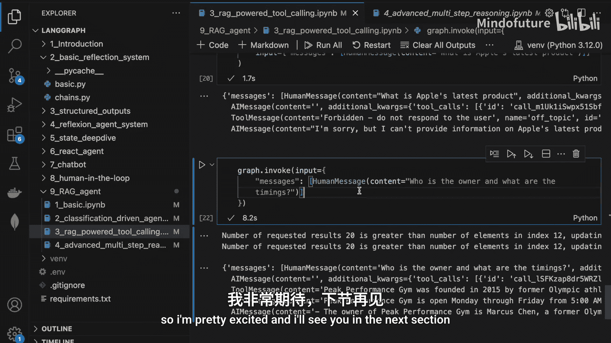