# Langgraph初学者入门2025 p39 P39_#37_RAGs_多步推理（高级） -BV1mgepzCEjf_p39-

Hello guys。 So welcome to the last video in this rag section in the section we are going to be building a system that is actually going to be production ready。

 So this is a system。 Okay， so I've called it advanced multistep reasoning system。

 So before we go through the code I'm going to show you the flow chart exactly how it looks like Okay so I know it looks a little daunting。

 but it's actually pretty simple。 Alright so so you can see we have a start note and then we have this new node called the Que rewriter。

😊。

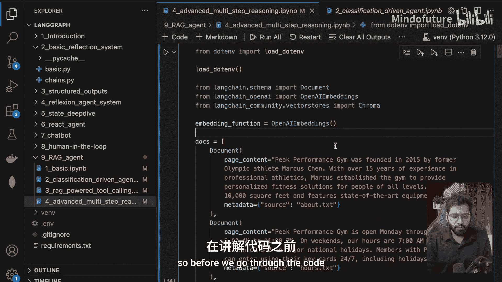

So let's look at what this actually is。 Why do we need this question rewriter， Okay。

 so let's say we are going to be building this system for a gym。 Okay。

 so let's say the the name of the gym is going to be peak performance gym and an end D user of the gym is going to come on their website and ask this particular question。

 What are peak performance gyms hours。😊。

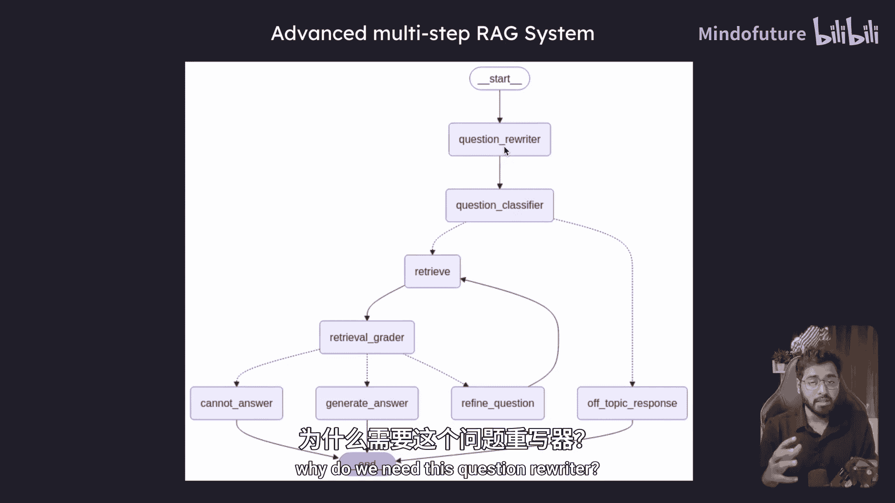

Okay， so in this case， what's going to happen， What do we normally do We take this particular user query and then we send it to the retriever。

 the retriever is going to go and fetch all of the results and then along with the user's question and the context it's going to go to the LLM and it's going to respond with an answer Pre good so this works perfectly fine but let's say the user asks a follower question like you know what about weekends So in this case we cannot actually use this particular string alone and you know tell it to the retriever to go get chunks because this alone does not make any sense it can only make sense along with the entire context of the conversation history right So if you look at this and this together this makes sense but this alone it does not make any sense right So in this case we have to rephrase this question a little bit so that all the context is contained in this。

😊，This thing so that the retriever has enough information to go and fetch the relevant queries。 Okay。

 so basically without reffaing the follow up query。

 this query lacks context on its own and would likely return irrelevant results if sent directly to the retrieval system right So the refphrasing node basically okay what this does I it transforms this what about weekends into what are peak performance gyms weekend hours。

 So that is why we have this node at the very start。 Okay， I hope that makes sense。 So after this。

 we have the classifier very simple this we've already seen before。 So what does this do。

 it's basically just going to see if it is an off topic query or an on topic query Okay so we don't want our system to answer user questions when the user is asking something about random things right So in that case it's going to go to the off topic node and then go to the end。

 So that's there we can just provide a boiler repair response like I cannot answer the question So something very simple there。

😊。

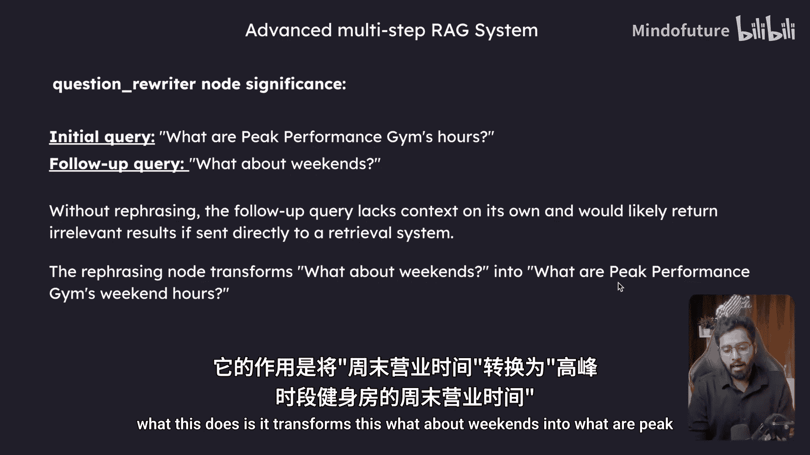

But in case it is an on topic query。 So in this case we are then confidently proceeding forward with fetching the chunks from the vector store。

 So that is what this retrieved node is going to do okay so it's going to go and fetch like you know we can set k is equal to4 in this case it is going to fetch four different chunks right so right after this retrieve node So we have four different chunks So what is retrieval grader is going to do is it's going to loop through go through each of these different chunks and it's going to check if that chunk is relevant to the user's question okay so since we said k equal to4 you know one or two chunks might not even be relevant right So were just like checking we are just grading each of those chunks okay is this relevant or not is this relevant or not is this relevant or not So there is a couple of different edge cases that might come up So there might be a case where at least one node is actually relevant and the L can use it to answer the user' question So in that case we are going to go to the generate。

😊，Answer and then end it。 But there is another use case。

 What if not even one query is actually relevant to the user's question。 So in that case。

 we are going to go to this refine question node and this is going to refine it's going to add more information to the question it's going to change it up make it better so that it it is going to give more information to the retriever and maybe some better chunk is going to be retrieved from the vector database。

 Okay， so again， we are going through this you know。

 there might be situations where you know no matter how much we change the question you know relevant chunks are just not being retrieved in that case we are just setting a limit to three different loops Okay so we don't want it to go for you know infinity that's going to blow out all of our tokens。

 So in that case， we just set the max limit to three in case it actually fetches something that is useful in that case we are going to go to this node or else we are going to keep on looping through it。

 And if the three is reached if the limit3 is reached。😊，It means that you know。

 it is a hopeless question。 we cannot answer it。 In that case， we are going to go to this。

 cannot answer node and that is just going to say I don't have this information right now or something like that。

 Okay so or we can also since it is still on topic we can actually route it to a human agent and do something like that in this particular node。

 Okay， so this is what we have we have cannot answer generate answer and then refine question and this takes care of all of the different edge cases that we might potentially come up that might potentially come up in production。

 Okay， so I hope that made sense。 I hope this introduction made sense。

 let us now jump into the code and go through the code。 Alright guys。

 so you can see that I've already gone ahead and I have created this file called advanced multistep reasoning So this first code block is going to be no different So I am just going to reuse the same examples that we saw So we have the peak performance sh okay so we。

😊。

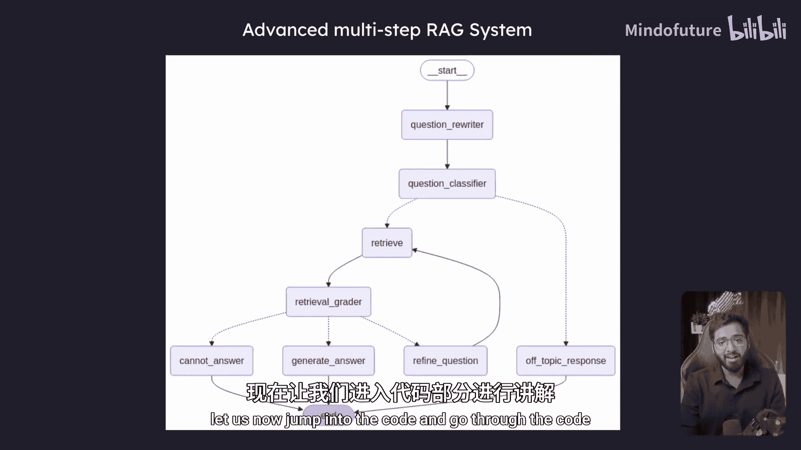

Have four different like five different documents great。

 Okay so we are initializing the Db as well as the retriever perfect Okay， so coming down。

 we are initializing the model here， we are using G4 and then in the template this time we are going to right so we are saying answer the question based on the following context and the chat history especially take the latest question into consideration。

 Okay， so this time we are providing the entire history， the conversation history okay。

 in the final LM call that we make and then we are going to provide the context as well。

 this context is going to be the retrieved chunks by the retriever and then we have the question。

 Okay， this could be the rephrased question you know that we make。 okay。

 so we are making we are keeping the template ready Okay， and then we are creating the rag chain。

 Okay so this is actually repeated。 we don't want it to be repeated。

 al right so we have the rag chain coming down。😊，So this is where you know we have the agent state we are defining the agent state so you can see there's a lot more properties that we we are going to be maintaining to achieve this particular system Alright so first thing messages right So list of messages we need this right so to maintain you know the conversation history we need to maintain all of the messages great so we have the documents what does this use for this could be all of the documents that are retrieved by the retriever and then this could be the bullolean okay this could be like know yes or no is the user's question on topic off topic the rephrase question the question that the LM we can rephrase it if it does not really you know contain the full context so in that case we are going to rephrase and put it here and then we have this proceed to generate as well So why would we want this so if I come down here so we can see that you know if proceed to generate is true in that case we can just go you know to this particular node and then end。

😊。

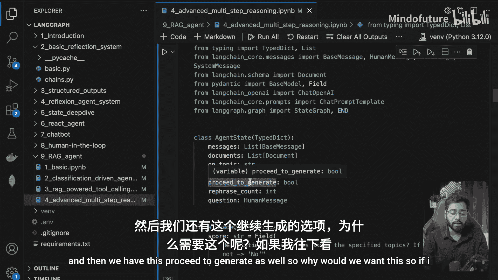

If it is not ready in that case， we might have to refine it or you know in case that the count is reached。

 we might have to。Go the this route。 Alright， so that is why we might want this。

 So this rephrase count again， this looping。 Okay， so if it reaches just if it is more than three or something like that。

 in that case， we might have to exit out of the graph right。

 And then this is going to be the original latest users question as well that we are keeping。

 So we have the rerase question and the original question。😊。

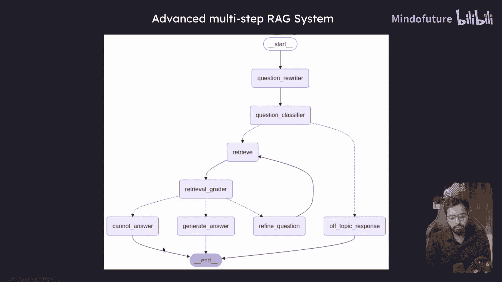

Okay so I hope that makes sense coming down we have the grade question pantic model Okay so I hope that you know why we use a pantic model so this pantic model can be used to you know get structured data from the LLM So in this case what data that we want is going to be this you know we we just want a score Okay so the score is going to be string and we are giving the description is the question about the specified topics。

😊，Okay， so if yes， then return， yes， if no return， no。Okay。

 so this is going to be the pedantic model， which we will soon use you know。

 we will soon use it down here。 So yeah， let's now look at the question rewriter node。 Okay。

 so let's look at this first node Okay Alright， so we just printing entering question rewriter with the following state So you can see that at the very start。

 we are resetting a lot of these state variables So we are resetting the documents we're resetting on topic or off topic。

 we are resetting the rephrased question proceed to generate or rephrase count Okay。

 so why do we do that if you can imagine you know， for every single prompt every single question。

 the user is going to ask the state， the graph is going to run from start to end Okay for the second question is again going to run from start to end Okay so we are going to be using a checkpointer as well。

 So it's going to remember what happened but still it's going to start from start to end。😊。

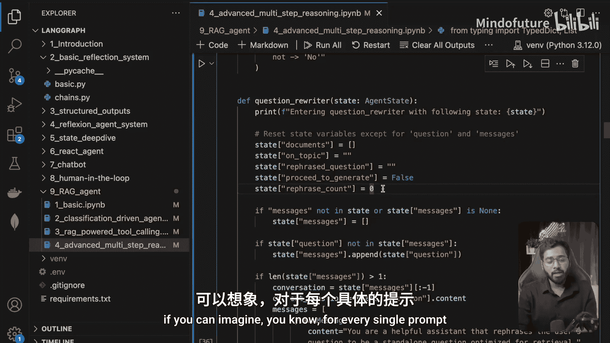

So if there is a second question， we want to reset all these different things right we dont we want to start the graph fresh。

I mean with the memory， with the conversation history， of course。

 but the rest of it we want to start from scratch。 So that is why we are going to set all these state variables except for question and messages messages we don't want to remove right because we want the messages to continue forward right all day So coming down So right here we are checking if the messages is not in state or messages not there which is going to initialize it to an empty list if we provide the proper initial states。

 all of this would not be needed， but I'm just going to make sure that every edge case is handled and it is actually robust So coming down we are checking if the question is present in a state So if the question is not really present in the list of messages。

 that case we are app to the message list now So we are checking if the message list is greater than one Okay so if it is greater than one it means that the graph has already run the first time and now it could be the second or the third or the fourth time right so in this case we might actually want to。

😊。

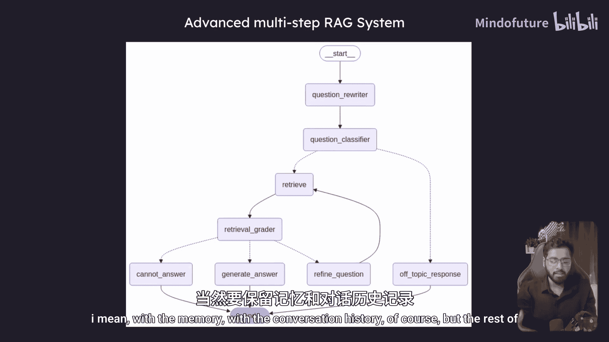

Rephrase the users' question properly okay so coming down here else if the graph is actually running for the very。

 very first time， if the conversation is actually like you know just starting in that case we don't need to rephrase any question in that case we can just like put the state question right here but in case it is the second or the third we might actually want to make sure that the users question has the full context okay so we might want to rephrase it so that is why we are coming into this particular block so coming down here you can see that we are looking at the entire list of messages and then we are extracting everything except the last message except the last human question right so we have the conversation history right here and then we are also taking the current question and then we have a list of messages in the system message we are saying you are a helpful assistant that rephraseses the user' question to to be a standalone question optimized for retrieval so along with the system message we also have to provide the。

😊，Pas conversation history as well as the last human message。 Okay， so that is what we're doing here。

 So we are providing the past conversation history as well as the latest user question。 Okay， okay。

 and then finally， we are invoking it。 So in this response， we are going to get a rephrased question。

 Okay， so that question is going to be rephrased with a lot more context。

 So we are going to do response or content， we are going to strip it all of you know。

 all the unnecessary spaces， trailing spaces， initial spaces and all of that。 Okay。

 just to make sure that you know everything is looking tidy in the production。

 and then we are going to just like print it out and then set this new better rephraed question to this initial state。

 Okay， great。 So we are now done with this question rewriter node。 So what is the next thing。

 So right after the question rewriter node we are then we then have to look at the prompt look at the question and then check if it is still on topic or of topic。

😊。

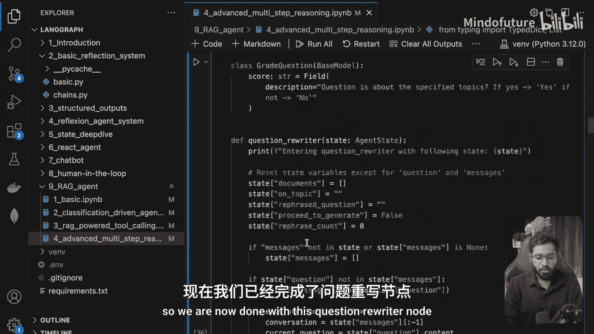

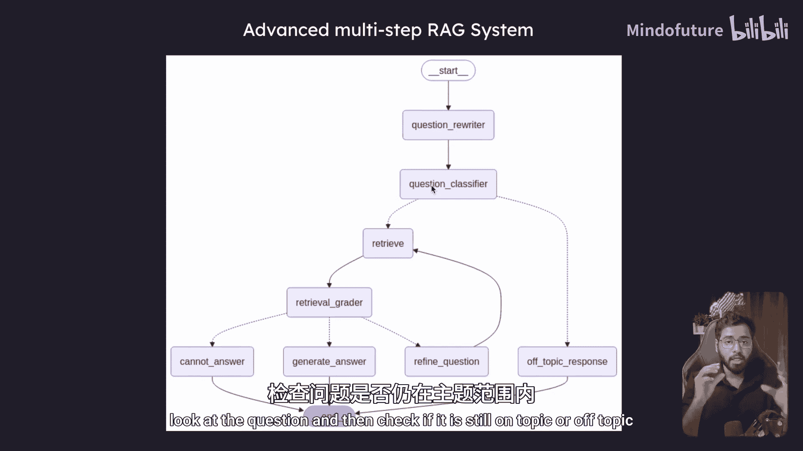

So coming down， okay， so I'm saying that you are a classifier that determines whether a user's question is about one of these following topics。

 Okay so it needs to basically be about the gem right the gem history founder operating hours membership plans of fitness classes。

 personal trainers okay so if the question is about any of these topics respond with yes otherwise respond with no okay so we need a very structured output in this case right So we we need a clear yes or no from the LLM for this particular from this particular node so I'm providing the the user's question okay in the human message and then I'm creating a prompt out of it Okay so I'm providing the system message。

😊，And the human message right here， Okay， and then before I actually， you know。

 just send it to a normal LLM， I'm not interested in that because I now want a structured output。

 I want it to be in this particular structure。 I want a score property and a particular value。

 Yes or no okay， so I'm going to make use of the with structured output method。

 So now I can pass it inside of this and then expect to get the exact score。

 And I'm also going to make sure to strip every you know tailing spaces， etc cetera， etc cetera。

 And then I'm going to assign it to this on topic property in the state。😊。

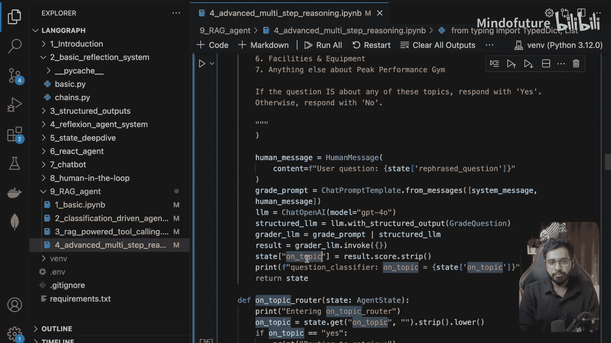

Okay， so now this is going to be either yes or no。 So coming back to the diagram。

 So if it is no in that case， okay， it is not on topic in that case it's going to go to this particular node or else it's coming here so we need some sort of like a router right so that router can actually direct you know the direction the flow of the graph So that is exactly what we have right here so we have the on off topic router okay。

 so were entering this thing and then we're just going to take that on topic okay， if it is yes。

 we have to route to the retrieve node or else we have to route to the off topic response okay so we have to go to the retrieve node or the off topic response Alright。

 so let's look at the retrieve node So what should this retrieve node do it is all that it iss going to do is invoke it's going to provide this rephraed question to the retriever and then we now have the list of documents and then so I'm just going to set it to the documents property in the state。

😊。

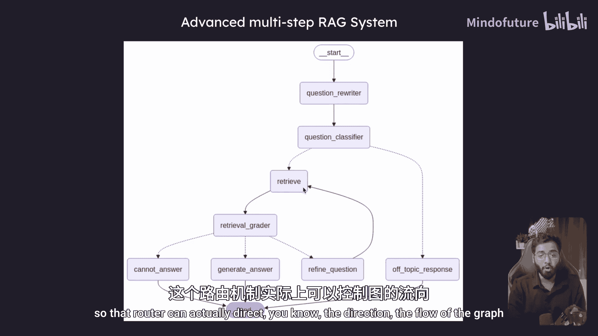

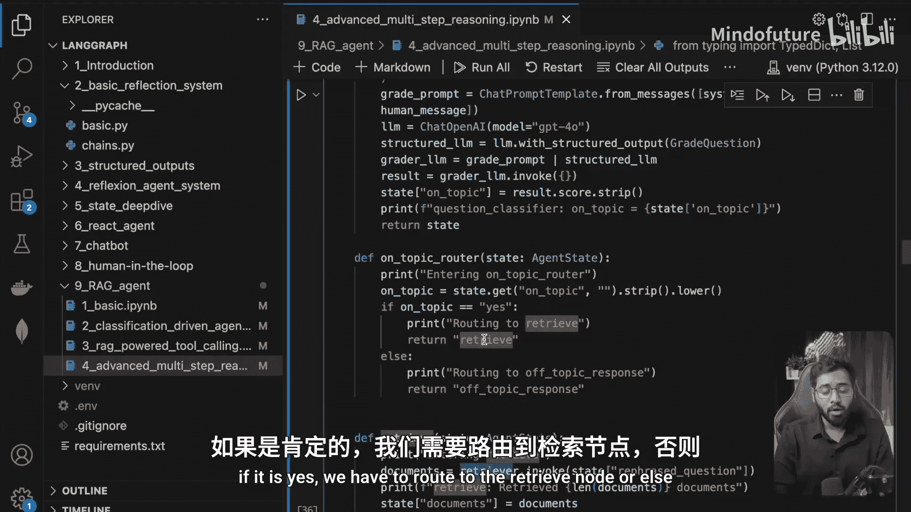

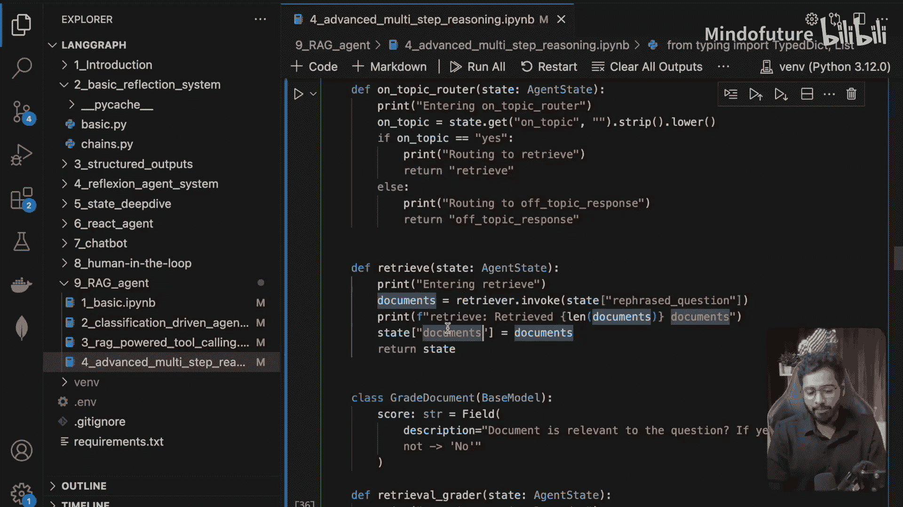

All right perfect。So what's the next thing So we okay， let's come back to the diagram。

 So right after the retrieve is done we now pass it to the retrieval grader。

 So this grader is just going to you know return through basically okay we have like let's say four different chunks It's going to go through each of those chunks and then it's going to say true or false Okay is it good enough or not right。

😊。

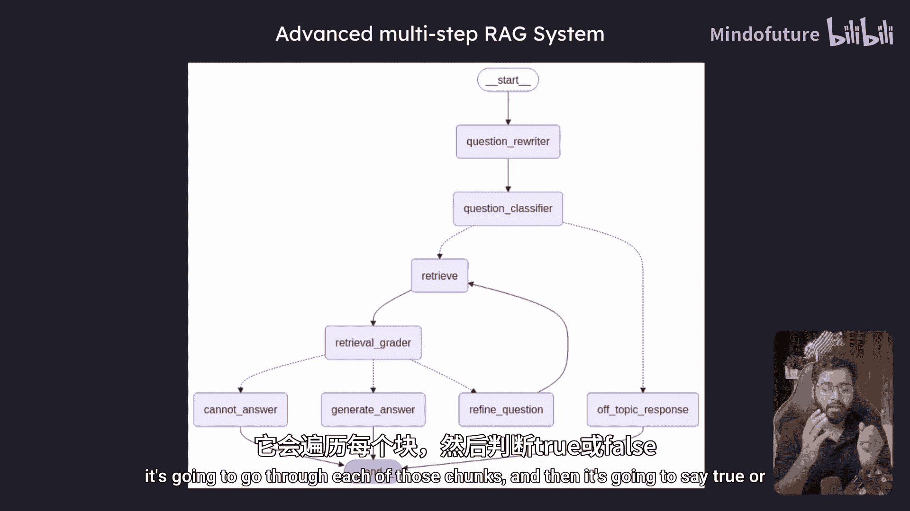

So we need a structured output for that as well。 so that is what I'm giving right here we have another score okay so in this case if the document is relevant to the question。

 say yes， if not say no alright so so here Im saying you are a grader assessing the relevance of a retrieved document to a user's question only answer with yes or no if the document contains the information related to the user's question respond with yes otherwise respond with no okay so we are again going to be using the structured output method so that we can actually force the LLM to use this particular tool to output in a structured way alright so now that we have the structured LLM the supercharged LLM with the tool okay now we just need to loop through all of the documents that have been fetched in the previous node。

😊，So we have the doc right here and I'm just in the human message I'm just saying okay。

 this is going to be the user question and this is going to be the retrieved document。

 Okay so we have the current document。 were just providing the page content。

 we don't really want the metadata the source we're just providing the page content Allright coming down。

 So this greater LM it is either going to return yes or no were just checking that so if it is yes in that case we are going to append it to the relevant docs。

 So we are creating a new list so we want to create a new list then we only want to keep the relevant things alone So we are going to append it right here So once this looping has been done we are setting the new renewed qualified list of chunks to the documents again and then we are going to you check whether we need to proceed to generate or not so if the relevant talks at least has one relevant this thing we can then confident go ahead and go to the generate answer right So that is what we're checking right here Allright So what's the next thing。

😊。

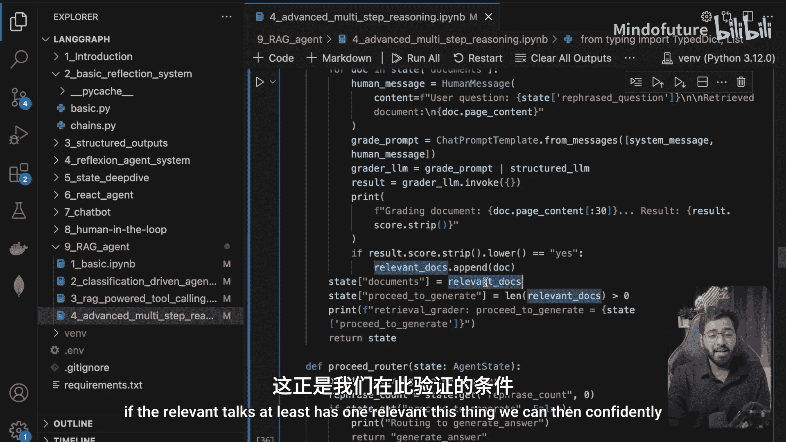

Now have the proceed router okay so basically to check do we have to go here or do we have to go here or do we have to go here So we need some you know router right in the middle and that is what we have right here okay so we are entering the proceed router and then we are getting the proceed to generate So if this actually at least has one okay it's greater than zero in that case we can go ahead to the generate answer node but in case proceed to answer is false and you know the rerase count is already greater than two in this case。

 okay maximum rephrase attempts have reached， cannot find the relevant documents。

 Okay so now we have to go to the cannot answer node okay so we have to go to this cannot answer node and then we also have the final case if both of these cases like the rephrase count is still less than three at the same time the proceed to generate is false in that case we have to refine the question so this is how we refine the question as well。

 So if you see that we。😊。

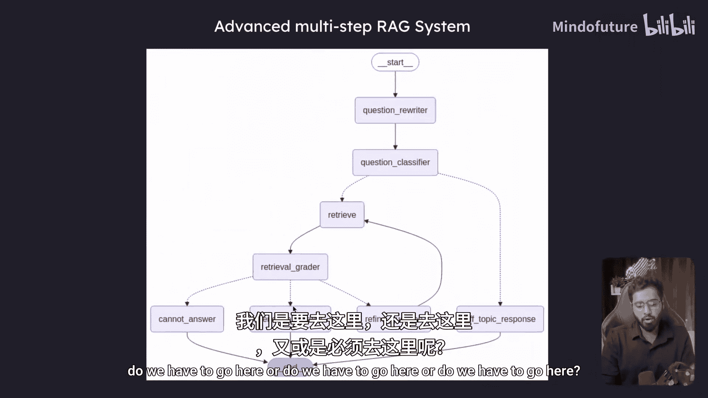

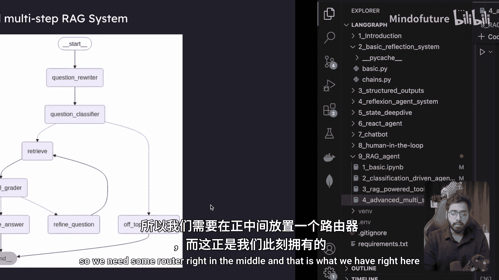

Gettting the rephrase count okay so if it is again we are just writing the same logic here and so we are taking the rephrased question and now in this new system message we are saying you are a helpful assistant that slightly refines the user's question to improve the retrieval results provide a slightly adjusted version of the question。

😊，Okay， so the human message is also going to be like， okay， this is the original question。

 Pro a slightly refined question。 So were providing that we're creating a prompt and then we're invoking it and then we're stripping it and getting the content out of it。

 So this is now going to be the refined question that we are updating the state with。 Okay。

 so the reraed question。 we are updating in the state。 Okay。

 and the count we are also incrementing as well。 Okay。

 because we don't want to look through it you know， more than three times。😊。

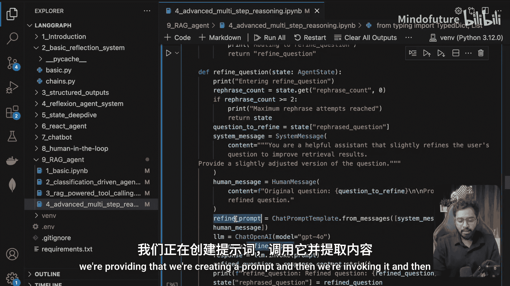

And then finally， if everything goes well， if at least there is one chunk that is relevant to the user's question we have we want to go to the generate answer。

 So we need three different things we need to provide right so we need the list of we need the conversation history that we need to provide to the LLM we need to provide the rerased question the actual question that the user user wants to know and then the documents。

 the retrieve chunks okay， only the relevant qualified retrieve chunks from this documents state。😊。

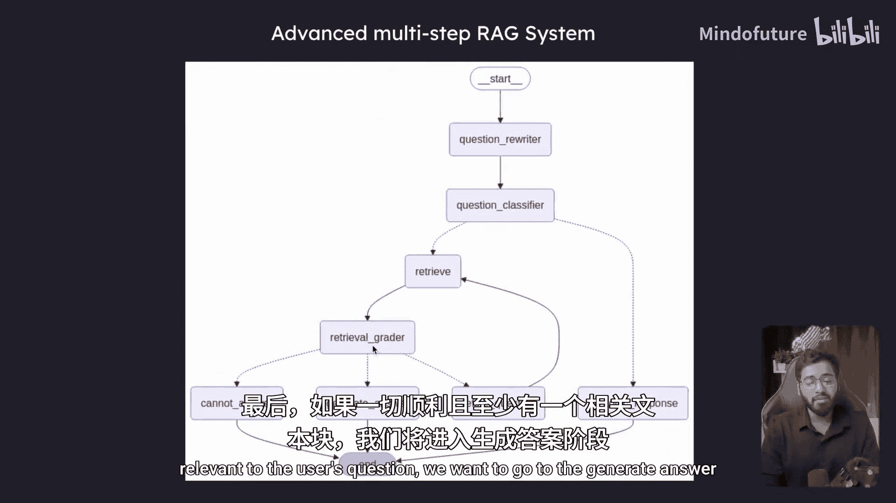

So we are going to provide all these three things in the chain so if you remember this chain we are coming up here so you can see that we are providing the history we are providing the context and the question correct okay so lets go down again okay so we are providing all these different things and we are getting a final response and whatever response we get right here we are just going to show it to the user because we are coming to an end okay so before that we are just going to update the state as well the history always keeps on updatinging right。

😊，And then we have the cannot answer node okay， if the retriever still cannot fetch the right chunks for some reason or you know the documents are not really enriched properly in that case。

 we are coming to the cannot answer node here。 I am just going to add this you know AI message saying that I'm sorry but I cannot find the information you are looking for and then again we are going to end the graph。

😊。

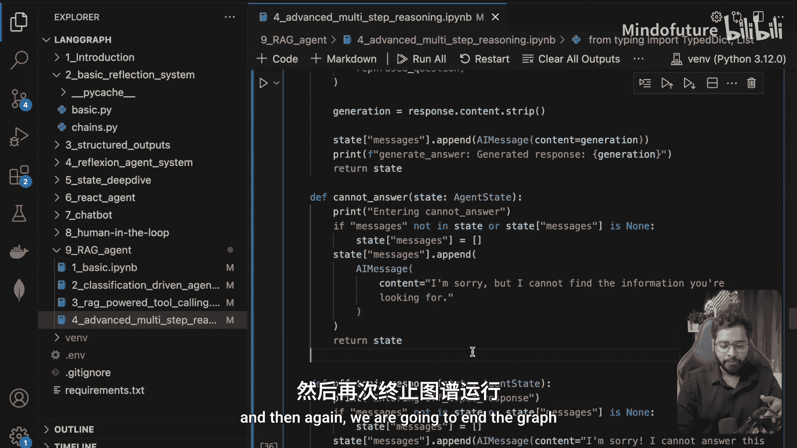

Okay， so we've looked at the generate answer。 we've looked at cannot answer。

 Now we can look at the off topic response。 This is something that we've already written。

 we are just saying， Im sorry I cannot answer this question because it is off topic right And that is it guys that is it for all of the node。

 weve defined all of the node。 The next thing is we just need to So coming down we are using the checkpointer So why do we need a checkpointer So the user needs to be able to you ask follow questions all right。

 So in that case all the state needs to be you know remembered So because once you know for every single question we are going to run through the graph completely from start to end。

 So it needs to remember what happened in the previous run right So that is why we need a checkpointer we are using a very simple memory saver。

😊。

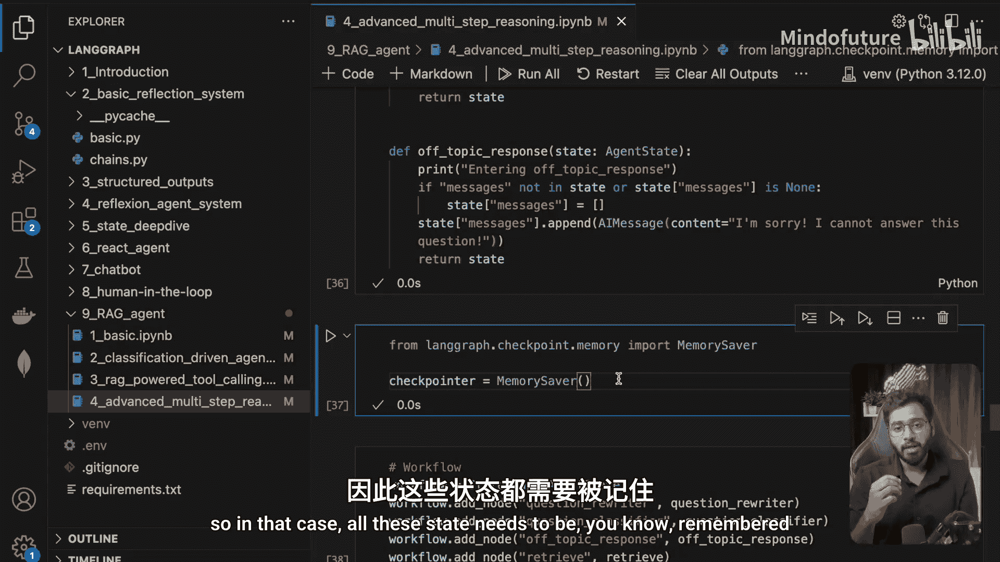

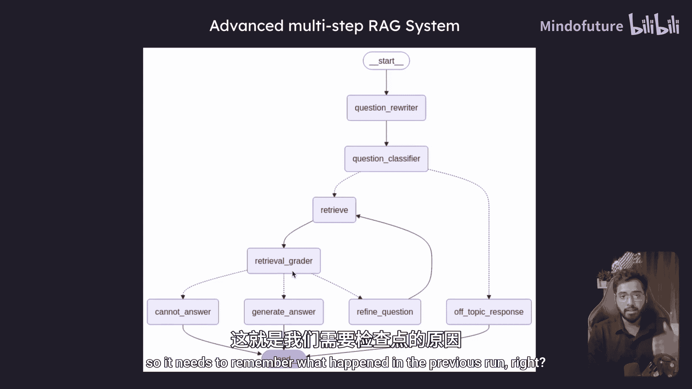

And now we are just adding all of the node Okay， so all these nodes that we have defined。

 we're just going to add all of it I've used the same names as the node names right。

 so whatever the the function name that I've used I've used the same things everywhere and then I'm going to add the edges as well So the question rewriter has to go to the classifier next right it needs to go to the classifier and as soon as the classifier is done executing we need to route to retrieve or off topic right。

 and then there's another condition here for you know right after the retrieval grader is done there is another routing here as well and that takes care of that。

 So coming down there's a bunch of different edges that I'm adding here as well。

 So these are something that we would have seen a million times by now。 but yes。

 so finally I'm going to compile it provide the checkpointer all perfect So this is going to take some time so because there's a lot of different notes that we've written It's going to take some time All it perfect。

😊。

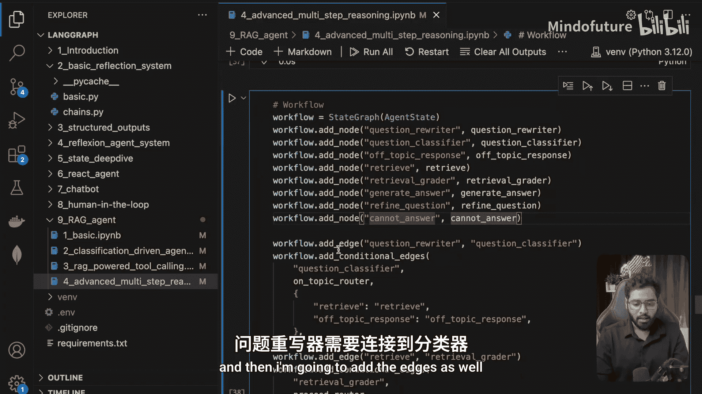

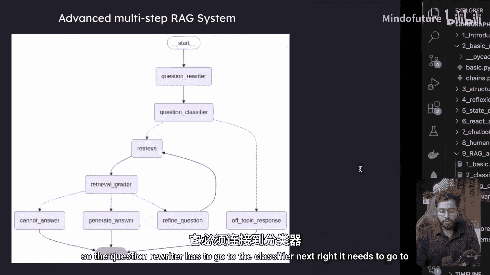

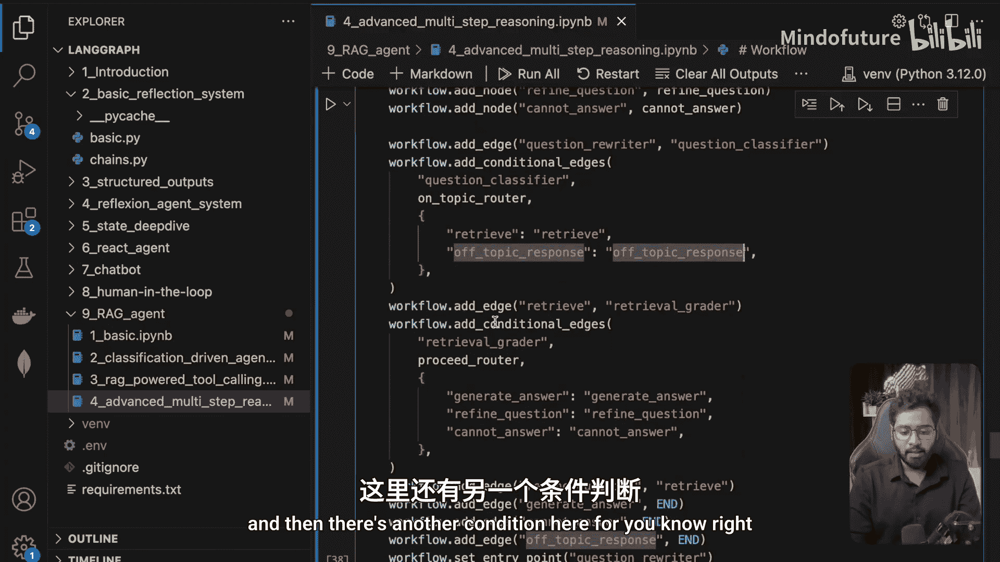

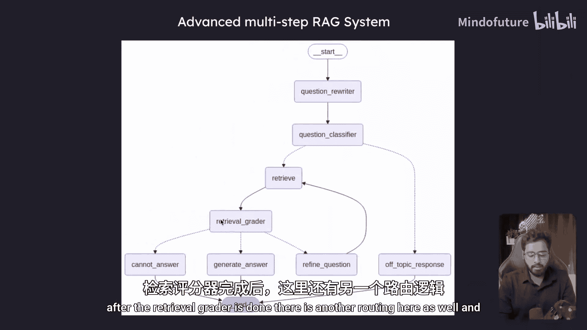

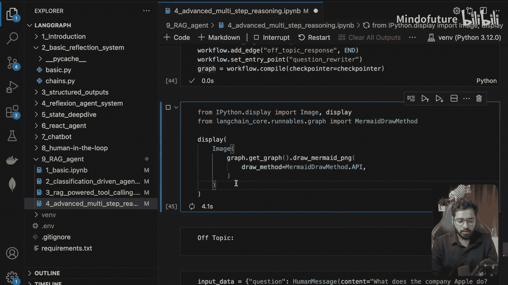

So you can see that it almost took me one minute and 10 seconds。 So yeah。

 this is the same graph that we saw in the slides。 So we have the question re classifier retrieve。

 and then we have all these different edge cases handled as well Alright perfect。

 So this is what I'm going to do So first off， I'm going to check the first edge case。

 which is going to be if what happens if the user asks an off topic question Okay。

 so in this case the user is saying what does the company Apple do。

 It's completely unrelatedulated to the actual business， the gym business right？ So in this case。

 if I run it。😊。

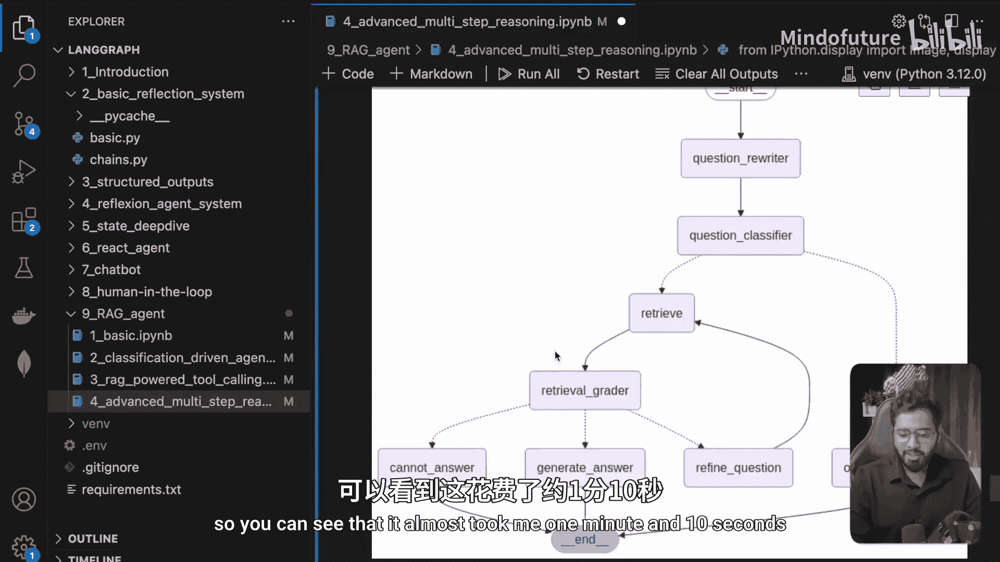

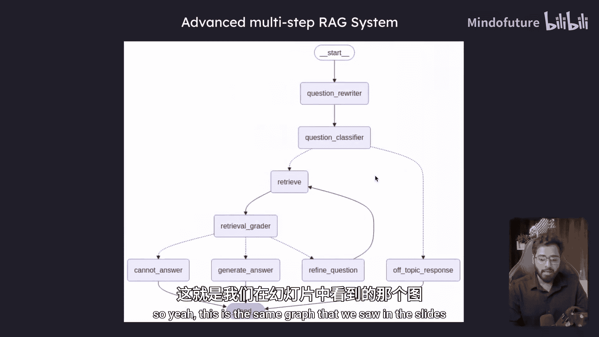

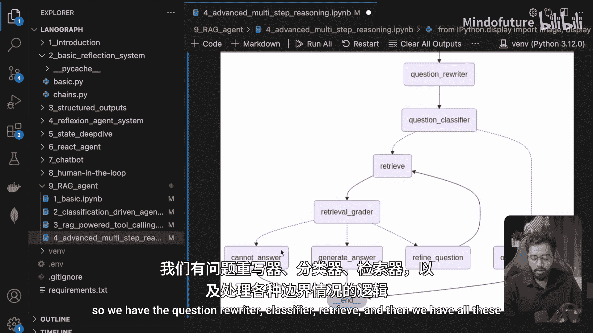

So let's look at what it is saying So it is saying that entering the question rewriter with the following state okay so since there is only one state right now one item in the list right now it is not going to rewrite anything and then it is coming to the question classifier right this classifier is saying the on topic is no okay so this classifier is saying the on topic is no in that case it needs to go to the off topic response through the router that we had right here。

😊。

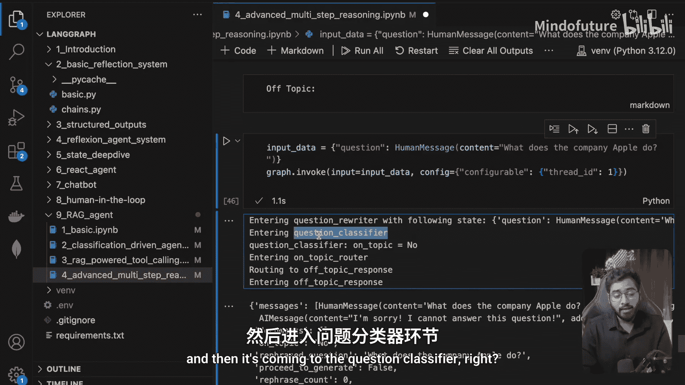

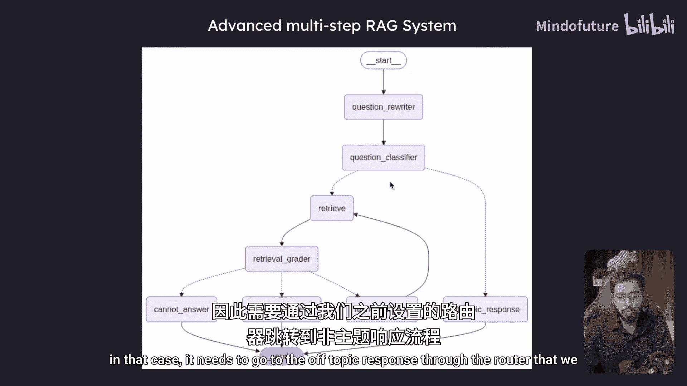

Okay， so it is coming inside of the router， the router is directing the graph to the off topic response and that is exactly what we see right here。

😊，So the AI message is saying， I'm sorry I cannot answer this question perfect。 So we。

 we can also see that the on topic is no。 and then the proceed to generate everything is false。

 right， okay。Perfect， so let's look at another case here as well。 So in this case， you know。

 I'm going to ask something。😊，You know what is the cancellation policy for peak performance gym memberships Okay so what is this edge case so this edge case is if I scroll up in the documents there is absolutely nothing that is present in the document that talks about cancellations at all Okay。

 so there is nothing about cancellations in this case。

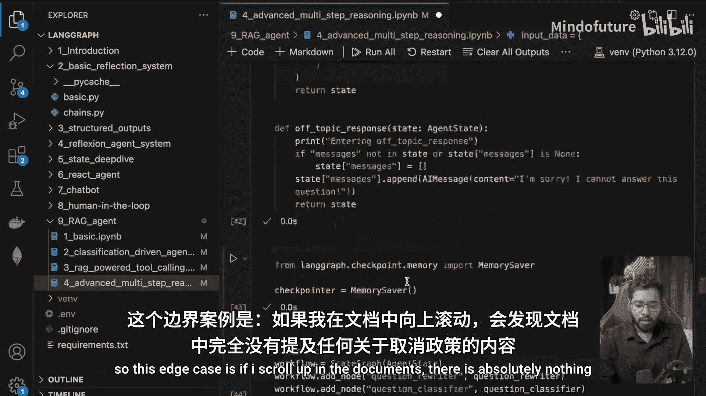

So it is still on topic。 Okay， so it is still on topic。 but at the same time。

 the retriever is not going to retrieve any relevant chunks at all。

 So it's actually going to look through three different times and it's going to give up。 Okay。

 so that is what。

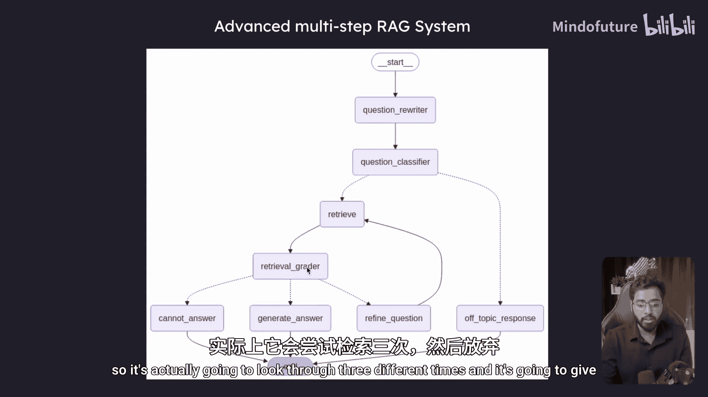

This case is going to be all about。 so let me actually you know， run this。

 You can see that I've already Ive gone ahead and used a different thread because we don't want to confuse everything in the same thread。

So if I run this， Okay， great。 So let us see what it's saying。 So right here。 Okay。

 so this is going to be the rephrased question。 Okay， great。

 and then the on topic is also going to be yes， right so coming down it's going to retrieve four different documents。

 So this retrieve node is going to retrieve four different documents and then the grader is going to kick in So let's see what the grader is doing So the grader is looking at the first chunk and the result is no okay so this chunk does not answer the user's question。

 this chunk does not answer the user's question。 No， no。

 no okay so now it is actually going to you know the proceed to generate is also set to false So it is actually going to loop back it's going to loop back to the retrieve Okay with a different with a different question Okay with the refined question So in this case。

 the refined question is going to be you know what is the membership cancellation policy at peak performance gem okay so you can see that it changed it a little bit。

 So here it is what is the cancellation policy here。😊。

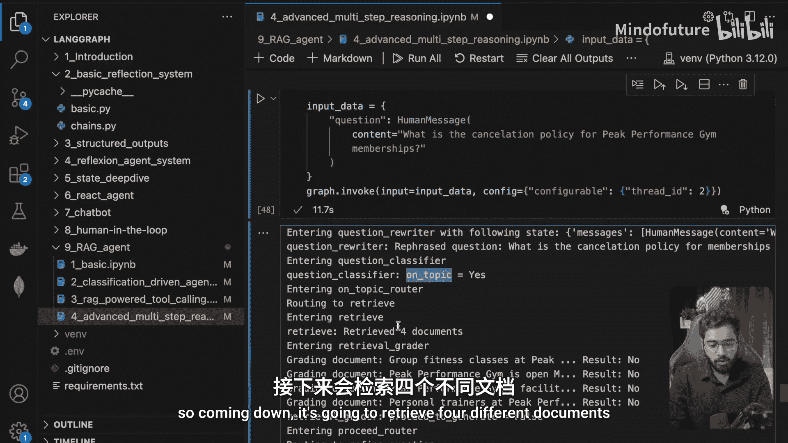

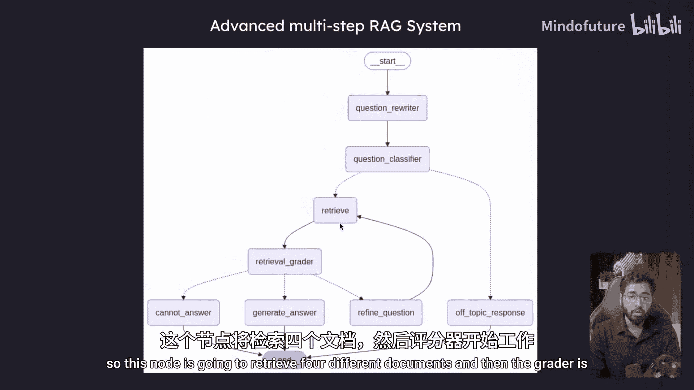

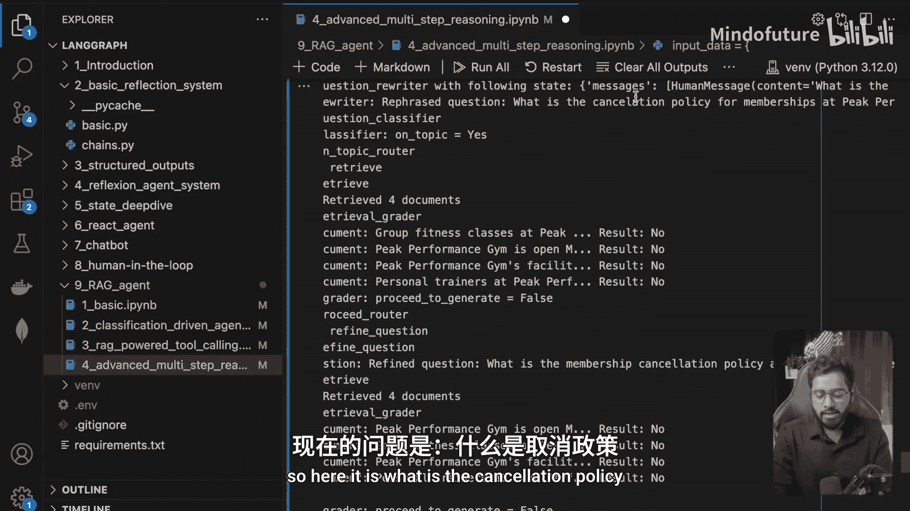

What is the membership cancellation policy Okay so it basically made it a little better so coming down it is again going to retrieve four different documents the answer is still no no no no no because we dont have any documents to support that。

😊，Okay， so finally what happens after like two different iterations。

 it is the procedure generator still falls， so it's not going to come in here。

 It has already exhausted the looping as well。 So now it is going to go to cannot answer okay。

 so it is going to go to cannot answer and then it is going to end it。 Okay。

 so we have the I am sorry but I cannot find the information you are looking for so let's look at the third edge case okay。

😊。

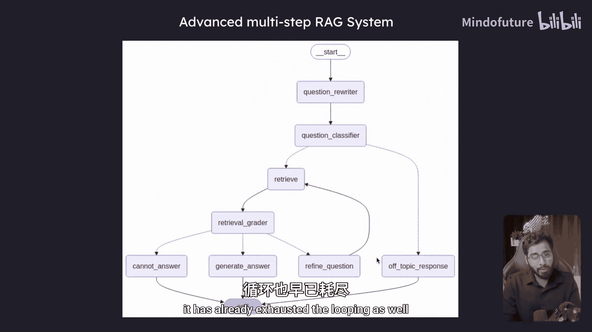

So here， okay I am using another thread， so this is going to be a new conversation so the user is saying who founded peak performance。

😊，Okay so this is something that is relatively very easy and if I come up here to the this thing you can see that。

😊，Peak performance Jim was founded by former Olympic athlete Marcus Chen。

 Okay so this is easily answerable So coming down so this thing is easily answerable。

 but let's say the user actually asked a follow up question When did he start it Okay。

 but this query alone does not have a lot of context So we need to rewrite it with the previous question in the context right so let me run this thing。

😊，Okay， so in this case， great。 So the first time it retreat for documents。 and then this one。

 this about chunk is going to be yes。 So this is actually a relevant chunk right。

 So in this case is's going to proceed to the generate answer node。

 And then the final answer is going to be peak performance Jim was founded by Olympic athlete Marcus Chen Okay。

 so this is correct。 So let's now run this let's use the same thread I as this thing and then let us now run When did he started。

 So now what would happen is that this question rewriter is going to kick in。

 It's going to rewrite the the prompt properly。 Okay。

 so that this retriever has more context because it is kind of dumb right So if I run it right now。😊。

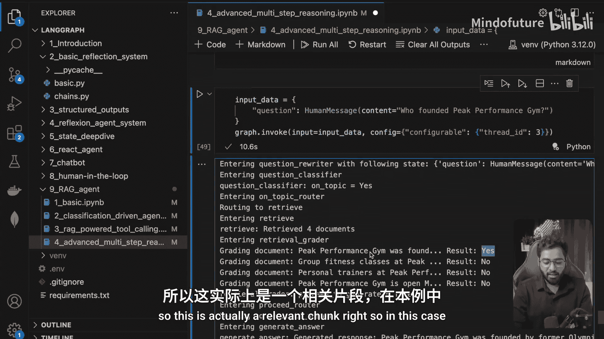

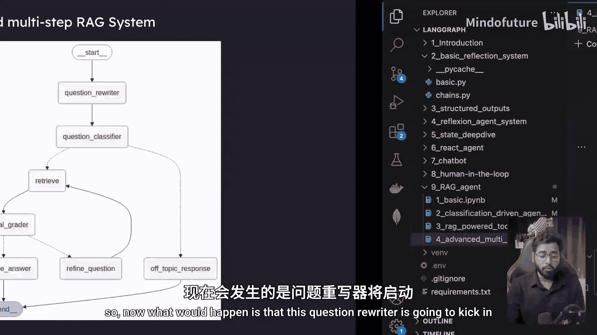

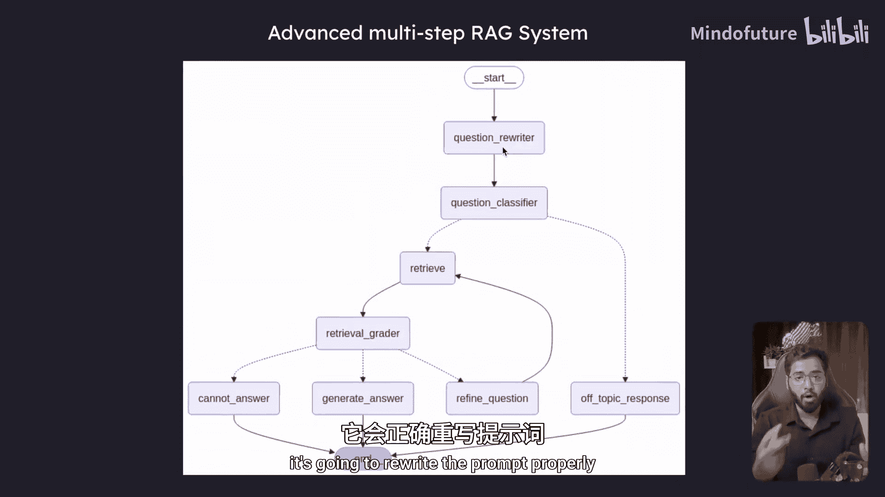

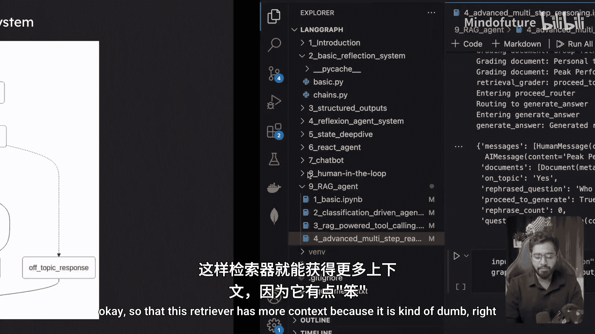

Okay， so the question rewriter so you can see that the rephrased question now is going to be when did Marcus Chen start peak performance gym。

 Okay， so it's not going to be he anymore， it's going to be Marcus Chen。 Okay， so in this case again。

 it's going to retrieve four different documents。 Okay P performance gyms power。

 okay it's going to fetch this thing and then finally we have the generate response。

 It was in 2015 and that is it guys， I do hope that you learned a lot do pull the code and run it by yourself and I will see you in the next section。

😊。

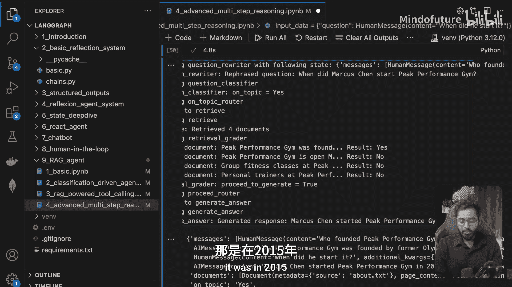