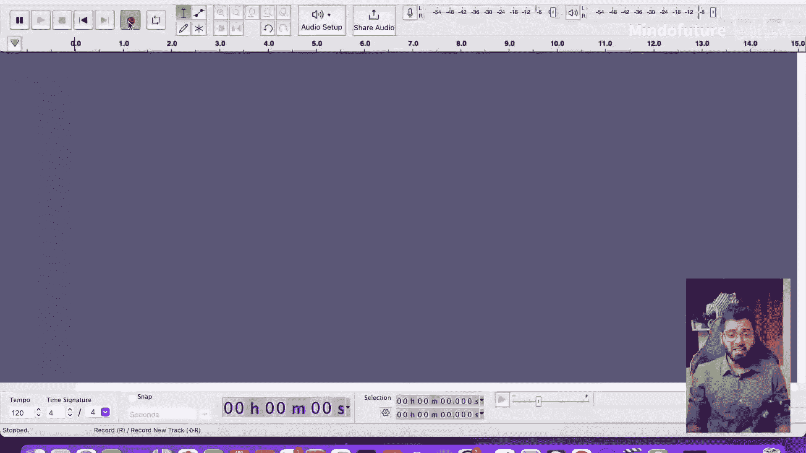
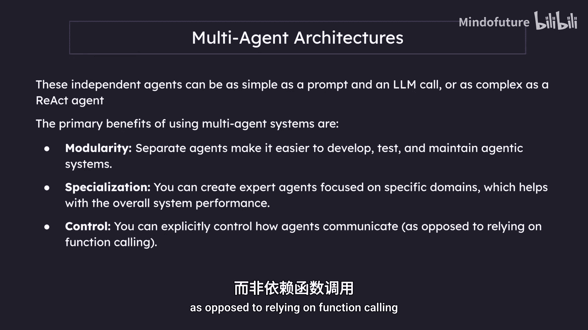
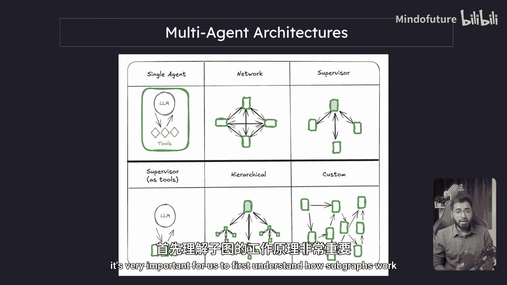
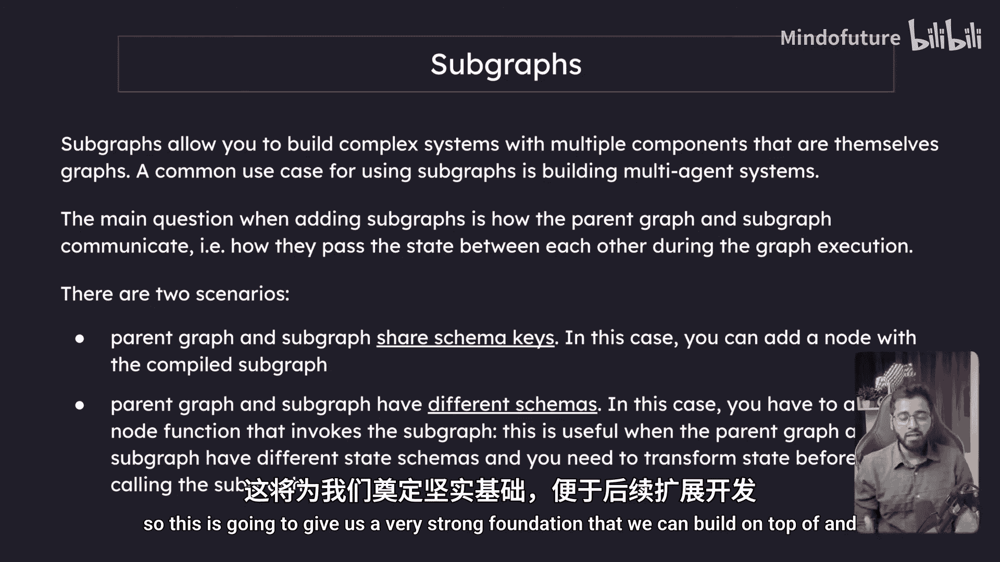
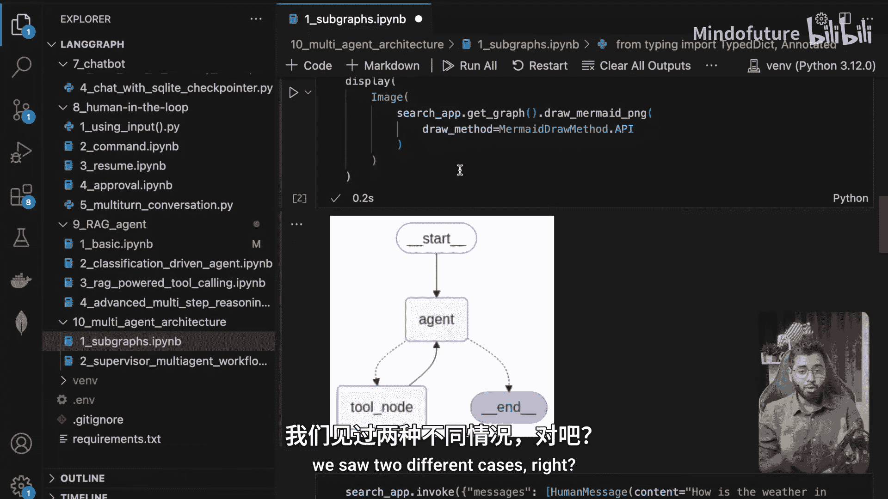
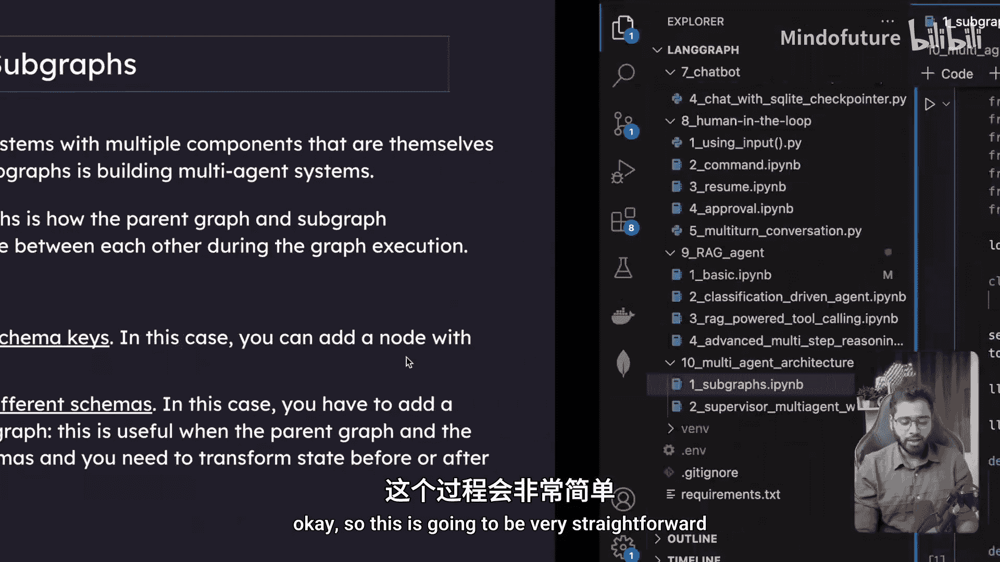
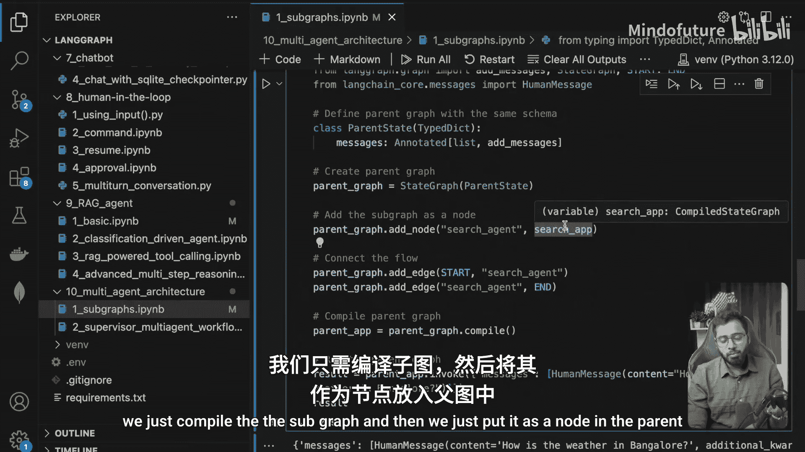
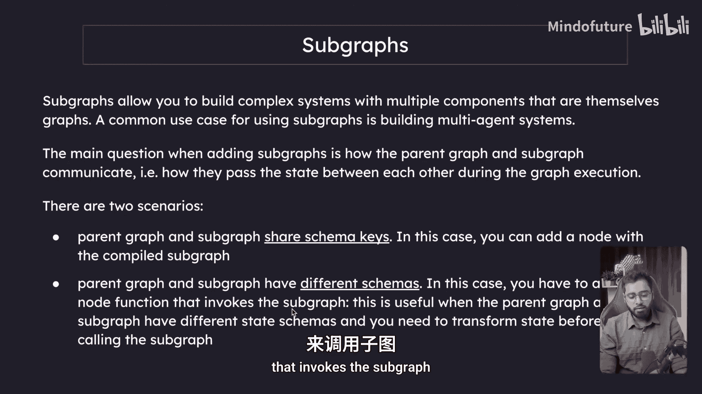
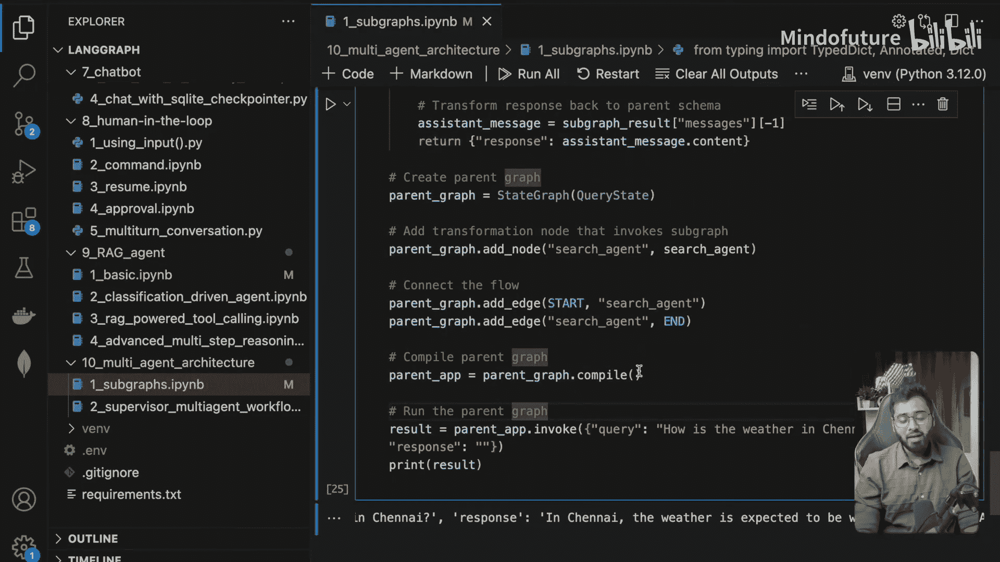

# Langgraph初学者入门2025 p40 P40_#38_多代理介绍_什么是子图 -BV1mgepzCEjf_p40-

Hello guys welcome to a brand new section in this video we are going to be looking at multi agent architectures so let's look at a few slides so we already know that an agent is a system that uses an LLM to decide the control flow of an application。

😊。

As you develop these systems， they might grow more complex over time。

 making them harder to manage and scale， for example， you might run into the following problems。😊。

The agent has too many tools at its disposal and makes poor decisions about which tool to call next。

😊，The context grows too complex for a single agent to keep track of。

And other problem could be there might be a need for multiple specialization areas in the system。

 so we might need a separate area for planning and research and math to tackle these problems you might consider breaking your application into smaller more independent agents and composing them into a multi agent system So these independent agents can be as simple as a prompt and an LLM call or as complex as a react agent。

😊，The primary benefits of using multi agent systems。

Our modularity separate agents make it easier to develop， test and maintain agent systems。😊。

Specialization， we can create expert agents focused on specific domains which helps with the overall system performance。

😊，And then control， you can explicitly control how agents communicate as opposed to relying on function calling。

😊。

So， here is an image that I pull from the documentation where they are talking about the different multi agent architectures that are possible。

😊，So if you look at this is the single agent right so we know what an agent is if we give tools to an LLM that becomes an agent。

 Okay so this is a single agent So the next type is the network So you can see that we have four different agent and they are all communicating with each other。

 So this one agent is solving it part of the task and then once it is done depending on what the next part of the problem is it is hand control to the next agent So they all have access to each other。

 So and the next step you can see this is a supervisor multiagent architecture So here you can see that we have one supervisor at the very top so the supervisors only job is to orchestrate you know the team So what we have below here is we have you can think of it as like three employees Each employee is specialized to do one particular thing So the first agent could be like a coding agent the second could be a researching agent the third could be like a evaluating agent or something like that。

 So depending on where you know how much of the problem is all。

 let's say it's a threepart problem in that case the supervisor。😊。

Is going to make use of this agent to solve the first part and then the control flow is going to come back to the supervisor and then the second part is going to be done by this agent and then the control flow is going to come back to the supervisor So one thing that you have to notice is that these agents don't communicate with each other they always report back to the supervisor and the supervisor has to decide which agent to call next okay so this is the supervisor multi agent architecture and the next thing is we have supervisor as tools So it's basically the same thing as what supervisor does except all these different agents。

 these three agents are provided as tools to the LLM So depending on where how much of the problem is completed the LLM can decide to call a particular tool which in this case is an agent it can provide input to the tool and then you know structured input to the tool so and then the agent or slash tool can be executed。

😊，And the next step is the hierarchical you can see that this is very similar to supervisor。

 but its just an extension of it Okay so there might be situations where you know this one supervisor might not be enough in that case we go for know multiple supervisors and in this case it's going to be a hierarchical multi agent architecture so it's very similar to how big companies work right and then finally we have custom where you know there is no clear definitions so right after this agent is done you know there are two different options depending on the answer output of the agent we can you know direct the flow to this agent or this agent so this is a little bit more disorganized and they have their own applications as well So with regards to actually learning how to build multi- agentent architectures it's very important for us to first understand how subgraphs work so let's look at some slides basically subgraphs allows you to build complex systems with multiple components that are themselves graphs a common use case for using subgraphs is building multi- agent systems。

😊。

So the main question when adding subgraphs is how the parent graph and subgraph communicate in other words。

 how they pass the state between each other during the graph execution so there are two scenarios。😊。

The parent graph and subgraph share the same schema keys in this case。

 you can just add a node with the compile subgraph。

But if a parent graph and a subgraph have different schemas。

 so in this case we add a node function that invokes the subgraph。😊。

This is useful when the parent graph and the subgraph have different statechemas and you need to transform the state before or after calling the subgraph So we are going to be looking at an example where we are going to be building a very very rudimentary basic subgraph and then we are going to embed that into a parent graph and we are also going to see these two different scenarios as well So this is going to give us a very strong foundation that we can build on top of and then we can build complex multi agentent architectures so let's jump to visual studio code So right here you can see that I've already gone ahead and created a folder called multiagent architecture and I've also created a file called subgraphs and I have populated the code as well so let me go through it step by step。

😊。

Alright， so as usual， I'm just going to import some needed modules like， you know， Land graph。

 you know， we are going to be using the Lama model this time。 Okay。

 so human message and we are loading the E and B file。 Okay。

 we are using the Tee and then we have the tool node。 Okay， so in the first part of the code。😊。

What I'm doing is I'm basically you know creating a very simple graph so if I scroll down here okay so this is the graph that we are building this is something that we've done it a million times by now we just have an LLM we have a tool node okay so if the user and one of these tools are the Tli search tool okay so if the user asks some question that requires an internet search in that case the the control flow is going to come to the tool node and then this is going to you know give an informed answer Okay so this is what I have built right here。

😊，So， as you can see right here in this child state okay so in the first part I am going to be building the child graph okay not the parent graph I am going to be building the child graph okay so this is the child graph。

😊，So right here， okay all that we want is the messages list。 I'm initializing the Tli search tool。

 I'm initializing the LLM。 we are binding it with this particular tool Okay and then this is the LLM this is the model which is going to invoke whichever human message is going to be you know passed in right so we have the agent and right after the agent okay so right after the agent we have the router so we're checking if the last message has tool calls and it has some tool calls that the LLM is asking for So if it is greater than zero in that case we are going to go to the tool node so we are using the prebuilt tool node class that the La graph provides so so this tool node is going to execute the Tli search it's going to return back the control to the agent and the agent which is the LLM which is going to have the response of the Tli search and it's going to give an informed answer okay so it's going to come back to the agent and that is going to come。

😊，To the end Okay so this is exactly what I have built right here So you can also see that I have named this thing a subgraph Okay so just to make it clear that what we're building is going to be a smaller graph that we want to embed into know a parent graph so this is a very basic example that we can work with so if I run this you can see that this is the graph that we get so if I run this you can see this is what we get right so this is going to be the initial human prompt and in the AI message if I scroll down here you can see that this is going to be the query So the LLm wants to invoke is calling a tool and then the tool is also getting executed。

 T search is getting executed and then you know it is also the AI message it is saying that Chennai weather today temperature So it wants a bit more information it is not satisfied with it so it is again calling the tool and then we are finally getting the current whether in Chennai is misty with it。

😊，emperature of 34。4 degrees c。 So what we have done so far is that we have built a subgraph。

 Now let's build let's create a parent graph and then embed the subgraph into the parent graph。

 So when we want to embed a subgraph into a parent graph in the slides。

 we saw two different cases right so you can see that we have two different scenarios here。

 right So if we parent graph subgraph share the same sche a keys。

 So what do we mean by schema keys So this particular messages property in the state right So if the parent as well as a child have the same message in that case we can just add a node with a compiled subgraph Okay。

 so this is going to be very straightforward。 So let's look at how we can do that Okay。

 so right here in the subgraph we are compiling the app So we have a search app Okay so I'm just going to call it this could be like a search agent right So coming down。

😊。

So this case， one is going to be the shared schema， and we are directly embedding it。 Alright。

 so this is going to be the parent state。 It has the same messages key as well for whatever reason。

 Okay， so here is what I'm doing right here。 So I'm going to keep it very， very simple。

 So we just have a start node and then the search agent node and the end node。

 Okay so the search agent is what weve already built up here。 Okay。

 so we can think of this as the parent graph。 Okay， so we are creating a parent graph。

 a new new graph using this new state， which happens to have the same schema key， right。

 so we have the new graph。 we are adding the search node。 Okay。

 so this is going to be this particular app。 Okay so we've compiled the app right here right。

 So this is exactly what we are providing as a node。😊，To the parent graph。Okay。

 so we have we are starting with a start right after the start is done。

 we are going to go to the search app and then ending。 Alright。

 so we are compiling it and we are providing the message。 Okay。

 how is the weather in Chennai and basically it's going to do the exact same thing now I can invoke the parent app and then I can pass in the same message and whatever we pass in here is going to be made available in this search agent as well Okay。

 so the control flow is going to go to the search agent and whatever the search search agent is going to be outputting it is going to be available as a result right here Okay so if I were to change it tool。

 let's say bangalore okay， if I run this file if I run this code block。😊。

Okay basically the control flow should go inside of the search agent。

 So if we go to the lasmith and we look at it it's going to go inside of this。 Okay。

 so or else how are we going to get this right So the current weather in Bangalore is expected to be fair with a maximum temperature or whatever right So this is how simple it is to embed a subgraph into a paragraph graph as far as we have shared schema Okay so if we shared schema we just like put the direct we just compile the the subgraph and then we just put it as a node in the paragraphgraph all it coming down。

😊。

Now let's scroll down So we have a case to as well where we have different schemas。 Okay。

 so we are invoking with a transformation。 So what does this mean So if they have different schemas in this case。

 you have to add a note function that invokes the subgraph。 Okay。

 so we just have to have an intermediate step。 Okay that is all that we are doing right here。

 So coming down we this is where we are going to define the parent graph with a slightly different schema Okay。

 so this is going to be different this this is going to have a different schema from what the subgraph is expecting。

 Okay， so we have to sort of match， we have to make it both compatible。

 we have to make this subgraph and a parent graph compatible with each other so that they can be embedded。

😊。

So so what I'm going to do is I'm going to define a new node for that Okay so you can see that this parent graph is just going to have you know three different nodes okay we are just going to have the start and then we are going to have an intermediate node called search agent and then we are going to have end okay so this is going to be the intermediate node where we are going to you know make it compatible the subgraph and the parent graph compatible so if I come down here okay so this is the the subgraph right search app so we know that this only takes in a list of messages so that is why we are going to make use of we are going to extract the query from here and then we are going to send it okay as part of the messages array okay when we are invoking the subgraph okay so this way okay we are going to get a response right we are going to get the final response which is again going to be a list of messages from the subgraph so now all that I'm going to do is okay so you know that in the parent graph we just have the query and the response。

😊，So I am going to extract the response from the result of the subgraph so in the last AI message Im just going to get the last AI message。

And then take the content alone and send it and then attach it in this particular response。

 and that is it。 And then I'm going to end it。 Okay， so now if I just ask。

 you know how is the weather in Chennai， we just have the response。

 Okay in Chennai the weather is expected to be warm and sunny okay so this is how simple it is to you know embed a subgraph into a parent graph Okay。

 if it is a same state just compile it and put it as a node if it is a different state in that case you just need to write an intermediate node like what we did right here。

 you know pass the data in the exact format that the subgraph is asking for get the result and whatever result that you get。

 you can just update it based on whatever schema that we have defined for the parent state。😊。

So I hope you've learned how to embed a subgraph into a pair graph and then we've also seen two different scenarios as well。

 Okay， so I will see you in the next section where we are going to be building a multi agent architecture。

 so as you then。😊。

