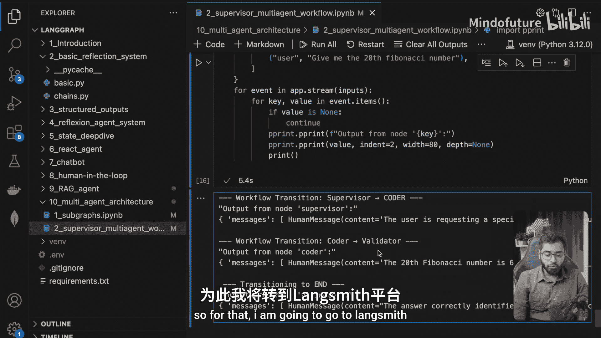
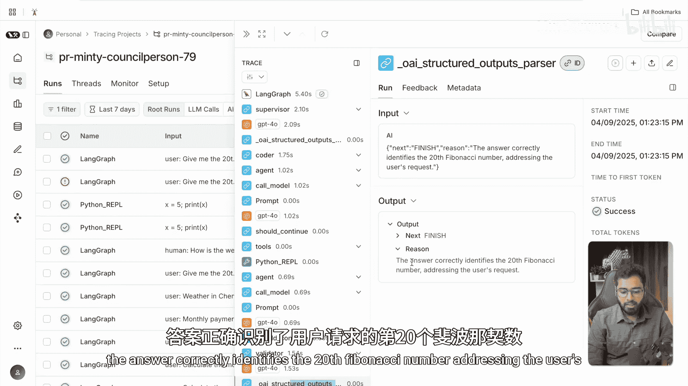
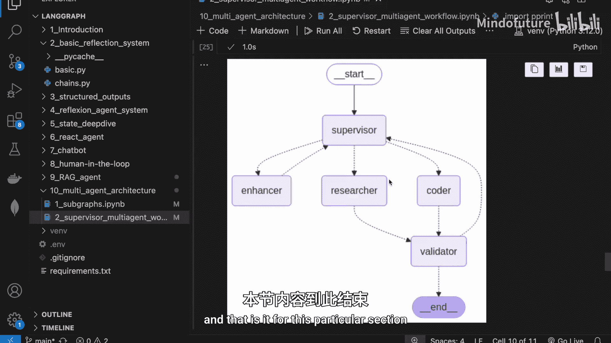

# Langgraph初学者入门2025 p41 P41_#39_多代理_主管代理系统 -BV1mgepzCEjf_p41-

Hello guys， so in this video let us look at how we can implement the supervisor multi agent architecture。

😊，So in this architecture we define agents as nodes and add a supervisor node that can decide which agent node should be called next so we can use the command class to route execution to the appropriate agent node based on a supervisor's decision so this is what I want to build so you can see that we have a supervisor agent at the very top and this supervisor agent has four different agent underneath them so we have the enhancer agent we have the researcher agent the code agent and the validator agent okay so if the user prompt if the supervisor agent thinks that the user prompt is not really clear if it is not vague if it is a little vague in that case the supervisor agent can always employ it can always use this enhancer agent to make the prompt better it to rephrase it better。

😊，Okay so so right after the enhancer is done with the enhancer work。

 the control4 is going to come back to the supervisor agent again。

 So now the supervisor knows the prompt is better now it's going to look okay so does this particular prompt require research from the internet in that case is' going to you know it's going to hand it off hand off the control to the researcher So once the researcher is done it's going to come back and the same thing for coder as well So if there is a particular problem that requires some code to be written in that case you know the control the supervisor can hand off the control to the coder agent and the coder agent can actually use an actual tool okay that tool we are going to be looking at that tool is going to actually execute code okay it's going to take the output and give it okay so that is also something that we will look at and then finally we have the validator agent so right before ending this workflow the validator agent is just going to check if the user's question and the final answer is actually。

😊，relevant or not okay so this is what we are going to be building out So lets actually without wasting any more time jump into the code。

😊，So right here you can see that these are some very standard imports that I'm doing right I'm importing you know pantic because there are some structured outputs that we might have to do and then we have human message that T tool the command class to direct the flow of the graph we have the state graph and then look at this part so there is actually a pre-built graph that la graph provides for us to build a react agent so if you remember a couple of videos before in the react agent we actually built out the react agent from scratch right so we can always use a particular graph and then embed it into this bigger graph。

 we can always do that but if you don't want to do that that is absolutely fine La graph provides a pre-built class a method So this is going to you can see that it creates a graph that works with a chart model that utilizes tool calling so we can just provide the prompt problem statement you can provide the tools and then that is going to start looping through the thought action observation。

😊，observation is's going to return the final answer。 So in this in this video。

 let's also explore that。 Okay， great。 And then we have the i Python。

 we are loading the environment variables。 and then this is going to be the second tool that we are going to be using So if you remember I told you that this code agent is going to have one tool right So that tool can actually execute code。

 So this is going to be that particular tool okay， so it's going to be the tool for running python code in a repel。

 So if I go in here， you can see that it is a tool for running Python code in a repel right it so I'm taking it from la chain experimental you probably would not have it installed already so go ahead and install that as well perfect So coming down are very so we are initializing the LLM and then were initializing the table search and then we are initializing the Python repple tool as well so if I go ahead and run this Okay so you can see that we are getting five as an output so you can imagine that there might。

😊，some cases where the LLM just writes the code and then it might ask you know it might actually use this particular tool to you know better get accurate answers alright so I hope this makes sense before I continue forward with explaining the rest of the code so you can see that I've already gone ahead and created the supervisor node okay and then I've created the enhancer node the research node。

😊，The code node right and finally we must also have the validator node as well。

 So I've already created all of these nodes。 but before I actually move on to explaining each and every single node。

 I first want to show you the graph okay so this is the graph that we have So this is very similar to what I showed you right So we have the supervisor node up here we have the enhancer So if the supervisor wants the prompt to be enhanced it's going to come here and then it's going to report back to the supervisor okay so if the supervisor needs research okay so it's going to go to the researcher node and right after the output is done the control flow is going to go to the validator okay so what this validator agent is going to do is it's going to look at the output of the researcher and then it's going to check does this answer the user's question if it does we are going to return it if it does not return it we are going to send it back to the supervisor maybe there is another problem that we have to solve maybe there is a coding problem in that case the code is going to give the answer and then。

😊，checking validating that does this have the answer to the users question If it does not have the answer。

 then we are again going to send it to the supervisor Okay so this is going to be the graph。

 So as you can see I've got a couple of different examples example prompts Okay so this is one problem and I've got another problem here whether in Chennai and then I've got another problem give me the 20th Fibonacci number Okay so let's let's actually you know you can imagine that this particular code is going to make use of the coding agent right so let me actually go ahead and run it and show you the output。

😊，Okay， so P print is not defined。 Okay， and that is not running because okay， let me just copy。

 copy and put it over here。Okay， because I don't want to run that particular block right now， Okay。

 so now they should work。All at trade。 So we actually have the answer right here。

 So let's actually see what happened。 So the workflow initially transitioned from the supervisor to the coder。

 Okay， the supervisor correctly figured out that this particular problem requires the coder agent So that is why the supervisor is first saying the user is requesting a specific numerical result from a well definedfin sequence。

 Okay， the Fibonacci sequence， which is best served by calculating the value using a coding implementation。

 the problem is clear and structured making it appropriate to move it directly to the coder for computation Okay so if I had like you know given some vague prompt in that case。

 the supervisor probably would have gone for the prompting agent。 Okay。

 so you know this particular agent enhancer agent。😊。

But since it' is already well defined it is going to direct it to the coder so now it is coming to the so you can also imagine why are we using human message here So we are using human message as the output of the supervisor because we are sort of like simulating that each of these agents are actually human beings right supervisor is a human all these different people are different agents human agents thats why Im using human agent here。

😊，Alright， so the next thing is the coder is going to output this thing。

 Okay the 20th Fibonacci number is 6，7，6，5。 So we we can't look at the tool called right now。

 So for that I am going to go to lasmith。 Okay， so I am going to go to the first run。😊。

Okay so you can see that okay this is what we provided right Give me the 20th Fibonacci number So the first one was was the supervisor the supervisor you know directed the control to the coder right so you can see that go to his coder So the next thing is the coder So right here you can see that the coder agent is actually calling the tool and it is providing the input query for the tool as well So it basically wrote the you know Fibonacci calculation program it also provided20 instead of this because that is what the human initially wanted right that was the initial prompt So its provided this thing and then finally you can see that it is going to you know coming down you can see that it is calling the Python repel tool。

😊，Right so it's calling the Python re tool and the Python re tool is outputting 6765。

 which is again going to be fed to the agent right so it's again going to be fed to the agent So if I come down here you can see that it is actually saying the 20th Fibonacci number is 6765 and finally the validator is also confirming that this is actually good the answer correctly identifyent the 20th Fibonacci number addressing the user's request So now that we understand know what problem this architecture solves let's quickly go through the different nodes that I've written So initially we have the supervisor node that I've written right here so I've defined the supervisor node and I'm also structuring the output of the supervisor node so I'm telling give me back two different properties so I need the next agent to direct the flow to and then I also need a reason why you think that the next agent is it could be enhancer or researcher or coder so I'm just giving a description as well So use enhancer when。

😊。

User input request clarification use researcher when you need additional facts use coder when some problem solving is required okay so accordingly it is going to produce either this or this or this and it is also going to give some reason why it thought that okay let's say we need to go to coder okay so detail justification。

Allright， so this is going to be the prompt I'm providing a lot of different information like you know you' are a supervisor managing a team of three agents prompt enhancer researcher andr your role is to orchestrate everything provide clear concise rationale for each decision these are the three team members you know the prompt enhancer researcher coder these are your responsibilities right I'm saying analyze each user' request and agent response for completeness accuracy and relevance route the task to the most appropriate agent at each decision point maintain workflow momentum by avoiding redundant agent assignments。

 continue the process until user request is fully and satisfactorily resolved okay your objective is to create an efficient workflow that leverages each agent's strengths while minimizing unnecessary steps ultimately delivering complete and accurate solutions to users request So this is going to be the system prompt okay so this is going to be the first system message and then。

😊，I'm going to append the conversation history okay so right here and then I'm going to know use this particular you know structured output I'm providing this sporadic model and why am I doing that because I want the output of the supervisor to always have this next and reason so that is what I'm extracting right here So once I have the go to and the reason as well okay so the reason I can just provide it I can just add it as a message in the list message list and then I'm going to use this go to to use I mean I can put it in this go to keyword parameter and I can use the command class rate so that I can control the direction I can control the flow to whichever agent that the supervisor wants to go to allright so that is it for the supervisor node So coming down we also have the enhancer node the enhancer node basically okay this is what does it improves and clarifyifies the user query it takes the original user input and transforms it into a more precise actionable request before passing it。

😊，To the supervisor So this is going to be the system prompt Okay you're a query refinement specialist Okay。

 you are going to analyze the original query， identify the key intent。

 what is the user actually you know asking for and then we have resolving any ambiguities or confusions without requesting additional user input expanding underdeveloped aspects of the query with reasonable assumptions right restructuring the query for clarity and actionability So we are we are also saying that never asked questions back to the user instead make informed assumptions and create the most comprehensive version of their request possible。

😊，So we are going to do the same thing again this is going to be the system prompt we are providing the entire history again and now we are going to you know invoke the LLM whatever is going to be the output I am just going to append it as a human message and Im also going to provide a name this time。

😊，Okay， so I'm going to provide the name enhancer。 the same thing I would have done in the supervisor as well。

 Okay， so I'm providing the name as supervisor， but we are not going to be using AI message。

 we can't do it。 Nothing is going to happen， but Im just going to consider all these different agents as humans。

 So that is why I'm using the human message and then I'm providing the name as well Allright。

 So right after the enhancer。 What do we want to do， we always want to go back to the supervisor。😊。

Right we cant we cant go go to the end right after the enhancer we always need to go back to the supervisor。

 so that is why I have added this as a default value Alright I hope that makes sense let's move on So now we have the research node so the research agent node gathers information using the Tli search。

😊，It takes the current task， performs relevant search and returns findings for validation Okay so here I'm going to be using the react agent As I said already we can use the graph that we've already built or we can use this prebuilt class that Lagra provides as well okay so here I'm providing the LLM that I want to use the tools that are available to the react agent and then this is going to be the initial prompt okay so I'm saying identify key information needs based on the query context gather all the information optimize the findings okay wherever you know you want to cite the sources when possible you can do that to establish credibility focusing exclusively on information gathering avoid analysis or implementation。

😊，Provide thorough factual responses without speculation where information is unavailable。Okay。

 so this is going to go crawl the internet。 It's going to you know do a couple of loops okay。

 and then it's going to return the entire state again right here。

 So that is what this particular invo is going to do and this is going to return the entire state with a messages list right so we're just going to take the last AI message that this particular agent would have returned and then I'm going to take the content alone and I'm going to append it to our list so to our messages list I'm going to append it right here Okay so right after the research agent is done with its work we are now going to be validator okay so this also we are hard coding right here because if the research agent has done its job properly in that case if the validator gives the sign off okay if it gives the green light we can just end the workflow okay so now let's go to the validator okay so validator is somewhere down here in the middle we also have the code node it's very simple your coder and an analyst focus on mathematical calculations analyzing solving math problems。

😊，Right right so calculations okay so we are again providing the Python Re tool as well the same thing and whatever result that we get。

 we are going to take the latest AI message right and then I'm going to add it as a human message and append it to our list and again I'm going to go to the validator okay I hope that makes sense and finally we have the validator okay so we have the validator node we are using a couple of prompts for the validator okay so we are saying that first review the user's question the first message in the workflow and then review the answer which is the last message and make sure that and were saying that if the answer addresses the core intent of the question。

 okay finish it or else or else route back to the supervisor okay so that is what we are saying right here So either it needs to output supervisor or finish okay so that is what we are providing right here and in addition to providing it right here we are also using a pyantic model and we are further you know forcing it to only provide。

😊，Supervisor or finish so specifies the next worker in the pipeline supervisor to continue or finish to term the reason for this decision here as well。

 So as I told you， we only need the first user' question and the last answer right so that is exactly what we're doing right here in this node So we are taking the first human question and then we are taking the last answer that is supposedly the final answer So we are going to take the user's question and the agent's answer and we are going to provide all of this to the LLm and then we're also you know providing the validator pantic model as well。

 So right here if the LLM returns go to is finish in that case we can end the graph。

 but if for some reason it does not provide finish for some reason this final answer does not have the full answer to the user's question in that case we need to go to the supervisor again so that is what Ive put right here Alright so I hope that makes sense so far we built out all the different nodes now all that is left is to combine by。

😊，putut it all together into a graph so that is exactly what I have done here I'm adding all these different nodes and then I'm compiling it as well Okay so that is why we have this final。

😊，Graph right here， which looks pretty good。 So coming down lets actually go ahead and implement this other example that we have。

 So the user is asking for whether in Gennnai。 So in this case you know the researcher agent is going to kick in right you can imagine because researcher is the one access to the T search tool right So let's actually go ahead and run this。

😊，Okay， great， so you can see the supervisor is handing off control to the researcher why the user is requested information about the weather in Chennai。

 which requires collecting current data。 The task is best handled by the researcher who can gather updated information So this is the reason that the supervisor is providing and using the command we are directing the the float to the validate I mean the researcher Now what is the researcher saying the current weather in Chennai is as follows it is providing it is calling the T search tool it is providing the information right here and then finally the validator Okay。

 so the answer provides a detailed current weather this thing。 Okay。

 so that is it So we have the final answer right here。😊，And that is it guys。

 This is how we can build out the supervisor agent architecture system。 So do go ahead。

 pull the code run it by yourself， try putting in different prompts。

 So there might be some prompts that that might not work。

 And that might require some tweaking in the prompt。 Okay。

 so that might require some changing prompts here and there According to the problem that you are trying to solve。

 And that is something that I will leave you to explore。 And that is it for this particular section。

 I will see you in the next one。😊。

