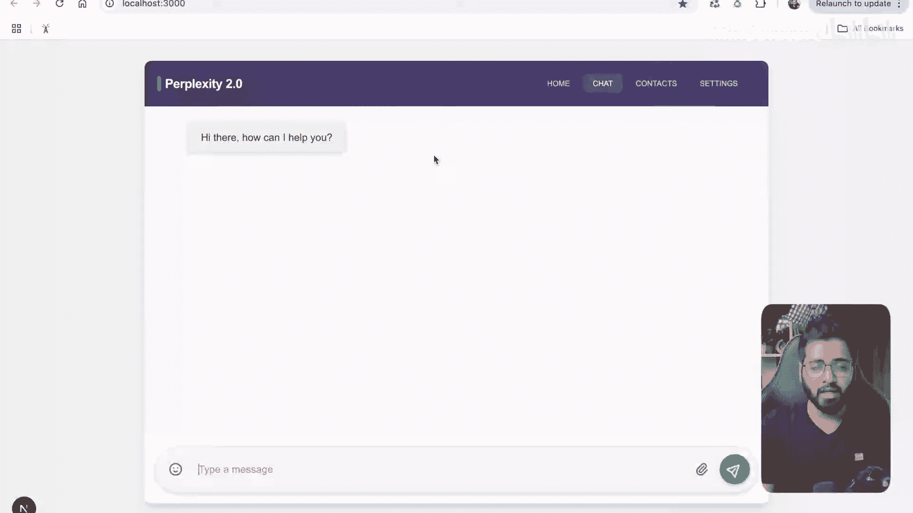
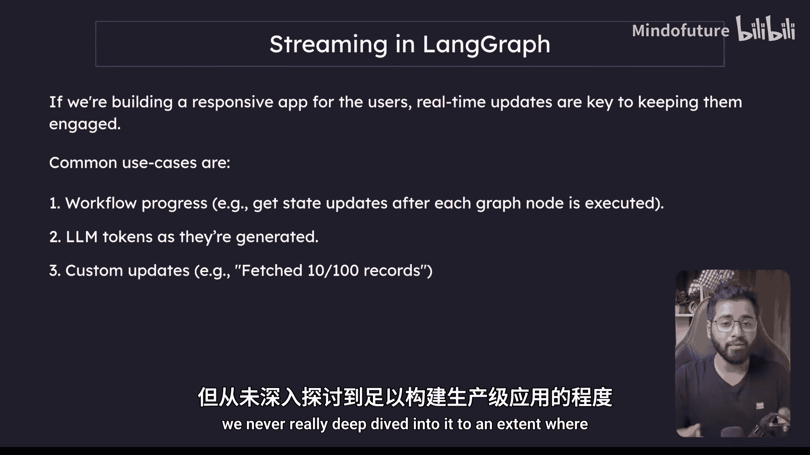
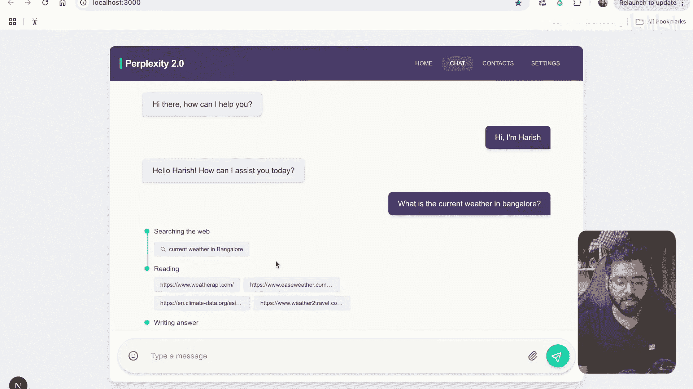
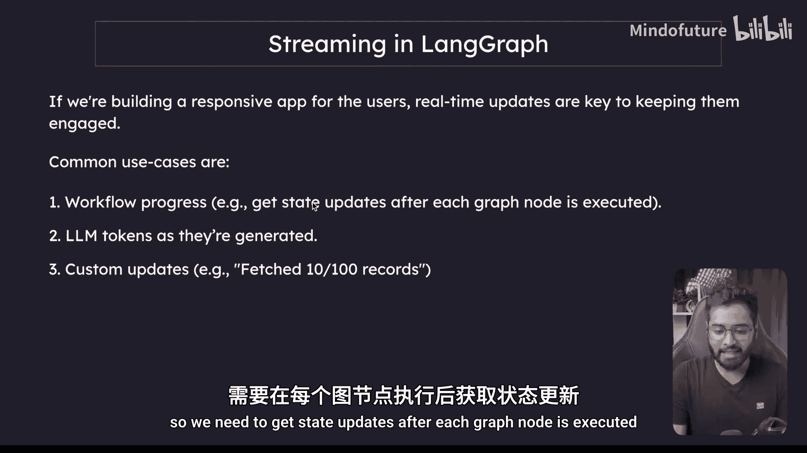
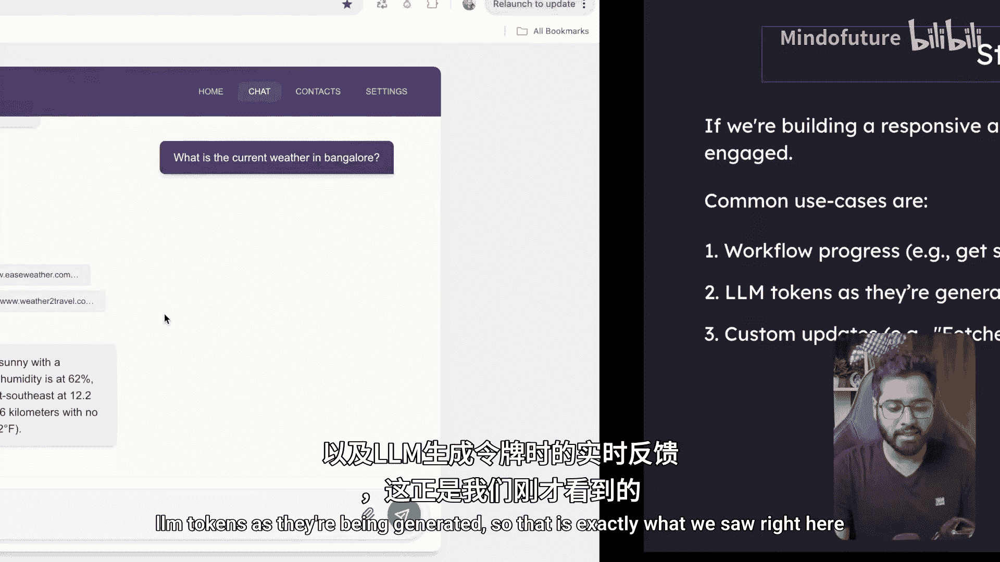
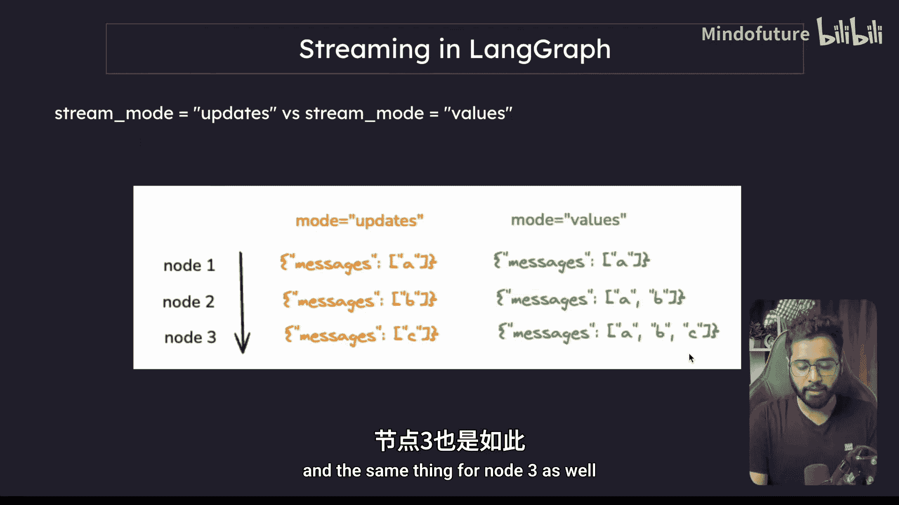
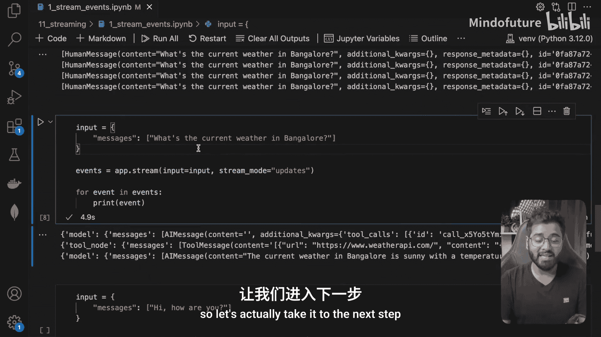
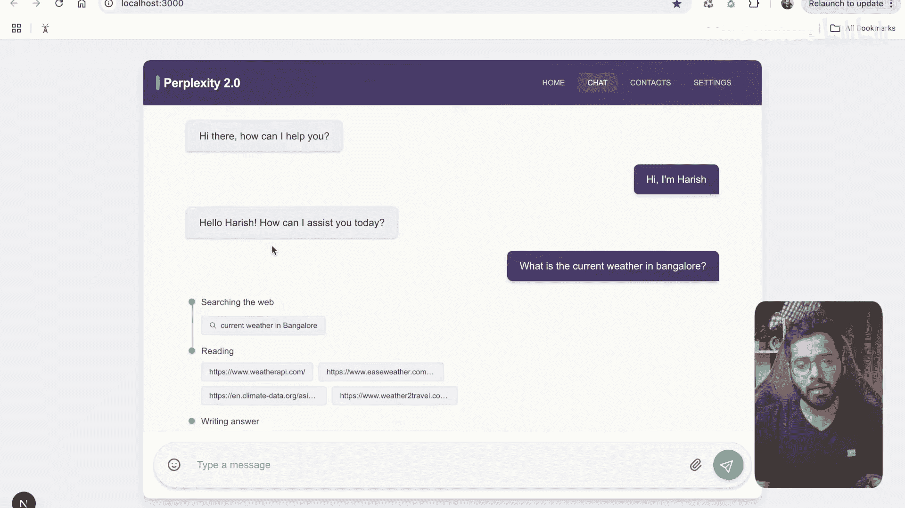
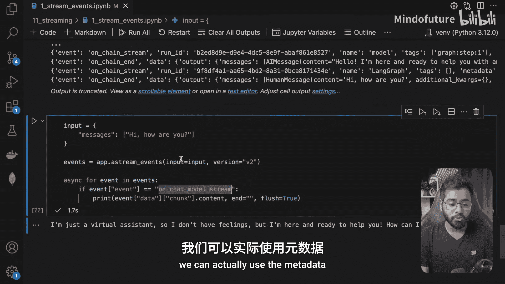
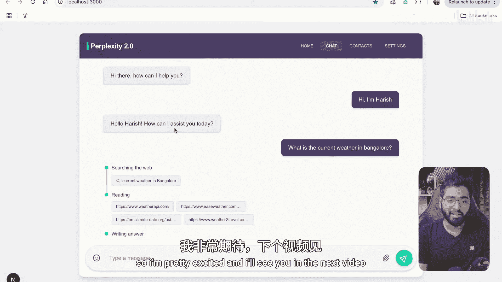

# Langgraph初学者入门2025 p42 P42_#40_流式传输_深入探讨 -BV1mgepzCEjf_p42-

Hello guys。 So in this video， let's actually try to understand streaming in depth。

 So in the past few videos， we did use you know streaming here and there。

 but we never really deep dived into it to an extent where we can actually build you production grade applications。

 So I'll tell you what I mean。 So this is an application that we are going to be building for the final capstone project So I've called it perplexity to point0 because we are sort of mimicking what perplexity does in there Ui wherein you know if I were to ask something like or let me just say hi am Harish in this case it's going to you know stream the tokens。

 So you can see that as and when the words are generated by the LLM。

 all these tokens are being streamed to the front end and also you know if I were to ask a question like you know what is the current whether in Balore or let's say。

😊。

So in this case you can actually see all of the tool calls that are being done so you can see that it's searching the web this is the query that the LLM has suggested to the Tli search and then this is the response of the Tvalee it is actually pulling all of the information from these four different websites and then finally it's writing the answer so we can actually see that all these different things are being streamed to the front end and we can actually see what the LLM is doing so it's very important because you know just imagine if there is no streaming happening the user is not going to know what is happening so for a good 20 seconds 30 seconds the user is just going to stare the screen so this is exactly what we are going to learn in this particular video so you can see that if were building a responsive application for the users real-time updates are key to keeping them engaged Common use cases are workflow progress right so we need to get state updates after each graph node is executed LLM tokens as theyre being generated so that is exactly what we saw right here。

😊。

Custom updates right so when we talk about streaming in La graph so we have the stream and a stream methods so the stream and stream are sync and async methods for streaming back outputs from a graph run so there are several modes you can specify when calling these methods so we can say graph or stream this is actually very similar to how we say graph do invoke right So we say graph or stream we pass in the the initial state。

And then right here look at this。 So right now we pass in values。

 but the common modes are we can either pass in values。

 this streams the full value of the state after each step of the graph。

And then we also have stream mode updates。 So basically this streams the updates to the state after each step of the graph。

 So let's actually look at a pictorial representation of the difference between stream mode updates and stream mode values So if we set stream mode updates we are only going to look at we are only going to see what is the value that has been updated Okay so we know that the messages。

 okay so this is node 12，3。 So in node one， it just updates a okay initially the list would have been empty。

 So node 1 just updates a okay node 2 basically would have appended B to the list okay so that is why we are just seeing B and the node C just appended C to the list So that is why we are seeing just a B and C and when we look at mode values so after the execution of the first node we are going to get the entire state at that particular point which is going to be a list with the item a and then after the execution of node2 we are going to see the。

😊，State at that particular point and the same thing for node3 as well。

 So let us actually put this in practice。 you can see that I have already gone ahead and created a file called streamam events So right here you can see that this is going to be the picture that this is something that we've built already so we have the start node and then we have the LLM sitting right in the middle and then we are just providing one tool which is going to be in this case the T search tool and then the tool node so let's actually go and look at the graph structure So we have the agent state right here。

 which is just going to contain the list of messages we are initializing the T search and then we have the tools list right here and then we are also you know initializing the LLM and then we are initializing we are binding the tools with the LLM as well and now we have the LLM with tools so right here we are defining the model node we are just going to invoke and send in the entire list inside of this and then the tool routeer is basically just going to take the last AI message and then it's going to see。

😊。

If there is any tool calls needed at that particular point and then if there are any tool calls that the LLM wants to do in that case it's going to direct the flow to the tool node node and for this tool node we are using the tool node prebuilt method class right here where we are also going to provide the list of tools as well Alright so we are just connecting all these different things and finally we have a graph like this this we have already seen alright so everything is looking good so coming down so in this case we are actually going to put these stream method to use so right here you can see that what I'm doing is I'm saying app do stream and then I'm providing the input so the input message list is going to be what the first human message is going to be what is the current weather in Balore so I'm also setting the stream mode to values so if you remember when we set stream mode to values so what that is going to do is right after the execution of every single node it is going to emit an event it's going to emit an event and in that event we are going。

😊，To see the entire state at that particular point so I am looping through the events right here okay so this event is going to be an iterable it is a generator so anytime there is an event that is being emitted that is being yielded from the generator we are going to get this event right here and we are going to print it down here so let me actually go ahead and run it and let me show you what it means。

😊，Alright so you can see that initially we have this one human message alone Okay so that is the only thing that exists So why are we getting this particular object we are getting the object because the start node just got executed so at this particular point the list only has one human message and then after the execution of this LLM model what should be there there should be two items in the list right we have the first human message and then we should have an AI message with an empty content content field and then we should have a tool call item because this is a query that requires the LLM to use the Tli search tool right So in this case you can see that this is going to be the first item and then if I come down here you can see we have an AI message as predicted the content is not there because we actually have the tool calls right so we can actually see the argument here as well that the LLM is suggesting so it is suggesting okay use this particular query current weather in Balore so that is。

😊，That is present right here Okay so it only has two different Okay it's pretty long。

 but it only has two items in this particular list right now So what next what should be the next thing next the control is going to come to the tool node the tool node is going to take that query and then it's going to call the T research tool and that is going to output a tool message so that is exactly what we see right here we have the tool message this is going to be the output and finally it's going to come back to the model and then finally there is going to be an AI message So that is why you know in the last last event that was emitted the last event that was emitted here you can see that we would have the final AI message as well。

It's going pretty long， but you you get the idea。 Allright， I'm not even going to try at this point。

 Okay Alright， so great， so we have the AI message right here。

 right the current weather in Balore is sunny is sunny with the temperature 30。

1 degrees Celsiusius right So we have four different events that were emitted and each of these events had the full state after the execution of each of those nodes。

 So I hope that that made sense we can actually go and we can actually say something like messages right here and this is this would probably give you you know just the messages alone Now let's actually go ahead look at the updates。

 Okay so if you remember updates is just going to give you what is that new item that's been added to the list right So it is also going to provide you which node actually did the change as well。

 So let me actually run this and show with you So in this case。😊。

Okay so you can see that the first change was made by this particular model node and then it updated something Okay so it just added this AI message at the very start Okay so that is all that we see right here so this model node just added this AI message and this tool node just added this tool message and then this again this model node added this AI message which which has the final answer here。

So let's actually take it to the next step。 So if you remember what we did in the Ui we didn't just we were we are not interested in getting the entire state after the execution of every single node。

 that's not what were interested we are interested in getting every single token that is being generated by the LLM right so that is what we did right here that is how we can actually achieve this sort of a Ui right So to help us with that there is there are other methods so let's look at that So let's actually look at some slides as well。

 So in production applications we usually want to stream more than the state right so in particular with LLM calls。

 it is common to stream the tokens as they are generated。

 So we can do this using the a stream events method which streams back to events as they happen inside the nodes so we are not interested in what happens at the end of the node we are interested in what happens within the node right So each event is a dictionary with a few keys so in this case we are every single event is going to be a。

😊。

And it's going to have an event property name data and metadata properties so the event is going to be this is going to be the type of event that is being emitted。

 the name is going to be the name of the event data is going to be the data associated with the event and we are also going to have some metadata about which particular node emitted that event as well I hope that makes sense let's actually now go ahead and put this method to use so right here coming down you can see that I have used this particular method right here so I'm going to be using something very simple right here you know message hi how are you we are not going to be using any tool calls at this particular point because we are learning so I'm saying app dot a stream events passing in this input this also takes in two versions okay so we've got version1 and version2 I'm going to be using the latest version。

😊，And all that I'm going to do is I'm going to look through all of the events that are getting emitted and then printing it。

 Okay， so make sure to use this particular async because this is going to be an asynchronous operation Alright so in this case let's actually go ahead and run it and you should be able to see that you know the events are actually getting generated you can see that there's a lot of events that are getting generated we can actually use all these different things and then accordingly we can show it in the Ui so right here you can see that we these are the event types right so these are the event types so on chain start on chain end on chat model stream right so on chain end so these are the event types and what we are interested in is the streams the event that are emititted from the LLM So these are the things that are emititted from the LLm okay so on chat model start and then on chat model stream So inside if if you look at the data that is associated with this on chat model stream we should be able to see in this particular chunk we should be able to see this。

😊，AI message chunk okay so this is going to be the response so you can see that it is saying hello I am here and ready to help you with any information or questions so this is going to be the response of the LLM。

😊，Right you should be able to find all these different tokens that are emitted inside of the data in this particular type so if you wanted to we can also always use these particular types right we can always use this particular event types and then isolate it and yield it isolate and send it stream it to the front end so what I mean by that is right here you can see that Im only interested in this particular event called on chat model stream and then I'm just going into event data chunk and then I'm printing it okay so in this case if I run it it's going to be the same query as well so if we run it you should be able to see just that being printed hellello I'm just a computer program so I don't have feelings but I'm here right so if if you want it to be in a same line this print method also provides this end so right here we can just say we can just give an empty string okay so in this case what's going to happen is it's not going to go to the next line instead it's going to。

😊，concatenate everything。 So right here you can you would have actually noticed that。

 you know it did not generate word by word。 And the reason why that happens is because you know it actually this print method by default it's going to store some chunks together and only then print it so to overwride that we can actually use this flush through and this is just going to flush everything from the buffer as and when you know some value is actually stored in it。

 So in this case， if I actually go ahead and run it， you can actually see word by word。

 it is being generated。 So I hope this makes sense， we can actually use these events。

 we can actually use the metadata So if I actually go to the right side so inside of the on chat model stream So this is the data this we know we can actually also go to the metadata so we have the metadata right where we also have information about which particular node emitted which particular node is。

😊。

Responsible for this particular event。 So in this case the La graph node that is responsible for this event is the model node Okay。

 so we can also use this particular name the this particular La graph node and we can also add that in one of our conditions and then yield we can isolate that and yield to the。

😊，Send stream it to the U I。 Okay， so it is completely in our control。

 We can actually make use of all these different， you know， properties like event data， metadata。

 et cetera， et cetera。 So by the end of this course。

 we are going to be actually putting all these different concepts to use。

 and we are going to be building this particular application。 So I'm pretty excited。

 And I'll see you in the next video。😊。

