# Langgraph初学者入门2025 p43 P43_#41_毕业设计项目_介绍 -BV1mgepzCEjf_p43-

Hello guys， welcome to this brand new video In this video。

 we are going to be building a full stackag application using la graph in the back end。

 we are going to be using fast API。 we are going to be using react in the front end and we are going to achieve something that is very similar to what perplexity does in the UI So I'm not sure if you've used perplexity before but it basically you know it's basically like a very smarter version of Google you can think of it like that right So if I were to ask some question that requires the AI agent powering perplexity to actually make an internet search the user I can actually look at what is happening on the Ui So you know I can see something like searching the web right now it is actually reading through all these URLs it is actually giving a response as well。

 So I would be able to see all these different things So that is exactly what we are going to be building as well In addition to that all these know it's going to remember our previous conversations all these different words as in when。

😊。

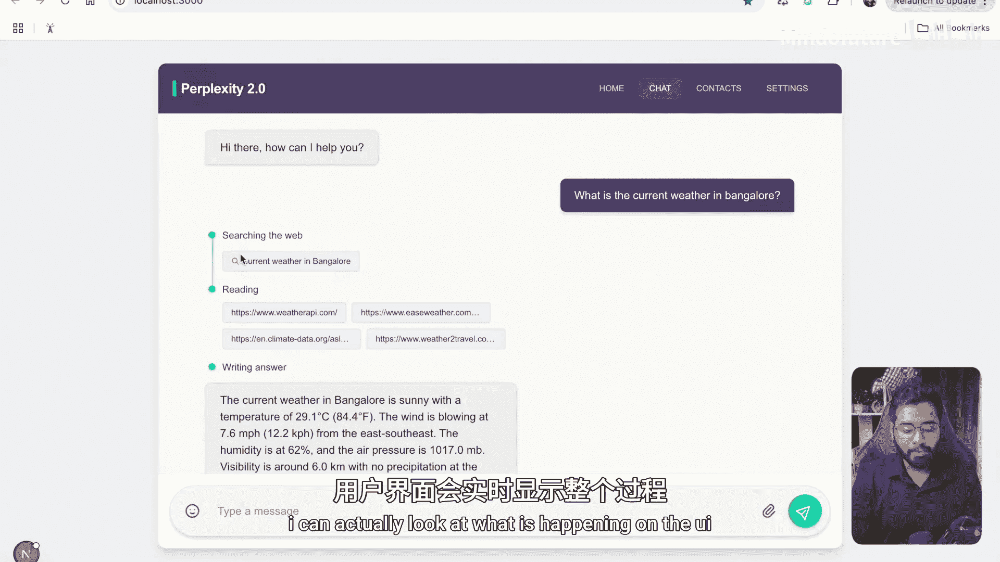

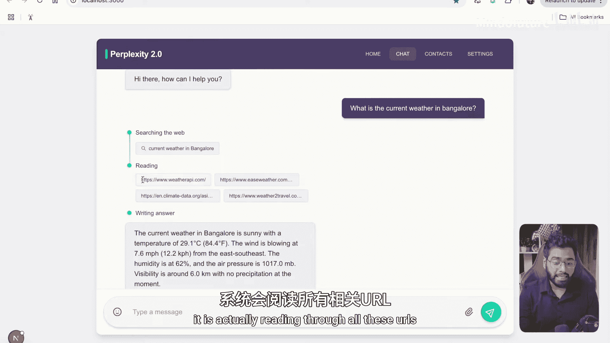

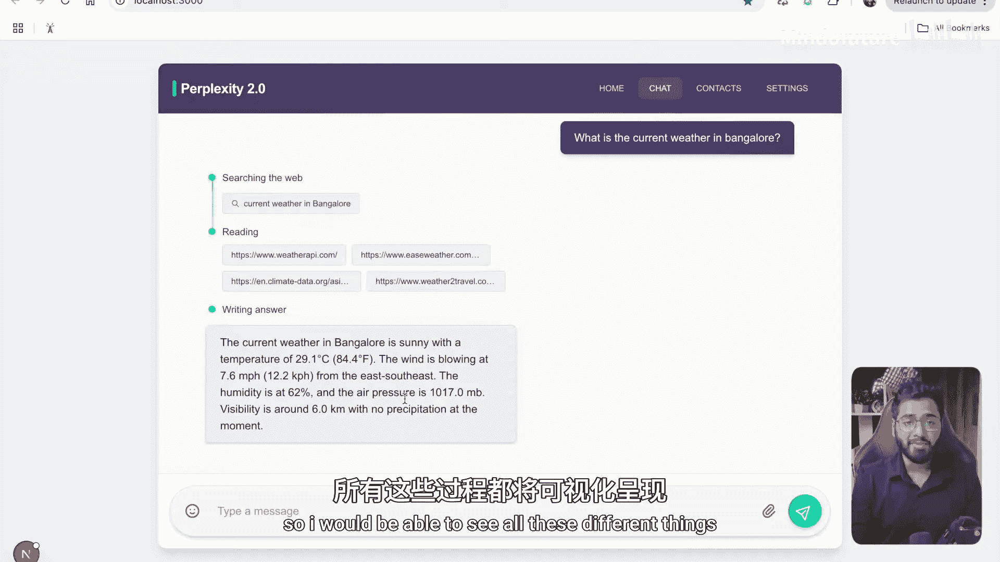

Tokens are being generated。 It is going to be streamed to the front end so the user is not going to wait for anything so let me actually quickly demo it for you。

 So let's test out the first thing。 Okay so there's a few errors right here we don't have to worry about it but let's you know just say you know hi my name is Haish right So in this case it's basically just going to you can see that every single word is actually being streamed and it is shown in real time。

 So it's just hi Hash how are you how can I assist you today。😊。

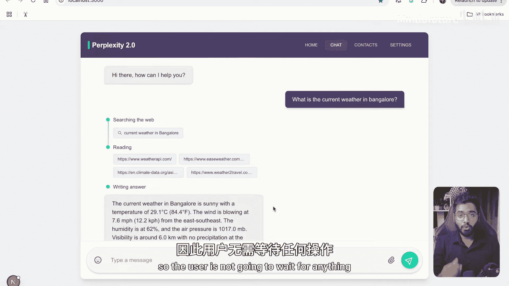

In this case， I can ask like what was my name again？

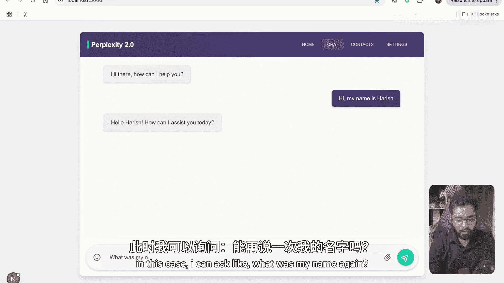

So it should be able to tell okay your name is Harish because it remembers the previous conversations so it is a very small part now let's actually ask ask the agent something that is a little more tricky the agent now has to actually make a Google search an internet search only then it can actually respond to it so let's ask something like when is the next space X launch。

😊。

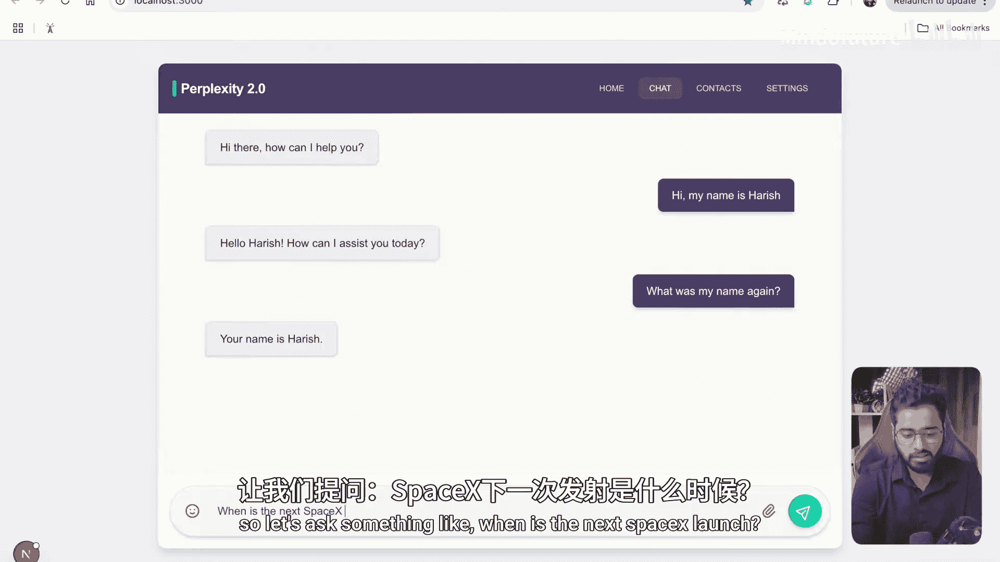

Okay， so right here it is actually going to you search the web so you can see searching the web This is the query and then it is actually reading from all these different URLls。

 all these different pages and then finally it is saying that the next Space launch is schedule for Sunday。

 April 6 So this is going to be a very exciting full stack application So in the back end in Land graph we are going to be learning how exactly to build this graph it's going to be very simple we are going to be learning checkpointers for memory for persistence we are going to learn how to actually set up streaming And if for some reason you're not a front developer you don't want you're not interested in learning about react etca。

 etca that is absolutely fine you can just go ahead steal my code copy paste it and it would just start working out of the box。

 So I'm pretty excited about this application。 So first thing let us now go ahead and start building out our agent graph。

😊。

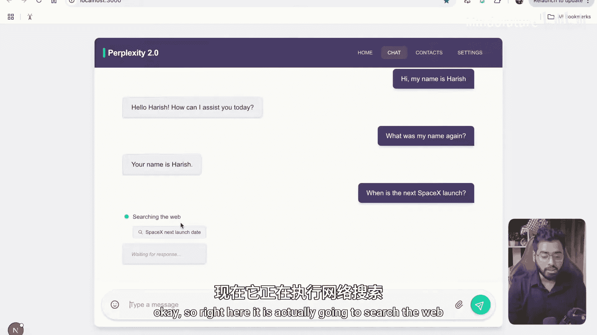

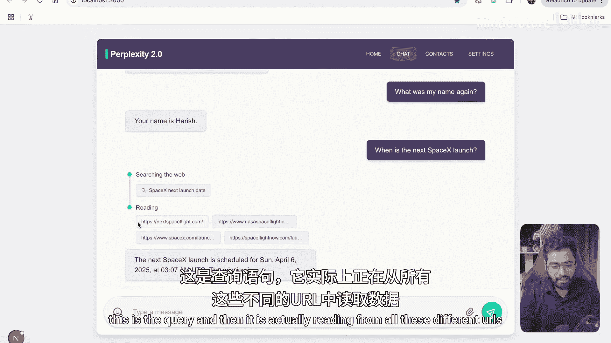

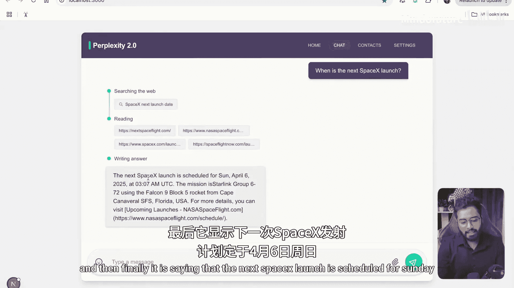

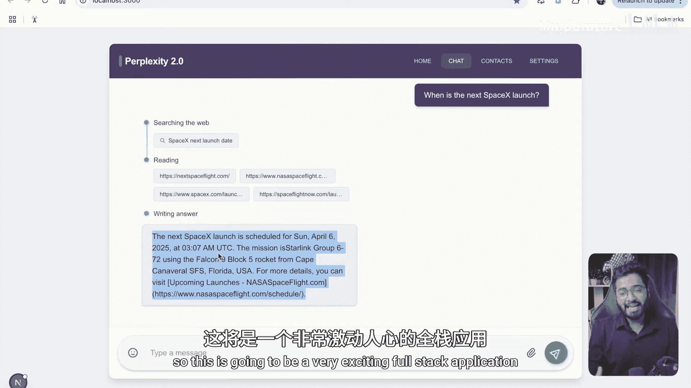

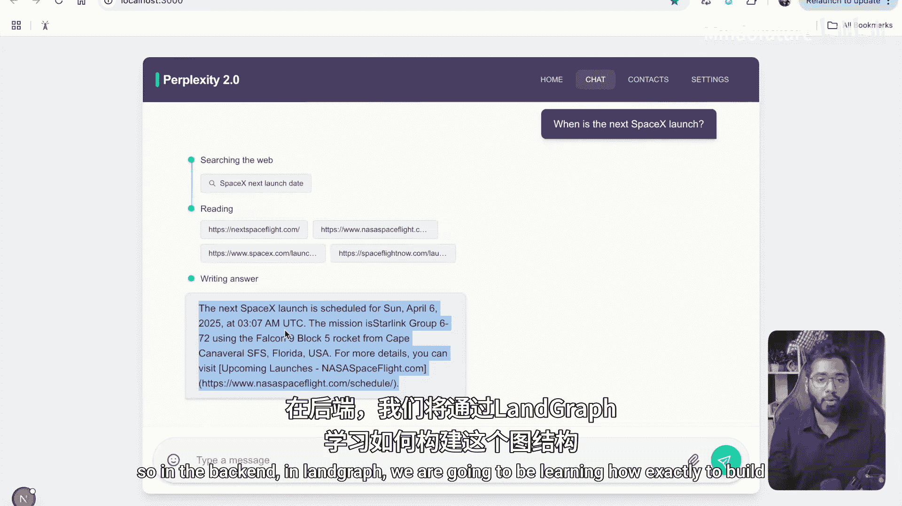

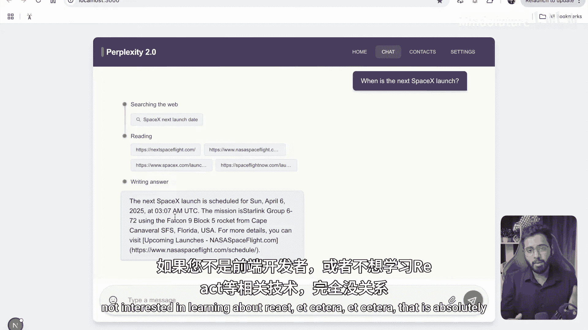

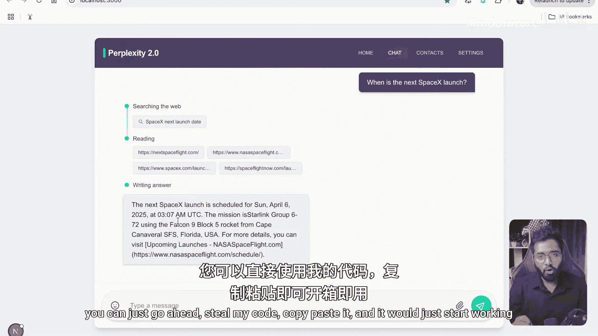

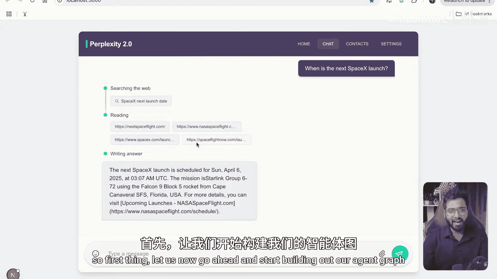