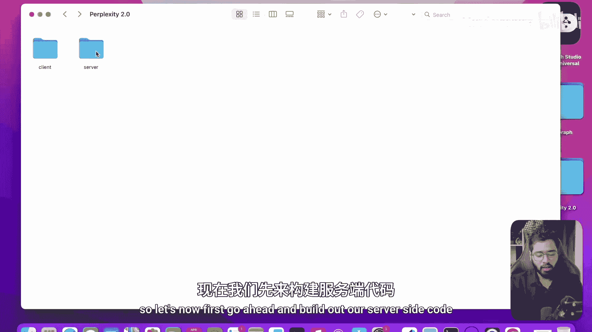
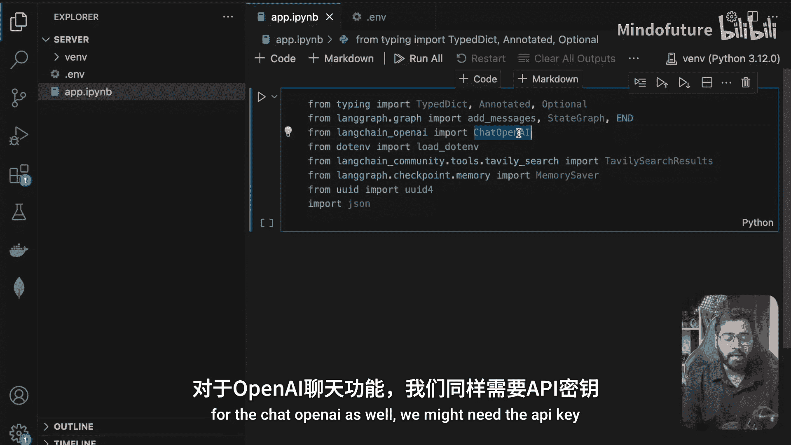
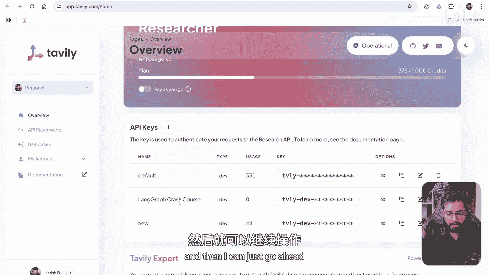
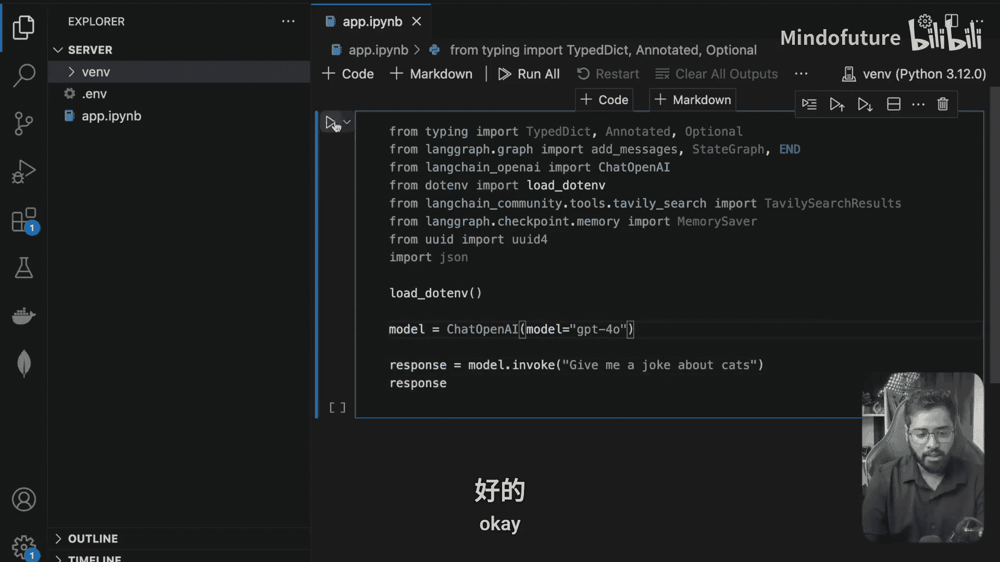
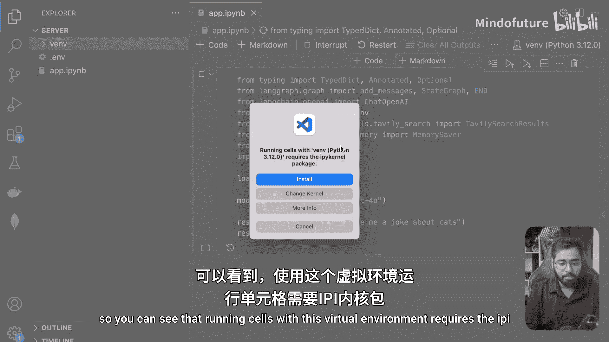
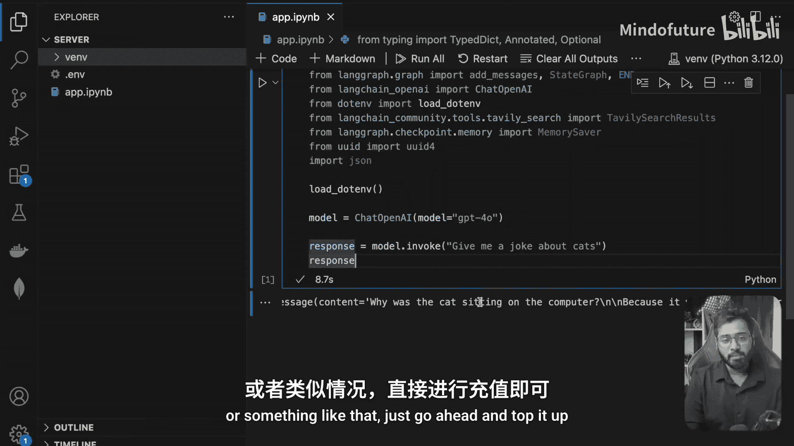
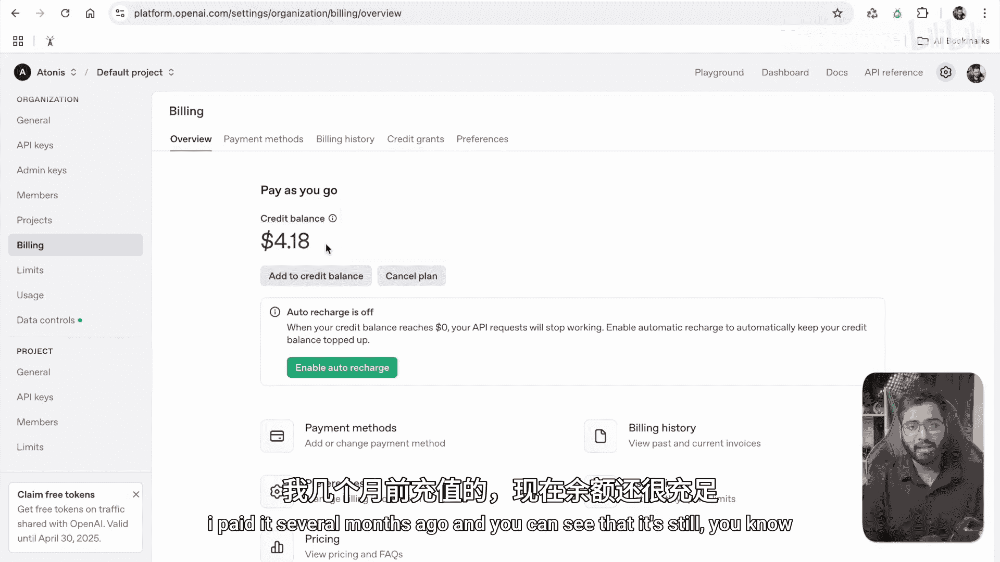
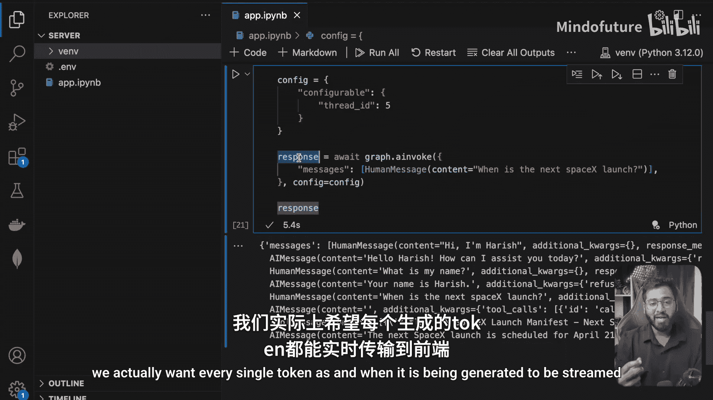
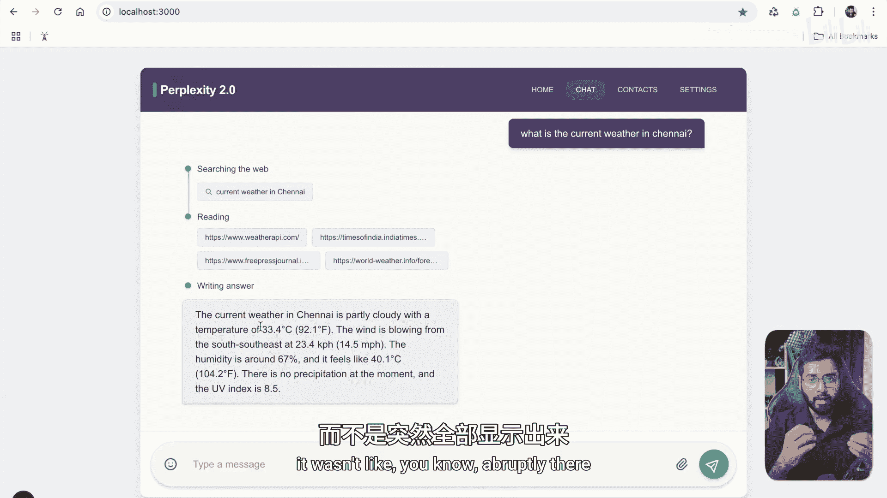
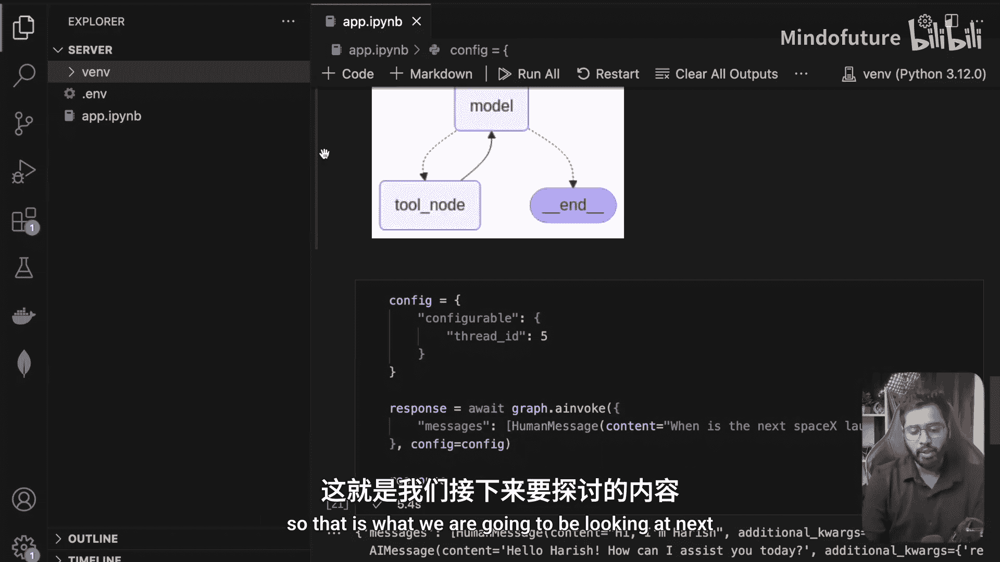

# Langgraph初学者入门2025 p44 P44_#42_毕业设计项目_构建图 -BV1mgepzCEjf_p44-

So lets now go ahead and build out our La graph agent graph so once we build out our graph we can then drop our graph using an API endpoint and then we can connect it with our front end right so you can see that I've already gone ahead created a folder called publicplexity2 point0 I've created two folders client and server so right now the client and the server is empty so let's now first go ahead and build out our server side code。

😊。

So I'm going to open it using my visual studio code。So let me just zoom in a little bit。

 So the first thing that I'm going to do is I'm going to install virtual environment and we need the virtual environment because we want all our packages that we are going to be installing later on to be isolated in this one particular location we don't want it to be available globally so to initialize my virtual environment I'm going to say Python 3 I'm saying Python 3 here because I'm working with a Mac right now if you' are working with a Windows in that case you can you can just say Python and then I'm going to say dashm this stands for module Im using the V E and V module and the folder that I want created right here I want it to be named as V E and V as well。

😊，So right here in a while you can see that we have the V E and V folder created alright so the next thing is we have to activate this virtual environment So right here you can see that the path is not really pointed to V E and V to still point to base so in order to activate this since Im working with a Mac again I'm going to say source okay I'm going to go inside of the V and V and then I'm going to go inside of this bin and then I'm going to invoke this activate file okay so this is going to activate my virtual environment as you can see right here in Windows it's a slightly different command you can look it up okay it's pretty simple。

😊，Alright， so now that we have the virtual environment initialized and activated as well now I am going to go ahead and I am going to create an app dot Jupyter notebook okay。

😊，And now there is a couple of packages that we might have to install in order to build out our graph。

😊，So I'm going to go ahead and install first thing is I'm going to install Lagra。

 we absolutely need Lagra and then I'm going to be using Lcha open AI chat model okay we can always use other chat models we can use you know Gemini we can use you know Goc to access Lama models but in this case I'm going to be using the Lcha open AI chat model and then we need the La core package and then we also need Python do env because we want to you know make the environment variables available inside of our Jupyter notebook right and then we also need fast API and then we also might need Lcha community because in the La community we can actually get access to you know a lot of tools right you know the T research tool etc etc So if at all we need something else in the future we can always come back here and then we can install it so let's go ahead and install it。

All that great。 So now that it has been installed， let's go ahead and import a few things。 And guys。

 before we start coding this， I expect you to know Land graph already。 Okay。

 so I expect you to know land graph La change the fundamentals of it。

 I expect you to know how to build a react agent。 I expect you to know the basics of streaming。

 I expect you to know know how persistence works etca， etc ce。

 If you do not know any of these fundamentals。 Ive created a course that I'll attach the link in the description below。

 that course is going to take you from absolute beginners to know pro level。

 we are going to be covering you know what are the different types of agents。

 how to build a react agent， how to do streaming， how to do persistence。

 how to you know what a checkpoint or how to do human in the loop。

 you know how to build complex architectures like you know the supervisor agent。

 So I would have covered everything。 So I would expect you to know it already。 if you do not know it。

 please go ahead， watch that and then come back to this video。😊，Okay。

 so now let's actually go ahead and start importing our you know modules so the first thing is we are going to need from typing okay so from this we are going to need the type deck and the annotated and the optional so basically why do we need these things we need these things because we want to define the state of our agent graph right and then we are obviously we are going to need land graph and instead of the graph module we are going to need the。

Add messages method。 This is going to be the reduce method。

 which is going to let us easily update the graph state。

 and then obviously we are going to need the state graph and then the end node Okay so what's the next thing and the next thing is we are going to need a chat model basically chat models are tools that you know La gives us which lets us interact basically like interfaces which lets us interact with Llms right So in this case I'm going to be using open AIs chat model but if you don't want to pay for it。

 you can always go for know Google's chat model or you can go for Lama chat model so just go go to Google search for chat model Google in that case it's going to give you a different chat model you can import it and use it but in this case I'm going to be using the open AI and I'm going to be using the chat open AI chat model and then obviously we are going to need the dot E and we as well because we want to load all our environment variables in this file And then we are going to need the tab。

😊，Se tool the Tli search tool is what is going to let our agent access the Internet。

 So in this case we can actually go to Lcha community and then we can say tools and inside of this I can you know access the T search so I can say Tli search results So the last thing that I want is the you know the ability to persist our graph So what I mean by that is we need you know memory introduced So I'm going to be using a checkpointer that is the go to way of introducing persistence in our graph because we want our application to remember what the user said previously right so in this case I'm going to be using la graph。

😊，Dot checkpoint dot memory。 Okay， so from this， I'm going to be using the memory saver。

 And then after this， we also would need the U U I because we will have to create unique Is for each user session。

 So in this case， we might need the U U I。 Let's use U I for Alright So we are done with most of our imports for now。

 So now I'm going to go ahead and I'm going to create an E file。 And right here。

 we need to add a couple of you know environment variables for you know the Tli search。 Okay。

 so for the Tli search results， we might need the API for the chat open AI as well。

 we might need the API key。 So for the open AI API key。

 I'm going to go to platform do open AI dot com I can go inside of the profile and I can go inside of API keys right here。

 And now I can go ahead and create a secret API key。 so I can just say perplexity。😊。

And I can go ahead and can have the permission set to all and I can go ahead and copy this And the same thing for Tli search as well。

 so I can just go to this particular link log in and then I can just go ahead。

 you can see that I've already created a few T API keys I can just copy this thing come to the EV file。

 So what would be the environment variable name So if I go inside of the chat open AI you can see that it requires this particular environment variable set。

 Okay so just put the API key that you would have copied there inside of single codes or double quotes right here。

 and then the same thing you will have to do it for the Tli search as well。

 So if you come inside of here， you can see that this is the environment variable environment variable key Alright guys。

 so I've already populated all the environment variables in my file。

 So in this case I'm going to go ahead and load all the environment variables。

 And the first thing that I'm going to do is I'm just going to make a simple LM call and make sure that everything is working fine。

 So in this case I can just say this is going to be the model。😊。

So I can say the model that I want to use is going to be G 40。

And now let's go ahead and invoke this model and we can say something like， you know。

 give me a joke about cats。 let's say， Okay， so let's get the response right here。Now， let's also。

Okay， so let's try to run this。 So we can see that running cells with this virtual environment requires the I Pi kernel package。

 So let's go ahead and install that as well。😊。

All right。 So now you can see that it is running。And it should give us a joke about cats。

 All it perfect。 You can see that we are getting an AI message back。

 We are saying that boy was the cat setting on the computer。 So everything is working fine。

 If at all， you're getting an error saying that， you know。

 insufficient balance or something like that。 just go ahead and top it up。

 You can go to the building and you can top it up。 It's going to last you anywhere from 3 to6 months。

 I paid it several months ago。 and and you can see that it's still， you know。

 I've still got a lot of balance。 All it perfect。 So now let's get rid of this。

 And now let's also actually go ahead。 And test out our T search。 Okay。

 so I'm going to initialize our T search。 So in this case， I can say search tool。 Okay。

 So search tool， T search results。😊。

And in this case， I can just set the max results to4 in this case。 Okay。

 so now I can just go say search tool。 what's happening， search， okay。

So I can just say search tool dot invo， okay。I can say， what is the。

Whether in let's say what's what's the weather in Bangalore。 So in this case。

 this is also going to give us a proper response。 Okay。

 so I'm just going to test out all the environment variables。

 make sure that everything is working fine。All it perfect。

 So now you can see that we are getting an array of four different objects。

 Each of these objects are going to have title。 Okay and the URL and the content。 Okay。

 you can see that there's quite a lot of content basically the sta search is very similar to a Google search searches for this particular query this is the URL that it pulled all this particular content from So this is the query and this is the URL that it pulled all the content from right so we've got a lot of different information。

 which then later the agent can actually use okay， so the agent can actually make use of this particular tool whenever it needs to know needs that particular data live data and then it can actually make some informed decision。

 All it perfect。 So now that this is also working fine。

 I'm just going to clear this out again and then we can just say tools and right now we are just going to have this one search tool in the list of tools。

 Allright So what's the next thing。 So next thing is we can actually go ahead and initialize our memory saver as well。

 Okay so this is going to be the checkpointer that is going to introduce persistence。😊。

In our chat application now let's actually go ahead and create a an LLM instance that is going to have access to these tools so I can just say LLM with tools okay so I can just say model dot bind tools and then I can pass in all these list of tools right here okay。

So what basically what this is going to let me actually put it in a separate code block。 Okay。

 so what this is going to do is now if I were to actually you know LLM with tools LLM with tools。

Now if I ask a question right here that is actually going to require some live data okay。

 that is going to require live data in that case the LLM is not going to give an immediate answer。

 but instead it is actually going to call the search tool okay so if I were to ask something like know what is the current weather。

In Bangalore， okay， so in this case。It is going to。Let's see what it actually returns。 Okay。

 tools is not defined and that is because we have not run this already right。

So in this case you can see that the AI message does not have any content。

 but instead if I go to the tool calls okay so where is the tool calls。😊。

Let me actually search for it To calls。 Alright。 So in this tool calls。

 you can see that in this array， there is going to be one tool call。

 So the Lm actually wants to call the Tli search results Json because we've provided it。

 weve bound all the tools right here。 so it actually wants to call this particular tool and this is going to be the query that the LM is suggesting as well so now we have the LM with tools instance as well which is perfect so what's the next thing So now let's go ahead and build our graph。

 Okay， so let me copy pasteson code right here。 Allright， guys。

 I've copy pasted a bit of code right here。 So before I actually walk you through this particular graph。

 So I'll show you what is the structure of the graph that we have built。

 so if youve actually followed along with my land graph course this is something that we would have done a million times already So you can see that we have the start node at the very start and then we have the model。

 so the model， anytime the user question is something that requires the model to make a tool call in this case the control flow。

😊，I going to go to the tool node Okay so in the tool node。

 this particular tool node is going to make use of the tabli search and then it's going to you know take the query that the LLM has provided。

 it's going to make the internet search and then it's going to return the response back to the LLM and if the internet search is sufficient in that case the LLM is going to you know end this particular graph Okay so this is what we have built right here。

 So if I scroll up here， you can see that we have you know this is going to be the initial state so to achieve this particular thing we just need the messages list and we are going to be using this particular ad messages reducer function So if you do not know how this reducer function works if you do not know the different types in which we can update the state know all of these things I would have covered in the course so do check it out Alright so so initially we have the first node which is going to be the model node so if I come back to the diagram you can see that that is going to be the entry node right here。

😊，Right so we have this particular entry node so this node is going to get the entire state right here and we are going to be using the LLM with tools we are going to invo and we are going to pass in the entire list of messages and then we are going to update the state with it Allright so also another thing that I want to note here is that we are going to be using the async await keywords and why do we need to do that because when we are dealing with production applications and when there's going to be a lot of concurrent users in that case you don't want to block the thread okay so we want multiple threads to be working concurrently so in that case we will have to use async and we will also have to use the a invo method and not the plane invo method the functionality is going to be very similar all all the paying is were going to be using a invo and adding async and in all our node wherever there is an async operation wherever there is an LLM call that is being made or an API call is being made we have to do async there So right。

😊，After this particular model is executed， we are actually going to look at this AI message right here Okay so that is what this tool router is going to do Okay so it is basically just going to take the latest AI message okay and then it's going to look at the tool calls does it have any tool calls or not if it has some tool calls in that case it is going to route the flow of the graph to the tool node node so or else it is going to go to end so let's come inside of the tool node okay so this is going to be the custom tool node that handles tool calls from the LLM again we are going to take the you know the last AI message okay so this is going to take the last AI message and then we are going to go inside of the tool calls and from that tool call we are going to get the name of the tool call in that case it's going to be the Tli search results Json because that is the only tool that weve made that weve provided to the LLM we can also get the as so in this arts this is where the query know the internet search query is going to be located so we are going。

😊，Get a reference for that as well。 and then we also need the tool call ID and then we are going to execute the search tool with the provided arguments。

 so we are going to provide all the queries and all the you know everything that is inside of the as and then this is going to give us the search results so we is going to stify it and then we are going to add the tool node in the tool message and the tool name as well so now we have the final tool message that we are going to append to the list of tool messages and then we are going to update the node as well So this is going to be the function the tool node function definition that is also another pre-built know tool node class that Lagra provides because this is such a common thing whenever we are working with agents you calling this particular code block is going to be such a common thing So Lagraph actually wrote a class and then just give it to you for us to use So if I actually go back to this is part of the la graph series that I worked on So here you can see that in a lot of different sections we would not。

😊，Return this entire thing we would have just used this tool node right here Okay so this land graph prebuilt import tool node and you know I would have just like instantiated this tool node past in the tools and this would have been the tool node Okay so exactly what we've done right here Okay so we can either do this or that but I'm doing it this way because this gives you a lot more you know transparency on what is happening inside but if I actually go inside of this particular tool node you can see that this is basically what we are doing right here。

Okay， so we are taking the latest AI message we are going inside of the tool calls and then we are invoking it。

 and that is it。 Okay， so that is exactly what we are doing right here as well。 perfect。

 So coming down we are going to be using state graph we are building the graph So the first node is going to be the model node so that's going to be the entry point and then we also have the tool node and then we are adding a conditional edge So right after the model is executed。

 So right after the model is executed， we have to look at whether we have to go here or here So that is why we have this tools router right here。

 Okay so tools router is going to decide if the tool calls is present at least one item is present or not if something is present in that case we have to go to the tool node or it we have to go to the end。

😊，Okay so I hope this makes sense and finally during the compilation step we are going to provide the memory the checkpointer right here so that is it So now let's actually go ahead let me run this as well。

😊，And let's now go ahead and put this to test。So I can say graph dot invogue Okay， so in this case。

 you know in the messages array， I can use this human message Okay so I can ask something like how are you doing Okay。

 so lets just test it out。Repons。Okay， so we are getting an issue right here Okay。

 so this is because okay， so this is because we are using the the checkpointer writer right So in this case since we are using a checkpointer a checkpointer always requires a session I Okay so you know the the graph needs to know which session is it storing the particular state for right So in this case we have to actually go ahead and create the。

The conflict object， Okay， so let's say conflictg。Inside of this， we have to say configurable。

Okay in this in this we have to say thread sorry， thread ID。And right here。

 we can say one or two or three， and then we can provide this config right here。Like this。 Okay。

 so now everything should work fine。 Okay， so it's still not working。 and that is because。😊，Okay。

 so to fix this， we just need to say a invo。 and then we have to await this as well。

 And now let's also you know， go ahead and change it to let's say5 or something。 And now let's say。

 you know， let's introduce ourselves and then let's ask what my name is so that we can also test out the checkpointer。

 So hi Im Hash。😊，Okay。So， in this case。Okay， so you can see that we have the first human message and then the A message is saying hello hurryish。

 how can I assist you today So let's actually test out the persistence if it is working or not so I can see what is my name。

😊，So now you can see that all the past conversations are being carried forward， right？

 So we have the first thing that I sent。 And now it is actually， you know。

 remembering that my name is Irishish。 Okay， so now let's also try to， you know。

 ask a question that requires the agent to make an internal search。 So in this case， I can say。

 you know， when is the。😊，Next， space X launch。Okay so in this case it would actually have to go you know utilize the Tly search tool and it would have to fetch internet results right so you can see that right after this particular question you can see the AI message the content is empty in in this case it is actually you know suggesting to call a tool right so in the tool calls you can see that it is saying that you call use this particular tool and pass this particular query inside of this particular tool as well。

😊，Okay， and then finally what happens is we have tool message right so this is going to be the return the response from the Tli search。

 this is going to have all the information you can see it has pulled information from next space flight dot com it pulled it from you know a lot of different URLs right。

😊，See it pulled from space launch schedulechedule dot com as well right And then finally。

 the last AI message is going to have the next spacex launch is scheduled for this particular date。

 Okay so everything is working fine and finally I also want to show you how streaming works because you this is not what we want right we actually want every single token as and when it is being generated to be streamed to the front end right so what I mean by that is so whenever I ask a question here you know let's say what is the current weather in China itself if you remember every single word was like streamed to the front end right it wasn't like abruptly there。

 So this is going to give you abruptly， this is not what we're interested in。

 we want data to be streamed。 So let's also get a quick rough you know idea about how streaming works as well and then we can all put it together later on So I'm going to create another block So in this case I'm going to be using I'm going to be saying graph in this time this time I'm not going to be using this a invo or invoke that is going to abruptly give you。

😊。

Final response that is not what we want in this case Lagra provides another method called a stream events。

 Okay， so this is what we are going to be using So let me actually show you how this works So in this case also we can use an input Okay so where is the input。

Okay， so we can actually copy the same input。So let's put it here。

 So in this case Im just going to introduce myself here， hi I amm Hash。😊，Alright， Okay。

 so what's the next thing。 So similar to what we do right here， we are providing the config， right。

 we have to do the same thing here as well。😊，Okay， so I can give it a different thread I D this time。

 I can say6 this time。😊，Alright and now what is going to happen is this is going to return us a generator function okay this is going to give us something like you know we can say events okay so any time there is a an event getting emitted we can actually loop through this itemerable and then print it okay so I can say for event in events and then I can print this particular event。

😊，Okay so I hope that makes sense， so this is going to be an iderable anytime there is an event getting emitted we are going to this function is going to run alright this this particular block is going to run。

😊，So now if I run it， I hope that everything is looking good。 Okay， we have not provided the config。

Right here， Okay， so we have not provided the con and one more thing that Ive forgotten is we also have to provide this version Okay。

 by default it is going to be v2， but still lets also go ahead and provide the version as well。😊。

Okay， so there is version1 okay， and there is version 2。

 There's a lot more information being emitted in version 2。 and that is what we are interested in。

 So let's actually go ahead and run this and make sure that everything is looking good。

m not sure if we we actually have to await it here as well。 Okay。

 I'm not sure if we have to do it here or here。 let me actually run it。😊，Okay。

 so we are getting the error。 So in this case it is saying that we have to actually use the async of weight Okay so right here we are not using that right。

 so I can do something like this。 So I have just put the async for event right here so we are using async for to iterate over the async generator Alright so now you notice that if I were to now run this you should be able to see a lot of different events that are being generated So you know that this is the question that I'm asking or rather I'm just saying I'm haish in this case you can see that a lot of these events are being generated right here right so you can see a lot of events。

😊，So you can see that we have on chain start okay， so we have on chain on chat model start on chatm stream。

 Okay， so all of these are event。 Okay， so this is a particular event item。

 This is another particular event item right， So in one particular event object we would have the event type we would have data we would have another property called metadata as well。

 these are some things that I would have deep dived in the la graph course but I'll just give you a quick you know overview as well。

 So you know it's I'm not able to search for it met data。 Okay。

 so you can see that we have metadata here。 that is going to give you information about which node this particular event was emitted from Okay so we have all these different information through which we can actually isolate these events and then we can yield it to the front end so I can actually do something like this so I can say。

😊，You know if event is equal to on chart model stream because we are only interested in this particular event type okay I can just isolate that particular thing alone and I can go inside of the data so inside of the data I can go inside of the chunk and then I can just extract the content alone so if I clear this file and if I change it to let's say7 and if I run this。

😊，Okay， you should， okay， you should it's， it's pretty fast。 So give me。10 word you know。

 essay on climate change。 let's say， okay。Change， so you should be able to see the words that are getting populated。

 Okay， so， okay， so you can see that every single word was getting， you know， streamed。 Okay。

 so this is what we're interested in， guys。 Alright， so next up。

 we are going to transfer all these files。 Okay， so we we are dealing with production applications。

 We are not going to be working with Python notebooks。 right。

 so we are going to be creating a plain Python file， we are going to be， you know。

 importing fast API。 We are going to create an end point around this agent so that the frontend can start accessing it。

 Okay， so that is what we are going to be looking at next。😊。

