# Langgraph初学者入门2025 p45 P45_#43_毕业设计项目_FastAPI_+_流式传输 -BV1mgepzCEjf_p45-

Hello guys。 So in the last part， we built out our agent graph。

 but we built it out using the Python notebook。 So basically what I have done right now is that I've created a new file called app dot Py。

 I' basically transferred all of these code to a separate Python file Okay so no difference at all。

 I have imported the same exact imports。 Okay， so you can see that I'm initializing the memory initializing the state。

 Okay， so we we have the model node， we have the tools router and then we have the tool node as well。

 and then I'm connecting all these different things together。

 So up until here we completely already seen。 Okay， so coming down。

 this is the new code that I have added。 Okay， so it's going to be very simple。

 all that I'm doing is I'm importing fast API okay from fast API。 I've installed that as well。

 Okay so coming down， you can see that I've initialized the fast API app I'm adding some middlewares。

 Okay so this is basically just to know。😊，For our browser。

 for our client to be able to communicate with the server endpoint without any issues without any cost issues。

 I've added these things。 Alright， so here， look at this thing。 So we have the chat stream。

 this is going to be our endpoint So whatever new message that the user in the front end is going to enter that information is going to come right here so that is what we are we are accepting in this particular argument and the second argument is going to be the checkpoint I okay so this checkpoint I this is going to be provided as a query parameter Okay so if at all the client does not provide a checkpoint I that is completely fine in that case we are going to default to none okay so we are going to default to none but if they do provide something in that case we are going to accept it and okay so lets let's pay attention to what we are doing right here so if it was a simple。

 if are not thinking about streaming or anything like that。

 we can just go ahead and we can just say graph invo or a invoke in this。😊。

We can just provide the message inside of this and then we can you know use this particular checkpoint idea as well it is going to be very simple。

 but since we are interested in streaming right now。😊，Okay。

 so in fast API we are going to be making use of this concept called server cent events。 Okay。

 so okay， so it' is going to be server cent events， okay server。😊。

Sent events This is for your own education。 You can definitely go it research more about it。

 learn more about it， but essentially servercent events is slightly different from web sockets。

 Okay so what are the difference between server sent events and web sockets web sockets essentially you know establish a consistent connection between the server and the client and both the client can communicate the server as well as the server can communicate with the client right it is bidirectional but in our application in our project that is going to be an overkill what we need in our chat application is going to be server sent events So what this means is that the server can actually like communicate with the client so it's going to be one directional not bidirectional This is what we need。

 So the way that we can do this in fast API is that we can use this streaming response class that fast API provides okay so streaming response So the first thing that we have to provide in here is going。

😊，To be the generator function。So the generator function is just going to you know emit events anytime it receives something。

 it's just going to emit it。 And then the second thing， this is very， very important。 Okay。

 so in the media type， we have to set it to text event stream so this is going to be the protocol that we are going to be using the server sent event protocol Allright。

 so let's actually take a look at this generator you know function， let me now expand this thing。

 Allright， so so first off， we are going to check if the checkpoint I is there or not So if it is a new conversation。

 we have one if block idea， if it is an existing conversation。

 we have another L block idea So let's look at the first block so the first thing is we are going to generate the checkpoint I and then we are going to construct the config object and then we are going to be using the same a stream events method that we just looked at in the i notebook right So we are going to be using the a stream events we are going to provide the message that。

😊，Received we are going to use the same threat I okay and then this is how we are going to be yielding Okay so that this is what you know this is a generator function is going to emit the events or we can also say it's going to yield events So if we put yield right here this is what we are going to be sending back to the client so we are going to be looking at exactly how the data looks like using swagger docs fast API provides a very easy way for us to actually look at you know exactly what is being emitted from the API so well take a look at that。

 So here you can see that we are the type is going to be checkpoint and we are going to be providing the checkpoint I So you might think that why are we using all these s basically just to escape this particular double codes okay so we can't use double quotes within double codes without escaping it like this so that is why we are yielding it like this。

 And if you are wondering why we are saying data right here and why we are saying s n slash n right here so。

😊，We have to say that because that is basically just how the server sent event protocol works。

 This is how the browser is going to know that this is going to be a server sent event Okay。

 so we just need to follow this Allright so now we've seen this particular if block let's now move on and let's understand the else block So let's say this is going to be a continuing conversation in that case we are going to be using the checkpoint I that we get from right here okay so we are getting it from right here So the server knows exactly which session to continue the conversation Okay and then we the same thing is again continuing the same thing and coming down right here you can see that we are getting reference to the event type and then based on that we are doing a couple of things so for every single different event type we are structuring it in a certain way and then sending it to the client So that the client can differentiate between each event type right so the first event type that。

😊，Interested in is the on chat model stream This is going to be a very basic this is going to be the most common thing that we are streaming。

 So what I mean by that is let's come back to our Jupyter notebook。

 So if you remember okay so let me say okay I've just said that give me a0 word essay on climate change in this case you can see that this is going to be know the events that are going to be emitted when the LLM is actually generating something something right so this is when the LLM is starting to generate and this is when it has started generating already so that is why we see know the empty string climate change refers to significant long term changes in global origin So this is what I' am going to be grabbing next so how can I grab it so you can see that I'm passing the event data chunk inside of this particular method just going to be a fallback method let me show you what it means but I'm going into event data and chunk So this is going to be the entire event I'm going to go into data I'm going to go into chunk okay。

😊，So I'm grabbing this AI message chunk I'm passing that inside of this method All this method is going to do is it's just going to check if this chunk is an instance of AI message chunk okay so there might be some situations where you know there could be something going wrong in that case I'm just going to you know you know show an error okay so that is all that this is doing so we're grabbing this content so this particular content I'm grabbing that particular content and then I'm just going to you know escape single codes and new lines for save Json passing is just you know this is save content and finally I'm going to be yielding this particular data to the client okay so we are going to have okay so we are going to have data and this slash and slash and this is just protocol okay the7 events requires you to add this in this at the start and at the end and this is going to be the JSson that we are going to be sending to the client okay so this is going to have the type okay。

😊，Has the escape characters okay， because we are using double quotes within double quotes。

 but the type is going to be content and the content itself is going to be this particular save content。

😊，Okay， so we are emitting this thing Similarlyly we are also emitting another event type called on chat model and okay so we are emitting some data why are we doing this so let me actually show you why we are doing this so in this case Im going to you know change the threat I and I'm going to say I'm going to make use of you know I'm going to force the agent to use a tool call Okay so so that I can show you why we are doing that so I can say when is the next。

Space X launch。Okay， so if I run this。

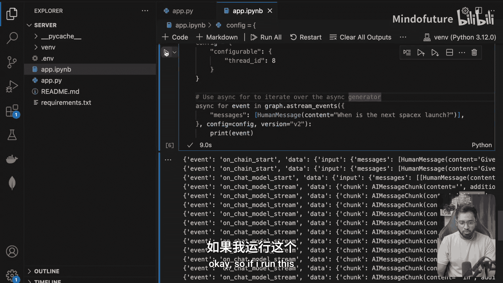

Okay so we can see that the LLm started to generate we so right here you can see that you know all these all these on chat model streams。

 the content is not going to be there Okay because you know if I come back to the end so this is where the LLm done generating something so in this case you can see that the content is going to be n and it is completely shown that we have to call this particular tool call okay so we can see that it is saying that use this particular query use this particular tool and then do an internet search okay so this is what we are grabbing okay so we are grabbing this thing so that in the Ui you can see that we are showing this particular we are showing this particular thing so searching the web and the next Spacex launch it So in order to show both of these things we need to grab this on chat model and so sometimes the tool calls might be there sometimes the tool calls might not be there but we are only isolating when there might be tool calls so that is。

😊。

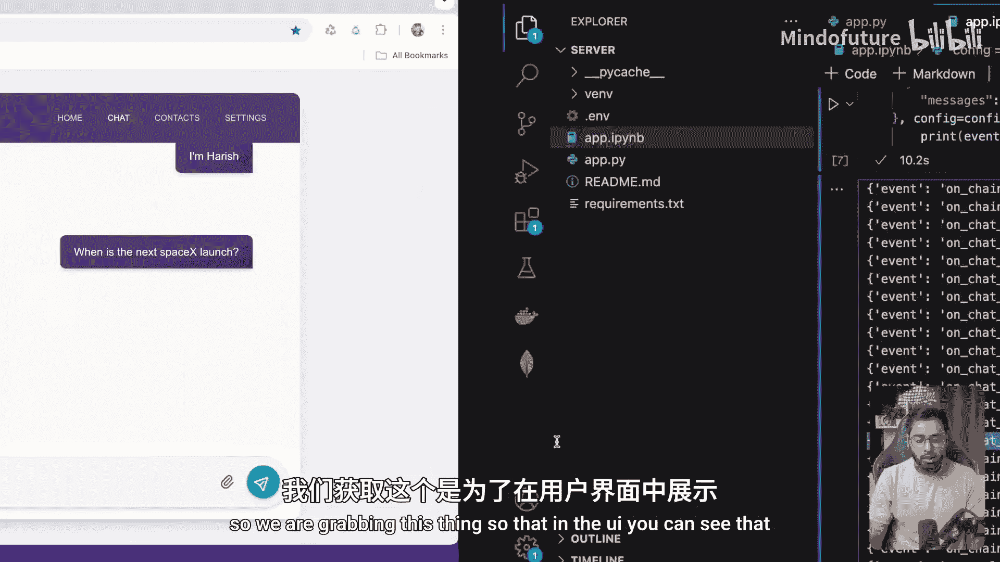

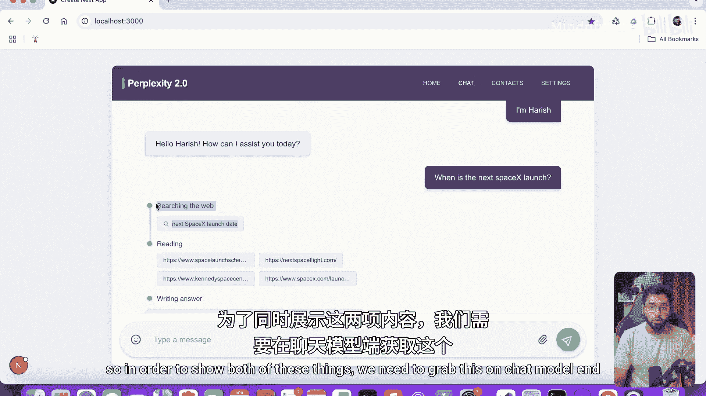

Exly what we're doing right here。 So we're checking if the tool calls are present or not okay if it is not present。

 it's going to be an emptyRA and then we are looping through it and then were checking if there is at least one tool call where the Try search is needed So if it is not there no problem at all but if it is present in that case we will have to start showing this searching the web all this okay so that is why we are emitting a different event so what I'm doing I'm just going to grab the query alone so you can see that were signaling the search is starting we are again escaping this is some passing that we are doing and then we are yielding a different type okay so here we saw that we were know yielding a type content and the content name in this case we are going to be yielding type search start and then we are passing the query as well so this is how the client can actually differentiate between what is what right so we might want to show a different UI or something like that in that case the client can easily differentiate based on this particular type。

😊。

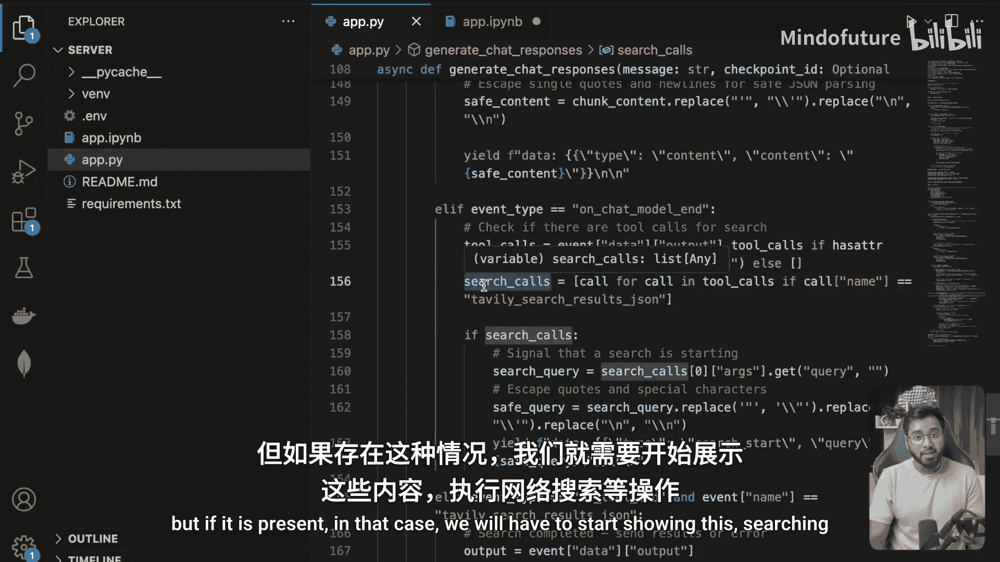

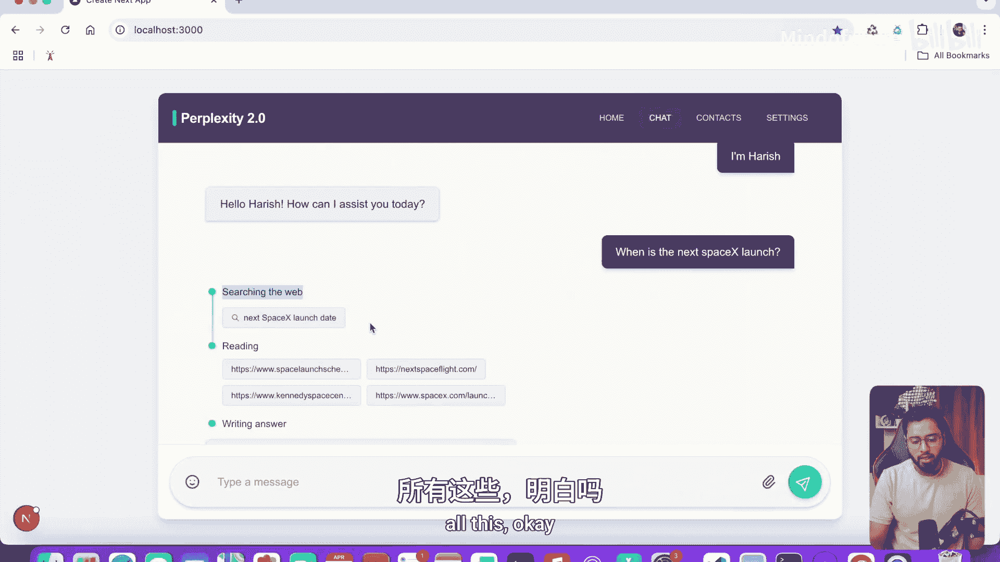

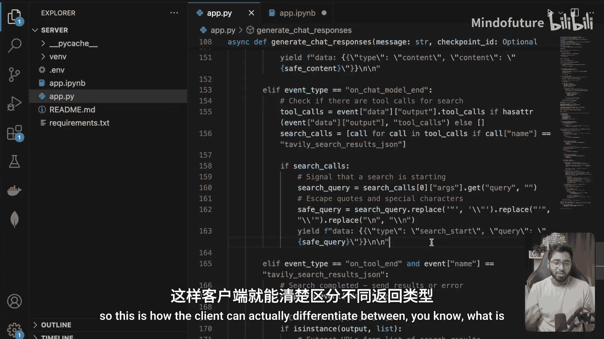

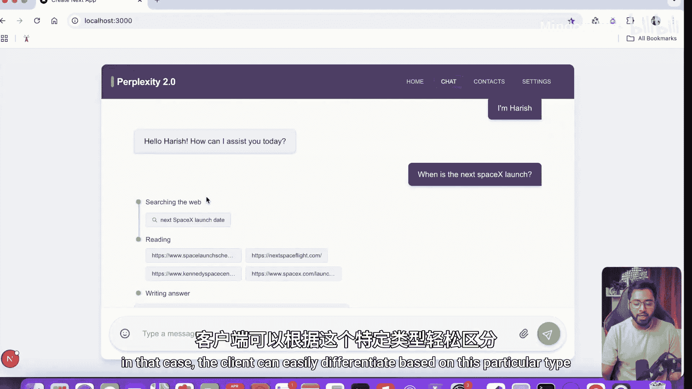

So in this case， it's going to be search start Alright so what's the next thing So we are also emitting this on tool end。

 So what is that So if I come down here we have this on tool start nonto end so it's only in the on tool end where we are having the full response of the Tli search tool okay so this is where we are seeing the entire you know the four URL URLs that it pull the data from so this is where we are able to see everything So this is why we don't want the onto start because you know we are not going to have this particular information at that point so that is why we are grabbing a hold off this on tool end event so that is why I'm taking the on tool end event and I'm also making sure that the event name is Tli search okay so in the future if you want to extended there could be multiple tools right in that case you will have to know at these conditions as well okay so I'm grabbing the。

😊。

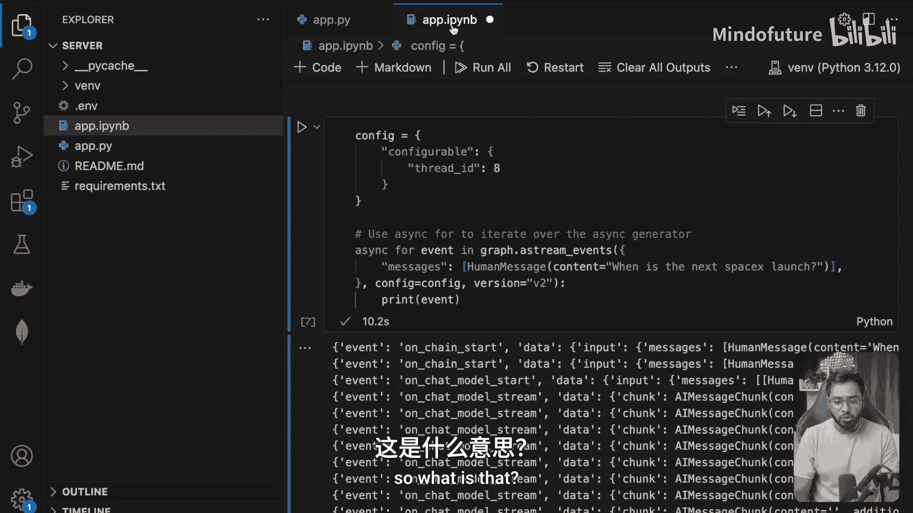

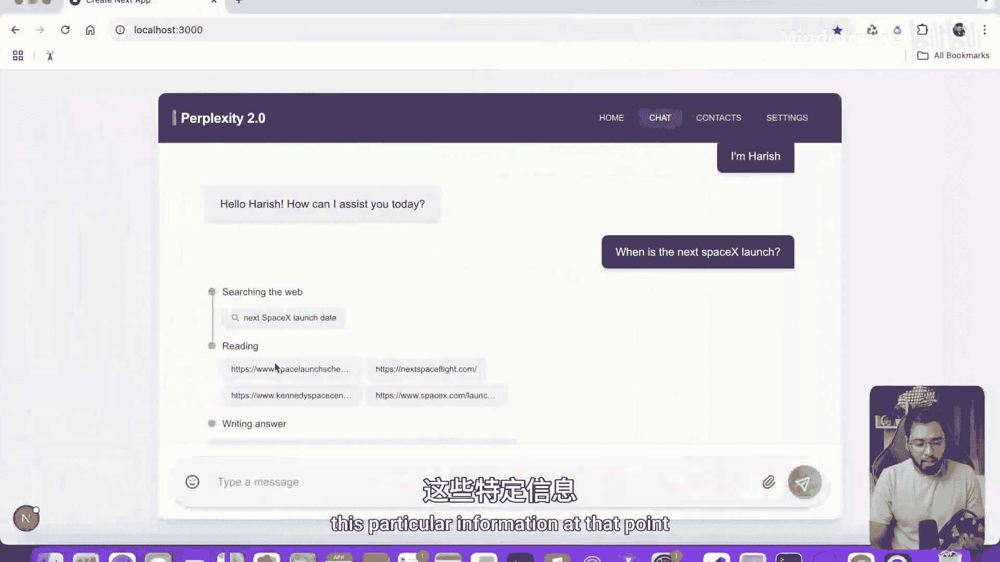

Output， so this is going to be the output in this case。

 it is going to be a list right So the response of the tablet search is going to be a list of four different items。

 Each item is going to have the title is going to have the query etc etc ce。

 so that is exactly what I'm going to look through and I'm just going to grab the URLs because for the Ui I'm just going to show the URLs So that is why I'm just providing the URLs。

 Okay， I'm converting the URLs to Json and finally we are just going to be yielding it。

 So in this case， the type is going to be search to results。

 Okay earlier it was search start and now it is going to be search results。 Alright。

 and finally we are just going to send an end event。

 Okay so this is going to be the complete server side code So what I'm now going to do is I'm going to you know make sure I'm just let me just close this up。

😊。

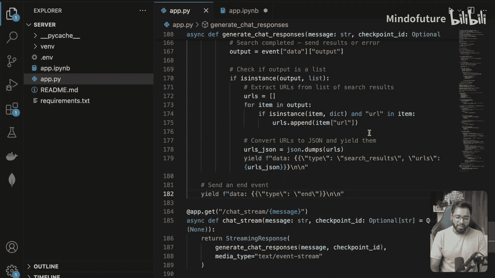

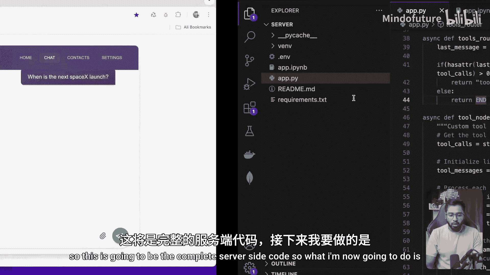

I'm going to run this file。Okay so I can run it by saying UVcon okay so UVcon is going to be you know if youve worked with node Js we've got no demand right okay similar to that we've got Ucon and fast API and we are going to go into this particular app ort Py so that is what this thing stands for the first part and then the second part is going to reference this particular variable okay where is it。

So we are going to reference this particular variable okay so this is going to be the fast API instance okay so we are getting a reference to that and then we are also saying dash dash reload because if at all we want to make some changes immediately we want the server to be restarted automatically。

😊，Right， so that is why we are saying reload as well。 so let's now run it。😊。

And I'm going to be testing， I'm going to be testing this API endpoint。

 So I'm going to be testing this using swagger docs。 So if you do not know whatwagger docs is。

 it's basically like postman But you know， it is something that fast API provides out of the box that we can actually use to test our endpoints。

 Okay， make sure that everything is working fine。 So to access it， I can just say docs。

 and this is going to give you a very nice Ui about all the different endpoints that we've written。

 in this case， we only have this one endpoint that we've written。

 So chat underscore stream and then messages。 So if we click on it。

 you can see that it automatically shows you Okay， we have to provide this particular message。

 which is going to be required。 and we can optionally provide the checkpoint Id as well。

 So I can click on the try it out。 So in this case I can say something like what is the let's say current weather。

😊。

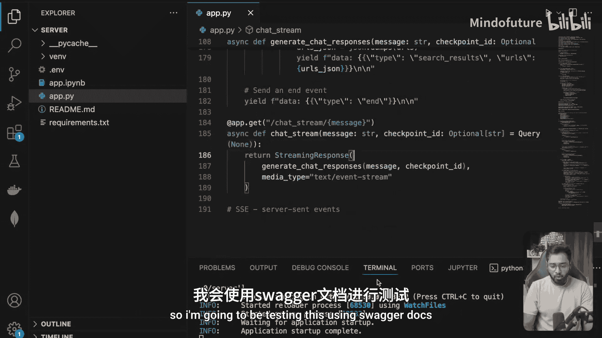

Okay， whether in Delhi， okay， so if I do that， you should be able to see all the different events that are emitted。

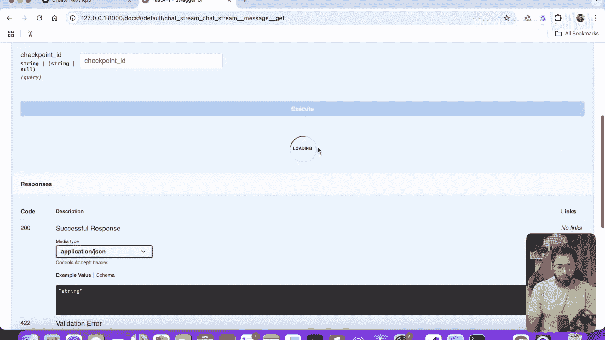

Okay， it's taking a while。 great。 And right here you can see that the first event that was emitted contains the checkpoint ID。

 So the client can actually grab a hold of this。 remember it for future requests。 Allright。

 so so since this is a query， this is a query that requires tool calls。

 So in this case it is going to return some empty content so in this case it's not going to do anything on the front end and then you can see that search has started right this is this is on the client side we can grab this thing and then we can show a nice Ui like this one。

 Okay search has started and we can also you know we also have access to the query we also have access to the query。

 Allright， so once the search is done executing once the Tli is done executing we are also provide getting another event where we are getting all the URLs all the five URLs for URLs I and then we can make use of that as well and we can show it right here so I hope that you are。

😊。

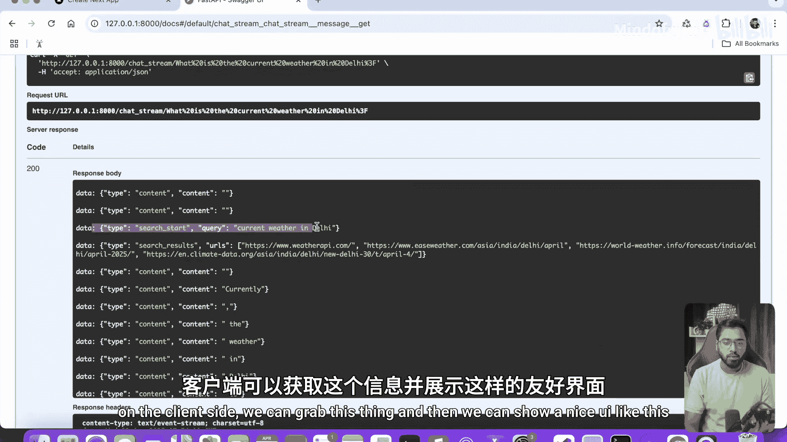

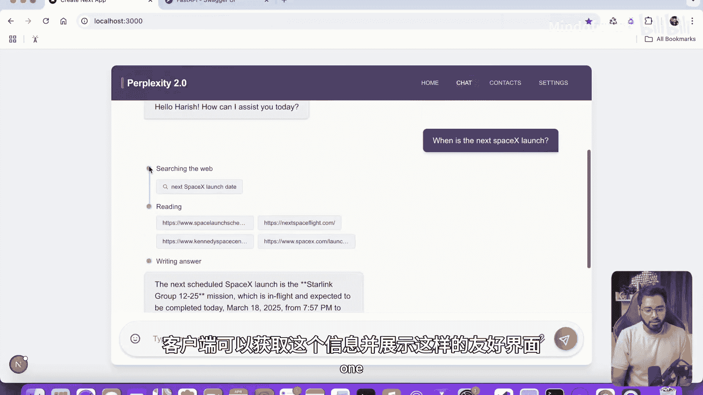

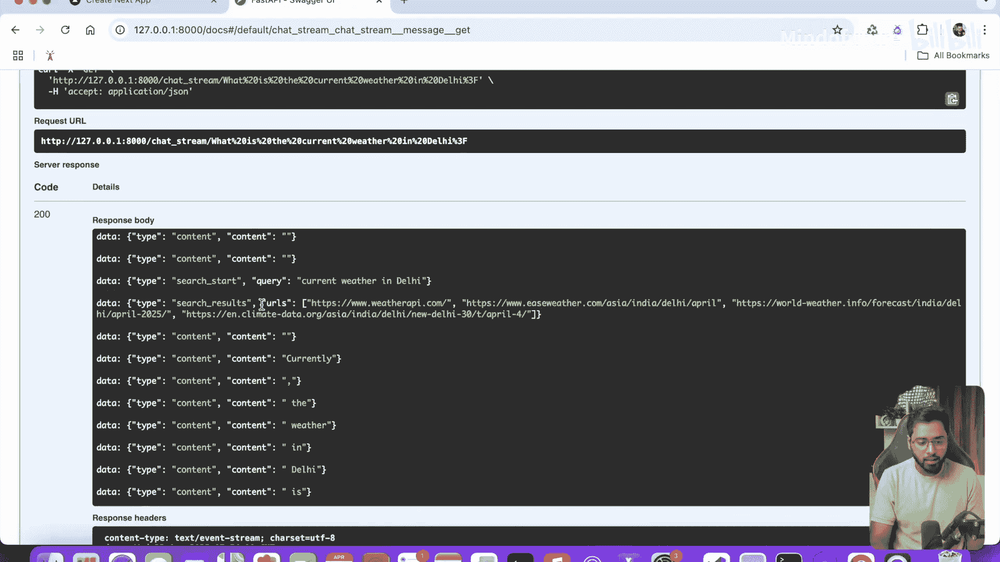

ble to see how it's all coming together and just one hiccup guys。

 one thing that I ran into when I started， when I wanted to run this code。

 one thing that I ran into was that。😊。

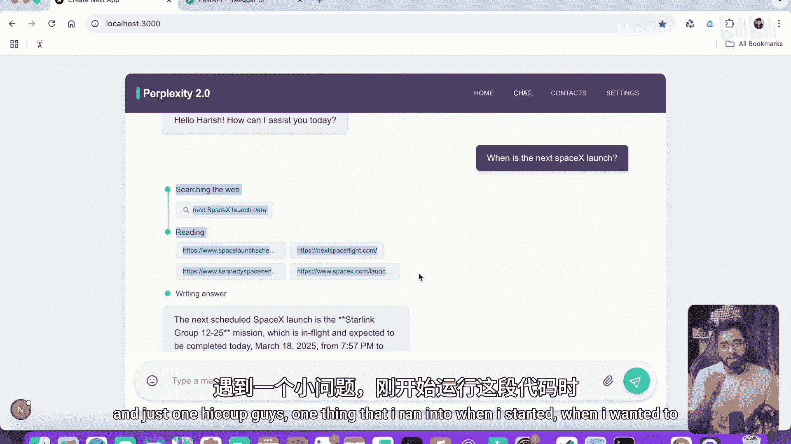

There was a certificate issue that I kept getting when， you know。

 the agent wanted to run the Try search。 Okay， so this is going to be the fixed guys。

 So in the read me， So all that I all that I did was I just installed Cify。

 And then I just put this particular line in the terminal as well and that fixed the issue for me。

 Allright， So let's move back。 So what happens next。 So right after we show all the URLs。 Okay。

 then we can actually then we have access to the type content again。

 right so we can now get all these different keywords。 Okay。

 all these different tokens that are being generated。

 So it's all going to be part of the type content right， and then we can actually show it right here。

 very neatly。 So I really hope that you are starting to see how it all comes together。

 So in the next part of this video。 we are going to be building out the react front end。

 So I'm pretty excited as you there。😊。

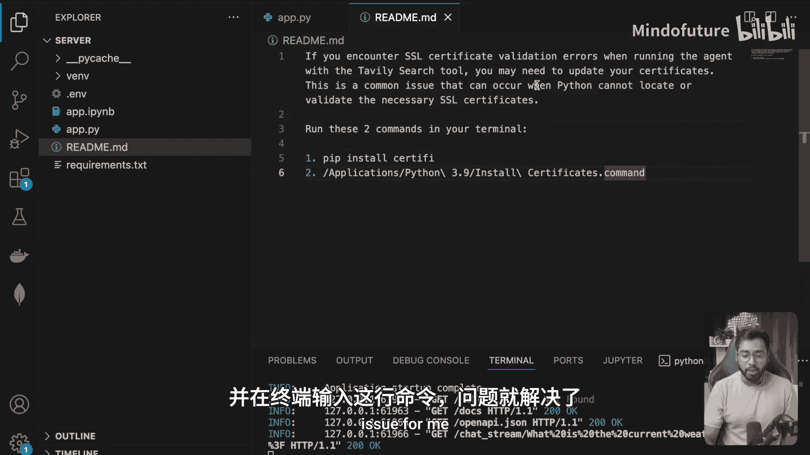

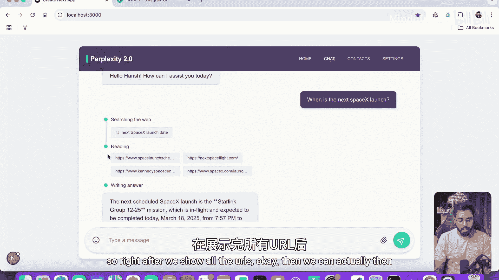

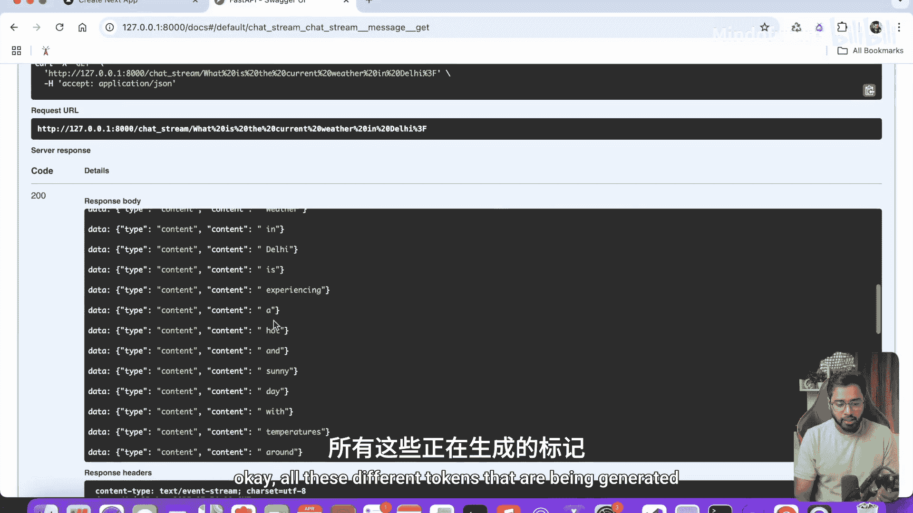

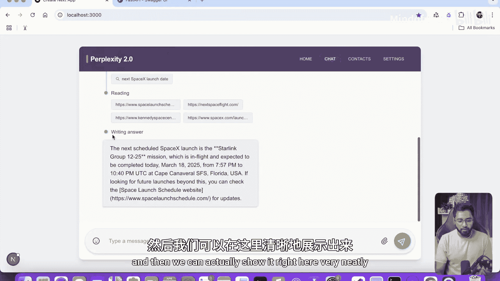

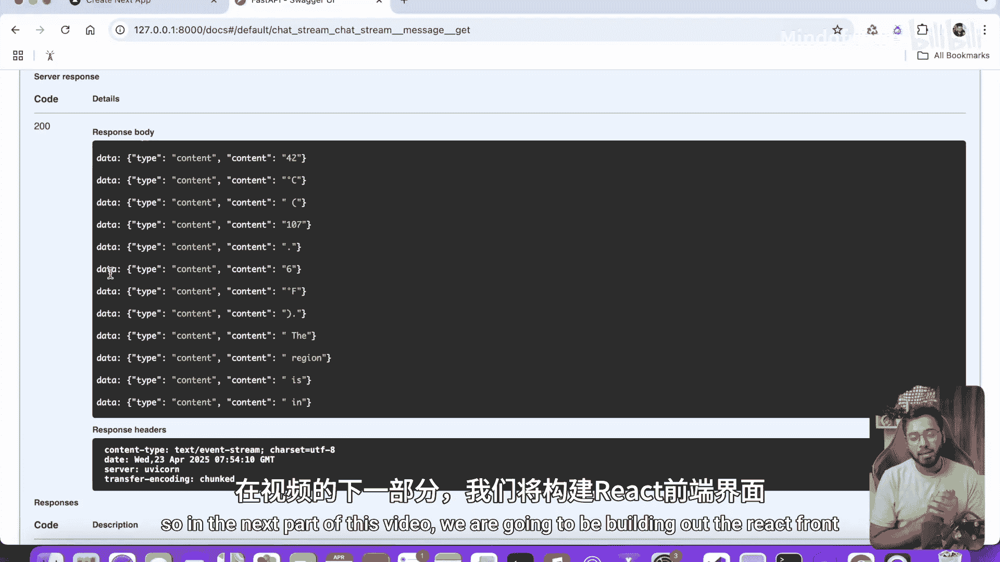