# Langgraph初学者入门2025 p47 P47_#45_毕业设计项目_最终部署 -BV1mgepzCEjf_p47-

Hello， guys。 I'm excited。 Welcome to the last part of this course。

 We are going to be deploying our application。 Okay， so so far we built the server side code。

 we've built the graph。 we've tested it locally。 but eventually we will have to deploy to production。

 and that is exactly what we are going to see。 there's quite a lot of different ways to do it。

 my favorite way is to do it with Docker Okay so this is going to be you know the backend code。

 I haven't touched it at all since the last time we saw it So the only two things that I added to this repo are this particular docker file and this docker ignore Okay so this docker file is going to have all the instructions that is necessary to put the project together in a different server in a public server。

 So I expect you to know some amount of docker already So here is what I'm doing I'm basically going ahead and pulling a python image and then we are setting this。

😊，Diry to be app so inside of the Docker container we we are telling okay create an app folder and then we are going to copy this requirements Txt okay into the particular app folder and then we are also installing this requirements Txt and then we are going to copy the rest of the application code including everything right so we don't want this i y and so we can actually go ahead and delete it I'm just going to keep it around in case we might need it for something but actually when youre running when you're building this image okay we can actually go ahead and delete it as well so we essentially copying the rest of the things and then moving it inside of the app directory and also we don't want to move the contents of the environment file as well so that is exactly why we have this Docker ignore file as well where we are going to put in all the different files that we want Docker to ignore right so we are going to copy the application。

😊，ode and then finally we are going to expose the port 8000。

 and then this is going to be the command to run the application。

 Okay so these are things these are some things that you would recognize right you be on app app right so this is what is going to spin up our container So once we have the Docker file and the Docker ignore setup done So now it is time for us to start building our image right so once we build out our Docker image we can then use a cloud provider So I'm going to be using render so you can use digital lotceion if you want I'm going with render because they offer a free tire and it does have some down times like you know if you don't use the server。

 it is going to take some time to spin up again so there are some drawbacks but since were just learning this is going to be ideal for us and then for the different steps that we have to do like building the Docker image testing it locally pushing to Docker hub you can see that I'm。

😊。

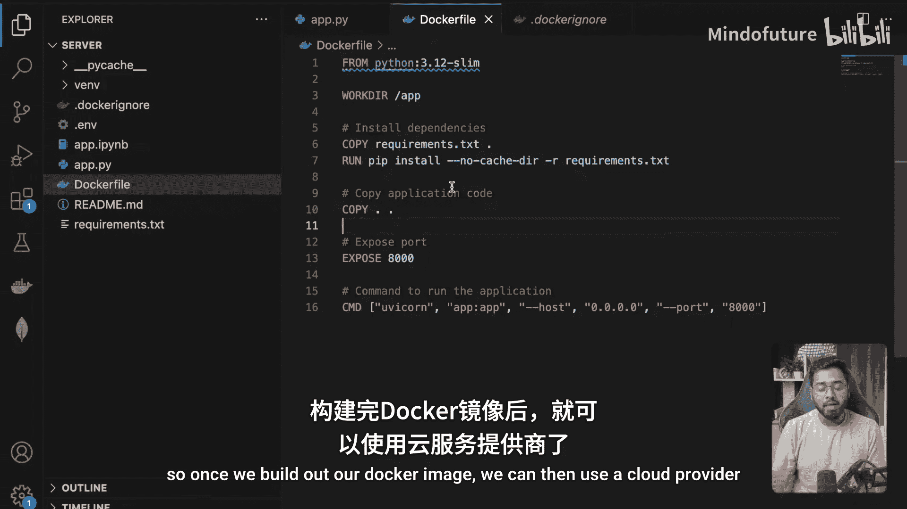

usingsing my own API keys right here。 So I want this to be extremely easy for you as a viewer to follow along。

 So I'm going to be removing all these API keys as soon as I upload the video but yeah this should make it extremely easy for you to follow along okay so the first step that we have to do so you can see that this guide contains exact commands with your credentials for building testing and deploying your perplexity app So that's what I'm calling it so personalized docker and render deployment guide So step1 is going to be we have to build the Docker image and if you're wondering why we have different commands for Apple Sil and the rest of it and that is because Apple Silon has a different processor and if we build the image in a different processor we cannot actually use render because render only accepts this AMD 64 processor So that is why we are using this and then we are making it standard okay so let me actually copy this thing this is going。

😊。

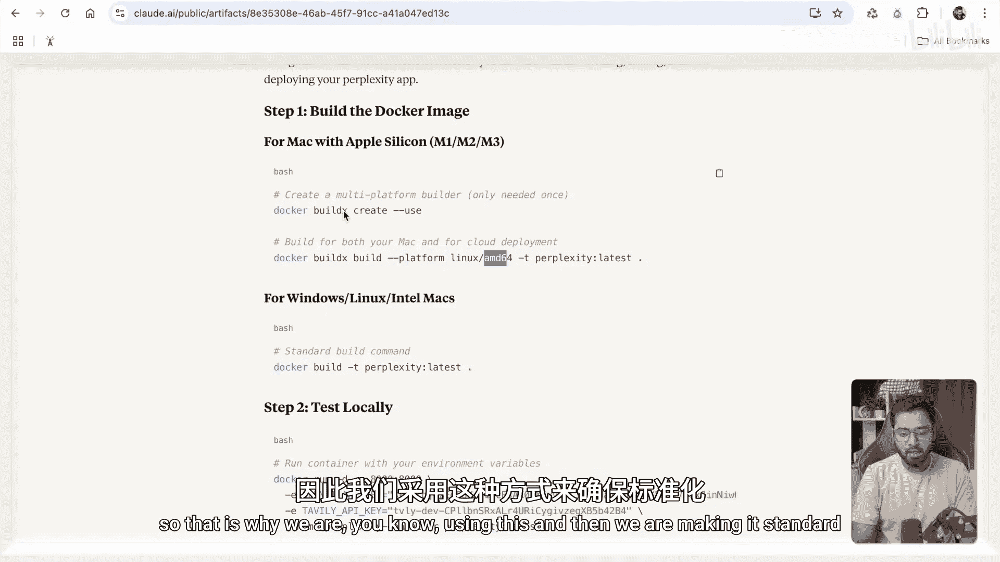

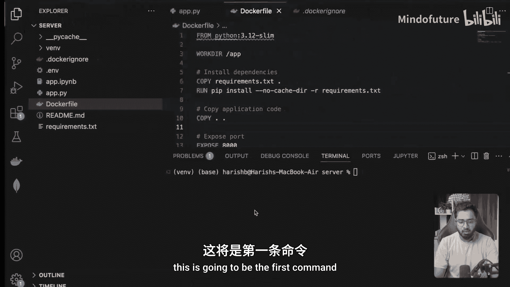

Be the first command okay and then I am going to copy this entire thing and then put it right here and that is going to go ahead and start building my Docker image so this might take some time。

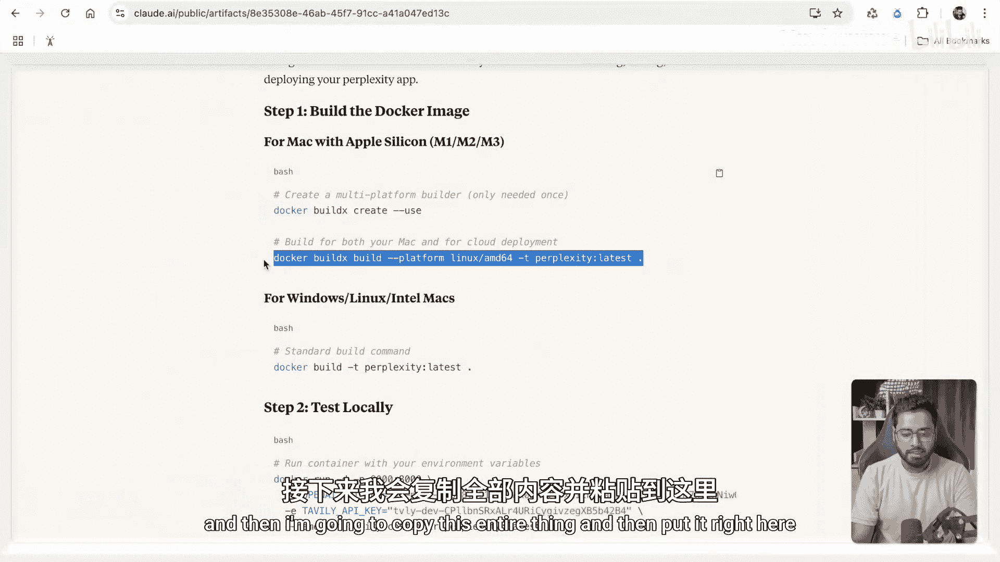

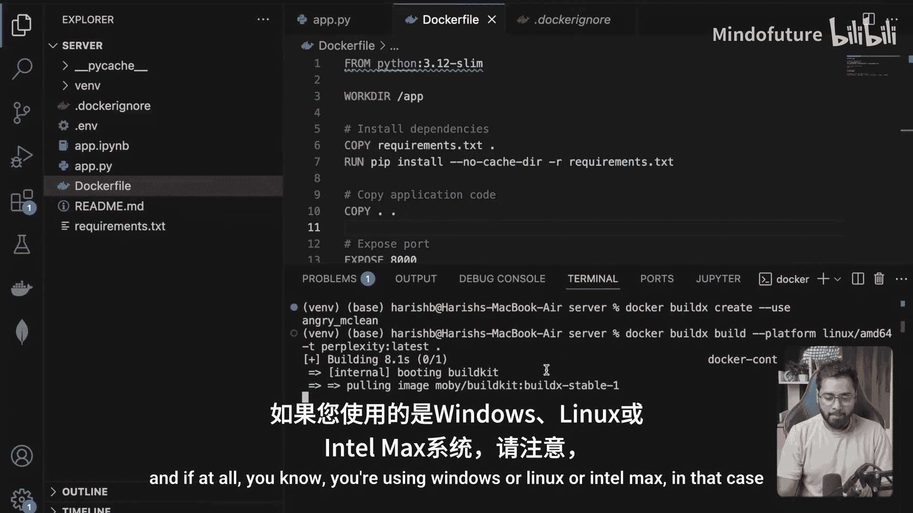

And if at all， you know you are using Windows or Linux or Intelmax in that case。

 just say Docker build dash perplexity latest and a dot here as well so why do we have this dot。

 were just saying that it is in this particular route directory where we have this docker file so we are basically just giving it the location to our Docker fileright so while this is taking some time let's go ahead and lets move on to step2 So whatever image that we built right here we are going to run it so we are going to run it as a container and we are going to test it we have to say docker run So this is how we run an image so this is how we run a container and we are saying dash this is a detached mode so we don't want to worry about all the logs detached mode and then we have this dash So what this means is we are specifying the ports So the container itself is going to have ports so that is what we are saying that in the container use the 8000 port and once。

😊。

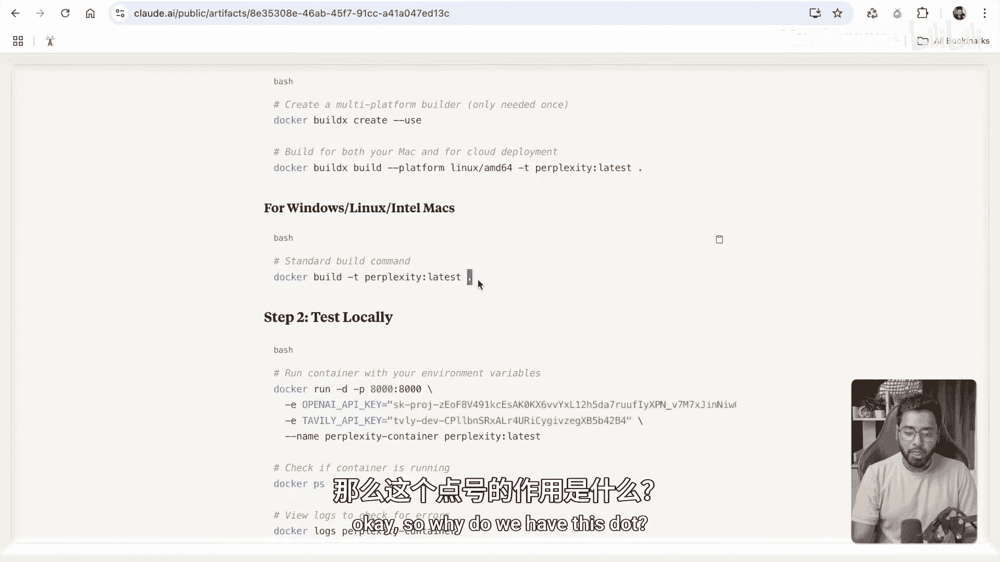

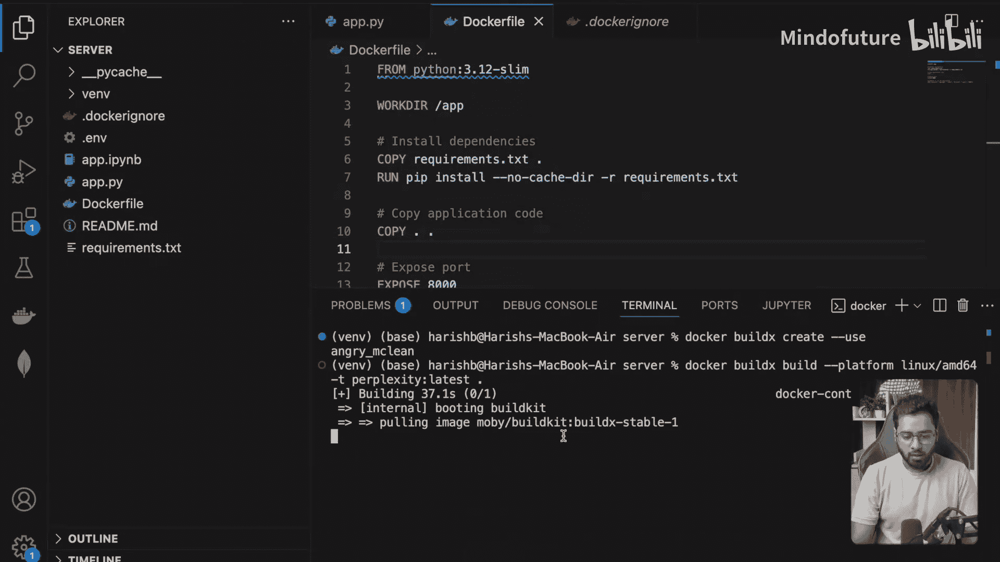

tainer is running if you want to you tap into if you want to access that port inside of the container。

 you know， use the local host 8000。 So that is what we are saying right here 808000 So this 8000 is going to be the port of the container this 8000 is going to be the port of the host machine and then we are going to set the open AI API key we are going to set the Tli API key and then we are going to give this thing。

 this container a name called perplexity container and then the image that we are going to be using as perplexity latest。

 so the same thing that we mentioned right here。 Okay so let's actually go ahead and copy this and let me see if it is done Okay great so you can see that the image has been built。

 So now let's go ahead and run this image great so now you can see it has given the container name So if I actually go back to my Docker desktop So right here you can see that we have the container running right。

😊。

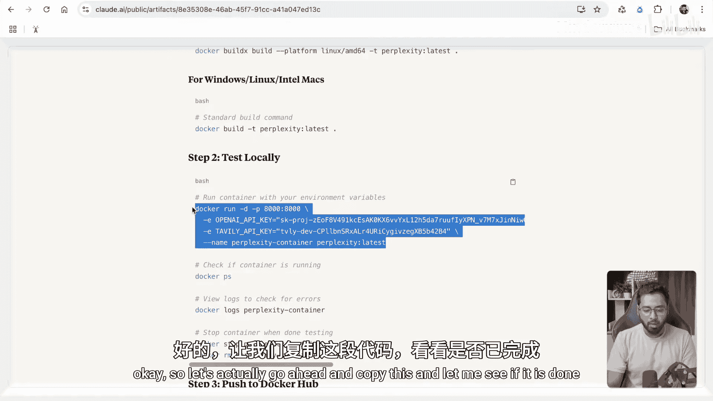

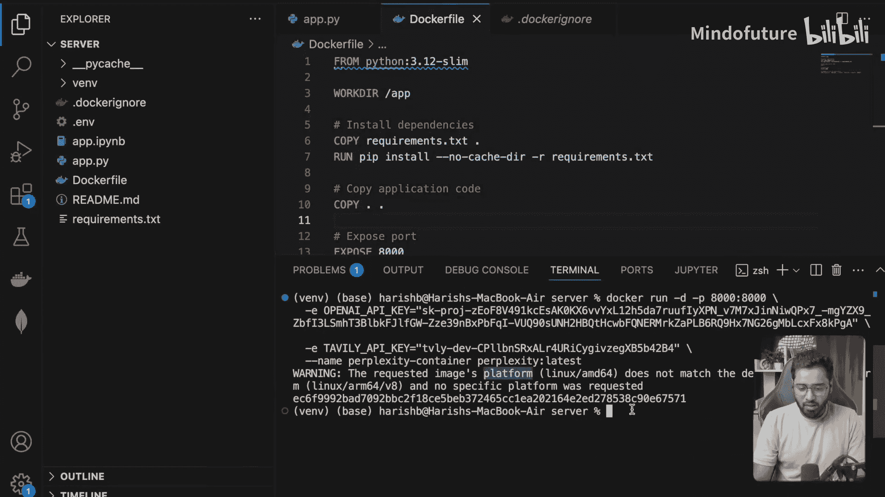

Right， so we have perplexity latest which is currently running on port 8000 right so I can just come back to Chrome and I can go to local host 8000 Okay so now you can see that if I actually go to docs we can see that we are actually able to access the endpoint and everything right So this is actually amazing right so you can see that we don't actually have any server running right here so were directly listening to this particular server it is actually the container that is running our entire python server including you know all the the land graph files as well right so now we know that the container is working fine now let's go ahead and push it So let's actually look at what is the next step right here Okay so the next step is basically to push to Docker hub So now let's actually go ahead and we can also stop this particular。

😊，Containers， okay， we don't want it to be running because we now want to push it。

Okay so it's been stopped and then we can also you know do this particular command as well。

 So now let's go ahead and log in okay to Docker hub so that we can actually push it to Docker hub So once we have it available in the repo in the Docker hub we can actually go inside of a public server and then pull it and then we can build the same image there as well and then we can have our application be available globally right so I'm going to go ahead and say Docker login so I can say Docker login authenticating with existing credentials username Harishne okay so it's because I've already logged in but if you have not logged in it's going to you can just provide your credentials and it's going to log in so what is the next thing So the next thing is we have to tag our image with your Docker hub user name okay so this is going to be the command Docker tag perplexity latest and then this is how we can actually do it So let me copy it put it over here and now。

😊，Lets go ahead and push the image to Docker hub so we say Docker push and this is going to be the user name of my you know Docker hub so if I go here to Docker hub。

Okay， so you can see that this is going to be my username right？

 So Harishil is going to be my username。 So that is exactly what it is showing right here for you。

 it is going to be something else。 And as you know。

 this is going to be the name of our image right So this is going to be the tag as well。

 So let's copy this entire thing and then let's go ahead and push it to Docker hub So you can see that it's preparing waiting So now it's actually going to be publicly available for you know the world right so let's actually wait for a little bit Okay。

 great， so it is done pushing。 So if I actually go to Docker hub right here and great。

 you can see that it has been pushed less than a minute ago right so this is what we want and now this is actually available publicly So the next step is going to be very simple so let's actually go back to our artifact。

 So we are going to be deploying on render right So I can go to my dashboard。😊。

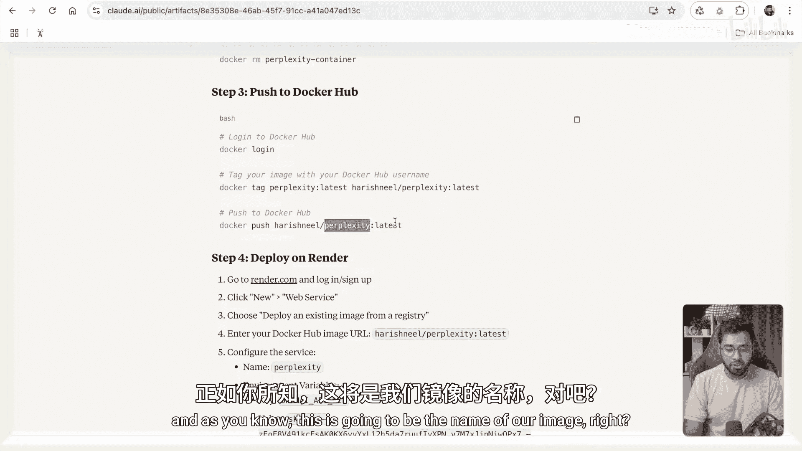

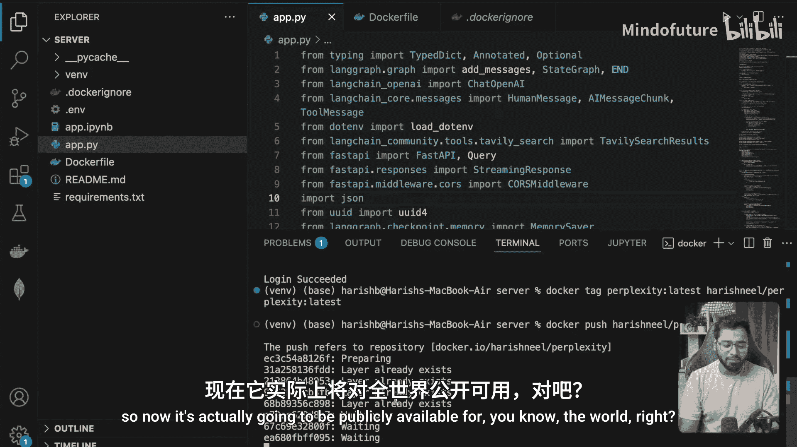

Okay， so I can click on add new and I can click on web service。Okay， so right here。

 I can click on existing image so in here I can actually provide the Docker image URL。 And for you。

 the username is going to be different for me this is going to be the image URL so let me copy this and put it over here Okay great so you can see that there is a tick mark right here so I can now go ahead and click on connect and then you can create a project if you want Im not going to do it I am going to go for the free version right here I can leave this region as it is So coming down this is where we have to provide our environment variable So we have to provide the open AI API key and we have to provide it tab as well so I'm just going to quickly go ahead and copy that。

😊。

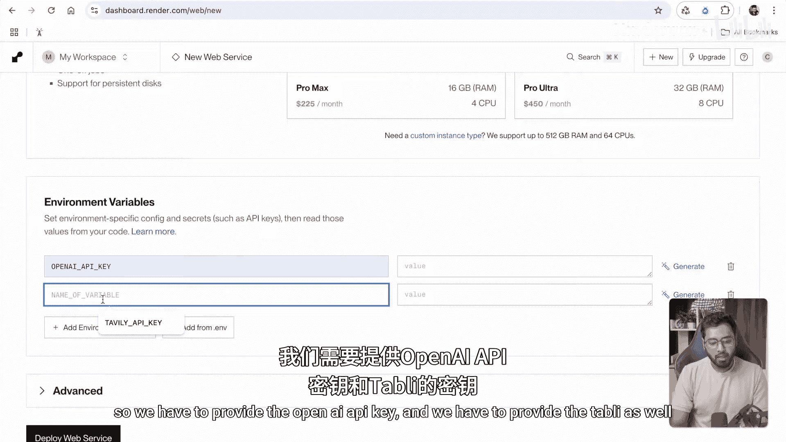

So Im just going to copy this， put it over here， this is going to be the open AIs this is going to be the Tvalese al right and that is it so now all that I have to do is deploy this。

😊。

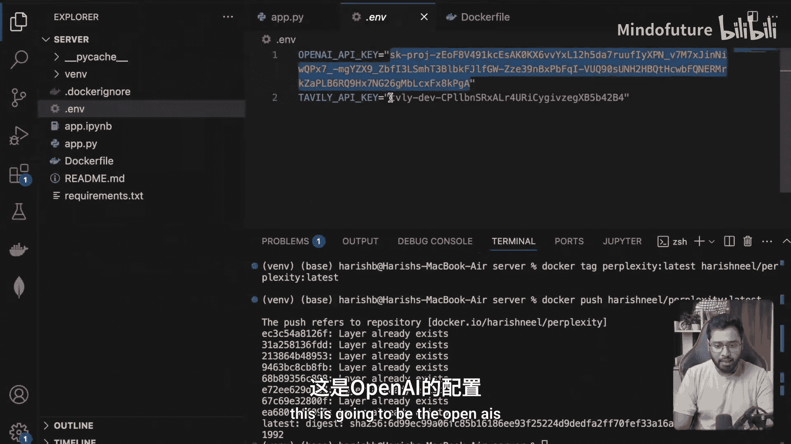

So right now what is happening is you know render is automatically pulling the image from a Docker hub because its now been made publicly available。

 it is pulling it and you can see that it is actually you know running it it is building it in its own server and it is going to make our application available to the world。

😊，So you can see that the service is now alive and now you can see that up here it provides me the new API endpoint I can just copy this and I can actually go ahead and run this and you should be able to see that we can actually access the swagger docs of our deployed application okay in this particular endpoint okay so now what I can do is I can just copy this endpoint come back to my client side code okay so right now it is actually pointed to our local host right so instead of this I can actually you know replace this let's remove this docs。

😊。

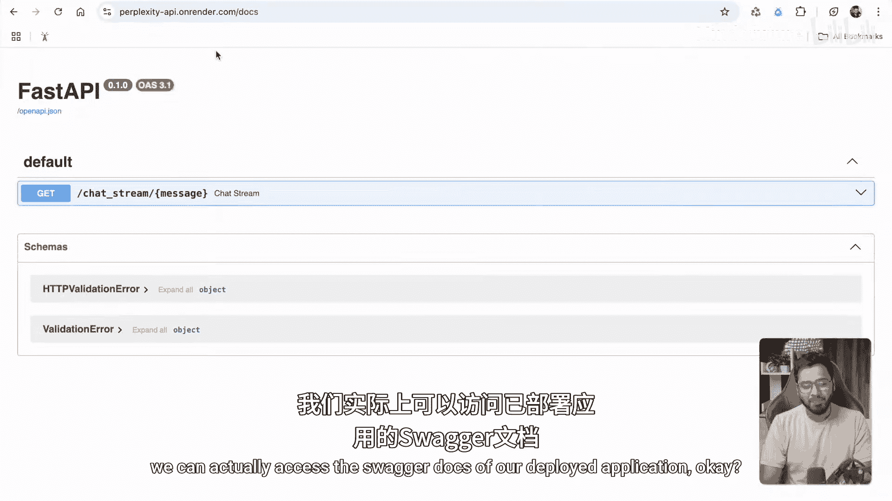

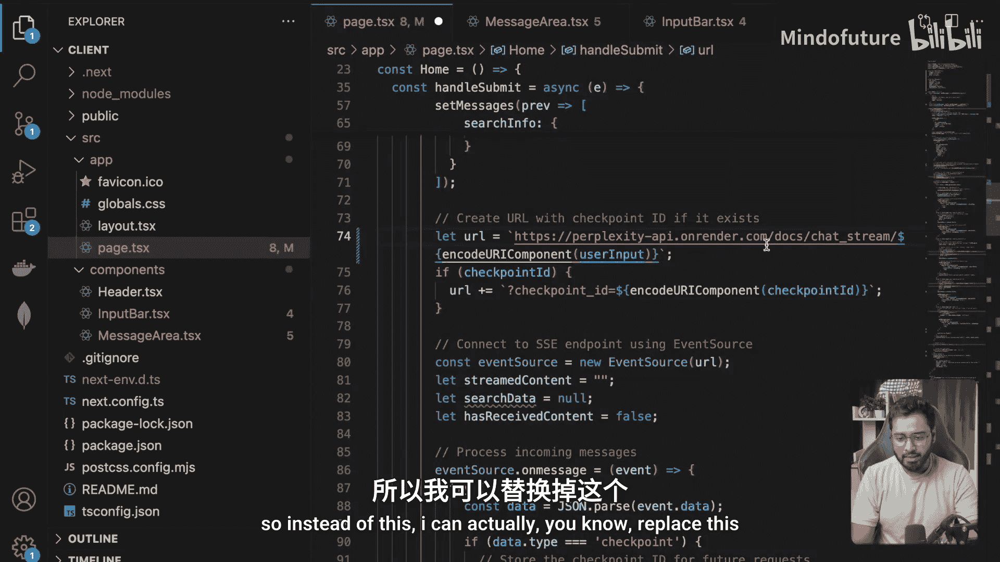

Okay， let's save this file and let's actually now go ahead and see if you know it everything is working fine。

 So in this case Im going to say， you know Im Harsh。😊，How are you。Okay。

 so now you can see that it is actually working guys。

 so our application is successfully deployed on render so if I actually inspect it and show it to you in the network tab you should be able to see calls going to render right now so I can say。

😊，You know， what is the weather？In SF。 So in this case。

 you can see that all the calls are actually going to perplexity， right， Okay。

 so it's going to on render dot com right so perfect。 So everything is working as expected。

 So if you want to go ahead， deploy the front end code as well That is pretty easy。

 there's a bunch of tutorials out there on how you can deploy a next Js application on ver。

 And if at all you want to steal the code you know I don't mind at all， please go ahead。

 pull the code you know clone it and then change the Ui a little bit and then go ahead and put it in your list of portfolio projects。

 So I don't mind absolutely at all。 Okay， so and that is it， guys。

 I hope you learn a lot and I see you in the next video。😊。

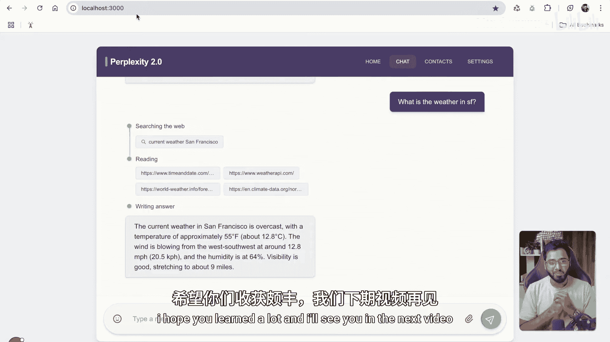