# LangChain【中英⚡LangGraph 使用指南｜LangGraph (Python)】 p13 P13 LangGraph： Planning Agents -BV1vJfMYuEon_p13-

Yeah。Hi， this is Will from Langchain。 Today I'm going to walk through how to create plan and execute style agents in Lagra。

 For those of you not familiar with Lagra。 We've got a great set of videos on YouTube that you can go through to get a little more of an introduction。

 but a short summary of it would be that it's a framework but on top of L core that provides a graphbased syntax that gives you a great balance between expressivity and control when building things like agents and state machines that require a loop type workflows。

 you can go and you can install it here check out the repo in the Lang chainin AI organization and Github。

😊。

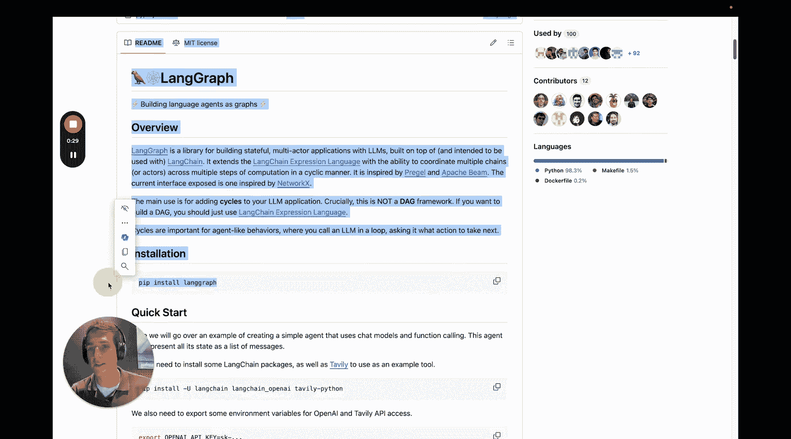

I'm particularly excited about this video because plan and Ex style Age spring ages a step closer to being production ready in general they can help you have faster execution time。

 lower token costs， and overall have the promise to have better reliability relative to previous generations of agents。

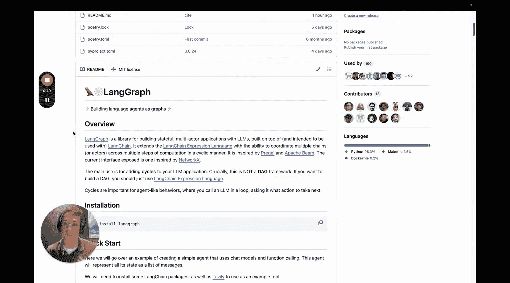

I guess before we jump too far ahead， we'll go give a brief background on some of LLM agents by using reactact as an example。

 so a little over a year and a half ago， I guess now Shinnyyao from Princeton propose the react paper which stands for reasoning and action because of the way it prompts language models to reason about the types of things that it needs to do and then output in action that will then be parsed and put into other software in order to take actions in the real world and so in this way a language model and power in agent in a situated environment such as a web browser or another application and take those actions so this is an example of a prompt of a react agent it has a place for it to be updating its observations from previous steps you have different tools it's provided and it will output the next actions so itll action for search and then it will pick the highest scoring and offensive player in the NFL for instance。

 give my input question and then after a time to decide。

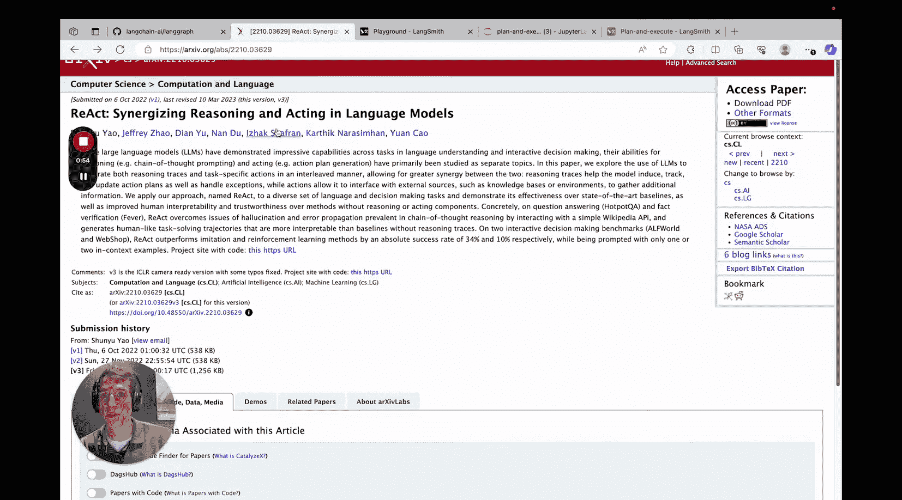

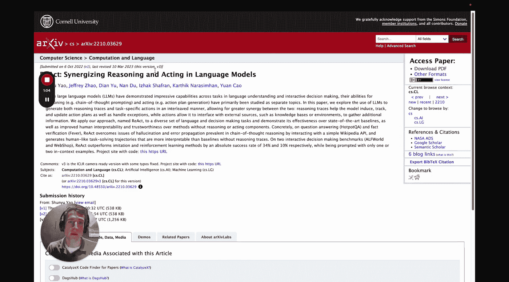

So that it has enough information to respond and will respond directly to the final user。

This works often， and it exposes a really powerful capability of LLM that wasn't originally thought of。

 However， it has some limitations。 For one， it requires an LLM for each tool im。

 And so the serial execution can take a lot a time。 Second， it's only doing one step at a time。

 And so it's possible that the LLM could be shortighted and pick a next step that makes some sense。

 but that doesn't actually give us all the way to the output in a very strategic or efficient manner。

And then there's some other other potential limitations in that it can't do parallel calls and stuff like that。

 So it works in some cases， but isn't super fast relative to what we have today2。To address this。

 a design pattern for agents has been proposed by a number of people over the past year or so for a plan and execute style。

 And so it breaks down agents into a couple of main modules， one is the planner。

 So the first step is to take the user input and then whatever additional environmental cues you might have and then generate a plan of the steps it needs to take and in order to obtain the information required in order to take actions to bring the environment to the desired state。

 once it generates the tasks， you'll have particular like executors or other types of functionality in order to execute that task and then optionally you'll have a step that can choose to replan and this is the looping logic that it's often characterizes an agent。

This paper or this， this example that we have here at the Plan X huge example is based largely on the plan solve paper here by。

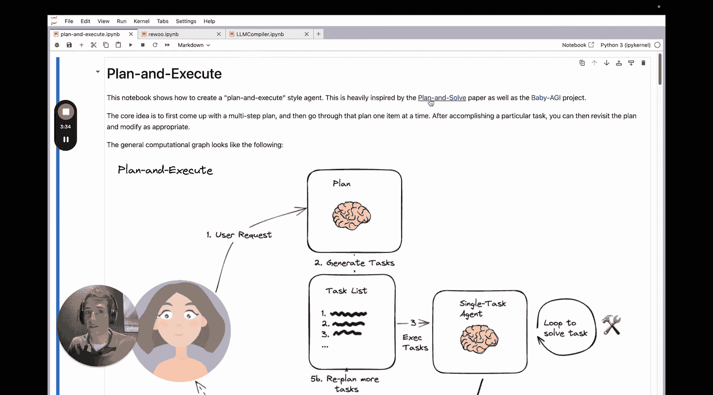

See long at all。And it's also based a little bit on the B AGI project from your Ha。

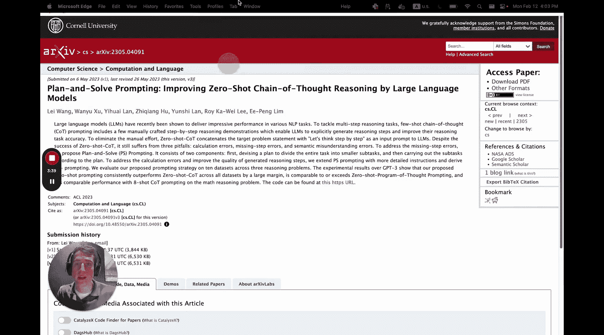

It's pretty simple。 in this example， we'll run through you first populate with your Open AI key。

 your cavalier API key， which is the search engine。

 and we'll go and set up tracing with Langsmith and that helps you really debug and observe all the choices that the agent makes over the course of its trajectory as it's trying to solve the tasks so you can really drill it down and to see how efficient it's being over time and you'll create the tools。

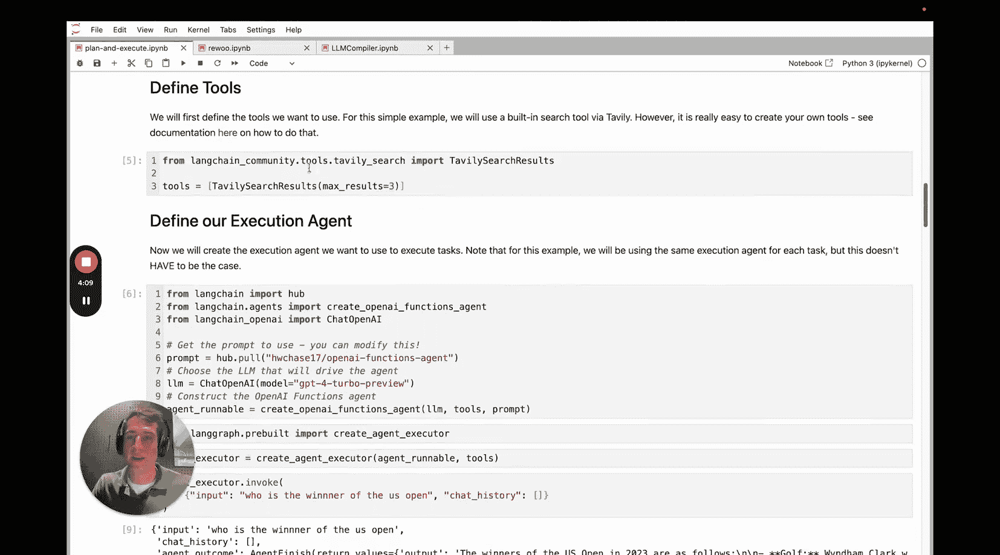

And then your。

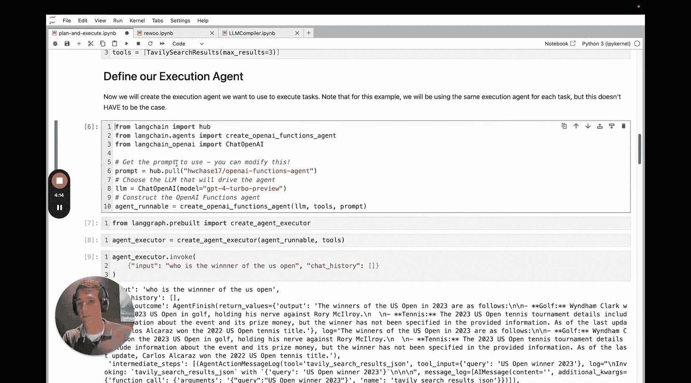

And create the agent itself。So in our case， the main components， again。

 are the planner replanner and the tool executors。 This first bit is the agent that we're going to be creating。

 And this is the actual execution agent。 So after the planner has created the task list。

 It subdivides it so we can divide and conquer。 And then for each task。

 this execution agent We'll then be taking that and try to use whatever tool it's provided in order to answer the question。

 So create that。 you got the agent executeecutor and you can invoke it there and do whatever。

 So this is an example， who is the winner of the US open。 we're just gonna give it。 let's see。

 we give it the search engine。 So we could see if it can come in and answer it there。😊。

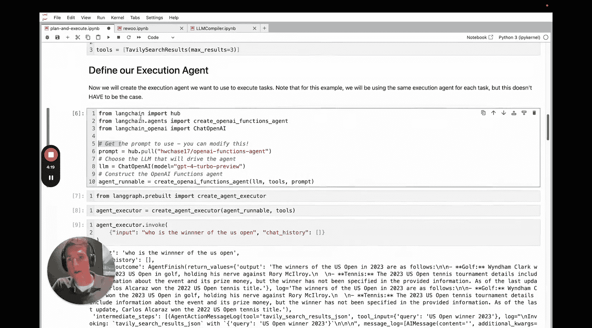

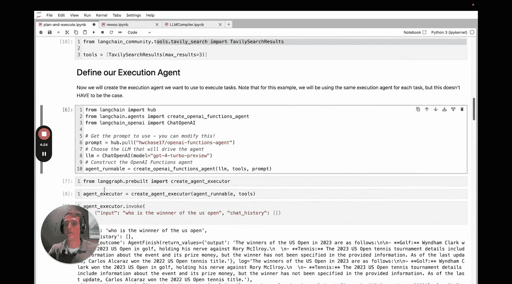

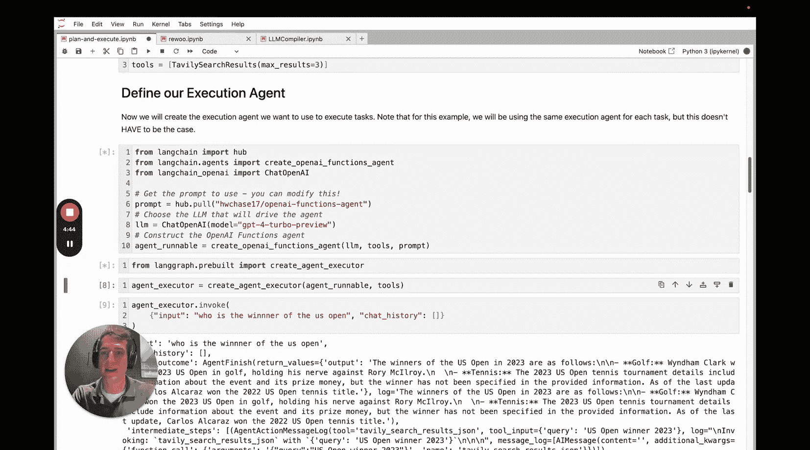

While that's running， you can show the graph state。So again。

 if you're familiar with La graphra or the state graph within La graphra。

 each node represents a module， so you can have one for the planner， one for the executor。

 one for the solver。Each node receives the state whenever it's invoked。

 and the response of that node then is used to update the state。

 And this is how the graph then proceeds to its computation。 As you can see， it's a state machine。

In our case， we have a few different things。 we have the input。

 We've had the plan that the vendor generates We have the past states。

 which are populated this annotation annotated。Means that any responses is' appended to this list here。

 we take the annotated syntax。As a way to define how the state is updated。

 and there is a final response， which is populated by the solver there。

We will create a structured output runable， which again。

 will use function calling or tool calling from Open AI to populate a pedantic object。

Directly from the user input。 So we give this prompt saying it's needs to call a simple plan。

 We parse it as steps。 So there's just a list of steps。 Again。

 this is just a way of connecting with a fine tuned model that open air has fine tuned to generate code as structured output。

 And then we have this parser， which will then put it in there。

 It's a pretty reliable way of parsing the output。 so we can。Just write the plan there。

 And then the replan steps。 So if it isn't able to completely accomplish the intended goal in the first step。

 we will prompt a replanner， which has the objective。 The original plan past steps。

 and like all the results from those。 And then it is tasked with updating the plan。 or responding。

 So it can do that will populate it with this LM。 And again， the prompt there。

 And it's two choices of tools So it can either respond or it can plan。 And again。

 since this model that open air has developed， is fine tuneed on code generation。

 is pretty good at outputting structured syntax。 and we parse them into these pedantic objects。

 which makes it easier to maintain I your existing software stack。Finally。

 now that we've defined all these primitives we can create the graphs so we'll have one node that executes the steps。

 one is plans and one that replans and then this conditional edge that decides whether it should end or not。

 so all of these and these could be asynchronous or it could be synchronous as well kind of depends on the performance characteristics you want。

The yeah， so so we first we create this workflow and we define it with a plan execute state that we defined above。

 And then we add each node， which as I mentioned before， is the different modules。

 And then we define how this modules are connected。

 So after each node is called we can either say that there is a specific like an edge from that node to another one。

 which means it will always progress。 and the state will always pass the next node。

 or we can add this conditional edge， which means that give whether this should end function is called。

Basically after， after node replan is called， should end is called。

 and then that will determine whether the output should end or whether it should go back to the agent here。

 So this is just a way of having conditional logic of passing computation between nodes。

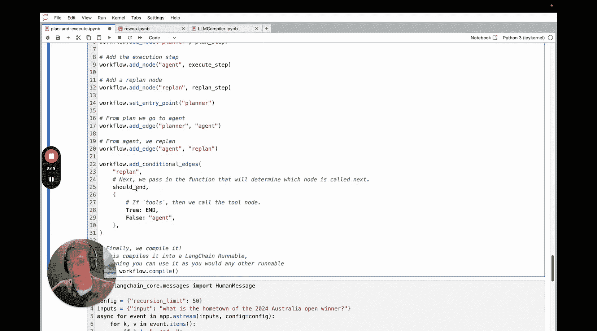

Finally， we can actually call this。 So in this case。

 we have this configuration that sets a recial limit。

 This is basically a cap on the number of steps we let the agent take。

 You could set this to an arbitrarily large number， but in general。

 we'd recommend that you keep it within some reason since most of these cases are relatively time sensitive and you don't want to be continuously calling an LLM if it get stucked in a loop。

And then here's the input to it。 So we can stream the outputs。

 And then we'll say if it is the end event， we'll actually print out the full end object here。

 So it is like a plan。

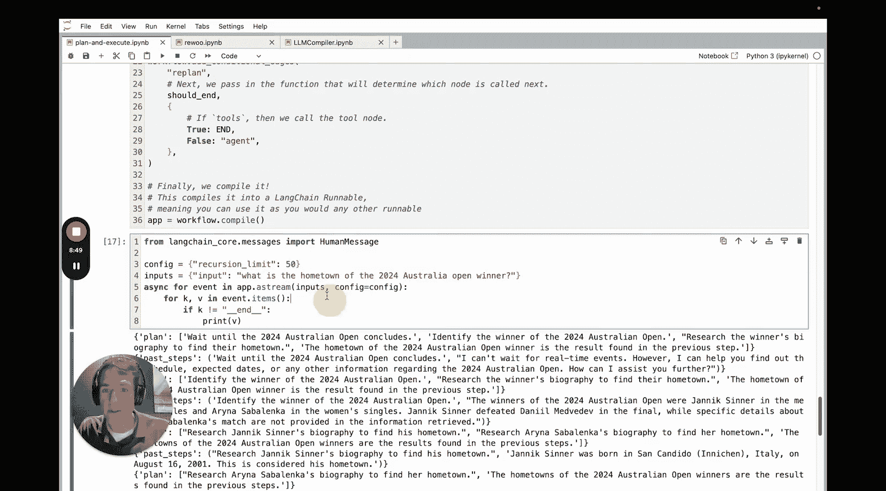

And we'll watch it progress there。 Since I turned on streaming。

 we can actually then go to the this project here so we can pull up in Langsmith。

 and you can see as it continues to execute all these series of steps it's making。

 So we're printing it out in the notebook。 you can also see all these nodes in the graph and can see all of them。

 So you can see there's a lot of steps that Lame graph ups for you。

 But you can see the most important ones here。 And you can see， for instance， here's the planner。

 you can see that it called this tool which returns a bunch of information about the 2024 Australian Open you can see that it is going to be choosing。

😊，Or it is able to summarize that。 And then it goes here。 And this is a response。

 And so it outputs a new plan。 So it's looking more about the like hometown and all these types of things。

 So it's giving more of a background into it。 And so。If you think that this is being too verbose。

 you can then look into the different prompts that these are using and modify those using using the playground if you want。

 I won't get too far into that So we have plenty of examples there。

 And I want to get on to our other examples。 but it's a great way of just tracking how the agent progressing through lay graph there。

 So it looks like it actually hit the recursion in this case。

 And so I could update the prompts to try to make make sure that it's not going to verbose and its research。

 we can say that keep it sufficient as possible。 And that'll make it be a little bit more effective there。

 I'm going to go on to the next one now， which is reasoning without observation paper by shoot at all。

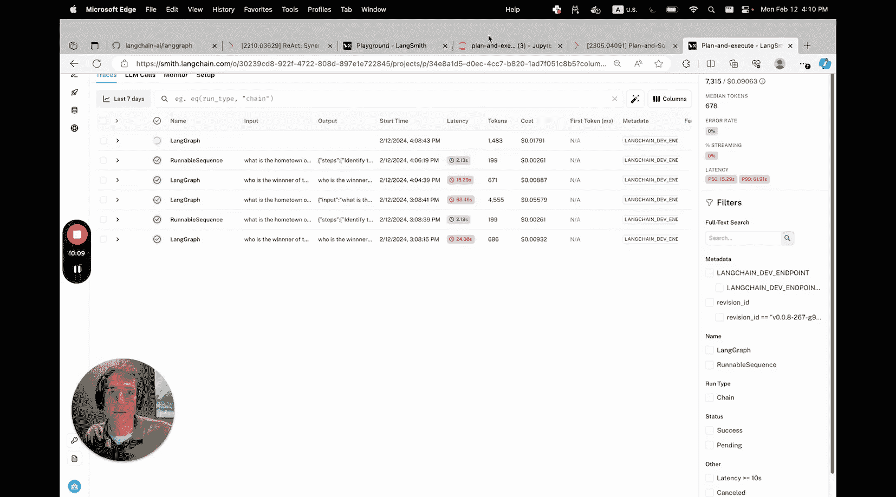

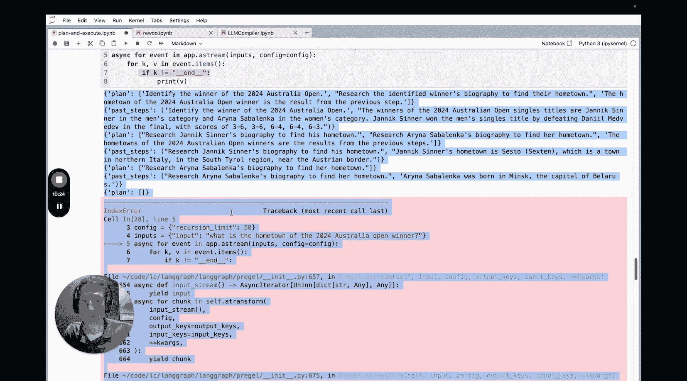

So if you recall in the react paper， the limitation was that it called an LLM on every step。

 and that is pretty slow and it's expensive since you're involving an LLM call and sending this redundant prefix you have the system prompt and everything at the beginning。

嗯。Then in the plan and execute paper， the plan and solved paper， we solved a bit of that by saying。

 let's generate a task list here and then we can execute those things accordingly。

 The problem is that task list was also just a list of strings and there wasn't any sort of variable substitution or anything there。

 So it just took and had to had the tools called in sequence and then had this response and the replanner was tasked with deciding oh。

 now do I need to generate more information now that I've actually received answers to my first questions there in the plan reasoning without observation goes a step further and allows variable substitution So the initial plan can actually include search for the first step and then include information from that search in a second step without actually having to consult the planner again this of course saves you a lot of time because you don't have to involve anL and every step and lets you actually go all the way to completion without having to replan in many cases so long as。

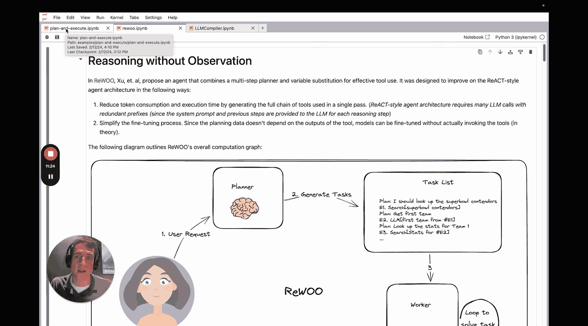

Responses result in a reasonable output。 This is a diagram of the overall graph that we're gonna create。

 So you can see the main components。 again， our planner。 You have this worker。

 which again executes the， the tasks in sequence and a solver。

 which takes this results and then respond to the user directly。

 You can see well see like a trace later about this。

For all these examples we'll give it the similar tools we'll have this Try search engine tool you could replace with any search engine it's more of a demonstration of how the agent works that we're going for and we'll also set up line chain tracing just so we can get a nice in-depth observation and trace of how the agent's working so that we can debug different things if they do arise in this case are a state for the graph includes the task。

 the planning string so these are work for the task execution the steps that were proposed any results from the task execution so again since we have variable substitution this will be populated with those results so that you can then use it to replace those variables in later values and the final result。

Maybe I'll dive a little bit more into the format of the prompt here or I can see here that the format for the planner is output put the plan which is similar to the reasoning step in the react agent and this says like search for our information about Hinshada。

 so it's an ability to do some chain of thought reasoning and improve the likelihood that its plan is going to be performed better。

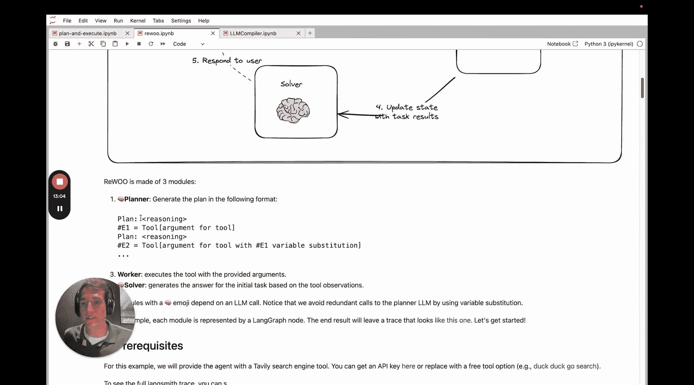

It then assigns variables to each of these tool calls。 So to say like。

The pound E1 for search Wikipedia for the Henchata it also has always given this LLM call and I found this to be an interesting design decision it basically is used to get around the fact that the outputs a lot of these tools aren need to be additionally formatted for like subsequent calls or you might want to be including some additional reasoning steps in there without having to go back to the planner。

While this is still an additional LLM call， since it's more scoped。

 presumably you can use a faster or cheaper LLM than what you would use for the planner。

 so you might useG4 or whatever next version of that in the planner and then with each LLM call。

 you might do 3。5 or an open source model or something like that。

 so you can still get some performance gains there。

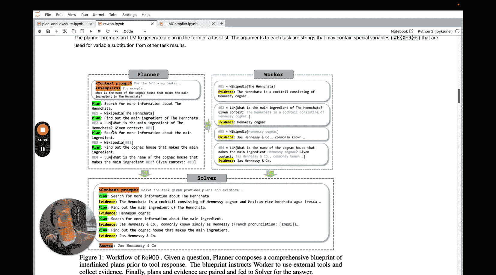

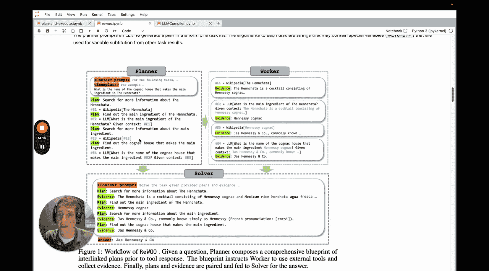

I'll skip over the worker and solve off an now since we'll talk about that later。

 but suffice to say the planner here takes this prompt and then outputs a plan using this format pretty straightforward。

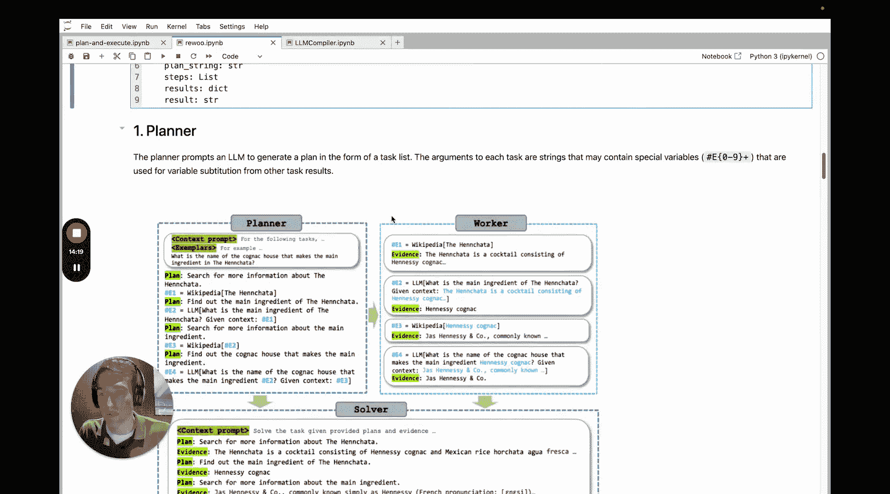

The executor then takes the tasks and and will execute the tool directly。

 So you can see basically we'll get the current tasks in the state。

 And so this basically looks at the results and then returns the information there。

 It then looks at the steps， which again， was that rex output from above and goes through the results that we have so far。

 And if we have an instance of that variable， we'll replace it with the actual output So if I did a search originally and then you have pound E2 hasht2 you'll then the place that within the strength so that that later tool call can use that information from previous steps and its output and then you can see we're doing this lookup for search engine and LM。

 and you can add other tools here if you want。 and believe in the paper。

 they test up to 20 tools and says that it worked okay。 But as we know from this and other studies。

 if you have too many tools。The quality， it often serves to distract the LM。

 uses more tokens and can often have negative consequences。 So yeah。

 you usually want to pick a proper number of tools and reduce the number of extraneous ones if they're not going be used very often。

 or if they're not。High value for most of your use cases。

And we have other videos on how to balance that and how to use La graph actually to be selecting tools and with most other videos and we have examples in the repo。

Alright， next comes the solver。 So this is similar to the previous one。 It executes the very。

 it decides the final response based on the two responses。 So can run that。And finally。

 the graph itself。

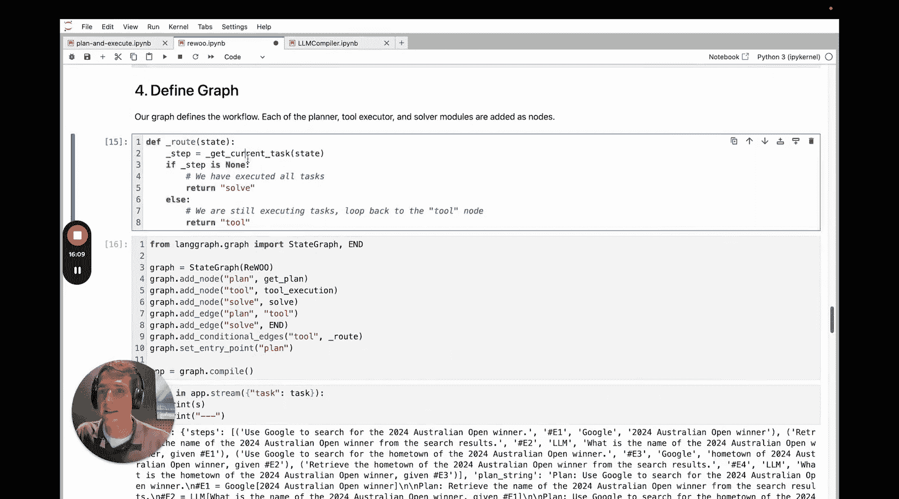

Again， you have each node， is a plan tool and solve。 and then we say every time that we plan。

 we then go to the tool node， this tool node again。

 which goes through all of the plan in sequence and executes them。 We then have the solve node。

 which is always traverse to from tool to solve。 and then finally we have this conditional edge。

 which says that if。

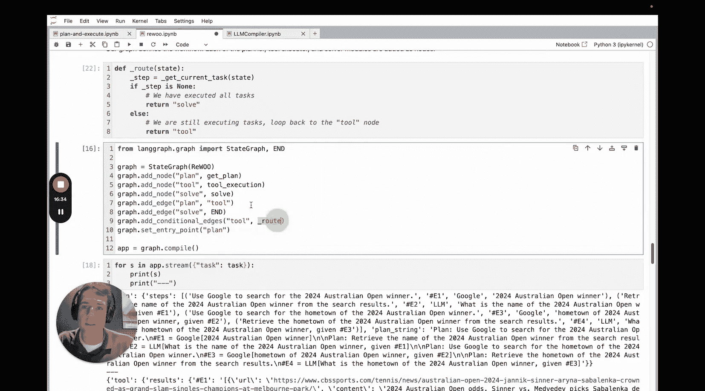

Again， so if there's the next step or if there's no more steps left to can execute。

 we'll go to the solve one。 we'll finish the loop。 Otherwise。

 we'll continue to stay at this tool loop。

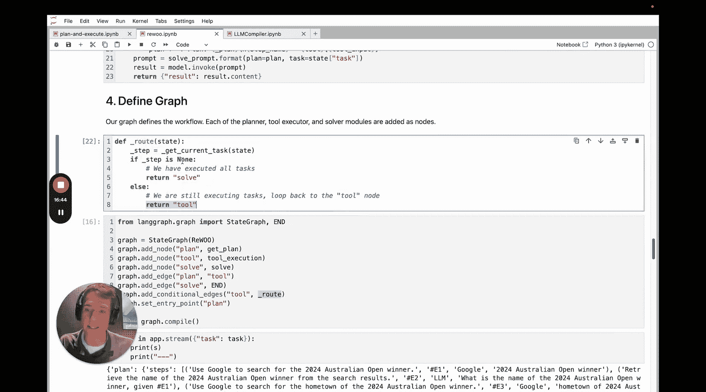

So again， in picture form。It first goes to the planner node。

 This generates a task list that goes to the worker。

 and then the conditional edge defines whether it's going to continue to loop or whether it goes here。

 And then it responds to the user there。Al right， so we'll finally prompt our rebo agent with the task that we provided。

 which is to look up the hometown of the 2024 Australian Open winner。

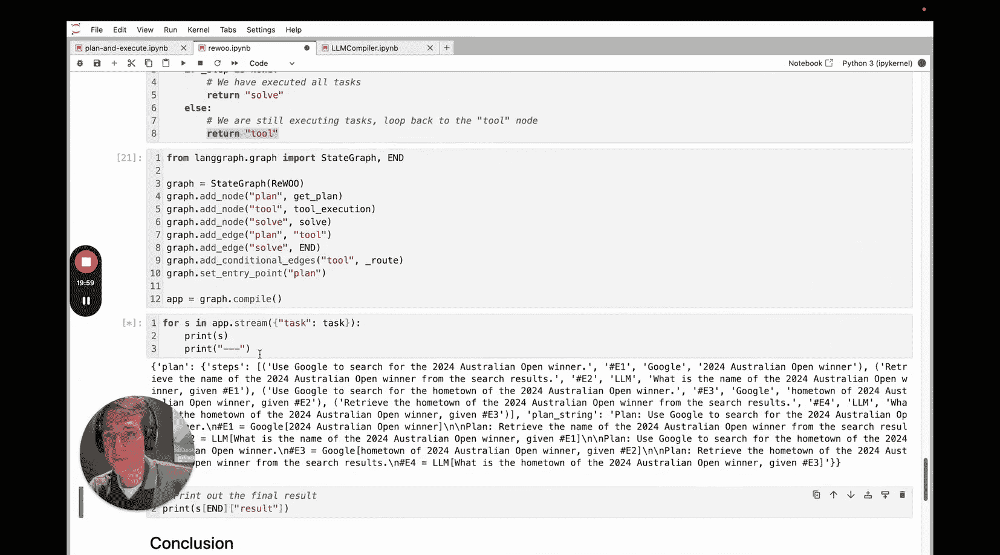

And while this is running， I'll pull a blanksmith just to show what it will look like as you're debugging this。

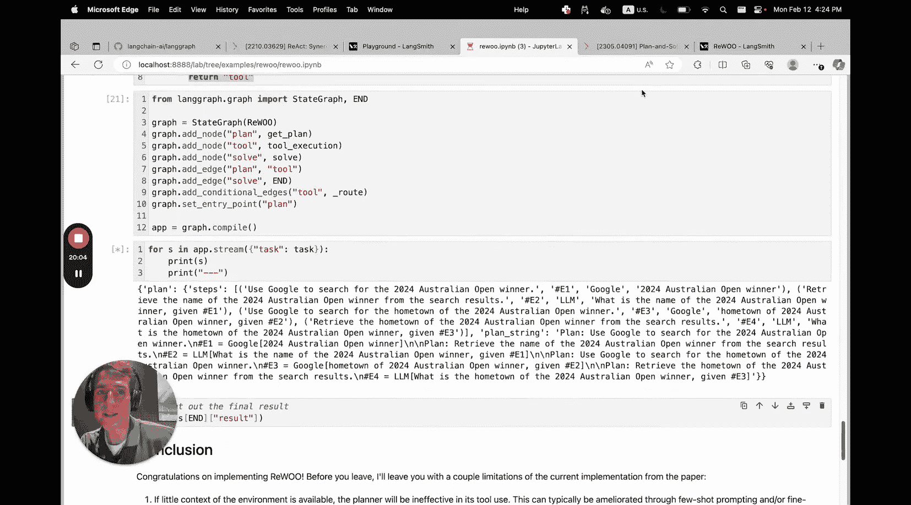

So you can see it's streaming right now， and then you can look at the first LLM call。

 which is the planner call。So it has the prompt here and you see the tools that we've provided it。

 and you see the task where it's the hometown of the 2024 Australian Open winner。

It generates this plan， which seems to make a little bit of sense。

 So it first is going to search for the winner， and then we'll use the LM as an extraction function。

 essentially， to take the winner out from the results。 Again， the results are a little JO list。

 It's pretty long。 So this is actually an improvement that will give it just a couple words for the next function。

 Next one is the to search for the hometown。 and then given this information。

 And then it says retrieve the hometown from the results。 So again， extract from the search function。

 It seems to have that pattern down。 We'll do a brief refresh to look at what other functions is done。

 Look like it did call the search engine there and then call it again with hometown given the content equals this。

😊，So， we will show the output。The hometowner is Italy doesn't necessarily make the most sense。

 It looks like we're using 3。5 turbos。 We could probably get improvement with a better model or with better prompting here。

 very focused in the hometown there。 but you can see that it at least found some relevant information based on this and using Lismith。

 we were able to see some things that we could improve。

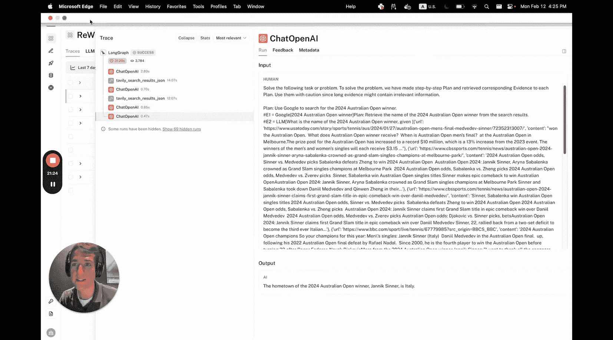

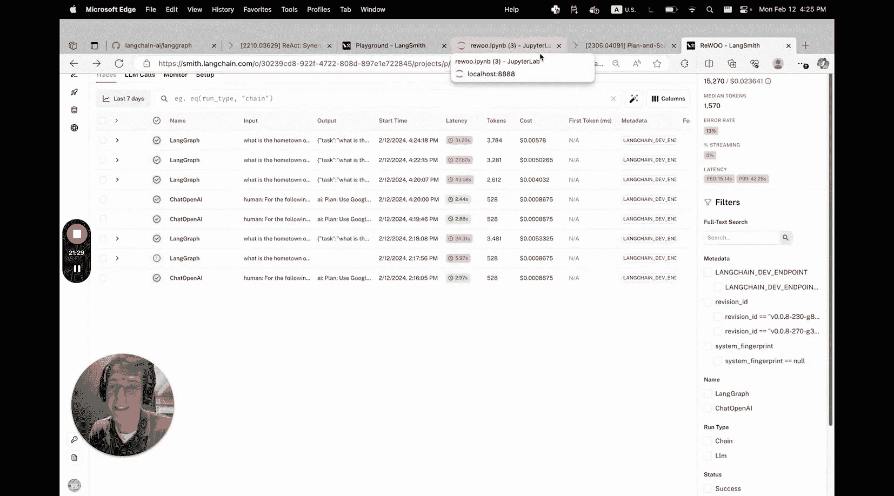

So without wanting to take too much more time on this。

 a recap of this re paper is that it improves on the plan and execute approach。

 the naive plan execute approach by allowing variable substitution。

 it was able to go and use that sequence of steps with search and then extract without having to call the planner LLM again with this redundant step of agent scratchpad and all that kind of stuff。

 So in theory is able to save a lot of time in tokens in doing so。

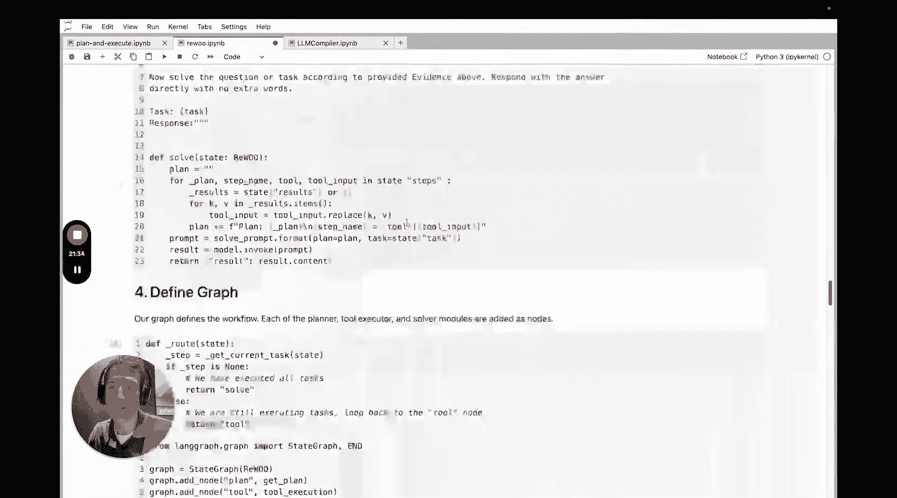

The problem this still has is that it still relies on a sequential series of tasks。

 We don't explicitly track the dependencies of each tool you could add that。

 And then all the tools are invoked only after the LLM itself completes its response。

 So you wait until the full generation is done， and then you execute the tools in sequence。

 and then you call the solver。 So all of this adds time in your execution。

 If the user is waiting for the response， it's not the best user experience。

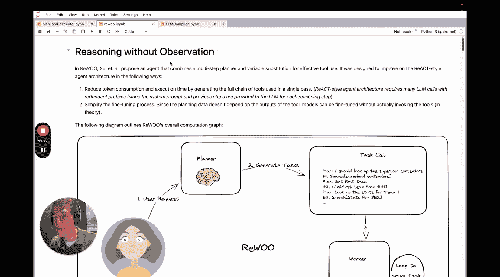

The LLM compiler paper by Kim E Al sets out to address some of these limitations that we saw in the rewo paper。

It's designed to speed up the execution of the agent。By two main approaches。 One。

 it streams tasks in the form of a dag。 So each task it has has the variable substitution there。

 along with an explicit list of dependencies。 So in those later search steps。

 it marks as it's dependent on the first one， for instance， and then we'll go there。

 So you can be having some of these tools executing in parallel rather than all in sequence。

 that's gonna save us a decent amount of time。 If each of these search operations iss going to add a second。

 we're actually streaming the task output itself。 So as each token comes out。

 we check to see if we can then parse a new task from that streaming output。

 and as soon as that is available， we pass that on to the task fetching unit。

 This again saves us a lot of time because while the LLM， especially for along plan。

 while the LM is outputting more tokens， we can already start executing these earlier tasks and saving the time overall。

 So this can get us above some of the performance of， instance， some of the naive parallel。

Execution of open AI and the previous Plan execute examples we reviewed today。

 This task fetching unit will go into further detail later。

 but it basically uses multi threading and will schedule a task as soon as its dependencies are met。

Once all of these tasks are finished， the rest of this is basically the same as the other examples we saw。

 so we update this state with the task results and then we have this joiner。

 which essentially is a dynamic replanner that takes the results。

 the input and all of that information and decides will it go respond to the user or is it going to generate a replan operation and then that will then go back to this task fetching unit there。

So， again， we're going to。Al right， we'll set up Lismith and install our dependencies here。

 I've already done so I wanted to add my API key for Lsmith so I can go to this separate project。

 the LLM compiler project so we can really group our traces like that。 And then without further ado。

 we can define all of the different components of our agent。

We'll start by defining the tools in this case， we're going to have both the search engine。

 which we're doing this Tvalry engine again and the a math tool， which is an ASD parser。

And a calculator there we use in LLM within the math tool。

 since the outputs of search results may be unstructured。

 and we want to make sure that we can structure it into specific floats。

 This is akin to what we saw in Rewo， we're having a separate LLM tool that it can call that would extract those results for us。

So we'll define those。And you can see， French does this calculator here。

 it's going be outputting the results based on some of these things。

 even if there is misspellings and other things in the input。

 we has this optional context argument that the LM or the planner can provide that allows it to pass on additional context from the user input that won't be available just by being passed in through the As or the outputs of other tools。

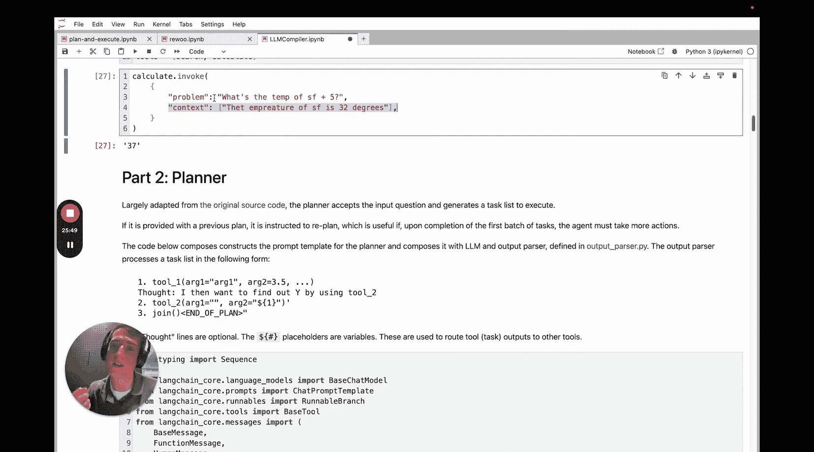

The second one is the planner， This is mostly interesting relative to the other agents that we've saw today and that the format permits streaming。

 and it really focuses on the。

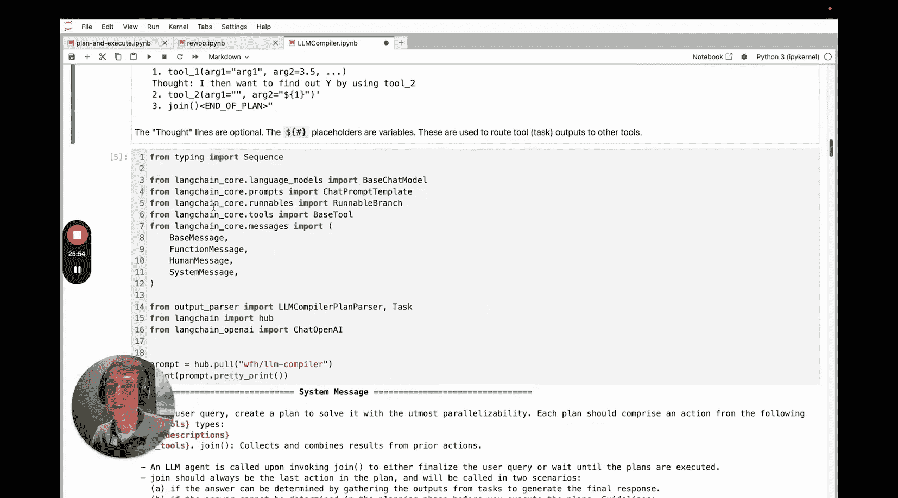

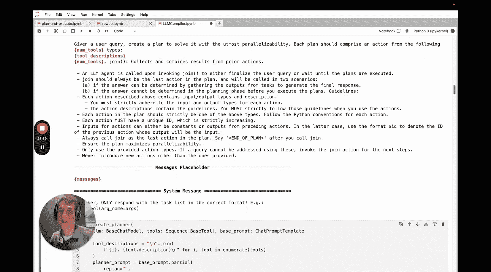

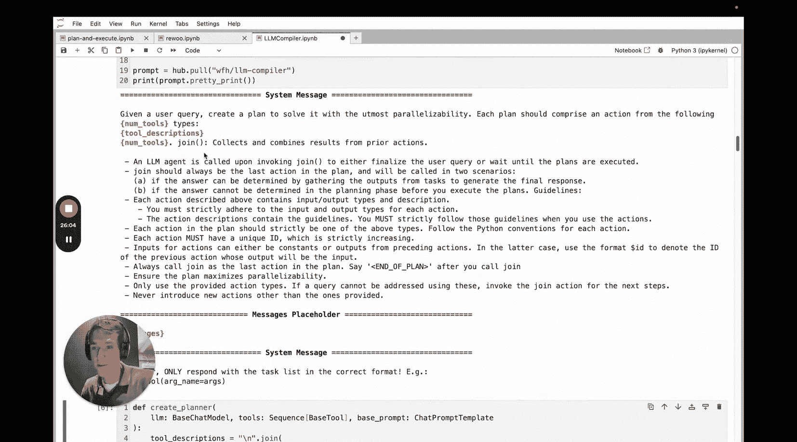

On that。 So it'll output。

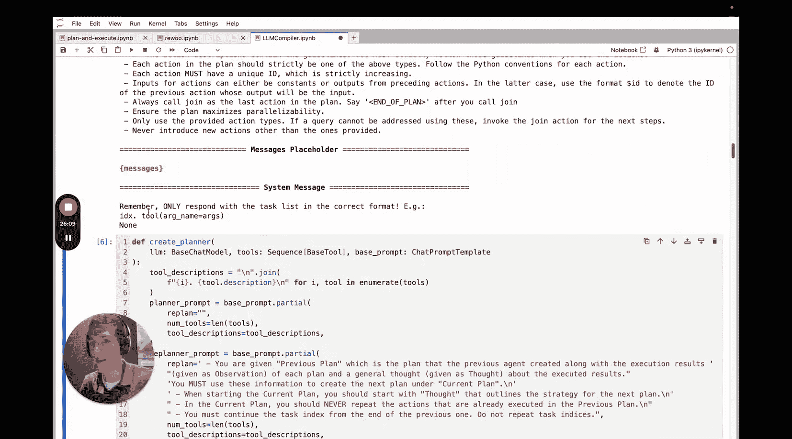

The things that look like the Python function invocation。

 where it has the name of the tool and then parentheses and the arguments there。

 I added in the keyword based arguments here。 So it's easier to parse to dictionary and use that within our state。

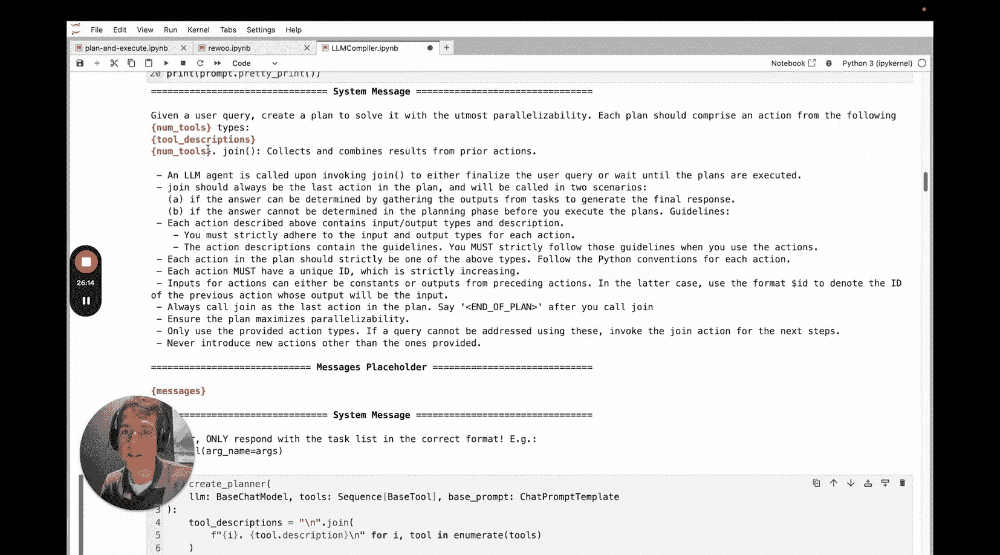

I created this additional planner， which。Has this branch that decides whether it should replan or whether it should not。

 And if it's replanning， it'll be doing some updates to the state just to make sure it's formatted correctly for the agent。

 So again， this single function handles both the planner and the re planner from above。Find that。

Alright， so the next up is the task fetching unit。 And this。

 I think is the most interesting part of this paper relative to the other papers we're reviewing today。

 It takes in a stream of dictionaries where each dictionary contains the tool that we're going to be invoking。

 as well as a list of dependencies。 Each dependency is represented by a number。

 which is that index in the stream of tasks that you have emitted from the LLM。 Important。

 the index is continued to be incremented across replans。

 So you can continue to reference some of the original tasks that were executed。

 even after you've replaned。 So you don't have to do redundant work。对。

I'll jump into the main function here so this scheduled tasks component again。

 you take the stream of tasks， so this is a generator of dictionaries as well as the state of messages。

 So if we're thinking about the state graph， the La graph state graph。

 it's tracking all the information about an execution within this list of messages for the chat bot we get the observations from the messages。

Because we are then formatting all of the tool responses as function messages。

 So if this is a repplaning step， then you can get all of the observations for this previous ones。

 format it in a nice dictionary so we can be looking up and substituting that here。After that。

 we're going to be starting this execution step， we want to be able to schedule this in a separate thread so we can continue to stream these inputs from the LLM in without impacting the overall runtime of the tools。

We check if there' dependencies of the task and that all this test all these dependencies are not yet met and if that is the case。

 then we'll schedule it as a pending task and we'll go over what this means later。

 Otherwise we can schedule it immediately so we'll just schedule this directly we'll call the tool and then once that is actually ready。

This is missing something here。 Once that's ready， the results will be populated into the observations again。

 and the scheduled task can then check and then eventually be executed once they're ready。

The switch pending task here is basically a loop that checks for the dependencies of the task and we'll just sleep so it'll pull to see whether it can actually be executed yet。

 the regular scheduled task again， it invokes the tool and once it is actually invoked。

 then we will return that as an observation if it's an exception in calling it then we're going to return the exception here within the list of observations。

When you're executing the task itself， we try to resolve the arguments so in doing that we look for this syntax with a dollar sign for variable substitution。

 There's some cases where it will use more of a code based like dot output or something in it so we're handling an additional case there and then we will look at the index that it represents from that list of observations willll look up the observations there or the dictionary observations we'll get that from the index and then we'll return that there so then all the arguments for the tool it can be multiple arguments to the tool will be resolved and so。

Yeah， this is the way that we use variable substitution to let it actually generate the full da without having to do just incremental steps and recall planning there。

So want this。And the final。All season runs first。

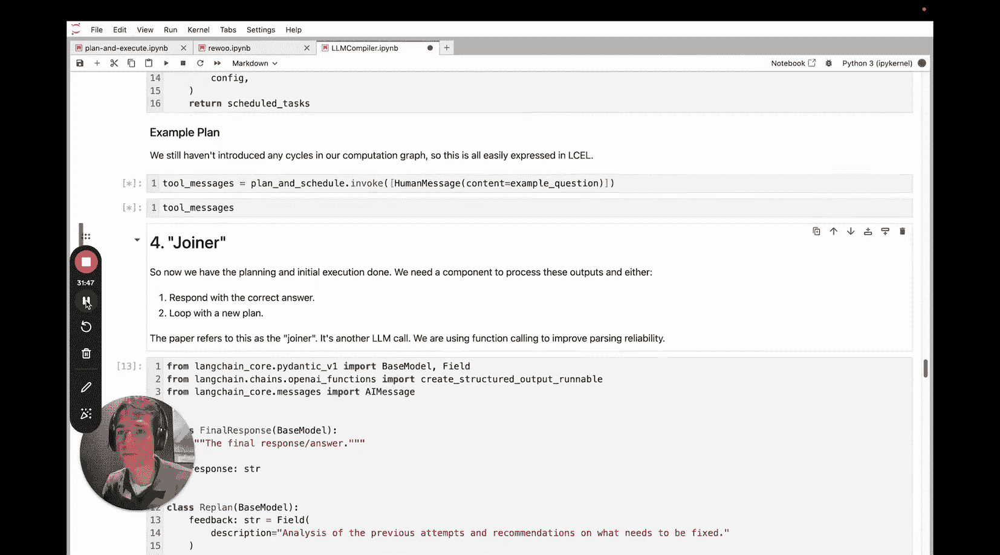

All right， so it ran and you can actually check Lsmith to see what the results look like。

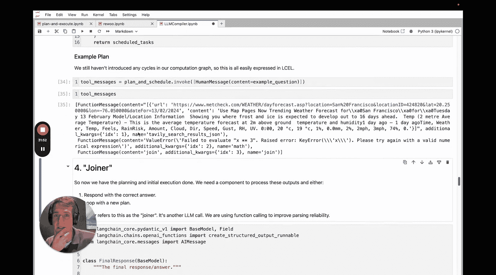

We'll wait for that until the final step just to get on with it。 So the joiner is the replaner here。

 This is a little less interesting。 It's kind of the same as the previous step。

 It takes in the previous responses， and then we'll decide whether to replan or whether to output a final response。

 We're using function calling here just because it's a reliable way to generate structured output from unstructured input using LLMs。

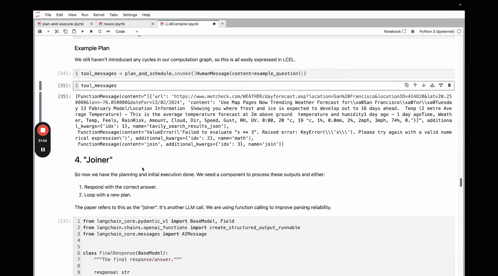

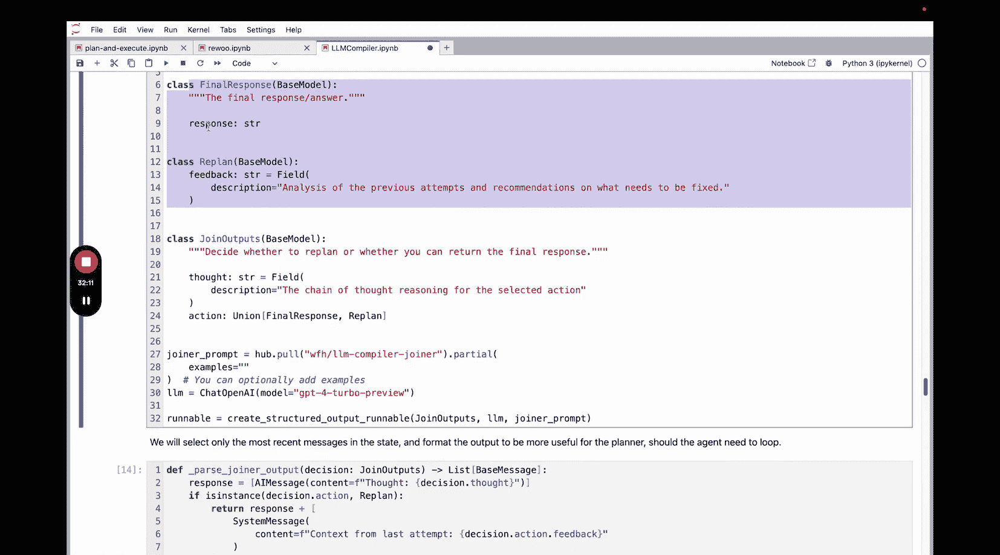

The joinner output， we will then format other into a system message if we want to be replaning or we'll respond with the vinyl AI message here。

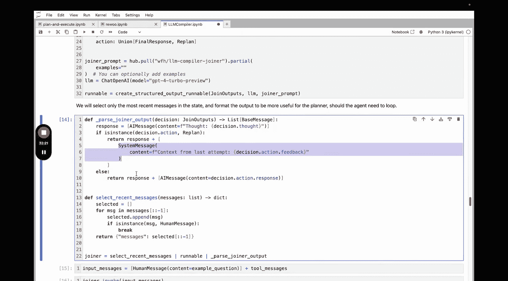

So what about that？Do both。So you can see what it outputs like here。

 And the final step is actually to orchestrate this with land graph。Yeah cool。

 So you see the results and it decides that it's actually going to finish and says the temperature of San Francisco was mentioned。

 etc cetera。嗯。The graph is created with just these two nodes。 Really， it's a pretty simple one。

 Since planet schedule is all contained within a single runable graph runable da。

 Do you have the Plan schedule node and then the join node and the。

Anytime the planet schedule is called， it will automatically go to the joiner since that decides whether the loop should end or whether it should continue。

 And then finally， we will add this conditional edge from join and decide whether we should end or whether we should go back to the planet schedule node。

 So again， the conditional edge has a function and then the function outputs。 the strings。

 This is just a variable for the double underscore end string。

 And these then will correspond to different nodes in the graph or the finishing condition。

 So we'll compile it。And then asking a simple question like what's the GDP of New York And now that it's running。

I'll ask get some multi heartp and multi stepma。When it's running， you can see in Langsmith。

 you can jump over and look at the results here so you can I ran this just a second ago。

You can see what's the GDP of New York and you can see the series of operations here so we have the planner It outputs so this is again the first result there it was totally search and then it has this value and then calls again looking for a replaning attempt to look at GDP of New York in 2023 because the original one it didn't get the most specific results that it wanted and then it finally goes and it says it right in the search results the New York has this and so it says the GDP of New York in 2022 it's 2。

053 trillion again we could provide additional information if we wanted to be more specific about which year or something like that the next question we had for it was a multihb question。

Let's go back here。So what's the oldest parent alive。 You can see the output of the plan。 It has 012。

 It has the search for the oldest parent alive， and then it has average life status been a parent。

 and it has the end。 There's no variable substitution here。

 It's able to just do parallel function calling。 basically。

 where you can see the both of these are called pretty quickly。 And then after that。

 it calls the planner。 It says that。It's found the age of the oldest parentt。 who's 83 years old。

 Qui old， but it doesn't have the average lifespan of parrots。

 It is only able to get some other specific information。 So it tries again。

 So you can see the replanner。 It then continues from where it left off in the task list and says average lifespan of part。

 look it up。 And then the replanner chooses that。It's found the oldest one there。 It says that。

It's not。 they don't have the specific lifespan there。

 but it's implied that large pirates may live longer than smaller species。 So basically。

 it's saying the search results weren't good enough。

 both in the output here and from debugging of the trace。

 you can see the search engine actually should probably be tuned here for this type of question。

 if we wanted to be able to strand well to this type of question。

 And that's really the way to want to be improving things。

 we want to improve the overall quality of this agent。And as we'll jump back to the notebook。

 you can see that it's completed here， you can see it also did a math problem。

 which we can jump to here as well it did again， this math chain a few times in sequence there。

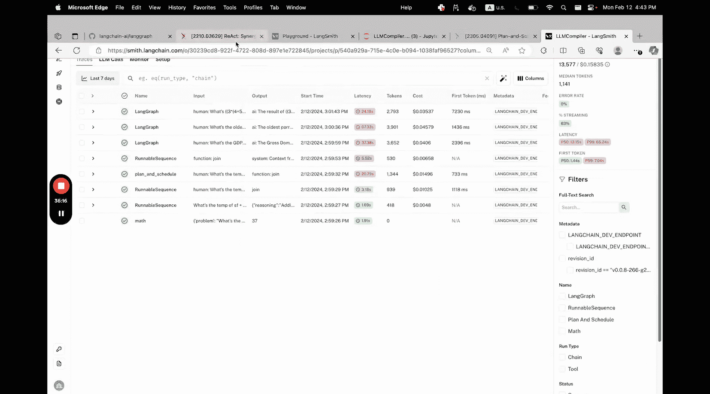

So again。That's about it for the LM compiler notebook。

 I think the key takeaway from this one is that whenever you're doing planning and you have variable substitution。

 if you do track the dependencies there， then you can actually start executing the tools before the agent ends。

 And so this can overall optimize your runtime。 save on tokens relative to the react agent style and improve the overall performance of your model。

 I think all of these。Agents in summary are a step towards a more robust and more effective agent design。

 If you want to be using LMs to make decisions about how to execute tasks。

 And I think implementing them in Lgra is pretty straightforward。 I would actually recommend。

Dorinking so yourself and maybe combining some of these different approaches。

 like taking maybe the re or plan execute style output from the planner and streaming it and using something like an LLM compiler executor to be able to doing it more eagerly and stream mixing it with maybe other design patterns that we've showed throughout the La graph as well。

So that's about it。Again， thanks again for watching this video。

 feel free to leave feedback on the video and like or subscribe to share and follow other types of content like this so that you can learn more about how to create different agents both for production and for experimental use。

 And finally if you want to sign up for Lsmith， feel free to go do so atsmith。

Lngchain com We no longer have a waitlist so you can go ahead and get started debugging your LM workflows immediately。

And thank you all and hope to see you again。

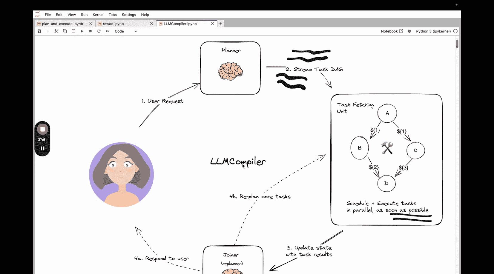