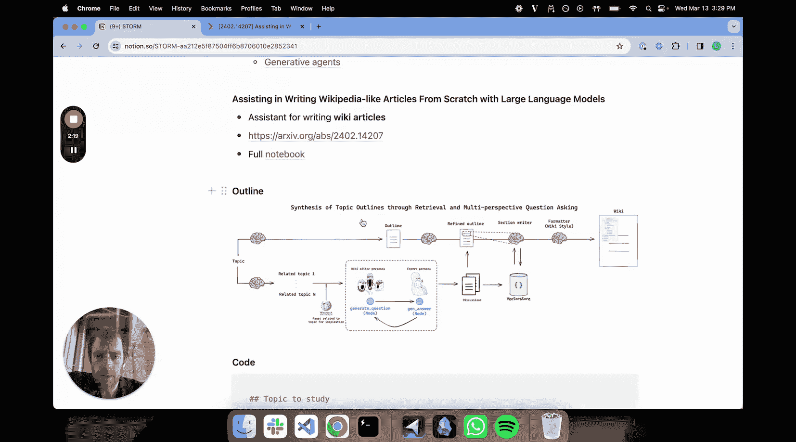
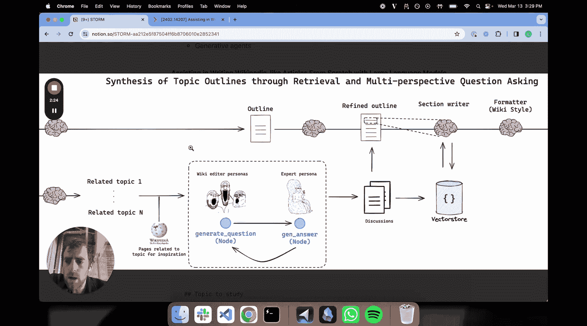
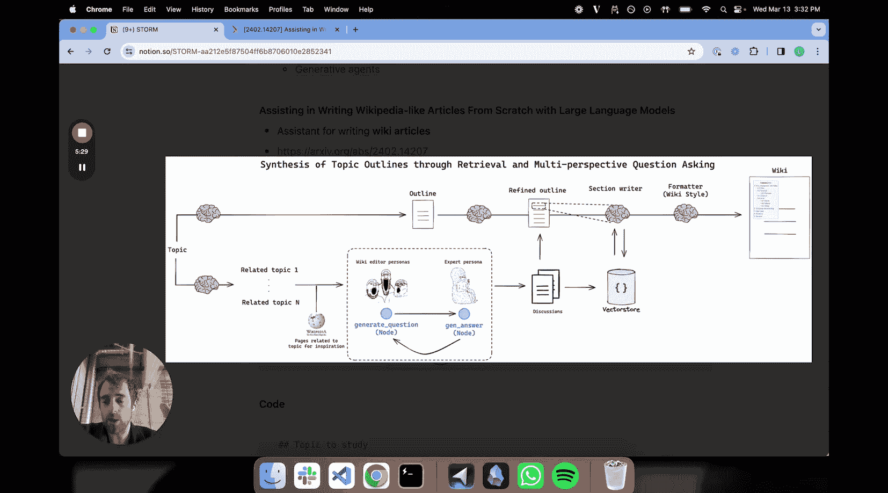
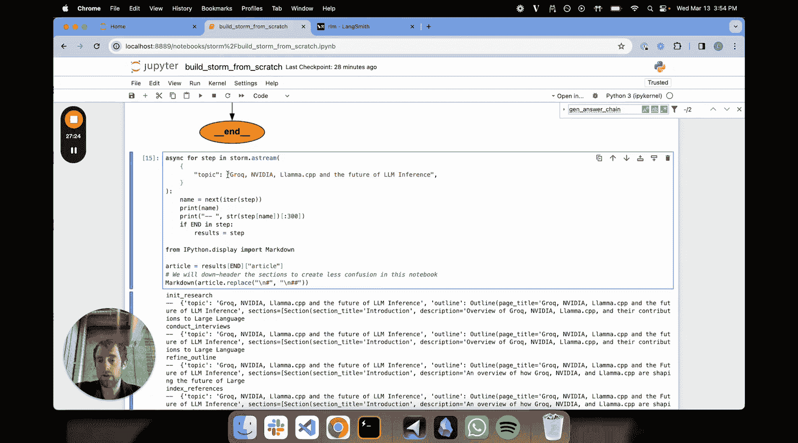

# LangChain【中英⚡LangGraph 使用指南｜LangGraph (Python)】 p15 P15 Building STORM from scratch with LangGraph -BV1vJfMYuEon_p15-

A， this is Laster Li in it。I've been to talk about a recent paper called Storm。

Which bringss together three pretty interesting themes。

So the first theme just to kind of set the stage here is on AI media assistance。

And there's been quite a few of these kind of in recent months。

 we've seen a lot of work on code assistance， GPT engineer being one。

 particularly kind of popular one。There's also a lot of work on kind of web research assistants like GT researcher and others。

So kind of P1 is this idea of assistance for certain tasks they're a little bit more target codegen or web research The second is using RaG to assist with that generation process so there's a kind of this nice review tweet and paper on retrieval augmented generation for content is pretty interesting in code through lots of the themes you might use RaG like code Gen image gen audio and so forth。

 but it's an interesting general theme that RaG is kind of centerpiece for some of the generative workflows that could involve code research or other things。

And the third is this theme of personas。So to solve certain problems or to perform certain simulations。

 AI can take on different personas and they can have debates and they can kind of bounce ideas。

 One really interesting work on along these lines is called the generative agents paper out of Stanford and this was kind of one of the first works that kind of used generative agents in a simulation to kind of as human behaviors and it kind of a fun game simulation that you could play So those three ideas kind of come together in this newer work called Storm which is also out Stanford here's the paper So it stands for you know the paper title is assisting in writing Wikipedia like articles from scratch using large language models and Stor is。

Basically short for synthesis of topic outlines through retrieval and multi perspective question answers。

 that's kind of a mouthful。 But the maintuition is that bringing together these three ideas to write Wikipedia articles。

 That's the highlight point。So here's kind of a cartoon by the way。

 at least I think about really what's going on here。

And we'll actually you walk through a code that will kind of build this from scratch。

So it looks like the this is slightly。

Here we go。 You can kind of see it now。So， what's happening is this。You're starting with the topic。

And there's like kind of two branches here， let's just go through the bottom branch。

 the bottom branches， and LM's taking that topic and fanning it out to a few related topics。

And it's actually retrieving for each related topic from Wi Wikipedia articles that serve as like kind of templates or example articles that can be written on similar topics。

Now。What happens here is。Those articles and questions are used to create some wiki editor personas。

Which are basically like kind of AII AI personas that are going to be the editors asking questions about these topics。

And we're also going to have experts， so experts are experts on this topic and they're going to be using retrieval kind of web retrieval using different tools。

 we'll use tablink or this one but use other things as well to answer questions。

So what's happening here is we're going to take our topic。

 we're going to break it out into related topics。 We're going to fish out Wikipedia articles for those topics and use those to instantiate some editors。

 Okay， so that's like phase one， we're going to build some editors。

We're then also going to independently build kind of an expert module that answers questions。

 And here's what we're going to do。 We're going to have the editors and the expert kind of debate。

 question answer， question answer over it。 We can use land graph to implement that。

 So this is going to take a little kind of like debate loop， which you'll see is kind of cool。😊。

That's going to accumulate a discussion。About these related topics。And then。Pretty simply。

 when we have that discussion at hand， you can kind of see over here。

What we're going to do is use it。For two things， one。

 we're going to use it to kind of help us build a refined outline of our final article。

 see this is kind of like a parallel branch up here。We take the topic， we build a general outline。

 and then we refine that outline based on the discussion。

And then what we're also going to do is we're to take the discussion we'll put it in a vector store so it's easily retrievable。

 and we're going to have a section writer that's responsible for taking every section in that refined outline and fleshing it out in detail。

And the final thing we're going have is just so wki like formattter that's going to like build our final article。

 So that's really the overall flow。We're going to take a topic。

 we're going to get some related topics， we're going to build a wiki editor and expert persona that are going to debate those related topics。

We're going to then capture that discussion in a vector store that such that it can be retrieved。

And we're going to use that discussion also to refine an outline of a wiki article。

 And then we're going to do kind of like more fine and gray fleshing out of that article using the vector store。

 which contains like the granangular discussions to write every section。

 And then we'll format as a wiki。 So that's really it。 That's the flow。

 And we'll kind of reference back to it because there's a little bit of code involved。

 So we'll kind of go back and forth from that outline。

 But first I want to kind of like kick things off here in terms of coding。

So I've an empty notebook here。 A few pi and stalls。

What I'm going to do first is simply define what's a topic one study。

 Now I've been doing a lot of work recently a long Conx Llens on the Sarah past video Actually talked a lot about this。

 So I'm going to make this an example topic。 What is the impact of million plus token LNs on rag。

 Okay， so that's like my my high level topic。 Now here is where we're going to copy over just some code to do this first stage of topic expansion。

So that's this step here right and we're going to run this so all this is doing is we're defining our 2L liness that's fine we're going to have a prompt here that you're writing a Wikipedia article you know recommend some pages and okay so basically the related subjects we find are you know impact of meconent lens in rag so you know not the most like helpful set of related topics here but it'll work。

So。Then what we're going to do is we can combine a few different steps here。Together。

So we'll just go ahead and kick this off， and I'll kind of walk through the code here。 So again。

 where we are in the flow is this related topic generation。

 retrieval wiki pages and creation of our editors。 And we can kind of see here。

 here's the editors that we created。 Now， how did that work。 If we just look at the code。

 we can see this was the chain that we defined above to expand the topics。

 So into these related subjects。 So did that first。

And then it retrieves wiki articles relevant to that to each of our subjects。 That's fine。

 It retrieve them。 It does a lot of formatting。 And then it generates these perspectives are different like personas。

 so to speak for editors。 and we can actually go back and look at that chain。

 here is our gen perspectives chain。 and here's our prompt you need to select a diverse in sub Wikipedia editors work together。

 And that's basically how wouldn you do。 I will make the interesting note here that we're using structured outputs quite a bit in this code。

 and of course， you should look at the notebook that's gonna to be linked to this video to kind of walk through it all in detail。

 But this is very useful and important here and more gene So in particular。

 what we're doing here is with structured outputs be bound to our LM。😊。

And it's using this perspectives thing so what is that well that's a pedantic object that we define right here that basically defines what an editor is and so basically this class editor defines a bunch of attributes that every editor has which we then capture in this perspectives pedantic object and the key point is this every of our editors has a very nicely formattted kind of description so to speak。

 so here's go list of editors。Here's each one， the affiliation， the name， doctor researcher。

 or also a researcher， the researcher will focus on analyzing the impact of you context。

 lung context rag。And anyway， you kind of build a set of editors that are going to be responsible for different。

 like different questions， basically in this discussion we're going to create shortly。

So that's kind of cool。 Now what we're going to do is we're going to give these editors the ability to ask questions。

 So that's kind of the next thing we want to do。 Let's copy this over and we'll kind of kick this off。

And so that already ran， it's very quick。 So all that's happening here is we've defined found we defined this generate question chinning。

And really， all that's happening here is we we basically are defining the editor that we want to work with。

And then we have this gen question prompt which is right here so you're an experienced Wikipedia writer you want to ask question when you have no more questions。

 they thanks so much for your help to end the conversation so that's like kind of we'll see this as used later to kind of terminate the discussion and again we have a bunch of we define on a number of objects here that will help mediate the discussion as we're going to see shortly and again there's like kind of a lump code here。

 so I encourage you to actually look up the real book this just kind of gives you a broad strokes that made pieces that are involved。

嗯。So basically what happened here is we invoked this generate question chain with our editor and this messages you'll see。

Is basically a question so so you said you're writing an article on the impact of millionian plus tokens on RaG and when we say basically that's how we kind of initiate this question answer chain with like kind of an introduction。

And this was kind of the answer， this is the output。

 So you give the editor persona kind of an input like prompt。

 and then it performs this question generation， you can see the question generated is。

Yes that's correct responding to so you were writing an article about this main topic right and yes that's correct I'm focusing on analyzing the impact of million plus token conash windows on RAG。

 this includes looking into how these leverage models improve generation blah， blah， blah。

 is there any specific you would like to know about this topic。So， you know， that that's kind of。

 that's how you set up question generation。U that the editor will use in this discussion with the expert。

Okay， so now what we're going， we can do is。Here we're setting up the expert， so actually。

 I'm going to delineate this。So we'll call this the expert。Okay， and then this is the editor。

The editor？Courd。Great， now here's the expert。嗯。Now。

 the first thing that the expert is going to do is the expert is going to be more of like a search tool。

So the experts' is going to do。Is this going to take the input question that the editor provided and it's going to break that out sum questions trying to answer the some questions？

So this is kind of the first part where it took that input question about the impact of million plus token on Ra。

 and it fansed down to a few kind of related sub questions。

 This is kind of just helps in like defining a better answer。 So， again， we're inside the expert。

 The first part of the expert is like taking what the， what the。

But the editor asks and trying to fan it out and to set of sub questions。

 So this is then where we're going to define the full expert answer chain。嗯。

So this is basically a decent amount of code， again。

 I encourage actually actually look at the notebook to kind of crop all the details that are going on here。

 but this is the high level idea。Wherere basically we have this gen answer function。

And you can see it already ran， which is pretty nice where we're taking in like the current state of the interview。

 We'll see why that's relevant in a bit。and you know。

 basically a name is subject matter expert as like did come the default name and what's happening is you're basically setting the role to be the expert。

 you're generating those sub questions that we just showed above。

And now what you're doing is you're calling search engine。

 using a search tool just to search for things relating to the topic that you you were asked or actually to each sub question that you generated。

 you perform search and you don't worry about too much about these details and you basically getting the cited URLs and you're also calling this generate answers chain which is going to。

That's going to be， let's see where that is。Yep， right here。 So you Jen answers prompt。

 You're an expert。 You can use information effectively。

 You're chaing Wikipedia writers who want to write a Wikipedia page on and。That's really it。

And you're basically going to pass in information from search to provide its final answer and here we go you can see this final generation here so there's a generation。

 here's the cited URLs and we kind of format the final message you get our answer。

 and we can look at it here a million plus token windows。

 have significant impact on RAG largely goes extend to context will allow for complex prompt execution so you know it basically the point is this。

You take the input question from the editor， you fat it out to some sub questions for each sub question。

 you kick off like a web search， you get search result in the URL back。

 you kind of consolidate that into a spinal answer with all your citations that's really all's going on here。

So if we zoom all the way back up to like the kind of overall slope here。We have taken our topic。

 broken out of subtopics， defied a bunch of editor personas。Dfined our expert personas。

Given the editor's ability to ask questions， given the experts' ability to answer questions using Web search。

 that's really it。 So we set all that up。 Now， what's pretty cool is we have to find a few functionsious name all this。

 Now we can do is set up that inner graph。 You can see the code here。😊，And。Boom， here we go。

 and actually this is pretty nice， we can actually run through the graph visually so we can look at it so it's started the graph。

We'll ask a question， we'll answer it， we'll route back to ask another question unless we had a stopping edition or remember in the editor prompt。

 there was basically this specification say thank you for your help if you're done if you're satisfied and that's what we basically do in this answer question route messages thing。

You can see right here。So basically if the question ends with。

 thank you so much for your help you end or if basically the like the maximum number of turns you define is5。

 so you go five turns or the editor is satisfied and they're done so that's really it。

And we can go ahead and actually go test that。So let's just try to run that。

 So this will take a little bit to run， but you can see this is just the discussion like basically following and we're printing it out every stage so you can see how the entry point here I'm so the entry point is so you were you said you were writing an article on or topic which was long context you know long cutest model impact on Ra and you can see this actually just followed the discussion which is pretty cool Yes。

 that's correct I'm interested in understanding what's going on with that topic。

So you this is what the expert says these a million dollar tokens have a major impact thank you for such insight so actions is kind of neat you say a graph to mediate a discussion between editors that we've created and experts on this topic and see bounce that back and forth and now this is captured a final graph state so you can see we've just meeting in this graph it's run you know not too long maybe like a minute or so now what we're going to do here is we're just going to go ahead and store that。

At inner retriever。And there we go， so we can actually just run retrievetieving folk。

 give him a question and you know， we can retrieve information from this conversation we've had。

So let's just like pull back and think about what we've done here。

 so I think it's pretty cool actually even though I get it a lot of codes。

 so you have to look at the notebook to really rock this。

 but at least I want to walk through the high level ideas。Again， we've taken a topic。

 we've broken it up the subtopics， we've use those to build a number of editors。

We've also defined an expert， we've let the editors and expert have a basically a discussion。

Meted by web search。To build like an understanding of this question and we've put that in a vector store。

 that's all we've done， but it's pretty cool because we've used La graph to kind of mediate this interaction between simulated like editors and simulated experts which are effectively just a search tool right that's kind of nice and we've done that and we've built out from that。

A vector store that we can there are three things from recording。 So that's really it。

Now to some of the kind of little bit more straightforward pieces here。

 because I know that's kind of a mouthful to digest。We're going to now take our input topic again。

 Remember this example topics are input。 we're going to build like an outline of our， of our blog。

 which we talked about kind of up here at the top。 Now， we're entering the the top branch here。

 We're generating a high level outline of our topic。 So we should have that done。

 So this is pretty cool。 We have a high level out learninging now。😊。

It walks through like an introduction， rag framework and so forth。

 and now following the flow we outlined， what we're going to do is refine that outline a little bit based on the discussion we've had。

And so this is going to run you can see we set up of prompts here。

 your Wikipedia writing you've gathered information from experts and search engines now you're refining your outline and that's really it so this is like kind of a refinement stage here's the old outline you're refining it based on discussion with the expert and so okay cool there we have it so this is like a slightly refined outline again initially the outline did not use our conversation and all this was just the LN reasoning about our topic defining a s outline now we refined it a little bit based upon the discussion that we've had so that's pretty neat。

And now we're going to do is actually build a more refined outline。

 or actually we're going to do is flesh out each section in our outline in detail。

 So if you go back to the top here， what's happening is。We've had our discussion。

We we've had our discussion， we've also saved it in the vector store， we've built our outline。

 we've refined our outline and now where we are is running're a section writer stage So the section writer is based going through that outline and actually writing the sections accordingly referencing our vector store is contained the expert editor discussion So that's really what's happening now we're fleshing out the outline in detail based upon the discussion between the experts here we go。

 this is pretty cool so you can see extremely pretty nice it's actually writing it out for us right now。

 look that not bad。嗯。Yeah， it's kind of fun to see that band。 see still going。Cool。

 as running out the references for us。 So there we go， we're actually getting a look close here。

 Now what I'm actually going to do is I'm just going to capture all these in like one final graph。😊。

So here we go， cool， look at this， so this basically is our whole workflow。

This is just wrapping what we've already and done so we can like run it all end to end。

 which is pretty cool。And what we're going to call now is。Let's go ahead and try to run all of that。

Hm so this is going to maybe take a little bit and we're going to ask a new topic now we're going to say topic G and videodiallmaacyP in the future of inference so that's pretty cool we're starting from scratch new topic you can see we kicked off that conversation In fact let me pull up next to this while this is running our diagrams so we can kind of Slo along。

嗯。So。Here's our di room。Right here。Nice。And we can see that where we are currently in the flow。

Is that we're in the wki editor persona， an extra persona discussion。About inference。

 And we can see that we kind of started it with。UThe overall topic。

 Gro and video allmasacy be in the future of inference。And then we've initiated the research。

So there was our overall topic。There's we've defined an outline and so right now it's probably in the discussion stage effectively here。

 which is like kind of the most time consuming stage of the overall flow。

we actually can go over to Langsmith。And we can see what's actually running at any point in time。

 So I just open up Langsmith。 This is pretty neat。 So I can look at all these pending things in Langsmith Tell me what's actually running right now。

 So okay， this is kind of nice。 We can see kind of like where we are in the flow。

 Here the various subject matter experts， for example， Here was a kind of our introductory question。

 this is actually showing the discussion that's ongoing between our subject matter experts and our this is pretty cool。

 Our various editors and the experts。 So this is actually like what's happening under the hood as this is running right now we can investigate some of the other kind of ongoing things right I see。

 So this is what's happening right now。 basically a number of the discussions have been kicked off between different subject matter experts。

 and。😊，Different editors， so this is pretty neat。Let's actually look at this in detail because this is kind of fun。

So here's the subject matter expert。So you said you were writing an article on GinviI Lama CP and the futureture of A on inference。

 so this is our editor yes that's correct， I see you're interested in machine learning and tools optimization can you provide me with more information about the specific contributions of Goc and NviIDdia in the field of machine learning so look at all these references that pulls up this is pretty good so it gives like kind of a nice overview here。

😊，Crop come focusing on creating ships running AM models efficiently developed the LM， the LPU。

 which which is accurate， so this seems to be sane as of right now this seems correct。

 They demonstrate superior performance LM inference compared to GPUs。

 So this all looks pretty sane to me NviDdia， obviously yet。

 to've talks about NviDdia and NviDdia's role in inference provides lots of citations。

 which is pretty nice。So then this goes back to our editor， asks a follow up questions。

 subject matter experts and answers in some detail。A few more references。Thats great information。

And I believe that is really cool。 and then we get an output。

 so this is the output of that discussion pretty cool。

And we can see we kicked off a bunch of discussions along these lines。And it looks like。

 look at this， here's our article。 It's all written。

 So this is kind of like some of the discussions that were logged。And look at this is pretty neat。

 Here's our article， largerge la model inference forensic dances in future directions。

 Here's an intro。look at this， Not bad。 It's pretty detailed， talks about Gr， talks about Gr。

 talks about LPUs， benchmarking， impacting A models and videos contributions。

 hardware innovations frameworks， onCBP。Not terrible。 The final set of references。So， you know。

 that took maybe5 minutes， it felt a little bit law like understand here sitting and as the video was going。

 but you know， this actually compiled a fair amount informationist structured to pretty nicely game us references it's pretty cool and again we can use likes with a look under the hood and see kind of what's going on in all these discussions。

 Yeah， this is you can kind of you can。Really audit like we did previously the discussions between the editor and the expert。

Um， and， you know， again， I maybe just want to zoom back up and show you the overall flow。

What we did here is we showed how to use a few different ideas。

 retrieval personas to basically perform wiki writing from a given topic。And we took the topic。

 we built a general outline in parallel with that， we took the topic， we built some personas。

 we built experts， we had them discuss。We then captured the discussion。

 we use that to refine our outline， we basically capture that in a vector store。

 we use that to write the individual sections of our outline。

 we then produce a final wiki formatted correctly。And boom。

 there we go on a topic of interest to us from scratch took about five minutes on Gck andviI LZP in the future of inference So anyway。

 I said there's a lot of code， you're not going to be able to rock all the code listening to me。

 you should absolutely look on our notebook because it's pretty cool and definitely recommend playing with this I think ability to use these ideas。

 different personas and know assistance whether it be for code overhe generation here are really powerful and these things will probably all be either refined and use very frequently in our workflows in coming once and years so thanks a lot。

