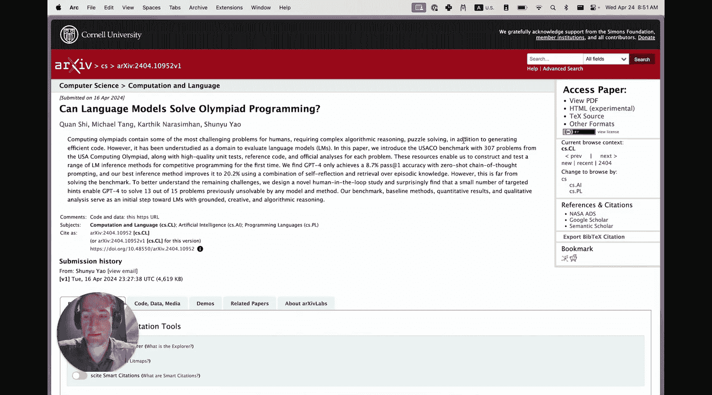
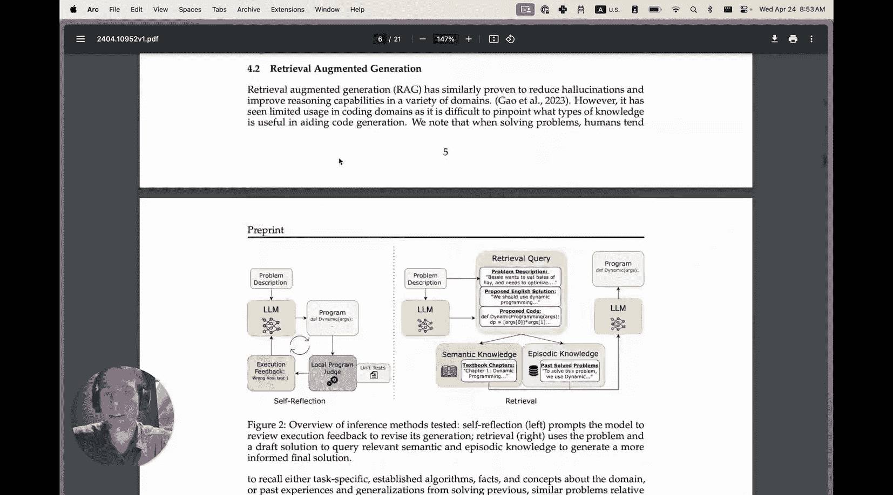
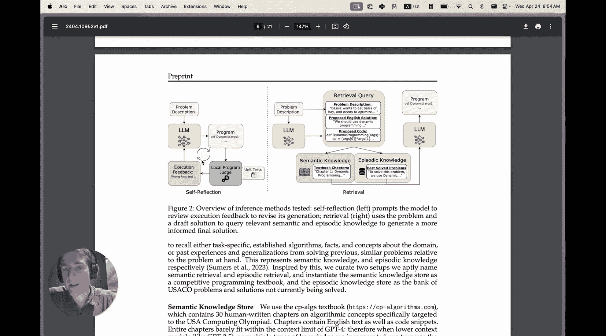
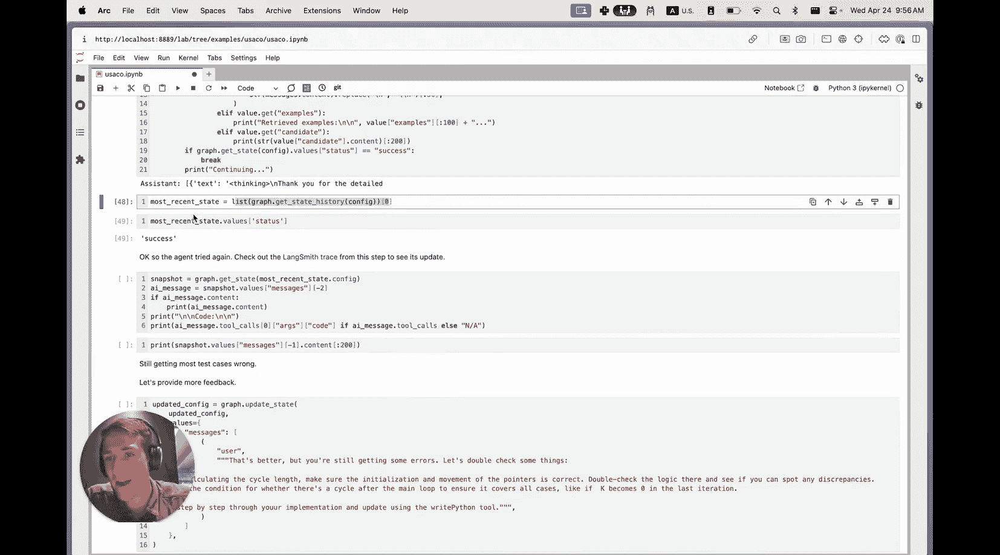
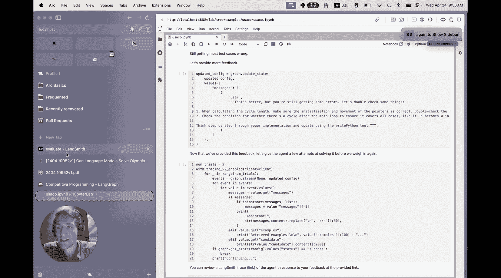
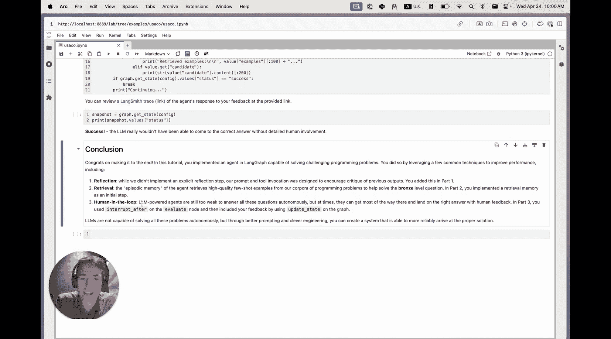

# LangChain【中英⚡LangGraph 使用指南｜LangGraph (Python)】 p16 P17 Build Computing Olympiad Agents with LangGraph -BV1vJfMYuEon_p16-

Hi all， this is Will from Langchin， let's build computing OlympI agents together。So about a week ago。

 this team out of Princeton came out with a paper called Can Laguage Model Solve Olympiad programming。

 It was done by the folks such as Chen S and Shinny Ya。

 who you might recognize from the Re paper T of Fath paper reflects the on Pa。

This paper really has two interesting components to it。 On one hand， it's a data set paper。

 They come out with this challenged benchmark of 307 competitive programming problems from the USA computing on Libviad。

 and they showed that G4 only has about an 8。7% pass rate when trying to do this with a simple0 shot react agent framework。

 This is in contrast to some of the existing benchmarks like human eval MMmLu that are mostly saturated by this crop of language models。

They then showed some inferenceprint optimizations。

 basically prompting techniques or systems engineering types of approaches to improve the performance on average from that 8。

7% up to 20。2%。And we'll go more in detail on to those techniques as we go throughout this tutorial。

Let's get a sense for the difficulty of the types of problems in this benchmark。

 So here's an example question。 You can see they're mostly word problems that require you to identify the underlying mathematical problem you need to solve。

 Use advanced data structures and algorithms and compose them in creative way to come up with the correct solution。

 It also has to be done and implemented in a way that solves it within a given time limit。

As you can see from this diagram， there's a lot of different usage of sets and other types of things there。

The questions are challenging， there's a reason why it's called an Olympian。

What I find interesting about this benchmark is that it really pushes LLMs to the limit so you can see where it breaks down。

 I think when we're using them in normal life， you often start to anthropomorphize them and see then think that they're reasoning whenever you get to this extent you can see when they start doing things that look like interesting。

 close to correct but don't have this logical property。 So as I mentioned before。

 when they first run GP for on each of these problems it gets a really low pass rate。

They later show a number of inference techniques that they could do to improve it。

 Some of these include self reflection。

And some of these involve retrieval， either from sevantic knowledge or episodic knowledge。

 They do a lot of experiments to show what types of retrieval actually improve the performance of the model。

 We're going to implement the best performing retrieval type。 this episodic knowledge type。

 Since it seems to be very complementary to self reflection。

 It works well within our tutorial structure。 Let's check out our lagraft docs to see how we're going to implement this in the tutorial。

😊。

All right。So for the remainder of the video， we're going to be creating an agent to solve these types of competitive programming problems。

 we'll break it down into three parts， following the paper's structure and making agents that are increasingly capable of solving these advanced questions。

And the first step will implement the Ref agent， a zero shot agent that does self reflection。

This corresponds to here this block in our graph that we're going to be creating。

 it's going to have two simple nodes and just run in a loop until it can solve the answer correctly or ran out of time。

This is roughly analogous to this reflexion agent they created that gets about a 12。38%， so again。

 better than the base0 shot agent， not as good as what they can get overall。

In part two of this tutorial， we're going to implement retrieval as a form of episodic memory。

 what the paper calls it。This is part two here， where we'll be then retrieving some high quality examples to include within the prompts and hopefully induce better logical performance in the model。

This is analogous to this section here that gets about the 22。2% on the benchmark overall。

In part three， we're going to add a human interrupt， so we're going to let us。

 the user actually weigh in on the answer and help guide the agent to come to the correct answer。

You may consider this cheating， and in fact， we aren't actually going to benchmark this on the whole dataset set and the authors don't as well。

But。In a lot of application designs。What you actually want is the best outcome overall。

 and so coppi type setups are a great pragmatic approach to getting a better overall outcome where either perhaps the human alone or the agent alone couldn't actually get there。

A big theme throughout this is that autonomous agents really aren't quite there yet。

 especially when you're just prompting in a simple zero shot manner。

But you can create state machines using frameworks like Lagraraph to really control and guide it within your task domain and hopefully get better outcomes overall。

Let's download this notebook and then run through it together。All right。

 now we're ready to start running through the tutorial。We've opened this up in Jupiter。

 and we're going to install some prerevisites here。 It's basically la graph。

 We're going to add some tracing here with L Smith。

 The agent is going to be powered by Anthropics Cla model in our case。

 and we've got a couple of other things to pull things through the hub。We'll set our environment。

 in our case， itll be anthropics API key to connect to their API。

 and then we'll also configure tracing。 There's a lot of steps that go on here and each of the programs can be quite long so visualizing it in a notebook can be pretty cluttered。

 I'd recommend using Langsmith just so you can debug each step and see exactly what's happening。

 easier to catch mistakes， easier to see what's going on。

We'll then fetch the data ex storedd in Google Cloud bucket and we'll load it into memory。

 And then finally， the utility here is to run test cases。

 I'll note that this is executing code locally。 So proceed with caution there's inherent risk if the LLM does generate malicious code or something that have an OM or something。

An exampleamp run of here of the test case runner in this print hollow world if it passes。

 it return past， If not， it return wrong answer along with the expected output。All right。

 so now I can finally start defining a graph。In part one again。

 we'll be doing this simple zero shot agent with reflection。

in the paper they use an explicit Reflex on prompt。

 we've adapted it a bit and then prompted our agent here to be reflecting on its output here when it's doing tool calling。

This one's going to be relatively rudimentary。 It corresponds to that agent that gets about a 12% pass rate on the benchmark。

 And so for our first question， we kind of expect it not to pass， but then that's okay。

 We've got some other tricks up our sleeve。Now， the next part may be review if you've already built the La graph。

 but I want to review up view it anyways because I think it is important。

 The main primitive in La graph is a state graph。It's how you define a state machine。Basically。

 the nodes define the units of work， and the edges define the control flow。 once a node completes。

The edge defines which node to pass to next in order to continue operation。 It most simple case。

 you essentially have two nodes in our cases， and it loops back through。

 and then will output once it is reached some end state。

The final piece of this that's really important is the state。 Of course。

 this defines the interface for all the nus。 So each node receives the state as an input and then returns an update to the state。

 that could be an entire state itself or just some subset that then the graph is able to incorporate into the previous state。

😊，In our case， the main aspect of this state is going to be this messages list that we're annotating as being appendonly using this function。

 using Python's annotated syntax。 This basically keeps the agent scratch pad as it generates a candidate and then receives a tool response and then continues to iterate and try to improve the。

The rest of the state here holds the test cases essentially in the runtime limit to configure how the evaluate node runs。

The agent itself is going to ignore this， but the test runner will incorporate it。

Now that we've defined a state。Well update a data to be in the right format。

 essentially to be able to pass it in。And we can start defining the good parts。 Remember。

 this has two nodes。 We've got the solve node and evaluate node。 So first， the solver。

Here it's pretty simple。 We're basically taking a prompt。 and we're going to compose it with an LLM。

 So this format into a prompt and then pass it to the LLM。

 This bind tools operation is just configuring a schema for the LLM。

 so it notice the structure that it's to respond with。 In our case。

 we're going to use this right Python tool。 Its right Python schema。

 we're basically going to tell it for some reasoning and pseudocode to induce some chain of thought reasoning beforehand。

 and then we'll finally have it write all of the python3 into the code string here。

 This just makes it a lot easier to parse on detail。

 And so you don't have to be parsing out raw strings。 I'll run this here。

 and then we'll define a solver。 So we fold this this solver prompt from the hub。 It's pretty simple。

 I didn't do too much prompt engineering here。 note that we do have this variable examples that we'll use later in part2。

 right now， we're just going fill this in through paring with an empty string。

 That'll be the placeholder that we then populate with additional information that we retrieve， but。

More on that later。Here's an example run。Gers can ask it。

 how do I get a perfectly random sample from an infinite stream。Allright， we've gotten the response。

 so you can see it generates this thinking tag and then eventually it outputs things with the reasoning。

 you might see the pseudocode and then eventually the code and it is doing reservir sampling as we'd expect。

 So at least it studied some code that's a good initial sign。

 One thing that I like about Cla as opposed to G4 is that it was trained to output this like thinking or prelude text。

 you can think of it before actually doing the tool in I think there's often this question when using G4 with tool calling of how to incorporate chain of thought and we've found that it sometimes suffers with some of these more complex tasks as a result。

 I think it's quite nice that it've trained the models to people that output this before doing the tool in So you don't have to be thinking sacrifices there。

😊，So the second node that we'll define in this loop， this agentnt loop is the evaluate node。

 and there's a good amount of error handling and stuff here。

 but really the key bit here is we're going to iterate through all the test cases in our state。Again。

 recall that each node is going to receive an instance to the state and return an output。

 So in this case， an updated message。 but it it through the test cases runs them。

 And then if it succeeds， it'll update the status in our state。

 Otherwise it's going to format all each of these things individually and then add the messages。

Once you are there， you can create the graph。And we'll visualize it。So again。

 this corresponds to that graph we had above。 It's a little more simple。

 We put the initial problem in here， tries to generate a solution。 It tests it out。

 And then we enter this control edge。 If it's successful， we end。

 Otherwise we go back to the solver and we key bond looping。 here the control edge。

You can see there it just also receives the state and then checks that state to see if it succeeded。

It then returns。 This is a string and string with double underscores。

 This just tells the graph that it doesn't need to continue looping。 Otherwise。

 it says go back to the solver nodede。That's how we would define it here at the condition edges。

Let's see the first question。Question about Farmer John。Looking at， you know。

 you got some productivity the other day。 Bessy， you've got the cow。

 she was pretty pretty complicated。 It's got the number of sample inputs， Sple outputs。

As a part of the question。Let's try running our agent here。So， again。

 this't the simplest version of the agent that we're going to be building today。

 I fully expect it not to work。 Honestly， and the way La graph indicates this typically is through a graph recursion area。

 Basically， by default， the graph has a limited number of steps。 You can configure this。

 we show this in the docks elsewhere。 I won't go into detail here。

 But if it surpasses the maximum number of configured steps。 It'll raise a recursion error。

 Let's wait for this to to continue to populate。All right， it looks like， as we said。

 it's going to hit the rehesion limit it。 wasn't able to actually solve it。

 You can see each of these steps below， and we'll actually jump over to Langsmith to check out the trajectory one second。

Allright， so we've checked out this trajectory here。

 you can see it going through the loop as we defined it， you have the prompt and LLM。

 and then you have the a known and it goes in this loop and continues until it eventually has this error。

I always like to jump into one of later LLM calls because it does collect this full history of messages and you can see exactly what it's doing。

 So initially it says solve this problem on this that key insightite here and tries to write out the pseudo code and then thinking and then generates it all there。

 And the second one is that the current solution times out and a larger test cases likely because it its through all possible things。

 So it's trying to actually self correctr here but is unable to。

 It doesn't have a lot of good examples of solving this type of problem， I guess，'s in its memory。

 And so as you can see， it goes through quite a number of things。So it wasn't able to get it correct。

That's all right， the paper presents at least one more automatic improvement that we can be incorporating into it and then also presents the idea of more of a coppiot type of scenario。

 which we'll get to in part three， but in part two。

 let's jump into the memory and retrieval optimization。Al right， so back in the notebook in part2。

 we're going to be implementing this few shot retrieval optimization that the paper proposes。

 and the authors call this an episonic memory because it's retrieving these outputs from the other question answer pairs in the corpus。

 So if you pretend that the algorithm where that the agent has already solved all these other problems。

 it could then recall this and use this for solving later problems。

 it's kind of an interesting framing， and kind of in contrast to the rule of thumb where people tend to talk about rag and retrieval as a way to improve knowledge updated knowledge。

 but not as a mechanism for actually improving the reasoning capabilities of the agent。

 though since these are extremely well selected well crafted in domain examples。

 this does then align more with few shot instruction and optimizations like that。

 this more of what it is。 that paper also explores a semantic memory where it'strieving over textbooks and things。

 And that does show a brief boost， but doesn't seem to hold whenever they incorporate that later。😊。

with the reflection and other things so it seems to be a technique that doesn't really scale quite the same extent as this high quality instruction type data set。

 so we'll skip that for here following the paper we'll use as the rer。

 this BM25 retriever it's essentially a more old fashioned non vector based TFIDf based retrieval mechanism here that's high quality。

And then to accommodate these steps， we're going to add two more keys to our state compared to part 1。

 We're going to add this candidate message that we generate first。

 and is's going to be used in the the retrieval step。

 And then we'll have the examples formatted its strings。 If you remember the prompt at first。

 it had that examples template will finally be populating that here。And then again。

 recall that this episodic memory happens before our agent loop。

 this part is going to be untouched here， but here we're going to be having in the retrieval step and then we'll still ignore this and say this for part 3。

So once we defined our new state， we can define the solver this is mostly repeat from before。

 except we're going to have a little if statement to generate the populate the candidate step if it's still that first stage there。

 so we're going to make this draft solver and solver。

 they're pretty much identical except the draft solver of course， hasn't already had questions here。

Well， then to just make sure that we avoid cheating by putting the actual answer to our question in the retriever。

 we're going to separate out this as train and test Corp route。

 and then we'll create the retriever here。Finally， it's time to define the retrieve node。

 so as before there receives a state here， as alt in nodes do。

 and then returns to this updated state so it's going to update the examples key in particular。

And then within this， it calls the retriever here， so retriever invoke。

 picks out the top K there and then formats this in a string that we're going to be updating in the prompt。

And noticeice that we add these runupable config here in this graph that we're defining。

 we're going to let you configure whenever you invoke the actual agent。

 the number of retrieved examples that you'll have one way to do that is through these configurable parameterss in the config。

 which is always the second positional argument。One more thing to note about this retriever setup that I think is quite interesting is that we're retrieving or retreatting the candidate program as the query rather than the initial question。

 This kind of similar to techniques you might have come across。

 such as hide or some of these other like raft or other types of indexing strategies for Rag。

The observation here is that the distribution of queries is different than the distribution of documents that you're trying to retrieve from。

 And so you either want to be creating hypothetical queries from the documents that will better align with type of queries that we're going to be putting into the system。

 or we want to map from the queries to what you'd expect the document to look like and then maybe you retrieve from that。

 And then there's some other variant there。 But basically。

 you're saying the type of text and the type of words that we're going to put in these two things is not going to be the same。

 And so you get better results if you can try to translate them。Finally， it's time to build a graph。

 So again， we've had most of this is the same here。

 So you see solve evaluate and all these stuff is like untouched。 The things that we've added here。

 really are this draft node at the beginning where we're putting in that solver and then the retrieve node here。

 So we're setting the draft node as entry point， retrieving。

 And then we're going to always progress an interactive edge from draft to retrieve and then retrieve to solve。

 and then again， we'll create the loop of solve that evaluate and then from evaluate either go to the end or back to solve。

😊，So let' create an nod。 here's the visualization in case that's easier to see。 So again。

 the rest of this is all the same。 We've just added these two steps beginning。Let's try it out。

We're going， as we added a checkpointer here， we're going to add just can ignore this here。

 but we're going to say retrieve three of these examples from the corpus and pass this in。

This is also going to take some time， so bear with us。All right， looks like a graph finished already。

 You can see this is a little bit truncated。 Let's jump over to Langsmith to see what exactly was done。

 but you can see that from the state that we've got， you can see that it was a success this 10th。😊。

All right， Now you've jumped over to the linksmith trace。

 you can see it's only a few steps this time。 So that's great。 And following our graph structure。

 we had the draft node here， which again， you put in theation question。

 the system prompt to the question， and it outputs the initial。😊，Answer is the problem。

 We retrieve some examples from it。 So again， see the query is this candidate program that we talked about and retrieves other examples from the corpus。

 And then we pass that in here。 So you can see now those examples are formatted here in the system prompt for the solver。

 And then it has that。 All of it。 we don't have the initial candidate program in here because we've saved it in a different key in the state。

 But then it tries to generate an answer This time it's correct。 And test cases are successful。

 So it's great。😊，I'll jump back to part 3 because we see it solves this bronze level question。

 but how well does it solve some of the more difficult， challenging ones in this benchmark？Alright。

 so jumping back to the notebook， let's test it on a harder silver level question。

 So we've got this from the desk data set。 You can see。The question here， it's a river cruiseise one。

 basically you're trying to detect detect cycles and then simulate different steps of it as well。

 It gives a couple of sample inputs here， but it's more challenging question than the first one here。

 We'll format that and then run it and we'll see how it does。 I fully expect this not to work in May。

 but I expect this to fail because。It's just a more challenging problem。 And these LOMs。

 while they have been trained in a lot of code， a lot of reasoning types of problems。

 whenever there's new ones， they kind of struggle to be composing them creative ways。

 So some of these techniques can help。 but I think we're running into some of the limits of the reasoning capabilities of agents as they stand today。

Al right， so our optimized graph has finished and we got another graph recursion error。

 it wasn't able to correctly answer the problem in the allocated number of steps。😊，不做 k。In fact。

 we expected it。 These are extremely challenging problems， and they push at the LLMs。

 at least as they are trained and design today to the limits of their reasoning capabilities。

It requires some novel combination of algorithms and data structures in challenging ways。

The paper explores then one final entrance time optimization。

 which really gets us from the realm of autonomous agents to the realm of coppis so that they can benchmark it。

 they will restricted human involvement to simple guidance and prodding without revealing any parts of the answer or anything。

 But when you're building an actual application， you often want to optimize really for the end user experience and maximizing the chance of accomplishing the goal。

😊，If you are going to be creating an application where a user is in the loop。

 you want to give them a nice ability really to be providing guidance whenever and wherever they want。

Lengraft makes this pretty easy。 So for the sake of this tutorial and in part through。

 we're just going to add a generic cu in the loop interface to our agent。

And we're going to insert it right here。 So the agent graph is going to be structured exactly the same way as part 2。

Will insert the problem。 The agent will generate a candidate at program。

 The programme will retrieve similar high quality examples from this corpora of semantic memory。

 or episodic memory。And then the agent tries to solve it。 it generates the program here。

 it then runs the test cases on them。Then what we're changing in part 3 is we're going to interrupt here。

 and then we'll say。A human is allowed to then look at these key state of the graph at this point。

 perhaps optionally add a message saying to consider some alternate route。

 Consider looking into specific part of the of the generator program， et cea。

 We can then resume execution at any time since Langgraff lets you just persist this in a checkpoint and continue trying。

You can continue this loop and continue to intercede and provide feedback as it goes through。

 and hopefully prevent the LLM from following into these local optim。

 these local pitholes where it's just looping through and unable to actually accomplish the real task。

Once you can collaboratively come to the final answer。

 the agent and the othergraph can finally finish executing。In theory。

 this type of design is only restricted by the quality or the capability of the user involved。

 since really we can be providing the correct answer or any type of feedback and the LLM will be able to synthesize this and incorporate it into it。

So let's jump into here and create this human little loop agent for solving computing L problemss。

 This code buck here is exactly the same as in part2。 We get our checkpointer here。

 we're just going to do that in memory， we've got our state graph。

 we're using the exact same state here。 we've got the promptton LLM。 we create this draft solver。

 add it to the node， we set that as the entry point， we create the retrieve node。

 we create the solver node and the evaluation node or run the test cases。

 then we start connectinging them。 So we add an edge from draft to retrieve， retrieve to solve。

 solve to evaluate， and then we add these conditional edges to define the conditional looping。

 So we say once you run the test cases， we'll either go back to the solver or we'll finish if we succeed。

😊，And I'll create the check line as well。The one different thing in part 3 compared to part  two is we're going to add this interrupt after the evaluation command。

 So basically before it goes to a human step， we're going to tell the graph， hey。

 stop and allow the human or any other process to be modify the state。Let's visualize this here。

 as you can see， the graph looks exactly the same innocent part too， and we'll start running it。😊。

So again， this is just going to continue executing until it reaches that interrupt。Al right。

 so our graph has stopped executing。 You can see the current state by this snapshot using a config。

 and you can see again the problem there。Note that。 It doesn't say。graphra recursion error。

 but it still has gotten the incorrect submission as we expected。

 since we added the interrupt it actually will stop this loop and then we can resume it at any time。

So we can look again， here's the silver problem that we were looking at before。

 it was unable to solve it so far， we're going to look at its current candidate solution so this is kind printed out from the agent right now。

 looks okay， maybe a little simple， definitely doesn't handle all of the edge cases。

And then we can look at this test here。 because that's the last tool message here incorrect submission。

 and actually got 8 out of 10。 So its pretty close。 Let's say。

 let's give it some recommendations here as a human message。

 And then we'll check to make sure that that actually was reflected in the state。

 So you can see we now have this human message。 We've done by calling graph dot update state。😊。

And providing that config there。 So it tells which snapshot to be updating。

 and then you have the human message here and we can resume。

The way we resume here is we pass in an null values and none。

 and then since we're using this same config that we're using。

 it knows to load the current state from the checkpointer that we've compiled into the graph。Again。

 we use that in memoryory SQLite checkpointer here for the sake of the tutorial。

 but there's a lot of implementations you can use to connect with your own storage architecture。

This is going to take a little bit of time， so again， we'll resume whenever it's done executing。

All right。 So in our case， it actually was enough to get it to succeed。

 I had this other code here to try to prompt it into the right position because occasionally it doesn't succeed even after that first bit of human feedback。

 But in our case， it does。 as you can see， you can list through all of its states here。

 so I was just getting the most recent checkpoint from this graphs execution and we see that it six success。

 you can actually check out the Lsmith trace again here， I'll jump back。😊。

To see it run。 And we see that again， we passed in null。

 If you remember from the loop in the notebook， it goes， it loads。

 We go back to the solver because that's the next node slated to be executed in a graph。

 It already run the draft and recall and retriever in all those steps。

 You can see the full list of messages to see that， Yes， indeed。

 it has been fetching these things from memory and includes this recommendation that we've added。

 We've done this all in a notebook。 But again， you can put in any sort of U I above the la graph implementation。

 and allow the user to be interacting with your copit in arbitrary ways。😊。

So the AI is able to then incorporate this breakdown into an updated response that then passes all of the test cases。

 so I'd say it's a success。All right， so that brings us to the end of this tutorial。

 as we saw LLMs as they're trained today alone aren't super great at solving this challenging type of reasoning problem and problems posed by Olympiad programming questions。

However， through some prompting techniques and then better systems design。

 you can improve the average performance greatly from the low point of under 9% to above 20%。

And when you're building real applications to solve challenging problems。

 you can create these sort of human loop interfaces easily with La graph to make it so that you can reach a better overall outcome compared to just the agent alone and compared to just the human alone。

 I think these general techniques are fairly， fairly expansive and can be applied in a lot of domains。

So you recall， first we started with a zeroshot agent with reflection。

 it basically prompted the agent to be looking at the test case results。

 looking at the current solution， and then try to incorporate those results and feedback into an updated candidate to eventually get out and solve the right problem。

We saw how even on a bronze level problem， this doesn't always work。

 and so we then added in an additional optimization for retrieval。This。

 as the author's posed as like sort of episodic memory。

 allowed the model to then fetch these really high quality examples from the corpus and use that to try to trigger a little bit better of an output that follows a similar design and approach。

 This can induce better reasoning in this case because of these few shot instructions。😊。

We saw that that was able to solve the bronze level question。

 but it failed on the silver level question， So then we added in this human the loopbe interface with the interrupt after that allowed us to then go in and modify the checkpoint state graph to then guide the agent to come to a proper solution to the problem this harm。

As you can see from all of these steps， autonomous agents are really cool。

 they're not quite there yet along of these challenging problems， but through better engineering。

 through using state machines and all of this， it can come to some better designed systems that are actually capable of doing some pretty impressive work。

I'm excited by this new data set because it is a lot more challenging and shows the cracks in the abilities of our current types of language models as they are today。

 while also showing how these hybrid systems， these neurosymbolic approaches。

 can be really powerful and improving performance I'm excited to see other people come out with better systems that can surpass those presented by the authors and hopefully get to the point where they can solve all these types of questions。

 even without resorting on much， much larger models。😊。

That's all that we have for our tutorial today If you have any questions or comments feel free to leave them in the comments below check out the links in the description as while to see the code and run it for yourself and let us know what other types of tutorials you'd like to see that would be helpful in implementing your own agents and chatbots and assistance until next time this is well and hope you have a great day。

But。