# LangChain【中英⚡LangGraph 使用指南｜LangGraph (Python)】 p17 P18 Build a Customer Support Bot ｜ LangGraph -BV1vJfMYuEon_p17-

H， we'll here。 let's build a travel assistant chatbot together in the process。

 you'll learn some reusable techniques that'll be applicable if you're building any customer support chatbot or really any AI system that has any of the following characteristics。

 One， it uses tools that take actions on behalf of the user。

 So it's more than just a Q& A read only kind of chat bot。😊，Two， it uses a large number of tools。

 and so it has a lot of difficulty perhaps choosing the right one and also using that without more advanced techniques。

re。Your chatbot has to support different specific user journeys in your product。

 So each of these could be maybe a checkout flow management of a specific feature， etc ceter。

 So it has to support a large number of intents。We'll start by building a really simple travel assistant。

 show some limitations in its design， and then gradually add some complexity and control to help better support these types of needs。

As always， these tutorials can be found in a La graph documentation。

 this case is a customer support use case。

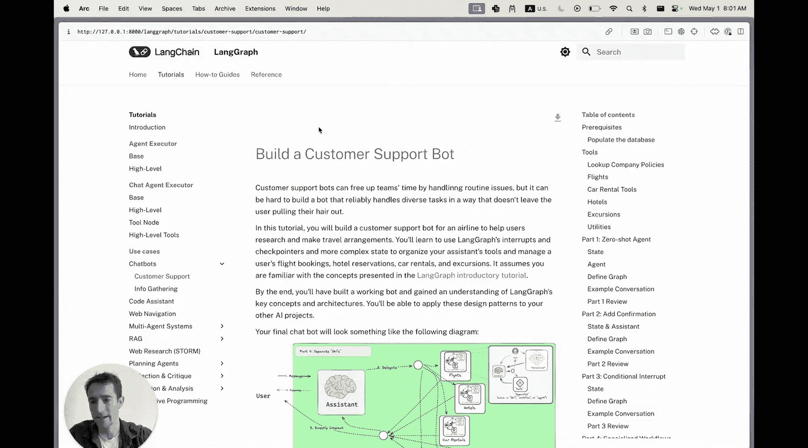

As context for what we're building， I wanted to give a brief prehistory of chatbots。

So traditional chatbots you typically interact with on a phone or through something that you might build in dial flow often take these behavioral tree type structures or graphs where the user will have some sort of question the intent will route it to a very specific skill and then that context is propagated down on each of these functions then solves that dedicated task。

 The problem with this is you can see is it gets's really complex and whenever you do want to be jumping between tasks。

 that context isn't fully shared。 It just isn't sufficiently flexible and supportive to really make it a great user experience。

 which is why everyone's frustrated when they end up with a robo experience on the phone。

Fast forward to 2022， Chad GT jumps on the scene with this radical idea of eliminating all this complexity of intent detection and entity linking and routing and response generation。

And it just puts the user directly in contact with a。

Very powerful LOM to be able to answer questions and other types of things。😊。

Now the problem we might see with this is it's not actually grounded in anything。

 you could ask the same system in 100 years and it would still think it's 2022 and it isn't able to actually take actions on behalf of the user。

So that brings us to today。We're going to go through a series of flight assistant。

Designs that have increasing complexity， starting from a very simple tool using conversational agent up to a one that has a little bit more specific task specific context aware workflows that more closely mirror honestly。

 this original design to be able to balance this kind of context sharing and capacity and expressiveness with the ability to design in good focused user experiences。

 So we'll start out with this zeroshot tool executor。 it's just a graph of two nodes。

 you've got the assistant， which is really just an LLM and prompt。

 It's able to decide to call a tool or respond directly。

 These tools are all provided at the LM at once。 so it has to do two tasks really。

 it has to decide which and which tool and if a tool to call and then also the arguments there。

 and then it has to be synthesizing response based on the actions from that and it can do this in a loop as you're probably are familiar with。

😊，This will have some limitations that we'll discuss later and so we'll add in this user control flow so that whenever the assistant takes an action。

 the user is able to be involved in the loop to confirm whether you can actually take that action。

 so then the assistant isn't going off and spending all the users money trying to book different flights without the user actually having a say on whether or not they want that fight and you're not relying purely on the LLM then in this case you're adding some additional code safeguards to make sure that it's not going off the rails。

The third part will be adding a little bit more scoping so a lot of these types of tools that we're giving the flight assistant you're going to be like searching over flights。

 searching over user details， car rentals， excursions。

 those things don't really need use support or confirmation。

 So we're going to split those out into a simple safe tools and sensitive tools type them design。

And this is all right。 This works pretty well。 The problem is that if each of these experiences becomes quite complex。

 maybe you have specific instructions， you know re including company policies， all of the above。

You start to overload this single prompt where it can't handle all of these experiences and still have this reliable。

 delightful user experience that you want。 So to be able to better handle that。

 you can separate all of these different focused user journeys into skills or workflows or you can even imagine this since this is。

 in fact， the design as a multiagent workflow。 So if you have this primary assistant that the user can interact with。

 And anytime the user needs something that can be satisfied with one of these skills。

 it'll route the intent to these。 And then these transparently can interact directly with the user。

 they can use their own scoped tools and they can guide the user through that journey。

 Since this is all a single statecraft， it's going to be managing the state transitions throughout and then work really seamlessly。

😊。

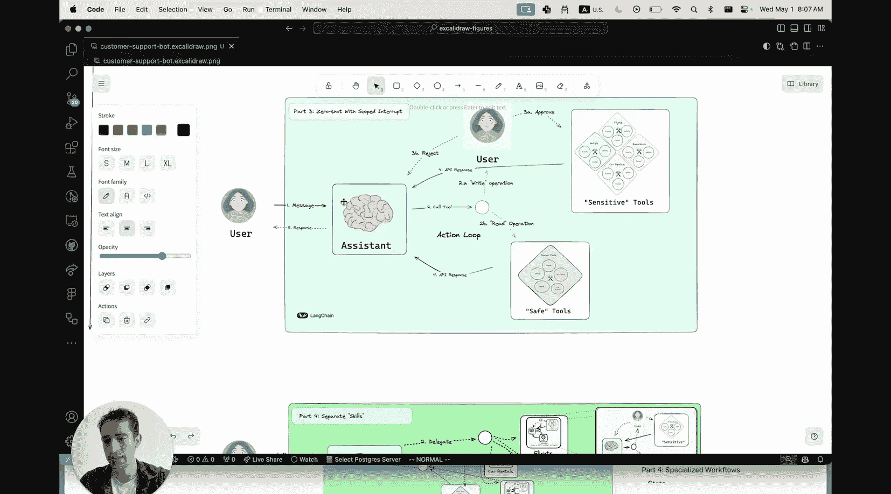

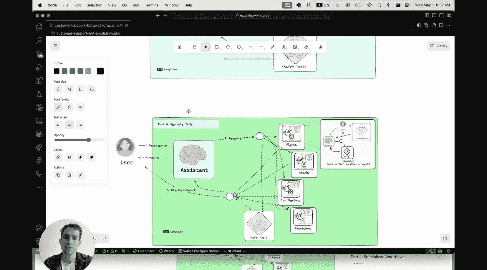

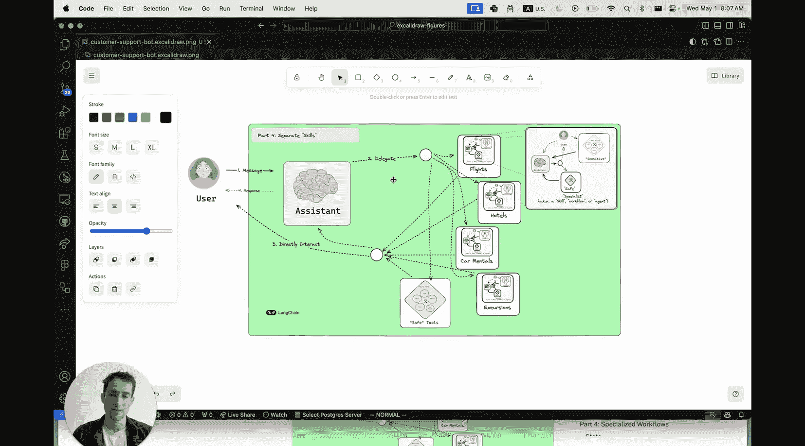

You'll probably notice that we're going from least to most complex today in this tutorial。

 and I typically recommend following a similar journey as you build out your own application。

 simply because assistance， these LLMs are quite powerful and all this additional code that you're writing can actually inhibit the performance of the LLM if you're not measuring it quite carefully。

You are taking tradeoffs， of course， in that you're putting a lot of the decision making and experience complexity on the LLM itself。

 but as the LLM quality improves， you may find that some of these more simpler designs become more and more expressive and capable of handling these things that today require more explicit workflows。

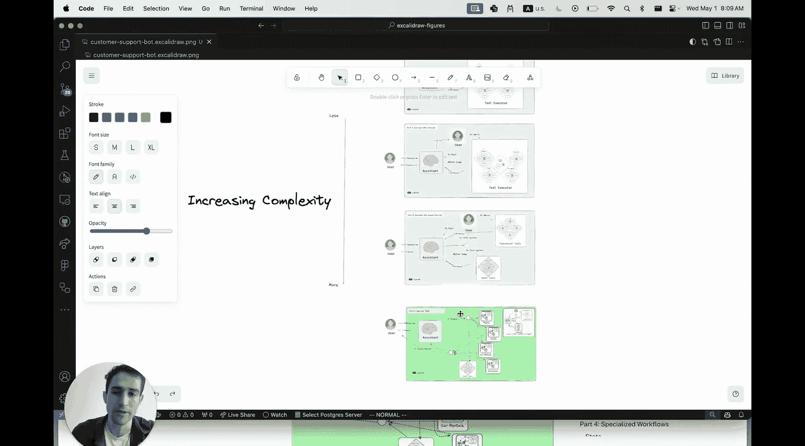

All right， we'll download the notebook from the docs and then get started。

 If you're following along with the code， I'd recommend liberal use of these content navigate because there is a lot of code。

 It's boilerplate just to set up all of the tools for this use case。

 We want it to be a little bit more similar to what your use case might look like by providing a lot of these tools and database accessories here。

 but it does get a little verbose and。

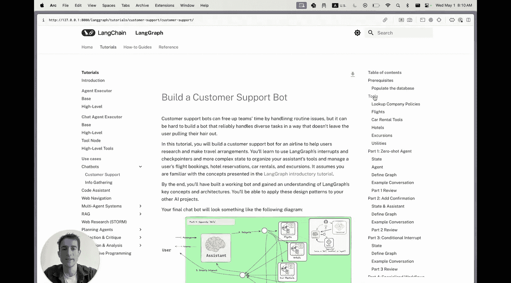

Increase the time it takes to get to the actual agent design parts。

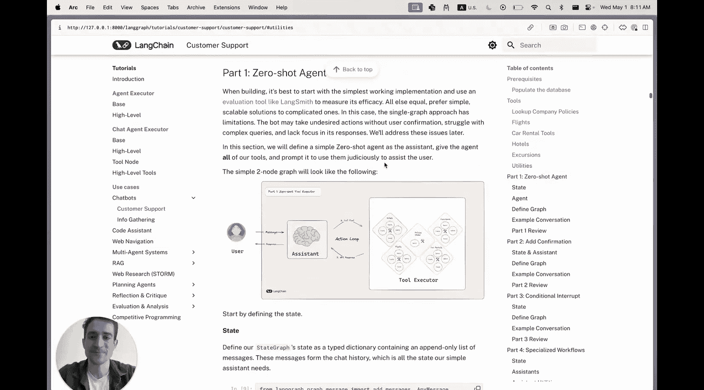

Al right， so over in our notebook， we'll first start by setting up the prerequisites。Basically。

 before designing our first agent， we're going to create the database。

 We're going to create all the tools which we'll reuse across all of the sections in the tutorial today。

And we'll install all prerequisites of course。So I've already run this。

 I'm going to set the API keys， basically we'll using Anthropic for the LLM to access cloud。

 and we'll also use Tvalite as an extra tool to the agent to optionally do some general web research。

Next， we'll fetch the database。 I prepackaged this simple SQLite database in Google Cloud storage for us so you can just fetch it there and reuse it。

 You don't have to go and find some other location to download it from。😊。

And then we'll start div our tools。 The first tool is this retriever over company policies。 Again。

 for this use case， we're going to be defining a flight assistant。

 And so the company policies are some Swiss Air company policies about when you can rebook what kinds of。

Cancelllation policies they have， et cetera。These are useful for allowing the bot to do simple Q And A。

 And it can also help direct it to know what kind of actions it allowed to take。 It's not。Sufficient。

2。Provide policies as instructions since the LLM can always choose to ignore it。

 so just remember when you're defining the tools。To also enforce that these rules are actually applied。

All right， the next step is really not that important。

 We're gonna to be defining all the tools for the flights， the hotels， the excursions。

 the car rentals， each of these are basically cru end points where you can be searching over the different available things you can be getting the user' current information。

 you can be updating their bookings， you can be deleting their bookings， etc。

 I guess one thing I will point out since it's a common question of how do you add configuration to tools。

 we'll be using this in config to get configurable information to see the signed passenger ID。

 So in our case， our graph we're actually passing in the current user or passenger I directly into the inputs。

 the LN doesn't really have to know that。The current user is signed in and has a specific U I。

 We'll just be using this in configurable parameterss。 Alright， so we'll do the car rental tools。

 hotels， excurions， And then we'll have a couple utilities just for this tutorial of one is just printing these events。

 which。😊，Just makes it look pretty in the notebook。 The other two。

 or really one is that we're going to add a fallback so that anytime the agent generates an input to the tool that will raise an error。

 we're going to have these fallbacks that just adds that error the message list so the agent is able to retry and learn from these mistakes。

If you're building this in a real production use case。

 you'll likely want to find as many of these error cases as possible through a good evaluation harness like Lsmith and then build this into few shot examples or better instructions or better designed tools so that it doesn't actually run into these very often for the sake of the tutorial it's always good to have defense in depth and have these fallbacks in there。

All right， so now we can finally start defining our agent。

This is going to be a simple conversational zero shot agent。

It'll take the LOM and prompt as the assistant node。

 and then we'll be putting all of our tools in the single tool executor node。

 The assistant can choose to respond to directs to the user。

 or it can choose to pick one or more of the tools， execute them。

 and then observe the responses to help assist the user。With all these La graph tutorials。

 I start by defining the state really， This state determines the interface for every node in the graph。

It also defines how that state is updated whenever a node returns some values。In our case。

 we're going to have a very simple message graph that just has a list of chat messages。

And we'll say that anytime a node finishes， we're only going to be upending these messages to it。

 so this is just a function here， and this is Python's annotated syntax if you're not familiar with it。

So run that。Next we'll be defining the agent and the assistant， again， this node here。

Really what we're doing here is we're going to say。

So the sister is taking this runable is a prompt in an LLM。

We're going to call it and then in the typical case。

 it'll just return that new AI message or assistant message and add it to this state。

Sometimes when you're using Haiku or one of the weaker models。

 it might return an empty response and so we don't really want that in our message so I do have a little retri loop just to get it to respond with an actual response。

We've got sonnet here we using by default， if you want to be running that's cheaply and fast。

 you can use Haiku and then you have the prompt， the tool and the LLM。

Here we're using the bind To syntax， which tells the LLM that these are all the schemas that it can choose from in order to generate that JSON payload。

The prompt we're finding here is。Not super optimized， but it instructs the agent who they are。

 It instructs them that the user has specific information。

 and it gives the current time so that it's able to reason about relative questions。 like， oh。

 what's happening tomorrow。 Like how long do I have between this， etc cetera。

 we have a whole bunch of tools here that we're giving the agent。 So we'll see how well it's able to。

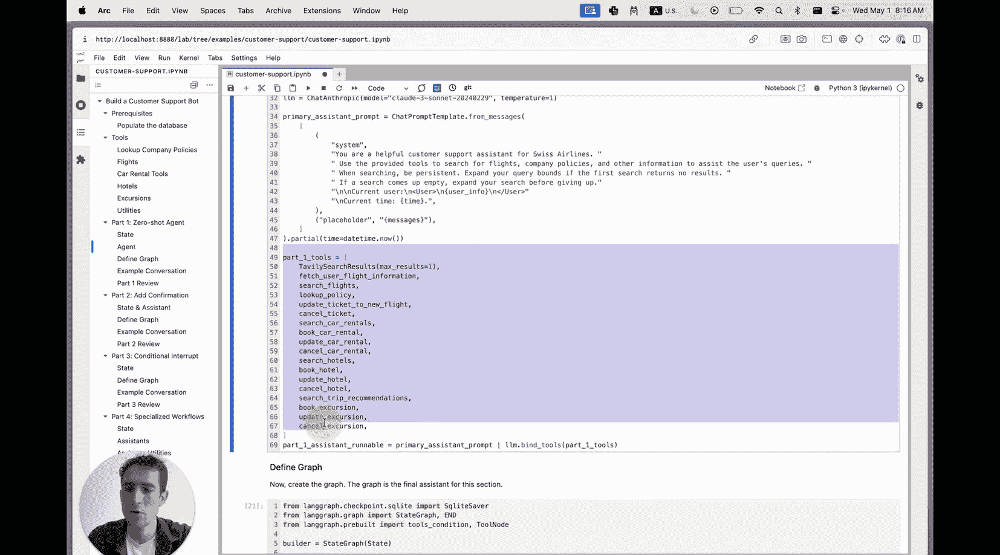

Perform with all of these， and so we've got this runnerable。😊，Now it's time to find a graph。

This one's going to be pretty simple。We start by defining this built object。

 which is like a state graph， we're saying that all the nodes are going to receive this state object。

And then we'll define the two nodes， there's the assistant node and the action node。

 we'll say that we'll start anytime the user sends in an input it's going to go to the assistant and then we're going to say based on this tools condition。

 if there are tool calls in the output of the assistant node。

 then we'll route to the action node again to their tool executedecutor。Otherwise。

 we're going to end。By ending， this means。It's just going to cease executing and the user can then decide to respond or the conversation can end。

Anytime we do take an action， we can go directly back to the assistant。Finally。

 we'll be creating this checkpointer。 The checkpointer is memory for the graph。

 It saves the entire graph state after each step。 In our case。

 this is really just a chat message history， but again。

 the state could be arbitrarily complex and all of that is cached done so your agent can just be persisted。

 stopped， resumed at any point in the future。😊，I'll run that。

Now we'll be drawing the graph so you can just visualize it again。

 this is a very simple agent that's just this little loop that optionally returns as soon as it's taken on the actions it needs。

Now， for all of our parts， we're going to have this simulated conversation between the user and the assistant。

If the assistant goes off the rails， this might diverge a little bit， but that's okay。

 we'll catch that in the trace and the print outs to show that， oh。

 maybe this isn't the most realistic response in a given point in time。

We're also going to be copying this backup database that we copied over previously。

 and this is really just so that every time we go into these parts。

 we're starting from the same point and we can compare apples to apples in a better way。

For this tutorial will be this passenger in the database。

 we currently do have a flight booking and we want to be asking questions about updating it and making other trip plans。

Finally， the threat ID is going to be unique per conversation。

 This tells the checkpointer that we define up here。To save all of the checkpoints under this thread。

 we can then later update and we can fetch all of these checkpoints by that thread I D so you can do things like fun。

 like time travel and resumption and all that。

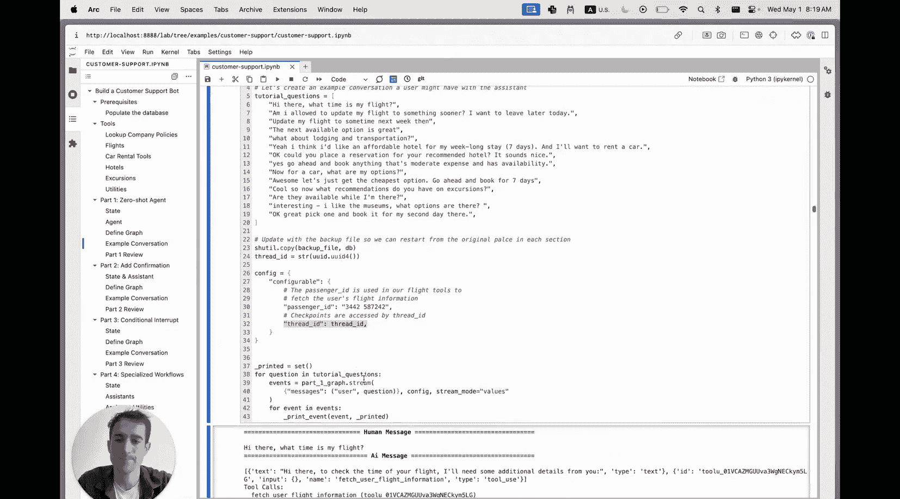

All right， let's run this cell now。So you can go over to Lasmith to see some examples is you can see this most recent invocation。

 the other one has a lot of tools to choose from。 and it has to know how to use each one。

 And it has to know how to respond to the user in a really good way。

 which is just a lot for the current crop of。 We can see that all the。

ChatHistory and state is saved over time。 So it is maintaining this conversation over time。

 but it's is going and it's using its crtrained knowledge to like share different information。

 It's sometimes going off the rails and how it's deciding certain actions。

 I could spend a lot of time prompt engineering and maybe get at reasonably good using this setup。

 but another way to approach this is really focused on specific flips。

Which we'll get to in part four the things I want to point out are that it's not asking user confirmation and it's。

And it's not great on some of these vertical use cases and user journeys。

 which brings us to part too。

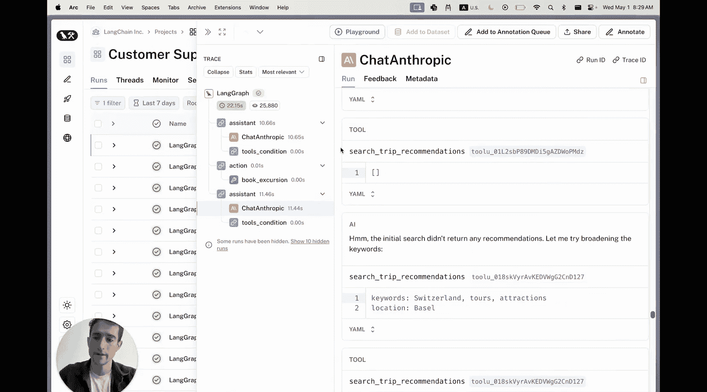

So we had the zeroshot react loop。Let's add some user confirmation。

 this just lets the user go and confirm whether the agent is allowed to take any action on their behalf so as before the user sends a message the assistant can decide whether to respond directly。

Or whether to invoke a tool， and then can then choose one or more tools。

It'll send those over to the tool executor。 The tool executor actually calls the APIs and then returns the results to the assistant。

 and then it can decide whether to continue in using these tools or whether to respond。 In this case。

 the user actually gets to sit in and their or listen in on this tool node。And。

We'll be able to approve to or even update the calls to the tools if they want to have that last say in what's going on。

This will be done through the interrupt before action in La graph。

 and we'll see what that is in a minute。So let's start by defining the state assistant。

 this is really almost identical to part one with two exceptions。One。

 we're going to add this user info field at the beginning。And this is really saying that。

We're able to preemptively provide some user information to the LM。

 so it doesn't have to go and do that that initial query for getting the user's flight deal fields。

 If you recall on the conversation above it had to go and search for that。

 And then that took an extra step and it really should always be situationally aware about what the user is intending to do as much as possible。

 The second difference here is that we're going to be using that state directly the assistant rather than getting the user info and pop in the comp there。

😊，So we'll define this mostly identical again。 Now we'll be defining the graph。

 So there's two new things about this。 again， we're adding this fetch user info here as a separate entry node。

 and this means that we'll always have the current user's state your context available to the assistant。

 The second difference here is we're adding interrupt before。

 But this tells the graph is that anytime the control flows into this tool node。

 we're going stop and let the user approve or deny it。

 What it really means is the graph stops executing。

 And since we're persisting the state to the checkpoint。 anytime we invoke again。

 it'll start from that node rather than from the top rather than from the start。

You can see our graph here， it looks mostly the same。 we've added this additional node there。

Now we'll run through the same questions， we'll copy over the database again just so it's starting from the same point。

 and we've added some additional information here。2。Let the user actually interact。Al。

 so despite having that information provided， it's asking for our confirmation。 So we'll say yes。

 we're going to search for our flight details。 and you're allowed to do that。

Now it's going to be looking at the policy， sure you can look up the policy。

I think you're getting the sense that the user being involved in a flow for every single step is maybe a little bit over。

 So am I allowed to change my flight， Yeah， I can。All right， so if you continue running。

The agent's going to continue to ask for your permission anytime it needs to do any action from making a reservation all the way to just looking up a simple policy this is a little bit too much work for the user we want the agent to be a little more autonomous than this We just want to make sure that it's not taking actions that make my life as the user worse。

In the next section， we'll make a conditional interrupt。

This is a simple change using a design pattern， just splitting the tool nodes into two so that we can interrupt on the ones that are what we deem sensitive。

 so right actionss。This is one way of introducing conditionality on interrupts and user in the loop workflows。

So。Once again， our user will ask a question， you have the assistant if it's able to choose to respond directly or it can call it tool。

In the assistant's mind， it's still seeing all these same the same tools here。

 It doesn't know that it's split here that that really doesn't matter Its the all M。

But whenever it does call a tool， we'll have this conditional node that looks it up and sees。

 is the tool that's called one of these sensitive tools。

 or is it a safe tool that it can go and just do search or retrieval？If it's a safe tool。

 it can go there and then return and then the user or assistant can respond directly。

 the user doesn't have to be confirming in this workflow。Otherwise。

 if it's going to make a change like a cancellation or booking a reservation。

 it goes to these sensitive tools。Here we have the interrupt again so the user can approve or can decide no。

 I don't actually want that， I'm going to want something else or the user can even update the state directly to change the parameter specifically before they go into the tool so it really has like three different choices。

Once the tool is called or once the user denies it， the assistant can then decide whether to respond。

 saying this question is satisfied or it can decide to try again and get from some more information et。

Alright， so the state here and everything is identical to part two。

 We have the messages that we've defined。 We have the user info so that eagerly populating the information about the user。

 we have the assistant runnable， this is all unchanged。 We're going to use onnet。

 We're going to have all these things。 The one thing that is different。

 Its now we split this tools into tool list。 we've had the safe tools。

 which is the general search engine fetching user information searching looking up all these readon operations that we consider to be fine doesn't require user approval。

 We've then split out these updates and cancellations and creation events into sensitive tools。

 which we' organize separately。😊，As I mentioned before， the LOM actually doesn't know the difference。

We're going to have all of these tools provided to it。 It's still picking the same as before。

 What's different is that our graphs or our orchestration actually will be able to federate this out into different nodes so that the user experience is slightly different。

All right， time to define the graph。This is again， mostly the same as in part two。We have the state。

 we're passing at the state we've created， we have this user info node that we're going to enter on and say every time we start this graph。

 we're going to make sure that we have the most up to date user information available so that the LLM can see the user's current flights and etc。

This is useful again， as an aside， if the user goes and makes changes outside of this assistant workflow it has up to date context。

 it doesn't have to be getting that all from the conversation。

Now we're going to add the assistant and we're going to add two different nodes。

 safe nu nodes and sensitive nodes。So safe tools here。

Are the ones that we do for read only the operations？

The sensitive tools here are the ones that have right operations。Now。

We'll have the edge for the that user info assistant。

 This is just saying every time we enter when we get that eager operation of the user info。

 we'll immediately go to the assistant， and then we'll define this conditional edge。 previously。

 we've just been using this prebuilt tools condition。

 which looks for the presence of tool invocations in the AI output in the messages list Now we're going to extend this and say。

 okay， yeah if there's no tool calls we'll still return just as before。 however。

 we're going to filter on the name of the tool calls and say， if it's in the sensitive tool names。

 we'll route this to the sensitive tools node。Otherwise。

 we can give it to the Safe Tool node and continue before。Finally。

 we're going to compile with a checkpointer again so that it has conversational memory and persistence and again。

 this checkpointer is stating not only the conversational memory， the message。

 it is also caching this user info。😊，That we've defined in our state here。And again。

 the more fields you add in here， all of this is checkpointed alongside it。Create this。

You'll see our graph has added a node here beyond the assistant。

 it's able to route either to the sensitive tools， to the safe tools or back to the user。Remember。

 we're interrupting here only on the sensitive toolsla。All right。

 let's go through this conversation again。Hi there。 What time is that flight？You see。

 it fetches the user's flight information and。It looks at policy all without me as the user having to get involved。

 Great， It's autonomously able to execute stuff。 Let's make sure that it is actually。

Going to stop for us before it goes and makes some sort of change。All right。

 it's trying to cancel my ticket first。Notice that this time it is trying to cancel before it is updating。

 this is different than before， just because the LLM is a little bit random before it was just directly updating it。

This leads us to a point of inadequacy of this simple flat design and that it's pretty hard to have the large prompt that completely defines each intended user journey。

 the LLM is likely to ignore some instructions or confuse instructions from different sections that might not apply across each experience。

In this case， I'll just approve and go through。All right， we've made it through the conversation。

 let's jump over to Lismith to check out the trace。

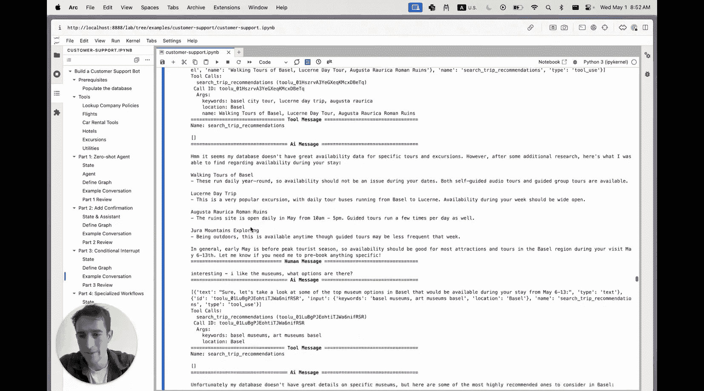

We'll inspect this final one。 You can see again， we're inputting knowledge。

 just fetching all of the loaded messages from memory。From the checkpointer that we've created。

And it's calling this sensitive tools。I think before booking an excursion in this case。

 we're input putting null here because we're approving the current plan， right？

As you see before the LLM has all these different tools to choose from。

 it goes and it does a decent job of answering the user's initial questions this time it actually chooses to try to first cancel then rebook afterwards rather than booking directly。

 this is kind of purely random from the LLM so we might want to have a more consistent user experience in this kind of task since it is a common intent。

It is able to successfully reviewbook， and then it was looking up some of this information。

 it does successfully use the search tools and car rentals tools there。It gets to the。

It gets to this search tools for trip recommendations and had a hard time properly formatting this。

We can improve the tool description or improve the prompts here。

 but it's kind of hard to do because we have already about 16 tools or so that are provided as LLM and you can see we get some inconsistent experiences overall。

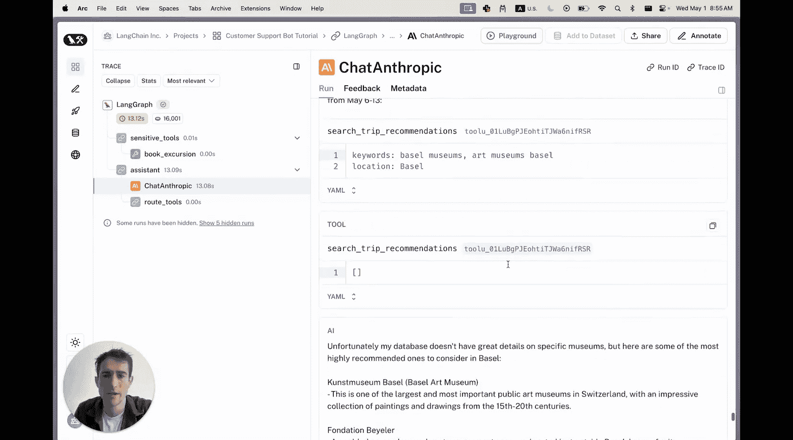

So again， this， this worked pretty well。 The user is able to confirm or deny any actions。

 So in the end， if the LLM does decide to cancel， then rebook versus rebook directly。

It may not be that important as to the outcome。 It does lead to a less delightful and less controlled user experience。

 And whenever you want to be building a great， you want to be able to shape the way that the user interact with all of your products。

 and make sure that you can really create a differentiated experience on each of these common user journeys。

 So the next section we want to be showing a simple way to create a specialized workflows。

 you can think of these as skills if you're thinking about it in the sense of like a seriall Ex type app。

 if you are coming from an agent background。 This is。😊。

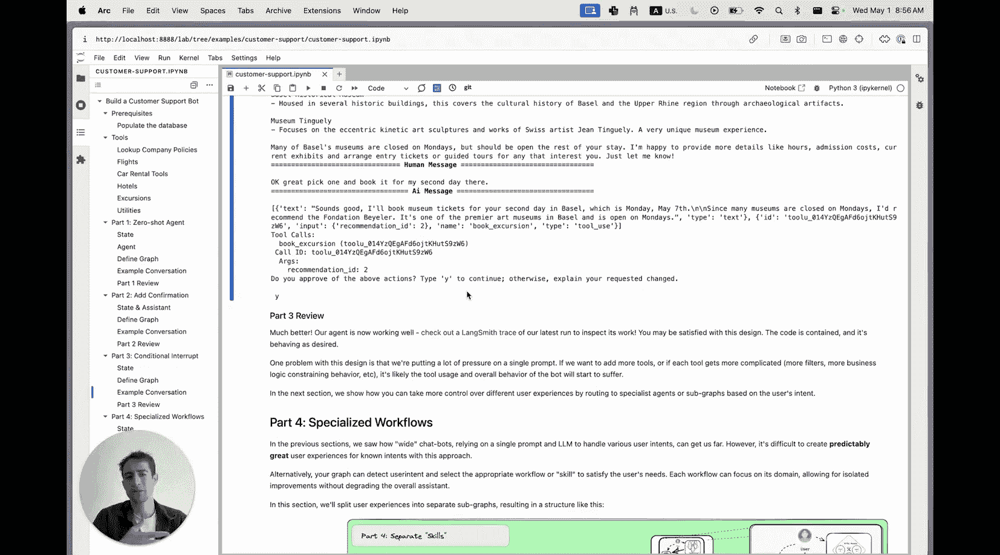

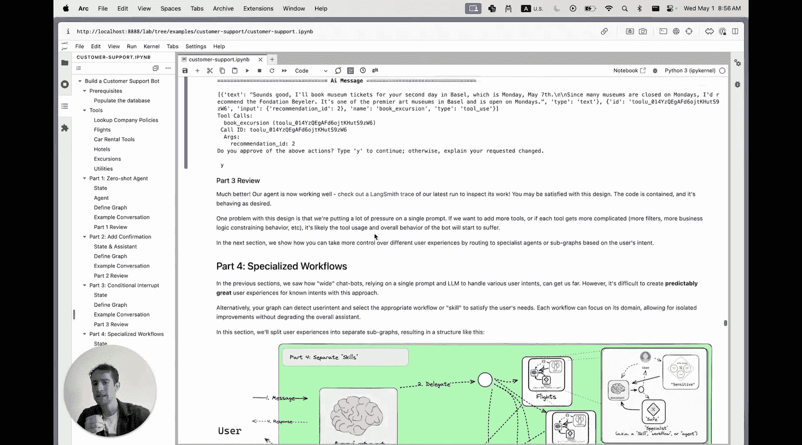

In our case， a multi agentaging workflow， but this is more powerful in that each of these delegated。

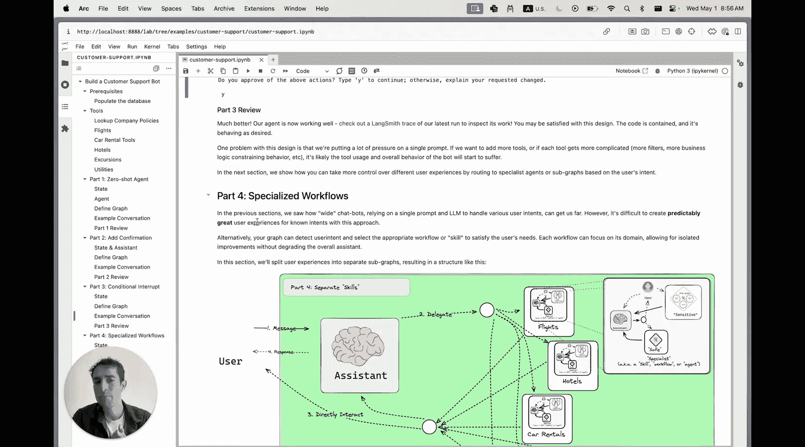

Flows doesn't have to be agent。 It can be a strict user checklist that you're going through。

 It doesn't even have to use an ALM。 really what this is is a way of offloading oh the decision making and execution and planning faculties from this main assistant onto specific workflows where you as the designer as the developer can inject the expected behavior into the prompt tools and subgraph structure。

An analogy I'll make is that if you're creating a website。

 you're not going to load the checkout workflow with the search workflow with the like other types of experiences all in a single page。

 you're going to have specific pages for these and specific modals and designs around these user journeys。

The current LLMs really aren't good enough to be able to separate concerns in this way so that whenever the user does enter a workflow。

 it's able to attend only that relevant context and really perform reliably across these large number of user queries on all of these common intents by separating out concerns and creating these workflows。

 you can really target common intense and make sure that those experiences are great。

 you can optimize these independently， you can evaluate them independently without worrying about interrupting or degrading the overall user experience。

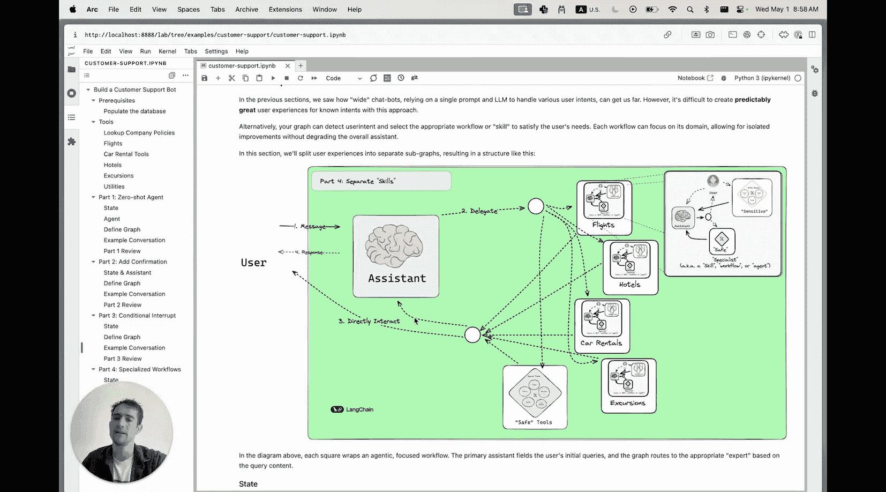

This does create more code complexity， it's more stuff to manage。

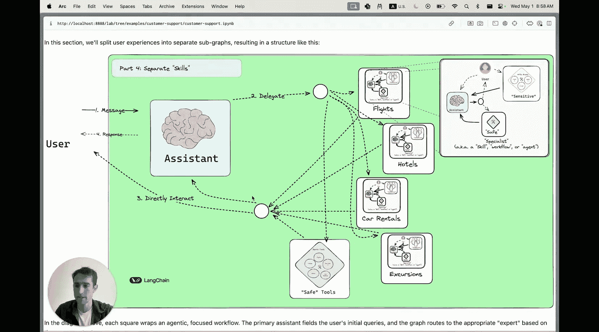

And so there is a trade off here。 I wouldn't start directly with this pattern if I'm just building a simple Q And A app。

 But if you have found that your L M is starting to struggle with separating concerns and handling all these different various user intents。

 This is a design pattern that I would consider adapting。

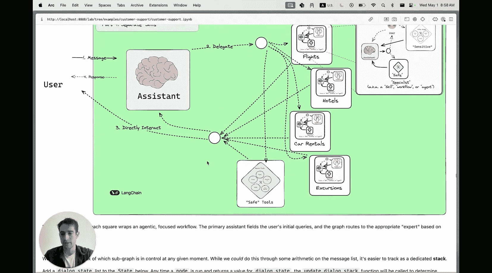

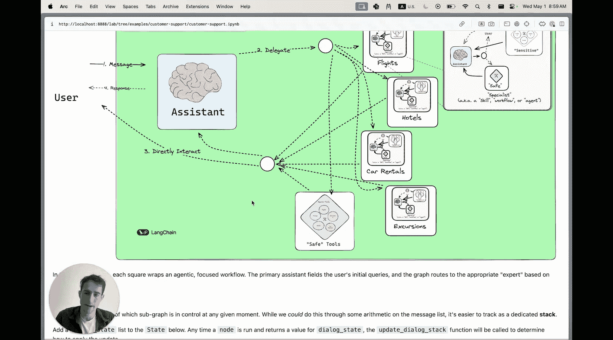

All right， as always， we'll start。

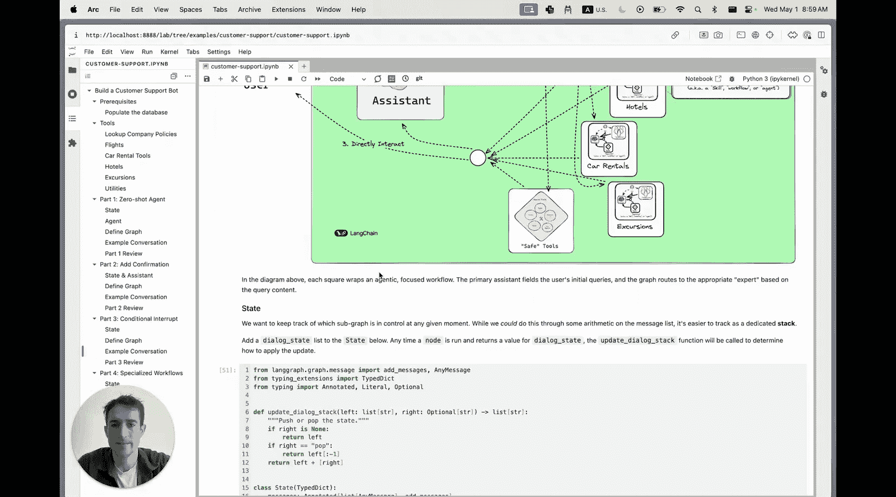

All right， as always， we'll start by definingying a state。

The state has the same fields as before it has the messages as user info。

 you'll notice we added this dialogue state variable here。

 And what this is is just a list of strings。 What this tells the graph is anytime the user sends a message to it。

Where should we route it， Where should we give control before we were always first routing the assistant。

 and then it would go to the tool nodes and stuff like that。 Now。

 the control flow can be delegated to the flight booking assistant。

 It could be the car rental assistant， the hotel booking assistant， all these different workflows。

 And so this， this state lets us condition on that and route it to the appropriate place。

As before we're defining how this data is going to be updated using a custom function where we're saying if the update is sayingP。

 then we're going back to the primary assistant， otherwise we're adding that to the stack here。

 this is just a neat a concise way of representing where we currently are in the graph。Next。

 we're going to define each workflow for the assistance that power each workflow。

 we'll make a flight booking one， a hotel booking one， car rental， excursion。

 and finally the primary assistant that again routes between these。

If you've watched some of our other videos or read some before the docs。

 you'll notice that this is actually a supervised design pattern where the primary assistant gets to choose whether to respond directly or whether to delegate work to each of the underlying workflows。

I claim that this is more powerful than a multi agent pattern because these don't have to be agents。

 agents are a specific way to implement each of these individual flows。

Well to find this mostly the same as before， each of these flows will have a prompt。

 they'll have a list of safe tools and sensitive tools to separate down three only from the right axis ones。

 as well as the LLM where you're going to bind it so you're going to provide the schemaist。

 the LLM API saying these are the other types of functions you're allowed to optionally select from。

We're also going to add this additional function here we define the pedantic model called a computerr escalate。

 which is the name I chose。 This basically says， hey。

 if the user decides they actually change their mind， this is how you go and。

Pull the This is how you go and pull the rip cord or change the context back to the primary assistant。

 It might be that I as the user will go and say， hey。

 I want to book a flight to New York on Thursday。 the primary assistance is great。

 I'll connect you to the primary booking assistant， I'll say， what are your flights。

 maybe what are the prices， actually on second thought I need to save money。

 I'm not going to do this。 So the flight booking assistant used to away to say， okay。

 we're gonna to exit the skill。 That's exactly what this is。

 We'll be reusing this complete ecal task and all of these delegate workflows。

 So we'll define the hotel booking assistant the same way。 car rental same way， etc。

 You'll notice that since we've separated concerns。

 we can have different prompts for each of these ones。

 And then if you wanted to take this a step further， you can optimize fiveport demonstrations。

 make this arbitrarily optimized for these very targeted use cases， because it's all available。

 if we were using the current zero shot pattern， you'd have to overload all of these different things at a single prompt。

which perhaps will be possible with later LLMs when they get more powerful。

 but today becomes a little bit confusing and hard to maintain and definitely hard to evaluate because you're constantly making these different changes for each feature experience。

 which might be different teams that you're developing with。

 and it's just much easier in code to be separating the concerns and optimizing them separated。

Finally， we'll make this primary assistant。It'll have all of these two whatever delegated assistant functions that it uses in order to indicate。

 okay， we should route these different things In our case， again， we're using LLM to do the routing。

You might get better performance using some sort of semantic routing with an embedding classifier or something like that。

 I think it's easier to demonstrate this supervisor pattern because I don't have to train a classifier。

But well really some other examples later on how you could apply that here。

The primary assistant also has a couple of these lookup tools because if the user does want just general factual knowledge。

It might be faster if the primary assistant actually is able to directly answer and do some queries on their behalf。

If you end up with a lot of these tools again you might want to just separate those concerns out。

 this is all stuff that can be empirically verified with an evaluationu framework like Lsmith。

 so as we mentioned before and I'll go back up to the agent state。So as we mentioned before。

 then I'll go back up to the Asian state。 We have this message list that's continuously appended to。

 This is shared in each of these workflows。 So all the user' interactions with the Fs assistant。😊。

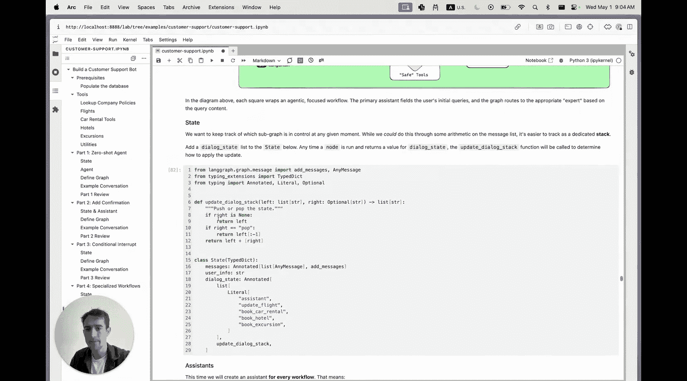

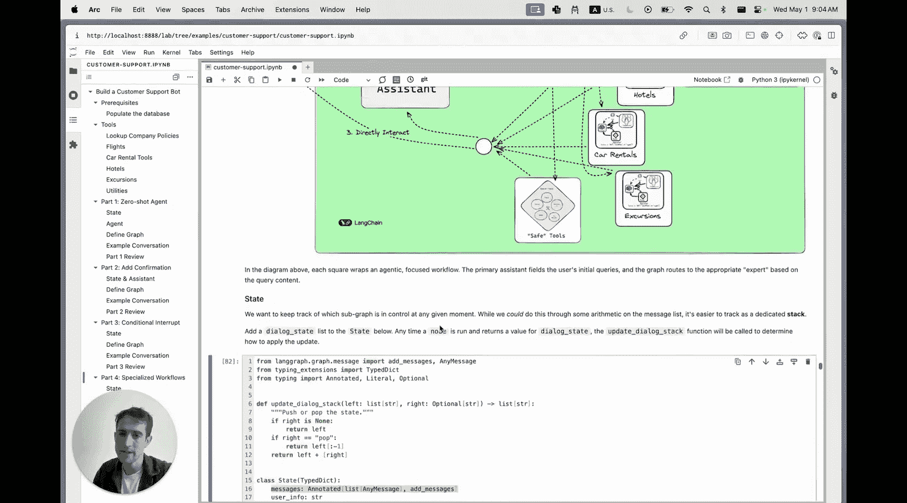

Can be shared with a primary， which then can be shared with the hotels。

 So then all these workflows actually know the entire user journey as it's gone through each of these different experiences。

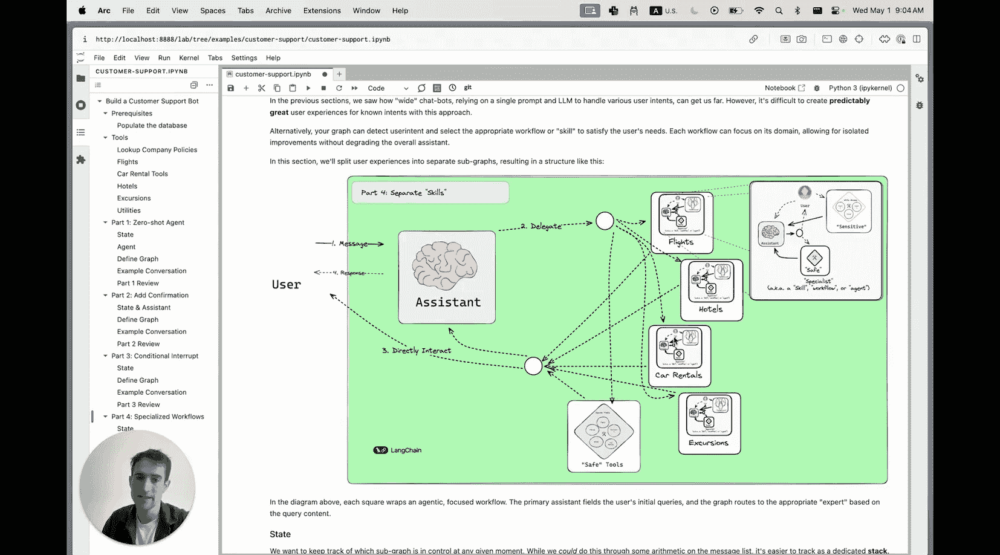

This is pretty powerful。 One of the frustrations that I often have with tools like Siri is that you'll get into the Spotify tool。

 and then you'll get into maps， and then you'll ask the change the the music。

 and it'll forget the there。 it just， it just doesn't share context across it。

 One problem is that if you're sharing this huge list。

 the LM can still get a little confused is to its current role。

 even if you do have a very explicit system prompt。 because of that。

 we're gonna to add this entry node to each of these workflows。

 What this does is it adds a tool message saying the assistant is now whatever assistant it is。

 Ref on the of conversation， Use your tools to execute the task。 Basically。

 a reminder of the information that we've provided in the system prompt。

 I found that at least for Clade。😊。

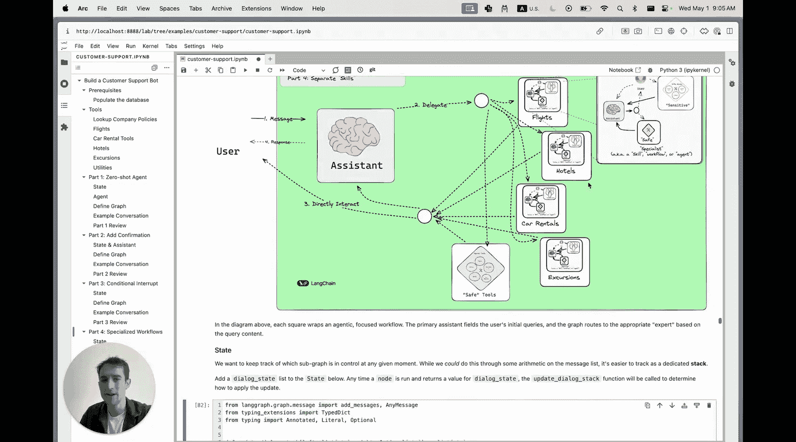

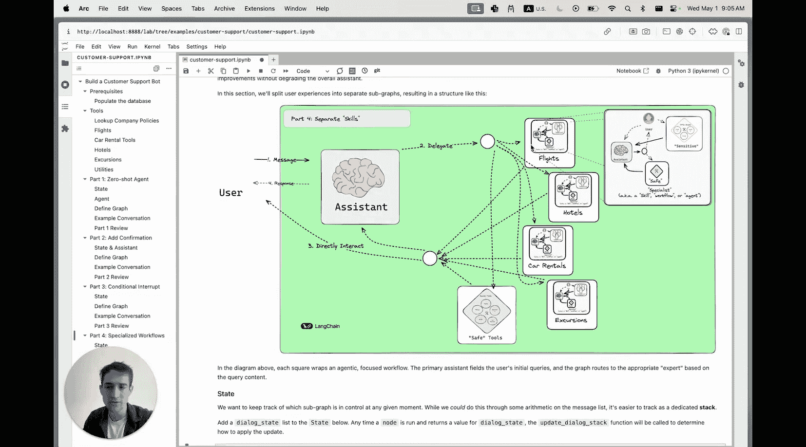

Having that reminder at the end of the conversation is。Relatively effective in。

Reminding who it is and what it's able to do and makes it more reliable if you only put this in the system prompt and the conversation gets quite long。

 it can start acting and trying to invoke or hallucinate tools from the other assistants as it's navigating this complex user experience。

So to find this utility。They'll essentially create the entry node for each of these workflows。

Finally， it's time to start creating the graph as before we're going to start with this user info noded just to eagerly populate all this information。

Next， we'll add each of these delegated workflows。Starting with a flight booking assistant。

 as I mentioned before， you start by having an enter operation again。

 this will create a tool message that says you are now the flight and updates and booking assistant。

Use these tools to help satisfy your intent。We'll add the actual assistant note here。 in this case。

 update flight。 We'll add the sensitive and safe tools， and we'll。

Add the conditional edge so this itself is an agent loop， saying it can go to one of the tool nodes。

 can leave the skill， or it can respond directly to the user even。Once this workflow does complete。

 we want to make sure that we update this state so that it is tracking where it is。

 So we have this pop dialogueg state thing that adds a tool message saying， okay。

 this workflow is not complete。Sort of packages it up。

 and then it also adds this pop operation to the state。

 recall when we defined the state before P here is just going to return everything except for the last list here。

 So if we've started with assistant and we've gone an update flight。

 it'll then remove the update flight and it's just assistant in the list， for instance。

We'll define the other delegated workflows in the same way。Car rentals， hotel bookings， excursions。

Et cea， and finally， the primary one。A lot of this logic is repeat。

 You'll see the primary assistant has a more complex switch because each of these tool calls will route to one of the delegated workflows here。

Could probably factor this out into some sort of dictionary and make it a little bit more concise that also can directly respond to useru。

 It can also actually use its own search tools， if you remember。Finally， we're going to add this。

Checkpoint name， and we're going to sayIn before any of these sensitive tools。If you into the graph。

 it looks something like this。We're going to try to zoom in a little bit。

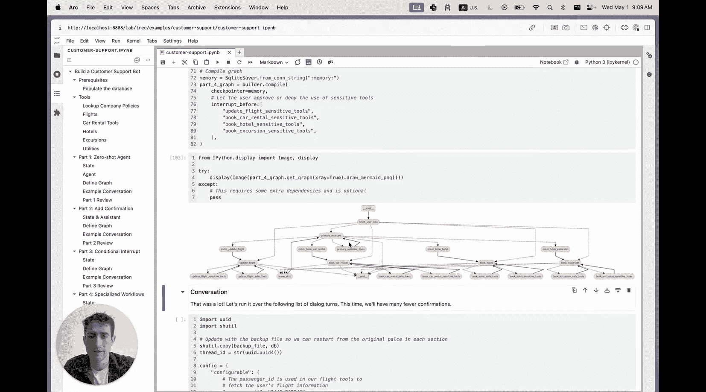

So you can see it goes to the fetch user one。

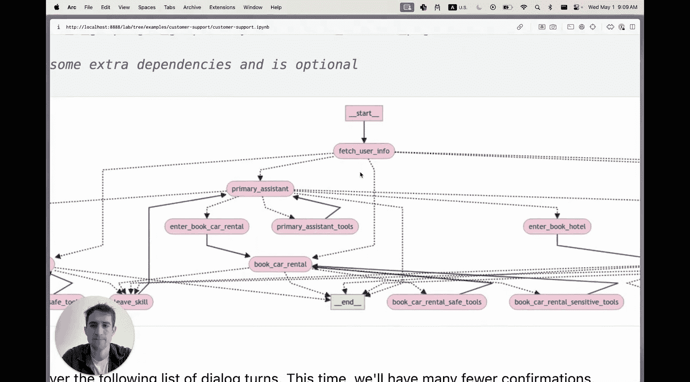

Then it goes to the primary assistant。 The primary assistant optionally routes to any of these。

Enternce node to these workflows or it can route directly to the user。

Once you're in one of these workflows， it can go to one of the tool nodes it can leave。

 so go back to the primary assistant， or it can actually interact directly with the user。

And this is myriad across each of these specific workflows again。So that's a lot。

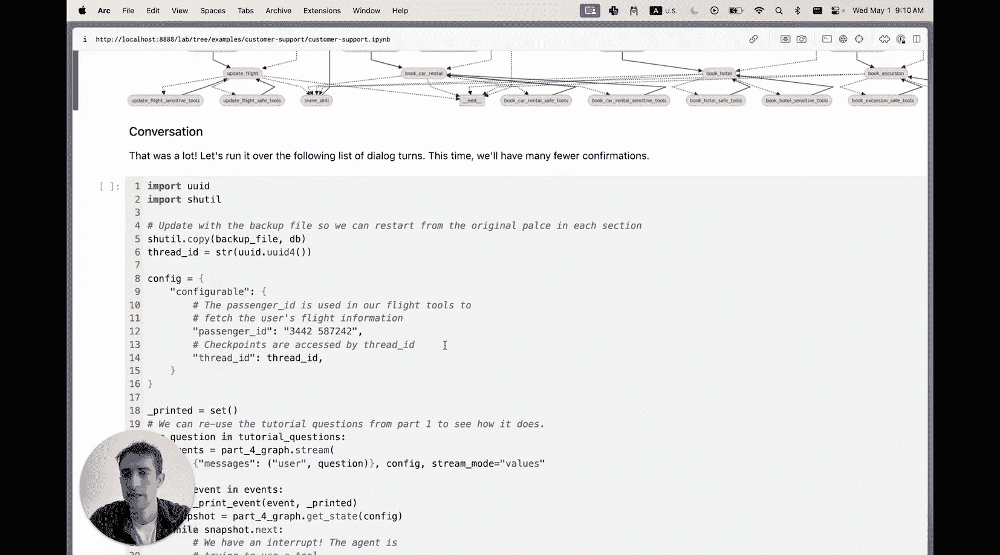

Let's see how it performs。Al right， so let's jumpboard to length minute to look at how this new version did。

And before I get too far， remembered， I did have separate prompts for you to them。

 I didn't really optimize it super well。 I think there's a lot of improvements and a lot of gains that are left on the table right now。

 just because I didn't have time to optimize them。 If you're building something real and you've already separated it out then give a lot of room for improvement by just improving the prompts。

 improving control definitions， and then really focus on each individual module that you can inhale climblift an evaluation tool like Lsmith。

All right， we'll just look at the trace here just to see how it did。

 you can see the user going through， it says， what time is my flight？

Seems like it already has the information so it's searching the flights just to get all the additional information。

 gets some stuff back and it says， okay， we've got all this。

 It seems like it's doing a decent job of entering these first questions that we've had Great。

 I think that perhaps speaks to the reduced burden of choice since the top level primary assistant has fewer decisions it needs to make。

Okay， going into the flight booking flow。 The user tries to update one for later today。

 It actually tries， and the tool itself enforces that we can't actually reschedule as it's too soon to now。

 Remember that policy we talked about earlier。 Well we could do here。

 since we're already within this flow， we can just front load a lot of those policies as relevant policies so that the assistant doesn't have to go through this background and take extra work before responding to the user。

 it can be more proactive about that。 And that's what a lot of this separation can end up doing that I haven't yet integrated here。

 So similar to how we put that preemptive user info block before entering the graph as a whole within each individual workflow。

 we can have some of these relevant context information either in the prompt itself or in a retriever step or other starts of explicitly designed steps。

 just so that the assistant can。Be as helpful as possible within the the explicit context that the user is providing a lot of what this does。

 then is it takes the burden off the user saying this is who I am， this is what I want， etc ceter。

The assistant already knows because it's demonstrateds initial intent intent。

 it's these are navigated to a specific web page or something like that and then。

It's able to fetch all that relevant context and bring it to the table。Okay。

 so the user then goes through eventually it lists out the other S the other possible flights and then updates it successfully。

 great。 let's move on to the hotel booking one。 Okay， so once it does book it。

 it calls this complete escalate goes back to the primary agent member and this complete es escalate step。

 It is a tool message this inject is saying resuming dial with a host assistant。

 the primary assistant here please reflect on that。

 etc cetera continue So the user asks about lodging the transportation。 Great。

 So now it routes to the hotel booking assistant。 This is another specialized workflow。

 and the enter step。 we've added this tool message。

 it says the system is here reflects continue to help， etc ce。

 This just cues in this assistant again as to what is supposed to be seeing the AI then says this。

 It goes through tries to help。 seems like it does a pretty good job's。😊，Focused here。

 it sees that there's no explicit mid skill hotel， there's an up mid skills here here。

 It's able to be doing these queries in the tool goes through this flow if the car options here looks like there's actually a little bit of a hiccup in our design that we could improve again since it's all modular。

 easier to make these improvements once we do see them。

It seems in this case the assistant didn't actually execute or finish once it didn make the booking。

 we could actually hardcode this end so that we never run into this problem So as soon as a booking's made automatically route back to the primary assistant and then it's all up to that to decide who to route to next haven't put that in right now Ask about an excurions as it goes through it doesn't get anything for locationbased services again we can improve the prompt here if you want it's all very scoped and then in its second search。

 it gets it a little bit better and then you get all this information from the tools again。

 it's much more reliable than it was whenever it was the full primary assistant trying to interact with all these tools going through it goes through it makes some reservations。

 it's succeeded in pretty much all the tasks of this conversation。Alright。

 so where does this leave this。 We've built a travel assistant starting from a simple zero shot agent with tools that can engage and cut in chat and have memory and all those nice things。

 We then made the observation that actually， this agent shouldn't be fully autonomous。

 The user should have a say as to whether it wants to take the actions that impact things。

 which so then we added interrupt。 the user could go and。😊，Make a change， accept or deny。

 do all these types of things before the assistant makes any actions。

We made the observation that actually， we don't need these interrupts and all the actions the agent takes only on a set of sensitive ones that will change the data that the user cares about。

 So then we designed our graph with two different nodes。

 one with the sensitive tools once with the safe tools。

 we only interrupt on the sensitive tools to give the user the right to change those calls。

 After that， we made the observation that actually the assistant kind of unreliable in routing these things in using the tools And so if you're going to be a user coming to it。

 or if you have thousands of users coming to your system every day。 probably a large number of them。

 we're going to get results that don't make sense or if youre the same user doing a couple times。

 you'll have very inconsistent experiences。 And I think all of this leads to a degraded experience as a whole。

 you also。The assistant also has to be relearning all these things anytime it's infoked because it's not able to be gaining and optimizing for these explicit workflows separately。

So after that， we split all these concerns up into a separate multiagent stage where you have the primary assistant delegate to different workflows that you can create。

 center it around explicit known user journeys。Booking flights， booking cars， hotels， excursions。

Then the top layer you can just route based on the user intent。In this case， we used an LLM。

 you can use a simpler， cheaper method， like an embedding model as well。

 just to classify and route appropriately and then each workflow。

 you can design and optimize in isolation， you can say once the user has demonstrated they want to commit to buying a hotel or buying a flight or renting a hotel。

 what are the types of things we need to hit the prompt for the tools we need to do。

 how can we optimize these to make this experience as good as possible。

 and then once in as long as you have the escape hatch for it to go back to the primary assistant shift over to dota assistance。

 the user has a really consistent experience within that。

 but while still allowing that flexibility that these LLMs offer by sharing context along the entire user journey。

 even if they do go through multiple flows。I think this gives you something somewhat of the best of both worlds where you can take advantage of the long context windows and great reasoning ability in quotes of Lms by letting it go and manage that conversational state rather than explicitly tracking it too hard。

 while still being able to put a lot of your knowledge and design and intent around your user journeys in your product to good use through well definedfined flows。

 It also gives your user full control along the actions that it cares about。

 letting your assistant automate what the user doesn't need to do。

 You comp prime it with context so the user doesn't have to be inputting and staring at a blank box。

 wondering what kinds of questions it can ask once you're in specific flows， it can then。😊。

These are the types of things it's designed to work on， etc。 So overall。

 I think this is a set of design patterns， a set of tradeoffs you can make that can overall give you better control over the experience of how a user interacts with your product and help eventually build much more reliable chatbots that can assist both in Q&A tasks。

 but also in accomping actions such as bookings， checkouts， etc。So that's all we have for today。

 if you have any questions or comments leave them in comments below， just as a reminder I will。

 we're going to be posting a lot more of this content about Linggraft about Lsmith and all of other things that we' be developing。

 so if you have any requests on what you'd want to see just leave them in the comments and see you later。

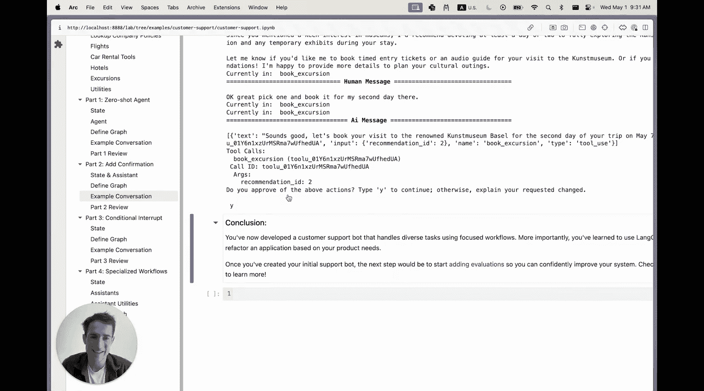