# LangChain【中英⚡LangGraph 使用指南｜LangGraph (Python)】 p18 P19 Build a MemGPT Discord Agent in LangGraph Cloud -BV1vJfMYuEon_p18-

Hi， we'll here， Let's build a menGT Discord agent together in Langgra。

For those of you who haven't read it yet， MenGT is a great paper by Packer Ed Alwl out of this lab in Berkeley。

They show that you can prompt an LLM to manage its own memory using function calling and tools。

The agent we are going to build today is inspired by MenGPT。

 It will have both core memories and recall to semantic memories and will deploy it on Langgraft Cloud。

 Finally， we're going to deploy a discord server so we can interact with it in a discord。

 and it can continue to learn our preferences and personalities。😊。

The agent that will create will have a pretty simple workflow for each message it will enter here will load memories for that particular user based on I。

 The agent will then decide whether to use any tools in order to respond。

 or in order to diss save your memories。 Finally， it will generate the response message which will then be send back to the user。

And the load memories is able to fetch the core memories from that user。

 as well as semantic memories， which are ones that are stored in a vector score。

 The agent then can query more semantic memories if we feel like the ones that areque weren't actually that relevant or useful。

 It can use other tool that we provide it such to a web search tool to answer the user's question。

 And it can also store an up different types of memories there。 before we get too far along。

 that we have two basic prerequisites。 We're going to need a vector store index for our recall memory。

 We're going to use pin cone for this example。 So we'll go ahead and create an index here。

 It do that by logging in。😊，And then creating the index。

 we'll set this as 700 dimensions for the embedding distance。

 since we're going to be using noomic em text， which is similar to the Bt encoder for the dimensionality of the output。

 You can call a specific name， and then you'll create it。 once you create it。

 You want to make sure that you copy over the region。 You copy over the actual name。

And that you have access to the API keys that've created here。 Next。

 we'll create our API keys to connect to the LLM。 In this case。

 we're going to use a Lama 3 fine tuned model fire function from fireworks。

 So with that prerequisites out of the way， let's go in fork3 repo。We'll take that。

 and then we'll clone it locally。

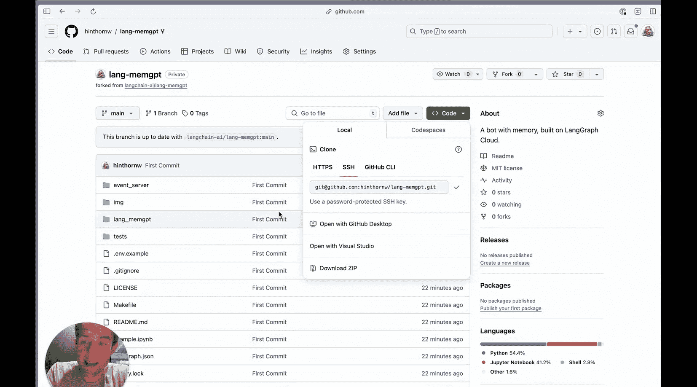

And then once weve cloneed it， we can pull it up here。 here we have our repo structure。

If you're not familiar with Lagraraft Cloud yet， a typical Lagraft Cloud structure contains a configuration file which defines the different types of graphs that we're going to be exposing in this case we just have this one memory graph。

 which is the MGPT implementation。You can expose the environment variables that you're going to be injecting in it。

 and you also define independent fees， by putting the local directory here。

 this will infer the dependent fees from mypro Tamel file。

 which then is a classic Python way of packaging projects。Within here。

 you can see we've added a bunch of different LM so you can swap out for open AI and Proic。

 all without having to change anything and code。 Next， we'll go over this basic agent dial。

 We've got some constants and schemas。 These are just tiny things they will go through。

 The most important part that we want to look at is this graph do pi file。

 If you look at the overview for the file。 You can see we defined these four different tools that are related to memory management。

 We have save recall memory and store core memory。 These are the two ways that the agent is able to persist memories about the user。

 We also have search and fetch core memories。 search queries semantically over past。

 save recall memories and fetch core memories just returns all of the core memories。

 which is just a list of strings for this particular user。😊。

Now we've got the actual graph definition below， it we go in more detail in a second。

 we've got the agent node here， this is just the LLM being prompted to be responding or using tools in order to respond and answer the user's question。

We've got the load memories function here， and this just takes the user ID D from our configuration。

 so the bot doesn't get to choose what types of data access it has。

 and it fetches those relevant memories before the LLM even gets to see the input。

We have the route To function， which is routing the messages to the tools node if the AI decides to be calling some of those tools。

Otherwise， it'll respond to the user directly。 And then finally， we have the tool node here。

 which we just use with this prebuilt decorator。 This will invoke any tool that is called by the agent and that is found within that suffix AI message whenever the state enters the tools node。

 If for save recall memory we'll fetch the embeddings。

 we'll fetch the vector or actually generate the vector and then we'll add some metadata like the current time so that you could be querying and filtering based on that。

 and then we're storing this all into the vector database。

 the key thing here is we're looking out based on a single vector on this memory string。

 you can look up in other ways if you want。 Next we define the search memory function。

This is a similar structure。 so we're going to get the embeddings。 We'll embed the query。

 and then we'll be looking up based on similar memories。

 You can see that we're passing in the user I in our configuration。

 and this is always going to be configured based on your front end in regular code。

 and this filters to make sure that it's only able to fetch memories that were saved for this signed in user or for the connecting user。

 Next， we have the type。 So we're only going be touching over recall。

 and then we'll get those responses and return the strings of memory there。

We have the fetch core memories， which is similar。 we're just going do a direct get operation on the database there。

 And then we have a store memories here。 This lets us actually save the memory。

 And if the AI wants to， we can use it to overwrite an existing one。 For instance。

 if I have a memory that I've been chatting about how oh I really love Taylor Swift and then all of a sudden and I decide。

 oh I mean I know that I'm a little bit tired of it they can update that。 maybe not a core memory。

 but things that it might want to be altering or updating。

 has that ability to define all the tools and these will be made available to the agent the we have the prompt which I've added to try to encourage it to use these memory tools as readily is possible for the sake of this demo。

 I always like to include the system time so it has a little bit more context and doesn't fruit and doesn't think that if until 2022 or wherever it was trained until and we're gonna to be templating in any memories here if they are fetched。

Now going back to the agent， we have this an chat model based on whatever the model that is configured here。

 the configuration， we default to this Lama 3 fireworks model， you can change it to Sonet。

 ors or cloud Sonet or OpenI or Gemini as well。Next， we'll provide the tool schemas。

 which just is a way to define an interface between the functions you need to call and the agent。

In the end， we're just passing in JSON schemas to the LLM so that it knows the format of the outputs it's expected to generate。

If we have core memories or recall memories that are already populated for this user。

 we can populate it in secure。And then we'll finally generate this prediction using the LLM。

 This goes into our messages date for load memories， Basically this is the entry point of the graph。

 We want to make sure that the LLM has all the contextual information it needs before it has to make any decisions。

 So we're going to do this by running in the vector core memories in the search memory functions here before you even get the LLM。

 And then after that， the LLM is allowed to do other types of queries。

 So now that we've gone over the graph。 it's time to deploy it， we'll do so on Lang graph cloud。

 So first navigate to Lngsmith， click on deployments and impress new deployment。😊。

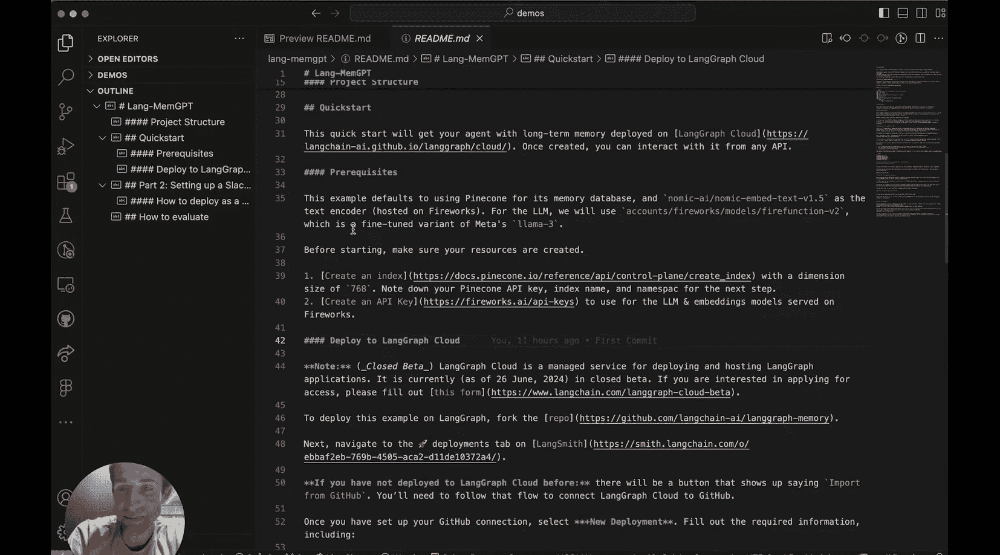

You'll want to add the Langgraphft cloud installer to your account。 Once you've logged it。

 logged into Gitthub， you can select to share all the repositories， or you can select a select few。

 I'm going to say Lng mem GPT。As if we can pull， I'm going to add and then hit Daveve。

Once you've done this， it should show up in the list of available repositories you can deploy from I'm going to call this MeM GPC。

The configuration file in this repo is at the root directory。

 if you clone it and move it to a separate directory， you can always add a path to it。

You can also pick a different reference a different branch deploy from Landgraft Cloud also allows you to select a different deployment type bridge going to go with development here。

Now， finally， it's time to add the environment variables。

 The key ones to add are pine cone and firework。

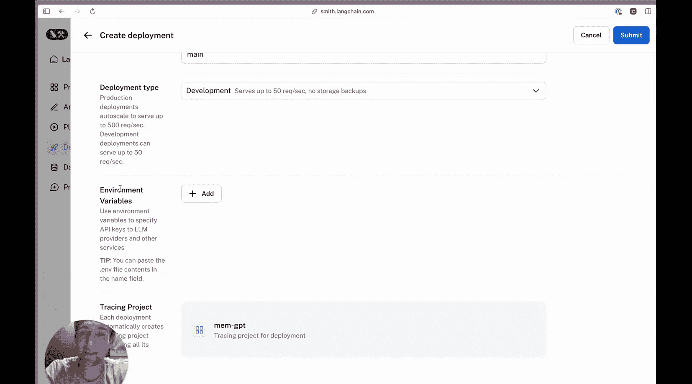

You can create these in a dot in file and then copy， paste that format into the UI。

 You'll also want to create a Tvalry account。 which I failed to mention before。

 and this will provide the search engine access if you want your agent to be able to query the web。

 Once you're done， hit submit Langra Cloud will start building your Docker image and then eventually deploy。

 If you run into any issues。 Check the build logs here。

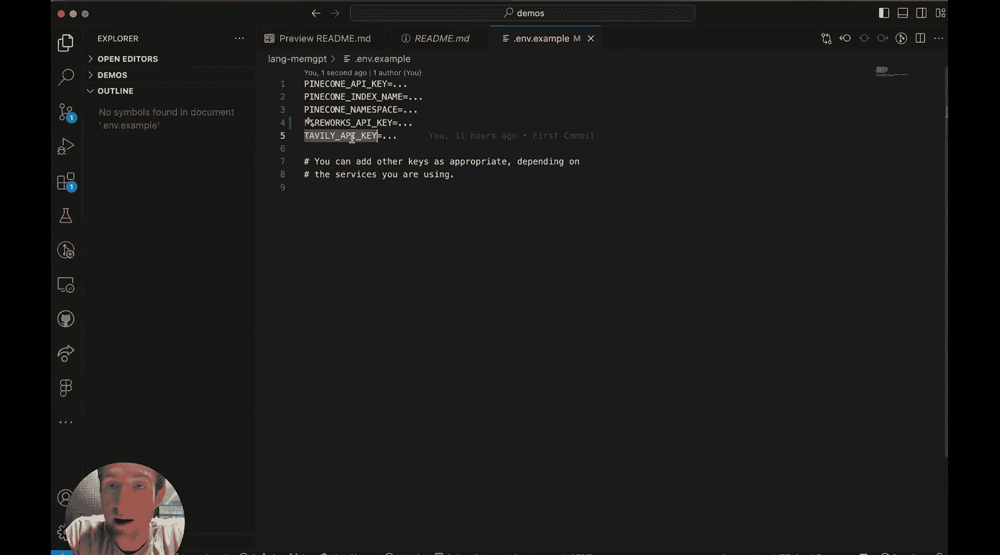

To see if there's any errors that show up or the deploy thought logs。

 common issues include not having the environment variables set correctly or forgetting to add different dependencies into your Lagra project。

 So if everything worked correctly after 3 to4 minutes， you should have a new deployment already。

You can head to the playground in order to try interacting with it directly in the Ui。

 The Lagraft Cloud studio is a great place to be able to debug and deeply visualize how your graph or agent is operating on different types of inputs。

 If you recall from the code review。 you have a few different configurations。

 we can make for this graph。 for instance， you can choose a model， you can choose a thread。

 and you can also add the user I D here。 So if for user Id here will say my user 3。

 And then we can try adding some messages。 So for instance。😊，Today， I had pie。

 And then you can see here how the agent's going through。

 See the at first tried to load memories from me， and then it tries to go in and call the agent。

 The agent decides this isn't a particularly important message。 And then it actually is sent back。

 This isn a night U eye。 If you're trying to be developing it。

 But this isn't something you're going to be exposing to the end user。In phase 2。

 let's try to flying a discord servers， we can connect to it。 If we jump back to a code base。

 If you remember， we have the basic graph structure here。 We have the high level ones。

 We also have this advanced server that we have saved in the repository that you cloned。😊。

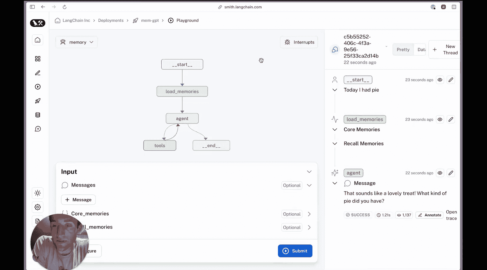

Within this， we have some information and files that are needed in order to be deploying a Discord bot to cloud run actually。

 So the main file here just defines the discord bot has a couple of events。

 It has this assistant I helper and it has a message handler。 So anytime a discord message comes in。

 we'll be passing this to our agent that we deploy it on Lagra and then immediately respond with the whatever it's going to be responding a discord。

 and this just allows it to be forwarding these types of things through web what Discd expects to deploy a Google Cloud run。

 you'll have to create an account here youll have to install the Google cloud SDK。

 And we're also using the G cloud command line。 So you want to install that。

 you have to create a Discord developer account。 and you have to make sure Dockers install as well。

 Then next we need to set up a discord bot。 you can do that by navigating to this portal here log in。

 And then we can create a discord bot。 So we'll call this my memory bot。 Once you have this。

 we'll go into the bot section。

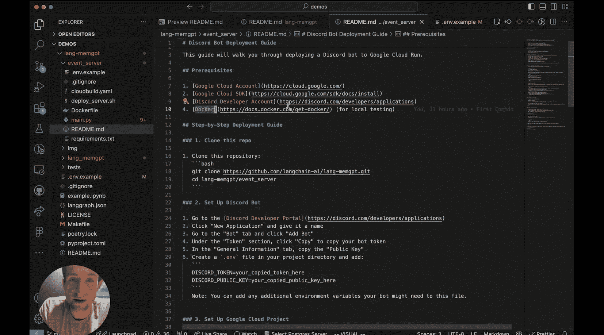

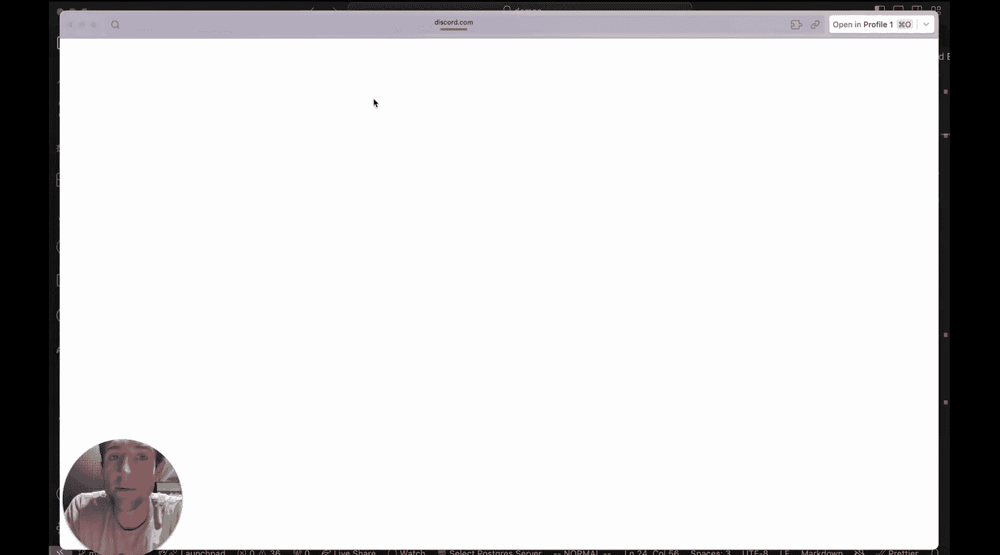

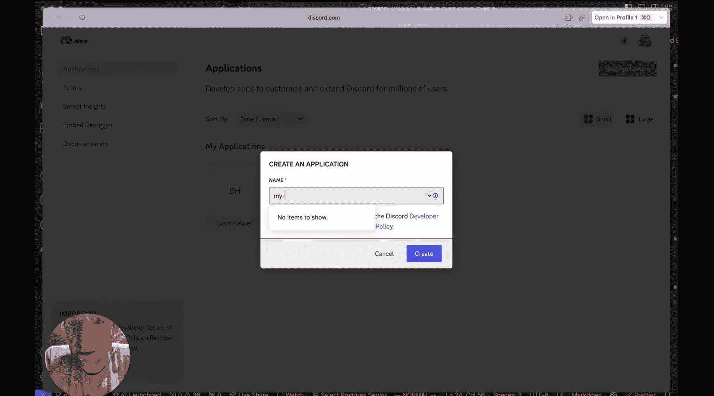

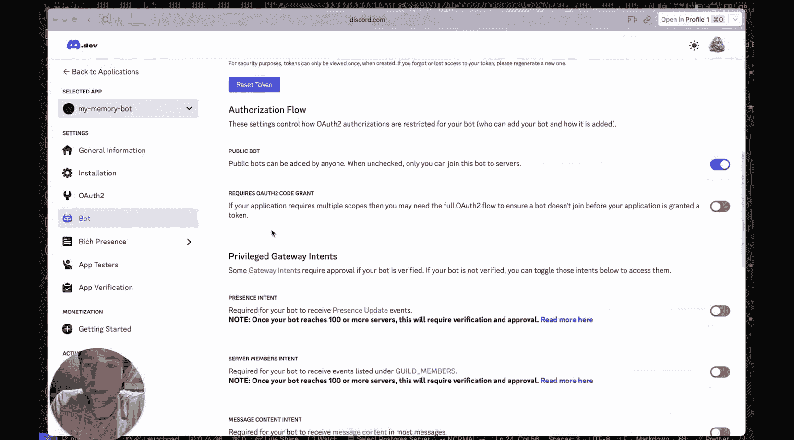

And。We'll reset the token in order to get our bot token。

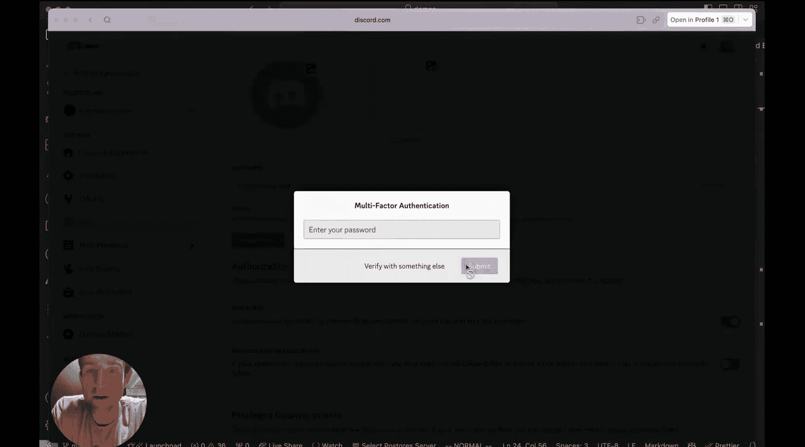

And then you can get this token here to copy over。 You can save this in a dotm file here that we're going to be putting in this event server。

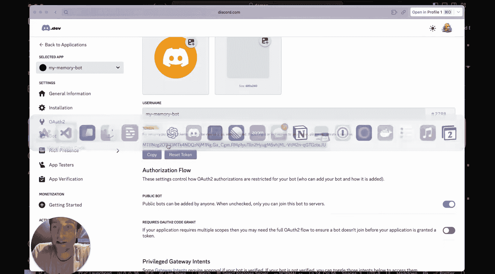

So you've got the discord token， the public key actually isn't important and the assistant URL we can populate from the deployment that we just made over in you have this deployment。

 it's this API URL here so you can copy that over。 But once you've copied your token locally。

 you can customize your bot however you want， you can give it a new username。

 you can change the banner， you can add icons and stuff。

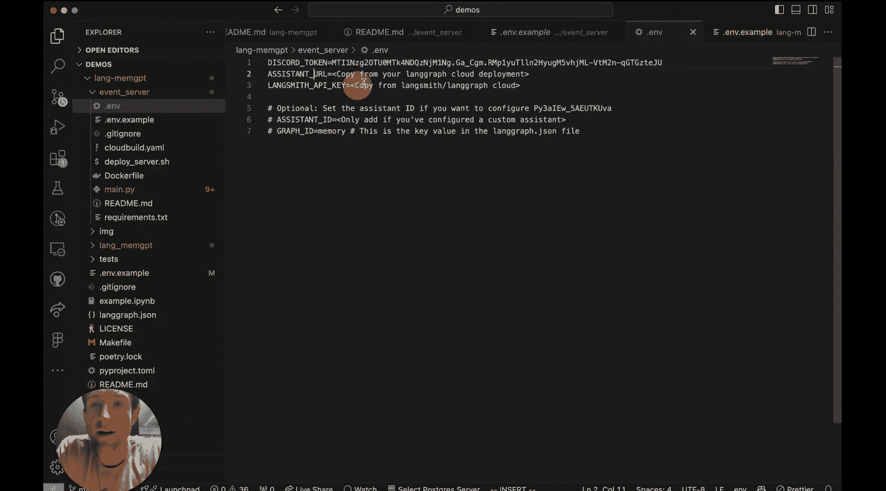

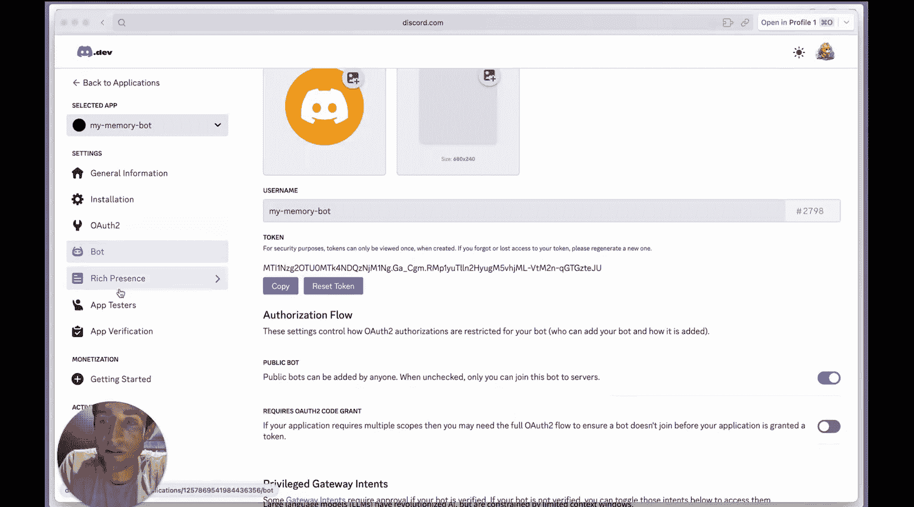

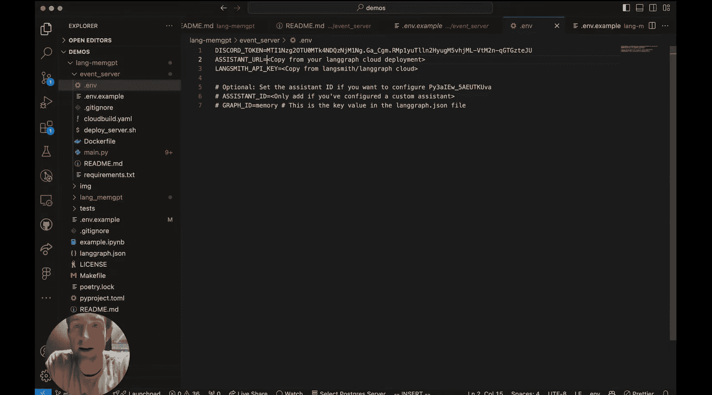

Then you're going to want to navigate to the bot section and you need to give it message， content。

 intent， otherwise it won't be able to read any messages so that turn that on and hit saveve changes to make sure we commit those changes。

Next up we're going to go to installation because we do want to install the bot Eventually we're going to be installing it with this link。

 but first we need to make sure that for the gu install here， we add this bot option。

So I'll do that again， you can just type in bot and make sure that you save those changes again。

Finally， you're going to copy this link and go over to it in order to install it to your server。

 amount it's the cool memorable server here and authorize。

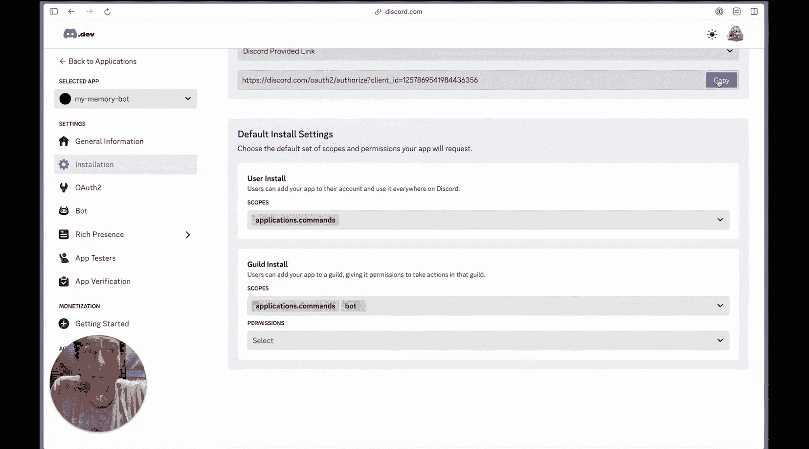

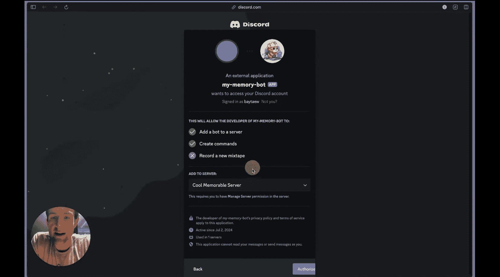

Assuming that you installed your bot correctly with the correct permissions。

 including the bot permissions。You should yet show up as an ability to mention the bo who you can say hello。

Hi there。 How are you。The Discord server itself creates a new thread and then sends a message to the agent。

 The agent will then respond with whatever information it has。Craise to you here。

We'll do the hello world of Lang chain and see if we can check the weather like in SF。Great。

 so it has the date correct and it also has information there。😊，And then I can say， oh。

 I'm planning a 4 July trip to Sacramento。Goought any advice。

And you see it continues the conversation based on the discord thread。

 This is all happening because we're aligning the discord threads with threads the actual date track in La graph。

 So it has the full conversation history thats short term。

 The bot's also able to actually store some of these long term information so that it has information across threads。

 We'll see that in a moment here。 We'll see if it can remember in a new thread here。😊，Pd it。

I'm doing some planning。I'm taking a trip to Sancramento。 Guth W。 It's for the fourth。

 So let's generating some recommendations here， and we'll see if it's able to actually remember this type of information in the next thread。

 We'll start a new conversation thread and share some information。 I'll say， I like swimming。😊。

And then we'll start another one， me see if you remember from that。

 so it looks like it doesn' remember that I'd mentioned swimming。

This is all because I said I like swimming。 And this seems like it's pretty salient things to remember about my core memories。

 And it also is remembering that I'm planning a trip for Sacramento in 4 July year。

2024 because we're time stamping everything。 And it's including that information here。 So cool。

 it's able to actually do this。 Now that we've got this running9 bug server。

 Let's actually deploy it。😊。

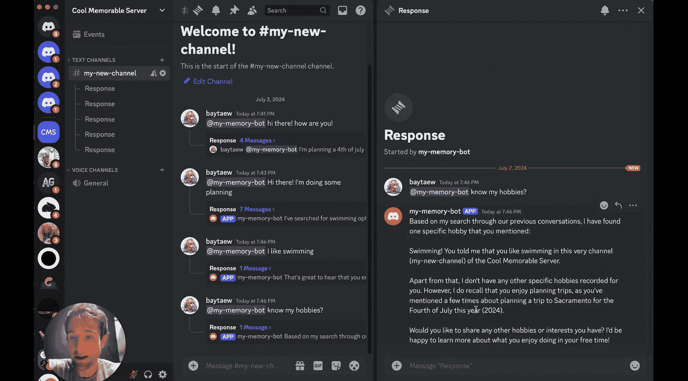

Both of this step by step， we've already cloned it， you've set it up， we've debugged them。

 now it's time to set up the Google project。You can create a new one in Google Cloud。

 or you can use an existing one。 In my case， I'm going to use an existing one here。

 So I'll say product id is this then I'll enable and necessary APIs。

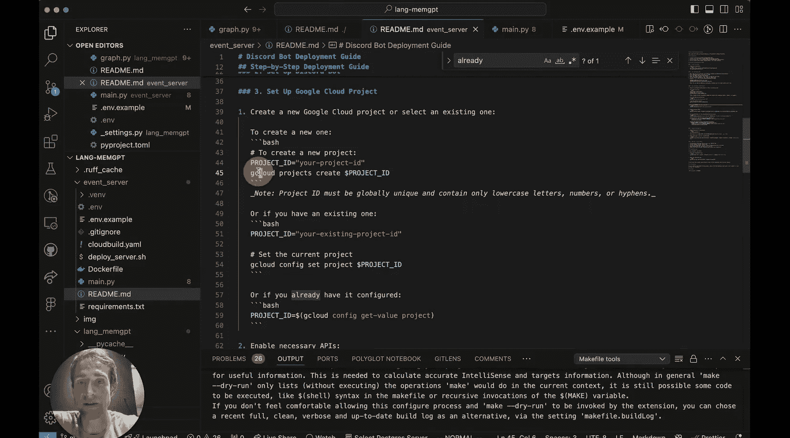

This is successful。After that， I need to set up permissions for the cloud build services。

 This creates an IAM policy that'll be able to build the Docker image and then deploy the cloud run instance。

 I'm going to say no conditions here。

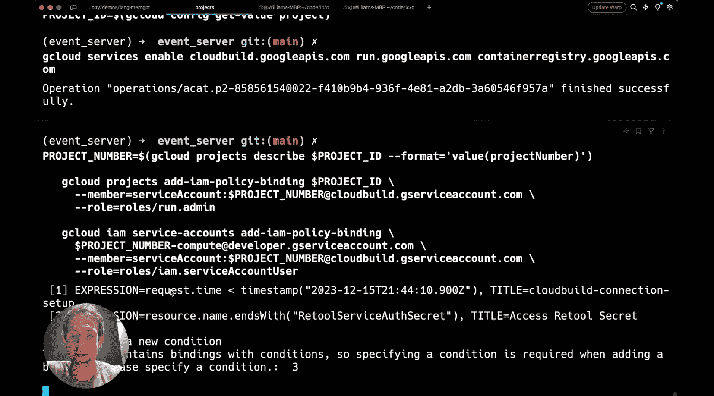

To the create it， and then it'll create it there。 once that's done。

 I'll run the script for the deploy server。

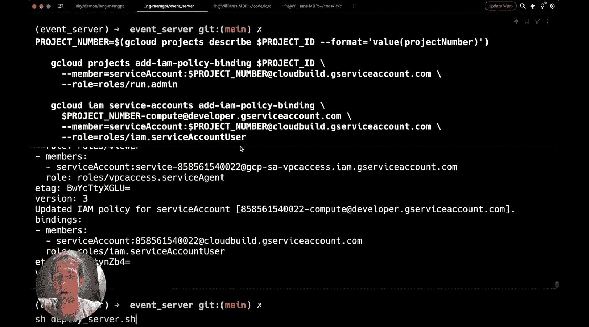

And should be up and running once you have it up and running。

 you'll have a cloud run instance you can check the logs to make sure it's all running correctly。

You'll have configuration here with the environment variables that are needed acting into your La graph instance。

 and you'll have everything set up for your Discord bot to be communicating with anyone on Discord and relearning about all the different users。

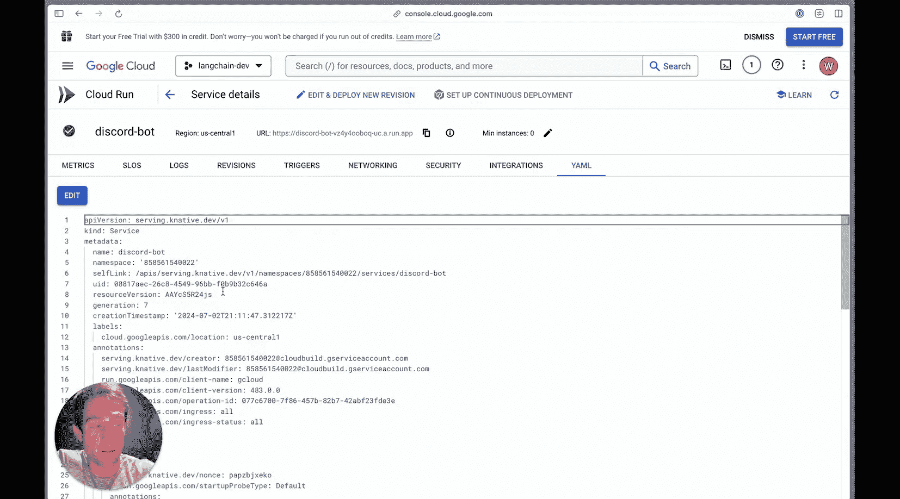

For section 3 of this video， I wanted to briefly touch on evaluating or testing this type of agent。

Testing to be hard and getting it right can be a little bit overwhelming at times。

 I'm a fan of being pragmatic， adding tests where necessary， adding them as quickly as possible。

 even if it's simplistic assertions that catch the base fundamentals， it's better than nothing。

 And using a tool like Langsmith can help you at least debug and find the root cause of what goes wrong whenever one of these tests do fail in C eye。

Ive made an example test file here。 I'll test memories that we can use to just go through a couple different conversations and see what actually get stored。

 I'm using the Langsmith test decorator here， which syncs this to a data set in Langsmith so that you can be comparing different versions of your system over time。

😊，It iterates over the examples， it has some existing memories， for instance。

 to see how that influences the types of responses that are saved。

 and then it has the number of expected memories， at least that will be extracted from this。

 you have to be mocking different things perhaps because you don't want to be touching your actual production database whenever you're running valves just like any software test。

And then you can be doing straight up relatively simple assertions here if you want。Similarly here。

 we're testing for the different types of recall memories that are going to be saved there as well。

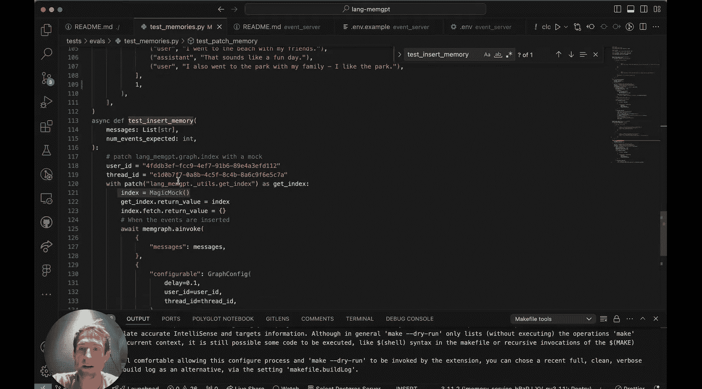

I'll go ahead and run this。 I'm also going to be using the test cache here。

 which will be caching some of the request the API requests locally to be a little bit faster in future iterations。

 and it'll just be running this just with regular pi test。

 If I go to the data sets here I'll see that I'm evaluating these test memories and you can see I ran this a few times before I had some bugs that I think that caused it to fill the tests and then you can see outputs here of what was absurded in those types of things。

 If anything were to go wrong， you can then click in and debug the entire trace of operations。

 you can see the LLM test open it in the playground debug things。

 you have that full auditability here while also being able to have very pragmatic metrics and checks。

 running in C just as you're familiar with any software。

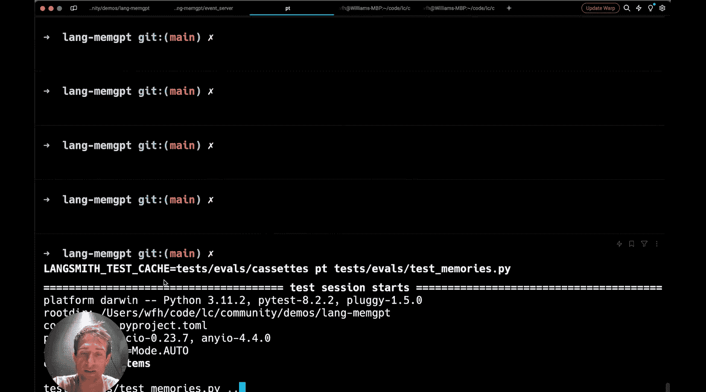

So that's all for today。 In this video， we created a MenGBT like agent in Langgra cloud， deployed it。

 deployed a discord server and showed how we were able to interact with it in Discord or using the studio at UI to be able to see the exact types of things that are going to be saved and see how that then translates to memory over multiple conversations。

 If you have any request or other feedback， leave it in the YouTube comments below I encourage you to go and fork the original report here and try and build it yourself And don't forget to check in later for more content like this。

 Thank you and goodbye back。😊。

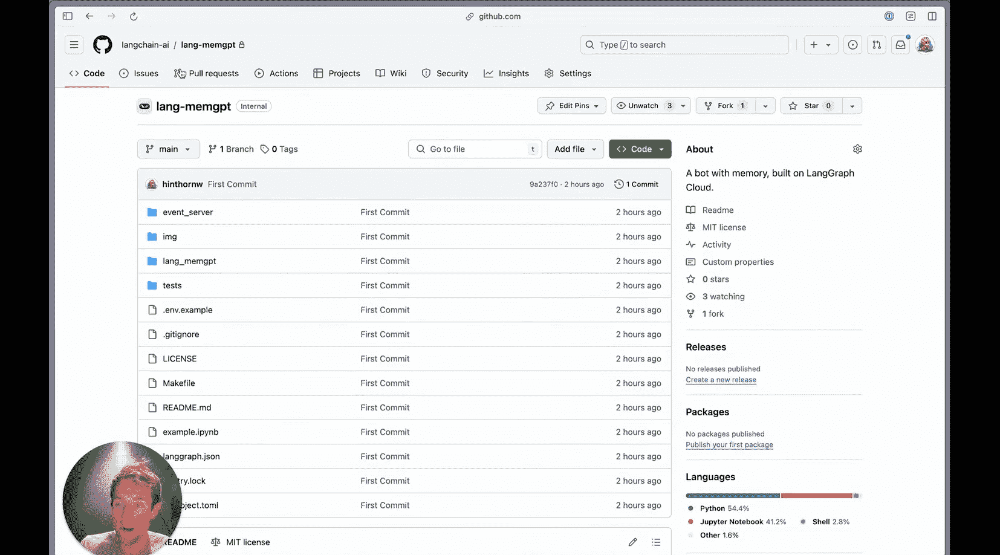