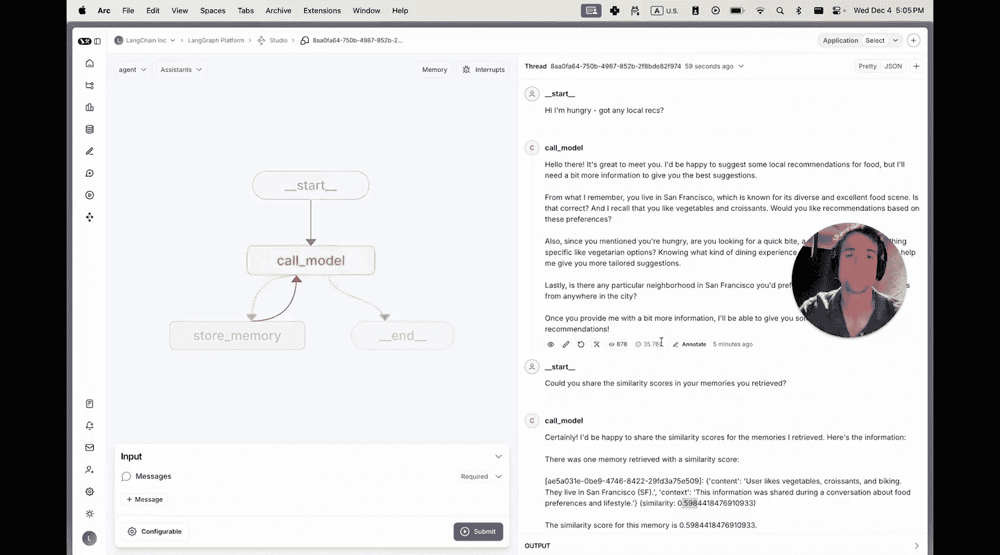
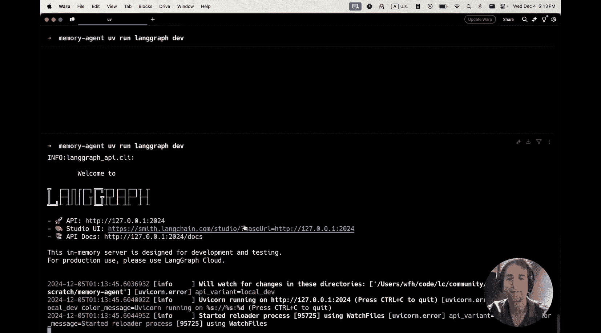
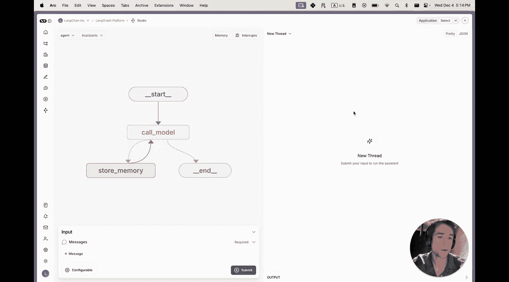
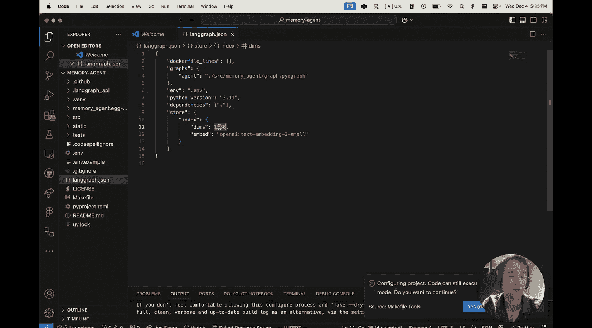
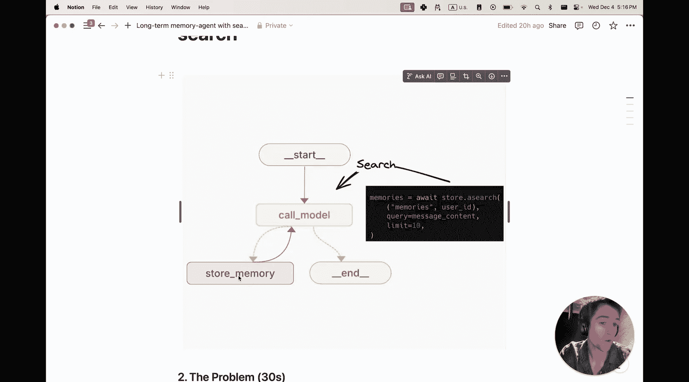
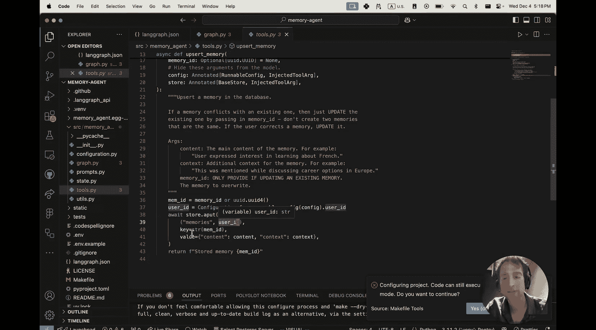
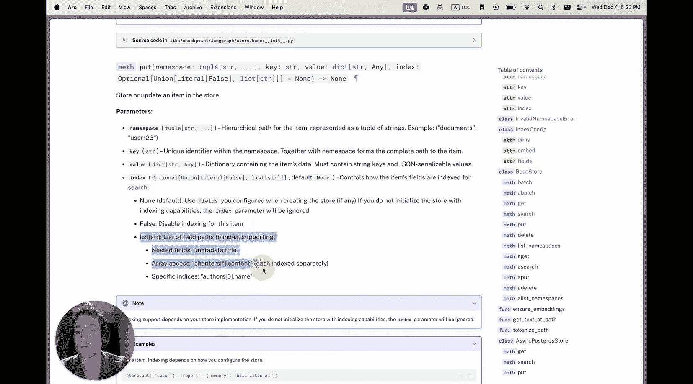

# LangChain【中英⚡LangGraph 使用指南｜LangGraph (Python)】 p19 P21 Smarter LangGraph Memory Agents with Semantic Search -BV1vJfMYuEon_p19-

H we'll here。 Today I'm going to show you how to add semantic search to your longter memory agent in Lagra。

 semantic search lets you search for similar memories stored across conversational threads so that you can create more personalized and effective applications。

 First a little review。 The most basic type of memory is a working conversational memory This is provided by Lagra checkpoints and it comes for free with every Lagra instance。

 This led to AI assistance maintain continuity within a single conversation。 A couple months ago。

 we released the base store abstraction throughout all of Lagra。

 This provides a flexible and modulate doc store so that you can save memories its documents in any organization you want and share information across conversation as a part of that release we created the memory agent template。

 The memory agent template defines a simple agent that uses the store in two locations。

 The first location is in the store memory tool。 This tool lets it write whatever string content to this base store so we persisted across conversations。

😊，The second use of the base store is in the call model node itself prior to calling the LLM。

 we fetch memories from the base store， format them in the persistent prompts。

 and then call the LLM so that it is able to respond both with the context for this particular conversation as well as long-term information it deemed important enough to be saving and persisting across conversation let me give you a quick example to show you what I mean。

I can tell the agent that I love croissants and veggies and liking and I live in NS。

 the agent that can then decide to call the tool to save information why I like it stores the members using the tool。

 and then the agent can choose to respond after this。 I start a new conversation。

 The agent is able to recall this information and use it for its suggestions。

 You can see it recalls that I live in San Francisco and I like croissants and vegetables。😊。

You can click into the Lsmith trace confirm indeed here we see that we've successfully templated in information in this system prompt saying the memory that we just saved。

 you can also view all of the memories that you've saved at any time by navigating through this memory's pan and you can see the exact content that the agent saved there This is all fine and good but what happens when you save too many memories It's easy to fall too far on either end of the spectrum of the precision recall curve either you put too many memories into the system prompt and it's imprecise and all irrelevant and it can easily distract the LLM。

Or you can drop too many of them and you won't actually get the most relevant information that's contextually applicable。

 Imantic search lets you query of em based on the semantic similarity or vector similarity to your user query these similarity scores can be used to help fetch the information that you think will be most appropriate from a large corpus of memories in the rest of this video I'll show you the step by step instructions to add semantic search to your longterm memory in any la graph to P。

First you're going to want to use the Lacraft Cly to clone the memory agent template localloly。

 we'll use the Python version here Next we'll go into the directory。

Create a virtual environment， install the dependencies， set the environment， and install the server。

If you installed everything correctly。I'll bring you to the studio UI that we were looking at before to add semantic search support。

 we had to change the configuration file if you open up the Lagraft。 Json file in this template。

You'll notice the usual suspects， the pointer to the agent as defined by its path in the graph。

The environment that we're defining and some other things we're configuring the store here and saying do support semantic search through indexing。

We've provided a configuration for which embedding model to use。

 and we've also specified the dimensionality of it。

 the dimensions allow us to create the table restoring the vectors。

If you remember my description from earlier， we use the store in two locations。

 the first is in the call model nut where we search for relevant memories and put them in the system prompt。

The second is in the store memory tool that is used to store new information to the store。

 Let's see where these are defining code。 First we'll look at the call model node。

 You'll notice here we get the store that's injected automatically by Larop。

 We're searching within this configured user Is namespace so that we can be separating out memories from other users of our agent。

 And then we're using the most recent messages to form some search query。

 and then using that to fetch the 10 most similar memories by semantics and La。

These are then put into this system prompt and and we call the LLM here if we jump to the tools file。

 we can see this tool definition of observed memory the LLM will populate the contact and context information and this will be stored in the database。

The memory ID here is to allow us to be able to update old memories if it wishes in case we want to add additional information that will further contextualize it。

 and then we use the same base store that's available on every La graph deployment to be storing these memories See by the memory ID stored within this namespace again to segregate out information between users and we'll store all the value here in a dictionary and that's about it for more information about memory and La graph and how to implement semantic search in your agents I'd recommend checking out the documentation we've got a couple how to guys here now on how to add semantic search for long-term memory that shows how to use it in a couple different scenarios including these in create react agent as well as some information on how to add it to your deployments。

This will walk you through similar steps to get you up and running similar to this video。

 including additional information on how to use custom em vettting， if you want to go even further。

 I'd recommend checking out the reference stocks for the base store this can help you better understand and use the different arguments to landgragraph based store including things like index in order to disable indexing for a given item whenever you're inserting it into the store or in order to customize which fields are going to be embedded for multive retrieval That's all we have for today if you had any questions comments or concerns。

 please leave them in the comments below or open an issue or discussion on a Lagra repository and Github。

Until next time。