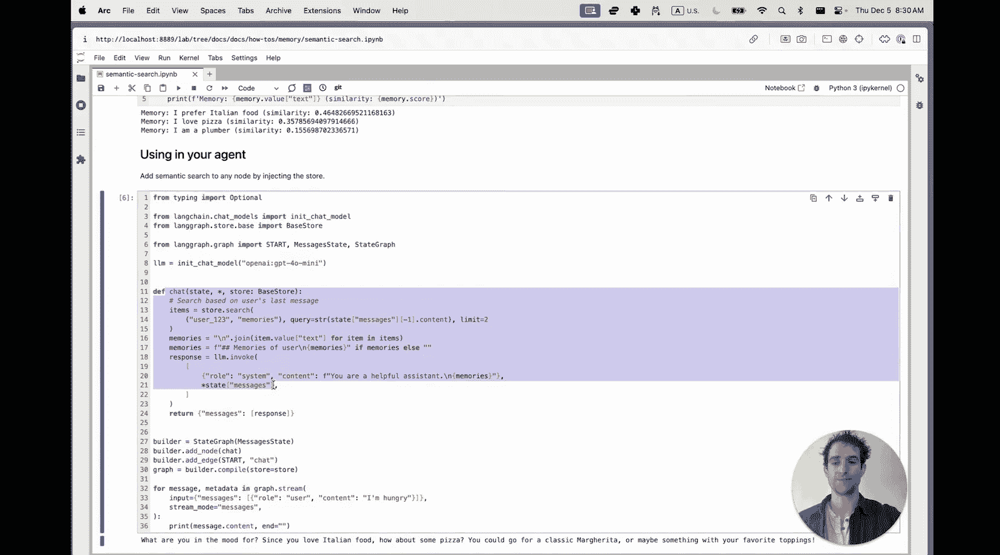
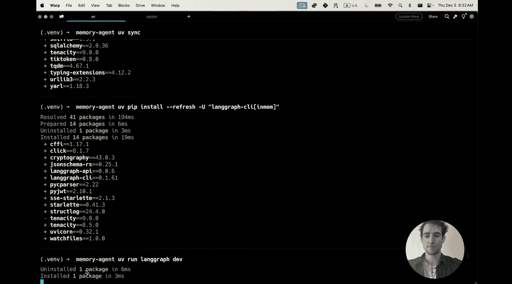
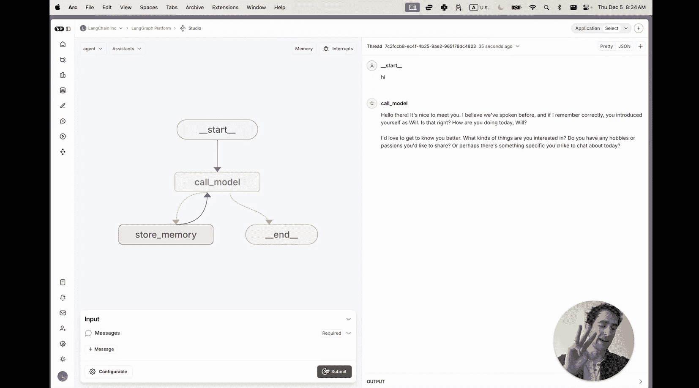
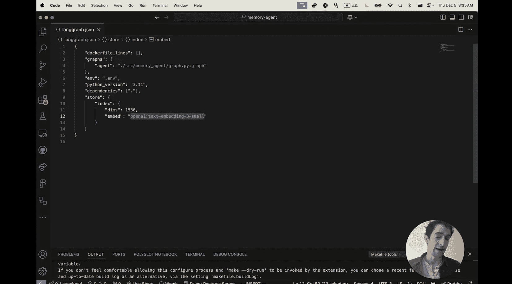
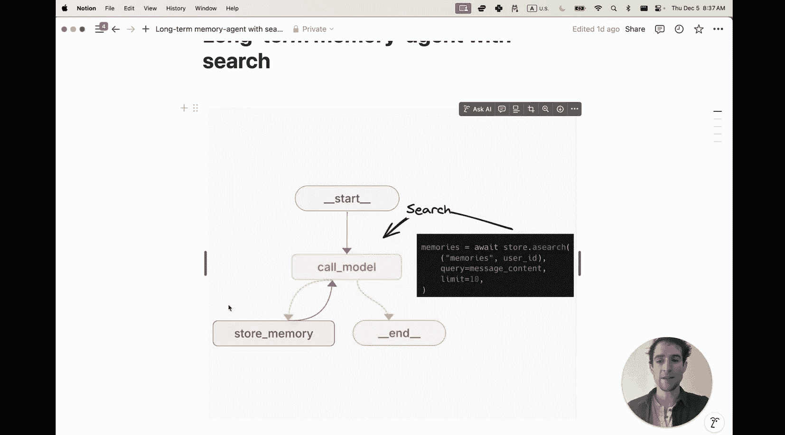
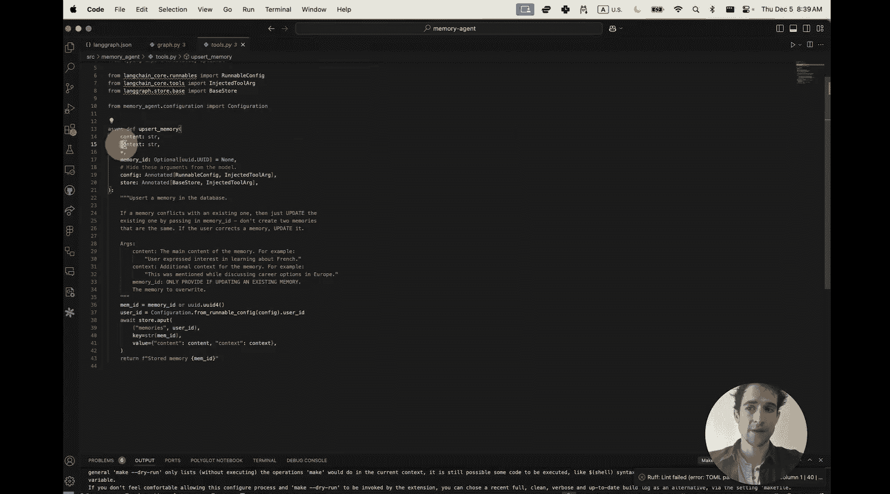
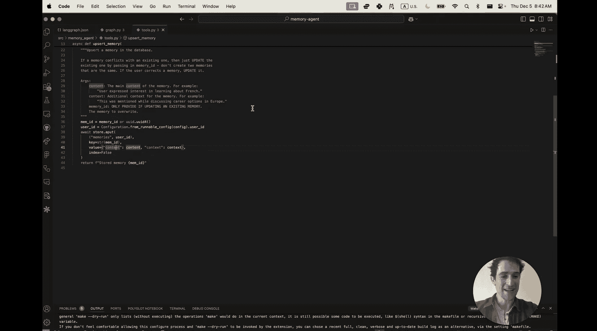
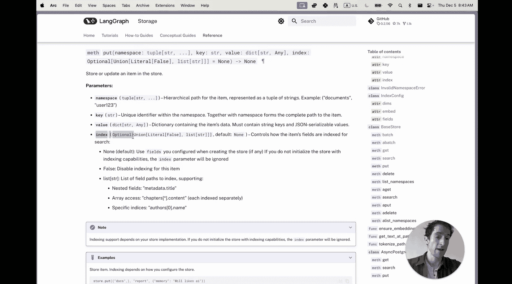

# LangChain【中英⚡LangGraph 使用指南｜LangGraph (Python)】 p20 P22 Smarter Memory with Semantic Search in LangGraph -BV1vJfMYuEon_p20-

Hi， all， well here。 Let's build a chatbot together with longterm memory powered by semantic search。

 This can let it remember effects and important details from thousands of conversations we might have with it。

 By the end of this video， you will have built a chatbot that can use personalized information to provide great recommendations。

😊，As you can see here， it remembers that I like spicy food and live in San Francisco。

This memory is enabled by a new feature we've added to Landgra。

 semantic search in the base store API。 Let's see how it works。

 The two key ingredients are a store such as this example in which runs ephemerally in a notebook and embeddings to be embedding the information that we're going to be saving。

 You initialize the store here with an index configuration that specifies how we're going to be indexing the documents as well as a dimensionality。

 Next， we'll put some information in。😊，This process puts the documents into the base store and indexes them for later search。

You can then search for them using a natural language query， as you can see here。

 it's fetched information sorted by similarity here， Italian food is the most similar to food。

 pizzaizza is also similar， plumlumber is a little less so to use this in your landgra agent。

 Simply add this store argument to any note in your graph。

The store that you provide when you compile your graph will then be accessible from any node in the agent。

Here we see the agent able to search for the information and give a recommendation based on the documents will be saved above。

If you're curious， you can also use this in createreate React agent。

You can add it in tools or in any given preparation there and other nodes in your graph。

 so to review there's three ingredients needed in order to enable semantic search in your La graph instance。

One， a store which is available by default in any Lagraft platform deployment，2。

 an index configuration with embeddings to specify that you'd would like to index all the information that you're putting in and three。

 modify your nodes so that they'll accept the base store so you can use it to put and search for information whenever you'd like。

Let's apply this to an end to end application。First。

 we're going to open our terminal and use the Lagra C to clone the memory agent template we step into the repository。

Install dependencies。And then start the survey。

This will launch the application we saw at the beginning of this tutorial。

If you've set up everything correctly， you'll have an agent that's able to use tools in order to save memories and then recall them in later conversations。

Let's check out the code to see how we set it up for Lagraft platform。

 If we recall there's three ingredients， store configuration with embeddings and accepting it in my graph。

 First， store configuration。 When deploying things to the Lagraft platform。

 we define most of our configuration in this Langgraft J file。

 This is where you'll see the pointers to our actual graph implementation。

 our agent implementation environment， as well as other types of dependency information。😊。

Finally， we have this store configuration。 If I provide an index with an embedding instance。

 this will let us actually instruct the La graph platform to prepare the database for vector search so that we can add semantic search to our store here I'm using this concise syntax to specify that I'll be using openaiIs text embedding three small model。

 This requires L chain to use。Alternativelyly， I can point it to a custom file so that I can define my embeddings as a custom function。

 so we've covered the first two ingredients。 We've set up the configuration for the store and added embeddings。

 Now we just need to use it in our graph。 If you recall from the visualization of the app。

 Our graph has two main nodes。 The call model node prompts the LLm with the information of the conversation thus far。

 We've added a story search method in order to search for relevant content and template that into the prompt that we've send to the LLM。

😊。

Second， we provided the LLM with a single tool。 this lets it optionally call that the tool to save information if the conversation brings up important facts that it wants to save for later。

 this is going to be executed in the store Me node。

Let's see what that looks like in code。 Here we have this graph file that defines the main nodes as well as the actual graph。

 We'll first look at the call model node。You'll see here we take the most recent messages from the context and format that as the query。

This is a simple fast way in order to be looking at things that are semantically similar to whatever is happening in a conversation right now。

These memories are fetched and if there are anything that matches。

 these will be formatted as a string and then passed into the model that we're going to recall here。

After the call model node， we have a conditional edge。

 The R messages decides if we have any tool calls， this is going to go to the store memory node。

Otherwise will return directly for the user。The stored memory node calls this tool that we provide the ILM。

This tool also uses the store in a different way。 The LLM populates arguments for content and context。

 which are both going to be stored as the document。

And Langgraft provides information about the store as well as the configuration。

We separate memories by user ID so that the LLM doesn't mix up information that it's stored from different users for interacting with it。

 and we save them all with an unique identifier this identifier is used so that the LLM can actually update existing memories if it sees fit。

By default， these memories will all be indexed according to whatever configuration I've defined in the Lagraft file。

 which by default is the whole object itself， symbolized by this dollar sign。Alternatively。

 I can add specific fields to the embedding for multi vector search。

I can also dynamically specify these at put time whenever I'm inserting new memories。

This tells La graph only generated embedding for the content field within this object。

 If I want to specify that I don't want an object to be indexed for search。

 perhaps I just don't want it showing up high on the list whenever I'm searching for values by semantic similarity。

I can specify index equals false。Note that if we haven't satisfied the first two ingredients for setting up semantic search。

 namely the index configuration with embeddings。All of these arguments will be a con。

 every object will be provided in the store， but it won't be retrievable by query。

 all of the memories will still be inserted to the store， but no embeddings will be provided。

 so we can't be searching by natural language query。And that's all you need。

 If you want to dive deeper， I'd suggest checking out the documentation。

 We have documents on how to add sympantic search for long-term memory that shows how to implement it in Lagraft OSss。

 We also have an example of how to configure it in Lagraft platform。

 which walks you through similar steps to what we just did in this video。

 This also shows you how to specify custom embeddings。

 If you wanted to find embeddings of the custom function。😊。

Finally， the base store reference documents also provide a lot more information if you want more details about what the index argument means and what the behavior is there。

Currently， semantic search is supported in the in memoryory store as well as the Postgre stores。

 which is provided with every Langgoft deployment。

And that's all we have for today， if you have any questions or comments。

 please leave them below or open an issue or discussion in the line graph repository。

Thanks again and see you next time。