# LangChain【中英⚡LangGraph 使用指南｜LangGraph (Python)】 p21 P23 Adding Custom Authentication to LangGraph -BV1vJfMYuEon_p21-

Today， we are excited to launch custom authentication and access control support in Langgraft platform。

 This is available both in Langgraft cloud and selfhoed setups。

 This lets you directly integrate with your own authentication service and implement custom permissioning models using other security schemes directly in your Lagraft application without relying on a separate backend server as a part of this release。

 I am going to show you how to add O off to an existing Langgraft application using our new off tutorial。

 We will do so in three parts。 In part 1， we will add user authentication to ensure that only users who have valid credentials are able to access your application。

 In part 2， we will go a step further， adding custom authorization to our individual resources。

 En that authenticated users despite having access to the service are not able to access each other's data。

 In part 3， we will take these learnings and put them together by integrating with the real production authentication server to show you how to put these together in a trustworthy way with those。

😊，liminaries out of the way， let's get started。For our first milestone。

 we're going to implement authentication。 This checks every request to make sure it has the required credentials to access the service。

 It then returns a user object that we'll use later for fine and grain control。

 Let's start by installing the Lagraft command line interface and then cloning this new Lagraft project once we've clone the project。

 we can spin up the server just to see what it looks like with install the package as an editible requirement。

 then spin up the server。😊。

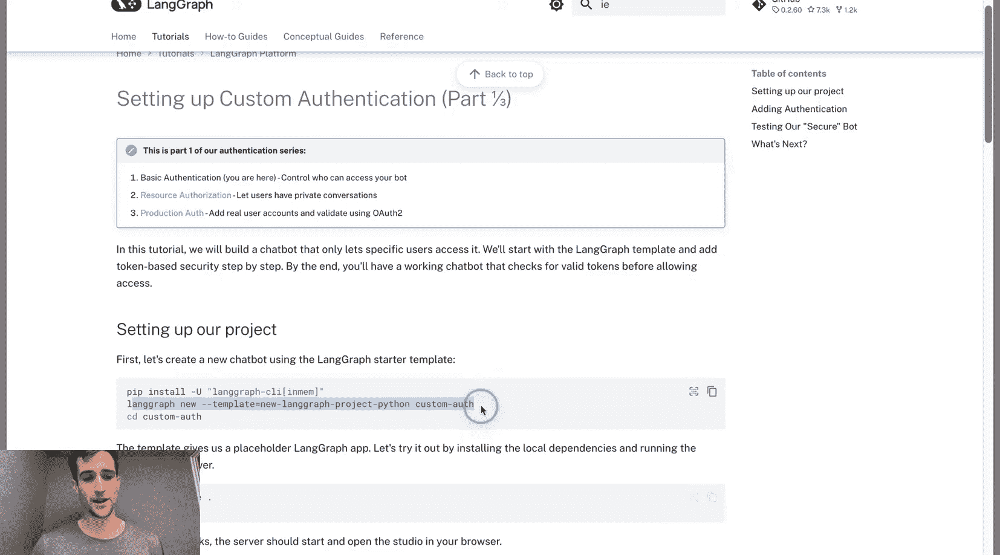

You can play around with it to see it doesn't too much。 It echoes the response。

 The content of the graph is not important。 What is important is the skills we use today can be applied to any Lagra platform application。

 No matter how big or small for custom a Lagra needs to know which function to call to validate every request。

 We do this using the off object exported from Lagra SDK will initialize this object。

 and then decorate a custom function。 telling La graph。

 this function should be used for authentication。 Our function will accept an authorization header。

 This is a common header that's provided for many different validation schemes。

 will assert that it's provided。😊，And then we'll check that the token is present in our。Toy database。

 we have the super secret user 1 and user 2 tokens here to demonstrate how it works。 Finally。

 we'll fetch the user information and return that。This information will be useful in later parts of this tutorial。

 Let's add this code to our deployment。 We'll create a new folder called security and add a file for authentication。

 Now， our server needs to know where this off object lives。

 We will do that by modifying the langgraft dot Json。

 We will add an off entry with a path to the file we just created。😊。

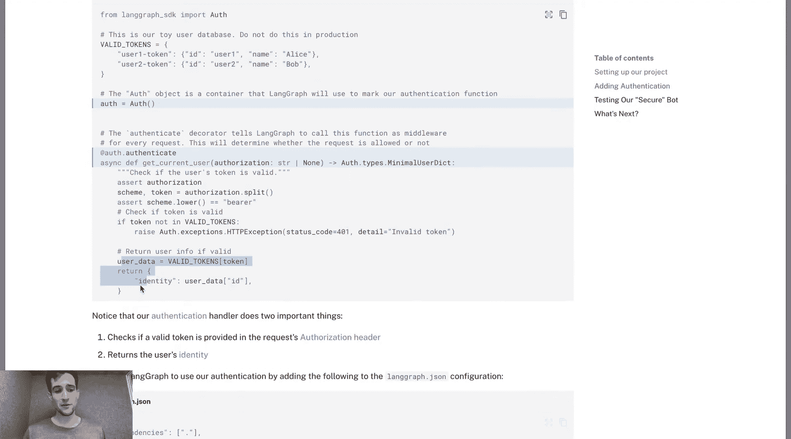

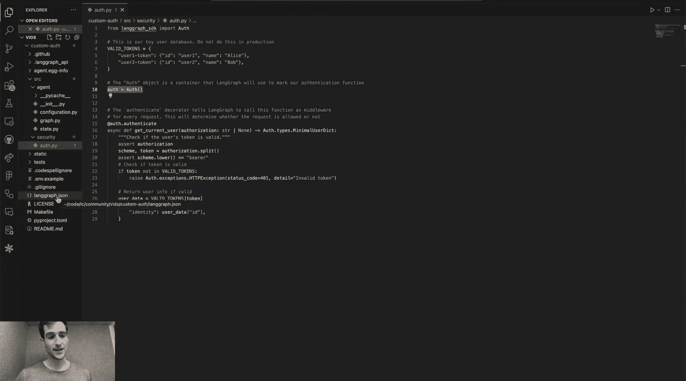

And then a variable name that is the off object， and here it is here。

 Now let's test out our implementation。You will create client code to connect to the server。

 Our first test will create a client without valid credentials。

 This client will be unable to access the service， as demonstrated by this attempt to create threads。

 If we recreate the client with the appropriate headers。And then try the operation again。

 It should successfully create this。 That same client should be able to create runs and interact with the server in general。

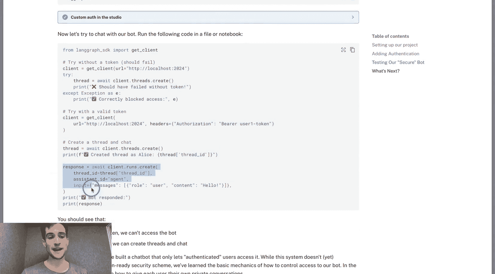

Let's try it out， I'm going to restart the surf and then copy that test code into a notebook。

Since our implementation was correct， we get all green at tech marks。

Our unauthenticated client was blocked by the server。

 but then successfully was able to create threads and runs。 And that concludes part 1。

 We've learned to eject unauthenticated requests using Lagraft's off object。😊。

Of putting this into a Python file and thening the server at the file in the Laraft。 Json file。

 However， any authentic user can access any resource now in the next section。

 we will learn how to make authorization handlers to filter resources and make conversations private。

 let's add in authorization handler to prevent authenticated users from accessing each other's data。

 If you recall from part1， we added authentication by using this off object and decorating a function with this authenticate method to add authorization。

 we use event handlers using o thought on。😊，This means that on need to create。

 read or other event to any resource。 This function will be called to check whether that user has access to the resource。

 These functions tick two arguments。 the authentication context。

 which has information about the user， as well as the action being performed and the value。

 which is the actual data that's being sent to this action for creation events。

 it would contain the actual data that's going to be saved to the database。

For read and search events， this would include only the parameters needed to be searching or retrieving that information。

 Each authorization handler has up to three tasks。 The first task is to create filters。

 Return filters let the system node to only return resources with metadata that matches them。

 In this case， they will only return data who has an owner key in the metadata。

 matching this user's identity。 The second job of these handlers pertains to create an update events。

We can add metadata containing the user's identity so that that will be saved to the database。

 If we didn't do this， these filters would never match anything。

 The third job of an authorization handler is to reject requests outright。Before discussing this。

 let's add this to our service。I am going to copy this handler and add it to our existing authorization file here。

 we've added this handler and left the rest of the file as is。 I we'll restart the service。

 and then we can go over the tests for these tests， we'll create two different clients。

 one for Alice and one for Bob。 We will first check that Alice can create assistance。

 threads and runs。 She can interact with the service。 Great。😊。

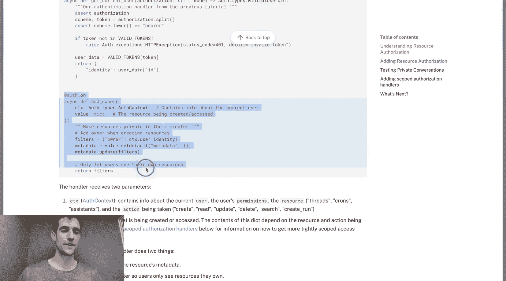

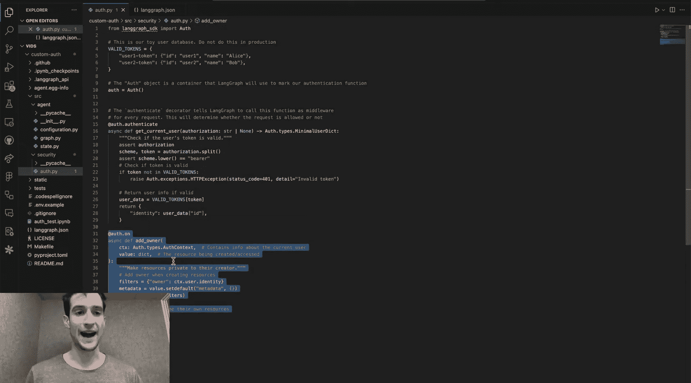

Next， we're going to check that Bob cannot try to fetchdge information from the thread that Alice just created。

 If we've implemented the authorization correctly， he will not have access to this thread。 Finally。

 we'll show that Bob still can't access the service。

 just so long as he uses his own information to cap it off will list over the threads to show that each user can only see the data that they own。

 I'll copy the code to a notebook and then run it。 Well see all green check marks again。

 Alice was able to create an assessment in a thread。 Bob was unable to access Alice his thread。

 Bob created his own thread， and they both see one thread。 if you want。

 you can double check that each thread is distinct， creating this authorization handler was concise。

 But what if you want to have different behavior depending on the resource。

 or what if you want a little bit more visibility into what the heck this value dictionary is for more control。

 You can define handlers scoped to individual resources。

 or even to specific actions on that resource。 The type of the value has an analogous path so you know which keys to expect to illustrate scoped authorization handlers。

 you will create three new functions。 This first one。😊。

matchtched on any assistance operation and we'll decide to reject all requests。

 This will apply to every create， read， search and update event。

 the second one will create is will apply to any read event of the threads。

Since we're only reading and not writing， we can just return this filter without trying to modify any metadata。

 that would be ignored anyways。 The third handler will match on any create event to the threads resource。

 This code will be functionally the same as our handler before by creating more scoped authorization handlers。

 you can exercise more fine grainined control or the access policies that you enforce over your deployment。

 You may wonder what happens if you have two handlers that both match an operation。 In this case。

 Langgraft will only called the most specific handler for a given operation。

 This means that on threads creation events， our specific handler will be called rather than the global handler。

 Sam goes for both of these to。 if we were to define a function that was only up to the threads level。

 that would only be called for search and update events not for reading create events since these are more specific。

 Langgraft does not allow you to register two functions that have the exact same scope to finish off part2。

 I'm going to add these scope handlers to our off file and then run the corresponding。😊。

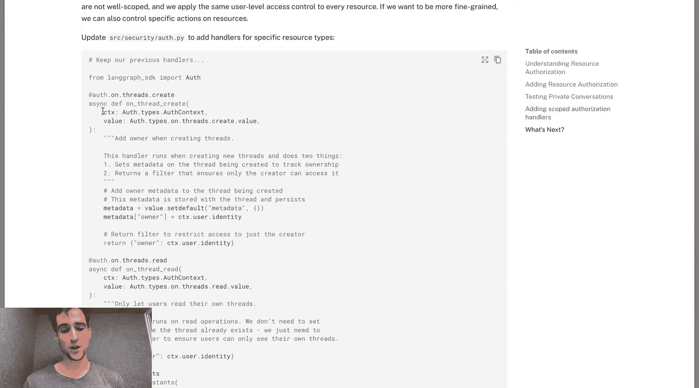

Tests。Here I have copied the code below， leaving the rest as is。

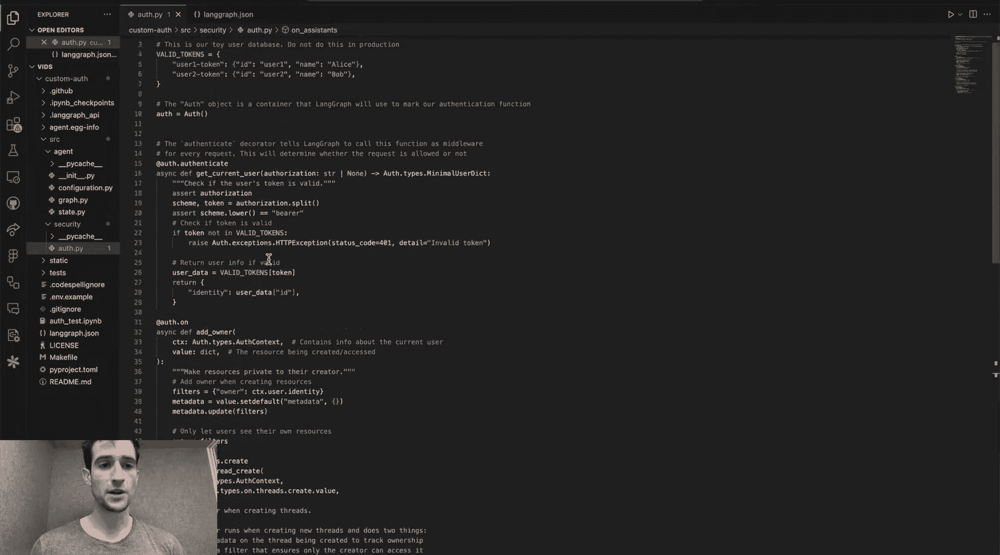

I'll restart our server and then review the new tests。 Really。

 all we're going to test now is that no one can be creating or searching assistance since we have added that specific scope handle。

 Finally， we will confirm that users are still able to access threads resources。

 We'll run it in our notebook and see all green once more。😊，Alice cannot access assistance。

 but she can still access threads and runs。 And that's all for part2。 In this example。

 we added authorization handlers to make sure users only have access to the resources that they own。

 We also implemented more scope handlers to implement a more custom and restrictive policy on different resources。

 And now you have all the skills you need to implement off in your service。

 In part 3 of this tutorial， we will replace our toy user database with a real production off service。

 to show how you can manage your users for production application。

 Let's connect our app to a real off service。 Superbase makes it easy to get started。

 If you're following along， make sure you have an active superbase account and created a new project。

 If you recall from the beginning of this video。 Our off service has three main components。😊。

Part 1 is the authorization server。 In our case， it's going to be super baths。

 This is responsible with generating user tokens to the client。

 That will be validated by a backend server。 The second is the application backend。 In our case。

 we just have the La graph application。 This is all you need for your AI business logic。

 The third component is the client application。 This is typically the web or mobile app that lets the user access your services。

 The flow we will be implementing look something like this。 The user's client will initiate a login。

 They will send valid credentials to the off server， which will respond with a signed token。

 The client then will include this token in the headers of every request it makes to our application backend。

 our backend will look at the token and validated it against the off server。

 And if it's valid will continue processing， it can then return conversation data or invoke your application logic。

 If the token isnt valid。 our authentication handler will reject the request before updating their handlers。

 Let's make sure we have the required information to connect the server。

 Our server needs two pieces of information。 The URL of your project。😊。

And the secret key that it'll use to connect to it。 Our client then needs access both to this URL。

 And a public key is public key lets the client safely generate credentials to access your service。

 You can find this information in your superb project by going to your project settings。😊。

And clicking on API， these settings contain your public URL， your public key。

 and the private service role in Jot secrets。 Copy that information from your dashboard to your local dotden file Now it's time to integrate the author server。

 If you're a recall from parts 1 and2， we used Lagraft's off object to decorate an authentication function that would validate user claims。

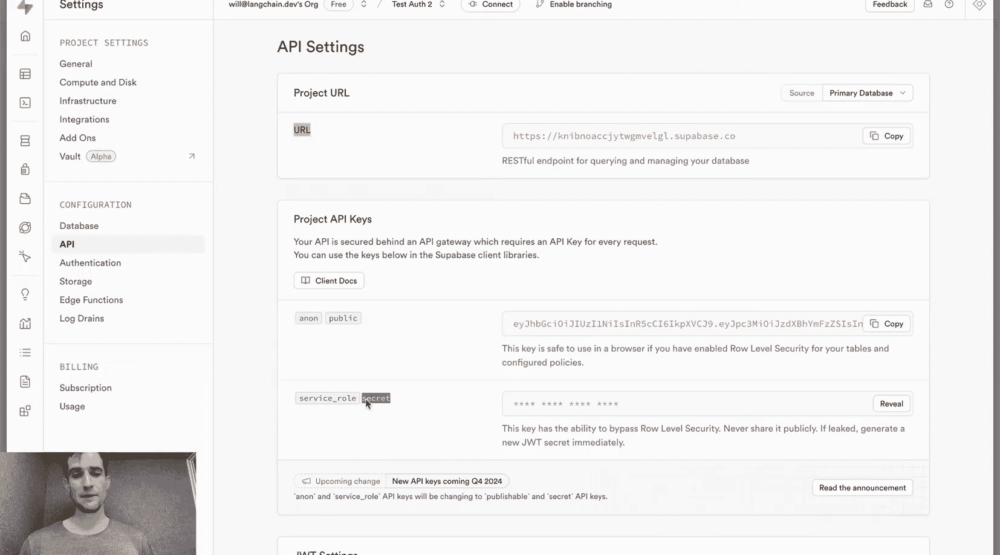

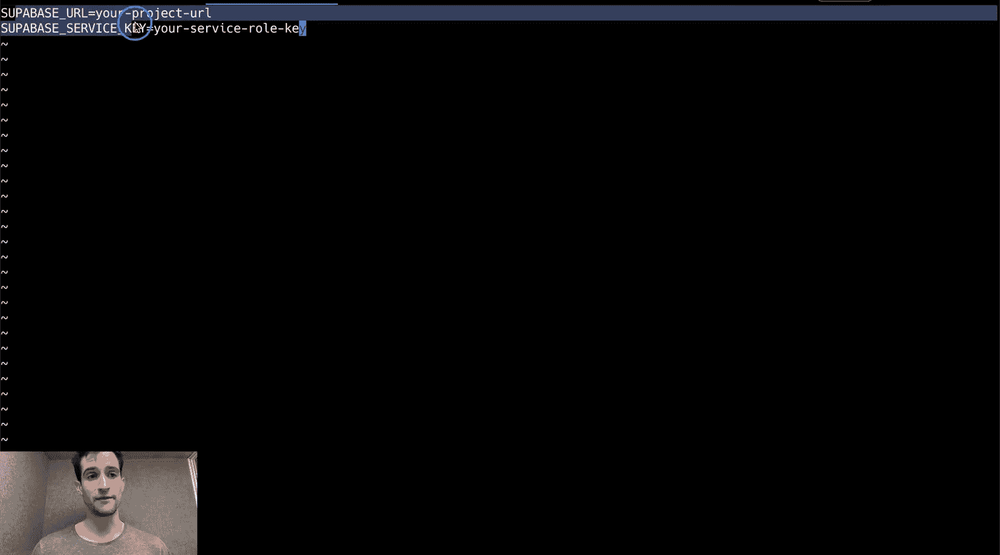

We then used it to add individual resource ownership using authorization handlers to integrate the off server。

 We only need to modify this authenticate function。

 It will do so by connecting to the Superbase backend。And fetching the user's information。

 If the request succeeds， we can return that information。 Otherwise。

 we know the server has rejected the request。 to avoid making API request here。

 You could instead use the Jot secret from the project settings to validate the users's bar token or you could at least cache the request to avoid duplicate calls。

 Let's copy this new authentication handler and add it to our application。

 All of our authorization handlers can remain as they are。 we can restart the server to try it out。

 Our client code here is a bit more involved that imparts1 and2。

 Since we need to connect to a real authentication server。 First， let's create two users。

 You can run the code in your notebook and provide a valid email you have access to。

 then include your superbase project URL from the for， as well as your public anon key。 Remember。

 you can get your anon key from your API settings in the project settings。

 your superbase dashboard before proceeding， you'll have to check your email and confirm the accounts。

 Otherwise Superbase will reject further attempts to log in when you click confirm it will redirect you to a local host address。

 because we haven't set up our projects to point to a real front end。😊。

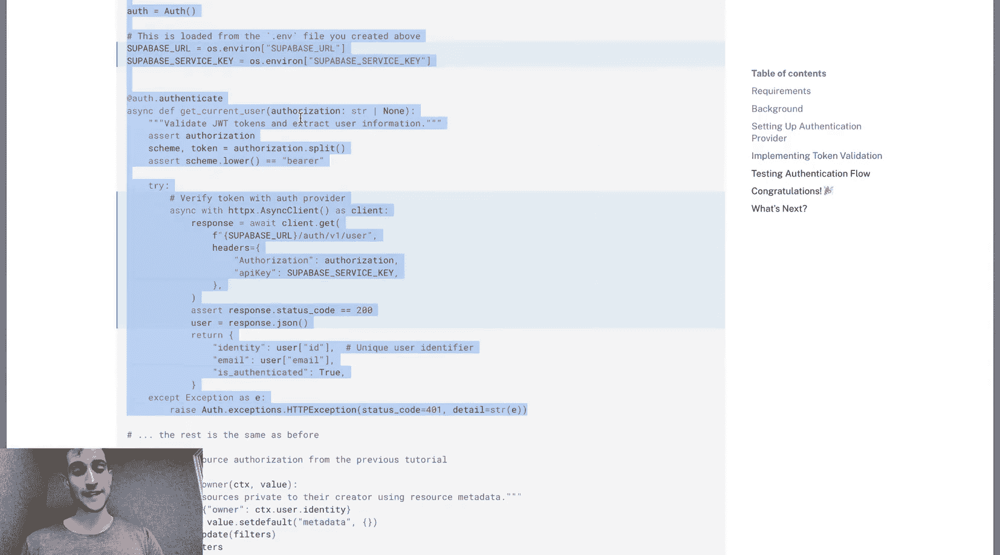

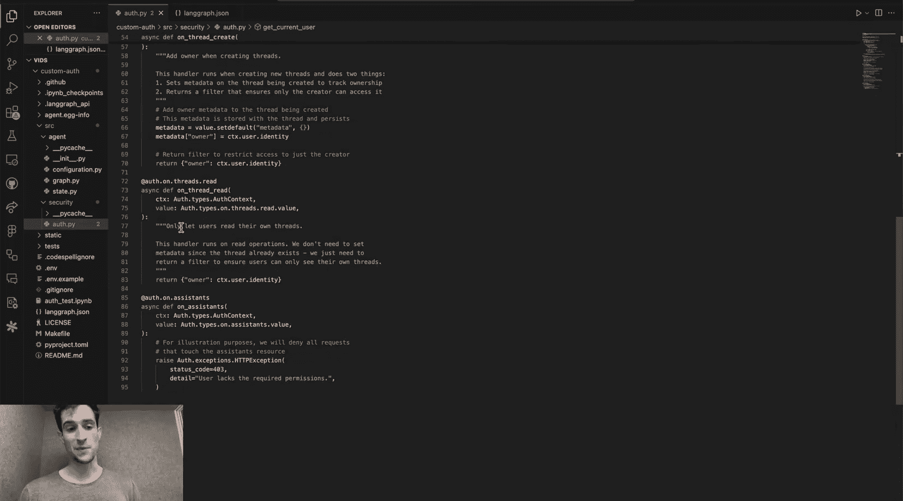

That's okay。 your user is still confirmed to authenticate into our La graph app。

 Our users need to get a valid signed token from the off server to do that。

 we'll run this login code。 We're going to request a token using the password grant type from before and using our anonymous key here again。

 Once we log in we'll use that token in the same authorization headerers before。

 then we'll test that our user is able to create a thread we'll check to make sure an unauthentic key to user also cannot access the thread and we'll confirm that user 2 still doesn't have access to the data that user one has created run the code to confirm if everything was implemented correctly。

 you should see three green checks。 Each to confirm that our authentication service is working as intended。

 Congratulations， you've completed the tutorial In this section。

 you've successfully set up your authentication provider。

 you added real user accounts with email and password authentication。

 you integrated jot token validation into your La graph server and you implemented proper authorization to ensure users can only access their own data。

 These are all the requisite skills you need to create a full stack application based on。😊。

raAnd it's all we have for today。To learn more， you can try doing all this yourself using the Lagraft Pla tutorials。

 you can also check out our conceptual guide on implementing authentication and access control in Lagraft and check out the Lagraft SDK reference to get all the details on what you can do with the author object and related methods。

 finally， keep your eyes peeled for more guides on how to implement common authentication and access control patterns in Lagraft platform。

See you next time。

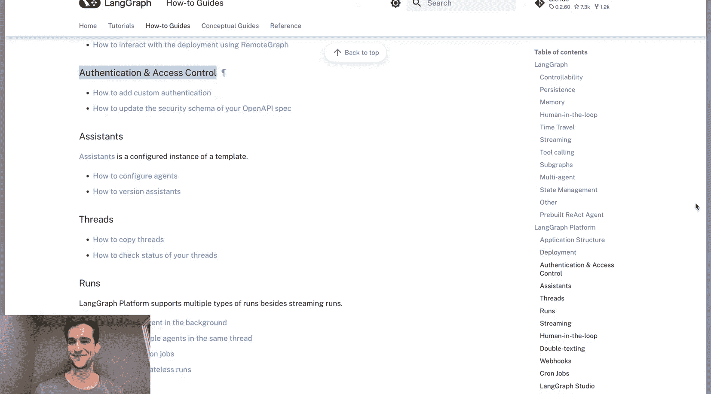