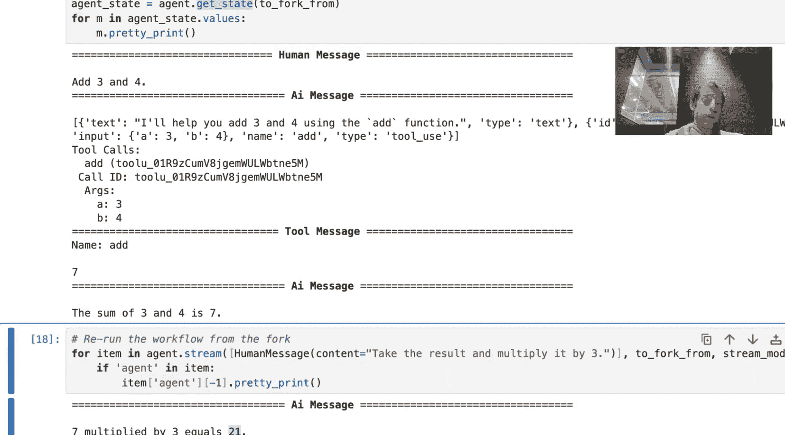
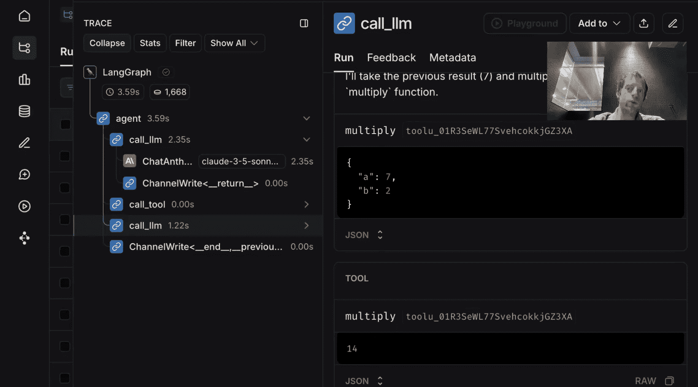
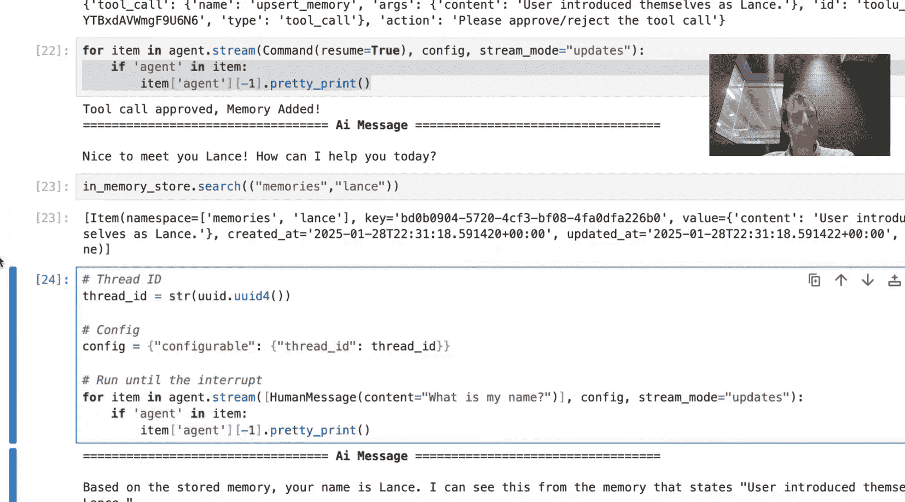
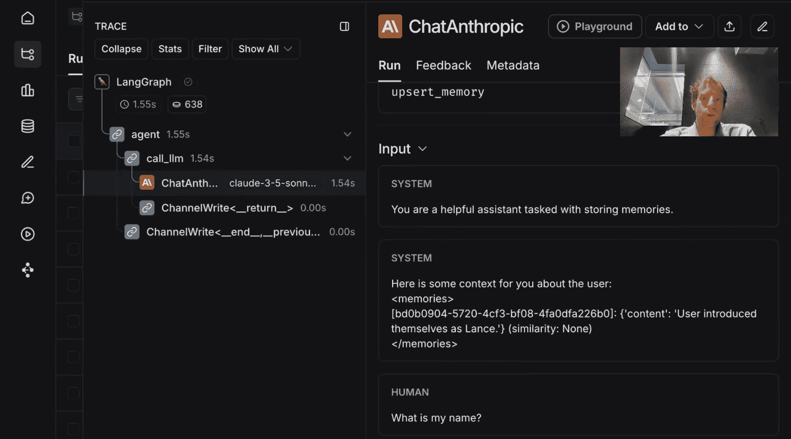
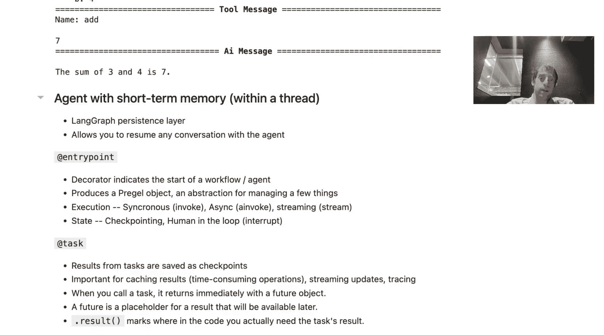

# LangChain【中英⚡LangGraph 使用指南｜LangGraph (Python)】 p22 P24 LangGraph Functional API Overview -BV1vJfMYuEon_p22-

Hey， this is Lanchm Lang chain。There's a lot of interest right now in frameworks for building AI agents。

And La graph is one， and a lot of people ask， well。

 what are the benefits of using La graph as a framework。

 and I want to tell you in very simple terms what the benefits are quickly here。You get persistence。

 You get streaming。You get debugging and deployment。Now。

 persistence breaks down a few different things。 short term memory， long term memory。

 human in the loop。Streaming means streaming of Bal tokens from different LLM calls or state of your assistant。

 agent， whatever you're building。Debugging deployment involves studio。

 a very nice environment for visualizing your assistant or agent during its execution。

And a lot of support for deploying that very quickly with things like observrability in Langsmith。

 So that's kind of the case for Langraff。Now， the question is， when I use a framework。

 what is the overhead， You know， what's the cost， I can see the benefits what are the cost and the cost typically are you have to learn some API。

 okay。Now in the case of Lagra， you have to learn a few specific things。

 you have to learn about what is state。 You have to think about laying out your control flow or your assistant as a set of edges and nos。

 And you have to compile it to the state graph。 So really the motivation for the functional API is to say。

 can I get the benefits of the land graph framework without some of the overhead。

 Like what if I don't want to specify state and lay this how as control flow of edges and No。

 I just want to write Python code has already had。 But just do some little things to turn it into a la graph application and get those benefits with really minimal code changes。

 relative to what I would do independently。 So I want to kind of motivate this。

 I'm going to build an agent kind of from scratch without landgra at all。

So I'm going to freshen notebook right now， and I'm going to go ahead and define a few tools for my agent。

 I'll use Anthropic and I'm just going to use this convenience tool decorator。

 So this is the Lang chain integration for Anthropic and Lang chains tool decorator。

 which I'm just going to use to decorate these raw functions。

 multiply add divide and you'll see why it's useful later。

 that basically implements a particular tool calling interface for those functions。

 which makes it easy for me to call them。 add the tools as a list。 I bind them to my LLM。

 And here's a set of a few simple functions I can use to define a tool calling agent first call my LM。

In this case I call that LM with bound tools， I basically tell you a helpful assistant task web forming arithmetic。

 also have a function that will call whatever tool based upon the LM's decision as to what tool it wants to call。

And I have this agent function， which will call the LLM and will continue calling the LLM until it does not make a tool call。

 And so what's going to happen is I'm going to pass an input。It will call the LLM。

 It will check if that is a tool call。 If it's not， you end， if it is， you execute it。

 you take the output of the tool call， you add it to messages。 you pass that back to the LLM。

And you continue until no tool call is made。 Let's have a look at this。

 I'm going to pass in add 3 plus 4。 And you can see very nicely。 heres the progression of messages。

 We pass the thin as the human message。The model then decides to make a tool call， look at that。

 we can see the tool calls is made。This tool message is returned back from call tool。

 You can see we respond with the tool message。 That's great。 And the model receives that。

And respond directly with the output。 And we an Sybil vanilla agent。No Lagra。

So now let's bring in Lnggraft to get us one particular thing。

 we're going to use Lraft to get a persistence layer。

 and this is going to allow us to save our conversation with the agent。

 So it's basically giving us what we call short term memory。

Now there's really two things to understand about using the new functional API with Lagraff to set up your agent workflower chat bot really easily。

 One is entry point。This is a decorator that indicates the start of whatever building。

 It produces a preal object and abstraction for managing a few things for you and manages execution。

 So it gives you a standard interface for synchronous， asynchronous or streaming execution。

 And it also manages state for you in particular， checkpointing。

 as we're going to see shortly and human loop， which we'll see in a little bit。 Now。

 the other decorator to be aware of， is task。 This just ensures that any functions that are called by the entry point function。

Are saved checkpoints。 This is especially important for caching results。 For example。

 if you've run like a time consuming operation， it's cached for you。

But also allows you to stream updates from those tasks and also enables tracing for those tasks。

 So let's just make this concrete and show this with our existing agent code。

 So here's the code we are working with。 And I just flag new and anything new about it。

 You can see I do a few imports， import the decorators。

 And I'm also going to import this in memoryory checkpointer for Lagra。

 And you're going to see just above The functions we have previously add this new decorator task。

 These are registering the tasks to our agent。 I define a checkpointer。

 This is what we're going to use to save every checkpoint or step that the agent takes to what we call a thread。

 And we inject that checkpointer in with this entry point decorator。 Now。

 it's cool is now we have this defined。 We can use previous to access prior checkpoints。

 We can grab them here。😊，Now this all looks very slimmer to before。

 The only difference you see we call this result when。We perform these calls to our functions。

 which are now registered as task。 and this is because tasks now return a future object。

 which is just a placeholder for result that will be available later。 And if we add result。

 that tells the code that we actually want to wait for the result of that task。Now， in Langraff。

 checkpoints from our agent are written to what we call a thread。

And the checkpointer that we injected into the entry point will basically right to that thread。

So we can define a thread ID。 We pass it as a configuration to our agent。

 our agent now is a landgraft agent， and it has an interface of common methods， including invoke。

 stream， batch， we'll call invoke， we'll pass in the input and our configuration。

 and we'll run it just like before。Great， so look similar to what we already had。 That's great。

But what's nice is because we have a check pointer。

 we actually can go back and look at the last checkpoint written。

 which will have the full list of messages in our agent。

 So you can see we call us agent duck at state passing configurationfigu。 And there we go。

 So now these are all saved to our thread， which are accessible to us in follow up discussion with our agent。

😊，So we can pass in the configuration， which has our thread ID and we can say take the result and multiply it by two。

 for example， Now if you didn't have persistence or short- term memory。

 it wouldn't know what that result is， but because we can pass in this message history via the configuration which has our thread ID。

 this will just work。There we go， So we see here's that full prior set of checkpoints that we had。

And you can see it takes the prior result， and which with 7 multiplies it by  two when we get 14 in the correct answer。

 So very simple example of how just a few decorators now give us persistence。

 which allows us to retain long running conversations with ourura。

And what's nice is those conversations can have interruptions， as we just saw。

 but also it gives us a lot more capabilities in terms of human in the loop。

 which we're going to see next。So now that's a very good seway， let's introduce human to loop。

 and I want to show you something interesting from a nice blog post Ananthropic recently put out on building effective agents。

 so in this section about describing agents they mentioned specifically agents can pause for human feedback at checkpoint that's exactly we were just talking about or when encountering blockers。

It can then terminate upon completion。 So human loop is a very useful way to do things like approval for certain tool calls or to check in agent's work during execution。

So for human loop， we only need to introduce one new thing， which is this interrupt。

 What we're going to do is we're going to inject this in our tool call okay and what we're going to do is we're going to stop before the agent actually invokes the tool and check to confirm that we want to actually call the tool。

 Now this is useful if it's， for example， a tool that can be a little bit more sensitive。For example。

 right into a database， so all I need to use is interrupt function in Lagraph which allows you to specify information you want to show to the user。

 so in this particular case it's a diict so you can just find a diict that you want to show in this case we're going to show the user of the tool call as you would expect and also give the user a call to action。

 please approve or reject it。Now， what the user passes back will be sent to is approved。

 and we can use that in downstream code to do different things。

 It could be feedback the way actually want to interject into into a function call or into an LM call。

 it could be an approval Boolean， for example， true false， just like we see here。In this case。

 if true， then we go and make the tool call otherwise we'll say tool call rejected。

 and so we'll run that before。 we'll create a new thread I。 We'll pass that to our agent right here。

 and we'll go ahead and stream everything up into the interrupt。

So I add a little bit of logging that we can actually see what's going on here。

 so we're executing our agent。And we call the LM。 The L M looks at our input and decides to call a tool。

 and then we enter that tool calling function。 And this is the interrupt that we pass to the user via that interrupt function。

 We can see we can look at the tool call， and we can look at the action。 Please approve or reject it。

 Now to do that all in need to use is command from Lagraft types。 and we can just pass in command。

 resume true， and this will go ahead and be passed to。😊，Is approved right here。

 So that true we pass through and that control flow will proceed accordingly。 Run that。

 and there we go， perfect。Now， I do want to show something kind of interesting here。

 We we kept our logging so you can see after interrupt。 you still start at the entry point。

 You can see we still have this executinging agent logging。 but let me see。

 let me show you something pretty interesting。 Notice how we don't call the L O M first again。

 because that's a task and that output has been cached for us。

 So what happens is we go ahead and pass over any task or steps that have already been cached up until we hit the task that had the interrupt。

 In this case， the interrupt was in tool calling。 So that reexcuts。 It injects what we passed。😊。

Right here in is approved and then the agent proceeds。

 and it calls LM to complete and provide a response。With the output of the tool call。

 the tool call itself executes using these arguments 3 and 4， and then returns 7 to the LLM。

 which results in our final answer right here。 And so to kind of recap what happens here in the initial execution。

 call the LM， the tool call itself is cached。 Then we go to call tool。

 it starts basically the interrupt。 We wait for the human input。

 Then we resume call tool continues from the interrupt point。

 The initial result from callM had been cached。 So that doesn't run again just as we saw on the logging right here。

 So again， it started with calling tool。 That's great。 tool calls is executed。

 and then we do a final call LM to take the results of the tool call and give us the final answer as you see right here。

 So it's a nice illustration of caching when you're using tasks。 Now。

 another powerful thing you can do once you have this persistence layer is what we call time travel。

 So in simple terms， that's basically the ability to rewind in a prior point during your agent's execution。

 and try something different。😊，Let'm show you a specific example。

So here's our agent just like we've been working with。

 and let's go ahead and run it just like we've been doing。 again。

 I have a persistence layer here passed in。 again， I define a thread I and I went and ran my agent So that's great。

 Now， let's tell the agent to take that result and multiply it by two。

 And again we pass in the prior history through the thread and we get the result。😊，Gre。Now。

 this get state history allows us to get any prior checkpoint that has been written。

 It's going to turn a list， and we can pick any particular checkpoint from that list and get the configuration notably the checkpoint I and the thread I。

 so this allows us to fork from any checkpoint I we've written previously。

And we can even look at what is in the state at that particular checkpoint so we can just pass to fort from。

 get stayed， and we can look at it。 Co。 so you can see this remindwinds us to a checkpoint that has all the messages up to 7。

Now， we saw above here。 We went and said， okay， let's take this and multiply by 2 to get 14。

 Now we can try again from the same checkpoint with something new。 I。e。 We can fork。 So as to say。

 take the result and multiply it by 3。 We just pass in again。

 that checkpoint I D and the thread I D that we want to fork from。There we go。

 So now we get 7 times 3 is 21。 So verable example of the flexibility you get when you have a persistence layer。

 And in this case， we we use it with time travel。 and we get tracing。 so we can look at our agent。

 We can look at each of those calls。 This， for example。

 is that second run of a agent where we basically took in the history。

 which was the addition of 3 plus4 to get 7。 We then multipied that by and we got 14 out。

 and you can kind of follow this the whole way through the chain and there we go。

 That's the final output we saw。

So again， it's very nice to get kind of tracing for free just with a fuible decorators converting your code into a landgraff agent。

I do want to showcase another trick that you get with Langgraft， so we saw a few different things。

 we saw that you can set up a checkpointer。And that opens up a lot of new things for you。

 Checkpointer gives you short term memory。 So the agent's steps are saved to the thread。

 and that allows us to pick up from where the agent left off。 if we， for example。

 interrupted the agent in the case of human in the loop。

 or if we just want to have a longrun conversation with interruptions。

 Or if we want to do things like time travel。 where we rewind to a prior checkpoint and then try something else from that point in our agent。

 So this persistence layer gives you a lot of flexibility for operations within a thread。 Now。

 sometimes you want to save things across threads。 Good example， this is。😊。

Sometimes as you want to say some information about a user across every thread which you can think of as a session with that vector killer user。

 So imagine I use a particular application Every time I have a chat with that application。

 that chat is saved to a thread， but I want some information to live across all my chats like my name where I live。

 and so forth。 So Langraft has a nice abstraction for that。

 and I'll show you how that works right now。 So first。

 let's modify our agent to perform kind of long-term memory writing。 So for this。

 I'm just going to find a new tool called up certain memory， which is going to take in。

 you see this new thing。 This Langraft base store。 This is a key value store that's compatible with Lagra。

 and that can be used to store long-ter memories across threads。

 Here's a case of us uping information to that base store。

 So you can see all you need to do is receive store and run this put method which will take in a namespace for your memories。

 the key and a value， which is an arbitrary dit。 that basically it can contains the structure of。😊。

Your memory， and I'll initialize an L M with that tool。 Now， this basically looks the same as before。

 Call L M。 Only difference。 I now tell it， hey， your assistant tasked with story memories。

Call tools basically the same。 Now， the only new things are that in this case。

 I'm going to initialize this in memoryory store。 Now。

 this is this in memoryory stores is a very simple kind of inmeory implementation of a base store。

 But we do have a number of others that， for example。

 interact with different databases of your choice。 And all I need to do is pass this in again。

 to the entry point along with the memory saver。 So to be really clear here， what's happening。

 You're really passing in two injectable parameters。 One is your checkpointer。

 That basically saves the steps of your agent to a given thread。

 which is great for all things we just talked about。 The second is this store。

 which allows you to store information across threads。 Now， you'll see。

 we've extended our definition a little bit where we take in previous messages。 For example。

 saved the thread and our store。 we get prior messages。😊。

And we retrieve anything from the store per our name space right here。 So now we do two retrievals。

 one for messages on the thread， and one for memories inside our store。 We format the memories。

 Pass them to our system prompt。 Now， let's run this just like before。😊，In this case。

 I'm going to give it something I want it to remember。 Hi， my name is Lance。 Co， just like before。

 You're going to see that we interrupted the tool call。

 And this is actually kind of a good example of when you'd want to use something like an interruption。

 And in approval because we're writing to memory。 So we want to prove that， hey。

 this is a good memory to write。 Use introduce himself as Lance。 Yes， that's correct。

 Then we go ahead and proceed。 we pass in true because we want to go。 and there it is。

 memory's been updated。 And we get a nice response。

 Now it's nice as we can look at our memory store search it per name space and see if the memory's actually there。

😊，Good， so we can confirm its there。 Now， we can test this by rerunning with a new thread I creating a new thread。

 But the distortship persist memories across all threads。

 which should remember that my name is Lance。 I pass in。 What's my name。 So there we go。

 That's a nice illustration of long term memory in Langraff。😊。

And just before we have observability through tracing， we can look at， O。 Here is our agent。 Again。

 this was after the interrupt。 And again， this was after we'd save memories。 And so we can ask。

 what's my name。Look at the LLM call。Let's see how the system prompt actually got formatted。

 And there we go。 So exactly as we expected， the memories are added to the system prompt。

 and there we have it。 you introduce themselves as Lance。 and that's how it knows。 Hey。

 the user's name is Lance。 So there you go。 Very simple illustration of how long- termm memory works in Lagra。

 So let's just kind of pull back and do a quick overview here。

 We start with a vanilla agent implemented in Python。

No framework。 we then showed how a few decorators get you shortter memory。

 This buys you the ability to have longrun conversations， and it gave you tracing out of the box。

 So it's pretty nice and very few code changes。 Now then we showed that having that persistence layer also gives you the ability to do human in the loop。

 So that is you can actually interrupt and approve things like tool calls or interject feedback directly from a user。

 we also showed time travel。 So persistence layer lets you， for example。

 rewind to prior checkpoints and fork try something different in this particular case。

 multiply by three rather than by two。 and we also showed that La graph gives you long-ter memory。

 So this gives you the ability to save things， for example。

 user information across all threads or sessions with a given user。

 So what's nice is you get all these benefits with pretty little code addition with this functional APIpis you can see all you need to do is just add a few decorators notably entry point and task to。

 for example， the start of your agent or workflow。😊。

And to any tasks associated and you get all these benefits very easily so anyway。

 hopefully the functional API provides a nice easy on ramp to work it with Laraft that get you the benefits without much overhead and would love to hear feedback below。

